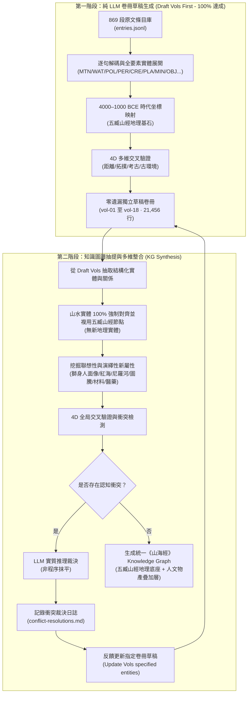

# 《山海經》全書時代語義對應主操作手冊 (SHJ Era Mapping Runbook)

## 一、項目最高公理與指導原則 (Core Axioms)

### 1. 【無新地理內容公理】(Zero-New-Geography Axiom for Books 6–18)
- **《五臧山經》（卷一至五）是全書唯一的底層客觀地理空間坐標網**：
  - 確立了全書唯一的走向方位、巡行里數（1里 ≡ 0.400公里）、山系骨架與水網閉環。
- **卷六至卷十八純屬人文與物產，絕對沒有新的地理內容**：
  - 卷六至卷十八所記載的全部內容，純粹是**人文、邦國、神祇、先賢帝陵、特產風物、動物、植物、器物與科技發明**。
- **山水實體 100% 複用五臧山經**：
  - 卷六至卷十八提到的所有山、水、澤、海實體（如崑崙、不周、凶桑、衡山、巫山、幽都、方丈、蓬萊、羽山、首陽、赤水、黑水、弱水、江水、河水、洋水、東海、西海、南海、北海等），**一定在《五臧山經》中找到對應，並且強制 100% 複用《五臧山經》已確定的地理坐標與實體節點**！
  - 絕不允許在知識圖譜或地圖中為後續卷建立漂移獨立的重複地理節點。
- **地圖表現法則**：
  - 在地圖表現上，是把卷六至卷十八的人文和物產，**直接添加到《五臧山經》已確立的地圖之上**：根據描述的五臧山經地理位置，補充人文與物產標註圖層。

### 2. 【徹底拋棄後世注釋·文字出發原則】(Discard Post-Han Commentary, Text-First)
- **徹底拋棄漢代郭璞注、清代經學及近現代一切將《山海經》無限微縮、牽強附會於一省一隅的後世注釋與解讀**！
- **嚴格、純粹從《山海經》原始經文字面出發**，以全球尺度客觀實證：
  - **崑崙之丘**：《大荒西經》的崑崙之丘與《西山經》完全一致，**嚴格對應於埃及開羅吉薩高地金字塔群**（30.0°N, 31.2°E），實惟帝之下都，高萬仞，面有九門。
  - **地中海與非洲板塊**：自中原一路向西，《西次三經》自帕米爾天門向西橫貫西亞兩河，進入地中海、埃及與北非板塊。
  - **赤水 ≡ 紅海 (Red Sea)**：環繞崑崙、西南流入南海之赤水，即紅海（古因紅藻呈現赤色，水深赤）。
  - **黑水 ≡ 尼羅河 (Nile River)**：自崑崙流出西南入海之黑水，即古埃及尼羅河（古埃及名 *Aur*，意為黑河/黑水，因每年定期氾濫沉積厚重肥沃黑淤泥得名）。
  - **神陸吾 ≡ 獅身人面像 (The Great Sphinx of Giza)**：《西山經》「西南四百里，曰崑崙之丘，神陸吾司之。其神狀虎身而九尾，人面而虎爪，是神也，司天之九部及帝之囿時」，即守護吉薩法老陵墓帝之下都的巨型獅身人面像（古人以虎代獅，人面虎身虎爪）。
  - **不周之山**：帕米爾高原天門／地中海亞洲地質斷裂帶。
  - **崦嵫之山**：摩洛哥大西洋日落之門（日之所入）。
  - **湯谷扶桑**：北美中美洲日出觀測大洋軸。
  - **章尾山燭龍**：北極圈極晝極夜極光圈。

---

## 二、兩階段標準流水線 (Two-Phase Standard Pipeline)

---

## 三、知識圖譜實體抽取與複用鐵律 (Phase 2 Extraction Rules)

1. **地理實體唯一性**：
   - 所有 `MTN`（山）、`WAT`（水）實體，ID 嚴格以《五臧山經》首發定義為準。
   - 卷六至十八出現的山水，屬性中標註 `reused_from_shanjing: true`，直接繼承五臧山經坐標，關聯邊為 `located_in` 或 `same_entity_as`。
2. **人文與物產實體豐富性**：
   - 卷六至十八的核心貢獻是：`POL`（邦國）、`PER`（神祇/先祖/帝陵）、`CRE`（異獸神禽）、`PLA`（靈木異草）、`OBJ`（科技發明/禮器）、`AST`（天象曆法）。
   - 所有人文與物產實體，均通過 `anchored_to` 邊精確綁定於對應的五臧山經山水節點之上。
3. **地圖表現**：
   - 地圖渲染引擎在已有五臧山經高精度水陸底圖上，以人文徽章、神明圖標與風物標籤進行分層渲染。
