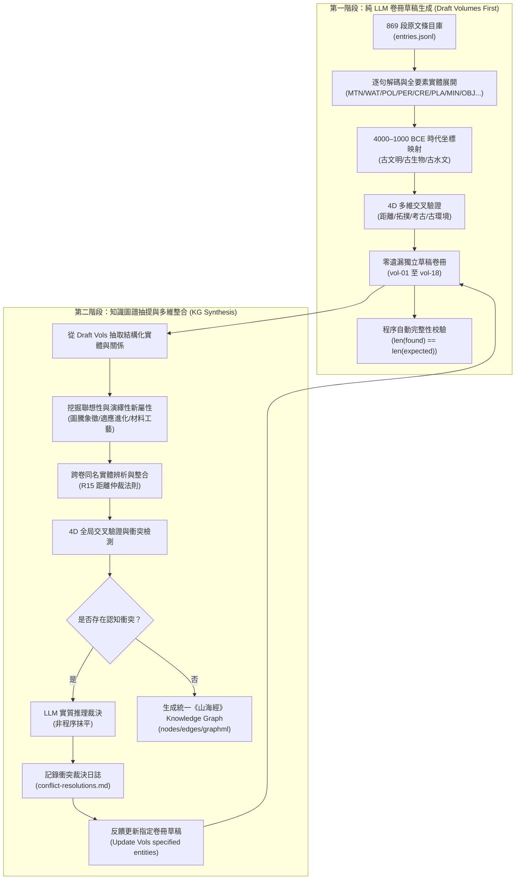

# 《山海經》全書時代語義對應主操作手冊 (SHJ Era Mapping Runbook)

## 一、設定與研究邊界 (Initiator Settings, 2026-10-20)
1. **時代範圍**：公元前 4000 年–公元前 1000 年（仰韶至殷商晚期大暖期與青銅時代）。
2. **觀察視角**：以中原（河南洛陽/鄭州 34.7°N, 113.6°E）為天下幾何中心（「中」），向全球歐亞、北非、美洲、北極四向輻射。
3. **文本第一**：只用原文正文（明成化本標準字底），不依賴後世注疏與先入為主的學術定論。
4. **名稱語義獨立**：古名絕不預設今名，名稱為語義與音韻符號，不作現代地圖生硬附會。
5. **純 LLM 推理**：**絕對不使用 Python 代碼批量生成草稿文本或偽造推論！正文與論證完全依靠 LLM 深度演繹**。
6. **圖層架構與五臧山經坐標校準**：
   - 《五臧山經》（卷一至五）描述客觀地理相對位置、走向、里數與水網閉環，是全書唯一的底層地理空間坐標網。
   - 後續各卷（卷六至十八）描述邦國、神人、帝陵、特產風物與天文神話，本質是標註、疊加、補充於《五臧山經》地圖之上的人文地貌。
   - 後續各卷實體的空間定位與推演，必須嚴格以《五臧山經》確立的空間坐標網作為唯一校準基準。

---

## 二、兩階段標準流水線 (Two-Phase Standard Pipeline)



---

## 三、第一階段：草稿編寫規範 (Phase 1 Drafting Rules)

### 1. 條目格式規範（每一段原文必須完全獨立）
```markdown
### 【SHJ-XX-X-XXX】實體規範名稱（段落主題核心）

#### 1. 段落序號與原文
> **【經文原文】**  
> 完整原文，無刪節無錯漏。

#### 2. 全要素逐句實體展開（零遺漏剖析）
* **【句一】「...」**
  - 解構所有實體（MTN、WAT、LND、POL、PER、CRE、PLA、MIN、OBJ、AST、CLIM）。
* **【句二】「...」**
  - 解構次句實體。

#### 3. 實體時代映射（公元前 4000–前 1000 年）
| 實體編碼 | 原文名稱 | 實體屬性 | 時代地理坐標（4000–1000 BCE） | 考古/古生物映射分類 | 時代存續狀態 |
|---|---|---|---|---|---|
| ... | ... | ... | ... | ... | ... |

#### 4. 4D交叉驗證與多維邏輯推理
* **【距離/拓撲/考古/古生物/古環境多維論證】**：
  - 詳盡論證，符合邏輯，嚴禁套話。
```

### 2. 絕對不偷懶清單
- **嚴禁合併**：絕不可將相鄰山水合併為一條（如 `【SHJ-05-4-002】至【SHJ-05-4-008】` 是嚴重違規，必須逐條拆開）。
- **嚴禁省字**：每條原文的所有動植物、礦物、神人必須全部解構，不得寫「餘同前」。
- **代碼僅用於校驗**：Python 代碼僅允許用於檢查 `len(found) == len(expected)`，絕不能用來生成解讀文字。

---

## 四、第二階段：知識圖譜與衝突裁決 (Phase 2 KG & Conflict Handling)

### 1. 實體抽提與新屬性生成
- **聯想性屬性（Associative Properties）**：神話圖騰演變、文化神格、儀式功能。
- **演繹性推理屬性（Deductive Properties）**：材料工程特性、藥用病理機制、生態耐受度。

### 2. 知識衝突的 LLM 裁決機制
- 跨卷交叉驗證發現的尺度矛盾、水系相悖或名物衝突：
  - **嚴格由 LLM 承擔實質性推理裁決，嚴禁用程序代碼硬性忽視或過濾**。
  - LLM 裁決後若需修正，精確回寫更新指定卷冊草稿條目。
  - 全過程寫入 `findings/conflict-resolutions.md` 日誌。
