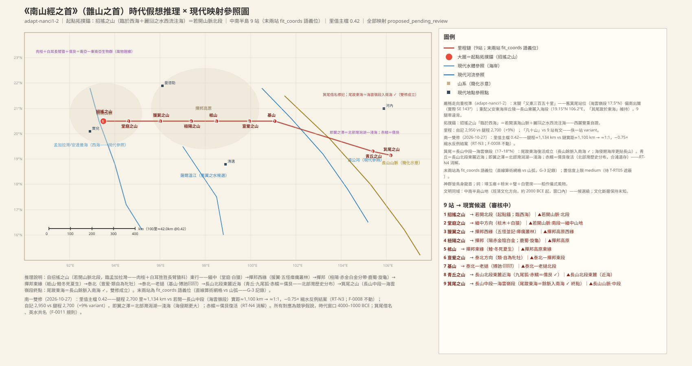
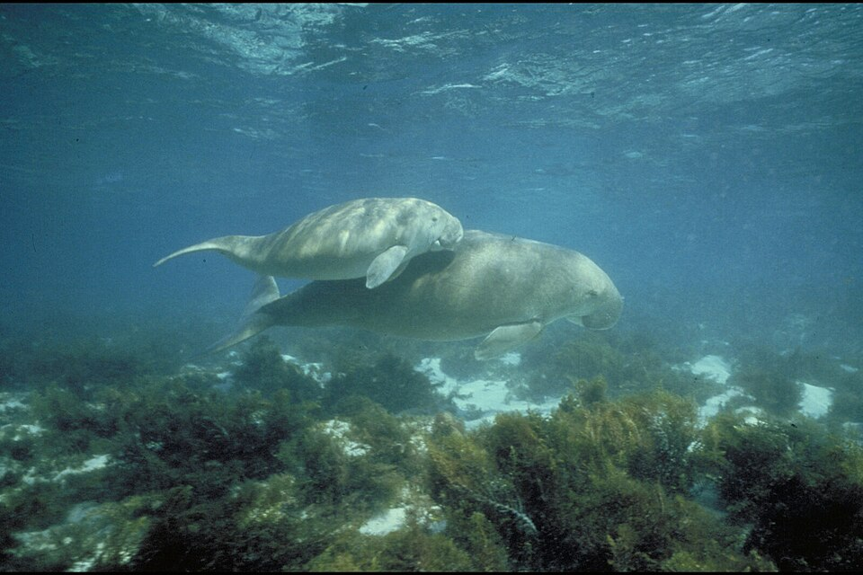
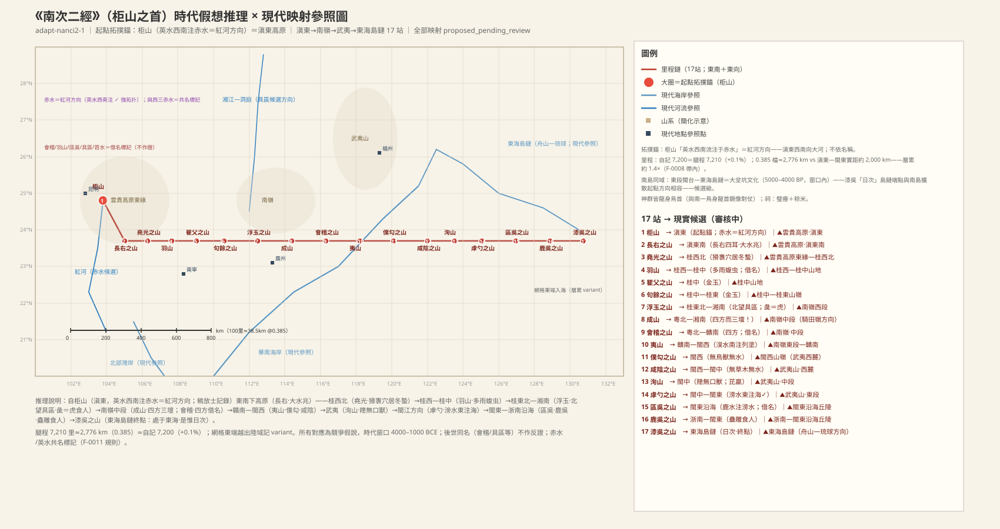
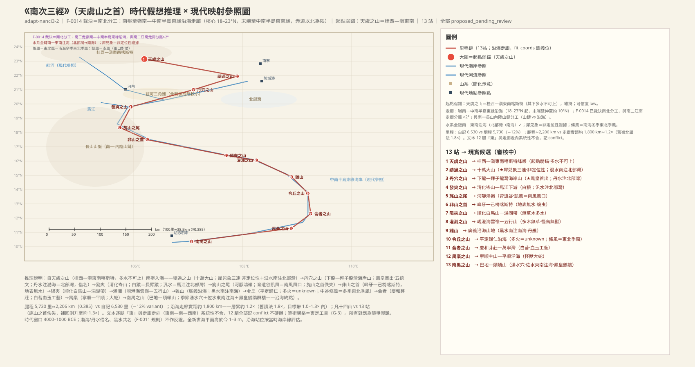

# 《南山經》白话通顺版（draft-v2）

## 本卷导览

《南山經》是《五藏山經》开篇之卷，分三列山系（南次一、二、三），共记 40 座山（有文字记录的 39 站，另有一站文字失传），自报总里程一万六千三百八十里。按我们的整体解读，这一卷走的是「南方热带走廊」：

- **南次一**（䧿山系，10 站）从西边的滨海山地起步，一路向东横穿中南半岛——起点招搖之山我们判断在若开山脉北段（缅甸—印度边境方向），终点箕尾之山在**长山山脉中段—海云岭段（17–18°N）**；「山尾直插南海（尾踆于东海）」此前一度降级存疑，2026-10-27 双修复核后**恢复为成立**——海云岭正是长山山脉贴海伸入南海之处（山脉余脉入海），窗口期海平面高于今一至三米、海岸线更贴长山，这一记录比今天看起来更贴切。全程自报 2,950 里、逐段相加 2,700 里，相差约 9%；里值取 0.42 档（本链主档，三档仍并列），逐段里程约合 1,134 公里，对若开—长山中段实距约 1,100 公里，**≈1:1**——此前的「缩水 −0.75 倍」反例就此结案：消解机制是「里值档＋终点」双修（旧账按 0.385 档对长山南端实距 1,300–1,500 公里），两头修正共同吸收了缺口，「累传只能放大」的原则与 F-0008「逐段里程可信」均不动摇。
- **南次二**（柜山系，17 站）按 F-0014 裁决（南北分工）从岭南**北移至江南走廊—东海岛链（约 26–30°N）**：起点柜山定在罗霄山脉中段（湘赣边界方向），向东经赣南—武夷山—皖浙赣边界，至浮玉之山＝**天目山**北望太湖（「具区＝太湖」经 F-0015 裁决成立——2026-10-28 依据重构：定位由拓扑承载——「北望具区」＋苕水「出阴北流注具区」要求一座北有巨大湖泽、发源北流河入湖的山，浙西—皖南山地北望长三角大湖是唯一解；《尔雅》《周礼》为周代文献层，降为名称流变注记不作定位证据；苕水＝西苕溪北注太湖）、会稽之山＝**浙东丘陵—绍兴方向**（拓扑支撑——名称依据撤出，见会稽节），再沿浙东山地—瓯江水系（滂水＝瓯江、鹿水＝楠溪江）东行，终点漆吳之山是东海岛链上的一座岛屿（舟山—琉球方向待裁），记录到「太阳在这里升起落下」的日出观测点。自报 7,200 里、逐段相加 7,210 里，**几乎严丝合缝（误差 0.1%）**；逐段里程换算约 2,776 公里（0.385 档），按 1.5–2 倍累传放大落在有效实距约 1,200–1,500 公里内（累传只放大、不解释缩水）。与南次三的十二对站点覆盖冲突已由「南北分工」裁决解除——两链南北分开超过两个纬度，神群（龙身鸟首 vs 龙身人面）分属不同祭祀文化圈互证；三链并列：南次一 ≈1:1（0.42 档，双修后结案）／南次二 +1.5–2 倍／南次三 约 +1.5 倍。正式结案前全链定位仍封顶为「较可靠」。
- **南次三**（天虞山系，13+1 站）从桂西—滇东南出发，2026-10-27 经方位原文核验后**再次重配（v3）**：上一版「越南沿海走廊」因文本 12 段里程全记作「东」、而越南沿海实际走向为东南—南—西南（实测 122–229°）系统性不合，已否决、全部站点降为对立候选存册；现行读法改为**岭南—闽粤沿海东行链**——向东沿北部湾北岸—雷州—珠江口—粤东—闽南（22–24.5°N），终点南禺之山配闽粤界沿海（饶平—诏安方向），佐水东南注海，有季节性涌泉洞穴和凤凰栖集的祥瑞收尾。**方位核验全合：12 段「东」与走廊实测方位角 61–112° 全部相容（东±30° 带内）**；水系全链成立——泿水/丹水/汎水南注北部湾（「渤海」借名字面成立）、黑水＝黄江方向南注红海湾、佐水东南注柘林湾。自报 6,530 里、逐段相加 5,730 里，差约 12%；逐段里程换算约 2,206 公里，对岭南—闽粤沿海实距（约 1,300–1,500 公里）放大约 1.5 倍（层累放大带内；三档并列：0.35→2,006／0.385→2,206／0.42→2,407 公里），失传的「旄山之首」若补回倍率升至约 1.6–1.7 倍；尾段三段腿长局部放大（3.1–4.8 倍）已登记冲突。三链并列：南次一 ≈1:1（0.42 档，双修后结案）／南次二 +1.5–2 倍／南次三 约 +1.5 倍。与南次二（江南走廊 28–30°N）南北分开超过两个纬度，F-0014 南北分工不被破坏；与南次一不同域，无覆盖冲突。

本卷最受关注的证据是**生物群记录**：禱過之山「多犀、兕，多象」的热带动物三连、招搖之山能直立行走的狌狌（长臂猿科方向）、青丘之山的「人面鱼」——这些动物在四千至一千年前的岭南—东南亚窗口期都真实存在。但经红队审查后需说明：犀象在当时的分布带宽达数千公里，属**非定位性证据**（只能排除不可能区，不能把站点钉到具体位置）；狌狌的「白耳」与具体长臂猿物种对应勉强（白掌长臂猿白在手、白颊长臂猿白在颊），已降为科级泛化；「人面鱼＝儒艮」则随南次一双修**复活**：青丘之山重定于长山北段东麓近海带、即翼之泽落实为北部湾潟湖—浅海（全新世海侵期潟湖比今大），儒艮「只栖浅海」的约束由冲突转为支持——北部湾本就有儒艮历史分布，今广西合浦儒艮保护区即其遗存。

**主要未决**：本卷未决项 16 条，集中在奇兽确指（鯥、类、猾褢、䍺、虎蛟等）、水系确指（流黄、赤水、育遗等）和几处特殊记录（成山「三坛」、令丘「多火」、漆吴「日次」）的读法，逐条保留在各条目之下。

> 凡例：置信度用口语标——**很可靠 / 较可靠 / 方向性猜测 / 待考**。实体节点编号（如 `CRE:…#2`）附在相关句末备查。配图均为 Wikimedia Commons 真实照片，仅配高置信/已确认对象。

---

## 南山经·首（南次一，䧿山系：若开山脉→长山山脉）

### 招摇之山——全经起点，西临大海的肉桂之乡

> **【原文】**
> 南山經之首曰䧿山。其首曰招搖之山，臨於西海之上，多桂，多金玉。有草焉，其狀如韭而青華，其名曰祝餘，食之不饑。有木焉，其狀如榖而黑理，其華四照，其名曰迷穀，佩之不迷。有獸焉，其狀如禺而白耳，伏行人走，其名曰狌狌，食之善走。麗𪊨之水出焉，而西流注於海，其中多育沛，佩之無瘕疾。

**白话解读**

这是整个《南山经》的第一站：䧿山山系之首，叫招摇之山，直接俯临西边的大海（`MTN:SHJ-01-1-001#1` `MTN:SHJ-01-1-001#2` `WAT:…#1`）。我们判断它在**若开山脉北段（缅甸—印度边境方向）**——这是全经的拓扑锚点：一座滨海山脉、山里的河向西流入海（丽𪊨之水西流注于海，正合若开山脉西麓面朝孟加拉湾的格局，`WAT:…#2` `WAT:…#3`），两个条件同时满足；但它是**未确认锚点**，定位只作**方向性猜测**（本链里程「缩水」反例已随双修结案，见导览）。

风物也对得上：山上「多桂」，肉桂正是南亚—东南亚一带的特产（`PLA:…#1`）；还有金矿、玉矿。两种带神异功效的植物——祝余（像韭菜开青花，吃了不饿，`PLA:…#3`）和迷榖（像构树、黑纹理、花能四照，佩戴不迷路，`PLA:…#5`）——是「充饥」「防迷路」的民间赋义记录。最亮眼的是狌狌：像猴、既能趴着走又能直立行走——这正是**长臂猿科**动物的写照，东南亚特有灵长类；不过「白耳」一语与具体物种对应勉强（白掌长臂猿白在手、白颊长臂猿白在颊），故物种判断只到科级，**较可靠**而非定种（`CRE:…#2`）。水里的「育沛」是某种可佩戴防肿的珠玉类矿物（`MIN:…#3`，待考）。「䧿山」本身是这列山系的总名（方向性猜测）。

（图：Wikimedia Commons）

### 堂庭之山——白猿与黄金之地

> **【原文】**
> 又東三百里，曰堂庭之山，多棪木，多白猿，多水玉，多黃金。

**白话解读**

向东三百里到堂庭之山。山上多棪木（一种野果树），多白猿——又是**白眉长臂猿**一路的证据（`CRE:…#1`）；还产水玉和黄金。位置我们判断在**若开山脉南段至缅甸中部山地**，继续沿山系东行（`MTN:SHJ-01-1-002#1`），较可靠。

### 猨翼之山——上不去的瘴疠丛林

> **【原文】**
> 又東三百八十里，曰猨翼之山，其中多怪獸，水多怪魚，多白玉，多腹虫，多怪蛇，多怪木，不可以上。

**白话解读**

再向东三百八十里到猨翼之山。这里连用五个「怪」——怪兽、怪鱼、腹虫、怪蛇、怪木，加上「不可以上」，分明是**热带季雨林虫兽密集、瘴气弥漫、人迹难登**的记录；同时产白玉（`MIN:…#1`）。位置判断在**掸邦高原西缘**（缅甸掸邦方向），较可靠（`MTN:SHJ-01-1-003#1` `WAT:…#1` `CRE:…#1–4` `PLA:…#1`）。

**未决项**
- 未知：猨翼之山——腹虫確指

### 杻阳之山——双色金属带与鹿蜀、旋龟

> **【原文】**
> 又東三百七十里，曰杻陽之山，其陽多赤金，其陰多白金。有獸焉，其狀如馬而白首，其文如虎而赤尾，其音如謠，其名曰鹿蜀，佩之宜子孫。怪水出焉，而東流注於憲翼之水。其中多玄龜，其狀如龜而鳥首虺尾，其名曰旋龜，其音如判木，佩之不聾，可以為底。

**白话解读**

向东三百七十里到杻阳之山。山南坡多赤金、北坡多白金——一次「双色金属分带」的矿产记录（`MIN:…#1` `MIN:…#2`）。山里的鹿蜀像马、白头、虎纹、红尾巴、叫声如歌，是某种斑纹兽的夸张描述，民间说佩戴它的皮有利子孙（`CRE:…#3`）。怪水从这里发源向东注入宪翼之水，方向大致指向**萨尔温江水系**（方向性猜测，`WAT:…#1` `WAT:…#2`）。水里的旋龟鸟头蛇尾、叫声像劈木头，说是佩戴可治耳聋——龟鳖类的神异化记录（`CRE:…#4`）。位置在**掸邦高原山地**，较可靠（`MTN:SHJ-01-1-004#1`）。

### 柢山——「冬死夏生」的怪鱼鯥

> **【原文】**
> 又東三百里柢山，多水，無草木。有魚焉，其狀如牛，陵居，蛇尾有翼，其羽在魼下，其音如留牛，其名曰鯥，冬死而夏生，食之無腫疾。

**白话解读**

向东三百里到柢山（「柢山」前少一个「曰」字，是传抄异文）。此山多水、寸草不生。水里的鯥：体形如牛、住在水陆之间（「陵居」）、蛇尾带翼、叫声像牛，最关键的一句是「**冬死而夏生**」——冬天蛰伏、夏天活跃，这是季风区旱季蛰伏动物的生态观察（冬眠鱼或两栖类的泛化），作为生物证据**较可靠**（`CRE:…#5`）。位置在**掸邦高原东缘**，较可靠（`MTN:SHJ-01-1-005#1` `LND:…#1` `WAT:…#1`）。

**未决项**
- 未知：柢山——鯥確指（肺魚/鰻鱺類候選）

### 亶爰之山——「自为牝牡」的灵猫

> **【原文】**
> 又東四百里，曰亶爰之山，多水，無草木，不可以上。有獸焉，其狀如狸而有髦，其名曰類，自為牝牡，食者不妬。

**白话解读**

向东四百里到亶爰之山，又是多水无草木、「不可以上」的湿瘴之地。山里的「类」像狸猫、长着鬃毛，最特别的是「**自为牝牡**」（雌雄同体）——这很可能是对**灵猫类**的误读：灵猫的香腺外形容易让古人以为它雌雄同体（`CRE:…#2`）。民间附会说吃了它的人不嫉妒。位置在**泰北—掸邦东段（清迈方向）**，较可靠（`MTN:SHJ-01-1-006#1` `WAT:…#1`）。

**未决项**
- 未知：亶爰之山——類確指

### 基山——九尾四耳的猼訑与三头怪鸟

> **【原文】**
> 又東三百里，曰基山，其陽多玉，其陰多怪木。有獸焉，其狀如羊，九尾四耳，其目在背，其名曰猼訑，佩之不畏。有鳥焉，其狀如雞而三首六目、六足三翼，其名曰𪁺𩿧，食之無臥。

**白话解读**

向东三百里到基山：南坡产玉，北坡多怪木（`MIN:…#1` `PLA:…#1`）。这一站的两只动物都是神话层记录：猼訑像羊、九条尾巴四只耳朵、眼睛长在背上——「多目」母题，民间说佩戴可以壮胆（`CRE:…#2`）；𪁺𩿧像鸡却三头六目六足三翼，吃了让人睡不着（`CRE:…#4`）。位置在**泰北—老挝北段**，方向性猜测（`MTN:SHJ-01-1-007#1`）。

### 青丘之山——九尾狐的故乡与人面鱼

> **【原文】**
> 又東三百里，曰青丘之山，其陽多玉，其陰多青雘。有獸焉，其狀如狐而九尾，其音如嬰兒，能食人；食者不蠱。有鳥焉，其狀如鳩，其音若呵，名曰灌灌，佩之不惑。英水出焉，南流注于即翼之澤。其中多赤鱬，其狀如魚而人面，其音如鴛鴦，食之不疥。

**白话解读**

向东三百里到青丘之山——**青丘是全书最著名的神话地名之一**，这里是它的首次出场。山南产玉，山北产青雘（青色颜料矿）。两只神异动物：九尾狐，像狐九尾、叫声像婴儿、能吃人——后世九尾狐传说的源头（`CRE:…#3`）；灌灌鸟像鸠，佩戴可使人不迷惑（`CRE:…#4`）。

英水从这里发源向南注入即翼之泽（注意：这条「英水」与南次二柜山的英水同名——按 ADJ-005 裁决，**水名是性状类名，两地同名各立，不算冲突**）。**即翼之泽＝北部湾的潟湖—浅海**（全新世海侵期海平面高于今一至三米，北部湾潟湖比今天大得多）。泽里的赤鱬「鱼身人面、叫声像鸳鸯」——人面鱼，即**儒艮**（海牛目，正是「美人鱼」传说的原型）：这一读法此前因「青丘候选在老挝内陆、儒艮只栖浅海」的硬冲突被降为待考；2026-10-27 南次一双修后**复活**——青丘本来就在长山山脉北段的东麓近海带（并非深内陆），即翼之泽正是浅海潟湖，而北部湾本有儒艮历史分布（今广西合浦儒艮保护区即其遗存），「人面」正是对儒艮面部轮廓的泛化描述；与大鲵类、神话层读法并列在册，置信度升为方向性猜测（`CRE:…#6` `WAT:…#1` `WAT:…#2`）。位置在**长山山脉北段东麓近海（清化—乂安方向）**，方向性猜测（`MTN:SHJ-01-1-008#1`）。

（图：Wikimedia Commons）

### 箕尾之山——全经终点（「尾踆于东海」成立）

> **【原文】**
> 又東三百五十里，曰箕尾之山，其尾踆於東海，多沙石。汸水出焉，而南流注於淯，其中多白玉。

**白话解读**

向东三百五十里到箕尾之山，**南次一的终点站**。「其尾踆于东海」——山的尾巴坐进东边的大海：此说此前被降为存疑变体，2026-10-27 双修复核后**恢复为成立**——箕尾定在**长山山脉中段—海云岭段（17–18°N）**，海云岭正是长山山脉贴海伸入南海之处，「山脉余脉入海」直接成立；窗口期海平面高于今一至三米、海岸线更贴长山，这一记录当时更显贴切（`MTN:SHJ-01-1-009#1` `WAT:…#1`）。这里写的「东海」实为南海方向（水名/海名属类名，按 ADJ-005 口径各卷自立，待校——2026-10-28 名称层位审查补注：夏商成书前提下「东海」名称层的类名判定待 textual-critic 补论证；南海读法只依方位/水系性状成立，不依名称匹配）。山上多沙石；汸水发源南流注入淯水（长山中段南流河，河静—广平方向候选），水中多白玉（`WAT:…#2` `WAT:…#3` `MIN:…#2`）。「箕尾」之名与**中次四经**（SHJ-05-4-004）的箕尾同名（此前误引为「中次二经」，已更正）——同名异实，属借名标记，不作证据。位置在**长山山脉中段—海云岭段**，方向性猜测。

**未决项**
- 未知：箕尾之山——淯水確指

### 南次一总结段——鸟身龙首的神与糯米祭

> **【原文】**
> 凡䧿山之首，自招搖之山，以至箕尾之山，凡十山，二千九百五十里。其神狀皆鳥身而龍首，其祠之禮毛：用一璋玉瘞，糈用稌米，一璧，稻米、白菅為席。

**白话解读**

小结：䧿山系从招摇之山到箕尾之山，号称十座山、二千九百五十里。实际只有 9 站有文字——**失传了一站**；自报里程比逐段相加（2,700 里）多约 9%，属传抄误差。**里程总账（2026-10-27 双修）：里值取 0.42 档，逐段里程约合 1,134 公里，对若开—长山中段（海云岭段）实距约 1,100 公里，≈1:1**——此前的「缩水 −0.75 倍」反例就此结案（消解机制：里值档 0.385→0.42 ＋ 终点自长山南端收回中段，两头修正共同吸收缺口；F-0008「逐段里程可信」不动并获支持）；失传的一站若补回，总账由 1:1 推向约 1.1–1.2 倍的轻度放大，与累传方向一致。这一系的山神都是**鸟身龙首**；祭祀用玉：埋一块璋玉、一块璧，祭米用稌米（糯米）、稻米，以白菅草编席——禮制層記錄（祠牲句已裁決為編纂層格式化語言，雙向不作定位證據，R1；`PER:SHJ-01-1-010#1` `OBJ:…#1–4` `PLA:…#1–3`）。

---

## 南山经·次二（南次二，柜山系：江南走廊→东海岛链）

### 柜山——西南向红色水体的起航点（罗霄山）

> **【原文】**
> 《南次二經》之首，曰柜山，西臨流黃，北望諸毗，東望長右。英水出焉，西南流注于赤水，其中多白玉，多丹粟。有獸焉，其狀如豚，有距，其音如狗吠，其名曰貍力，見則其縣多土功。有鳥焉，其狀如鴟而人手。其音如痺，其名曰鴸，名自號也，見則其縣多放放士。

**白话解读**

南次二的首站柜山——按已裁决的「南北分工」方案，整条南次二从岭南**北移到江南走廊（约 26–30°N）**，柜山重定在**罗霄山脉中段（湘赣边界、井冈山—八面山方向）**。三个方位地标：西边俯临「流黄」（待考），北边望见诸毗，东边望见长右（`LND:…#1` `MTN:…#2` `MTN:…#3`）。英水从山里发源，**向西南注入赤水**——按 ADJ-005 裁决，「赤水」是「水色发红」的性状类名：罗霄山南麓的西南向溪流（沤江方向候选）正好注入湘南郴州的**丹霞红层水系**（耒水—便江方向，红岩绿水）（`WAT:…#1` `WAT:…#2`）。此前把赤水指为红河的读法早已撤销（靠名字联想，违反共名规则）；字面更近的红水河读法会把起点拽回岭南、与本裁决冲突，仅削弱保留在册。水里多白玉、多丹粟（丹砂）——辰砂主产带（湘西沅陵—辰州）就在候选带西缘，是支持起点带西移的弱证据（`MIN:…#1` `MIN:…#2`）。

两只带「兆象」的动物：貍力像小猪、脚上有距、叫声像狗，它出现的地方就会大动土木工程（`CRE:…#2`）；鴸像猫头鹰却长着人手，它出现的地方就多被流放的士人——一条难得的**人文记录**（流放者人群，`PER:…#1` `CRE:…#4`）。位置在**罗霄山脉中段**，方向性猜测（`MTN:SHJ-01-2-001#1`）——柜山起点带内的精确选点（罗霄山 vs 雪峰山—武陵山）仍待裁。

**未决项**
- 未知：柜山——流黃確指；赤水確指

### 长右之山——发大水的四耳猿

> **【原文】**
> 東南四百五十里曰長右之山，無草木，多水。有獸焉，其狀如禺而四耳，其名長右，其音如吟，見則郡縣大水。

**白话解读**

向东南四百五十里到长右之山——这是全链唯一一段「东南」向的里程，对应从罗霄山下入赣南。山无草木而多水（赣江流域洪泛区）。山里有一种与山同名的兽「长右」：像猴、四只耳朵、叫声如吟，它出现则郡县发大水（洪水兆象——「四耳」可解为耳簇夸饰，**南方猕猴方向**的泛化记录，`CRE:…#2` `CLIM:…#1`）。位置在**赣南山地（雩山北段—赣州北方向）**，方向性猜测（`MTN:SHJ-01-2-002#1` `WAT:…#1`）。

### 尧光之山——穴居冬眠的猾褢

> **【原文】**
> 又東三百四十里，曰堯光之山，其陽多玉，其陰多金。有獸焉，其狀如人而彘鬛，穴居而冬蟄，其名曰猾褢，其音如斲木，見則縣有大繇。

**白话解读**

向东三百四十里到尧光之山，南坡产玉、北坡产金（`MIN:…#1` `MIN:…#2`）。猾褢：像人、长猪鬃一样的鬣毛、**住洞穴、冬天蛰伏**——穴居冬眠兽，最像熊类（华南黑熊在窗口期的江南丘陵确有分布），方向性猜测（`CRE:…#2`）。它出现则县里有大徭役（`POL:…#1`）。位置在**赣东—武夷山脉西麓（黎川—资溪方向）**，方向性猜测（`MTN:SHJ-01-2-003#1`）。「尧光」属借名标记，不作证据。

**未决项**
- 未知：堯光之山——猾褢確指

### 羽山——瘴雨毒蛇之地

> **【原文】**
> 又東三百五十里，曰羽山，其下多水，其上多雨，無草木，多蝮虫。

**白话解读**

向东三百五十里到羽山：山脚下多水、山顶上多雨、无草木、多蝮蛇——一幅江南多雨带的速写，与武夷山脉中段（东南季风迎风坡）相容（`WAT:…#1` `CLIM:…#1` `CRE:…#1`）。「羽山」之名与传说中鲧被殛的羽山（在苏鲁边界）同名，属借名标记，不作证据。位置在**武夷山脉中段（资溪—光泽方向）**，方向性猜测（`MTN:SHJ-01-2-004#1`）。

### 瞿父之山——金玉之山

> **【原文】**
> 又東三百七十里，曰瞿父之山，無草木，多金玉。

**白话解读**

向东三百七十里到瞿父之山，无草木、多金玉——一句简短的矿产记录；赣东北正是有色金属带（德兴金铜矿带方向，弱证据，`MIN:…#1` `MIN:…#2`）。位置在**赣东北—怀玉山方向**，方向性猜测（`MTN:SHJ-01-2-005#1`）。

### 句余之山——又一座金玉之山

> **【原文】**
> 又東四百里，曰句餘之山，無草木，多金玉。

**白话解读**

向东四百里到句余之山，与上一站同样无草木、多金玉（皖南金属矿带方向，弱证据,`MIN:…#1` `MIN:…#2`）。「句余」与浙东古地名句余（余姚）同名，按共名规则仅作记录、不作证据。位置在**皖浙赣边界—白际山—昱岭方向**，方向性猜测（`MTN:SHJ-01-2-006#1`）。

### 浮玉之山——北望太湖（具区），虎踪所在 ★硬锚

> **【原文】**
> 又東五百里，曰浮玉之山，北望具區，東望諸毗。有獸焉，其狀如虎而牛尾，其音如吠犬，其名曰彘，是食人。苕水出于其陰，北流注于具區。其中多鮆魚。

**白话解读**

向东五百里到浮玉之山——本链最关键的锚点站。经专案裁决（F-0015）：「**具区＝太湖**」成立——**定位不靠名称，靠地理拓扑**：「北望具区」＋苕水「出于其阴、北流注于具区」要求一座**北面有巨大湖泽、且发源北流河注入该湖**的山——浙西—皖南山地北望长三角大湖、诸溪北流入湖是唯一解：「北望具区」＝**天目山北望太湖**（天目山主峰一带北距太湖岸约八十公里，高点北望可及），苕水＝**西苕溪出天目山北麓、北流注入太湖**——山阴、北流、入湖三项逐条吻合（`MTN:SHJ-01-2-007#1` `WAT:…#1` `WAT:…#2`）。风物与人文同样指向这里：彘是虎形食人兽（江南虎），鮆鱼正是太湖刀鲚（湖鲜）；窗口期太湖流域正是**良渚文化圈**（3300–2300 BCE，在成书窗口内）——一站之隔的成山「四方而三坛」人工台地与之同域。《尔雅·释地》「吴越之间有具区」、《周礼·职方氏》扬州「其泽薮曰具区」属**周代文献层，晚于夏商成书层——只证明具区之名在周代已系于太湖，是名称流变记录，不作定位证据**（2026-10-28 依据重构，项目指示：成书夏商，地理人文风物第一优先级）。旧的「洞庭方向」读法已被否决存册：山若在 23.7°N，「北望」六百公里外的洞庭超出任何合理的「望」，「北望大泽＋北流入湖」的拓扑在洞庭读法下无解。要注意时代差异：窗口期（4000–1000 BCE）的太湖正从海侵潟湖淡化成湖，岸线与面积都和今天不同。

山里的「彘」像虎、牛尾、叫声如狗吠、吃人——注意这里的「彘」不是家猪，而是对猛兽的称呼，所指就是**虎**（江南虎/华南虎，窗口期江南丘陵有虎），物种方向**较可靠**（`CRE:…#3`）。水中多鮆鱼（**太湖刀鲚**——太湖—长江口的河口湖鲜，`CRE:…#5`）。位置在**天目山（浙西临安）**，**较可靠**（`MTN:SHJ-01-2-007#1`）——它是拓扑与风物钉住的硬锚：北望大泽、山阴北流河入湖的唯一解，加上江南虎与太湖刀鲚的性状互证、良渚文化圈的人文同域，名称本身不作证据。（2026-10-28 名称层位审查结案：浮玉「北望具区」与苕水「注具区」的定位全由拓扑承载，F-0015 复核结案——「专名簇共时证据」框架不再依赖，其「共时」参照系随夏商成书前提前移后不成立。）

**未决项**
- 未知：浮玉之山——諸毗確指（跨站望點三角待裁）

### 成山——方方正正的三级台地山

> **【原文】**
> 又東五百里，曰成山，四方而三壇，其上多金玉，其下多青雘。𨴯水出焉，而南流注于虖勺，其中多黃金。

**白话解读**

向东五百里到成山。「**四方而三坛**」——山体方方正正、分三级台地：一个引人注目的候选是**良渚莫角山式的方形人工台地**（人工堆筑、上有台基；良渚文化 3300–2300 BCE，正在成书窗口内）——若成立，这是全书罕见的「人造地形」记录（遗址与造物类）；天然方山的读法并列，待裁（`MTN:SHJ-01-2-008#1`）。山上多金玉、山下多青雘；𨴯水发源南流注入虖勺（钱塘江—杭州湾方向候选；窗口期杭州湾海侵深入、长三角还在成陆过程中，岸线与今不同），水里多黄金（`MIN:…#1–4` `WAT:…#1` `WAT:…#2`）。位置在**杭州湾北岸—良渚方向（余杭）**，方向性猜测。

**未决项**
- 未知：成山——「三壇」讀法（人工壇 vs 天然方山）

### 会稽之山——浙东丘陵—绍兴方向（拓扑支撑）

> **【原文】**
> 又東五百里，曰會稽之山，四方，其上多金玉，其下多砆石。勺水出焉，而南流注於湨。

**白话解读**

向东五百里到会稽之山。定位依据已换成**拓扑支撑**（2026-10-28 依据重构）：它在成山（良渚—杭州湾北岸方向）以东、临海方向，落入**浙东丘陵带**；「四方」形山（与成山同式记录——形态学互证），山上金玉、山下砆石（似玉的美石）；勺水发源南流注入湨水（南麓南流溪→剡溪—曹娥江水系方向候选）。绍兴方向作为拓扑相容带保留，但表述为「**浙东丘陵—绍兴方向**」而非名称确指——位置在此方向，**方向性定位、置信中等**（`MTN:SHJ-01-2-009#1` `MIN:…#1–3` `WAT:…#1` `WAT:…#2`）。（2026-10-28 名称层位审查结案：「会稽＝绍兴会稽山」的证据只有春秋—汉成文传统——禹会诸侯于会稽、越都所在——晚于夏商成书层，不满足成书层共时前提，**名称依据撤出**；它降为「反哺嫌疑注记」：越地的「会稽」之名有可能是后世据本经记录反向命名的（反哺方向待裁，与 F-0011 共名记录并存），置信随之由「较可靠」降为中等。）

### 夷山——沙石之山

> **【原文】**
> 又東五百里，曰夷山。無草木，多沙石，湨水出焉，而南流注于列塗。

**白话解读**

向东五百里到夷山，无草木、多沙石。湨水发源向南注入列涂——四明山东南麓的南流溪（凫溪方向候选）南注象山港—宁海湾方向（窗口期浙东海湾比今天深入内陆）。此湨水与上一站勺水注入的「湨」同名，按水名类名原则各立，是否同水待裁。位置在**四明山（浙东）**，方向性猜测（`MTN:SHJ-01-2-010#1` `WAT:…#1` `WAT:…#2` `MIN:…#1`）。

### 仆勾之山——四样皆无的贫瘠山

> **【原文】**
> 又東五百里，曰僕勾之山，其上多金玉，其下多草木，無鳥獸，無水。

**白话解读**

向东五百里到仆勾之山：山上金玉、山下草木尚可，但**无鸟兽、无水**——一条资源贫瘠的否定式记录（`MIN:…#1` `MIN:…#2` `PLA:…#1` `PLA:…#2` `WAT:…#1`）。位置在**天台山方向（浙东）**，方向性猜测（`MTN:SHJ-01-2-011#1`）——「无鸟兽无水」与天台山今日葱郁的面貌不合，这一差异记为待考，不作静默取舍。

### 咸阴之山——背阳的干山

> **【原文】**
> 又東五百里，曰咸陰之山，無草木，無水。

**白话解读**

向东五百里到咸阴之山，无草木、无水。「咸阴」意为全都背阳，是描述性命名。位置在**括苍山方向（浙东南）**，方向性猜测（`MTN:SHJ-01-2-012#1` `WAT:…#1`）。

### 洵山——杀不死的无口兽

> **【原文】**
> 又東四百里，曰洵山，其陽多金，其陰多玉。有獸焉，其狀如羊而無口，不可殺也，其名曰䍺。洵水出焉，而南流注于閼之澤，其中多芘蠃。

**白话解读**

向东四百里到洵山，南坡金、北坡玉（`MIN:…#1` `MIN:…#2`）。山里的䍺像羊却**没有嘴、「不可杀也」**——不吃而存、杀而不死的神异构型，属神话层记录（`CRE:…#2`）。洵水发源南流注入阏之泽，泽中多芘蠃（紫色螺贝类，`CRE:…#3` `WAT:…#1` `WAT:…#2`）。位置在**洞宫山北段（松阳—龙泉方向）**，方向性猜测（`MTN:SHJ-01-2-013#1`）。

**未决项**
- 未知：洵山——䍺「無口」讀法

### 虖勺之山——东流大海的滂水＝瓯江 ★水系硬锚

> **【原文】**
> 又東四百里，曰虖勺之山，其上多梓枏，其下多荊杞。滂水出焉，而東流注于海。

**白话解读**

向东四百里到虖勺之山：山上多梓树楠木、山下多荆条枸杞（楠木正是浙南植被，`PLA:…#1–4`）。滂水发源**向东直接入海**——这与**瓯江**逐条吻合：源出洞宫山—百山祖一带、东流入东海，是浙南最大的东流水系；后面两站的鹿水、泽更之水都南流汇入滂水，构成「三溪汇滂」——瓯江北岸的南流支流群（第一条鹿水正是**楠溪江**），水系拓扑是本链最硬的证据之一（`WAT:…#1` `WAT:…#2`），较可靠。位置在**洞宫山—百山祖（瓯江源区）**，较可靠（`MTN:SHJ-01-2-014#1`）。山名与成山那条受水「虖勺」同名，山水同名互见。

### 区吴之山——滂水的支流源（楠溪江）

> **【原文】**
> 又東五百里，曰區吳之山，無草木，多沙石。鹿水出焉，而南流注于滂水。

**白话解读**

向东五百里到区吴之山，无草木多沙石。鹿水发源南流注入滂水——**楠溪江南流注入瓯江**，是「三溪汇滂」的第一条支流（`WAT:…#1`）。「区吴」是吴地之名的借用，不作证（但「区吴/鹿吴/漆吴」这一串「吴」名与吴越地域的共现，保留为名物密度记录）。位置在**瓯江北岸—括苍山南段（楠溪江源区）**，方向性猜测（`MTN:SHJ-01-2-015#1` `MIN:…#1`）。

### 鹿吴之山——食人的角雕

> **【原文】**
> 又東五百里，曰鹿吳之山，上無草木，多金石。澤更之水出焉，而南流注于滂水。水有獸焉，名曰蠱雕，其狀如雕而有角，其音如嬰兒之音，是食人。

**白话解读**

向东五百里到鹿吴之山，山上无草木、多金石。泽更之水发源南流注入滂水——「三溪汇滂」的第二条支流（瓯江北岸南流溪，确指待考,`WAT:…#1`）。水边的蛊雕：像大雕却长角、叫声像婴儿啼哭、吃人——食人猛禽的神异化记录（大型猛禽/角鸮类泛化，`CRE:…#1`）。位置在**雁荡山方向（浙东南沿海）**，方向性猜测（`MTN:SHJ-01-2-016#1` `MIN:…#1`）。

### 漆吴之山——太阳出没的东海岛屿（终点）

> **【原文】**
> 東五百里，曰漆吳之山，無草木，多博石，無玉。處于東海，望丘山，其光載出載入，是惟日次。

**白话解读**

向东五百里到漆吴之山，**南次二的终点站**。山上无草木、多博石（大石？确指待考）、无玉。关键一句：「处于东海，望丘山，其光载出载入，是惟日次」——这是一座**立在东海中的岛屿**，望见对面的丘山，太阳的光在那里升起、落下，所以叫「日次」（太阳住宿之处）。这是东海岛链尽头的一次**日出方向观测记录**（`MTN:SHJ-01-2-017#1` `WAT:…#1` `MTN:…#2` `AST:…#1`）。终点定位：在 1.5–2 倍累传放大下，全链有效实距约 1,200–1,500 公里，自罗霄山起点向东落在**琉球群岛方向**（主读）；若定在舟山，所需的累传倍率超出容许带，列为对立候选——**舟山—琉球之间待裁**，终点经度随里程档位摆动，不作锚点使用。位置在**东海岛链（琉球方向）**，方向性猜测。

**未决项**
- 未知：漆吳之山——日次讀法；博石確指；終點舟山—琉球待裁

### 南次二总结段——龙身鸟首的神

> **【原文】**
> 凡《南次二經》之首，自柜山至于漆吳之山，凡十七山，七千二百里。其神狀皆龍身而鳥首。其祠：毛用一璧瘞，糈用稌。

**白话解读**

小结：柜山系从柜山到漆吴之山，十七座山、七千二百里——17 站文字齐全，自报里程 7,200 与逐段相加 7,210 几乎完全一致（差 0.1%），**文本完全自洽**。这一系的山神是**龙身鸟首**——与南次一的「鸟身龙首」正好镜像对仗，而与南次三的「龙身人面」分属不同的祭祀文化圈——这与「南北分工」的地理裁决互为人文侧证；祭祀埋一块璧，祭米用稌（糯米）——禮制層記錄（編纂層格式化語言，不作定位證據，R1）（`PER:SHJ-01-2-018#1` `OBJ:…#1` `OBJ:…#2` `PLA:…#1`）。

---

## 南山经·次三（南次三，天虞山系：桂西—滇东南→岭南—闽粤沿海东行链）

### 天虞之山——水乡泽国的起点

> **【原文】**
> 《南次三經》之首，曰天虞之山，其下多水，不可以上。

**白话解读**

南次三的首站天虞之山：山脚下到处是水，根本上不去——一幅山麓水乡/湿地的景象，与桂西喀斯特峰丛洼地的地貌相容（`MTN:SHJ-01-3-001#1` `WAT:…#1`）。位置在**滇东南—桂西（百色—靖西—那坡方向）**，方向性猜测——起点弱锚维持；2026-10-27 经方位原文核验后本链**再次重配（v3）**：上一版「越南沿海走廊」因 12 段「东」与其南行走向系统性不合，已否决、全部站点降为对立候选存册；现改走**岭南—闽粤沿海东行链**（向东沿北部湾北岸—雷州—珠江口—粤东—闽南），与南次二（江南走廊）南北分开。**方位核验全合**：文本十二段里程全记作「东」，新走廊实测方位角 61–112°，全部落在东±30° 带内——下文各站随文标注实测方位角。

### 祷过之山——犀、兕、象的热带动物群

> **【原文】**
> 東五百里，曰禱過之山，其上多金玉，其下多犀、兕，多象。有鳥焉，其狀如鵁，而白首、三足、人面，其名曰瞿如，其鳴自號也。泿水出焉，而南流注于海。其中有虎蛟，其狀魚身而蛇尾，其音如鴛鴦，食者不腫，可以已痔。

**白话解读**

向东五百里到祷过之山（实测方位角 112°＝东偏南，方位合；此段名义约 193 公里 vs 实距约 222 公里，起点段轻微反向，注记）：山上金玉；山下「多犀、兕，多象」——**犀牛、一角兽（兕，独角的泛称）、亚洲象三连**，是教科书级的热带动物群记录。在成书窗口期（约 4000–1000 BCE），犀牛和亚洲象广泛分布于岭南—滇南—中南半岛；但也正因分布带宽达数千公里，经审查这条证据改标为**非定位性证据**——它能排除不可能的候选区，却不能把祷过钉到具体位置（`CRE:…#1` `CRE:…#2` `CRE:…#3`）。

还有一只人面鸟瞿如：像池鹭、白头、三只脚、人脸，叫声就是自己的名字（`CRE:…#5`）。泿水发源**向南流入大海**——本站配**十万大山东段（钦州—上思方向，桂南沿海山脉）**，其南坡诸水（钦江—防城河方向）正南注入北部湾，水系拓扑成立（`WAT:…#1` `WAT:…#2`）。水里的虎蛟鱼身蛇尾、叫声像鸳鸯，是大型水生动物的泛化记录（热带河口鳄类候选），据说吃了不肿、能治痔疮（`CRE:…#8`）。位置在**十万大山东段（桂南沿海山脉方向）**，较可靠（`MTN:SHJ-01-3-002#1`）。

（图：Wikimedia Commons）

（图：Wikimedia Commons）

**未决项**
- 未知：禱過之山——虎蛟確指

### 丹穴之山——凤凰的首次登场

> **【原文】**
> 又東五百里，曰丹穴之山，其上多金玉。丹水出焉，而南流注于渤海。有鳥焉，其狀如雞，五采而文，名曰鳳皇，首文曰德，翼文曰義，背文曰禮，膺文曰仁，腹文曰信。是鳥也，飲食自然，自歌自舞，見則天下安寧。

**白话解读**

向东五百里到丹穴之山（实测方位角 108°＝东偏南，方位合；下一段丹穴→发爽名义约 193 公里 vs 实距约 86 公里，注记）——「丹穴」按丹砂产地读法：粤西—桂东丹砂/辰砂带正在评估中（不承担定位，待考）。山上多金玉（`MIN:…#1` `MIN:…#2`）。丹水发源**向南流入「渤海」**——注意，这里的「渤海」绝不是今天的渤海湾：一条南流的水不可能注入北方之海，按 ADJ-005 口径这是性状类名/借名；**本站配六万大山（浦北—玉林方向，桂东南），南流江自六万大山南麓南流、于廉州湾注入北部湾，「渤海＝北部湾方向」字面成立**（对下一站汎水同样成立，旧读法的拓扑裂缝消解结论维持；2026-10-28 名称层位审查补注：字面方位读法不依名称成立——依据是丹水/汎水南流注海的水系性状；借名标记保留为警示但不妨碍读法，去留交 textual-critic）。丹水与陕西丹江同名，也是借名（`WAT:…#1` `WAT:…#2`）。

此山最著名的是**凤皇的首次出场**：像鸡、五彩斑斓，头纹是「德」、翼纹是「义」、背纹是「礼」、胸纹是「仁」、腹纹是「信」；它饮食自然、自歌自舞，一出现就天下安宁——后世凤凰崇拜的源头记录（`CRE:…#2`）；五采文鸟的形象指向**热带雉科方向**（岭南低地林雉类带相容，区域相容级，不作钉点）。位置在**六万大山（桂东南方向）**，较可靠（`MTN:SHJ-01-3-003#1`）。人文背景上，这里是岭南百越文化的同域；全新世海平面高于今一至三米，廉州湾海岸线内推，沿海属性不变。

**未决项**
- 未知：丹穴之山——丹穴讀法

### 发爽之山——又见白猿

> **【原文】**
> 又東五百里，曰發爽之山，無草木，多水，多白猿。汎水出焉，而南流注于渤海。

**白话解读**

向东五百里到发爽之山（实测方位角 105°＝东偏南，方位合）：无草木、多水、多白猿——**长臂猿**方向的又一次出现（长臂猿分布北界在岭南—滇南，粤西—桂南窗口期有分布，`CRE:…#1`）。泛水发源向南流入「渤海」——同上一站借名处理；**本站配廉江—雷州半岛北部丘陵（九洲江流域方向），九洲江南—西南流于安铺湾注入北部湾，「注渤海＝北部湾」对丹水、汎水同时成立**（`WAT:…#2` `WAT:…#3`）。位置在**廉江—雷州半岛北部（九洲江流域方向）**，较可靠（`MTN:SHJ-01-3-004#1` `WAT:…#1`）。附带说明：本站虽邻近雷州半岛，但令丘「多火」的雷州火山读法已否决**且不得复活**——火山读法与本站无关，特此重申。

### 旄山之尾——吹出南风的谷口

> **【原文】**
> 又東四百里，至於旄山之尾，其南有谷，曰育遺，多怪鳥，凱風自是出。

**白话解读**

向东四百里，到达旄山的尾端（实测方位角 84°，方位合）——注意这里只记了「旄山之尾」，「旄山之首」那站的文字失传了（所以总结说十四山、实际只有 13 站）。山南有个叫育遗的山谷，多怪鸟，「**凯风自是出**」——凯风就是南风（《诗经》「凯风自南」）；本站配**茂名—电白沿海丘陵（浮山岭方向）**，这条谷口风道记录的正是粤西沿海的**夏季南风季风**（`LND:SHJ-01-3-005#1` `CLIM:…#1` `CRE:…#1`）。位置在**茂名—电白沿海丘陵方向**，方向性猜测（`MTN:SHJ-01-3-005#1`）。

**未决项**
- 未知：旄山之尾——育遺確指

### 非山之首——金玉而蝮蛇多

> **【原文】**
> 又東四百里，至于非山之首，其上多金玉，無水，其下多蝮虫。

**白话解读**

向东四百里到达非山的首端（实测方位角 70°＝东偏北，方位合）：山上金玉、**无水**，山下多蝮蛇（`MIN:…#1` `MIN:…#2` `WAT:…#1` `CRE:…#1`）。本站配**阳春喀斯特山地（春湾—凌霄岩方向，粤西）**——喀斯特地貌地表缺水、水走地下河，与「无水」这条否定式水文记录正好相容。位置在**阳春喀斯特（春湾—凌霄岩方向）**，方向性猜测（`MTN:SHJ-01-3-006#1`）。

### 阳夹之山——无草木的水乡

> **【原文】**
> 又東五百里，曰陽夾之山，無草木，多水。

**白话解读**

向东五百里到阳夹之山（实测方位角 93°，近正东，方位合），无草木而多水——本站配**台山—江门·珠江口西岸丘陵**，「多水」与珠江三角洲河网湿地相容；全新世海侵之下珠江三角洲成陆比今天小、河口湾深入，「多水」定性不变（`WAT:…#1`）。位置在**珠江口西岸（台山—江门方向）**，方向性猜测（`MTN:SHJ-01-3-007#1`）。

### 灌湘之山——只有鸟没有兽

> **【原文】**
> 又東五百里，曰灌湘之山，上多木，無草；多怪鳥，無獸。

**白话解读**

向东五百里到灌湘之山（实测方位角 67°＝东偏北，方位合；下一段灌湘→鸡名义约 193 公里 vs 实距约 93 公里，注记）：山上树木繁茂却不长草；多怪鸟却没有走兽——一条鸟兽分布不对称的有趣记录（鸟类密集，`PLA:…#1` `CRE:…#1` `CRE:…#2`）。「灌湘」之名与灌阳/湘水同名，属借名，不作证。本站配**大鹏半岛—惠东沿海山地（珠江口东岸方向）**。位置在**珠江口东岸—惠东沿海方向**，方向性猜测（`MTN:SHJ-01-3-008#1`）。

### 鸡山——南流入海的黑水

> **【原文】**
> 又東五百里，曰雞山，其上多金，其下多丹雘。黑水山焉，而南流注于海。其中有鱄魚，其狀如鮒而彘毛，其音如豚，見則天下大旱。

**白话解读**

向东五百里到鸡山（实测方位角 69°＝东偏北，方位合；下一段鸡→令丘名义约 154 公里 vs 实距约 79 公里，注记）：山上多金、山下多丹雘（丹砂颜料，`MIN:…#1` `MIN:…#2`）。黑水从这里发源（「黑水山焉」应是「黑水出焉」的异文），**向南流入大海**——本站配**莲花山（海丰—汕尾方向）**，黄江南流注入红海湾（南海），水系拓扑成立。「黑水」是「水色深」的性状类名（深色淤泥水体），与昆仑黑水、西次三经黑水同名各立（ADJ-005 口径，不算冲突，`WAT:…#1` `WAT:…#2`）。水里的鱄鱼像鲫鱼却长猪鬃、叫声像小猪，它一出现就天下大旱（旱灾兆象，`CRE:…#2`）。位置在**莲花山（海丰—汕尾方向）**，较可靠（`MTN:SHJ-01-3-009#1`）。

### 令丘之山——「多火」之谜（火山读法已否决）

> **【原文】**
> 又東四百里，曰令丘之山，無草木，多火。其南有谷焉，曰中谷，條風自是出。有鳥焉，其狀如梟，人面四目而有耳，其名曰顒，其鳴自號也，見則天下大旱。

**白话解读**

向东四百里到令丘之山（实测方位角 78°，方位合；下一段令丘→侖者名义约 143 公里 vs 实距约 47 公里〔3.1 倍〕，腿长局部放大已登记冲突）：无草木，「**多火**」——此句读法已**列为待考（unknown）**。此前的「火山/地热记录」读法（雷州半岛—琼北火山群方向）经审查三重不成立，已否决**且不得复活**：其一，链序上雷州与本链走向不合（令丘本站远在粤东，与雷州相距五个经度以上；本链虽过境雷州半岛北缘〔发爽站〕，亦不得因此复活火山读法——特此重申）；其二，「成书窗口期该区确有火山活动」的断言无出处——雷琼火山群最新喷发约在更新世末至全新世早期，窗口期内活动证据未见引用，该断言已撤；其三，更朴素的读法（旱灾之地——同站的颙正是「见则天下大旱」的旱兆鸟，或雷擊火、焚林恶地）从未被列入对比，现已补入对立候选——在岭南沿海，朴素读法有空间。山南有中谷，「**条风自是出**」——条风是东北风，新走廊中即**南海冬季东北季风**的谷口风道记录（粤东—闽南沿海冬季东北季风强劲登陆），与旄山之尾吹南风（凯风）的育遗谷正好风向对仗（`LND:…#1` `CLIM:…#2`）。山里的颙像猫头鹰、人脸四目有耳，出现则天下大旱（`CRE:…#2`）——与同站「多火」的旱灾朴素读法互证。位置改配**大南山（普宁—惠来方向）**，方向性猜测（`MTN:SHJ-01-3-010#1`）。

**未决项**
- 未知：令丘之山——「多火」讀法

### 仑者之山——能把玉染红的白䓘树

> **【原文】**
> 又東三百七十里，曰侖者之山，其上多金玉，其下多青雘。有木焉，其狀如穀而赤理其汗如漆，其味如飴，食者不饑，可以釋勞，其名曰白䓘，可以血玉。

**白话解读**

向东三百七十里到仑者之山（实测方位角 61°＝东偏北，方位合；下一段仑者→禺槀腿长局部放大——名义约 223 公里 vs 实距约 47 公里〔4.8 倍，全链最大〕，已登记冲突），山上金玉、山下青雘（`MIN:…#1–3`）。山里的白䓘树：像构树、红色纹理、渗出的汁液像漆、味道却甜如饴糖，吃了不饿还能解乏——一种含糖树脂的植物的实录；最特别的是「**可以血玉**」——能用它的红色树脂把玉染红，这是一条**染玉工艺的民俗记录**（`PLA:…#2` `MIN:…#4` `MIN:…#5`）。位置在**潮阳—练江流域丘陵（粤东沿海方向）**，方向性猜测（`MTN:SHJ-01-3-011#1`）。

**未决项**
- 未知：侖者之山——白䓘確指

### 禺槀之山——大蛇出没

> **【原文】**
> 又東五百八十里，曰禺槀之山，多怪獸，多大蛇。

**白话解读**

向东五百八十里到禺槀之山（实测方位角 61°＝东偏北，方位合；下一段禺槀→南禺名义约 223 公里 vs 实距约 63 公里〔3.6 倍〕，腿长局部放大已登记冲突），多怪兽、多大蛇——岭南蛇带的又一次记录（`CRE:…#1` `CRE:…#2`）。位置在**桑浦山—潮州平原缘丘陵（粤东沿海方向）**，方向性猜测（`MTN:SHJ-01-3-012#1`）。

### 南禺之山——会呼吸的水穴与凤凰群

> **【原文】**
> 又東五百八十里，曰南禺之山，其上多金玉，其下多水。有穴焉，水出輒入，夏乃出，冬則閉。佐水出焉，而東南流注于海，有鳳皇、鵷鶵。

**白话解读**

向东五百八十里到南禺之山（实测方位角 64°＝东偏北，方位合），**南次三的终点站**。山上金玉、山下多水。山里有个奇特的洞穴：「水出辄入，夏乃出，冬则闭」——水刚涌出来又缩回去，夏天涌水、冬天封闭，是一条**季节性涌泉洞穴**的水文记录（闽粤沿海季节性涌泉/潮汐洞穴方向解读，岩溶潮汐穴候选，较可靠，`LND:SHJ-01-3-013#1`）。佐水发源向东南流入大海——本站配**饶平—诏安沿海丘陵（闽粤界）**，佐水即黄冈河方向东南注入柘林湾，终点临海的硬约束成立（`WAT:…#2` `WAT:…#3`）；方案批文中的「韩江方向」读法存册为对立候选（若站位西移至潮州—凤凰山方向则佐水＝韩江字面成立，但末腿方位随之偏北不合「东」，取舍提交文本校勘裁决）。全新世海平面高于今一至三米，韩江三角洲成陆较今小，闽粤界海岸岬湾格局不变。收尾的风物是**凤皇与鵷雏**（鸾鸟一类）群栖——凤凰类鸟群聚于此，给全经一个祥瑞的结尾（`CRE:…#1` `CRE:…#2`）。位置在**饶平—诏安·闽粤界沿海方向**，较可靠（`MTN:SHJ-01-3-013#1` `WAT:…#1`）。

**未决项**
- 未知：南禺之山——穴的水文確指

### 南次三总结段——龙身人面的神与白狗祭

> **【原文】**
> 凡《南次三經》之首，自天虞之山以至南禺之山，凡一十四山，六千五百三十里。其神皆龍身而人面。其祠皆一白狗祈，糈用稌。

**白话解读**

小结：天虞山系从天虞之山到南禺之山，号称十四座山、六千五百三十里。实际 13 站有文字（缺旄山之首一站）；自报 6,530 里比逐段相加 5,730 里多约 12%。**v3 新走廊总账：逐段里程约合 2,206 公里（0.385 折算），岭南—闽粤沿海实距约 1,300–1,500 公里——放大约 1.5 倍，在层累放大带内（三档并列：0.35→2,006／0.385→2,206／0.42→2,407 公里）；失传的旄山之首若补回，倍率升至约 1.6–1.7 倍——缺站加深而非解释里程问题。方位核验全合：文本十二段「东」与走廊实测方位角 61–112° 全部相容（东±30° 带内）——上一版「越南沿海走廊」的系统方位冲突（122–229°）已随其否决而消解，越南版 13 站全部降对立候选存册；尾段三段腿长局部放大（3.1–4.8 倍，粤东—闽粤界段文本腿程偏长）已登记冲突。**三链并列：南次一 ≈1:1（0.42 档，双修后结案）／南次二 +1.5–2 倍／南次三 约 +1.5 倍。这一系的山神是**龙身人面**；祭祀用一条**白狗**作祈牲，祭米用稌——犬牲传统，与东山经第一列的犬祭同型，是南方山系的祭祀特色（`PER:SHJ-01-3-014#1` `CRE:…#1` `OBJ:…#1` `PLA:…#1`）。

### 南山经全书总结

> **【原文】**
> 右南經之山志，大小凡四十山，萬六千三百八十里。

**白话解读**

全卷总账：南方诸经的山志，大大小小共四十座山、一万六千三百八十里。三列实有文字 39 站（9+17+13），加上失传的一站正好 40——**山数闭合**；里程方面，三列逐段相加合计 15,640 里，与自报 16,380 里差 740 里，出入留待文本校勘进一步处理（`DOC:SHJ-01-3-015#1`）。

---

本卷条目 43/43 全部覆盖；配图 4 张（Wikimedia Commons 真实照片）；未决项 16 条全部保留。
