# 《西山經》白話通順版（draft-v2）

> **本卷導覽**：《西山經》共四條里程鏈、82 個條目，是全書橫跨幅度最大的一卷——從川西高原東緣的橫斷山河谷一路寫到摩洛哥的大西洋海岸。
>
> - **西次一經**（19 山）：起于川西高原东缘（甘孜—炉霍方向，约东经 101.5°），沿大渡河—雅砻江干暖河谷西行（丹巴—道孚—新龙方向），经横断山中段，由西南腿入藏东（八宿—波密方向），过藏东南谷地、北折藏北高原边缘（那曲东—比如），止于纳木错湖滨——騩山「錞于西海」字面成立。太华之山读作横断山刃脊锐峰（「削成而四方」＝刀削岩峰的通用语义，不定点）；渭/汉/沔/洛诸水名判为禹贡簇层累覆写（晚出层流变注记，不作定位证据）。里程自记 2,957 里，与腿程仅差 3.0%，属正常传抄误差；腿程三档 1,066／1,172／1,279 公里对位移约 1,010 公里全档放大（+5%～+27%），藏东南—藏北折段三腿比率 <1 记 variant。**〔红队注＋裁决跟进：本经 v3（华山—秦岭—青海湖，T-RT05 遮蔽重判后 v1 回摆）经发起人否决（2026-10-28）——走向/距离不对、太华＝华山属因果倒置锚定、秦岭已由中山经覆盖；T-RT05 盲评结论不予采纳（实验存档）；已执行修正版 B，v1/v3 读法降 rejected_rival 存册不删〕**
> - **西次二經**（17 山）：起於錫金—不丹東緣，沿喜馬拉雅南麓西行，經尼泊爾、旁遮普，止於印度河中游的哈拉帕心臟帶。鸚鵡、孔雀、犀牛、棕櫚、珍珠構成一條完整的南亞生物群證據鏈。里程自記與腿程差 +10.4%，是四經中最大的一筆內部差異，待校。**〔紅隊注：以犀牛西界否決伊朗方案一事，與西一對熊貓東界的放行不對稱，待 G-6 重審（T-RT17）〕**
> - **西次三經**（23 山）：起於阿拉伯西北的希斯馬高原，經阿拉伯谷裂谷、死海（峚山）、黎凡特海岸、尼羅河三角洲，抵全書最大錨點——昆侖之丘＝吉薩金字塔群；再向西過錫瓦綠洲（玉山＝西王母所居，自昆侖 1,320 里，三檔換算 462／508／554 km，實測約 550 km——僅 0.42 檔吻合，中值檔差 −7.6%），穿利比亞沙漠，止於蘇爾特灣南岸的日落山。里程差僅 1.5%。**〔紅隊注＋裁決跟進：河水三見方向不自洽的「拆分多實例」框架已由 F-0013 裁決取代（2026-10-27，項目負責人批准）——「河」＝區域性強大水系通名，西三河水＝尼羅幹流成立，「南流」讀作向南溯源延伸（C3 部分消解）；槐江「南望昆侖」降為修辭性 supporting〕**
> - **西次四經**（19 山）：起於阿爾及利亞西南的紹拉河谷，先北上穿撒哈拉阿特拉斯（全經唯一的「冬夏有雪」記錄），再折西沿中阿特拉斯、高阿特拉斯主脊（一山東西雙向分水的集水嶺記錄），止於摩洛哥大西洋岸的崦嵫之山——「苕水西流注于海」的海就是大西洋。里程差 -12.9%，待校。
>
> **主要未決**：渭/洛/河/涇等水名的多層借名與類名歸屬（ADJ-005 已裁決水名為性狀類名、多實例合法）；西王母方位的跨卷異文；峚山「玉膏」是否即死海瀝青；若干山名的現實定位。
>
> 體例：每條目先照錄原文，再給一段白話解讀（我們判斷它對應現實的什麼、理由是什麼，置信度用「很可靠／較可靠／方向性猜測／待考」口語標注，實體節點 ID 以小字附於句末），再附配圖（僅高置信對象），末錄全部未決項（照錄 draft-v1，不刪不丟）。

## 西山經·首（xici1）：從川西高原到納木錯

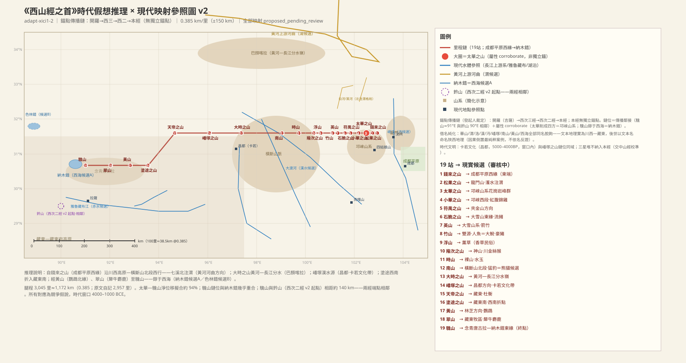
### 【SHJ-02-1-001】錢來之山——本經起點，川西高原東緣

> 西山經華山之首，曰錢來之山，其上多松，其下多洗石。有獸焉，其狀如羊而馬尾，名曰羬羊，其脂可以已腊。

**白話解讀**　这是《西山经》全卷的第一站：一座「上面长松树、下面出可淘洗砾石」的山，位置定在川西高原东缘、甘孜—炉霍方向的道孚—丹巴北一带（约东经 101.5°；较可靠，`MTN:SHJ-02-1-001#1`）——这是修正版 B 的锚站。「西山经华山之首」的意思是：西山经这一系的山叫「华山系」，钱来山排最东；注意这里的「华山」是本经的系名，不等于陕西华山（同名层累方向留档 F-0006，不按名字定位）。山上松林、山下河谷砾石，与川西高原东缘的地貌相符。山里有一种样子像羊、拖着马尾巴的动物叫羬羊，它的油脂可以治皮肤皴裂——这一经的羬羊和后面西次二经、西次四经的羬羊（大角羊/鬃羊）同名但多半不是同一种东西，留待裁决（`CRE:SHJ-02-1-001#1`）。

**未決項**
- 衝突：錢來之山——羬羊同名異實
- 衝突：錢來之山——「華山系」系名與陝西華山的同名層累方向留檔（F-0006）

### 【SHJ-02-1-002】松果之山——鲜水河上游谷地

> 西四十五里，曰松果之山。濩水出焉，北流注于渭，其中多銅。有鳥焉，其名曰䳋渠，其狀如山雞，黑身赤足，可以已𦢊。

**白話解讀**　从钱来山往西 45 里（约 16–19 公里）到松果山，大致是鲜水河上游谷地、道孚方向的山地（较可靠）。山里流出的濩水向北流——「注于渭」的「渭」按裁决处理：**禹贡簇层累覆写**——渭、汉、沔、洛这一组水名是晚出层写进去的流变注记（发起人说：「山海经成书于夏商，远早于汉，今名不足取」），不作定位证据；底层只按「北向溪」的方向记录来读（川西铜矿化带真实存在，溪里产铜对得上，`WAT:SHJ-02-1-002#2`）。还有一种叫䳋渠的鸟，样子像山鸡、黑身子红脚，大约是蓝马鸡一类的雉，古人说它能治皮肤皴裂（`CRE:SHJ-02-1-002#1`）。

**未決項**
- 衝突：渭——禹貢簇層累覆寫（流變註記，不作定位證據；F-0006 留檔）

### 【SHJ-02-1-003】太華之山——橫斷山刃脊銳峰（不定點）

> 又西六十里，曰太華之山，削成而四方，其高五千仞，其廣十里，鳥獸莫居。有蛇焉，名曰肥𧔥，六足四翼，見則天下大旱。

**白話解讀**　再往西 60 里到太华山。原文连用四个特征：「削成而四方」（山体像刀削出来的四棱柱）、「其高五千仞」（极高）、「其广十里」（基座庞大）、「鸟兽莫居」（绝壁上没有动植物）。**修正版 B 读法：这是刀削岩峰的通用语义——横断山刃脊（角峰/刃脊冰蚀地貌）的花岗岩锐峰群普遍成立，不锁定单一峰体**（约当道孚东—八美方向的刃脊峰群带；较可靠，`MTN:SHJ-02-1-003#1`）。〔红队注：T-RT05 盲评曾以此形态高置信指认陕西华山，v3 据以回摆；2026-10-28 发起人否决——太华＝华山属因果倒置锚定（以后世山名反定文本位置），盲评结论的走向/距离不符，不予采纳；华山读法降 rejected_rival 存册不删〕。总结段说「华山冢也」——冢级宗主山，那是名称层/礼制等级的记录，不作定位。山上的「肥𧔥」是六足四翼的飞蛇，属神话夸张，「见则天下大旱」是把它当旱灾的预兆（`CRE:SHJ-02-1-003#1`、`CLIM:SHJ-02-1-003#1`）。

**未決項**
- 衝突：太華之山——太華/華山同名——F-0006 層累方向留檔；v3 華山讀法降 rejected_rival 存冊；不定點讀法記 variant
- 衝突：太華之山——肥𧔥（003 蛇）vs 肥遺（007 鳥）名近異實待裁

### 【SHJ-02-1-004】小華之山——道孚—炉霍方向

> 又西八十里，曰小華之山，其木多荊杞，其獸多㸲牛，其陰多磬石，其陽多㻬琈之玉，鳥多赤鷩，可以禦火，其草有萆荔，狀如烏韭，而生於石上，亦緣木而生，食之已心痛。

**白話解讀**　太华以西 80 里是小华山，约当道孚—炉霍方向的山地（较可靠）。「太华/小华」是按规模成对命名——修正版 B 下不指向陕西的华山—少华山（那一对读法随 v3 一并否决存册）。山上灌木多荆条枸杞，野兽多㸲牛（一种牛）；北坡出能敲响的磬石，南坡出㻬琈美玉。鸟多赤鷩——这很可能是红腹锦鸡的古名，川西—横断山正是它的原产地（较可靠，`CRE:SHJ-02-1-004#2`）；「可以御火」是护佑类的民俗说法。草里有萆荔，长得像乌韭（石韦类蕨），能贴石头也能爬树，说吃了治心口痛（`PLA:SHJ-02-1-004#3`）。

### 【SHJ-02-1-005】符禺之山——炉霍方向（鲜水河谷地）

> 又西八十里，曰符禺之山，其陽多銅，其陰多鐵。其上有木焉，名曰文莖，其實如棗，可以已聾。其草多條，其狀如葵，而赤華黃實，如嬰兒舌，食之使人不惑。符禺之水出焉，而北流注于渭。其獸多蔥聾，其狀如羊而赤鬛。其鳥多鴖，其狀如翠而赤喙，可以禦火。

**白話解讀**　再往西 80 里到符禺山，约当炉霍方向、鲜水河谷地的山地（较可靠）。南坡产铜、北坡产铁。山上的文茎树结枣一样的果子，传说吃了治耳聋；条草像葵、开红花结黄果、果实像婴儿舌头，说吃了让人不迷惑——都是药用赋义的记录（`PLA:SHJ-02-1-005#1`、`PLA:SHJ-02-1-005#2`）。符禺水从这里北流（山水同名——谷地北向溪；「注于渭」为禹贡簇层累覆写注记，不作定位证据）。野兽多葱聋（像羊而长红鬃毛），鸟多鴖（像翠鸟而红嘴），说它能「御火」（`CRE:SHJ-02-1-005#1`、`CRE:SHJ-02-1-005#2`）。

### 【SHJ-02-1-006】石脆之山——炉霍—甘孜方向

> 又西六十里，曰石脆之山，其木多椶柟，其草多條，其狀如韭，而白華黑實，食之已疥。其陽多㻬琈之玉，其陰多銅。灌水出焉，而北流注于禺水。其中有流赭，以塗牛馬無病。

**白話解讀**　再往西 60 里到石脆山（「石脆」就是岩石易碎的意思），约当炉霍—甘孜方向（方向性猜测偏可靠）。树多棕榈和楠木，草多一种韭形、白花黑籽的条草，说吃了治疥疮。南坡出玉、北坡出铜。灌水北流注入禺水；禺水在下一站英山又出现一次（一条溪的两段，还是两条同名溪，待裁）。溪水里有「流赭」——就是赭石（赤铁矿粉），拿来涂在牛马身上可以防病，这是一条很朴素的兽医民俗记录（很可靠，`MIN:SHJ-02-1-006#3`）。

**未決項**
- 衝突：禺水——禺水006/007接力——一溪兩段或同名兩溪待裁

### 【SHJ-02-1-007】英山——甘孜东方向，雅砻江河谷竹带

> 又西七十里，曰英山，其上多杻橿，其陰多鐵，其陽多赤金。禺水出焉，北流注于招水，其中多䰷魚，其狀如鼈，其音如羊。其陽多箭䉋，其獸多㸲牛羬羊。有鳥焉，其狀如鶉，黃身而赤喙，其名曰肥遺，食之已癘，可以殺蟲。

**白話解讀**　再往西 70 里到英山，甘孜以东、雅砻江河谷一带（较可靠）。山上多杻橿硬木，北坡铁、南坡赤金（红铜）。禺水从这里发源北注招水，水里多䰷鱼——长得像鳖、叫声像羊，是溪鱼或大鲵一类的泛写。南坡多箭䉋，就是**箭竹（大渡河—雅砻江干暖河谷竹带）**——这条记录很值得注意：箭竹（本站）→ 猛豹（012 站）→ 熊罴（014 站），正好构成一条「竹子—熊猫」的生态链，修正版 B 走廊下全链在横断山，与邛崃—横断山熊猫栖息带相容（方向性猜测偏可靠，`PLA:SHJ-02-1-007#1`）。还有一种鹌鹑样、黄身红嘴的鸟叫肥遗，说吃了治瘟疫、能杀虫；它和 003 站的肥𧔥（蛇形）名字相近但不是一物，属异文待裁（`CRE:SHJ-02-1-007#4`）。

**未決項**
- 衝突：英山——肥遺/肥𧔥名近異實

### 【SHJ-02-1-008】竹山——人魚與豪豬之山

> 又西五十二里，曰竹山，其上多喬木，其陰多鐵。有草焉，其名曰黃雚，其狀如樗，其葉如麻，白華而赤實，其狀如赭，浴之已疥，又可以已胕。竹水出焉，北流注于渭，其陽多竹箭，多蒼玉。丹水出焉，東南流注于洛水，其中多水玉，多人魚。有獸焉，其狀如豚而白毛，大如笄而黑端，名曰毫彘。

**白話解讀**　再往西 52 里到竹山，约当甘孜方向的竹林山、雅砻江干暖河谷一带（较可靠）。这座山一山发两水：竹水北流，丹水东南流——河谷小型分水的如实记录；「注于渭」「注于洛水」都是禹贡簇层累覆写注记（渭/洛为晚出层流变，不作定位证据）。丹水里多水玉（水晶）和**人鱼——就是大鲵（娃娃鱼）**，川西溪流正是它的原生地，「人鱼」是对它有四肢、啼声像婴儿的形象化写法（很可靠，`CRE:SHJ-02-1-008#1`）。山上还有毫彘，样子像小猪、白毛，身上的刺「大如笄而黑端」——像发簪那么粗、尖头是黑的，这是**豪猪**棘刺的精确描述（很可靠，`CRE:SHJ-02-1-008#2`）。黄雚草煮水洗澡可以治疥疮和浮肿，是药浴草的记录（`PLA:SHJ-02-1-008#2`）。

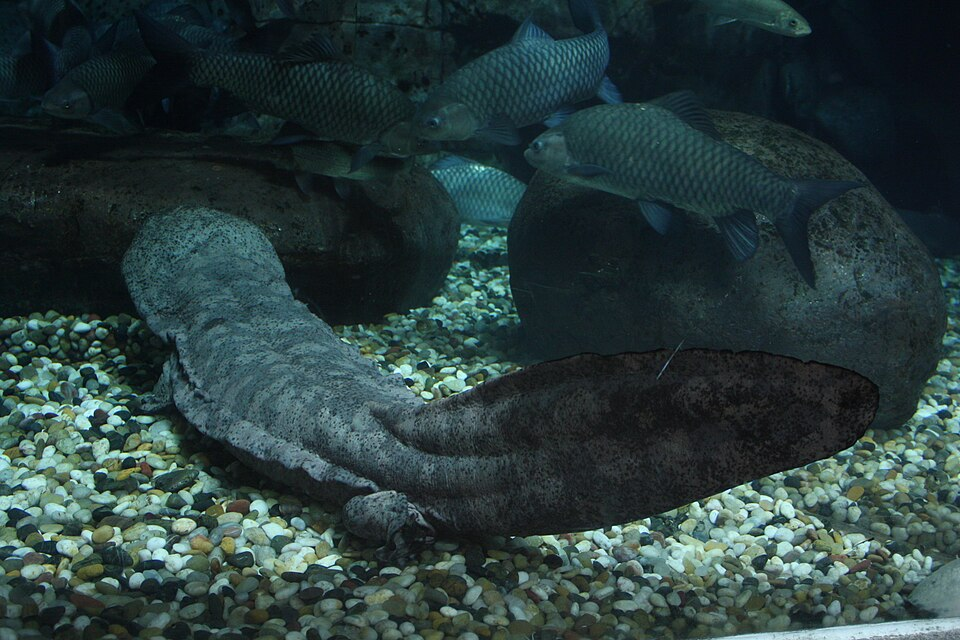（圖：Wikimedia Commons）

**未決項**
- 衝突：竹山——丹水同名異水（008/012）
- 衝突：竹山——洛水注記＝禹貢簇層累覆寫（流變註記）；與 xici4 洛水同名異水
- 衝突：洛水——禹貢簇層累覆寫；同名重合/異水待裁
- 衝突：丹水（竹山）——丹水同名異水（008/012）

### 【SHJ-02-1-009】浮山——香草之山

> 又西百二十里曰浮山，多盼木，枳葉而無傷，木蟲居之。有草焉，名曰薰草，麻葉而方莖，赤華而黑實，臭如蘼蕪，佩之可以已癘。

**白話解讀**　再往西 120 里到浮山，约当甘孜以西—新龙以东的雅砻江河谷山地（方向性猜测）。山上多盼木——叶子像枳但没有刺，树里住着蛀虫（「木虫居之」是对蛀虫的记录）。薰草麻叶方茎（唇形科的典型形态）、红花黑籽、气味像蘼芜——这是真实的香草，「佩之可以已疠」就是佩戴香草防疫病的民俗（较可靠，`PLA:SHJ-02-1-009#3`）。

### 【SHJ-02-1-010】羭次之山——金絲猴之山，本經神山

> 又西七十里，曰羭次之山，漆水出焉，北流注于渭。其上多棫橿，其下多竹箭，其陰多赤銅，其陽多嬰垣之玉。有獸焉，其狀如禺而長臂，善投，其名曰嚻。有鳥焉，其狀如梟，人面而一足，曰橐𩇯，冬見夏蟄，服之不畏雷。

**白話解讀**　再往西 70 里到羭次山，约当新龙方向的雅砻江干暖河谷（较可靠）。漆水从这里北流——漆水就是「漆树之水」，山水同名的产业带命名（川西是生漆主产区；「注于渭」为层累覆写注记）。这座山在全经地位极高：总结段说「羭山神也」，祭它要用烛火、斋戒百日、百头牺牲、百瑜百珪百璧，是本经最重的祭礼——与太华（冢级宗主山）构成本经双核心（名称层/礼制记录）。山上的「嚻」，样子像猿而长臂、善于投掷——很可能是**川金丝猴**（长臂、树栖、有投掷行为，岷山—邛崃—横断山分布带），也可能是长臂猿类的泛写（较可靠，`CRE:SHJ-02-1-010#1`）。还有一种猫头鹰样、人面独足的鸟叫橐𩇯，「冬见夏蛰」——冬天出现、夏天蛰伏，是一条朴素的季节物候记录（`CRE:SHJ-02-1-010#3`）。

（圖：Wikimedia Commons）

### 【SHJ-02-1-011】時山——無草木的裸山

> 又西百五十里，曰時山，無草木。逐水出焉，北流注于渭，其中多水玉。

**白話解讀**　再往西 150 里到时山，新龙以西—白玉以东方向的裸岩山岭（方向性猜测）。「无草木」是直白的否定记录——山体光秃（高寒裸岩带）。逐水北流，溪里多水玉（水晶；「注于渭」为层累覆写注记，`WAT:SHJ-02-1-011#1`）。

### 【SHJ-02-1-012】南山——白玉—贡觉方向，「猛豹」＝豹类

> 又西百七十里，曰南山，上多丹粟。丹水出焉，北流注于渭。獸多猛豹，鳥多尸鳩。

**白話解讀**　再往西 170 里到南山，约当白玉—贡觉方向的横断山纵谷带（较可靠）。「南山」是个通用的南向山名，和后世终南山同名只是巧合，我们不按名字定位。山上多丹粟（丹砂），丹水北流（丹砂水，山水矿同名；「注于渭」为层累覆写注记）；它和 008 站竹山的丹水也不是同一条，同名异水，待裁。「兽多猛豹」：**主候选按发起人裁决读法作豹类（金钱豹/雪豹泛写——邛崃—横断山有豹 ✓；本条异文正作「虎」）**；熊猫读法降为对立候选存册——箭竹（007/008）食源加熊罴（014）的生态链支持熊猫读法，但文献注疏多读猛豹为貘/豹类，两读并交对称性总审（T-RT17，`CRE:SHJ-02-1-012#1`）。鸟多尸鸠（布谷鸟一类）（`CRE:SHJ-02-1-012#2`）。

（圖：Wikimedia Commons）

**未決項**
- 衝突：南山——南山同名重合待裁
- 衝突：南山——丹水同名異水
- 衝突：丹水（南山）——丹水同名異水（008/012）

### 【SHJ-02-1-013】大時之山——瀾滄江谷地，禹貢簇層累覆寫的核心案例

> 又西四百八里，曰大時之山，上多榖、柞，下多杻、橿，陰多銀，陽多白玉。涔水出焉，北流注于渭。清水出焉，南流注于漢水。

**白話解讀**　再往西 408 里到大时山——这是本经最长的一段腿程（约 143–171 公里），可能含迂回或层累，待校。站位按河谷走廊定在横断山纵谷的澜沧江谷地（金沙江—澜沧江分水岭方向，芒康西北；方向性猜测偏可靠）。它的双源注记是裁决的关键案例：北坡涔水「北流注于渭」、南坡清水「南流注于汉水」——**渭/汉注记被判为禹贡簇层累覆写：晚出层流变注记，不作分水岭定位证据（发起人：「山海经成书于夏商，远早于汉，今名不足取」）**；双坡溪的流向记录本身如实保留（横断山纵谷分水的方向性阅读），受水名不附会。〔红队注：v3 曾以「渭/汉分水岭＝秦岭主脊唯一解」（C5＋T-RT05 盲评）把本站钉在太白山—鳌山段；2026-10-28 发起人否决（秦岭已由中山经覆盖、盲评走向/距离不符），该读法降 rejected_rival 存册不删〕。山上植被垂直分层（上层榖柞、下层杻橿），北坡银、南坡白玉（`MTN:SHJ-02-1-013#1`）。

**未決項**
- 未知：大時之山——408里長腿疑含迂迴/層累
- 衝突：漢水——禹貢簇層累覆寫（流變註記，不作定位證據；F-0006 留檔）

### 【SHJ-02-1-014】嶓塚之山——横断山中段，层累噪声如实记录

> 又西三百二十里，曰嶓塚之山，漢水出焉，而東南流注于沔；嚻水出焉，北流注于湯水。其上多桃枝鉤端，獸多犀兕熊羆，鳥多白翰赤鷩。有草焉，其葉如蕙，其本如桔梗，黑華而不實，名曰蓇蓉。食之使人無子。

**白話解讀**　再往西 320 里到嶓冢山，站位仍给：横断山中段、察雅方向（方向性猜测偏可靠）。**「汉水出焉，而东南流注于沔」按裁决如实记为禹贡簇层累噪声，不附会**——后世《禹贡》「嶓冢导漾」把汉水源安在嶓冢山，那是晚出层覆写方向（今名不足取，不作定位证据；F-0006 留档）；「沔」（后世＝汉水上游别称）同属层累注记。嚻水北流注汤水则是如实记录的北向溪（汤水＝热水通用词义，藏东温泉带候选，弱）。山上多桃枝竹和钩端竹；野兽有**犀、兕——犀牛温暖期分布的记录**（后期南退，退出动物证据）；**熊、罴——罴（人熊/大熊）是大熊猫的第二个古名候选**（方向性猜测；横断山种群在分布内）。鸟多白翰（白鹇的古名）和赤鷩（红腹锦鸡）——横断山的两种雉。蓇蓉草蕙叶桔梗根、开黑花不结果，「食之使人无子」是关于植物避孕的民俗记录（`PLA:SHJ-02-1-014#3`）。

**未決項**
- 衝突：嶓塚之山——嶓塚/漢水/沔與《禹貢》傳統的層累方向（層累覆寫裁定，F-0006 留檔）
- 衝突：湯水——湯水同名異水

### 【SHJ-02-1-015】天帝之山——藏东昌都方向（卡若文化同域）

> 又西三百五十里，曰天帝之山，上多椶枏，下多菅蕙。有獸焉，其狀如狗，名曰谿邊，席其皮者不蠱。有鳥焉，其狀如鶉，黑文而赤翁，名曰櫟，食之已痔。有草焉，其狀如葵，其臭如蘼蕪，名曰杜衡，可以走馬，食之已癭。

**白話解讀**　再往西 350 里到天帝山（「天帝」是神格命名，意为帝所居之山），约当藏东昌都方向的山地（方向性猜测偏可靠）。**时代文明同域覆盖保留：卡若文化（昌都，距今 5000–4000 年，正在窗口期内）就在本站走廊位置**——藏东高原东缘的新石器文化，与本经记录的人类活动同域（修正版 B 保留此论据）。「上多椶枏」——棕楠记录有海拔张力：棕榈的分布上限与藏东南谷地勉强相容，记 variant 存疑但不否决（发起人裁决口径）。谿边是一种狗形野兽，用它的皮做垫席可以防蛊（兽皮防蛊的民俗）。栎是一种鹌鹑样、黑纹红颈的鸟，说吃了治痔疮。**杜衡（马辛，Asarum）是真实存在的药草**，葵形、气味像蘼芜；「可以走马」是说能让马跑得欢（马用草药的赋义），「食之已瘿」是治大脖子病（较可靠，`PLA:SHJ-02-1-015#5`）。

**未決項**
- 衝突：天帝之山——椶枏海拔張力 variant（棕櫚上限 vs 藏東谷地——勉強相容不否決）

### 【SHJ-02-1-016】塗途之山——全經唯一的西南折點

> 西南三百八十里，曰塗途之山，薔水出焉，西流注于諸資之水；涂水出焉，南流注于集獲之水。其陽多丹粟，其陰多銀、黃金，其上多桂木。有白石焉，其名曰礜，可以毒鼠。有草焉，其狀如稾茇，其葉如葵而赤背，名曰無條，可以毒鼠。有獸焉，其狀如鹿而白尾，馬腳人手而四角，名曰𤣎如。有鳥焉，其狀如鴟而人足，名曰數斯，食之已癭。

**白話解讀**　这一站里程写的是「西南三百八十里」——全经唯一一次转向西南，链条从此拐入藏东，约当八宿—波密方向（方向性猜测偏可靠）。一山双源：蔷水西流注诸资之水，涂水南流注集获之水，符合藏东纵谷分水的格局。南坡丹砂、北坡银和黄金，山上多桂树（肉桂一类，亚热带标记——温暖期分布偏北）。这里还有一组罕见的「灭鼠」记录：白色的礜石（砷黄铁矿/砒石类毒石）可以毒鼠，无条草（葵叶红背）也可以毒鼠——矿物加植物的双重鼠害防治民俗（较可靠，`MIN:SHJ-02-1-016#4`）。𤣎如是鹿形、白尾、馬腳、人手、四角的複合獸，可能是四角羚或畸形鹿觀察的泛化（待考）。數斯是鴟形人足的鳥，說吃了治癭瘤。

**未決項**
- 未知：塗途之山——𤣎如原型

### 【SHJ-02-1-017】黃山——藏東南谷地西段，鹦鹉学舌的最早记录

> 又西百八十里，曰黃山，無草木，多竹箭。盼水出焉，西流注于赤水，其中多玉。有獸焉，其狀如牛，而蒼黑大目，其狀曰𤛎。有鳥焉，其狀如鴞，青羽赤喙，人舌能言，名曰鸚䳇。

**白話解讀**　再往西 180 里到黄山，约当藏东南谷地西段、波密以西—林芝方向（较可靠；和安徽黄山同名是巧合）。「无草木，多竹箭」是说没有乔木草本、只有竹丛——藏东南谷地竹丛带的写法。盼水西流注入赤水——这里的赤水按藏东南大河方向读（雅鲁藏布江候选；注意：没有水色性状的实测或文献依据，「赤」只是名色旁证——C11 存疑留档，不作赤水类名的有效实例）；「赤水」在本书出现三次（西次二经的印度河、西次三经的红海、这里的藏东南大河方向），按 ADJ-005 裁决它是「红色大水」的性状类名，多地同名不算冲突，留档不裁。野兽𤛎是苍黑大眼的牛形兽（野牛/犛牛泛写）。鸟有**鹦䳇——就是鹦鹉**：「人舌能言」＝会学人说话，青羽赤喙的特征对得上大紫胸鹦鹉；藏东南—林芝方向正是鹦鹉分布的北缘，温暖期还会更北（很可靠，`CRE:SHJ-02-1-017#2`）。西次二经数历之山也记了鹦鹉，两经呼应。〔里程警示：上一腿（塗途→黄山）实配直线约 147 公里，文本只有 180 里≈69 公里（0.385 档）——比率 0.47 <1，藏东南段文本腿程偏短，记 variant 不静默。〕

**未決項**
- 衝突：黃山——赤水同名異水（三見）
- 衝突：黃山——黃山同名重合待裁
- 衝突：黃山——腿 16→17 比率 0.47 <1——variant（藏東南段文本腿程偏短）
- 衝突：赤水——赤水同名異水（三見）；ADJ-005 類名多實例處理；本實例 C11 存疑留檔

### 【SHJ-02-1-018】翠山——藏北高原邊緣，犛牛与麝的高原动物群

> 又西二百里，曰翠山，其上多椶枏，其下多竹箭，其陽多黃金、玉，其陰多旄牛、麢、麝；其鳥多鸓，其狀如鵲，赤黑而兩首四足，可以禦火。

**白話解讀**　再往西 200 里到翠山，约当藏北高原边缘、那曲东—比如方向（较可靠）。上层棕楠（棕榈上限对海拔约 4000 米的藏北高原边缘张力更大——记 variant，勉强相容不否决）、下层竹丛，南坡出黄金和玉。北坡的动物组合是高原身份的标记：**旄牛就是犛牛，麝就是产麝香的麝鹿**——加上羚羊（麢），正是藏北高原动物群三标记 ✓（很可靠，`CRE:SHJ-02-1-018#1`、`CRE:SHJ-02-1-018#3`）。鸓鸟被写成喜鹊样、红黑色、两个头四只脚，属复合造像的夸张，「可以御火」是民俗赋义。〔里程警示：黄山→翠山一腿实配直线约 245 公里，文本只有 200 里≈77 公里——比率 0.31 <1，藏东南→藏北折段文本腿程显著偏短，记 variant 不静默。〕

**未決項**
- 衝突：翠山——椶枏海拔張力 variant（棕櫚上限 vs 藏北高原邊緣——勉強相容不否決）
- 衝突：翠山——腿 17→18 比率 0.31 <1——variant（藏東南→藏北折段文本腿程偏短）

### 【SHJ-02-1-019】騩山——納木錯湖濱的终点（錞于西海字面成立）

> 又西二百五十里，曰騩山，是錞于西海，無草木，多玉。淒水出焉，西流于於海，其中多采石、黃金，多丹粟。

**白話解讀**　再往西 250 里到騩山，全经的西端终点——「錞于西海」就是临立在西海的岸边。**修正版 B：这个「西海」＝纳木错**——青藏高原中部的大湖（「天湖」），「西海」作内流湖盆专名读法；高原上把大湖叫「海」是常见的类别泛化（较可靠，`WAT:SHJ-02-1-019#1`）。騩山本身是无草木多玉的高原裸山，位置约当纳木错湖滨山地（东北岸·扎西半岛方向）。淒水西流入湖——**纳木错东北岸湖滨山地的溪水正是西流注湖（淒水西流注湖方向字面成立 ✓）**，溪里多采石（彩石）、砂金和丹砂。注意它和西次三经利比亚的騩山同名异地，待裁。〔红队注：T-RT05 盲评曾判「西海」＝青海湖为最优解，v3 据以定在青海南山—日月山方向；2026-10-28 发起人否决（走向/距离不符），青海湖读法与黄河源湖区旧候选一并降 rejected_rival 存册不删；对立存册保留色林错（西藏最大湖，略偏西北）。王莽曾设西海郡于青海湖——那是后世的借名方向，留档不作反证（F-0006）〕。〔里程警示：翠山→騩山一腿实配直线约 277 公里，文本只有 250 里≈96 公里——比率 0.35 <1，藏北→湖滨段文本腿程显著偏短，记 variant 不静默。〕

**未決項**
- 衝突：騩山——騩山同名異地（xici1/xici3）
- 衝突：騩山——西海：納木錯（主）vs 色林錯（對立存冊）；青海湖/黃河源湖區（v1/v3 讀法）降 rejected_rival 存冊
- 衝突：騩山——腿 18→19 比率 0.35 <1——variant（藏北→湖濱段文本腿程偏短）
- 衝突：西海——與xici3西海（地中海）同名異地

### 【SHJ-02-1-020】總結段——十九山與三級祭禮

> 凡西經之首，自錢來之山至於騩山，凡十九山，二千九百五十七里。華山冢也，其祠之禮：太牢。羭山神也，祠之用燭，齋百日以百犧，瘞用百瑜，湯其酒百樽，嬰以百珪百璧。其餘十七山之屬，皆毛牷，用一羊祠之。燭者百草之未灰，白席采等純之。

**白話解讀**　西次一经从钱来山到騩山共十九山，自记总里程 2,957 里，和各段腿程相加（3,045 里）只差 3.0%，属正常传抄误差；折公制约 1,066–1,279 公里（三档）——钱来（川西高原东缘，约东经 101.5°）到纳木错（约东经 91°）位移约 1,010 公里，三档全为放大方向（+5%／+16%／+27%，与层累放大方向相容 ✓）；藏东南—藏北折段三腿（16→17／17→18／18→19）比率 0.47／0.31／0.35 <1，记 variant 不静默。祭礼分三级：**华山是「冢」（宗主山）**，用太牢（牛羊猪全牲）——修正版 B 下「华山」是本经系名/冢级标记的名称层记录，与 003 太华之山（横断山刃脊锐峰，不定点）同域，不等同陕西华山（同名层累留档 F-0006）；**羭次山是「神」**，祭礼最重：烛火祭（「烛」就是百草束未烧成的火炬）、斋戒百日、百牺百瑜、百樽酒、百珪百璧；其余十七山各用一头纯色羊。这套三级礼制是本经双核心（华山—羭山）的直接文本证据（名称层/礼制等级记录）。

**未決項**
- 未知：華山——冢級確指待考
- 未知：羭山——羭山確指待考

## 西山經·次二（xici2）：喜馬拉雅南麓，從錫金到印度河

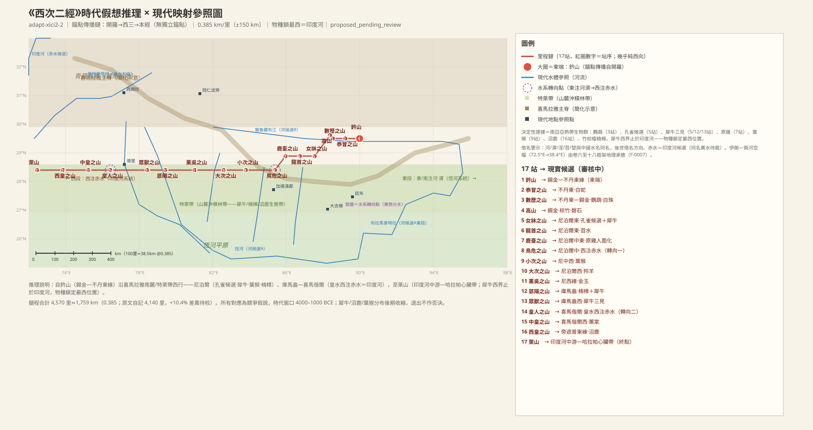
### 【SHJ-02-2-001】鈐山——錫金—不丹東緣的起點

> 《西次二經》之首，曰鈐山，其上多銅，其下多玉，其木多杻、橿。

**白話解讀**　西次二經的起點鈐山，我們定在錫金—不丹東緣、雅魯藏布大拐彎南側（干城章嘉方向）。注意：此前「與西次一經終點騩山相距約 165 公里、兩經首尾相銜」是 v2 時代傳播鏈定位的輸出——**西一已於 T-RT05 遮蔽重判後回擺為華山—青海湖走廊（2026-10-28），該相銜說法失效**；兩經銜接無文本內證，西二起點改為獨立待定（C14：銜接為算法假設）（方向性猜測偏可靠，`MTN:SHJ-02-2-001#1`）。「鈐」是鈴/鉗形的外觀描述。山上產銅、山下產玉，多杻橿硬木。

### 【SHJ-02-2-002】㤗冒之山——不丹東部

> 西二百里，曰㤗冒之山，其陽多玉，其陰多鐵。浴水出焉，東流注于河，其中多藻玉，多白蛇。

**白話解讀**　往西 200 里到㤗冒山，不丹東部山麓（方向性猜測偏可靠）。南坡玉、北坡鐵。浴水東流注入「河」——這個「河」是本經的總受水體，主候選是**恆河—布拉馬普特拉主干**；雅魯藏布江是對立候選，但因為本經的物種（鸚鵡、犀牛等）全都產在山南，所以取恆河系統（較可靠，`WAT:SHJ-02-2-002#2`）。水裡多藻玉（水草紋的瑪瑙類）和白蛇——白蛇是白色相記錄，和西次四經的白色動物群主題遙相呼應。

**未決項**
- 衝突：河——河多層指稱待裁

### 【SHJ-02-2-003】數歷之山——鸚鵡與珍珠

> 又西一百七十里，曰數歷之山，其上多黃金，其下多銀，其木多杻橿，其鳥多鸚䳇。楚水出焉，而南流注于渭，其中多白珠。

**白話解讀**　再往西 170 里到數歷山，不丹東—錫金方向的山麓（較可靠）。上層黃金、下層白銀，杻橿硬木林。鳥多**鸚䳇——鸚鵡**（紫胸/緋胸鸚鵡，喜馬拉雅南麓原生），這是本經「南亞生物群」的第一個決定性證據（很可靠，`CRE:SHJ-02-2-003#1`）。楚水南流注「渭」——這裡的渭是恆河北岸支流群（甘達克/戈西方向）的借名，和西次一經、西次四經的渭都不是同一條，待裁。水裡多白珠——**珍珠**，恆河平原水系的淡水珠貝記錄（較可靠，`MIN:SHJ-02-2-003#3`）。

**未決項**
- 衝突：渭——與xici4渭同名異水
- 衝突：渭——與xici1渭（黃河河曲候選）同名異水

### 【SHJ-02-2-004】高山——錫金大吉嶺方向

> 又西北五十里高山，其上多銀，其下多青碧、雄黃，其木多椶，其草多竹。涇水出焉，而東流注于渭，其中多磬石、青碧。

**白話解讀**　往西北 50 里到高山（通用的高山之名，無專名修飾），錫金段大吉嶺—干城章嘉山麓方向（方向性猜測偏可靠）。上銀、下青碧和雄黃（砷硫化物）。**棕櫚加竹子是亞熱帶植物群的標記**，南亞證據之二。涇水東流注渭（這個涇水和西次四經的涇水同名異水，借名警示）；水裡多磬石——能敲出樂音的石頭，和西次四經「音如磬石」的魚、西次三經騩山「音如鍾磬」的鳴沙構成本書的一套聲學記錄系統（`MIN:SHJ-02-2-004#4`）。

**未決項**
- 衝突：高山——涇水與xici4同名異水
- 衝突：涇水——與xici4涇水同名異水

### 【SHJ-02-2-005】女牀之山——犀牛與孔雀，尼泊爾特萊帶

> 西南三百里，曰女牀之山，其陽多赤銅，其陰多石涅，其獸多虎豹犀兕。有鳥焉，其狀如翟而五采文，名曰鸞鳥，見則天下安寧。

**白話解讀**　往西南 300 里到女牀山，尼泊爾東部特萊帶（喜馬拉雅山前的平原林帶）——這是本經生物群的核心站，定位在本假說內很可靠。南坡赤銅、北坡石涅（煤炭/石墨一類）。野獸虎、豹之外有**犀和兕——印度犀（獨角）**，布拉馬普特拉河谷在當時是犀牛的核心分布區（今天只殘存於阿薩姆一帶），哈拉帕印章上也有犀牛圖像，同期同域互證（很可靠，`CRE:SHJ-02-2-005#3`、`CRE:SHJ-02-2-005#4`）。「鸞鳥」樣子像長尾雉而身披五彩——很可能是**孔雀**（五彩長尾開屏的觀察），「見則天下安寧」的祥瑞化正是後世鸞鳳神話的動物原型：孔雀→鸞→鳳的層累（方向性猜測偏可靠，`CRE:SHJ-02-2-005#6`）。

（圖：Wikimedia Commons）

**未決項**
- 未知：女牀之山——石涅確指

### 【SHJ-02-2-006】龍首之山——尼泊爾東部

> 又西二百里，曰龍首之山，其陽多黃金，其陽多鐵。苕水出焉，東南流注于涇水，其中多美玉。

**白話解讀**　再往西 200 里到龍首山，尼泊爾東部山麓（方向性猜測偏可靠）。「龍首」是龍形山首的外觀命名。原文「其陽多黃金，其陽多鐵」連用兩個「陽」，按本書慣例應是一陽一陰，疑為傳抄之誤，待核。苕水東南流注入涇水（涇→渭→河的支流鏈）；這個苕水和西次四經摩洛哥的苕水同名異水，待裁。水裡多美玉。

**未決項**
- 衝突：龍首之山——苕水同名異水
- 衝突：龍首之山——陽字重出疑異文
- 衝突：苕水——苕水同名異水（xici2/xici4）

### 【SHJ-02-2-007】鹿臺之山——白豪與人面雞

> 又西二百里，曰鹿臺之山，其上多白玉，其下多銀，其獸多㸲牛、羬羊、白豪。有鳥焉，其狀如雄雞而人面，名曰鳧徯，其鳴自叫也，見則有兵。

**白話解讀**　再往西 200 里到鹿臺山，尼泊爾中東部山麓（較可靠）。上白玉、下白銀。野獸有㸲牛、羬羊（大角羊）和白豪——白豪可能是印度冠豪豬（南亞原生、棘刺淺色），也可能是白色毛獸的泛寫。鳧徯是雄雞樣、長著人面的鳥，叫聲像在喊自己的名字——很可能是**紅原雞（家雞的祖先，南亞原生）的人面化**寫法；「見則有兵」是兵災預兆的賦義（方向性猜測偏可靠，`CRE:SHJ-02-2-007#5`）。

### 【SHJ-02-2-008】鳥危之山——水系轉向點，赤水＝印度河

> 西南二百里，曰鳥危之山，其陽多磬石，其陰多檀楮，其中多女牀。鳥危之水出焉，西流注于赤水，其中多丹粟。

**白話解讀**　往西南 200 里到鳥危山，約當加德滿都谷地邊緣（方向性猜測偏可靠）。南坡磬石（鳴石）、北坡檀楮——檀是印度紫檀一類，南亞標記；「女牀」是一種草，和 005 站的女牀山同名（山以草名還是草以山名，待考）。關鍵在水文：鳥危之水**西流**注入赤水——這是本經水系的第一個轉向點，自此以西河水都向西流；這個「赤水」指向**印度河**（西南流的主干）（較可靠，`WAT:SHJ-02-2-008#2`）。按 ADJ-005 裁決，赤水是「紅色大水」的性狀類名，和西次三經的紅海、南次二經的紅河方向各自成立，不算衝突。**但此實例無水色證據，按修訂後的性狀判據標存疑（C11）。**

**未決項**
- 衝突：赤水——赤水多見同名異水/類名待裁
- 衝突：赤水——ADJ-005（水名/地貌名為性狀類名，多實例合法非衝突）——本條按類名多實例處理，留檔不裁

### 【SHJ-02-2-009】小次之山——白首赤足的朱厭

> 又西四百里，曰小次之山，其上多白玉，其下多赤銅。有獸焉，其狀如猿，而白首赤足，名曰朱厭，見則大兵。

**白話解讀**　再往西 400 里到小次山，尼泊爾中西部山麓（方向性猜測偏可靠）。「次」是駐紮/次第的意思，小次和大次（下一站）成對命名。上白玉、下赤銅。朱厭是猿形、**白頭紅腳**的野獸——很可能是喜馬拉雅葉猴（白首淺毛、四肢赤褐）；「見則大兵」是兵災預兆賦義（方向性猜測，`CRE:SHJ-02-2-009#2`）。

### 【SHJ-02-2-010】大次之山——尼泊爾西部

> 又西三百里，曰大次之山，其陽多堊，其陰多碧，其獸多㸲牛、麢羊。

**白話解讀**　再往西 300 里到大次山，尼泊爾西部山麓（方向性猜測偏可靠）。南坡白堊土、北坡碧石；野獸多㸲牛和麢羊（羚羊泛稱）。

### 【SHJ-02-2-011】薰吳之山——無草木的金玉礦山

> 又西四百里，曰薰吳之山，無草木，多金玉。

**白話解讀**　再往西 400 里到薰吳山，尼泊爾西緣山麓（方向性猜測）。「無草木，多金玉」——光禿禿的裸露礦山，全條只有八個字，是標準的過站簡記。

### 【SHJ-02-2-012】厎陽之山——犀牛二見，熱帶林木群

> 又西四百里，曰厎陽之山，其木多㮨、枏、豫章，其獸多犀、兕、虎、犳、㸲牛。

**白話解讀**　再往西 400 里到厎陽山，庫馬盎山麓、科貝特方向（較可靠）。樹木多㮨（松類）、楠木和豫章（樟類大樹）——南亞熱帶林木群。**犀牛第二次出現**（犀、兕），今天的奇旺國家公園一帶正是犀牛殘存區；加上虎、犳（豹類）、㸲牛，是一組完整的南亞猛獸群記錄（很可靠，`CRE:SHJ-02-2-012#1`）。

### 【SHJ-02-2-013】眾獸之山——犀牛三見

> 又西二百五十里，曰眾獸之山，其上多㻬琈之玉，其下多檀楮，多黃金，其獸多犀兕。

**白話解讀**　再往西 250 里到眾獸山（「眾獸」就是野獸多的概括命名），庫馬盎以西、喜馬偕爾東緣（方向性猜測偏可靠）。上層㻬琈美玉，下層檀楮林和黃金。**犀牛第三次出現**——犀兕沿特萊帶連續分布，是本經定位喜馬拉雅南麓的物種鎖證據（很可靠）。

### 【SHJ-02-2-014】皇人之山——水系轉向點二

> 又西五百里，曰皇人之山，其上多金玉，其下多青雄黃。皇水出焉，西流注于赤水，其中多丹粟。

**白話解讀**　再往西 500 里到皇人山（本經最長的一段腿程），喜馬偕爾山麓（方向性猜測）。皇人、中皇（015）、西皇（016）是「皇」字的東—中—西三段方位序列命名。上層金玉、下層青雄黃。皇水西流注赤水——**第二個水系轉向點**，指向薩特萊傑河上游支流方向（西流匯入印度河系統）；水裡多丹粟，和 008 站赤水丹粟呼應——赤水兩條支流都產紅色砂礦（`WAT:SHJ-02-2-014#1`）。

### 【SHJ-02-2-015】中皇之山——皇字中段

> 又西三百里，曰中皇之山，其上多黃金，其下多蕙、棠。

**白話解讀**　再往西 300 里到中皇山，喜馬偕爾以西、旁遮普東緣的西瓦利克山一帶（方向性猜測）。上層黃金，下層蕙蘭和棠梨——花草果樹的簡記。

### 【SHJ-02-2-016】西皇之山——接近印度河平原

> 又西三百五十里，曰西皇之山，其陽多黃金，其陰多鐵，其獸多麋、鹿、㸲牛。

**白話解讀**　再往西 350 里到西皇山，旁遮普平原東緣的西瓦利克段（方向性猜測）。南坡黃金、北坡鐵。野獸多麋、鹿、㸲牛——麋可能是**印度沼鹿（barasingha）**，恆河平原的沼澤鹿，出現在西段說明已接近恆河平原與印度河平原的過渡帶（方向性猜測，`CRE:SHJ-02-2-016#1`）。

**未決項**
- 未知：西皇之山——現實山名未定位

### 【SHJ-02-2-017】萊山——印度河中游，哈拉帕心臟帶

> 又西三百裏五十里，曰萊山，其木多檀楮，其鳥多羅羅，是食人。

**白話解讀**　再往西 350 里到萊山，全經西端終點——鏈位落在印度河中游的**哈拉帕心臟帶**（木爾坦—哈拉帕方向，鹽嶺一帶）；哈拉帕文明（約公元前 3300–1300 年）正與本書時間窗口同域。犀牛分布的西界止於印度河流域，本站是物種鎖允許的最西位置（較可靠，`MTN:SHJ-02-2-017#1`）。「萊」是草萊荒蕪的意思，邊地荒山。檀楮林。鳥多羅羅，「是食人」——一種被寫成吃人的兇禽；注意《海外北經》的羅羅是虎形青獸，同名異實，待裁。

**未決項**
- 衝突：萊山——羅羅鳥/獸異文待裁

### 【SHJ-02-2-018】總結段——人馬神與牛人神

> 凡《西次二經》之首，自鈐山至於萊山，凡十七山，四千一百四十里。其十神者，皆人面而馬身。其七神皆人面而牛身，四足而一臂，操杖以行：是為飛獸之神；其祠之，毛用少牢，白菅為席。其十軰神者，其祠之，毛一雄雞，鈐而不糈；毛采。

**白話解讀**　西次二經從鈐山到萊山共十七山，自記 4,140 里，但各段腿程加起來是 4,570 里，差了 10.4%——四經中最大的一筆內部差異，記錄待校。折公制約 1,450–1,740 公里（自記）/1,600–1,920 公里（腿程）。山神分兩群：**十位神是人面馬身**（人馬複合造像）；**七位神是人面牛身、四條腿一條臂、拄杖而行**，叫「飛獸之神」。兩群神各有一套祭禮：牛人神用少牢（豬羊）加白菅草席；人馬神群用一隻雄雞，「鈐而不糈」（閉藏不用祭米）加毛采（彩羽/毛色的祭儀）。一經之內兩組神、兩套禮，是罕見的雙神群禮制記錄。

## 西山經·次三（xici3）：從阿拉伯西北到蘇爾特灣——埃及與撒哈拉

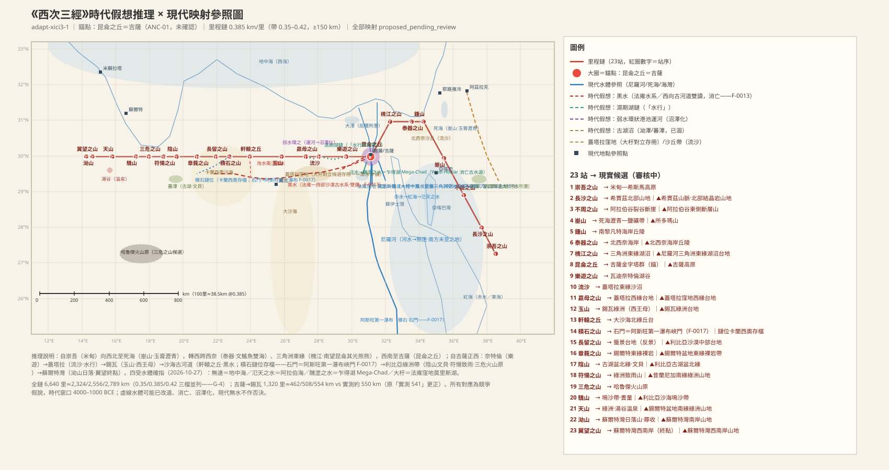
### 【SHJ-02-3-001】崇吾之山——米甸希斯馬高原的起點

> 《西次三經》之首，曰崇吾之山，在河之南，北望冢遂，南望䍃之澤，西望帝之搏獸之丘，東望䗡淵。有木焉，員葉而白柎，赤華而黑理，其實如枳，食之宜子孫。有獸焉，其狀如禺而文臂，豹虎而善投，名曰舉父。有鳥焉，其狀如鳧，而一翼一目，相得乃飛，名曰蠻蠻，見則天下大水。

**白話解讀**　西次三經的起點崇吾山，我們定在阿拉伯半島西北、希斯馬高原南緣（塔布克以東，米甸故地）（方向性猜測偏可靠）。「在河之南」的「河」指向西爾罕河窪地（Wadi Sirhan）的古河道系統——溼期是常年河，今天是乾谷；按 F-0013 裁決（2026-10-27），「河」是區域性強大水系的通名，逐鏈實例化——它和昆侖的「河水」（尼羅河幹流）各為本區實例，不是同名衝突。接下來是一套「四望」框架：北望冢遂（希斯馬北部山陵）、南望䍃之澤（希賈茲溼期窪地湖，今已乾涸）、西望帝之搏獸之丘（神獵場/聖域丘台，落點未知）、東望䗡淵（內夫得沙漠西緣的古湖窪地）——以北山、南澤、西丘、東淵搭起一個十字方位框架（各望點均為方向性猜測）。山上的無名果樹圓葉白萼、紅花黑紋、果實像枳，說吃了「宜子孫」（助生育的民俗賦義）。**舉父**最值得注意：像猿、手臂有花紋、凶猛如豹虎、善於投擲——這正是**阿拉伯狒狒**（雄狒狒銀灰色鬃毛即「文臂」，群體威嚇時投擲石塊即「善投」），阿拉伯半島原生，古埃及還把牠奉為智慧神圖特的聖獸（較可靠，`CRE:SHJ-02-3-001#2`）。蠻蠻是野鴨樣的水鳥，「一翼一目，相得乃飛」——必須成雙才能飛，是成對活動的水鳥（朱鷺/雁類）觀察的神話化；「見則天下大水」是把水鳥群遷先於洪水季節的物候經驗（如尼羅河泛濫前朱鷺北飛）異化成了預兆（`CRE:SHJ-02-3-001#6`、`CLIM:SHJ-02-3-001#1`）。

**未決項**
- 衝突：崇吾之山——「在河之南」之『河』與昆侖『河水』是否同一指稱：本模型取前者為區域古河道（Wadi Sirhan方向），後者為尼羅河系統——F-0013 已裁決（2026-10-27，規則 A）：河＝區域強水系通名，各鏈實例化並存，非衝突
- 未知：崇吾之山——河（在河之南）確指
- 未知：崇吾之山——冢遂、䍃之澤、帝之搏獸之丘、䗡淵四望點的具體落點
- 衝突：河（在河之南）——與河水（昆侖）同名異水：F-0013 已裁決（2026-10-27，規則 A），各鏈實例化並存，非衝突
- 未知：河（在河之南）——確指河道
- 未知：冢遂——具體落點未知
- 未知：冢遂——現實山名未定位
- 未知：帝之搏獸之丘——落點與『搏獸』儀式含義
- 未知：帝之搏獸之丘——現實山名未定位
- 未知：䍃之澤——具體湖盆
- 未知：䗡淵——落點未知

### 【SHJ-02-3-002】長沙之山——希賈茲結晶岩山地

> 西北三百里，曰長沙之山。泚水出焉，北流注于泑水，無草木，多青雄黃。

**白話解讀**　往西北 300 里到長沙山，希賈茲北部結晶岩山地、希斯馬高原西緣（方向性猜測偏可靠）。「長沙」大概是對長條沙質山脊的直觀描述。泚水北流注泑水——泑水主候選是西爾罕窪地的古湖沼系統（阿茲拉克方向）；「泑」是幽深黝黑的深水之意。注意後面槐江之山的丘時之水也「北流注于泑水」，兩處相距超過 800 公里，屬同名異水：此處是西爾罕系統，槐江那處是尼羅河三角洲北緣的潟湖，待審。「無草木，多青雄黃」——貧瘠基岩上出砷硫化物礦（雄黃/雌黃類），該區正是阿拉伯地盾前寒武紀礦化帶（較可靠，`MIN:SHJ-02-3-002#1`）。

**未決項**
- 未知：長沙之山——「長沙」是否描述沙脊外觀
- 衝突：泑水／泑澤——槐江之山丘時之水亦『北流注于泑水』，距長沙泚水逾800公里——同名異水：本體=西爾罕系統；槐江之泑水=三角洲北緣潟湖（地中海系統）。同名跨區水體為語義座標錨點，兩用並存待審
- 未知：泑水／泑澤——『河水所潛』的信仰水文細節

### 【SHJ-02-3-003】不周之山——裂谷斷崖與「河水所潛」

> 又西北三百七十里，曰不周之山。北望諸毗之山，臨彼嶽崇之山，東望泑澤，河水所潛也，其原渾渾泡泡。爰有嘉果，其實如桃，其葉如棗，黃華而赤柎，食之不勞。

**白話解讀**　再往西北 370 里到不周山——「不周」就是不環合、有缺口，我們判它是**阿拉伯谷（Wadi Arabah）南段東側的裂谷斷層山地**（亞喀巴以東）；後世「共工怒觸不周山」天柱折斷的神話，地貌原型可能就是這種裂谷斷陷（方向性猜測偏可靠，`MTN:SHJ-02-3-003#1`）。它北望諸毗山（與後面槐江「北望諸毗」同名，相距逾 800 公里，同名異地待裁）、西臨嶽崇山（裂谷西側的西奈—內蓋夫高地，與東側不周對峙）、東望泑澤（西爾罕古湖）。「河水所潛也，其原渾渾泡泡」是文本自帶的信仰水文：古人認為大河在這裡潛入地下（實態是湖水滲漏加泉眼湧出，「渾渾泡泡」正是湧泉翻滾的聲貌）；這個「河水」被圖譜用作昆侖河水（尼羅河）系統的掛點。山上的嘉果果如桃、葉如棗、黃花紅萼，說吃了「不勞」（抗疲勞），是綠洲旱生果樹的泛寫。

**未決項**
- 未知：不周之山——「河水所潛」的信仰水文機制（文本自述為潛流，機制未知標未知）
- 衝突：泑水／泑澤——槐江之山丘時之水亦『北流注于泑水』，距長沙泚水逾800公里——同名異水：本體=西爾罕系統；槐江之泑水=三角洲北緣潟湖（地中海系統）。同名跨區水體為語義座標錨點，兩用並存待審
- 未知：泑水／泑澤——『河水所潛』的信仰水文細節
- 注記：河水（昆侖四水之一）——崇吾『在河之南』之河與本河水的關係已由 F-0013 裁決結案（2026-10-27，規則 A：河＝區域強水系通名，各鏈實例化並存，非衝突）
- 未知：河水（昆侖四水之一）——無逹的具體範圍（努比亞/更南內地）
- 衝突：諸毗之山——同名異地待裁
- 未知：諸毗之山——兩處諸毗是否同體
- 未知：諸毗之山——現實山名未定位
- 未知：諸毗之山——現實山名未定位
- 未知：嶽崇之山——落點

### 【SHJ-02-3-004】峚山——死海瀝青與「玉膏」

> 又西北四百二十里，曰峚山，其上多丹木，員葉而赤莖，黃華而赤實，其味如飴，食之不饑。丹水出焉，西流注于稷澤，其中多白玉。是有玉膏，其原沸沸湯湯，黃帝是食是饗。是生玄玉。玉膏所出，以灌丹木，丹木五歲，五色乃清，五味乃馨。黃帝乃取峚山之玉榮，而投之鍾山之陽。瑾瑜之玉為良，堅粟精密，濁澤有而光。五色發作，以和柔剛。天地鬼神，是食是饗；君子服之，以禦不祥。自峚山至于鍾山，四百六十裏，其閒盡澤也。是多奇鳥、怪獸、奇魚，皆異物焉。

**白話解讀**　再往西北 420 里到峚山——這是全書最富礦物敘事的一站，主候選是**死海南緣的瀝青—鹽礦帶**（所多瑪山方向；對立候選是提姆納谷銅礦帶）（方向性猜測偏可靠）。山上的「丹木」赤莖赤實，可能是紅色岩層環境的植物化描述。丹水西流注稷澤（共享水體錨點，主候選是地中海東南岸湖沼帶；死海沒有西向出水口，所以這條流向降為無方向連接處理，待審），水中「白玉」是死海鹽晶的觀察泛化。核心物產是**「玉膏」——「其原沸沸湯湯」，沸騰湧出的膏狀物，我們判它是死海瀝青**（湖底瀝青塊上浮，死海古稱瀝青湖）；「黃帝是食是饗」背後可能是窗口期埃及從死海進口瀝青做木乃伊防腐的貿易，被神話化成了「帝食玉膏」；「是生玄玉」的玄玉就是黑色的瀝青凝塊（方向性猜測偏可靠，`MIN:SHJ-02-3-004#2`、`MIN:SHJ-02-3-004#3`）。「玉膏灌丹木，五年五色清、五味馨」是礦物—植物轉化的神話工藝敘事；「黃帝取峚山之玉榮投之鍾山之陽」為下一站鍾山埋下伏筆。瑾瑜之玉「堅粟精密、濁澤有而光」是對緻密拋光石材/瀝青光澤的觀察。「自峚山至于鍾山四百六十里，其閒盡澤也」是死海盆—內蓋夫窪地—海岸平原古沼澤帶的直接記錄（此處 460 里與腿程 420 里差 40 里，原文內部差異待校），湖沼帶多奇鳥怪獸奇魚，是溼期豐富生物群的總括。

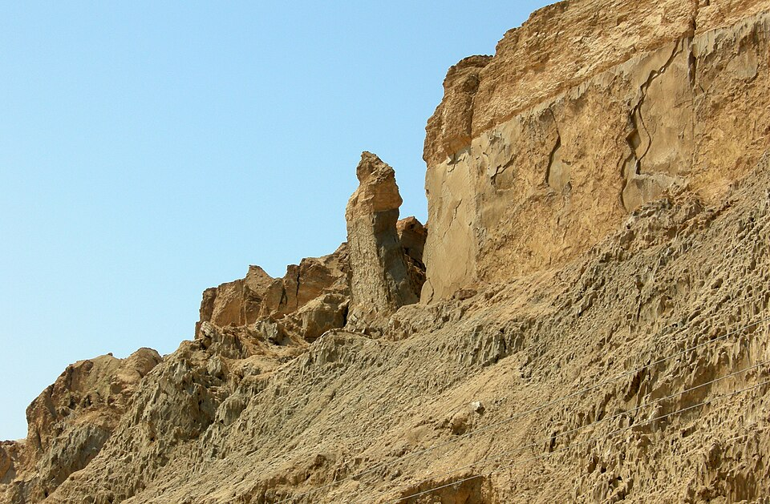（圖：Wikimedia Commons）

**未決項**
- 衝突：峚山——丹水「西流注于稷澤」：死海無西向出水口——按規則動態流向不單獨否決，降為無方向連接（峚山—稷澤相連）；或峚山主體在死海西側猶地亞陡坡。待審
- 未知：峚山——玉膏是否即瀝青（神話異化程度）
- 未知：稷澤——稷澤與大澤（槐江西望）是否同體異名——待衝突裁決
- 衝突：澤（峚山—鍾山其閒盡澤）——四百六十里與腿程四百二十里差40里，原文內部差異，記錄待校

### 【SHJ-02-3-005】鍾山——鼓與欽䲹的神話事件

> 又西北四百二十里，曰鍾山。其子曰皷，其狀如人面而龍身，是與欽䲹殺葆江于昆侖之陽，帝乃戮之鍾山之東曰𡺯崖。欽䲹化為大鶚，其狀如雕而黑文白首，赤喙而虎爪，其音如晨鵠，見則有大兵；鼓亦化為鵕鳥，其狀如鴟，赤足而直喙，黃文而白首，其音如鵠，見則其邑大旱。

**白話解讀**　再往西北 420 里到鍾山（「鍾」是鐘形圓丘），候選是南黎凡特海岸丘陵、加沙走廊方向（方向性猜測）。這一站全是神話事件：鍾山之子「鼓」人面龍身，和欽䲹一起在「昆侖之陽」（昆侖南坡）殺了葆江，帝在鍾山東面的𡺯崖處死了他們——這是把神話事件綁定在昆侖南側的掛點。事後欽䲹化成大鶚（雕形黑紋白首、紅喙虎爪，大型猛禽的泛寫），出現就有戰爭；鼓化成鵕鳥（鴟形赤足直喙、黃紋白首，鴞類泛寫），出現則城邑大旱。這類「神獲罪→化鳥→成災兆」的敘事是神話層，災兆賦義屬民俗記錄（`PER:SHJ-02-3-005#1`、`CRE:SHJ-02-3-005#1`、`CRE:SHJ-02-3-005#4`）。

**未決項**
- 未知：鍾山——鼓、欽䲹、葆江神話事件的歷史內核（如有）
- 未知：鍾山——現實山名未定位
- 未知：𡺯崖——神話事件性質

### 【SHJ-02-3-006】泰器之山——文鰩魚＝飛魚

> 又西百八十里，曰泰器之山。觀水出焉，西流注于流沙。是多文鰩魚，狀如鯉魚，魚身而鳥翼，蒼文而白首，赤喙，常從西海遊于東海，以夜飛。其音如鸞雞，其味酸甘，食之已狂，見則天下大穰。

**白話解讀**　再往西 180 里到泰器山，北西奈海岸、埃阿里什方向（方向性猜測偏可靠）。觀水西流注入流沙（北西奈沙丘帶，水沒於沙；這個流沙和 010 站的流沙同名異地，按 ADJ-005 流沙是流動沙地貌的通名，留檔不裁）。這裡的**文鰩魚就是飛魚**：「魚身而鳥翼」是胸鰭展開如翼的真實形態，「以夜飛」是夜間滑翔躍出水面的習性，「常從西海遊于東海」的兩海正是本站西側的地中海和東側的紅海（蘇伊士灣方向）——方位完全吻合（很可靠，`CRE:SHJ-02-3-006#1`、`WAT:SHJ-02-3-006#2`、`WAT:SHJ-02-3-006#3`）。「其味酸甘，食之已狂」是食用記錄加致幻賦義，「見則天下大穰」是把飛魚群與漁汛豐年的經驗聯想寫成了預兆。

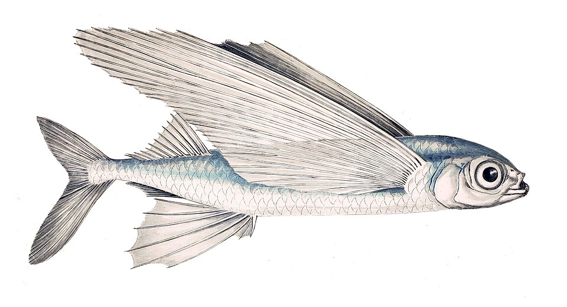（圖：Wikimedia Commons）

**未決項**
- 衝突：泰器之山——流沙（觀水所注）與流沙（010站）同名異地：前者=北西奈沙丘帶，後者=蓋塔拉方向沙沼，待審
- 未知：泰器之山——現實山名未定位
- 衝突：東海——東海（此處=紅海方向）與赤水（紅海）同域異名待裁；與東山經系統之『東海』同名異域待裁
- 衝突：流沙（觀水所注）——與010站流沙同名異地，待審
- 衝突：流沙（觀水所注）——ADJ-005（水名/地貌名為性狀類名，多實例合法非衝突）——本條按類名多實例處理，留檔不裁

### 【SHJ-02-3-007】槐江之山——尼羅河三角洲，南望昆侖

> 又西三百二十里，曰槐江之山。丘時之水出焉，而北流注于泑水。其中多蠃母，其上金青雄黃，多藏琅玕、黃金、玉，其陽多丹粟。其陰多采黃金銀。實惟帝之平圃，神英招司之，其狀馬身而人面，虎文而鳥翼，狥于四海，其音如橊。南望昆侖，其光熊熊，其氣魂魂。西望大澤，后稷所潛也；其中多玉，其陰多榣木之有若。北望諸毗，槐鬼離侖居之，鷹鸇之所宅也。東望恒山四成，有窮鬼居之，各在一搏。爰有滛水，其清洛洛。有天神焉，其狀如牛，而八足二首馬尾，其音如勃皇，見則其邑有兵。

**白話解讀**　再往西 320 里到槐江山——候選是**尼羅河三角洲東緣的湖沼台地**（曼扎拉湖方向）（較可靠）。丘時之水北流注泑水，這裡的泑水是三角洲北緣潟湖（地中海系統），和長沙山的泑水（西爾罕系統）同名異水，待審。水裡多蠃母（螺貝），物產清單很長——金、青雄黃、琅玕、黃金、玉、丹粟、金銀：三角洲是地中海—紅海貿易樞紐，這份礦物清單正是集散地物產的記錄。「帝之平圃」是把三角洲農耕平原神格化為帝王的園圃，管理神英招馬身人面、虎紋鳥翼，是斯芬克斯型的複合造像，「狥于四海」是說牠巡行四方之海（`PER:SHJ-02-3-007#1`）。最關鍵的一句是**「南望昆侖，其光熊熊，其氣魂魂」**：原解讀為從三角洲東緣南望吉薩金字塔白色覆面的反光——但紅隊重算後此讀法降級：吉薩在本站西南約 160 公里（方位角約 225°，已超出「南」的範圍），且 147 米高的金字塔在 160 公里外超出地平線可視距，反光機制物理不成立。此句現按鬆散修辭讀（「向昆侖方向遙望」），只作輔助性 supporting，不作定位證據；本站定位改依腿程鏈與「帝之平圃」的三角洲屬性（方向性猜測偏可靠）。西望大澤（三角洲西部湖沼，瑪麗尤特湖方向），是「后稷所潛」——后稷沉葬之地神話的地理化，和峚山的稷澤是否同體異名待裁。北望諸毗（同名異地待裁），是槐鬼離侖和鷹鸇（海岸崖壁的猛禽巢）所在。東望「恒山四成」——四層階台狀的山或人工階台建築（和後世北嶽恒山同名是借名，不能反證），有窮鬼「各在一搏」分據而居。滛水是一眼清澈的泉水（「其清洛洛」）。還有一位牛形八足二首馬尾的天神，叫聲如勃皇，出現則城邑有戰事——多肢多首的複合造像加戰爭兆象。

**未決項**
- 衝突：槐江之山——丘時之水「北流注于泑水」與長沙之山泚水所注「泑水」相距逾800公里——同名異水：本站之泑水=三角洲北緣潟湖（地中海系統），長沙之泑水=西爾罕窪地系統，待審
- 未知：槐江之山——恒山四成的具體所指（四層台地/人工階台）
- 未知：槐江之山——滛水「其清洛洛」的泉源落點
- 未知：槐江之山——現實山名未定位
- 衝突：泑水／泑澤——槐江之山丘時之水亦『北流注于泑水』，距長沙泚水逾800公里——同名異水：本體=西爾罕系統；槐江之泑水=三角洲北緣潟湖（地中海系統）。同名跨區水體為語義座標錨點，兩用並存待審
- 未知：泑水／泑澤——『河水所潛』的信仰水文細節
- 衝突：丘時之水——所注『泑水』與長沙泚水之泑水同名異水，待審
- 衝突：大澤（后稷所潛）——與稷澤同體異名待裁
- 未知：滛水——確切泉點
- 衝突：諸毗之山——同名異地待裁
- 未知：諸毗之山——兩處諸毗是否同體
- 未知：諸毗之山——現實山名未定位
- 未知：諸毗之山——現實山名未定位
- 衝突：恒山（四成）——與北嶽恒山同名異地，待裁
- 未知：恒山（四成）——四成的具體形態
- 未知：諸毗——諸毗確指待考

### 【SHJ-02-3-008】昆侖之丘——吉薩金字塔群，全書最大錨點

> 西南四百里，曰昆侖之丘，是實惟帝之下都，神陸吾司之。其神狀虎身而九尾，人面而虎爪；是神也，司天之九部及帝之囿時。有獸焉，其狀如羊而四角，名曰土螻，是食人。有鳥焉，其狀如蠭，大如鴛鴦，名曰欽原，蠚鳥獸則死，蠚木則枯，有鳥焉，其名曰鶉鳥，是司帝之百服。有木焉，其狀如棠，黃華赤實，其味如李而無核，名曰沙棠，可以禦水，食之使人不溺。有草焉，名曰薲草，其狀如葵，其味如蔥，食之已勞。河水出焉，而南流注于無逹。赤水出焉，而東南流注于氾天之水。洋水出焉，而西南流注于醜塗之水。黑水出焉，而西流于大杅。是多怪鳥獸。

**白話解讀**　往西南 400 里到**昆侖之丘——全書最大的錨點，我們判它是吉薩高地的金字塔—陵寢群**（在本假說內很可靠）。「帝之下都」就是帝王在人間的都城——金字塔陵寢群正是法老的永恆之都。守護神陸吾「虎身而九尾，人面而虎爪」——**這是獅身人面像系統**：古漢語沒有「獅」字，觀察者只能用最熟悉的猛獸「虎」來描述獅身造像；「九尾」是多尾誇張，和《海內西經》開明獸「九首」是同一造像傳統的異文。牠「司天之九部及帝之囿時」，即陵寢聖域的管理神（`PER:SHJ-02-3-008#1`）。土螻是羊形四角、食人的兇獸——四角羊在古代近東真實存在（如雅各布四角羊），「食人」是陵寢守護獸的威嚇敘事。欽原是蜂形、大如鴛鴦、螫鳥獸即死、螫木即枯——沙漠巨蜂的誇張，被歸進「鳥」類是古人對飛行物的類別泛化。鶉鳥「司帝之百服」，是帝王服飾寶庫的神格化看守。沙棠是棠形黃花紅果、味如李子無核的濱水樹，「食之使人不溺」是濱水環境植物的護佑邏輯；薲草葵形蔥味，吃了抗疲勞。水文是四方放射的四水系統（**按 F-0013 裁決重整，2026-10-27**）：**河水＝尼羅河幹流**（吉薩段）——裁決後「河」字不再預設專指黃河，而是「區域性強大水系」的通名（合格條件是功能性的：水量夠大、供養人畜文明、常年不涸；小水和季節河不夠格），黃河只是中原鏈的預設實例，尼羅河在本鏈完全合格；「南流注于無逹」重讀為觀察者站在吉薩向南追溯河源的延伸方向、東注入地中海——原先的「方向倒置」問題大部分消解；無逹＝**地中海**（尼羅三角洲的受水——尼羅東北入地中海，2026-10-27 確指；原「未曾到達之地＝努比亞方向認知邊界」的讀法降為對立候選存冊）；**赤水＝紅海**，東南流注氾天之水（阿拉伯海/印度洋，「氾天」是水勢滔天的外洋）——**「紅海」的「紅」是希臘語譯名層（Erythra Thalassa 的譯名傳統）而非水色實測，此處定位只依方位與連接，不依名色**；**洋水＝西南向已消亡的古水道**（Wadi Howar 等蘇丹—乍得方向的濕潤期水系，全新世濕潤期約 5000–3000 BCE 後隨撒哈拉沙漠化消亡——這是一條「消失的水」的記錄；原先的法雍支汊讀法降為對立候選保留），它所注的醜塗之水＝**乍得湖（Mega-Chad）**——非洲中西部濕潤期的終極受水體，全新世最大時約 40 萬平方公里、其後急劇收縮，正是這種消亡與收縮解釋了後世失載；**黑水＝雙讀並列**：(a) 尼羅氾濫—法雍水系（Bahr Yussef 支流向西南入法雍窪地），(b) 西部沙漠的西向古河道系統（納特倫—蓋塔拉—沙海方向，雷達探測證實該帶有濕期河道網，濕潤期約 5000–3000 BCE 結束後消亡）——核心支持來自埃及人對自己土地的稱呼：**古埃及自稱 Kemet，意即「黑土地」，正是以尼羅河氾濫留下的黑色淤泥命名**——「黑水」的性狀（黑）、流向（西流）、結局（後世消亡）三項自洽。黑水西流注于大杅——「杅」是盆盂，「大杅」就是大盆：**大杅＝法雍窪地（古莫里斯湖）確指**（2026-10-27：Bahr Yussef 西南入法雍；法雍莫里斯湖在窗口期遠大於今——中王國時期約 2000 BCE 仍為大湖）；若取黑水的西部沙漠古河道讀，則對應蓋塔拉窪地（低於海平面 134 米），對立候選存冊不刪。至此四水＋四受水體全鏈閉合：河→無達（地中海）、赤水→氾天之水（阿拉伯海，維持）、洋水→醜塗之水（乍得湖）、黑水→大杅（法雍）（較可靠，`WAT:SHJ-02-3-008#3`–`#8`）。「是多怪鳥獸」是對陵寢動物造像群（聖甲蟲、狒狒、公羊、獵鷹、豺等埃及聖獸）的總括。

（圖：Wikimedia Commons）

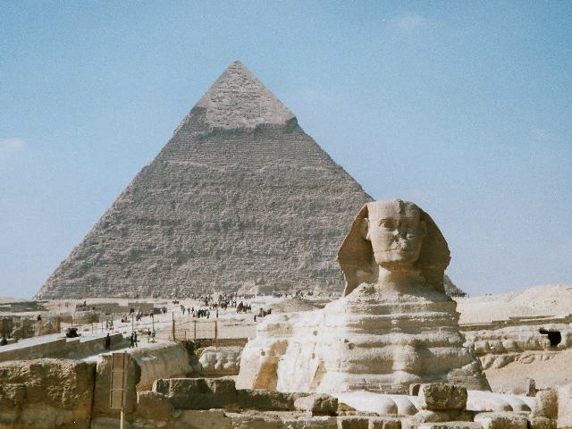（圖：Wikimedia Commons）

**未決項**
- 衝突：昆侖之丘——《海內西經》SHJ-11-1-024『西王母……在昆侖虛北』與本經玉山在昆侖以西1,320里方位相異——西王母位置為跨卷異文，待衝突裁決
- 未知：昆侖之丘——帝之囿/天之九部的具體含義
- 未知：昆侖之丘——炎火之山的物理機制（灼熱台地/自燃/神話誇張三選）
- 未知：昆侖之丘——弱水環狀水體的考古對應（吉薩港池運河遺址的沼澤化年代）
- 注記：河水（昆侖四水之一）——崇吾『在河之南』之河與本河水的關係已由 F-0013 裁決結案（2026-10-27，規則 A：河＝區域強水系通名，各鏈實例化並存，非衝突）
- 未知：河水（昆侖四水之一）——無逹的具體範圍（努比亞/更南內地）
- 衝突：赤水——與南次二經柜山英水所注『赤水』同名異水待裁
- 衝突：赤水——ADJ-005（水名/地貌名為性狀類名，多實例合法非衝突）——本條按類名多實例處理，留檔不裁
- 衝突：黑水（昆侖四水之一）——與海內經幽都黑水、其他卷黑水同名異水待裁
- 衝突：黑水（昆侖四水之一）——ADJ-005（水名/地貌名為性狀類名，多實例合法非衝突）——本條按類名多實例處理，留檔不裁
- 未知：黑水（昆侖四水之一）——古河道精確走向與斷流年代
- 衝突：大杅——與醜塗之水的競合已結案（2026-10-27：醜塗之水＝乍得湖 Mega-Chad、大杅＝法雍窪地莫里斯湖）；黑水雙讀下蓋塔拉窪地對立存冊
- 未知：無逹——無逹是否指具體地名或純粹『未至』語義

### 【SHJ-02-3-009】樂遊之山——瓦迪奈特倫的白色鹽鹼

> 又西三百七十里，曰樂遊之山。桃水出焉，西流注于稷澤，是多白玉，其中多䱻魚，其狀如蛇而四足，是食魚。

**白話解讀**　再往西 370 里到樂遊山，候選是瓦迪奈特倫湖谷（尼羅河三角洲西緣）（方向性猜測偏可靠）。桃水西流注稷澤——和峚山的丹水注入同一個共享水體（地中海東南岸湖沼帶）。「是多白玉」：奈特倫谷是古埃及泡鹼（natron）產地，白色鹽鹼結殼就是「白玉」；泡鹼正是木乃伊防腐材料，和峚山的玉膏（瀝青）構成一條防腐物質鏈（較可靠，`MIN:SHJ-02-3-009#1`）。水裡的䱻魚蛇形四足、吃魚——是**鱷魚**（或巨蜥）的泛寫，三角洲西部湖泊當時有鱷；歸入「魚」類是水生動物的類別泛化（較可靠，`CRE:SHJ-02-3-009#1`）。

**未決項**
- 未知：樂遊之山——桃水與稷澤的連接路徑（北向瑪麗尤特或西向蓋塔拉）
- 未知：樂遊之山——現實山名未定位
- 未知：稷澤——稷澤與大澤（槐江西望）是否同體異名——待衝突裁決

### 【SHJ-02-3-010】流沙與蠃母之山——可以行舟的窪地

> 西水行四百里，曰流沙，二百裏至于蠃母之山，神長乘司之，是天之九德也。其神狀如人而犳尾。其上多玉，其下多青石而無水。

**白話解讀**　從樂遊山**向西乘船行 400 里**，到達流沙——「水行」二字是時代狀態的直接證據：今天是旱地鹽沼的蓋塔拉窪地東緣，當時可以通舟（瑪麗尤特—奈特倫—蓋塔拉的溼期湖鏈）（較可靠，`LND:SHJ-02-3-010#1`）。再走 200 里到蠃母山（蓋塔拉西緣台地、錫瓦以東高地），「蠃母」是螺貝——以螺貝之地名山，和槐江山「其中多蠃母」呼應。守護神長乘人形豹尾——豹尾是埃及豹皮祭服（sem 祭司的真實服飾，豹皮垂尾）的造像異化；牠掌管「天之九德」。山上多玉（淺色石）、山下多青石而「無水」——台地之上沒有水，腳下窪地卻曾經可以行舟，「上無水、下曾水」的對照正是水體消亡後的地貌狀態。

**未決項**
- 衝突：流沙——與泰器之山觀水所注『流沙』（北西奈沙丘帶）同名異地：文本或以『流沙』為沙漠地貌通名，待審
- 衝突：流沙——ADJ-005（水名/地貌名為性狀類名，多實例合法非衝突）——本條按類名多實例處理，留檔不裁
- 未知：流沙——水行航路的具體水道（天然湖鏈/人工運河/混合）
- 未知：蠃母之山——長乘與天之九德的對應內涵

### 【SHJ-02-3-011】玉山——西王母與錫瓦綠洲

> 又西三百五十里，曰玉山，是西王母所居也。西王母其狀如人，豹尾虎齒而善嘯，蓬髪戴勝，是司天之厲及五殘。有獸焉，其狀如犬而豹文，其角如牛，其名曰狡，其音如吠犬，見則其國大穰。有鳥焉，其狀如翟而赤，名曰胜遇，是食魚，其音如錄，見則其國大水。

**白話解讀**　再往西 350 里到玉山——**西王母的居所，我們判它是錫瓦綠洲（阿蒙神諭聖地）**（在本假說內很可靠）。里程證據需三檔並列（紅隊更正）：自昆侖（吉薩）起算 1,320 里，按每里 0.35／0.385／0.42 公里換算為 462／508／554 公里，吉薩到錫瓦實測約 550 公里——只有 0.42 檔幾乎精確（+0.7%），中值檔差 −7.6%，不能只展示最有利的一檔。西王母的形象——人形、豹尾（豹皮祭服垂尾）、虎齒（咧齒威儀）、善嘯（神諭的吟唱宣告）、蓬髮戴勝（散髮戴冠飾）——是阿蒙神諭所女祭司/神諭傳統的造像異化；她「司天之厲及五殘」，即神諭裁決災罰的職能（`PER:SHJ-02-3-011#1`）。狡是狗形豹紋、長牛角、叫聲如犬吠的獸，出現則國家大豐收。**胜遇是紅色、吃魚的長尾大鳥——很可能是火烈鳥**（錫瓦鹽湖正有火烈鳥群），「見則其國大水」仍是水鳥—洪水的聯想（方向性猜測偏可靠，`CRE:SHJ-02-3-011#7`）。

（圖：Wikimedia Commons）

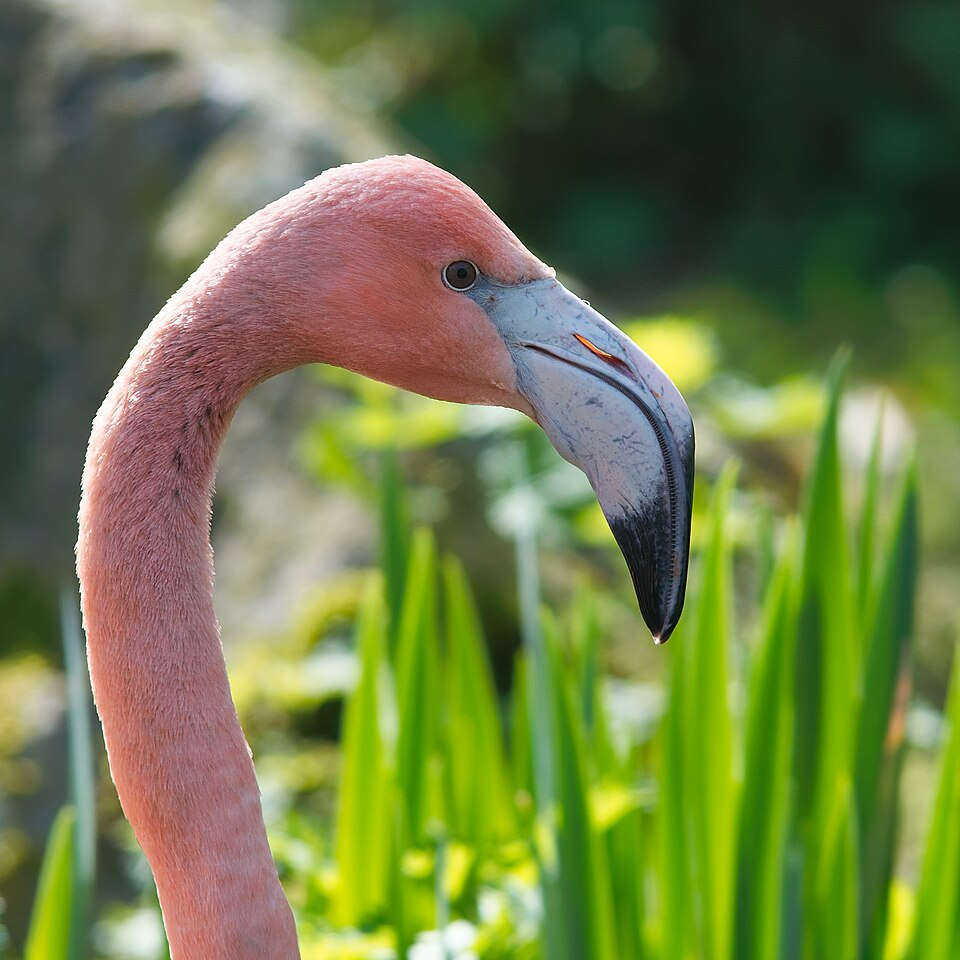（圖：Wikimedia Commons）

**未決項**
- 衝突：玉山——《海內西經》謂西王母『在昆侖虛北』，本模型在西——跨卷方位異文，待衝突裁決
- 未知：玉山——西王母的神職性質（女祭司/女神/女王三選）
- 未知：玉山——三青鳥取食的儀式含義

### 【SHJ-02-3-012】軒轅之丘——大沙海北緣

> 又西四百八十里，曰軒轅之丘，無草木。洵水出焉，南流注于黑水，其中多丹粟，多青雄黃。

**白話解讀**　再往西 480 里到軒轅之丘——全經最長的腿程之一，要穿過大沙海；候選是大沙海—卡蘭西奧沙海北緣的丘台（方向性猜測）。「無草木」是沙海裸露丘台的寫實。洵水南流注入黑水——黑水在這裡第二次出現（昆侖「西流于大杅」加上軒轅「南注」）；按 F-0013 重整（2026-10-27），黑水為雙讀（法雍水系／西部沙漠古河道），本站的跨山互證依**古河道讀**成立：同一條西向古河道系統被兩座山交叉校準；它和南次二經洵山的洵水同名異水，待裁。水中多丹粟（紅砂/光玉髓）和青雄黃——與長沙山的砷礦物記錄一起，構成沙漠礦化帶的連續記錄。

**未決項**
- 未知：軒轅之丘——洵水南注黑水的河道證據（雷達古河道探測待查）
- 未知：軒轅之丘——現實山名未定位
- 衝突：黑水（昆侖四水之一）——與海內經幽都黑水、其他卷黑水同名異水待裁
- 衝突：黑水（昆侖四水之一）——ADJ-005（水名/地貌名為性狀類名，多實例合法非衝突）——本條按類名多實例處理，留檔不裁
- 未知：黑水（昆侖四水之一）——古河道精確走向與斷流年代
- 衝突：洵水——與南次二經洵山之洵水同名異水待裁

### 【SHJ-02-3-013】積石之山——「河水冒以西流」

> 又西三百里，曰積石之山，其下有石門，河水冒以西流，是山也，萬物無不有焉。

**白話解讀**　再往西 300 里到積石山。**F-0017 裁決（2026-10-28）後的現行讀法：積石之山＝阿斯旺第一瀑布花崗岩峽門方向**（方向性猜測偏可靠）。「積石」是巨石堆積的山體外觀；山下有「石門」——阿斯旺第一瀑布正是尼羅河穿花崗岩露頭形成的急流峽門（cataract），「石門」意象精確；河＝尼羅（F-0013 規則 A）。「河水冒以西流」記 variant（洪水期漫流或晚層方位，待 textual-critic）。舊候選卡蘭西奧—薩里爾古河道區降對立存冊；其「潛入—湧出」信仰水文解讀（與不周山「河水所潛」閉環）保留為流變註記，不作定位證據。「是山也，萬物無不有焉」是極言物產豐富——溼期撒哈拉豐富動物群（岩畫裡的河馬、長頸鹿、象、水牛）的記憶。注意：本經的積石山和《海內西經》禹導積石山（後世安在中國河曲）同名異地——這是因果倒置的典型案例：後世拿《山海經》的名字去命名現實地理，不能反過來當證據；禹所積石已由 F-0017 判晚層編纂、不作定位。

**未決項**
- 結案：積石三址分立（F-0017，2026-10-28）——本經積石之山＝阿斯旺第一瀑布方向；禹所積石（book08/17）＝晚層編纂不作定位；卡蘭西奧候選撤銷存冊
- 未知：積石之山——「冒以西流」讀法（洪水漫流 vs 晚層方位）
- 未知：積石之山——阿斯旺讀法與鏈位（西三走廊）的里程核對
- 注記：河水（昆侖四水之一）——崇吾『在河之南』之河與本河水的關係已由 F-0013 裁決結案（2026-10-27，規則 A：河＝區域強水系通名，各鏈實例化並存，非衝突）
- 未知：河水（昆侖四水之一）——無逹的具體範圍（努比亞/更南內地）

### 【SHJ-02-3-014】長留之山——白帝少昊與海市蜃樓

> 又西二百里，曰長留之山，其神白帝少昊居之。其獸皆文尾，其鳥皆文首。是多文玉石。實惟員神磈氏之宮。是神也，主司反景。

**白話解讀**　再往西 200 里到長留山，利比亞沙漠中部台地（方向性猜測，置信偏低）。「長留」是長久停留（日落長留）的命名。居山主神是**白帝少昊**——注意因果倒置警示：後世五行說把少昊配為西方白帝，很可能正是源於這類文本的西方位置，不能拿後世的方位配屬反證本站。這裡的獸尾巴都帶花紋、鳥頭頂都帶花紋，是多紋玉石（瑪瑙/碧玉類）的地方。「員神磈氏之宮」的神「主司反景」——掌管倒影/蜃景：**沙海海市蜃樓（mirage）現象的神格化**，西方日落方向的神掌管反折的光影，意象貼切（方向性猜測）。

**未決項**
- 未知：長留之山——白帝少昊與員神磈氏的對應內涵（後世以少昊為西方帝——注意因果倒置警示：後世方位配屬或源於此類文本，不得反用為證）
- 未知：長留之山——現實山名未定位
- 未知：員神磈氏之宮——磈氏的對應內涵

### 【SHJ-02-3-015】章莪之山——畢方與怪火

> 又西二百八十里，曰章莪之山，無草木，多瑤碧。所為甚怪。有獸焉，其狀如赤豹，五尾一角，其音如擊石，其名如猙。有鳥焉，其狀如鶴，一足，赤文青質而白喙，名曰畢方，其鳴自叫也，見則其邑有譌火。

**白話解讀**　再往西 280 里到章莪山，錫爾特盆地東緣的裸岩帶（方向性猜測，置信偏低）。無草木、多瑤碧（碧玉類），「所為甚怪」是「這地方現象怪異」的總括預告。猙是紅豹形、五尾一角、叫聲像敲石頭的複合獸（聲如擊石或許是岩壁回聲/敲擊聲被誤植為獸鳴）。**畢方**是鶴形獨足、紅紋青身白喙的鳥，叫聲自呼其名；「見則其邑有譌火」——出現則城邑起怪火：錫爾特盆地有油氣苗自燃（或乾季灌叢火），某種鳥的出現與野火季節相關的物候觀察被異化成了因果預兆（方向性猜測，`CRE:SHJ-02-3-015#4`）。

**未決項**
- 未知：章莪之山——譌火的物理機制（油氣自燃/灌叢火/神話誇張）
- 未知：章莪之山——瑤碧的礦物對應
- 未知：章莪之山——現實山名未定位

### 【SHJ-02-3-016】陰山——古湖盆的文貝

> 又西三百里，曰陰山。濁浴之水出焉，而南流注于蕃澤，其中多文貝。有獸焉，其狀如狸而白首，名曰天狗，其音如榴榴，可以禦凶。

**白話解讀**　再往西 300 里到陰山，利比亞中部古湖盆北緣（薩里爾—卡蘭西奧古湖群方向）（方向性猜測偏可靠）。濁浴之水南流注蕃澤（繁盛之澤＝溼期大湖沼）。**「其中多文貝」是本站最具體的物證線索**：帶花紋的貝類——撒哈拉古湖群的湖相沉積裡富含淡水螺貝化石/亞化石，正是古湖存在過的遺物證據（較可靠，`MIN:SHJ-02-3-016#1`）。天狗是狸形白首的小獸（沙貓/獴類泛化），叫聲「榴榴」，說可以禦凶。注意：這座陰山和西次四經的起點陰山同名異地——「同一陰山」假說已被檢驗否決（若合併，西四終點會落到突尼斯，三項關鍵屬性全部不成立），「陰」是背陰通名，兩地各自成立。

**未決項**
- 衝突：陰山——與西次四經陰山同名異地：同一陰山假說已檢驗否決——若以本站（利比亞19.6°E）為西四起點，按西四原文腿程展開，崦嵫終點落於突尼斯（32.4°N,9.6–11.3°E），「苕水西流注于海」「冬夏有雪」「日落山」三項屬性全部不成立；且兩座陰山水文配置不同（本站濁浴之水南注蕃澤文貝 vs 西四陰水西注于洛），無共享水錨點。結論：『陰』為背陰通名（與流沙/黑水/弱水同屬通用語義多地共用），同名異地成立
- 未知：陰山——古湖的具體湖面高程與年代
- 未知：陰山——現實山名未定位

### 【SHJ-02-3-017】符愓之山——風雲所出的致雨之山

> 又西二百里，曰符愓之山，其上多椶枏，下多金玉。神江疑居之。是山也，多怪雨，風雲之所出也。

**白話解讀**　再往西 200 里到符愓山，利比亞綠洲山地（賈盧—昔蘭尼加南緣方向）（方向性猜測，置信偏低）。山上棕櫚楠木覆頂（綠洲山地的寫法），山下金玉。居山之神叫江疑。「是山也，多怪雨，風雲之所出也」——這是一座「致雨之山」：昔蘭尼加綠山是利比亞唯一的多雨帶，地形雨雲生成的觀察被寫成了「風雲從這座山發源」（方向性猜測，`CLIM:SHJ-02-3-017#1`）。

**未決項**
- 未知：符愓之山——江疑的神職
- 未知：符愓之山——怪雨的具體氣候機制（地形雨/季風殘餘）
- 未知：符愓之山——現實山名未定位

### 【SHJ-02-3-018】三危之山——哈魯傑火山原與滅絕巨牛

> 又西二百二十里，曰三危之山，三青鳥居之。是山也，廣員百里。其上有獸焉，其狀如牛，白身四角，其豪如披蓑，其名曰𢕟𢓨，是食人。有鳥焉，一首而三身，其狀如𪇱，其名曰鴟。

**白話解讀**　再往西 220 里到三危山，候選是**哈魯傑火山原（Haruj al-Aswad）北緣**——利比亞最大的火山原，黑色玄武岩覆蓋約四萬平方公里；「廣員百里」是全經罕見的尺度描述，和廣袤火山台地對得上（方向性猜測偏可靠）。「三危」可解為三重危險（火山地貌＋兇獸＋黑岩險境）。三青鳥居於此——牠們是西王母的信使鳥（《海內西經》「其南有三青鳥，為西王母取食」），三危與玉山（西王母）構成一條意象聯動鏈。𢕟𢓨是牛形、白身、四角、長毛像披著蓑衣的食人兇獸——很可能是**佩洛羅夫斯巨水牛（Pelorovis）或長角原牛**：撒哈拉岩畫大量記錄這種長角厚鬃的巨牛，約 4000 年前（本書時間窗口末期）絕跡，是滅絕動物的神話化記憶（方向性猜測，`CRE:SHJ-02-3-018#3`）。鴟被寫成一個頭三個身子，屬多體造像誇張。

**未決項**
- 未知：三危之山——三危『三』的具體所指（三峰/三重危險/三青鳥）
- 未知：三危之山——哈魯傑火山在窗口期是否有活動痕跡

### 【SHJ-02-3-019】騩山——會唱歌的沙丘

> 又西一百九十里，曰騩山，其上多玉而無石。神耆童居之，其音常如鍾磬。其下多積蛇。

**白話解讀**　再往西 190 里到騩山——和西次一經終點同名異地，這裡候選是利比亞沙海的鳴沙帶（方向性猜測偏可靠）。「其上多玉而無石」是說上層全是細粒（石英砂）而無岩石——沙丘體的物性描述（玉＝石英砂粒的泛稱）。居山之神耆童（老童）「其音常如鍾磬」——這座山常發出鐘磬般的樂音，**這就是「鳴沙」（singing dunes）：沙丘滑動或風蝕共振發出低鳴，利比亞沙海以鳴沙聞名**，是全經最精確的一條聲學描述（較可靠，`PER:SHJ-02-3-019#1`）。耆童的譜系也有互證：《大荒西經》「顓頊生老童」見於日月山「日月所入」段落，老童被放在日落山鏈的敘事裡，和本站位於日落山帶的鏈位一致。「其下多積蛇」是沙丘背風處蛇群聚集的生態觀察。

**未決項**
- 未知：騩山——積蛇的物種泛化範圍
- 未知：騩山——現實山名未定位

### 【SHJ-02-3-020】天山——帝江＝落日之盤

> 又西三百五十里，曰天山，多金玉，有青雄黃。英水出焉，而西南流注于湯谷。有神焉，其狀如黃囊，赤如丹火，六足四翼，渾敦無面目，是識歌舞，實為帝江也。

**白話解讀**　再往西 350 里到天山，錫爾特盆地南緣綠洲山地（澤拉—馬拉達方向）（方向性猜測，置信偏低）。多金玉、有青雄黃（沙漠礦化帶的連續記錄）。英水西南流注湯谷——「湯」是熱水，該帶有溫泉鹽泉；這個湯谷和《大荒東經》日出的湯谷同名異地，此處取「熱水谷」的通用詞義，待裁。居山之神**帝江（帝鴻）：黃色囊狀、紅如丹火、六足四翼、渾敦無面目、懂得歌舞**——我們判這是**落日太陽盤的神格化**：赤如丹火是落日的顏色，渾敦無面目是日盤沒有五官，識歌舞是日神祭儀的歌舞，六足四翼是光芒的觸手化想像——西方日落方向的渾沌日神（方向性猜測，`PER:SHJ-02-3-020#1`）。

**未決項**
- 衝突：天山——湯谷在《大荒東經》為日出扶木之地，此處為西方熱水谷——『湯谷』作熱水谷通用詞義處理，同名異地待審
- 未知：天山——帝江/帝鴻與日落祭儀的關係
- 未知：天山——英水溫泉的具體泉點
- 衝突：湯谷——與《大荒東經》日出湯谷同名異地：此處取『熱水谷』通用詞義，待裁

### 【SHJ-02-3-021】泑山——蓐收與日落之處

> 又西二百九十里，曰泑山，神蓐收居之。其上多嬰垣之玉，其陽多瑾瑜之玉，其陰多青雄黃。是山也，西望日之所入，其氣員，神紅光之所司也。

**白話解讀**　再往西 290 里到泑山，蘇爾特灣南岸山地（方向性猜測偏可靠）。居山主神**蓐收**——《海外西經》說「西方蓐收，左耳有蛇，乘兩龍」，同一位西方神在兩卷都被放在西極，方位互證。山上嬰垣之玉、陽坡瑾瑜（和峚山瑾瑜同種，礦物帶連續）、陰坡青雄黃。「是山也，西望日之所入，其氣員」——向西望就是日落之處，落日的圓暈（其氣員）歸神「紅光」掌管：晚霞的神格化（`AST:SHJ-02-3-021#1`、`PER:SHJ-02-3-021#2`）。

**未決項**
- 未知：泑山——嬰垣之玉的礦物對應
- 未知：泑山——泑山與泑水/泑澤的命名關聯（同源詞待考）

### 【SHJ-02-3-022】翼望之山——全經終點

> 西水行百里，至于翼望之山，無草木，多金玉。有獸焉，其狀如狸，一目而三尾，名曰讙，其音如奪百聲，是可以禦凶，服之已癉。有鳥焉，其狀如烏，三首六尾而善笑，名曰鵸鵌，服之使人不厭，又可以禦凶。

**白話解讀**　向西再**乘船行 100 里**到翼望山——蘇爾特灣西南岸的終點山地；「翼望」可解為「如翼盡處之望」，全經到此為止（方向性猜測，置信偏低）。無草木、多金玉。讙是狸形、一目三尾的獸，「其音如奪百聲」（聲音壓過百種聲音）是巨響賦義，可以禦凶、吃了治黃疸熱病。鵸鵌是烏鴉形、三首六尾、「善笑」的鳥——多首造像；「服之使人不厭」是辟惡夢（厭＝魘），佩戴鳥形物以辟不祥的厭勝民俗（`CRE:SHJ-02-3-022#4`）。

**未決項**
- 未知：翼望之山——水行百里的水道（海灣/潟湖）

### 【SHJ-02-3-023】總結段——羊身人面的二十三山

> 凡《西次三經》之首，崇吾之山至于翼望之山，凡二十三山，六千七百四十四里。其神狀皆羊身人面。其祠之禮，用一吉玉瘞，糈用稷米。

**白話解讀**　西次三經從崇吾山到翼望山共二十三山——我們的計數是 22 座具名山加流沙（010 站）＝23，和原文一致（流沙被算進了「山」數）。自記總里程 6,744 里，與腿程合計 6,640 里只差 1.5%；折公制約 2,360–2,830 公里。**全經山神統一為「羊身人面」**——公羊身加人面：這是埃及阿蒙神（公羊神）形象的人面化轉寫，吉薩—錫瓦軸線上阿蒙崇拜的公羊斯芬克斯大道（如卡納克公羊道）就是現實對應；全經統一神狀說明這一經寫的是同一個宗教文化圈（較可靠，`PER:SHJ-02-3-023#1`）。祭禮是埋一塊吉玉（瘞）、用稷米作祭米——谷物祭的禮制記錄。

## 西山經·次四（xici4）：從紹拉河到大西洋——阿特拉斯山系

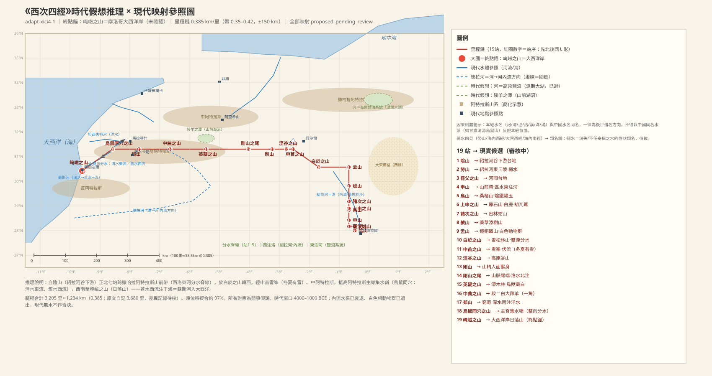
### 【SHJ-02-4-001】陰山——紹拉河谷的起點

> 《西次四經》之首，曰陰山，上多穀，無石，其草多𦮉蕃。陰水出焉，西流注于洛。

**白話解讀**　西次四經的起點陰山，定在阿爾及利亞西南、紹拉河谷下游的阿德拉爾方向台地（方向性猜測偏可靠）。紹拉河南流到這一帶消失於沙漠，和「陰水西流注于洛」（內流溪注內流河）的格局互證；「洛」就是**紹拉河（Saoura）內流系統**——西阿爾及利亞最大的內流河，與中國洛水同名是借名（較可靠，`WAT:SHJ-02-4-001#2`）。這座陰山和西次三經利比亞的陰山同名異地（「同一陰山」假說已被否決，見西次三經 016 條）。「上多穀（構樹類），無石」是土質旱生喬木山；草多𦮉、蕃兩種旱生草本。

**未決項**
- 衝突：陰山——與西次三經陰山同名異地：同一陰山假說已檢驗否決——若以三經陰山（利比亞19.6°E）為本經起點，按本經腿程展開，崦嵫終點落於突尼斯，「苕水西流注于海」「冬夏有雪」「日落山」三屬性全破；兩座陰山水文配置亦不同（本站陰水西注于洛 vs 三經濁浴之水南注蕃澤文貝），無共享水錨點。結論：『陰』為背陰通名，同名異地成立
- 未知：陰山——𦮉蕃的物種對應
- 未知：陰山——現實山名未定位
- 衝突：洛／洛水——洛水三用：001-003受水『洛』、010『洛水東注渭』、014『洛水北注河』——三名三用（同名異水），待裁
- 未知：洛／洛水——三處洛水是否同一水名的不同河段/水系

### 【SHJ-02-4-002】勞山——紫草與弱水

> 北五十里，曰勞山，多茈草。弱水出焉，而西流注于洛。

**白話解讀**　往北 50 里到勞山（「勞」是瘦瘠貧山的意思），紹拉河東側丘陵（方向性猜測偏可靠）。多茈草——**紫草**，根能製紫色染料的旱地植物，是一條物產記錄。弱水西流注洛——「弱水」是不任舟楫、中途消失之水的意思：一條會消失的溪注入一條會消失的河，語義完全自洽。按 ADJ-005 裁決，弱水在全書四見四域，是性狀類名而非專名，多地同名不算衝突（較可靠，`WAT:SHJ-02-4-002#1`）。

**未決項**
- 未知：勞山——現實山名未定位
- 衝突：弱水——弱水四處同名異水：類名說修正版＝消失之水／沼澤／環狀靜水的性狀類名（發起人方向：弱水可以是沼澤）vs 同一神話水體說，待裁
- 衝突：弱水——ADJ-005（水名/地貌名為性狀類名，多實例合法非衝突）——本條按類名多實例處理，留檔不裁

### 【SHJ-02-4-003】罷父之山——染色礦物雙記

> 西五十里，曰罷父之山，洱水出焉，而西流注于洛，其中多茈、碧。

**白話解讀**　往西 50 里到罷父山（音節名，語義不明），吉爾河—祖斯法納河之間的台地（方向性猜測，置信偏低）。洱水西流注洛，水裡多茈（紫色礦物/紫晶類）和碧（綠色石/綠松石類）——一紫一綠的染色礦物雙記，和上一站的紫草染料記錄相鄰，或許反映一條染料物產帶。

**未決項**
- 未知：罷父之山——洱水河道今貌
- 未知：罷父之山——現實山名未定位

### 【SHJ-02-4-004】申山——八水注之的「河」

> 北七十里，曰申山，其上多榖柞，其下多杻橿，其陽多金玉。區水出焉，而江流注于河。

**白話解讀**　往北 70 里到申山，貝沙爾以北的撒哈拉阿特拉斯山前帶（方向性猜測偏可靠）。上層榖柞喬木、下層杻橿灌木，南坡金玉。區水「江流注于河」——「江流」疑為「東流」的傳抄之誤，待文本批評核。這個「河」是本經東側的最大受水體（前後共八條水注之），候選 A 是高原東向內流宏系統（Chott el Chergui—Melrhir—Hodna 鹽沼群，溼期是大湖），候選 B 是穆盧耶河—地中海系統；按 F-0013 裁決（2026-10-27，規則 A），「河」是區域性強大水系的通名——本經的「河」就是本鏈（高原）的強水系實例，與西次三經的河水（尼羅河）、中原的黃河各鏈自立，不再是三層指稱衝突（方向性猜測，`WAT:SHJ-02-4-004#2`）。

**未決項**
- 未知：申山——「而江流注于河」的『江』字疑為異文/傳抄問題（疑『東流』），待文本批評核
- 未知：申山——現實山名未定位
- 注記：河——與xici3河水（尼羅）及中國河的關係已由 F-0013 裁決結案（2026-10-27，規則 A：河＝區域強水系通名，各鏈實例化並存，非衝突）
- 未知：河——河是否同一水體貫穿全經
- 未知：區水——『江流』讀法

### 【SHJ-02-4-005】鳥山——桑楮經濟林

> 北百二百里，曰鳥山，其上多桑，其下多楮，其陰多鐵，其陽多玉。辱水出焉，而東流注于河。

**白話解讀**　往北 120 里到鳥山（鳥多之山的通用名），撒哈拉阿特拉斯山前的植被山（方向性猜測偏可靠）。上多桑、下多楮——桑皮和楮皮都是纖維原料，是經濟林木的記錄；北坡鐵（本經鐵礦首記）、南坡玉。辱水東流注河。

**未決項**
- 未知：鳥山——現實山名未定位

### 【SHJ-02-4-006】上申之山——白鹿與「以髯飛」的當扈

> 又北二十里，曰上申之山，上無草木，而多硌石，下多榛楛，獸多白鹿。其鳥多當扈，其狀如雉，以其髯飛，食之不眴目。湯水出焉，東流注于河。

**白話解讀**　再往北 20 里到上申山（「申山之上」，和申山、後面的申首構成申山系三段），山前礫原（方向性猜測偏可靠）。山頂無草木、多硌石（裸露礫石），山麓多榛楛灌木。「獸多白鹿」——**本經白色動物群主題的首次出現**（沙漠/高原白相動物，白大羚一類的泛化），和後面 009 站（白狼白虎白雉白翟）、015 站（鳥獸盡白）、018 站（白虎）連成一條白色動物群鏈。最精彩的是當扈：雉形而「**以其髯飛**」（用鬍鬚飛）——這是**胡兀鷲（bearded vulture）**：「髯」就是牠頦下的黑色鬚狀羽，阿特拉斯山原生；古人把這撮鬚誤當成了飛行器官（較可靠，`CRE:SHJ-02-4-006#2`）。「食之不眴目」是治目眩的民俗賦義。湯水東流注河（湯＝熱水，溫泉溪候選，弱）。

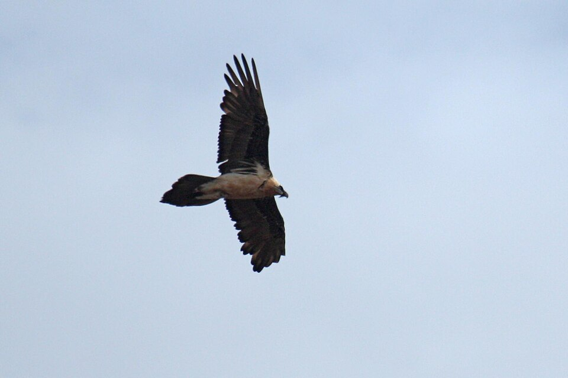（圖：Wikimedia Commons）

**未決項**
- 未知：上申之山——現實山名未定位
- 未知：湯水——湯水是否熱水

### 【SHJ-02-4-007】諸次之山——多蛇的密林

> 又北八十里，曰諸次之山，諸次之水出焉，而東流注于河。是山也，多木無草，鳥獸莫居，是多眾蛇。

**白話解讀**　再往北 80 里到諸次山，撒哈拉阿特拉斯的密林山（方向性猜測，置信偏低）。諸次之水東流注河（山水同名）。「多木無草」是密林冠層閉合、林下無草本層的生態觀察；「鳥獸莫居，是多眾蛇」——鳥獸不棲而蛇群聚集，是陰濕密林多蛇生境的直白記錄。

**未決項**
- 未知：諸次之山——鳥獸莫居的原因（密林/傳說禁忌）
- 未知：諸次之山——現實山名未定位

### 【SHJ-02-4-008】號山——藥草漆樹山

> 又北百八十里，曰號山，其木多漆、椶，其草多葯虈芎藭。多汵石。端水出焉，而東流注于河。

**白話解讀**　再往北 180 里到號山，撒哈拉阿特拉斯的藥草—漆樹山（方向性猜測，置信偏低）。樹多漆樹和棕櫚（經濟林木），草多葯虈、芎藭（川芎類傘形科藥草）——一條藥草物產記錄。多汵石（水邊石，確指待考）。端水東流注河。

**未決項**
- 未知：號山——汵石、葯虈確指
- 未知：號山——現實山名未定位

### 【SHJ-02-4-009】盂山——鐵礦與白色猛獸群

> 又北二百二十里，曰盂山，其陰多鐵，其陽多銅，其獸多白狼白虎，其鳥多白雉白翟。生水出焉，而東流注于河。

**白話解讀**　再往北 220 里到盂山（「盂」是盆形山的意思），撒哈拉阿特拉斯山前的礦山帶——北坡鐵、南坡銅，該方向有大型鐵礦（加拉傑比萊特 Gara Djebilet 方向）和銅礦化（方向性猜測偏可靠；**紅隊注：該具體鐵礦山與本站鏈位相距約 779 公里，遠超容差，僅作礦帶方向的山系段粒度參考，不作站位證據**）。動物全是白色相：白狼（沙漠狼毛色淺）、**白虎（淺色大貓——很可能是阿特拉斯獅，古漢語無「獅」字，以「虎」述獅）**、白雉、白翟——白色動物群主題第二站（較可靠，`CRE:SHJ-02-4-009#2`）。生水東流注河；下一站白於山的夾水北來注之，同一條水的兩段記錄。

**未決項**
- 未知：盂山——白色相是毛色變異還是特定物種

### 【SHJ-02-4-010】白於之山——一山兩源的小型分水嶺

> 西二百五十里，曰白於之山，上多松柏，下多櫟檀，其獸多㸲牛、羬羊，其鳥多鴞。洛水出于其陽，而東流注于渭；夾水出于其陰，東流注于生水。

**白話解讀**　往西 250 里到白於山——鏈條從這裡由北上轉為西行，位置約在阿特拉斯山前的雪松柏林帶（方向性猜測偏可靠）。「白於」呼應全經的白色主題。上層松柏（阿特拉斯雪松/檜柏）、下層櫟檀硬木，是真實的植被垂直帶。野獸有㸲牛和**羬羊——這裡的羬羊是阿特拉斯鬃羊（aoudad），北非原生**（較可靠，`CRE:SHJ-02-4-010#2`）；鳥多鴞（貓頭鷹）。水文上是一座小型分水嶺：南坡（陽）出洛水東流注渭，北坡（陰）出夾水東流注生水。注意「洛水」在本經三見（001–003 的受水體洛、本站東注渭、014 站北注河），三名三用，同名異水待裁。

**未決項**
- 衝突：白於之山——洛水三用衝突見水系記錄
- 衝突：洛水（白於之山陽）——洛水三用衝突

### 【SHJ-02-4-011】申首之山——全經唯一的「冬夏有雪」

> 西北三百里，曰申首之山，無草木，冬夏有雪。申水出于其上，潛于其下，是多白玉。

**白話解讀**　往西北 300 里到申首山（申山系之首），候選是**東高阿特拉斯雪峰帶**（阿亞希山 Jbel Ayachi，海拔 3,757 米方向；鏈位偏差約 200 公里，記為累積誤差待校；對立候選是撒哈拉阿特拉斯主峰 Djebel Aïssa）。「**冬夏有雪**」是全經唯一的常年積雪記錄，高寒山的決定性屬性（較可靠，`CLIM:SHJ-02-4-011#1`）。「申水出于其上，潛于其下」——發源於山頂、潛入地下，是喀斯特伏流/雪水滲流的真實水文記錄，「潛」字的這個用法和西次三經「河水所潛」屬同一詞彙系統。多白玉（白色岩/石英）。

**未決項**
- 未知：申首之山——鏈位偏差來源（里程/方位/錨點待校）

### 【SHJ-02-4-012】涇谷之山——白金白玉

> 又西五十五里，曰涇谷之山。涇水出焉，東南流注于渭，是多白金白玉。

**白話解讀**　再往西 55 里到涇谷山（涇水之谷，山水同名），東摩洛哥高原的谷山（方向性猜測偏可靠）。涇水東南流注渭——渭水系統的接入點之一；這個涇水與中國涇水同名，是借名警示。多白金（銀）白玉——淺色雙礦。

### 【SHJ-02-4-013】剛山——一足一手的神𩳁

> 又西百二十里，曰剛山，多柒木，多㻬琈之玉。剛水出焉，北流注于渭。是多神𩳁，其狀人面獸身，一足一手，其音如欽。

**白話解讀**　再往西 120 里到剛山（「剛」是石質堅硬之意），中阿特拉斯東緣（方向性猜測偏可靠）。多柒木（漆樹類）和㻬琈美玉；剛水北流注渭。山裡多「神𩳁」：人面獸身、一足一手、聲音像嘆息（欽）——山精造像；「一足一手」可能是岩畫/立像缺損或側面像的觀察誤讀（側面站立的人獸像只看得見一足一手）（待考，`PER:SHJ-02-4-013#1`）。

**未決項**
- 未知：剛山——神𩳁的原型（岩畫/猴/傳說）

### 【SHJ-02-4-014】剛山之尾——全經唯一的「山尾」

> 又西二百里，至剛山之尾。洛水出焉，而北流注于河。其中多蠻蠻，其狀鼠身而鼈首，其音如吠犬。

**白話解讀**　再往西 200 里到剛山之尾——全經唯一的「尾」記錄，就是剛山餘脈的西端（方向性猜測偏可靠）。洛水在這裡發源北流注河（洛水第三用，同名異水待裁）。水裡多蠻蠻：鼠身鱉首、叫聲像狗吠——沙漠鼠形動物（跳鼠類）的誇張描述。注意：西次三經崇吾山的蠻蠻是鳥（一翼一目、相得乃飛），這裡是獸，同名異實，待裁。

**未決項**
- 衝突：剛山之尾——蠻蠻鳥（001）vs蠻蠻獸（014）同名異實
- 衝突：洛水（剛山之尾）——洛水三用衝突

### 【SHJ-02-4-015】英鞮之山——「鳥獸盡白」

> 又西三百五十里，曰英鞮之山，上多漆木，下多金玉，鳥獸盡白。涴水出焉，而北流注于陵羊之澤。是多冉遺之魚，魚身蛇首六足，其目如馬耳，食之使人不眯，可以禦凶。

**白話解讀**　再往西 350 里（西段最長腿程）到英鞮山，中阿特拉斯的漆木林帶（伊夫蘭方向）（方向性猜測偏可靠）。上層漆樹林、下層金玉；「**鳥獸盡白**」——白色動物群主題的第三站，也是表述最強的一次（「盡白」＝全是白色）。涴水北流注陵羊之澤（中阿特拉斯山前湖沼，Dayet 湖群方向）。澤中多冉遺之魚：魚身蛇首、**六足**、眼睛像馬耳朵——湖澤怪魚，「六足」可能是蠑螈（四足加外鰭被看成六足）一類兩棲動物的泛寫；「食之使人不眯（不做噩夢），可以禦凶」是民俗賦義（待考，`CRE:SHJ-02-4-015#3`）。

**未決項**
- 未知：英鞮之山——冉遺之魚原型（兩棲類/鯰）
- 未知：陵羊之澤——具體湖盆

### 【SHJ-02-4-016】中曲之山——駮＝獨角獸原型

> 又西三百里，曰中曲之山，其陽多玉，其陰多雄黃、白玉及金。有獸焉，其狀如馬而白身黑尾，一角，虎牙爪，音如鼓音，其名曰駮，是食虎豹，可以禦兵。有木焉，其狀如棠，而員葉赤實，實大如木𤓰，名曰櫰木，食之多力。

**白話解讀**　再往西 300 里到中曲山，中阿特拉斯西段—高阿特拉斯東緣（方向性猜測偏可靠）。南坡玉、北坡雄黃白玉加金。這裡的**駮**非常有名：像馬、白身黑尾、**頭上一角**、虎牙虎爪、叫聲像鼓、能吃虎豹——我們判它是**彎角劍羚（scimitar oryx）**：白色體色完全吻合，兩隻長角在側面看會重合成一隻——這正是獨角獸傳說的經典起源機制；「食虎豹」是頂級猛獸殺手的神話化，「可以禦兵」是護佑賦義（較可靠，`CRE:SHJ-02-4-016#2`）。《海外北經》也記了駮，方位一西一北，異文待裁。櫰木像棠樹、圓葉紅果、果實大如木瓜，說吃了長力氣。

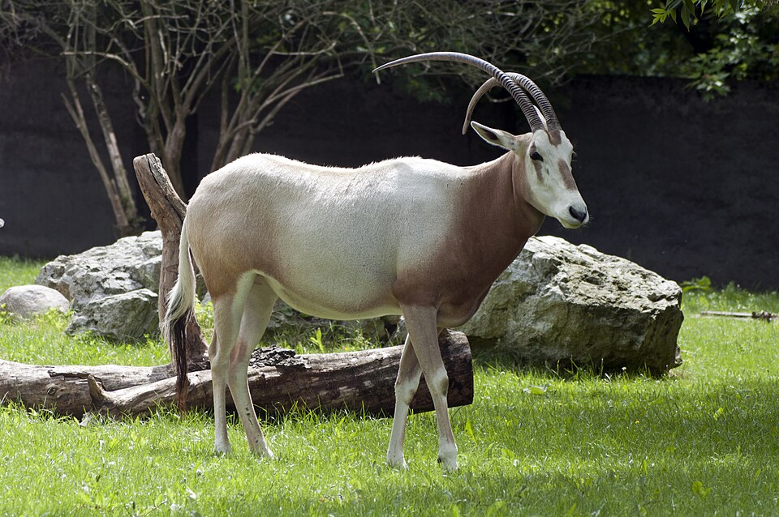（圖：Wikimedia Commons）

**未決項**
- 衝突：中曲之山——駮的方位：本經（西）vs海外北經（北）異文

### 【SHJ-02-4-017】邽山——窮奇與蠃魚

> 又西二百六十里，曰邽山。其上有獸焉，其狀如牛，猬毛，名曰窮奇，音如獆狗，是食人。濛水出焉，南流注于洋水，其中多黃貝；蠃魚，魚身而鳥翼，音如鴛鴦，見則其邑大水。

**白話解讀**　再往西 260 里到邽山，高阿特拉斯東段（方向性猜測偏可靠）。山上的窮奇：牛形、長著刺猬般的刺毛、叫聲像嗥叫的狗、吃人——兇獸（原型可能是豪豬/鬃毛野牛的複合，或純神話）。《海內北經》的窮奇是「虎形有翼」，和這裡的「牛形猬毛」形態分歧，同一兇獸名的異文待裁。濛水南流注洋水（平原大水，坦西夫特方向；「洋」是大水漫流的意思，和西次三經埃及的洋水同名異水，待裁）；水裡多黃貝。蠃魚魚身鳥翼、叫聲如鴛鴦——和西次三經的文鰩魚同屬飛魚型敘事；「見則其邑大水」仍是洪水兆象。

**未決項**
- 衝突：邽山——窮奇形態異文（牛形猬毛vs虎形有翼）
- 衝突：邽山——洋水與xici3洋水（F-0013 重整後＝消亡古水道）同名異水
- 衝突：洋水——洋水同名異水（xici3消亡古水道 vs xici4摩洛哥）

### 【SHJ-02-4-018】鳥鼠同穴之山——高阿特拉斯集水嶺

> 又西二百二十里，曰鳥鼠同穴之山，其上多白虎、白玉。渭水出焉，而東流注于河。其中多鰠魚，其狀如鱣魚，動則其邑有大兵。濫水出于其西，西流注于漢水，多𩶯魮之魚，其狀如覆銚，鳥首而魚翼魚尾，音如磬石之聲，是生珠玉。

**白話解讀**　再往西 220 里到鳥鼠同穴山——**「鳥鼠同穴」是高原鳥鼠共生（雪雀與鼠兔共穴）的真實生態現象，直接用作了山名**；位置候選是高阿特拉斯主脊集水嶺（圖卜卡勒峰方向，海拔 4,167 米）（在本假說內很可靠）。甘肅渭源的鳥鼠同穴山是《禹貢》傳統的後世借名，不能反證——本經正是因果倒置的核心案例。山上多白虎（白色動物群第四站）、白玉。水文是關鍵證據：**渭水發源於此向東流注河（渭在 010/012/013 站是受水提及，在這裡是發源體，一水兩用構成貫穿東坡的骨幹）；濫水出於山西向西流注漢水（蘇斯河方向，西入大西洋）——一山東西雙向分水，正是集水嶺水文的核心記錄**（較可靠）。渭水裡多鰠魚（像鱣的大魚），「動則其邑有大兵」是兵災兆象。濫水裡多𩶯魮之魚：像倒扣的碗勺、鳥首魚翼魚尾、叫聲如磬石，而且「**是生珠玉**」——產珠的水生物是珍珠貝/珠母的神話化（珍珠生成的觀察異化）（方向性猜測，`CRE:SHJ-02-4-018#4`）。

**未決項**
- 衝突：鳥鼠同穴之山——渭水/漢水與中國水名借名關係——本經為因果倒置核心案例
- 未知：鳥鼠同穴之山——𩶯魮之魚原型
- 衝突：漢水——與中國漢水同名（借名）
- 衝突：渭水——渭的歸宿（內流鹽沼vs地中海）待審

### 【SHJ-02-4-019】崦嵫之山——大西洋岸的日落山，全經終點

> 西南三百六十里，曰崦嵫之山，其上多丹木，其葉如穀，其實大如瓜，赤符而黑理，食之已癉，可以禦火。其陽多龜，其陰多玉。苕水出焉，而西流注于海，其中多砥礪。有獸焉，其狀馬身而鳥翼，人面蛇尾，是好舉人，名曰孰湖。有鳥焉，其狀如鴞而人面，蜼身犬尾，其名自號也，見則其邑大旱。

**白話解讀**　往西南 360 里到**崦嵫山——全經終點、終點錨**：摩洛哥大西洋岸的日落山（阿加迪爾—蘇斯河口方向）（在本假說內很可靠）。「崦嵫」就是日落之山，後世「日入崦嵫」傳統的地名源頭在這裡；它和西次三經泑山「西望日之所入」是兩經兩處日落山的呼應。山上多丹木：葉如穀、果實大如瓜、紅皮黑紋——**阿甘樹（摩洛哥特有）大果的候選**；「食之已癉（治熱病），可以禦火」是民俗賦義。南坡多**龜——地中海陸龜（摩洛哥原生）**（較可靠，`CRE:SHJ-02-4-019#1`），北坡多玉。苕水（蘇斯河下游）**西流注于海——這個「海」是大西洋，是本經唯一的海收水體，也是全鏈的西端錨點**；水中多砥礪（磨刀石＝河床礫岩）。孰湖是馬身鳥翼、人面蛇尾、「好舉人」（喜歡把人舉起來）的複合獸——或許有巴巴里獼猴（無尾、人面）的影子，機制待考。還有一種鴞形人面、蜼（長尾猿）身犬尾的鳥，鳴聲自呼其名，出現則城邑大旱——旱災兆象的複合造像。

**未決項**
- 未知：崦嵫之山——孰湖原型
- 未知：崦嵫之山——「可以禦火」的民俗機制

### 【SHJ-02-4-020】總結段——白雞為祭

> 凡《西次四經》自陰山以下，至于崦嵫之山，凡十九山，三千六百八十里。其神祠禮，皆用一白雞祈，糈以稻米，白菅為席。

**白話解讀**　西次四經從陰山到崦嵫山共十九山，自記 3,680 里，腿程合計 3,205 里，差 -12.9%，原文內部差異待校；折公制約 1,290–1,550 公里（自記）/1,120–1,350 公里（腿程）。本經山神沒有統一形態記錄（和西次三經「羊身人面」不同），祭禮一律用**一隻白雞**祈祭、稻米作祭米、白菅草編席——以白為祭，與全經白色動物群主題（白鹿/白狼/白虎/白雉/鳥獸盡白）首尾呼應。

### 【SHJ-02-4-021】全卷總計

> 右西經之山，凡七十七山，一萬七千五百一十七里。

**白話解讀**　以上是《西山經》的總計：七十七山、一萬七千五百一十七里。按我們的站點序列（19＋17＋23＋19＝78，含流沙一站）與原文計數基本一致；總里程折公制約 6,100–7,400 公里——一條從華山—青海湖橫貫南亞、阿拉伯、埃及、撒哈拉直到大西洋岸的超長記錄鏈。

---

本卷條目 82/82 全部覆蓋；未決項照錄 draft-v1 保留。配圖 14 幅，均為 Wikimedia Commons 實拍照片或歷史科學插畫，嵌入前已逐一打開 File: 頁面驗證存在。
