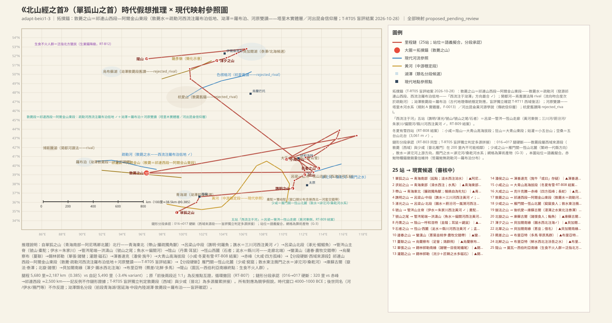
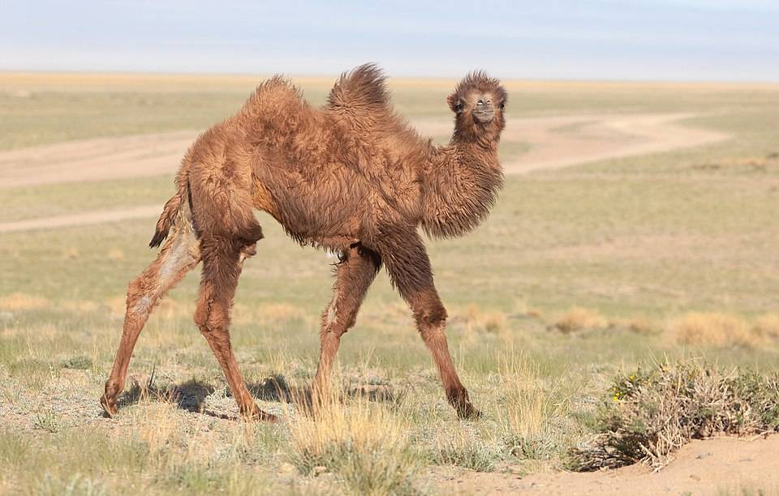
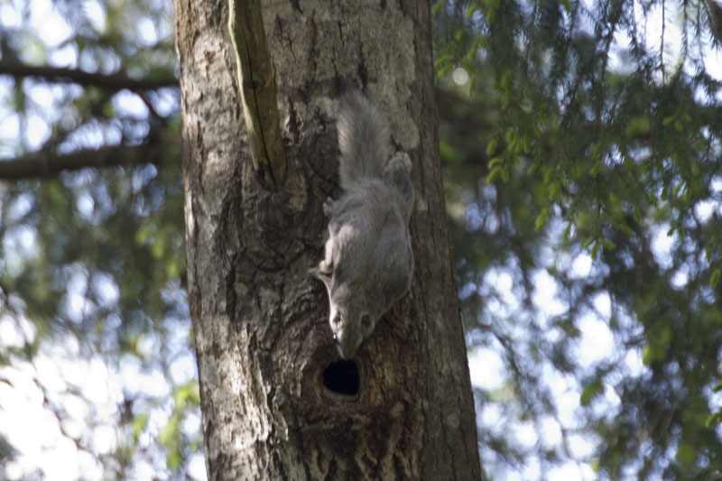
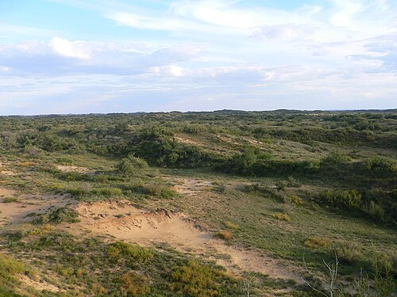
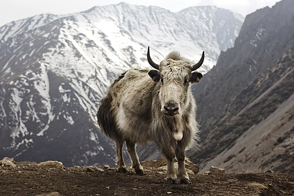
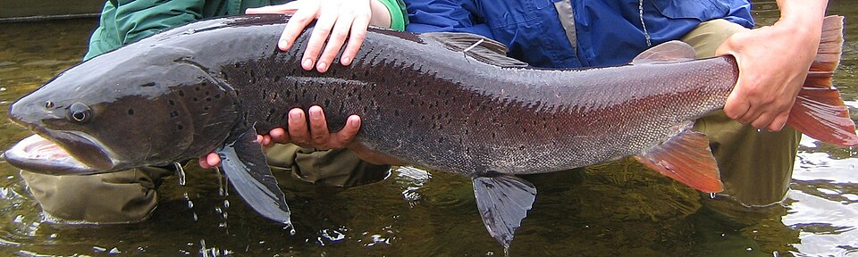
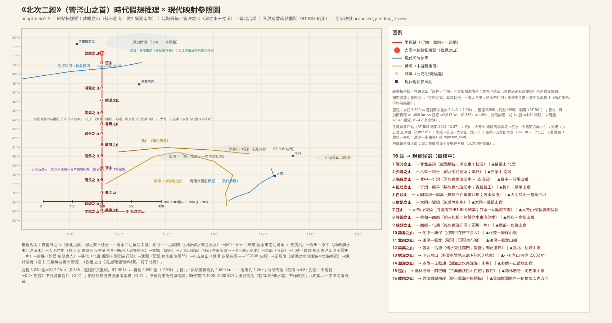
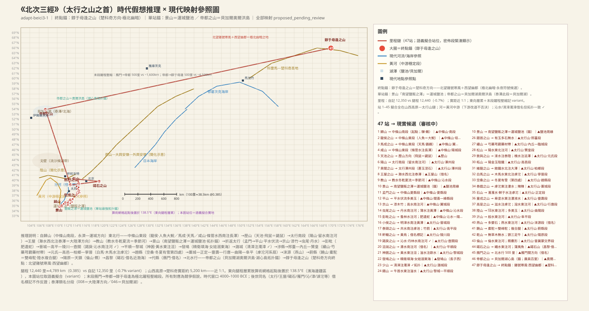
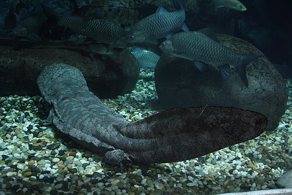
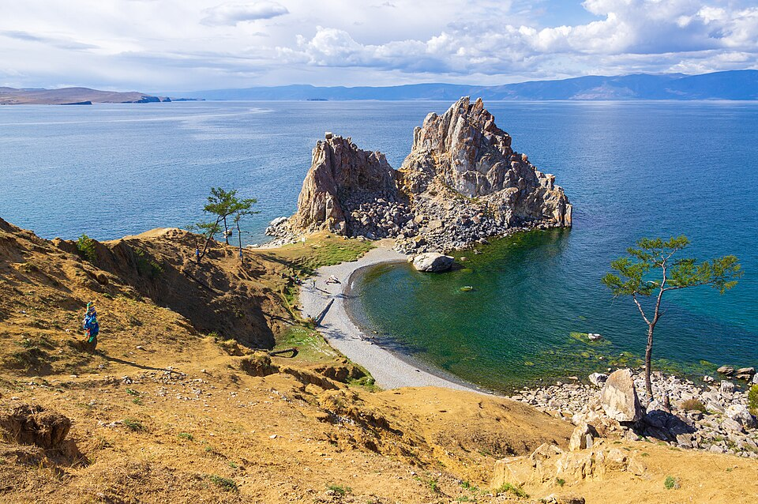

# 《北山经》白话通顺版（draft-v2，卷三）

## 本卷导览

《北山经》分三条子经，是全书篇幅最大的一卷（88 站有文，自记 87 山）：

- **北一经（25 山）**：从青海南部（阿尼玛卿山北麓方向）出发，经青海东部、吕梁—管涔—恒山走廊（「西流注于河」五站，黄河东侧）、阴山、锡林郭勒草原，中段硬断后接西域段——敦薨之山＝祁连山西段—阿尔金山东段（疏勒河西流注罗布泊低地，T-RT05 盲评结案），再接晋北插入段——少咸之山＝雁门关—恒山北麓（敦水＝滹沱河上游、雁门之水＝滹沱河/桑干河水系；**雁门名对系名称链牵引，遮蔽今名后复现性待验——名称污染清洗 2026-10-28 加注**），北折后杭爱，抵达贝加尔湖南缘，终点在图瓦—西伯利亚南缘方向。这是一条纵贯蒙古高原的南北大动脉（链形分段承认：016→017 腿硬断，敦薨段属西域来源段——盲评独立判定多源层累拼接）。
- **北二经（17 山）**：从晋北吕梁山（管涔山、汾水之滨）出发，穿大同盆地、张北高原，渡沙渡水，终点「錞于北海」——我们判断北海就是贝加尔湖。
- **北三经（46 山）**：挂名「太行之山」，从中条山南段起步，沿太行山主脊一路东北行，经运城盐池、长治（精卫填海的发鸠山）、滹沱河流域，到昌黎碣石山后折向北渡水，经泰泽（贝加尔湖方向）抵达帝都之山（已改肯特山—外贝加尔南麓带，RT-B02 结案；奥尔洪岛降 rejected_rival），最终指向极北之地——终点錞于毋逢之山主候选已改为外贝加尔方向（贝加尔以北山地，里程相容）；楚科奇降为延伸对立候选（需单腿放大 18 倍，里程否决，红队处置 RT-B04）。

**主锚点**（红队处置＋2026-10-27 批准方案落实后的状态）：景山「南望盐贩之泽」＝运城盐池（红队幸存项，但里程位置 7.8× 膨胀未解，锚级限于拓扑）；敦薨之山＝祁连山西段—阿尔金山东段（**T-RT05 遮蔽重判结案 2026-10-28，无先验盲评＋项目负责人批准**：敦薨水＝疏勒河——发源祁连山西段、西流注罗布泊低地，「西流注于泑泽」方向最合 ✓；开都河—焉耆降 rival，杭爱旧读降 rejected_rival；泑泽＝罗布泊——古代地理传统稳定对应、盲评独立确认，窗口期湿润期残余大湖，1972 年干涸，「曾经的大泽」正符文本量级；「实惟河原」双读——塔里木河水系＝规则 A 实体层〔西域唯一供养大量人畜的强水系〕／「河出昆仑」黄河源学说＝传统信仰层；赤鲑物种锚撤销重估维持）；帝都之山＝肯特山—外贝加尔南麓带（**RT-B02 结案**：三层坐标以文本实体为准统一，奥尔洪岛与楚科奇网格位降 rejected_rival）；敦题之山「錞于北海」＝贝加尔湖（注意：帝都改离湖心岛读法后，三锚「同一假说三次引用」缩为泰泽/北海两锚关联）；终点錞于毋逢之山＝外贝加尔方向（主候选，待裁 F-0018 关联）。

**里程吻合度**（红队核算修正，RT-B01/B03）：北一自记 5,490 里 vs 逐段加总 5,680 里（差 -3.4%）；北二自记 5,690 vs **5,240（逐腿原文重加，-7.9%——旧值 5,590/-1.8% 系幻影 +350，撤回）**；北三自记 12,350 vs 12,440（-0.7%——**注意这是 5.3× 前段膨胀与 0.1× 末段压缩的反向对冲伪影，总账吻合在统计上无效，北三已改为分段承认、逐腿标里值档**）；全卷自记 23,230 vs 23,360（+0.6%）。北二另有「凡十七山」实列 16 山的疑讹/佚失待核。

**裁决口径说明**：按已生效裁决，山名同名即同一座山（ADJ-005），所以太行、雁门、王屋、碣石等中原名的出现都按「借名/同一山系方向」处理；水名是性状类名（ADJ-005），所以「泰泽」「海」「北海」「河」在不同段落可以各指一湖一海，不算矛盾——北一的泰泽指贝加尔湖方向，北三的泰泽在中条山段指大陆泽方向、在后段又指贝加尔湖，各自成立。昆仑虚已另案裁为撒哈拉之眼（ADJ-002），本卷「出于昆仑之东北隅」只是跨卷方位参照，不作定位锚。烛龙已裁为极昼极夜与极光的人格化（ADJ-003），与北三终点「西望幽都」「其风如䬅」的极北寒夜意象属于同一认知簇。

**主要未决**（共 50 条，照录于各条目下）：「河原」读法——T-RT05 盲评结案（2026-10-28）记双读：塔里木河水系＝规则 A 实体层／「河出昆仑」黄河源学说＝传统信仰层；北一之「海」＝贝加尔湖读法；水马、何罗鱼、鰼鰼鱼等神异动物的确指；器酸、婴石等矿物确指；东海＝渤海还是鄂霍次克海等。

---

## 北山经·首（beici1，25 山＋总结段）

### 【SHJ-03-1-001】单狐之山：全经起点，青海南部阿尼玛卿山北麓方向

> 北山經之首，曰單狐之山，多机木，其上多華草。漨水出焉，而西流注于泑水，其中多茈石文石。

**白话解读**：整条北山经从这里起笔。山上多机木（槲树、桤木一类），山顶花草繁茂——像是高原边缘的草原花卉带。漨水从这里发源，向西流进泑水，水里有紫色的茈石和带花纹的文石。我们把起点放在青海南部、阿尼玛卿山北麓方向：从这里一路向北，正好接上后面河套、阴山的走向；「西流注于泑水」的泑水是全书反复出现的水名类名（按 ADJ-005，水名按性状命名，多地可用），这一段大致指青海湖—居延海方向的内陆水域。方向较可靠，具体山头待考。`MTN:SHJ-03-1-001#1` `WAT:SHJ-03-1-001#1` `WAT:SHJ-03-1-001#2`

**未决项**
- 未知：單狐之山——泑澤確指（類名分段）

### 【SHJ-03-1-002】求如之山：铜上玉下，水马出没

> 又北二百五十里，曰求如之山，其上多銅，其下多玉，無草木。滑水出焉，而西流注于諸毗之水。其中多滑魚。其狀如鱓，赤背，其音如梧，食之已疣。其中多水馬，其狀如馬，文臂牛尾，其音如呼。

**白话解读**：往北 250 里到求如之山，山上产铜、山下产玉，寸草不生。滑水西流进诸毗之水。水里两种东西最有名：滑鱼像鳝鱼、红背、叫声如梧树相击，传说吃了治疣；水马像马、前腿带花纹、拖着牛尾，叫声像人呼喊——大概是对某种水栖马形兽的夸张记录（河马或水栖马类的远闻也未可知）。《南山经》也有一条「诸毗之水」，同名不同水，按类名规则各自成立。位置大约在青海东部贵德—尖扎方向，方向性猜测。`MTN:SHJ-03-1-002#1` `CRE:SHJ-03-1-002#4`

**未决项**
- 未知：求如之山——水馬確指

### 【SHJ-03-1-003】带山：一角兽䑏疏与雌雄同体的鵸䳜

> 又北三百里，曰帶山，其上多玉，其下多青碧。有獸焉，其狀如馬，一角有錯，其名曰䑏疏，可以辟火。有鳥焉，其狀如烏，五采而赤文，名曰鵸䳜，是自爲牝牡，食之不疽。彭水出焉，而西流注于芘湖之水，其中多儵魚，其狀如鶏而赤毛，三尾六足四首，其音如鵲，食之可以已憂。

**白话解读**：再北 300 里到带山，上产玉、下产青碧。这山的明星是䑏疏：像马、头生一只带错杂纹的角——一条典型的「独角兽」记录，可能是角马、藏羚或野马的角突被观察泛化而成，附会了「可以辟火」的神性。鸟有鵸䳜，乌鸦模样、五彩红纹，「自为牝牡」是古人对雌雄同体（或雌雄同形难分）现象的直白记录。彭水西流进芘湖，水里的倏鱼被写成鸡形红毛、三尾六足四首——多尾多足多首的造像式夸张。位置在青海东北、西宁方向，较可靠。`MTN:SHJ-03-1-003#1` `CRE:SHJ-03-1-003#2` `CRE:SHJ-03-1-003#4`

### 【SHJ-03-1-004】谯明之山：一首十身的何罗鱼

> 又北四百里，曰譙明之山。譙水出焉，西流注于河。其中多何羅之魚，一首而十身，其音如吠犬，食之已癰。有獸焉，其狀如貆而赤豪，其音如榴榴，名曰孟槐，可以禦凶。是山也，無草木，多青雄黃。

**白话解读**：再北 400 里到谯明之山。谯水西流注入「河」——这个「河」就是黄河中游晋陕峡谷那一段（规则 A 中原链预设实例，F-0013）。按 RT-B09 结案（2026-10-27）：「西流注于河」要求站位在黄河**东**侧，本站已从甘肃—宁夏（河西侧，拓扑矛盾）重配到吕梁—管涔—恒山走廊的吕梁山·中段（离石—中阳方向），谯水读为三川河方向（吕梁山中段西麓西注黄河 ✓）。水里的何罗鱼「一首而十身」、叫声像狗吠：一个头拖十个身子，多半是把成群结队的小鱼看成了一体，或者是对多鳃鱼类的误读，确指待考。兽有孟槐，像獾、红鬃毛，传说可以御凶。山上无草木，多青雄黄——雄黄是砷硫化物，既是颜料也是药料。`MTN:SHJ-03-1-004#1` `WAT:SHJ-03-1-004#2` `CRE:SHJ-03-1-004#1`

**未决项**
- 未知：譙明之山——何羅魚一首十身讀法

### 【SHJ-03-1-005】涿光之山：十翼的鰼鰼鱼

> 又北三百五十里，曰涿光之山。嚻水出焉，而西流注于河。其中多鰼鰼之魚，其狀如鵲而十翼，鱗皆在羽端，其音如鵲，可以禦火，食之不癉。其上多松柏，其下多椶枏，其獸多麢羊，其鳥多蕃。

**白话解读**：再北 350 里到涿光之山。嚣水西流入黄河——按 RT-B09 结案（2026-10-27），本站从河套西缘（黄河西侧，拓扑矛盾）重配到吕梁山·北段（岚县—兴县方向），嚣水读为蔚汾河—岚漪河方向（西注黄河 ✓）；后面 021 站另有一条嚣水发源，同名类名。鰼鰼鱼像喜鹊、长着十只翅膀、鳞片长在羽毛尖上——飞鱼或带翅昆虫的观察被夸大成了「鱼身鸟翼」，兼有「御火」「不瘅」两层药用附会。山上松柏林、山下棕楠，兽多羚羊，鸟多「蕃」（小鸟泛称）。`MTN:SHJ-03-1-005#1` `CRE:SHJ-03-1-005#2`

**未决项**
- 未知：涿光之山——鰼鰼之魚確指

### 【SHJ-03-1-006】虢山：双峰驼登场——蒙古风物的自证

> 又北三百八十里，曰虢山，其上多漆，其下多桐椐。其陽多玉，其陰多鐵。伊水出焉，西流注于河。其獸多橐駝，其鳥多寓，狀如鼠而鳥翼，其音如羊，可以禦兵。

**白话解读**：再北 380 里到虢山，上多漆树、下多桐椐，山南产玉、山北产铁。伊水西流入黄河——按 RT-B09 结案（2026-10-27），本站从河套—乌海（黄河西侧，拓扑矛盾）重配到管涔山·主脊（宁武—静乐方向），伊水读为朱家川方向（管涔山北麓西注黄河 ✓；「伊水」是借名，与中山经的伊水同名）。最要紧的是「其兽多橐驼」——橐驼就是双峰骆驼，蒙古—戈壁的标志性物种，窗口期分布含晋西北—河套交错带，在新站位下依然成立。鸟有「寓」：老鼠身子、鸟的翅膀、叫声像羊——这是鼯鼠（飞鼠）的画像，滑翔被看成了「鸟翼」。`MTN:SHJ-03-1-006#1` `CRE:SHJ-03-1-006#1` `CRE:SHJ-03-1-006#3`

**配图**

（图：Wikimedia Commons）

### 【SHJ-03-1-007】虢山之尾：同一条山脉的另一端

> 又北四百里，至于虢山之尾，其上多玉而無石。魚水出焉，西流注于河，其中多文貝。

**白话解读**：再往北 400 里，到了虢山的尾端——按山名唯一原则（ADJ-005），这里不是另一座山，而是同一条虢山山脉的尾端站。按 RT-B09 结案（2026-10-27），本站从河套北—阴山（黄河西侧，拓扑矛盾）重配到管涔山脉尾端—洪涛山（神池—平鲁方向，与 006 管涔山同脉两端）。山上多玉而无石。鱼水西流入黄河，读为偏关河方向（西注黄河 ✓），水里多文贝——带花纹的蚌蛤，内陆河湖贝类的记录。`MTN:SHJ-03-1-007#1`

### 【SHJ-03-1-008】丹熏之山：会飞的「耳鼠」就是鼯鼠

> 又北二百里，曰丹熏之山，其上多樗柏，其草多韭䪥，多丹雘。熏水出焉，而西流注于棠水。有獸焉，其狀如鼠，而菟首麋身，其音如獆犬，以其尾飛，名曰耳鼠，食之不䐆，又可以禦百毒。

**白话解读**：再北 200 里到丹熏之山。山上多臭椿和柏树，草多韭菜和䪥（山蒜、薤白一类的旱地香草），还产丹雘（朱砂颜料）。熏水西流进棠水。这里的耳鼠写得活灵活现：老鼠身子、兔子脑袋、麋鹿身段，「以其尾飞」——古人看到鼯鼠张开皮膜滑翔，以为是用尾巴在飞。这是全卷第二条鼯鼠记录（与 006 的「寓」同型）。位置在阴山—呼和浩特方向，较可靠。`MTN:SHJ-03-1-008#1` `CRE:SHJ-03-1-008#2`

**配图**

（图：Wikimedia Commons）

**未决项**
- 未知：丹熏之山——䪥確指

### 【SHJ-03-1-009】石者之山：善于伏藏的孟极

> 又北二百八十里，曰石者之山，其上無草木，多瑤碧。泚水出焉，西流注于河。有獸焉，其狀如豹，而文題白身，名曰孟極，是善伏，其鳴自呼。

**白话解读**：再北 280 里到石者之山，光秃秃无草木，多瑶碧（美玉青石）。泚水西流入黄河——按 RT-B09 结案（2026-10-27），本站从阴山—大青山（黄河西侧，拓扑矛盾）重配到恒山·西麓（繁峙—代县方向，走廊北端），泚水读为县川河方向（管涔山脉尾端—恒山西麓过渡带西注黄河 ✓）。兽有孟极：豹子模样、花额头、白身子，「善伏」——善于潜伏突袭，像是伏击型猫科动物（雪豹或猞猁一类）的泛化记录，名字来自它的叫声（自呼）。`MTN:SHJ-03-1-009#1` `CRE:SHJ-03-1-009#2`

### 【SHJ-03-1-010】边春之山：阴山南麓的果园菜畦

> 又北百一十里，曰邊春之山，多蔥、葵、韭、桃、李。杠水出焉，而西流注于泑澤。有獸焉，其狀如禺而文身，善笑，見人則臥，名曰幽鴳，其鳴自呼。

**白话解读**：再北 110 里到边春之山。这山不记矿产，记的是葱、葵、韭、桃、李——一幅温带旱地的果蔬图景，正是阴山南麓农牧交错带的生业风物。杠水西流进泑泽（后面 012 站的栎水南流注入杠水，构成「栎水→杠水→泑泽」的二级支流链）。兽有幽鴳：猴子模样、花身子，「善笑，见人则卧」——猴类行为的拟人化记录。位置在大青山—蛮汉山方向，较可靠。`MTN:SHJ-03-1-010#1` `PLA:SHJ-03-1-010#1`

### 【SHJ-03-1-011】蔓联之山：见人就喊的足訾

> 又北二百里，曰蔓聯之山，其上無草木，有獸焉，其狀如禺而有鬛，牛尾、文臂、馬蹏，見人則呼，名曰足訾，其鳴自呼。有鳥焉，群居而朋飛，其毛如雌雉，名曰鵁，其鳴自呼，食之已風。

**白话解读**：再北 200 里到蔓联之山，山上无草木。兽有足訾：猴形、带鬃毛、牛尾巴、花臂膀、马蹄子，见人就呼喝——又一条灵长类泛化记录。鸟有䴔：成群结队地飞（群居朋飞），毛色像母野鸡，传说吃了治风疾。位置在乌兰察布方向，方向性猜测。`MTN:SHJ-03-1-011#1` `CRE:SHJ-03-1-011#2`

### 【SHJ-03-1-012】单张之山：衔着尾巴走路的诸犍

> 又北百八十里，曰單張之山，其上無草木。有獸焉，其狀如豹而長尾，人首而牛耳，一目，名曰諸犍，善吒，行則銜其尾。居則蟠其尾。有鳥焉，其狀如雉，而文首、白翼、黃足，名曰白鵺，食之已嗌痛，可以已痸。櫟水出焉，在而南流注于杠水。

**白话解读**：再北 180 里到单张之山，无草木。兽有诸犍：豹身长尾、人面牛耳、只长一只眼；最生动的是「行则衔其尾，居则蟠其尾」——走路叼着尾巴、歇着盘着尾巴，像是猴豹一类护尾行为的细节观察，「一目」读法待考。鸟有白鵺，野鸡模样、花头白翅黄脚。栎水从这里向南流进杠水——接上 010 站的支流链（栎→杠→泑泽），水系在链内闭合。位置在乌兰察布—锡林郭勒南缘，较可靠。`MTN:SHJ-03-1-012#1` `CRE:SHJ-03-1-012#2` `WAT:SHJ-03-1-012#1`

**未决项**
- 未知：單張之山——諸犍「一目」讀法

### 【SHJ-03-1-013】灌题之山：流沙与磁石

> 又北三百二十里，曰灌題之山，其上多樗柘，其下多流沙，多砥。有獸焉，其狀如牛而白尾，其音如訆，名曰那父。有鳥焉，其狀如雌雉而人面，見人則躍，名曰竦斯，其鳴自呼也。匠韓之水出焉，而西流注于泑澤，其中多磁石。

**白话解读**：再北 320 里到灌题之山。山上多臭椿柘树，山下「多流沙」——沙质草原和沙丘地，浑善达克沙地是很好的对应。兽有那父（牛身白尾），鸟有竦斯（母野鸡身子、人面孔，见人就跳）。匠韩之水西流进泑泽，水里「多磁石」——天然磁铁矿砂。这条记录分量很重：磁石是指南针知识的资源先导，属于矿物证据级的硬核内容。位置在锡林郭勒方向，较可靠。`MTN:SHJ-03-1-013#1` `LND:SHJ-03-1-013#1` `MIN:SHJ-03-1-013#2`

**配图**

（图：Wikimedia Commons）

**未决项**
- 未知：灌題之山——磁石確指

### 【SHJ-03-1-014】潘侯之山：四节生毛的旄牛

> 又北二百里，曰潘侯之山，其上多松柏，其下多榛楛，其陽多玉，其陰多鐵。有獸焉，其狀如牛，而四節生毛，或曰旄牛。邊水出焉，而南流注于櫟澤。

**白话解读**：再北 200 里到潘侯之山。上松柏、下榛楛，南坡玉、北坡铁。兽「其状如牛，而四节生毛，或曰旄牛」——四条腿关节处长着长毛，作者自己也不确定，加了一句「或曰旄牛」（有人叫它旄牛）：这就是牦牛（犛牛）的记录，「或曰」二字是记录者对命名存疑的诚实标注，很难得。边水南流进栎泽——栎泽正是 012 站栎水的受水泽，这条水系在链内完全闭合。位置在锡林郭勒—浑善达克方向，较可靠。`MTN:SHJ-03-1-014#1` `CRE:SHJ-03-1-014#2` `WAT:SHJ-03-1-014#2`

**配图**

（图：Wikimedia Commons）

### 【SHJ-03-1-015】小咸之山：冬夏有雪

> 又北二百三十里，曰小咸之山，無草木，冬夏有雪。

**白话解读**：再北 230 里到小咸之山。全条只有一句：无草木，冬夏有雪。别小看这四个字——「冬夏有雪」是永久积雪或长雪期的直白记录。红队核查指出（RT-B08）：浑善达克（约 1,300 米，42.5°N）在窗口期（全新世大暖期，比今更暖）不可能常年积雪——「冬夏有雪」是对该候选的**否决**而非支持。2026-10-27 批准方案结案：本站重配到阴山脉·大青山高海拔段（九峰山 2,338 米一带，窗口期积雪线略低于今，2,300 米级山体可持长雪期）；「冬夏有雪」四站（小咸→大青山、狂山→大青山东段、姑灌→小五台山、空桑→五台山北台 3,061 米 ✓）统一由「否决工具」转为落位依据，旧候选一律降 rejected_rival。`MTN:SHJ-03-1-015#1` `CLIM:SHJ-03-1-015#1`

### 【SHJ-03-1-016】大咸之山：上不去的四方孤峰

> 北二百八十里，曰大咸之山，無草木，其下多玉。是山也，四方，不可以上。有蛇名曰長蛇，其毛如彘豪，其音如鼓柝。

**白话解读**：再北 280 里到大咸之山，无草木，山下多玉。「是山也，四方，不可以上」——一座四四方方、爬不上去的孤峰或台地，是实打实的山形记录（《南山经》的成山、会稽山也有同样的「四方」写法）。蛇有长蛇：鳞片糙得像猪鬃，叫声像敲梆子。位置在克什克腾—赤峰方向，方向性猜测。`MTN:SHJ-03-1-016#1`

### 【SHJ-03-1-017】敦薨之山：本经拓扑锚——祁连山西段与双读「河原」

> 又北三百二十里，曰敦薨之山，其上多椶枏，其下多茈草。敦薨之水出焉，而西流注于泑澤。出于昆侖之東北隅，實惟河原。其中多赤鮭，其獸多兕，旄牛，其鳥多鳲鳩。

**白话解读**：再北 320 里到敦薨之山——本经最关键的拓扑锚，2026-10-28 批准方案（T-RT05 遮蔽重判，无先验盲评＋项目负责人批准）结案：**主候选改祁连山西段—阿尔金山东段**。山上棕楠、山下紫草。敦薨之水＝**疏勒河**，发源祁连山西段、**西流**注罗布泊低地——「西流注于泑泽」方向最合 ✓；开都河—焉耆读法（西流注博斯腾湖）降为对立候选（流向吻合度次于疏勒河）；杭爱读法（北流入色楞格）与「西流」的硬矛盾维持否决。这一段的泑泽＝**罗布泊**：古代地理传统稳定对应，盲评独立确认——窗口期（全新世湿润期）的残余大湖，历史上因塔里木河改道而游移（罗布泊—楼兰—台特玛湖），1972 年干涸——「曾经的大泽」正合文本量级。「出于昆仑之东北隅，实惟河原」记**双读**：【实体层】按规则 A（F-0013）读为**塔里木河水系**——西域唯一供养大量人畜的强水系，楼兰/龟兹/焉耆绿洲文明所系，水量级、文明承载、常年性三项硬条件全满足；【信仰层】**「河出昆仑」传统河源学说**——黄河源于昆仑的传统信仰（与《海内西经》「河水出东北隅」逐字平行）——两层并列不互斥；杭爱旧读降 rejected_rival。按裁决口径，昆仑虚已另案裁为撒哈拉之眼（ADJ-002），这里的「昆仑」只是跨卷方位参照（旁证：祁连西段正在其东北方向），不作本经定位锚。水里多赤鲑：原判哲罗鲑——**物种证据重估维持：哲罗鲑无塔里木/疏勒河水系分布，原「关键物种锚」随杭爱锚一并撤销，降非定位性**，西域水系（疏勒河—罗布泊低地）确指待考；兽多兕（一角兽泛化）和旄牛（牦牛），鸟多鸤鸠（布谷类）。链形注记：上一站（大咸·赤峰方向）到本站腿程「北 320 里」对约 2,500 公里实距是硬断——**链内层累拼接：西域来源段**（盲评独立判定多源拼接——敦薨段〔西域〕与少咸〔晋北〕在 200 里内不可能相邻），本链为分段承认的编纂接合，相邻腿里程不作链形证据。`MTN:SHJ-03-1-017#1` `WAT:SHJ-03-1-017#1` `CRE:SHJ-03-1-017#1`

**配图**

（图：Wikimedia Commons）

**未决项**
- 未知：敦薨之山——赤鮭西域水系確指（疏勒河—羅布泊低地方向）

### 【SHJ-03-1-018】少咸之山：吃人的窫窳与毒鱼

> 又北二百里，曰少咸之山，無草木，多青碧。有獸焉，其狀如牛，而赤身、人面、馬足，名曰窫窳，其音如嬰兒，是食人。敦水出焉，東流注于鴈門之水，其中多䰽䰽之魚。食之殺人。

**白话解读**：再北 200 里到少咸之山，无草木，多青碧。兽有窫窳：牛身红色、人面马脚、哭声像婴儿——全书最著名的食人神兽之一，「是食人」三个字是对危险兽类（或食人传闻）的警戒记录。敦水东流进雁门之水——**T-RT05 盲评结案（2026-10-28）：主候选改晋北雁门关—恒山北麓（繁峙—代县方向）**：雁门稳定对应代县雁门关，敦水读为滹沱河上游方向（恒山北麓东流），雁门之水＝滹沱河/桑干河水系（与北三雁门之山同属晋北雁门地标群）；后杭爱旧候选降 rival。**名称污染清洗加注（2026-10-28，§3.9）：雁门→雁门关名对为名称链牵引（今名对读）——遮蔽今名后复现性待验（待去今名重判）；敦水→雁门之水的水系拓扑层保留，置信 low_medium 维持**。水里多䰽䰽鱼，「食之杀人」——明明白白的毒鱼记录（河豚或有毒鱼类的泛化）。盲评同时独立判定：敦薨段（西域）与少咸（晋北）在 200 里内不可能相邻——链内多源层累拼接，与 RT-B03 分段承认结论独立呼应。`MTN:SHJ-03-1-018#1` `CRE:SHJ-03-1-018#2` `CRE:SHJ-03-1-018#3`

### 【SHJ-03-1-019】岳法之山：泰泽——贝加尔湖候选

> 又北二百里，曰嶽法之山。瀤澤之水出焉，而東北流注于泰澤。其中多抄魚，其狀如鯉而雞足，食之已疣。有獸焉，其狀如犬而人面，善投，見人則笑，其名山𤟤，其行如風，見則天下大風。

**白话解读**：再北 200 里到岳法之山（「岳」是借名）。瀤泽之水向东北流进泰泽——这个泰泽是大湖类名，此段我们判断指贝加尔湖方向（与北二「錞于北海」是否同指，留待裁定）。水里的䰷鱼像鲤鱼长鸡脚。兽有山𤟤：狗身子、人面孔、擅长投掷、见人就笑，跑起来像风——传说它一出现就天下起大风，是「风兆兽」一类的风物赋义。位置在后杭爱—库苏古尔方向，较可靠。`MTN:SHJ-03-1-019#1` `WAT:SHJ-03-1-019#2` `CRE:SHJ-03-1-019#4`

**未决项**
- 未知：嶽法之山——泰澤確指

### 【SHJ-03-1-020】北岳之山：四角的食人兽诸怀

> 又北二百里，曰北嶽之山，多枳棘剛木。有獸焉，其狀如牛，而四角、人目、彘耳，其名曰諸懷，其音如鳴鴈，是食人。諸懷之水出焉，而西流注于嚻水，其中多鮨魚，魚身而犬首，其音如嬰兒，食之已狂。

**白话解读**：再北 200 里到北岳之山（「北岳」是借名）。山上多枳棘刚木——荆棘硬木灌丛。兽有诸怀：牛身、四只角、人的眼睛、猪的耳朵、叫声像雁鸣，「是食人」——又一条食人兽警戒记录。诸怀之水西流进嚣水（本经西北向入海的主干水）。水里的鮨鱼鱼身狗头、叫声像婴儿，传说吃了治狂疾。位置在库苏古尔方向，较可靠。`MTN:SHJ-03-1-020#1` `CRE:SHJ-03-1-020#2`

### 【SHJ-03-1-021】浑夕之山：嚣水西北入海

> 又北百八十里，曰渾夕之山，無草木，多銅玉。嚻水出焉，而西北流注于海。有蛇一首兩身，名曰肥遺，見則其國大旱。

**白话解读**：再北 180 里到浑夕之山，无草木，多铜玉。嚣水从这里发源，向西北流进「海」——山经里的「海」在这里是大湖读法，我们判断就是贝加尔湖方向（与北二「北海」同指待裁；按 ADJ-005 水名类名规则，「海」指大水面，内陆大湖称海在全书都成立）。蛇有肥遗：一个头两个身子，传说一出现那个国家就大旱——旱兆蛇的造像。位置在库苏古尔—贝加尔湖南缘，较可靠。`MTN:SHJ-03-1-021#1` `WAT:SHJ-03-1-021#1` `CRE:SHJ-03-1-021#1`

**未决项**
- 未知：渾夕之山——「海」＝貝加爾湖讀法

### 【SHJ-03-1-022】北单之山：草原边的葱韭

> 又北五十里，曰北單之山，無草木，多蔥韭。

**白话解读**：再北 50 里到北单之山（借名）。无树木，却「多葱韭」——野葱野韭是草原边缘的典型旱生植物，一笔带过的生业风物。位置在贝加尔湖南缘方向，方向性猜测。`MTN:SHJ-03-1-022#1`

### 【SHJ-03-1-023】罴差之山：多马

> 又北百里，曰羆差之山，無草木，多馬。

**白话解读**：再北 100 里到罴差之山，无草木，「多马」——成群的野马/马群。从这一站起连续三站记马，正是蒙古高原马政传统的风物底色。位置在贝加尔湖南—布里亚特方向，方向性猜测。`MTN:SHJ-03-1-023#1` `CRE:SHJ-03-1-023#1`

### 【SHJ-03-1-024】北鲜之山：再记马群

> 又北百八十里，曰北鮮之山，是多馬。鮮水出焉，而西北流注于涂吾之水。

**白话解读**：再北 180 里到北鲜之山（借名），又是「多马」。鲜水向西北流进涂吾之水——西北向，正是入贝加尔湖水系的走向。位置在布里亚特方向，方向性猜测。`MTN:SHJ-03-1-024#1` `WAT:SHJ-03-1-024#1`

### 【SHJ-03-1-025】隄山：北一经终点

> 又北百七十里，曰隄山，多馬。有獸焉，其狀如豹而文首，名曰狕。隄水出焉，而東流注于泰澤，其中多龍龜。

**白话解读**：再北 170 里到隄山——北一经的终点。第三次记「多马」。兽有狕：豹身花头。隄水向东流进泰泽（这里泰泽又指贝加尔湖方向，类名分段的另一实例），水里多龙龟（大龟泛化）。终点放在图瓦—西伯利亚南缘方向，较可靠。`MTN:SHJ-03-1-025#1` `WAT:SHJ-03-1-025#1`

**未决项**
- 未知：隄山——生食不火人群的確指（生業錨）

### 【SHJ-03-1-026】北一经总结：人面蛇身神与「生食不火」的北方人

> 凡北山經之首，自單狐之山至于隄山，凡二十五山，五千四百九十里，其神皆人面蛇身。其祠之，毛用一雄雞彘瘞，吉玉用一珪，瘞而為不糈。其山北人，皆生食不火之物。

**白话解读**：北一经总计：从单狐之山到隄山，25 座山，自记 5,490 里（逐段加总 5,680 里，差 -3.4%，账本基本对得上）。这列山的神都是人面蛇身。祭祀用一只公鸡一头猪作牺牲埋掉，吉玉用一枚珪，埋祭而不献祭米——和南方各经用稌米的祀制形成鲜明的南北差异。最后一句最有分量：「其山北人，皆生食不火之物」——山以北的人生吃食物、不用火熟食，这是对北方狩猎采集人群生业方式的直接记录（明言「人」；但古爱斯基摩/ASTt 传统在图瓦方向无分布，生业锚级别降为「泛指北方猎民」）。注意：北三总结段「此皆不火食」的主语是四十四神祠（祭品不火烹），**不是**人群——两句的互证是主语误读，已撤回（RT-B12）。`PER:SHJ-03-1-026#1`

---

## 北山经·次二（beici2，16 山＋总结段）

### 【SHJ-03-2-001】管涔之山：在河之东、其首枕汾

> 《北次二經》之首，在河之東，其首枕汾，其名曰管涔之山。其上無木而多草，其下多玉。汾水出焉，而西流注于河。

**白话解读**：北二经开篇就给了两条大河坐标：这座山在「河」（黄河中游晋陕峡谷稳定段）的东边，山头枕着汾水——汾水发源于此，向西流进黄河。这个拓扑和今天山西宁武管涔山—汾河源的格局一致；不过「管涔」「汾」「河」都是后世沿用的名字，按借名警示我们拿它当拓扑证据（水系关系独立成立），不当山名铁证（**2026-10-28 名称污染清洗（§3.9）：T-RT05 留痕的「山名同字保留」撤回——锚改述为汾水源区水系拓扑锚；汾水名对有《左传》早证（昭公元年）保留为辅助；置信 medium_high→medium**）。山上无木多草、山下多玉。较可靠的弱锚。`MTN:SHJ-03-2-001#1` `WAT:SHJ-03-2-001#1`

**未决项**
- 未知：管涔之山——汾/河借名警示

### 【SHJ-03-2-002】少阳之山：全链唯一的西向腿

> 又西二百五十里，曰少陽之山，其上多玉，其下多赤銀。酸水出焉，而東流注于汾水，其中多美赭。

**白话解读**：这条链整体向北，唯独这一腿向西走 250 里到少阳之山。山上玉、山下赤银（银矿）。酸水向东流回汾水——等于从吕梁山脉往南绕进汾河支流扇，水里多美赭（赭石颜料）。位置在吕梁山南段—临汾方向，方向性猜测。`MTN:SHJ-03-2-002#1` `WAT:SHJ-03-2-002#1`

### 【SHJ-03-2-003】县雍之山：晋水东南入汾

> 又北五十里，曰縣雍之山，其上多玉，其下多銅，其獸多閭麋，其鳥多白翟白䳑。晋水出焉，而東南流注于汾水。其中多鮆魚，其狀如儵而赤麟，其音如叱，食之不騷。

**白话解读**：再北 50 里到县雍之山，上玉下铜。兽多闾麋（鹿麂一类），鸟多白翟、白䳑（白色雉鸡）。晋水向东南流进汾水——「晋水」是借名，东南入汾的支流扇拓扑成立；**2026-10-28 名称污染清洗（§3.9）：原据「晋水名对＋县雍/悬瓮音转」指向太原晋祠悬瓮山的点位系纯名称锚，已撤回**——位置退至太原盆地泛带（东南注汾支流源区），置信降 low。水里鮆鱼像倏鱼、红鳞、叫声如叱，传说吃了去狐臭。`MTN:SHJ-03-2-003#1` `WAT:SHJ-03-2-003#1`

**未决项**
- 未知：縣雍之山——晉水確指

### 【SHJ-03-2-004】狐岐之山：胜水东北入汾

> 又北二百里，曰狐岐之山，無草木，多青碧。勝水出焉，而東北流注于汾水，其中多蒼玉。

**白话解读**：再北 200 里到狐岐之山，无草木，多青碧。胜水向东北流进汾水，水里多苍玉。仍是汾河支流扇的一员。位置在忻州—原平山岭，方向性猜测。`MTN:SHJ-03-2-004#1`

### 【SHJ-03-2-005】白沙山：方圆三百里的沙海与伏流

> 又北三百五十里，曰白沙山，廣員三百里，盡沙也，無草木鳥獸。鮪水出于其上，潜于其下，是多白玉。

**白话解读**：再北 350 里到白沙山。这是一片「广员三百里，尽沙也」的沙地——方圆三百里全是沙，草木鸟兽一概没有，毛乌素沙地或大同盆地沙质带是可对照的地貌尺度。鲔水「出于其上，潜于其下」——水从沙面冒出来又钻到沙下，是典型的伏流（岩溶/沙层潜水水文记录，与中山经求水、帝囷山的伏流同型）。沙里多白玉。位置在大同盆地—阳高沙地方向，较可靠。`MTN:SHJ-03-2-005#1` `WAT:SHJ-03-2-005#1`

**未决项**
- 未知：白沙山——白沙山沙地確指

### 【SHJ-03-2-006】尔是之山：无水

> 又北四百里，曰爾是之山，無草木，無水。

**白话解读**：再北 400 里到尔是之山。无草木，而且特别标注「无水」——连水都没有的旱山，否定记录也是信息（说明记录者逐站核对过水源）。位置在大同—丰镇山岭，方向性猜测。`MTN:SHJ-03-2-006#1`

### 【SHJ-03-2-007】狂山：第二处冬夏有雪

> 又北三百八十里，曰狂山，無草木，是山也，冬夏有雪。狂水出焉，而西流注于浮水，其中多美玉。

**白话解读**：再北 380 里到狂山。无草木，「冬夏有雪」——本卷第二处永久积雪记录。红队核查（RT-B08）：丰镇—兴和一带是低山丘陵，窗口期不可能常年积雪——此句是对候选的否决。2026-10-27 批准方案结案：本站重配到**大青山·东段高海拔段**（2,300 米级，窗口期积雪线略低于今），狂水西流进浮水读为大青山南麓西向沟谷→大黑河方向（西流 ✓；浮水＝大黑河方向候选）；原「气候锚群」用法撤回，改作落位依据。`MTN:SHJ-03-2-007#1` `CLIM:SHJ-03-2-007#1`

### 【SHJ-03-2-008】诸余之山：旄水东行

> 又北三百八十里，曰諸餘之山，其上多銅玉，其下多松柏。諸餘之水出焉，而東流注于旄水。

**白话解读**：再北 380 里到诸余之山，上多铜玉、下多松柏。诸余之水向东流进旄水——旄水正是下一站 009 敦头之山发源的那条水，受水关系在链内衔接（待校）。位置在兴和—商都山岭，方向性猜测。`MTN:SHJ-03-2-008#1`

### 【SHJ-03-2-009】敦头之山：又一匹「独角兽」𩣡马

> 又北三百五十里，曰敦頭之山，其上多金玉，無草木。旄水出焉，而東流注于印澤。其中多𩣡馬，牛尾而白身，一角，其音如呼。

**白话解读**：再北 350 里到敦头之山，上多金玉，无草木。旄水东流进印泽（内陆湖泽候选）。水里的𩣡马：牛尾巴、白身子、一只角、叫声像呼喊——与北一 003 的䑏疏同型，是「独角兽」母题的第二次出现，可能源自角马、藏羚一类角突动物的传闻。位置在商都—化德山岭，较可靠。`MTN:SHJ-03-2-009#1` `CRE:SHJ-03-2-009#2`

**未决项**
- 未知：敦頭之山——印澤確指

### 【SHJ-03-2-010】钩吾之山：狍鸮——全书最著名的食人兽

> 又北三百五十里，曰鈎吾之山，其上多玉，其下多銅。有獸焉，其狀如羊身人面，其目在腋下，虎齒人爪，其音如嬰兒，名曰狍鴞，是食人。

**白话解读**：再北 350 里到钩吾之山，上玉下铜。这里的狍鸮是《山海经》最出名的形象之一：羊身人面、眼睛长在腋下、虎牙人手、哭声像婴儿，「是食人」。后来「饕餮」的部分形象特征就从这里演化出去。我们把它当作人面母题＋食人警戒的风物记录。位置在化德—康保山岭，较可靠。`MTN:SHJ-03-2-010#1` `CRE:SHJ-03-2-010#2`

### 【SHJ-03-2-011】北嚣之山：昼伏夜飞的𪄀𪃑

> 又北三百里，曰北嚻之山，無石，其陽多碧，其陰多玉。有獸焉，其狀如虎，而白身犬首，馬尾彘鬛，名曰獨𤞞。有鳥焉，其狀如烏，人面，名曰𪄀𪃑，宵飛而晝伏，食之已暍。涔水出焉，而東流注于邛澤。

**白话解读**：再北 300 里到北嚣之山（借名）。山不产石头，南坡多碧、北坡多玉。兽有独𤞞：虎形、白身狗头、马尾猪鬃。鸟有𪄀𪃑：乌鸦模样、人面孔，「宵飞而昼伏」——夜里飞白天藏，这是夜行鸟（猫头鹰类）的准确生态记录。涔水东流进邛泽（与东山经的涔水共名，按类名登记）。位置在康保—张北山岭，较可靠。`MTN:SHJ-03-2-011#1` `CRE:SHJ-03-2-011#7`

### 【SHJ-03-2-012】梁渠之山：刺猬样的居暨与四翼鸟嚻

> 又北三百五十里，曰梁渠之山，無草木，多金玉。脩水出焉，而東流注于鴈門，其獸多居暨，其狀如彙而赤毛，其音如豚。有鳥焉，其狀如夸父，四翼、一目、犬尾，名曰嚻，其音如鵲，食之已腹痛，可以止衕。

**白话解读**：再北 350 里到梁渠之山（与中山经梁渠同名，同名标记）。无草木，多金玉。脩水东流注入「雁门」——雁门作为地名在全书出现三次（北一雁门之水、此站、北三雁门之山），按山名唯一原则视为同一雁门方向的地标群。兽有居暨：像刺猬、红毛、叫声像小猪。鸟有嚣：拿神话人物「夸父」作形态参照（古人真敢写），四只翅膀一只眼、狗尾巴。位置在张北—沽源山岭，较可靠。`MTN:SHJ-03-2-012#1` `CRE:SHJ-03-2-012#2`

**未决项**
- 未知：梁渠之山——鴈門確指

### 【SHJ-03-2-013】姑灌之山：第三处冬夏有雪

> 又北四百里，曰姑灌之山，無草木。是山也，冬夏有雪。

**白话解读**：再北 400 里到姑灌之山，无草木，又是「冬夏有雪」——第三处永久雪记录。红队核查（RT-B08）：沽源—多伦（约 1,400 米坝上高原）同样不满足常年积雪条件，候选被否决。2026-10-27 批准方案结案：本站重配到**小五台山·高海拔段**（东台 2,882 米——晋冀交界最高山体，窗口期常年积雪段）；「冬夏有雪」四站统一由否决工具转为落位依据，仍留硬约束清单（平原/低山候选一律否决）。`MTN:SHJ-03-2-013#1` `CLIM:SHJ-03-2-013#1`

### 【SHJ-03-2-014】湖灌之山：湖水东流入「海」

> 又北三百八十里，曰湖灌之山，其陽多玉，其陰多碧，多馬。湖灌之水出焉，而東流注于海，其中多䱇。有木焉，其葉如柳而赤理。

**白话解读**：再北 380 里到湖灌之山，南坡玉、北坡碧，又多马（马群记录再现）。湖灌之水向东流进「海」——红队指出（RT-B11）原候选评估不对称：岱海在多伦**西南**且是内流湖，方位相反；呼伦湖在东北 700 公里，过远；而明显更优的候选一直没列入——**滦河→渤海**：多伦正是滦河源区（闪电河），东南流注入渤海，「东流注于海」逐字吻合。三处「海」字读法的宽容规则待统一。水里多鱓鱼。还有一种树，叶子像柳、红色纹理——红柳（柽柳）一类。位置在多伦—正蓝旗山岭，较可靠。`MTN:SHJ-03-2-014#1` `WAT:SHJ-03-2-014#2`

**未决项**
- 未知：湖灌之山——「海」確指（內陸湖 vs 渤海）

### 【SHJ-03-2-015】洹山：水路五百里加流沙三百里

> 又北水行五百里，流沙三百里，至于洹山，其上多金玉。三桑生之，其樹皆無枝，其高百仞。百果樹生之。其下多怪蛇。

**白话解读**：这一腿是复合行程：先向北顺水走 500 里，再穿过 300 里流沙，才到洹山——草原河道航行加沙丘地带跋涉的组合记录。山上多金玉。「三桑」是一种「皆无枝、高百仞」的巨树（无枝巨木，可能是对高大针叶古树的夸张记录），山下长着各种果树，还多怪蛇。位置在锡林浩特—阿巴嘎方向，较可靠。`MTN:SHJ-03-2-015#1` `PLA:SHJ-03-2-015#1`

**未决项**
- 未知：洹山——三桑確指

### 【SHJ-03-2-016】敦题之山：终点，錞于北海

> 又北三百里，曰敦題之山，無草木，多金玉。是錞于北海。

**白话解读**：再北 300 里到敦题之山——北二经终点。无草木，多金玉。关键在「是錞于北海」：这座山临着北海。我们判断北海就是贝加尔湖；「北海＝北冰洋」的读法里程过远、又缺第二证据，已降为对立候选。但两点必须交代（RT-B10）：其一，末腿「又北三百里」对锡林浩特—贝加尔约 1,000 公里的实距只有约 0.3×，独立不成立；其二，北一泰泽、北二北海、北三帝都三个「贝加尔锚」互为依据，其实是同一个假说的三次引用，不是三份独立证据——单点失效风险在册。北海＝贝加尔湖还需「湖＝海」的宽容读法（已登记）。置信降为 low_medium。`MTN:SHJ-03-2-016#1` `WAT:SHJ-03-2-016#1`

**配图**

（图：Wikimedia Commons）

**未决项**
- 未知：敦題之山——北海＝貝加爾 vs 北冰洋

### 【SHJ-03-2-017】北二经总结：蛇身人面神与投玉不糈

> 凡《北次二經》之首，自管涔之山至于敦題之山，凡十七山，五千六百九十里。其神皆蛇身人面。其祠：毛用一雄雞彘瘞；用一璧一珪，投而不糈。

**白话解读**：北二经总计：从管涔之山到敦题之山，自记「凡十七山，五千六百九十里」——但正文实列 16 山（001–016），「十七」疑讹或佚失一站，待校（RT-B01）；逐段加总为 **5,240 里**（旧版误作 5,590，幻影 +350 已撤回），差 -7.9%。神都是蛇身人面。祭祀用公鸡和猪埋祭，玉器用一璧一珪，投出去而不献祭米——「投而不糈」与北一的「瘗而为不糈」同型，北方祀制不尚祭米，与南方各经用稌米形成对照。`PER:SHJ-03-2-017#1`

---

## 北山经·次三（beici3，47 站＋总结段＋全书总结）

### 【SHJ-03-3-001】归山：太行之首，中条山南段

> 《北次三經》之首，曰太行之山。其首曰歸山，其上有金玉，其下有碧。有獸焉，其狀如麢羊而四角，馬尾而有距，其名曰䮝，善還，其名自訆。有鳥焉，其狀如鵲，白身、赤尾、六足，其名曰䴅，是善驚，其鳴自詨。

**白话解读**：北三经挂的总名是「太行之山」——这是整条链的系名（借名标记，不作锚证），实际第一站叫归山。山上金玉、山下碧。兽有䮝：羚羊模样、四只角、马尾巴、脚后有距，「善还」——善于回返（回巢/回旋行为，羚羊盘羊一类）。鸟有䴅：喜鹊模样、白身红尾六只脚，容易受惊。我们把归山放在中条山南段（永济—运城方向）——整条链从山西南部起步，后面会一路沿太行山北上，首尾呼应得很好。较可靠。`MTN:SHJ-03-3-001#2`

**未决项**
- 未知：歸山——太行系名借名警示

### 【SHJ-03-3-002】龙侯之山：人鱼就是娃娃鱼

> 又東北二百里，曰龍侯之山，無草木，多金玉。决决之水出焉，而東流注于河。其中多人魚，其狀如䱱魚，四足，其音如嬰兒，食之無癡疾。

**白话解读**：东北 200 里到龙侯之山，无草木，多金玉。决决之水东流进黄河。水里「多人鱼」：像䱱鱼（鲇鲵一类）、长四条腿、哭声像婴儿——这就是大鲵，俗称娃娃鱼，全书的「人鱼」记录（中山经也有好几处）都指向它；「食之无痴疾」是药用附会。位置在中条山东段垣曲方向，较可靠。`MTN:SHJ-03-3-002#1` `CRE:SHJ-03-3-002#2`

**配图**

（图：Wikimedia Commons）

**未决项**
- 未知：龍侯之山——人魚＝大鯢讀法

### 【SHJ-03-3-003】马成之山：见人就「飞」的天马

> 又東北二百里，曰馬成之山，其上多文石，其陰多金玉。有獸焉，其狀如白犬而黑頭，見人則飛，其名曰天馬，其鳴自訆，有鳥焉，其狀如烏，首白而身青、足黃，是名曰鶌鶋。其名自詨，食之不饑，可以已寓。

**白话解读**：东北 200 里到马成之山，上文石、北坡金玉。兽有天马：白狗身子黑脑袋，「见人则飞」——一见人就腾空跑掉，是善跃善逃的马驹/犬科动物的夸张写法。鸟有鶌鸠：乌鸦身、白头青身黄脚，传说吃了不饿、治「寓」疾。位置在中条山东段翼城—沁水方向，方向性猜测。`MTN:SHJ-03-3-003#1` `CRE:SHJ-03-3-003#2`

### 【SHJ-03-3-004】咸山：三年一熟的「器酸」

> 又東北七十里，曰咸山，其上有玉，其下多銅，是多松柏，草多茈草。條菅之水出焉，而西南流注于長澤。其中多器酸，三歲一成，食之已癘。

**白话解读**：东北 70 里到咸山，上玉下铜，多松柏，草多紫草。条菅之水向西南流进长泽。水里多「器酸」，「三岁一成」——三年才长成一批的东西（某种矿物结晶或水生食物的确切所指待考），传说吃了治疠疫。位置在中条山东段沁水—阳城方向，方向性猜测。`MTN:SHJ-03-3-004#1` `MIN:SHJ-03-3-004#3`

**未决项**
- 未知：咸山——器酸確指

### 【SHJ-03-3-005】天池之山：又一只飞鼠

> 又東北二百里，曰天池之山，其上無草木，多文石。有獸焉，其狀如兔而鼠首，以其背飛，其名曰飛鼠。澠水出焉，潜于其下，其中多黃堊。

**白话解读**：东北 200 里到天池之山，无草木，多文石。兽有飞鼠：兔子身子老鼠头，「以其背飞」——古人看到鼯鼠背朝上展开皮膜滑翔，说成是用背在飞。这是全卷第三条鼯鼠记录（北一的寓、耳鼠，这里的飞鼠），名字直白。渑水发源后「潜于其下」——又一条伏流记录，水里多黄垩（黄色涂料土）。位置在中条山—历山方向，较可靠。`MTN:SHJ-03-3-005#1` `CRE:SHJ-03-3-005#3`

### 【SHJ-03-3-006】阳山：牛形领胡与雌雄同体的象蛇

> 又東三百里，曰陽山，其上多玉，其下多金銅。有獸焉，其狀如牛而尾，其頸𦜜，其狀如句瞿，其名曰領胡，其鳴自詨，食之已狂。有鳥焉，其狀如雌雉，而五采以文，是自爲牝牡，名曰象蛇，其鳴自詨。留水出焉，而南流注于河。其中有䱤父之魚，其狀如鮒魚，魚首而彘身，食之已嘔。

**白话解读**：东 300 里到阳山，上玉、下金铜。兽有领胡：牛身、脖子上隆起肉团（颈𦜜）像句瞿（一种鸟？）的样子——怪牛泛化记录。鸟有象蛇：母野鸡模样、五彩花纹，又是「自为牝牡」（雌雄同体/同形观察再现），鸟叫「象蛇」是鸟蛇互名的有趣例子。留水南流入黄河，水里的䱤父鱼：鲫鱼头、猪身子——有人猜是江豚一类的泛化，待考。位置在太行山南段阳城—泽州方向，较可靠。`MTN:SHJ-03-3-006#1` `CRE:SHJ-03-3-006#5`

**未决项**
- 未知：陽山——䱤父之魚確指

### 【SHJ-03-3-007】贲闻之山：矿产账

> 又東三百五十里，曰賁聞之山，其上多蒼玉，其下多黃堊，多涅石。

**白话解读**：东 350 里到贲闻之山。上多苍玉，下多黄垩（黄涂料土）和涅石（黑色矾石，古代染黑用的原料）——一条干净的矿产账。位置在太行山泽州段，方向性猜测。`MTN:SHJ-03-3-007#1`

### 【SHJ-03-3-008】王屋之山：㶌水西北入泰泽

> 又北百里，曰王屋之山，是多石。㶌水出焉，而西北流注于泰澤。

**白话解读**：北 100 里到王屋之山——与今天的王屋山同名（借名标记，不当铁证，但方向相合）。山上多石。㶌水向西北流进泰泽：注意这里的泰泽按类名分段（ADJ-005），这一段指的是大陆泽方向的大泽，和北一那个指贝加尔的泰泽不是同一个湖。位置在王屋山（阳城—济源方向），较可靠。`MTN:SHJ-03-3-008#1` `WAT:SHJ-03-3-008#2`

**未决项**
- 未知：王屋之山——泰澤確指

### 【SHJ-03-3-009】教山：冬天干涸的季节河

> 又東北三百里，曰教山，其上多玉而無石。教水出焉，西流注于河，是水冬乾而夏流，實惟乾河。其中有兩山。是山也，廣員三百步，其名曰發丸之山，其上有金玉。

**白话解读**：东北 300 里到教山，上多玉而无石。教水西流入黄河，最精彩的是水文注记：「是水冬干而夏流，实惟干河」——冬天干涸、夏天来水，这是一条明明白白的季节河（干河）记录，季风区水文的真实写照。教山之中还有座小山「发丸之山」，「广员三百步」——方圆三百步的小丘，尺度记录精确，山上有金玉。位置在中条山沁水段，较可靠。`MTN:SHJ-03-3-009#1` `WAT:SHJ-03-3-009#3` `MTN:SHJ-03-3-009#3`

**未决项**
- 未知：教山——乾河確指
- 未知：發丸之山——發丸之山確指待考

### 【SHJ-03-3-010】景山：南望盐贩之泽——全书最强单点定位

> 又南三百里，曰景山，南望鹽販之澤，北望少澤。其上多草、藷藇，其草多秦椒，其陰多赭，其陽多玉。有鳥焉，其狀如蛇，而四翼、六目、三足，名曰酸與，其鳴自詨，見則其邑有恐。

**白话解读**：向南 300 里到景山——本经最强的单站定位锚。站在山上「南望盐贩之泽」：盐贩之泽就是运城盐池（解州盐池），山西南部那个因产盐而闻名几千年的大盐湖，「盐贩」二字直指盐业贸易，这是全书最强的单点定位证据；「北望少泽」是北面的小湿地，一南一北的双泽格局与运城盆地地形吻合。山上草多，产藷藇（薯蓣，山药，药材）和秦椒（花椒——晋南花椒带至今有名），北坡赭石、南坡玉。鸟有酸与：蛇身四翼六眼三脚，传说它一出现城邑就有恐慌。很可靠（拓扑锚）。`MTN:SHJ-03-3-010#1` `WAT:SHJ-03-3-010#1`

**配图**

（图：Wikimedia Commons）

**未决项**
- 未知：景山——鹽販之澤確指
- 未知：少澤——少澤確指待考

### 【SHJ-03-3-011】孟门之山：矿产账

> 又東南三百二十里，曰孟門之山，其上多蒼玉，多金，其下多黃堊，多涅石。

**白话解读**：东南 320 里到孟门之山。上多苍玉和金，下多黄垩和涅石——与 007 贲闻之山同款的矿产组合（苍玉/金在上、黄垩/涅石在下），像同一矿带的连续记录。位置在中条山夏县段，方向性猜测。`MTN:SHJ-03-3-011#1`

### 【SHJ-03-3-012】平山：又一条伏流

> 又東南三百二十里，曰平山。平水出于其上，潜于其下，是多美玉。

**白话解读**：东南 320 里到平山。平水「出于其上，潜于其下」——山上冒头、山下潜流，第三条伏流记录（与白沙山鲔水、天池渑水同型），岩溶水文在中条山一带反复出现。这里多美玉。位置在中条山闻喜—绛县段，较可靠。`MTN:SHJ-03-3-012#1` `WAT:SHJ-03-3-012#1`

### 【SHJ-03-3-013】京山：晋南的竹林

> 又東二百里，曰京山，有美玉，多漆木，多竹，其陽有赤銅，其陰有玄䃤。高水出焉，南流注于河。

**白话解读**：东 200 里到京山。产美玉，多漆树，「多竹」——晋南的竹篁记录，暖温带竹类曾广泛分布的生态信息；南坡赤铜、北坡玄䃤（黑色磨石）。高水南流入黄河。位置在中条山翼城段，方向性猜测。`MTN:SHJ-03-3-013#1` `PLA:SHJ-03-3-013#2`

### 【SHJ-03-3-014】虫尾之山：丹水与薄水

> 又東二百里，曰虫尾之山，其上多金玉，其下多竹，多青碧。丹水出焉，南流注于河。薄水出焉，而東南流注于黃澤。

**白话解读**：东 200 里到虫尾之山。上金玉，下多竹、多青碧。这山发源两条水：丹水南流入黄河（丹水是借名，与南山经丹水同名不同水）；薄水向东南流进黄泽——黄泽是个大泽类名实例，后面 016 小侯山的明漳之水也注入它，两站共享一个受水泽，水系闭合。位置在中条山沁水段，方向性猜测。`MTN:SHJ-03-3-014#1` `WAT:SHJ-03-3-014#4`

### 【SHJ-03-3-015】彭毗之山：肥水与肥遗蛇

> 又東三百里，曰彭毗之山，其上無草木，多金玉，其下多水。蚤林之水出焉，東南流注于河。肥水出焉，而南流注于牀水，其中多肥遺之蛇。

**白话解读**：东 300 里到彭毗之山。山上无草木多金玉，山下「多水」——水量充沛的注记。蚤林之水东南入黄河；肥水南流进床水（床水借名待校），水里多「肥遗之蛇」——北一 021 那条一头两身、见则大旱的肥遗，在这里再次出现，是蛇兆母题的复现。位置在中条山沁水—阳城段，方向性猜测。`MTN:SHJ-03-3-015#1` `CRE:SHJ-03-3-015#1`

**未决项**
- 未知：彭毗之山——牀水確指
- 未知：肥水——兩肥水關係待校

### 【SHJ-03-3-016】小侯之山：明漳之水入黄泽

> 又東百八十里，曰小侯之山。明漳之水出焉，南流注于黃澤。有鳥焉，其狀如烏而白文，名曰鴣𪄶，食之不灂。

**白话解读**：东 180 里到小侯之山。明漳之水南流进黄泽——与 014 虫尾山的薄水共享同一个受水泽。鸟有鸪𪄶：乌鸦模样带白纹，「食之不灂」（不污/不秽？药效的具体含义待考）。位置在太行山晋城段，方向性猜测。`MTN:SHJ-03-3-016#1`

### 【SHJ-03-3-017】泰头之山：共水入虖池

> 又東三百七十里，曰泰頭之山。共水出焉，南流注于虖池。其上多金玉，其下多竹箭。

**白话解读**：东 370 里到泰头之山。共水南流进虖池（虖池借名，河南济源—洛阳方向的大泽）。山上金玉，山下「多竹箭」——箭竹成林，又一条晋南竹类记录。位置在太行山高平段，方向性猜测。`MTN:SHJ-03-3-017#1` `PLA:SHJ-03-3-017#1`

### 【SHJ-03-3-018】轩辕之山：吃了不嫉妒的黄鸟

> 又東北二百里，曰軒轅之山，其上多銅，其下多竹。有鳥焉，其狀如梟而白首，其名曰黃鳥，其鳴自詨，食之不妒。

**白话解读**：东北 200 里到轩辕之山（与西山经轩辕之丘同名，借名标记）。上铜下竹。鸟有黄鸟：猫头鹰模样白脑袋，「食之不妒」——吃了不嫉妒，药效赋义写到了情绪上，颇有生活气息。位置在太行山陵川段，方向性猜测。`MTN:SHJ-03-3-018#1` `CRE:SHJ-03-3-018#2`

### 【SHJ-03-3-019】谒戾之山：一山水系枢纽

> 又北二百里，曰謁戾之山，其上多松柏，有金玉。沁水出焉，南流注于河。其東有林焉，名曰丹林。丹林之水出焉，南流注于河。嬰侯之水出焉，北流注于汜水。

**白话解读**：北 200 里到谒戾之山，上多松柏、有金玉。这山是个水系枢纽：沁水发源于此、南流入黄河——沁河入黄，借名但拓扑与今天的山西沁河一致；山东边有片林子叫丹林，丹林之水也南流入黄河；婴侯之水则向北流进汜水（借名，河南汜水方向）。一山分南北两向排水，正是太行山脊分水岭的写法。位置在太行山壶关段，较可靠。`MTN:SHJ-03-3-019#1` `WAT:SHJ-03-3-019#1`

**未决项**
- 未知：謁戾之山——汜水確指
- 未知：丹林——丹林確指待考

### 【SHJ-03-3-020】沮洳之山：濝水入河

> 東三百里，曰沮洳之山，無草木，有金玉。濝水出焉，南流注于河。

**白话解读**：东 300 里到沮洳之山（沮洳＝低湿之地的意思，名字本身就是地貌描述）。无草木，有金玉。濝水南流入黄河（濝水借名，河南济水方向）。位置在太行山平顺段，方向性猜测。`MTN:SHJ-03-3-020#1`

### 【SHJ-03-3-021】神囷之山：白蛇与飞虫

> 又北三百里，曰神囷之山，其上有文石，其下有白蛇，有飛蟲。黃水出焉，而東流注于洹。滏水出焉，而東流注于歐水。

**白话解读**：北 300 里到神囷之山。山上文石，山下有白蛇和飞虫（白蛇、虫群的直白记录）。发源两条水：黄水东流进洹（洹借名，河南安阳洹河方向）；滏水东流进欧水（欧水确指待校，或即浊漳方向）。**滏水同名两见（F-0022 待裁，2026-10-28 补登）：本站「滏水东注欧水」 vs 024 锡山「牛首之水注滏水」——同名异实 vs 同一水体未裁；裁前滏水名对不作任何一站的定位依据（名称污染清洗 §3.9）**。位置在太行山黎城段，方向性猜测。`MTN:SHJ-03-3-021#1` `CRE:SHJ-03-3-021#1`

**未决项**
- 未知：神囷之山——洹/歐水確指
- 未知：歐水——歐水確指待校

### 【SHJ-03-3-022】发鸠之山：精卫填海

> 又北二百里，曰發鳩之山，其上多柘木。有鳥焉，其狀如烏，文首、白喙、赤足，名曰精衛，其鳴自詨。是炎帝之少女，名曰女娃，女娃游于東海，溺而不返，故為精衛，常銜西山之木石，以堙于東海。漳水出焉，東流注于河。

**白话解读**：北 200 里到发鸠之山，山上多柘木。鸟有精卫：乌鸦模样、花头白嘴红脚。接着经文直接讲了那个著名的故事：炎帝的小女儿女娃在东海游玩时溺亡，化为精卫鸟，天天衔西山的木石去填东海——这是全书少数完整叙事的神话段，「精卫填海」的出处。地理上，发鸠之山放在**漳水源区太行中南段（水系拓扑，较可靠）**；**2026-10-28 名称污染清洗（§3.9）：「长子发鸠岭」点位与「炎帝上党地缘」权重剔除（今名对读＋后世传说附着层），锚改述为漳水源区太行中南段（漳水东流注河＋清漳入浊漳拓扑段互证）**；漳水东流「注于河」，按今天漳河入海的走向，这里的「河」应指东方的受水主干（借名警示）；故事里的东海是渤海方向候选（若按链伸远东的读法，鄂霍次克海是对立候选，见未决项）。`MTN:SHJ-03-3-022#1` `PER:SHJ-03-3-022#1` `PER:SHJ-03-3-022#2`

**未决项**
- 未知：發鳩之山——東海確指（渤海 vs 鄂霍次克海）
- 未知：東海——東海確指：渤海 vs 遠東大洋——對立候選

### 【SHJ-03-3-023】少山：清漳入浊漳

> 又東北百二十里，曰少山，其上有金玉，其下有銅。清漳之水出焉，東流注于濁漳之水。

**白话解读**：东北 120 里到少山，上金玉、下铜。清漳之水东流进浊漳之水——清漳河、浊漳河至今还是山西长治—晋城一带的姊妹河，在涉县合流成漳河；借名但拓扑完全一致，是本经水系定位的好佐证（**2026-10-28 名称污染清洗（§3.9）：清漳/浊漳今名传承方向待裁——真沿用 vs 反哺 vs 偶合；置信由 medium_high 降 medium**，拓扑成分保留）。位置在太行山潞城段。`MTN:SHJ-03-3-023#1` `WAT:SHJ-03-3-023#1`

### 【SHJ-03-3-024】锡山：牛首之水入滏水

> 又東北二百里，曰錫山，其上多玉，其下有砥。牛首之水出焉，而東流注于滏水。

**白话解读**：东北 200 里到锡山，上玉、下砥（磨刀石）。牛首之水东流进滏水——接上 021 神囷山的滏水，受水关系在链内衔接。**2026-10-28 名称污染清洗（§3.9）：本站原凭滏水名对（滏水＝滏阳河源→邯郸鼓山—滏口）解封——纯名称锚，且滏水同名两见未裁（F-0022：021 神囷「滏水东注欧水」 vs 本站「牛首之水注滏水」）——滏口落点撤回，置信降 low**；位置退至太行山南段泛带（仅余链序＋东北方位），方向性猜测。`MTN:SHJ-03-3-024#1`

### 【SHJ-03-3-025】景山（第二座）：景水入海泽

> 又北二百里，曰景山，有美玉。景水出焉，東南流注于海澤。

**白话解读**：北 200 里又有一座景山——和 010 那座南望盐池的景山同名不同地（同名标记）。这里产美玉，景水向东南流进海泽（海泽借名，渤海或大陸泽方向候选）。位置在太行山涉县段，方向性猜测。`MTN:SHJ-03-3-025#1`

### 【SHJ-03-3-026】题首之山：无水

> 又北百里，曰題首之山，有玉焉，多石，無水。

**白话解读**：北 100 里到题首之山。有玉、多石，特别标注「无水」——旱山否定记录（与北二 006 尔是之山同型）。位置在太行山邢台段，方向性猜测。`MTN:SHJ-03-3-026#1`

### 【SHJ-03-3-027】绣山：芍药与川芎——晋冀药材带

> 又北百里，曰繡山，其上有玉、青碧，其木多栒，其草多芍藥、芎藭。洧水出焉，而東流注于河，其中有鱯、黽。

**白话解读**：北 100 里到绣山。上有玉和青碧，树木多栒（枸骨或枳椇一类），草多芍药、芎䓖（川芎）——两味名贵药材同记一山，正是晋冀太行药材带的写照，与中山经条谷之山「芍药、虋冬」的记录呼应。洧水东流入黄河（借名，河南洧水方向），水中有鱯、黾——大鳖大龟的记录。位置在太行山内丘—临城段，较可靠。`MTN:SHJ-03-3-027#1` `PLA:SHJ-03-3-027#2` `PLA:SHJ-03-3-027#3`

**未决项**
- 未知：繡山——洧水確指

### 【SHJ-03-3-028】松山：阳水东北入河

> 又北百二十里，曰松山，陽水出焉，東北流注于河。

**白话解读**：北 120 里到松山。阳水向东北流进黄河。条目极简，只记一站一水。位置在太行山赞皇段，方向性猜测。`MTN:SHJ-03-3-028#1`

### 【SHJ-03-3-029】敦与之山：一山三水，分道扬镳

> 又北百二十里，曰敦與之山，其上無草木，有金玉。溹水出于其陽，而東流注于泰陸之水；泜水出于其陰，而東流注于彭水。槐水出焉，而東流注于泜澤。

**白话解读**：北 120 里到敦与之山，无草木，有金玉。这山一口气发源三条水：南坡的溹水东流进泰陆之水（泰陆＝大陆泽方向候选），北坡的泜水东流进彭水（与北一 003 的彭水同名不同水），另有槐水东流进泜泽。一脊分三流，是太行山东麓向华北平原扇形排水的典型写法。位置在太行山元氏段，方向性猜测。`MTN:SHJ-03-3-029#1`

**未决项**
- 未知：敦與之山——泰陸之水/泜澤確指

### 【SHJ-03-3-030】柘山：历聚之水入洧水

> 又北百七十里，曰柘山，其陽有金玉，其陰有鐵。歷聚之水出焉，而北流注于洧水。

**白话解读**：北 170 里到柘山，南坡金玉、北坡铁。历聚之水向北流进洧水——接上 027 绣山的洧水，但它是向北流注入，受水关系待校（同名水上下游是否一贯，留待核查）。位置在太行山高邑段，方向性猜测。`MTN:SHJ-03-3-030#1`

### 【SHJ-03-3-031】维龙之山：含铁的水

> 又北三百里，曰維龍之山，其上有碧玉，其陽有金，其陰有鐵。肥水出焉，而東流注于皋澤，其中多礨石。敞鐵之水出焉，而北流注于大澤。

**白话解读**：北 300 里到维龙之山。上有碧玉，南坡金、北坡铁。肥水东流进皋泽（与 015 彭毗山的肥水同名，类名标记），水里多礨石（礧石，大块矿石）。另一条叫「敞铁之水」——名字直译就是「出铁的水」，北流进大泽（大陆泽方向），是一条铁矿产区的水文记录，和山上「其阴有铁」正好对上。位置在太行山柏乡段，方向性猜测。`MTN:SHJ-03-3-031#1` `WAT:SHJ-03-3-031#3`

**未决项**
- 未知：維龍之山——敞鐵之水確指

### 【SHJ-03-3-032】白马之山：木马之水入滹沱

> 又北百八十里，曰白馬之山，其陽多石玉，其陰多鐵，多赤銅。木馬之水出焉，而東北流注于虖沱。

**白话解读**：北 180 里到白马之山。南坡石玉、北坡铁和赤铜。木马之水向东北流进虖沱——虖沱就是滹沱河（借名），从这里起，后面好几站的水都往滹沱河系汇，本经进入滹沱河流域段。位置在太行山宁晋段，较可靠。`MTN:SHJ-03-3-032#1` `WAT:SHJ-03-3-032#2`

**未决项**
- 未知：白馬之山——虖沱確指
- 未知：木馬之水——木馬之水確指待考

### 【SHJ-03-3-033】空桑之山：第四处冬夏有雪

> 又北二百里，曰空桑之山，無草木，冬夏有雪。空桑之水出焉，東流注于虖沱。

**白话解读**：北 200 里到空桑之山（与东山经空桑共名，类名/共名登记）。无草木，「冬夏有雪」——本卷第四处永久雪记录。红队核查（RT-B08）：赵县全境是山前平原，境内根本没有太行山脊，「太行山·赵县段」是县名拼接的伪影——平原站位不可能冬夏有雪，候选被否决。2026-10-27 批准方案结案：本站重配到**五台山·北台高海拔段**（叶斗峰 3,061 米常年积雪 ✓——四站重配中量级最硬者）；空桑之水东流进滹沱河，读为清水河方向（五台山南麓东南流注滹沱 ✓——与下一站泰戏之山「虖沱之水出焉」的滹沱源传统比定（繁峙泰戏山）相邻段协调）。`MTN:SHJ-03-3-033#1` `CLIM:SHJ-03-3-033#1`

### 【SHJ-03-3-034】泰戏之山：一目长在耳朵后的䍶䍶

> 又北三百里，曰泰戲之山，無草木，多金玉。有獸焉，其狀如羊，一角一目，目在耳後，其名曰䍶䍶，其鳴自訆。虖沱之水出焉，而東流注于漊水。液女之水出于其陽，南流注于沁水。

**白话解读**：北 300 里到泰戏之山，无草木，多金玉。兽有䍶䍶：羊身、一只角一只眼，而且那只眼「在耳后」——独角＋单目两个异形母题叠加，名字来自叫声。这山还是滹沱河水系的关键节点：虖沱之水从这里发源、东流进漊水（经文把滹沱河正源挂在此山）；南坡的液女之水南流进沁水（与 019 的沁水同名衔接）。位置在太行山藁城段，较可靠。`MTN:SHJ-03-3-034#1` `CRE:SHJ-03-3-034#2`

**未决项**
- 未知：泰戲之山——䍶䍶確指

### 【SHJ-03-3-035】石山：双水入滹沱

> 又北三百里，曰石山，多藏金玉。濩濩之水出焉，而東流注于虖沱；鮮于之水出焉，而南流注于虖沱。

**白话解读**：北 300 里到石山，「多藏金玉」——金玉储量丰富（「藏」字点出矿藏）。两条水都汇入滹沱河：濩濩之水东流入，鲜于之水南流入。滹沱河系的支流网越织越密。位置在太行山正定段，方向性猜测。`MTN:SHJ-03-3-035#1`

### 【SHJ-03-3-036】童戎之山：皋涂之水

> 又北二百里，曰童戎之山。皋塗之水出焉，而東流注于漊液水。

**白话解读**：北 200 里到童戎之山。皋涂之水东流进漊液水（漊液水借名待校，或即漊水、液水合流方向）。条目极简。位置在太行山灵寿段，方向性猜测。`MTN:SHJ-03-3-036#1`

### 【SHJ-03-3-037】高是之山：滋水与滱水

> 又北三百里，曰高是之山。滋水出焉，而南流注于虖沱。其木多椶，其草多條。滱水出焉，東流注于河。

**白话解读**：北 300 里到高是之山。滋水南流进滹沱河（滋水借名，河北滋河方向）；树多棕、草多条；滱水东流入黄河主干（滱水借名，河北唐县滱河方向）。一山分两水，一归滹沱、一归大河，分水岭写法再现。位置在太行山行唐段，方向性猜测。`MTN:SHJ-03-3-037#1`

### 【SHJ-03-3-038】陆山：𨜰水入河

> 又北三百里，曰陸山，多美玉。𨜰水出焉，而東流注于河。

**白话解读**：北 300 里到陆山，多美玉。𨜰水东流入大河（𨜰水借名，确指待校）。位置在太行山曲阳段，方向性猜测。`MTN:SHJ-03-3-038#1`

### 【SHJ-03-3-039】沂山：般水入河

> 又北二百里，曰沂山，般水出焉，而東流注于河。

**白话解读**：北 200 里到沂山（与东山经沂水同名方向，借名）。般水东流入大河（般水借名，河北般河方向）。位置在太行山阜平段，方向性猜测。`MTN:SHJ-03-3-039#1`

### 【SHJ-03-3-040】燕山：多婴石

> 北百二十里，曰燕山，多嬰石。燕水出焉，東流注于河。

**白话解读**：北 120 里到燕山（与现代燕山同名方向，借名标记）。山上「多婴石」——婴石是什么待考（一说婴兒石/乳石）。燕水东流入大河（燕水借名，河北易水方向）。位置在太行山涞源段，方向性猜测。`MTN:SHJ-03-3-040#1`

**未决项**
- 未知：燕山——嬰石確指

### 【SHJ-03-3-041】饶山：山行五百、水行五百，又见橐驼与毒鱼

> 又北山行五百里，水行五百里，至于饒山。是無草木，多瑤碧，其獸多橐駞，其鳥多鶹。歷虢之水出焉，而東流注于河，其中有師魚，食之殺人。

**白话解读**：这一腿是千里复合行程：先翻山 500 里、再走水路 500 里，才到饶山——陆路加水路向北跨越大片过渡带。山上无草木，多瑶碧。最要紧的是「其兽多橐駞」：双峰驼再次出现（与北一 006 同型）。但红队指出（RT-B15）此处候选自损：蔚县段在内陆、没有「水行五百里」的条件，距涞源仅约 60 公里而文本是复合腿 1,000 里；双峰驼窗口期分布含戈壁—蒙古高原，若按里程纯北约 385 公里落到锡林郭勒草原，橐驼证据反而成立——现候选记反例，待重配。鸟多鹠（鹠鸟泛称）。历虢之水东流入大河，水里的师鱼「食之杀人」——第二条明确的毒鱼记录（与北一 018 䰽䰽鱼同型）。位置原列太行山蔚县段，待重配。`MTN:SHJ-03-3-041#1` `CRE:SHJ-03-3-041#1` `CRE:SHJ-03-3-041#3`

**未决项**
- 未知：饒山——師魚確指

### 【SHJ-03-3-042】乾山：三条腿的牛

> 又北四百里，曰乾山，無草木，其陽有金玉，其陰有鐵而無水。有獸焉，其狀如牛而三足，其名曰獂，其鳴自詨。

**白话解读**：北 400 里到乾山。无草木，南坡金玉、北坡有铁而无水。兽有獂：牛的模样只有三条腿——三足牛造像（畸形或多足母题）。位置在太行山阳原段，方向性猜测。`MTN:SHJ-03-3-042#1` `CRE:SHJ-03-3-042#2`

### 【SHJ-03-3-043】伦山：「其州在尾上」的罴

> 又北五百里，曰倫山。倫水出焉，而東流注于河。有獸焉，其狀如麋，其州在尾上，其名曰羆。

**白话解读**：北 500 里到伦山。伦水东流入大河。兽有罴：麋鹿模样，「其州在尾上」——特征（州，或指肛门/腺体/斑记）长在尾巴根部，是对尾部标记的观察记录，确指待考（棕熊名「罴」与此同名，但这里写的是麋形兽）。位置在太行山天镇—阳高段（晋冀蒙交界），方向性猜测。`MTN:SHJ-03-3-043#1` `CRE:SHJ-03-3-043#2`

**未决项**
- 未知：倫山——「其州在尾上」讀法

### 【SHJ-03-3-044】碣石之山：逼近渤海

> 又北五百里，曰碣石之山。繩水出焉，而東流注于河，其中多蒲夷之魚。其上有玉，其下多青碧。

**白话解读**：北 500 里到碣石之山——「碣石」是河北昌黎碣石山的名字，秦始皇、曹操都登过的那座名山（借名标记，近渤海，与精卫填海的东海候选相容）。绳水东流入大河（近海河系方向），水里多蒲夷之鱼（确指待考）。山上玉、山下青碧。位置在昌黎碣石山方向，较可靠。`MTN:SHJ-03-3-044#1`

**未决项**
- 未知：碣石之山——碣石借名警示

### 【SHJ-03-3-045】雁门之山：向北渡水五百里

> 又北水行五百里，至于鴈門之山，無草木。

**白话解读**：从碣石再向北走 500 里水路，到雁门之山——「水行」说明跨过了大片水域或泽国（草原、沙漠间的水道过渡）。雁门是代县雁门关方向的借名（与北一 018 雁门之水、北二 012 脩水所注的雁门属同一地名群，按山名唯一原则视为同一地标方向）。山上无草木。位置在代县—朔州方向（借名标记），方向性猜测。`MTN:SHJ-03-3-045#1`

### 【SHJ-03-3-046】帝都之山：肯特山—外贝加尔南麓带（RT-B02 结案）

> 又北水行四百里，至于泰澤。其中有山焉，曰帝都之山，廣員百里，無草木，有金玉。

**白话解读**：再向北走 400 里水路，抵达泰泽——这里的泰泽维持贝加尔湖方向读法（与北一段泰泽同指待裁；按类名分段规则，与王屋段指大陆泽的泰泽分开登记）。「其中有山焉，曰帝都之山，广员百里」：2026-10-27 批准方案（RT-B02 结案）对这一条做了三项处置——其一，**主候选改蒙古东部—外贝加尔南麓带（肯特山—外贝加尔带，约 49°N 110°E）**，与下一站錞于毋逢之山的外贝加尔主候选在链序上协调；「泰泽中有山，广员百里」改读为大泽周缘视野内的山地规模记录（湖心岛拓扑放弃，这一读法张力如实记在册，待裁）。其二，**旧候选降级存册**：奥尔洪岛湖心岛读法因属性半合（岛北部、东部有森林，「无草木」只算半合；「有金玉」无对应矿产记录）降 rejected_rival；楚科奇网格位（64.26°N 170°E）本是端点钉死反推的算术产物，一并降 rejected_rival。其三，**三层坐标以文本实体为准统一（G-3）**：网格仅为检核带、不作定位。此前的「三锚同一假说三次引用」关联（RT-B10）随湖心岛读法撤销而对本站解除（泰泽/北海两锚间的关联仍在）。里程张力维持：鴈门→帝都的 400 里水行腿在现框架仍无解，帝都→錞于毋逢 500 里对肯特山→外贝加尔约 600–700 公里实距只合约 0.3×，分段承认。`MTN:SHJ-03-3-046#1` `WAT:SHJ-03-3-046#1`

**配图**

（图：Wikimedia Commons）

**未决项**
- 未知：帝都之山——「泰澤中有山焉」在新候選（肯特山—外貝加爾帶）下的讀法（大澤周緣山地 vs 層累誇飾）；水行腿（400 里）落實

### 【SHJ-03-3-047】錞于毋逢之山：终点——寒风与幽都

> 又北五百里，曰錞于毋逢之山，北望鶏號之山，其風如䬅。西望幽都之山，浴水出焉。是有大蛇，赤首白身，其音如牛，見則其邑大旱。

**白话解读**：再北 500 里到錞于毋逢之山——北三经乃至全卷的终点。站在终点北望鸡号之山，「其风如䬅」——那风是凛冽的寒风（䬅，风名/寒风声）；西望幽都之山——「幽都」字面就是幽暗之都，我们判断这是极北之地长夜（极夜）的意象符号；浴水从这里发源。山里有大蛇，红头白身、叫声如牛，传说出现则城邑大旱。这一组「寒风＋幽都＋大蛇」与烛龙的「是烛九阴」（ADJ-003 裁为极昼极夜与极光的人格化）同属极北认知簇。终点定位经红队处置更正（RT-B04）并与帝都结案协调（RT-B02，2026-10-27）：末腿「又北五百里」按里值上限 0.42 折算仅约 210 公里，自帝都（肯特山—外贝加尔南麓带，约 49°N）向北指向外贝加尔方向（贝加尔以北山地）——链序协调（实距约 600–700 公里记 0.3× 压缩张力，分段承认）；且书内自证《海内经》「北海之内，有山，名曰幽都之山」（SHJ-18-1-028）：本项目自设北海＝贝加尔，则幽都在贝加尔周缘，自外贝加尔「西望幽都」成立，自楚科奇西望 3,500 公里外的幽都谈不上「望」。故**主候选改为外贝加尔方向（待裁 F-0018 关联）**；楚科奇降为延伸对立候选——它要求最后一条腿单独放大约 18 倍，任何层累机制都辩护不了，仅因极光—烛龙语境保留在册。烛龙章尾山的定位原循环依赖于楚科奇走廊，已脱钩待重审（RT-B16）。`MTN:SHJ-03-3-047#1` `MTN:SHJ-03-3-047#2` `CLIM:SHJ-03-3-047#1`

**未决项**
- 未知：錞于毋逢之山——幽都/雞號確指
- 未知：鶏號之山——鶏號之山確指待考（極北方向）

### 【SHJ-03-3-048】北三经总结：四十四神与「不火食」

> 凡《北次三經》之首，自太行之山以至于無逢之山，凡四十六山，萬二千三百五十里。其神狀皆馬身而人面者廿神。其祠之，皆用一藻珪瘞之。其十四神狀皆彘身而載玉。其祠之，皆玉，不瘞。其十神狀皆彘身而八足蛇尾。其祠之，皆用一璧瘞之。大凡四十四神，皆用稌糈米祠之。此皆不火食。

**白话解读**：北三经总计：从太行之山到无逢之山（无逢＝錞于毋逢的异文，同一终点），46 座山，自记 12,350 里（逐段加总 12,440 里，差 -0.7%，几乎 1:1）。这条链的神分三批：马身人面的二十神，用一枚藻珪埋祭；猪身而佩玉的十四神，只献玉不埋；猪身八足蛇尾的十神，用一枚璧埋祭——合计四十四神，都用稌米（糯米）作祭米。最后一句「此皆不火食」需要更正主语（RT-B12）：「此」承上句四十四神——说的是这 44 神的祭品不用火烹，属祀制记录，不是终点人群的生食记录；而且 44 神分属全链各站（山西—河北段），根本不在终点。旧版以此与北一「其山北人，皆生食不火之物」互证楚科奇生业，是主语误读加位所误置，该互证撤回；北一那句（明言「人」）仍是真实的生业记录，但锚级降为「泛指北方猎民」。`PER:SHJ-03-3-048#1` `PER:SHJ-03-3-048#2` `PER:SHJ-03-3-048#3`

### 【SHJ-03-3-049】北山经全书总结

> 右北經之山志，凡八十七山，二萬三千二百三十里。

**白话解读**：北山经全书总账：87 座山、23,230 里。实际逐站数下来 88 站有文（北一 25＋北二 17＋北三 46），差的一座是因为北一的䧿山系名、北三的太行系名这类「系名不另计站」的算法差异，留待校勘；总里数自记 23,230 vs 逐段加总 23,360（北二按原文重加 5,240 修正），差 +130 里（+0.6%）。但请注意（RT-B03）：北三的总账吻合是前段膨胀 5.3× 与末段压缩 0.1× 的反向对冲，统计上无效——本卷里程记录北一较干净，北二差 -7.9% 且有「凡十七山」实列 16 的疑讹，北三已改为分段承认、逐腿标里值档，不宜再统称「自洽性上乘」。`DOC:SHJ-03-3-049#1`

---

*draft-v2 白话通顺版完。条目覆盖 92/92；配图 9 张（北一 5、北二 1、北三 3），均为 Wikimedia Commons 实拍照片并经可达性验证；未决项 50 条自 draft-v1 照录保留。*
