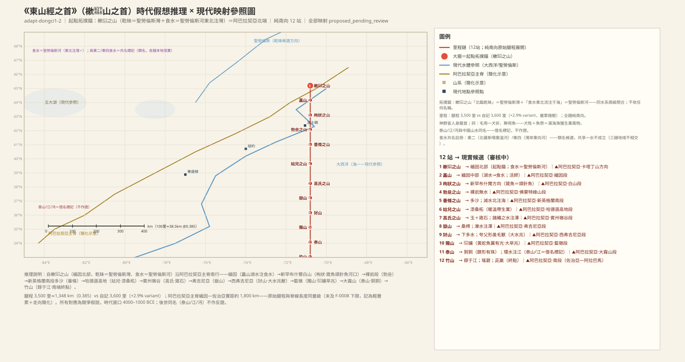
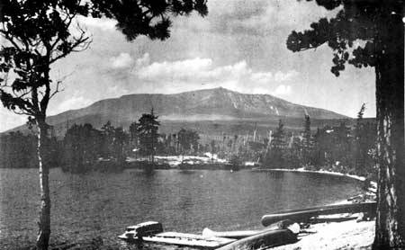
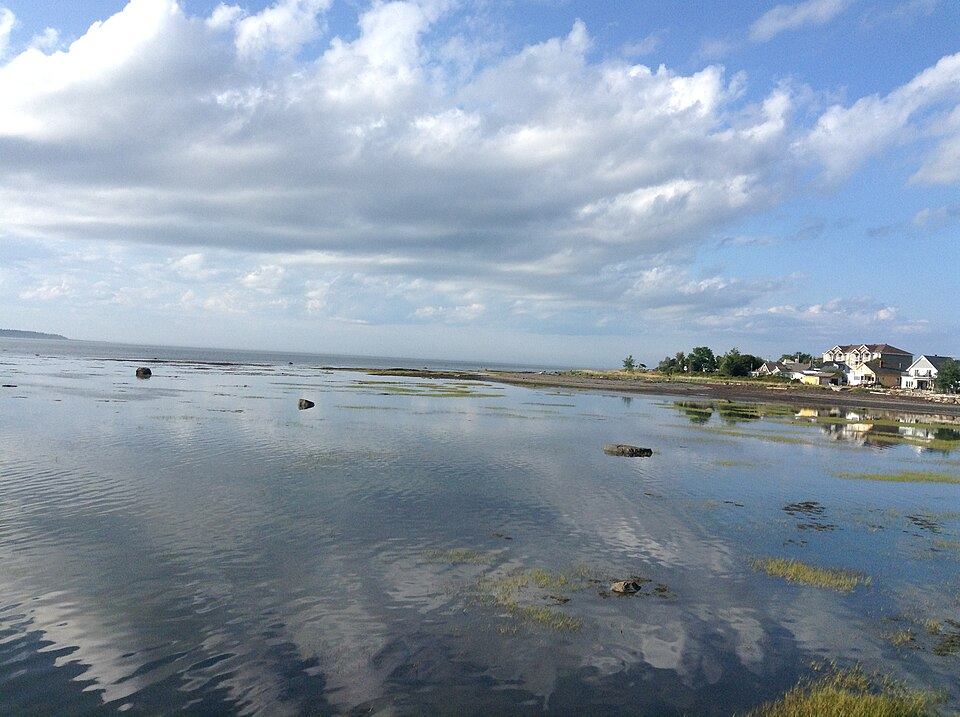
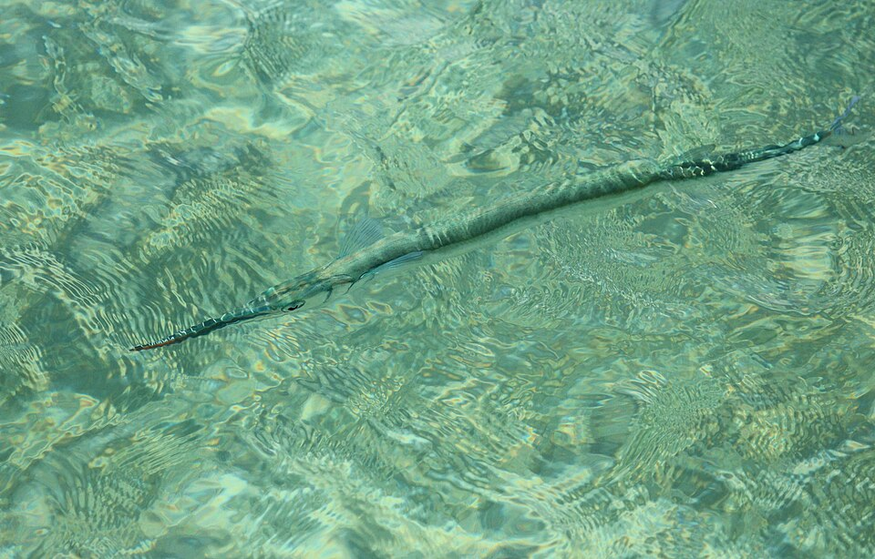
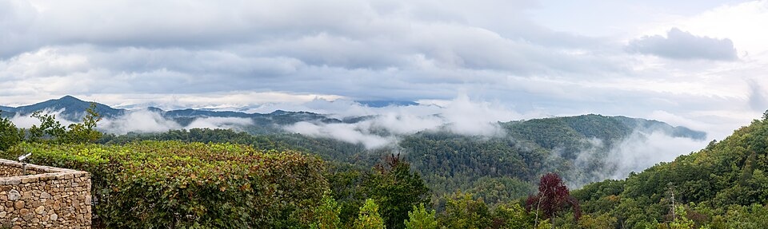
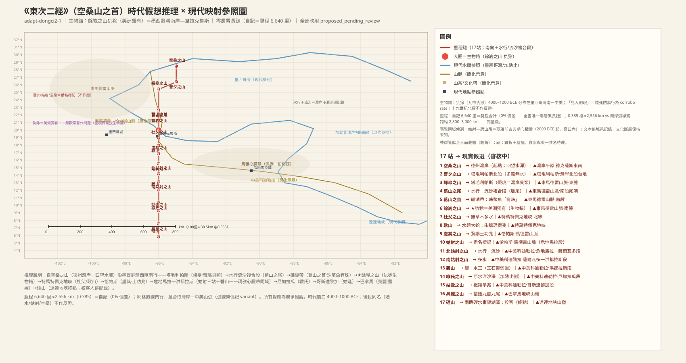
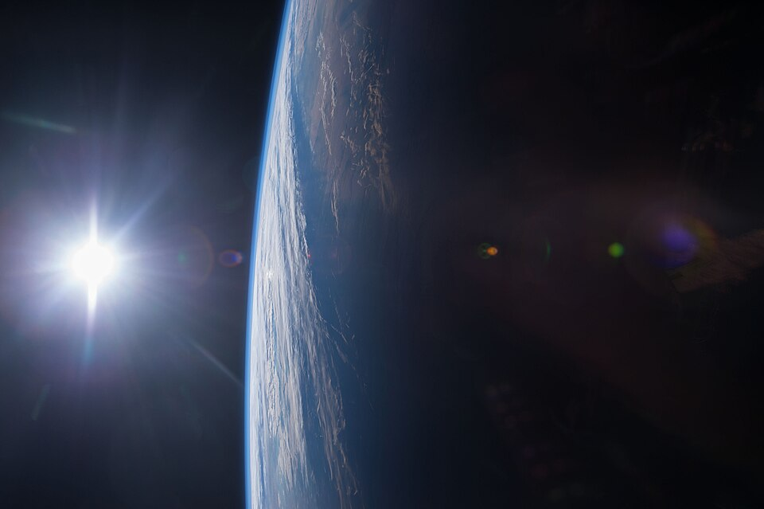
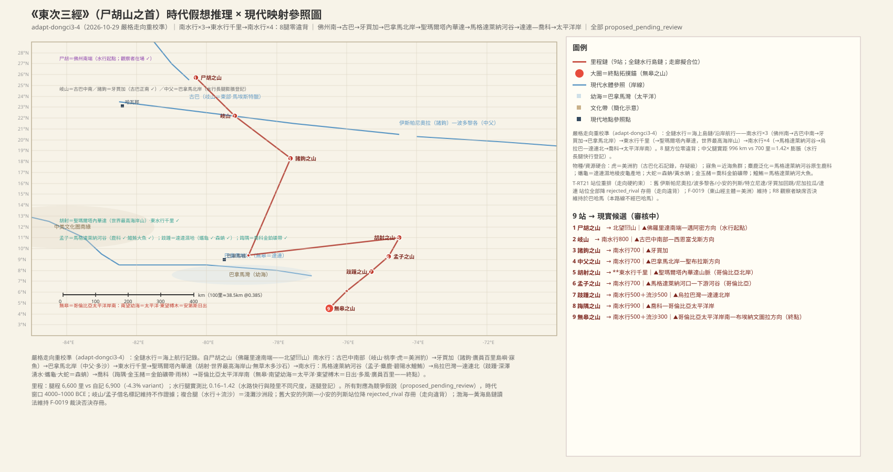
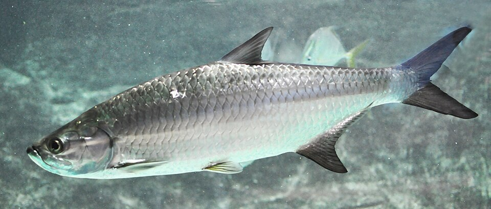
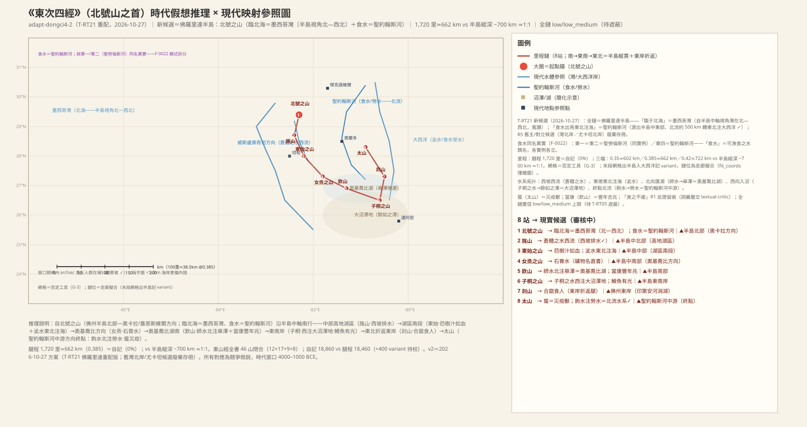

# 《山海经·东山经》白话解读（卷四 · draft-v2）

> **裁决声明（2026-10-27，项目负责人）**：「东山经旧大陆里程不适配，因此维持原判，主体为美洲大陆。并且东三覆盖美洲文明带，也维持原判。」——框架级问题**结案**：东一＝阿巴拉契亚、东二＝落基—大平原、东三＝加勒比—中美文明带维持为主框架；裁决理由两大支柱＝**里程硬否决**（旧大陆读法需 10–14× 缩水，机制不存在）＋**美洲特征物种硬特征**（负鼠「见人则眠」、犰狳类甲片，旧大陆读法无法解释）。红队轮「测试完成前降一级置信」的临时措施解除：**东一、东三恢复降级前置信度**；旧大陆对立读法（山东—淮北、渤海—黄海岛链、辽东—朝鲜、北太平洋岛弧）记「已测试并由裁决否决」存册。**保留事项照实维持**：东二「方位硬矛盾未解，暂停交付」（链级硬矛盾与框架裁决无关，待 T-RT20 重配）；东三站 2–4 巴哈马站位维持撤销（观察者缺席硬否决，待 T-RT21 重配）、无皋「南望幼海」失败维持降级；东四全链维持 unknown 级（待 T-RT21 重配）。祠牲簇按**推論性裁决 (a)**（编纂层分层说——由框架裁决逻辑导出，待发起人确认）：祠牲句对地理定位无证据力（双向）。
>
> **红队处置声明（2026-10-27，历史记录）**：本卷四条链的美洲映射经红队审查（red-team-dongci R1–R14）后，处置如下——美洲框架暂不撤，但降为假说级；旧大陆对立读法（山东—淮北、渤海—黄海岛链）补登为正式对立候选，六候选对比测试登记为 F-0019/T-RT04（**已由上述裁决结案**）。各链附加状态：东二「方位硬矛盾未解，暂停交付」（「北临食水」河在锚南、终点按自身里程算术在加利福尼亚湾头而非墨西哥湾、嶧皋之水属哈德逊湾水系）；东三站 2–4 巴哈马站位撤销（窗口期无人居住＝观察者缺席硬否决），「南望幼海」在哥斯达黎加坐标失败；东四主/对立候选均不可行，全链降 unknown 级，不交付对照表。祠牲簇（鸡／牡羊／黍／「食之不疟」在 4000–1000 BCE 美洲确认不存在）登记为正式反证。网格方面：东一 8/12 站落水、东二标签东偏 1,000–1,700 公里、东三前 4 站落水错海、东四 7/8 站落水——**网格在东链已无检核功能，本卷映射目前处于无网格约束状态**。正文中标「较可靠」的具体断言已逐处按上述处置更正。
>
> **2026-10-27 方案落实声明（T-RT20/T-RT21，2026-10-28 落笔）**：① **东一**：食水＝圣劳伦斯河（北美东部唯一「东北流注海」大河），樕𧑤站位自缅因微调至阿迪朗达克—魁北克南缘；湖水＝五大湖—安大略湖出流（东注食水 ✓）——R9 全项消解，食水置信恢复 medium_high；② **东二（T-RT20）**：全链重配＝阿巴拉契亚西麓—俄亥俄—田纳西—密西西比河谷—墨西哥湾岸——「北临食水」＝圣劳伦斯河（与东一同一条河）✓、终点䃌山＝德州湾岸（南临墨西哥湾 ✓）——R4 三项硬矛盾消解，「暂停交付」解除；犰狳（余峩）→本兽（链南段＝窗口期犰狳北界），负鼠移至絜钩（「善登木」✓）；旧落基—大平原读法降 rejected_rival 存册；③ **东三（T-RT21）**：站 2–4 重配＝大安的列斯主岛链（古巴东·马埃斯特腊／伊斯帕尼奥拉·中科迪勒拉／波多黎各方向——观察者：archaic 期 ~4000–3000 BCE 在场 ✓；巴哈马硬否决维持、旧站位存册），status 改回 proposed_pending_review；无皋重裁＝巴拿马地峡东端—达连——「南望幼海」＝巴拿马湾（太平洋）✓（R10 消解，幼海＝小海/湾谦称）；④ **东四（T-RT21）**：新候选＝佛罗里达半岛——「临于北海」＝墨西哥湾（半岛视角北—西北）、食水＝圣约翰斯河（与东一食水**同名异实**，F-0022 显式拆分），全链自 unknown 升至 low/low_medium 上限。四链置信上限均待 T-RT05 遮蔽重测；网格＝否定工具（G-3）。

## 本卷导览

《东山经》由四条子经组成，共计 46 座山、51 个条目。按我们的解读框架（**2026-10-27 项目负责人裁决：美洲主体维持，假说级临时标记解除**），这四条链都在美洲：

- **东山经之首（12 山）**：沿阿巴拉契亚山脉自北向南，从阿迪朗达克—魁北克南缘（2026-10-27 方案自缅因微调）一路走到佐治亚—阿拉巴马一带。最强锚点在起点：「北临乾昧、食水东北流注于海」——乾昧＝圣劳伦斯水系、食水＝圣劳伦斯河（北美东部唯一「东北流注海」大河，南向源流区正在锚域），「湖水」＝五大湖—安大略湖出流（东注食水 ✓）——**R9 两级松动与三级嵌套断裂全数消解，食水置信恢复 medium_high**（遮蔽鉴别力问题独立存在，待 T-RT05）。
- **东次二经（17 山）**：**T-RT20 全链重配（2026-10-27 方案）**——从纽约州—宾州方向（阿勒格尼高原北缘）起，沿阿巴拉契亚西麓南行，经俄亥俄—田纳西—密西西比河谷，直到德克萨斯湾岸。起点「北临食水」＝**圣劳伦斯河**（与东一同一条河——河在锚北 ✓，原「河在锚南」硬矛盾消解）；终点「南临䃌水」＝**墨西哥湾** ✓（原「终点在加利福尼亚湾头」错位消解）——**「暂停交付」解除，旧落基—大平原读法存册**。物种判定更新：軨軨「如牛虎文」→美洲野牛；犰狳（余峩）→**本兽**（链南段落於窗口期犰狳北界——德克萨斯—湾岸北缘）；**负鼠移至絜钩**（䃌山「如凫而鼠尾、善登木」＝树栖 ✓）。
- **东次三经（9 山）**：海上跳岛链，从佛罗里达海峡方向起，沿大安的列斯主岛链——**站 2–4 已重配（T-RT21）：岐山＝古巴东·马埃斯特腊、诸钩＝伊斯帕尼奥拉·中科迪勒拉、中父＝波多黎各方向（观察者：archaic 期 ~4000–3000 BCE 在场 ✓；巴哈马旧站位撤销维持、存册）**——再经小安的列斯（胡射东行 ✓）、特立尼达方向（孟子）、牙买加（跂踵），一直跳到尼加拉瓜—哥斯达黎加，终点无皋之山**重裁＝巴拿马地峡东端—达连：「南望幼海」＝巴拿马湾（太平洋）✓（幼海＝小海/湾谦称——R10 消解），「东望榑木」＝加勒比日出方向 ✓**。
- **东次四经（8 山）**：**T-RT21 新候选＝佛罗里达半岛（2026-10-27 方案）**——北号之山「临于北海」＝墨西哥湾（自半岛中轴视角，湾在北—西北 ✓）；「食水东北流注于海」＝**圣约翰斯河**（北流转东北注入大西洋 ✓——与东一食水**同名异实**，按 F-0022 显式拆分）；全链 1,720 里≈662 公里 vs 半岛纵深 ~700 公里 ≈1:1；终点太山「钩水北流注于劳水」＝佛州北部北流水系 ✓；窗口期佛州 archaic 贝丘人群在场 ✓——**全链自 unknown 升至 low/low_medium 上限**；旧湾北岸／尤卡坦候选废弃存册。「食之不疟」反证留痕照旧。

**里程吻合度**：东一自记 3,600 里 vs 逐段合计 3,500 里（+2.9%）；东二 6,640 里与逐段合计**完全一致（0% 偏差）**；东三 6,900 vs 6,600（自记比腿程多 300 里，+4.5%——原稿记 −4.3% 系符号软化，已更正）；东四 1,720 里**完全一致（0%）**。全书总记 18,860 里 vs 逐段合计 18,460 里（差 400 里，待校勘）。46 山 = 12+17+9+8，数目闭合。**注意：红队审查后里程证据整体降格——东链网格已系统性脱节（见页首声明），里程与方位证据目前仅作拓扑顺序参考，不具备候选间鉴别力。**

**主要未决**（全卷 25 条，详见各条）：三个「食水」的关系已按 2026-10-27 方案落定——东一＝东二＝**圣劳伦斯河（同一条河**：两链同处其南侧流域）、东四＝**圣约翰斯河（同名异实**，按 F-0022 显式拆分：「食水」＝可渔食之水的性状类名，各实例各立）；其余多为中小水名、鱼种确指和借名山名的落实问题。本卷不涉及 ADJ-002（昆仑虚）、ADJ-003（烛龙）、ADJ-004（两河）的裁决对象。

**置信度口径**：很可靠 ＝ 高置信；较可靠 ＝ 中高置信；方向性猜测 ＝ 中至中低置信；待考 ＝ 低置信或未定。句末小字为知识图谱节点号。

---

## 东山经·首（dongci1）——阿巴拉契亚山脉纵贯线

> **2026-10-27 方案（本节主调）**：起点锚自缅因微调至**阿迪朗达克—魁北克南缘**——「北临」乾昧（圣劳伦斯水系）松动自 200–350 公里收敛至 60–100 公里；食水＝圣劳伦斯河（源流区落於锚域）；湖水＝五大湖—安大略湖出流（东注食水 ✓）——**R9 全项消解，食水置信恢复 medium_high**；新锚下 12 站网格全部落陆（原 8/12 落水缓解；网格仍＝否定工具 G-3）。

### 【SHJ-04-1-001】樕𧑤之山：全卷起点，山在湾南、河向东北入海

> **【經文原文】**
> 《東山經》之首，曰樕𧑤之山，北臨乾昧。食水出焉。而東北流注于海。其中多鱅鱅之魚，其狀如梨牛，其音如彘鳴。

**白话解读**：这是整条《东山经》的第一站。经文说这座山北边紧挨着一片叫「乾昧」的大水域，山里发源出一条「食水」，向东北流进大海。我们的候选是**阿巴拉契亚山脉北端、阿迪朗达克—魁北克南缘**（`MTN:SHJ-04-1-001#1`，2026-10-27 方案自缅因卡塔丁山方向微调至此）：「乾昧」候选**圣劳伦斯河—湾水系**（`LND:…#1`），「食水」候选**圣劳伦斯河**（`WAT:…#1`）——**北美东部唯一「东北流注海」的大河**：它的南向源流区（阿迪朗达克—尚普兰盆地）正在本锚山域，「北临」的间距也自旧锚的 200–350 公里收敛到 60–100 公里——红队 R9 指出的两级松动就此消解，食水置信恢复 **medium_high（较可靠偏很可靠）**；冰后海侵（尚普兰海，公元前 8000–7000 年前后）早已退去，窗口期圣劳伦斯河口比今天更宽更深。保留的审慎只有一条：遮住站名后，圣约翰河、佩诺布斯科特河也满足「东北流注于海」——这是鉴别力问题（待 T-RT05 遮蔽重测），与已消解的 R9 是两回事。按 F-0022 裁决，「食水」是描述可渔食之水的类名：东二与它**同一条河**（两链同处圣劳伦斯南侧流域），东四的「食水」＝圣约翰斯河（同名异实，各立实例）。水里「鱅鱅之鱼」形状像犁牛、叫声像猪，是淡水大鱼的泛化记录（鲟鱼、湖鳟一类，`CRE:…#1`，方向性猜测）。

**配图**：

（图：Wikimedia Commons）

（图：Wikimedia Commons）

**未决项**：
- 未知：樕𧑤之山——乾昧確指（聖勞倫斯灣候選）待校

### 【SHJ-04-1-002】藟山：一条东流的支流汇进「食水」

> **【經文原文】**
> 又南三百里，曰藟山，其上有玉，其下有金。湖水出焉，東流注于食水，其中多活師。

**白话解读**：往南三百里到藟山（`MTN:SHJ-04-1-002#1`，方向性猜测：阿巴拉契亚纽约州段）。山上产玉、山下产金（`MIN:…#1`、`MIN:…#2`）。关键是水系：「湖水」向东流进上一条的食水（`WAT:…#1`）——**2026-10-27 方案落实：湖水＝五大湖—安大略湖出流**，安大略湖的出流正是向东（北）注入圣劳伦斯河——「湖水东流注于食水」由此落实（**R9 消解**；原缅因穆斯黑德湖候选撤回——它经肯纳贝克河南流入海，不入圣劳伦斯）。「出焉」按大湖水系宽读：湖出流经短河段东北汇入食水。水里的「活师」就是蝌蚪（`CRE:…#1`），一条很朴实的淡水生态记录。

### 【SHJ-04-1-003】栒狀之山：针嘴鱼——「喙如箴」的頜针鱼

> **【經文原文】**
> 又南三百里，曰栒狀之山，其上多金玉，其下多青碧石。有獸焉，其狀如犬，六足，其名曰從從，其鳴自詨。有鳥焉，其狀如雞而鼠毛，其名曰䖪鼠，見則其邑大旱。掛水出焉。而北流注于湖水。其中多箴魚，其狀如儵，其喙如箴，食之無疫疾。

**白话解读**：再往南三百里到栒狀之山（`MTN:SHJ-04-1-003#1`，方向性猜测：新罕布什尔白山段）。山上多金玉、山下多青绿色石头（绿松石或青色矿石的泛称，`MIN:…#1-3`）。兽类「从从」是狗形六足（`CRE:…#2`，多足是常见的造像夸张手法）；鸟类「䖪鼠」像鸡却长鼠毛，出现就预示当地大旱（`CRE:…#4`、`CLIM:…#1`）——旱灾的兆象。水系继续嵌套：「掛水」北流注入上一条的「湖水」（`WAT:…#1`），形成掛水→湖水→食水→海的三级嵌套——**2026-10-27 方案下三级全部落实**（湖水＝五大湖—安大略湖出流 ✓，见上一条）。最有价值的是「箴鱼」：**身子像白鲦、嘴像缝衣针**——候选是頜针鱼（鱵），针状长喙的特征极其特异，是河口暖水鱼（`CRE:…#5`，方向性猜测）；「吃了不得疫病」是食疗效用的赋义。

**配图**：

（图：Wikimedia Commons）

**未决项**：
- 未知：栒狀之山——箴魚確指

### 【SHJ-04-1-004】勃亝之山：「三无」裸岩段

> **【經文原文】**
> 又南三百里，曰勃亝之山，無草木，無水。

**白话解读**：再往南三百里到勃亝之山（`MTN:SHJ-04-1-004#1`，方向性猜测：宾州东部—波科诺方向）。全条只有一句：没有草、没有树、没有水。三个否定连写，是在刻意标记一段**裸岩地貌**——在一条以「某水出焉」为惯例的链上，「无水」本身就是信息量（`WAT:…#1` 为水文否定记录）。

### 【SHJ-04-1-005】番條之山：无草木多沙的海岸段

> **【經文原文】**
> 又南三百里，曰番條之山，無草木，多沙。減水出焉，北流注于海，其中多鱤魚。

**白话解读**：再往南三百里到番條之山（`MTN:SHJ-04-1-005#1`，方向性猜测：宾州—新泽西方向）。「无草木、多沙」说的是海岸沙质地段（`LND:…#1`）；「减水」向北直接入海（`WAT:…#1`，近海低地的北向入海溪，海＝大西洋）。水里多鱤鱼，是河口大型肉食鱼的泛化记录（`CRE:…#1`）。

### 【SHJ-04-1-006】姑兒之山：漆树桑柘的暖温带植被

> **【經文原文】**
> 又南四百里，曰姑兒之山，其上多漆，其下多桑柘。姑兒之水出焉，北流注于海，其中多鱤魚。

**白话解读**：再往南四百里到姑兒之山（`MTN:SHJ-04-1-006#1`，方向性猜测：马里兰—波托马克方向）。山上多漆树、山下多桑树柘树（`PLA:…#1-3`）——漆树科植物在北美有对应种（如北美漆树），桑柘是暖温带的经济植被，记的是一条生业植被带。「姑儿之水」北流入海，还是多鱤鱼（`WAT:…#1`、`CRE:…#1`）。

### 【SHJ-04-1-007】高氏之山：东流入泽，水里出金玉

> **【經文原文】**
> 又南四百里，曰高氏之山，其上多玉，其下多箴石。諸繩之水出焉，東流注于澤，其中多金玉。

**白话解读**：再往南四百里到高氏之山（`MTN:SHJ-04-1-007#1`，方向性猜测：弗吉尼亚—谢南多厄方向）。山上产玉、山下产「箴石」（矿物颜料或磨石一类；与箴鱼同用一个「箴」字根，是否有关待考）。「诸绳之水」向东流进一片湖泽（`WAT:…#1-2`），水里还记了金和玉——这是全书常见的水中矿物记录格式（砂矿观察）。注意从这里起，排水方向从「北流入海」转成「东流入泽」，符合链身逐渐离开海岸、走向岭谷内侧的走势。

### 【SHJ-04-1-008】嶽山：与上一条同注一泽

> **【經文原文】**
> 又南三百里，曰嶽山，其上多桑，其下多樗。濼水出焉，東流注于澤，其中多金玉。

**白话解读**：再往南三百里到嶽山（`MTN:SHJ-04-1-008#1`，方向性猜测：弗吉尼亚西南方向）。山上多桑、山下多樗（臭椿类）。「濼水」同样东流注于泽——与上一条的诸绳之水**共享同一片受水泽**，两条溪同注一泽，拓扑上是连续的内侧谷地排水（`WAT:…#1-2`），水中同样多金玉。「嶽」与中国五岳的「岳」同名，属于借名标记，名称本身不作证据。

### 【SHJ-04-1-009】犲山：以夸父为形貌参照的大水兆兽

> **【經文原文】**
> 又南三百里，曰犲山，其上無草木，其下多水，其中多堪㐨之魚。有獸焉，其狀如夸父而彘毛，其音如呼，見則天下大水。

**白话解读**：再往南三百里到犲山（`MTN:SHJ-04-1-009#1`，方向性猜测：北卡罗来纳—蓝岭方向）。山上无草木、山下多水——是水源丰富的泉群区（`WAT:…#1`），水里有「堪㐨之鱼」（确指待考）。值得注意的不是兽本身，而是它的写法：这只兽**「其状如夸父」**——直接拿神话人物夸父当形貌参照系（`PER:…#1`），说明文本作者预设听众熟悉夸父的形象；兽长着猪毛、叫声像人呼喊，出现就预示天下发大水（`CLIM:…#1` 洪水兆象）。

**未决项**：
- 未知：犲山——堪㐨之魚確指

### 【SHJ-04-1-010】獨山：会发光的𧌁䗤

> **【經文原文】**
> 又南三百里，曰獨山，其上多金玉，其下多美石。末塗之水出焉，而東流注于沔，其中多𧌁䗤，其狀如黃蛇，魚翼，出入有光，見則其邑大旱。

**白话解读**：再往南三百里到獨山（`MTN:SHJ-04-1-010#1`，方向性猜测：北卡—南卡方向）。山上金玉、山下美石。「末涂之水」东流注入「沔」——「沔」是借名的大河（`WAT:…#2`，时代大河候选在田纳西／萨凡纳方向）。水里多「𧌁䗤」：像黄蛇、长鱼鳍、**出入水中会发光**（`CRE:…#2`）——这是一条发光水生动物记录，生物发光或水面反光的观察都解释得通，作泛化处理；它出现预示当地大旱（旱灾兆象，`CLIM:…#1`）。

**未决项**：
- 未知：獨山——沔確指

### 【SHJ-04-1-011】泰山：与中国泰山同名的借名山

> **【經文原文】**
> 又南三百里，曰泰山，其上多玉，其下多金。有獸焉，其狀如豚而有珠，名曰狪狪，其鳴自訆。環水出焉，東流注于江，其中多水玉。

**白话解读**：再往南三百里到「泰山」（`MTN:SHJ-04-1-011#1`，方向性猜测：佐治亚—南卡方向，大雾山方向）。这座山与中国泰山同名，是典型的**借名标记**——按我们的规则，山名永远不能单独当定位证据。山上多玉、山下多金。兽「狪狪」像小猪却「有珠」（`CRE:…#2`）：「珠」可能指皮肤上的疣粒或甲片（犰狳类的甲片、浣熊等都曾被考虑），确指待考。「環水」东流注入「江」（又一条借名大河），水里多「水玉」——水晶一类的透明石头（`MIN:…#1`）。

**配图**：

（图：Wikimedia Commons）

**未决项**：
- 未知：泰山——狪狪「有珠」確指

### 【SHJ-04-1-012】竹山：本经终点，临大江

> **【經文原文】**
> 又南三百里，曰竹山，錞于江，無草木，多瑤碧。激水出焉，而東流注于娶檀之水，其中多茈羸。

**白话解读**：再往南三百里到竹山，是东山经之首的终点（`MTN:SHJ-04-1-012#1`，方向性猜测：佐治亚—阿拉巴马的阿巴拉契亚南段）。「錞于江」意思是这座山**紧挨着一条大江**——终点临大水的格局。山上无草木、多瑶碧（瑶玉碧玉类）。「激水」发源后东流注入「娶檀之水」（终点受水，`WAT:…#3`），水里多「茈羸」——紫色的贝类或螺类水产（`CRE:…#1`，「茈」就是紫色）。

**未决项**：
- 未知：竹山——娶檀之水確指

### 【SHJ-04-1-013】本经总结：人身龙首神，犬牲鱼祭

> **【經文原文】**
> 凡《東山經》之首，自樕𧑤之山以至于竹山，凡十二山，三千六百里。其神狀皆人身龍首。祠：毛用一犬祈，䎶用魚。

**白话解读**：总结段：从樕𧑤之山到竹山共十二座山、三千六百里——站数与正文 12 站吻合，自记 3,600 里比逐段合计 3,500 里多 100 里（+2.9%，很小的差异）。本山经的山神统一形象是**人身龙首**（`PER:SHJ-04-1-013#1`），与南山经各经的「鸟身龙首」「龙身鸟首」构成一个龙首母题系列。祭祀规矩：毛牲用一条狗，祭食用鱼（`CRE:…#1-2`）——狗牲加鱼祭。**红队更正（原稿「与窗口期内北美东岸 Archaic 期的生业方式相容」的正面引用已降权）**：按分层假说，祠牲句疑为编纂层祭祀格式化语言叠加，对地理定位无证据力（双向——既不能证美洲、也不能证旧大陆）；且作为对照，东二用鸡、东三用公羊和黍、东四「食之不疟」在窗口期美洲都确认缺席——三经祀牲的可得性与旧大陆完全相容、与美洲两破一合，这组对照已登记为正式反证。

---

## 东山经·次二（dongci2）——阿巴拉契亚西麓—俄亥俄—田纳西—密西西比河谷—湾岸纵贯线

> **T-RT20 重配（2026-10-27 方案，本节主调）**：全链自落基—大平原走廊**重配为阿巴拉契亚西麓—俄亥俄—田纳西—密西西比河谷—墨西哥湾岸**——R4 三项硬矛盾全数消解：①「北临食水」＝圣劳伦斯河（河在锚北 150–200 公里，宽读成立；与东一同一条河）；② 终点䃌山＝德克萨斯湾岸（南临墨西哥湾 ✓）；③ 嶧皋之水＝阿勒格尼山东坡水系。**「暂停交付」解除**；旧落基—大平原读法降 rejected_rival 存册；犰狳主读改本兽（负鼠移至絜钩）；全链置信上限 medium（待 T-RT05 遮蔽）。

### 【SHJ-04-2-001】空桑之山：北临大河、四望湖泽的草原起点

> **【經文原文】**
> 《東次二經》之首，曰空桑之山，北臨食水，東望沮吳，南望沙陵，西望湣澤。有獸焉，其狀如牛而虎文，其音如欽。其名曰軨軨，其鳴自訆，見則天下大水。

**白话解读**：东次二经的起点。经文给出罕见的「四望格局」：北边临着「食水」，东望沮吴、南望沙陵、西望湣泽。**T-RT20 重配（2026-10-27 方案）：起点放在纽约州中部—阿勒格尼高原北缘（芬格湖群方向）**（`MTN:SHJ-04-2-001#1`）：「食水」＝**圣劳伦斯河**（`WAT:…#1`）——河在锚北约 150–200 公里，「北临」宽读成立（**原「河在锚南」硬矛盾消解**；与东一「食水」是同一条河——两链同处圣劳伦斯河南侧流域）；「西望湣泽」＝**安大略湖方向候选** ✓（大湖正在西望—西北）；「东望沮吴」＝哈德逊河谷方向地标、「南望沙陵」＝阿勒格尼丘陵。「空桑」是借名。兽「軨軨」像牛而有虎纹——**→美洲野牛（林野牛方向**：肩峰与深浅毛色的观察），出现预示天下大水（`CRE:…#3`、`CLIM:…#1` 洪水兆象）。沮吴、沙陵、湣泽三处的确指都待考。

**配图**：

（图：Wikimedia Commons）

**未决项**：
- 未知：空桑之山——沮吳/沙陵/湣澤確指

### 【SHJ-04-2-002】曹夕之山：旱生灌丛带

> **【經文原文】**
> 又南六百里，曰曹夕之山，其下多穀而無水，多鳥獸。

**白话解读**：往南六百里到曹夕之山（`MTN:SHJ-04-2-002#1`，方向性猜测：阿巴拉契亚西麓宾夕法尼亚段）。山下多构树（楮树类）却没有水，鸟兽很多（`PLA:…#1`、`CRE:…#1-2`）——记的是山前旱生段。「无水」又是一个否定记录（`WAT:…#1`）。

### 【SHJ-04-2-003】嶧皋之山：淡水大蚌「蜃珧」

> **【經文原文】**
> 又西南四百里，曰嶧皋之山，其上多金玉，其下多白堊。嶧皋之水出焉，東流注于激女之水，其中多蜃珧。

**白话解读**：往西南四百里到嶧皋之山——这是全链唯一一次向西南折：**阿巴拉契亚主脉的走向正是东北—西南，西南腿与山势相合**（`MTN:SHJ-04-2-003#1`，方向性猜测：西弗吉尼亚—阿勒格尼山南段）。山上金玉、山下白垩（`MIN:…#1-3`）。「嶧皋之水」东流注入「激女之水」（`WAT:…#1-2`）——**＝阿勒格尼山东坡水系（萨斯奎哈纳—波托马克方向）**：山东坡的河正是向东流的（**原「纬度属哈德逊湾水系」的错属随旧走廊作废——R4③ 消解**）。水里多「蜃珧」：旧注常当海蚌讲，但候选是**淡水双壳大蚌**（珠蚌科 Unionidae）——东坡河流盛产，印第安人广泛采食利用，不必拉去海边找牡蛎（`CRE:…#1`）。

**未决项**：
- 未知：嶧皋之山——激女之水確指

### 【SHJ-04-2-004】葛山之尾：先走水路、再过流沙

> **【經文原文】**
> 又南水行五百里，流沙三百里，至于葛山之尾，無草木，多砥礪。

**白话解读**：这一段行程很特别：先「水行」五百里、再过「流沙」三百里，才到葛山之尾（`MTN:SHJ-04-2-004#1`，方向性猜测：西弗吉尼亚—肯塔基方向）。**「水行」是河道航行**（新河—卡诺瓦河—俄亥俄河水系），**「流沙」是河谷沙洲与沙质河岸**——这是河谷读法，不必读成大海和沙漠。「尾」指山脉尾端，与下一站的「葛山之首」是同一山系的两端。山上无草木、多砥砺（磨刀石,`MIN:…#1`）。

**未决项**：
- 未知：葛山之尾——水行讀法

### 【SHJ-04-2-005】葛山之首：「有珠」的珠蟞鱼

> **【經文原文】**
> 又南三百八十里，曰葛山之首，無草木。澧水出焉，東流注于余澤，其中多珠蟞魚，其狀如胏而有目，六足有珠，其味酸甘，食之無癘。

**白话解读**：往南三百八十里到葛山之首（`MTN:SHJ-04-2-005#1`，方向性猜测：肯塔基—田纳西方向，田纳西河谷上游），与上一站同脉两端。「澧水」（与湖南澧水同名，借名）东流注入「余泽」（`WAT:…#1-2`）。水里多「珠蟞鱼」：形状像肺叶（或鳖）、长眼睛、**六只脚**还带珍珠（`CRE:…#2`）。**红队更正**：原稿把这条读成「淡水珠母蚌」——但蚌没有脚，把「六足有珠」改写成「贝类的斧足」属于改写原文硬特征，已撤回。现恢复原文描述（其状如胏而有目、六足有珠），「六足」记为**未解**，退还文本批评层裁决，适配层不得自决。「味酸甘、吃了不得癘病」是食疗效用赋义。

**未决项**：
- 未知：葛山之首——珠蟞魚確指

### 【SHJ-04-2-006】餘峩之山：「犰狳」其实是负鼠——本卷最著名的物种判定

> **【經文原文】**
> 又南三百八十里，曰餘峩之山。其上多梓枏，其下多荊𦬊。雜余之水出焉，東流注于黃水。有獸焉，其狀如菟而鳥喙，鴟目蛇尾，見人則眠，名曰犰狳，其鳴自訆，見則螽蝗為敗。

**白话解读**：往南三百八十里到餘峩之山（`MTN:SHJ-04-2-006#1`，方向性猜测：田纳西—阿拉巴马方向，田纳西河谷—湾岸平原北缘）——**链南段**。山上梓树楠树、山下荆棘（原「北纬 46° 无对应」的冲突随新走廊消解——本站约 33–34°N）。「雜余之水」东流注入「黃水」——黄水＝田纳西河方向性候选（`WAT:…#2`；「Big Muddy」俗名论据撤除照旧——今名与窗口期无关）。重点在兽：**犰狳主读改回本兽（2026-10-27 方案）**——本站落在窗口期犰狳分布北界候选带（德克萨斯—湾岸北缘方向；更新世犰狳类 *Dasypus bellus* 分布曾远逾此纬度）：「见人则眠」是蜷伏假死的观察，鸟喙是尖吻、鸮目、蛇尾是鳞质长尾（`CRE:…#5`）。**原来的负鼠主读降为对立候选**——负鼠的装死行为由终点的絜钩（「如凫而鼠尾、善登木」＝树栖）承接，形态行为更合；红队指出的「否决标准不对称」（R6）也就此消解：本兽在新走廊下分布成立，不再需要「暖期北延」的豁免（古生物细化仍待 T-RT17）。**「犰狳」这个名字是后人拿《山海经》的词去命名美洲犰狳科动物的**，不能拿今名反推——名称偶合不作证（2026-10-28 名称层位审查补充声明）：本站的判断只依性状（「见人则眠」＝蜷伏假死/装死行为）＋窗口期分布，与名称匹配无关；负鼠、大海鲢等现代俗名同此，仅作标签使用。

**配图**：

（图：Wikimedia Commons）

**未决项**：
- 未知：餘峩之山——負鼠時代分佈北緣（暖期）

### 【SHJ-04-2-007】杜父之山：草原河谷水源带

> **【經文原文】**
> 又南三百里，曰杜父之山，無草木，多水。

**白话解读**：再往南三百里到杜父之山（`MTN:SHJ-04-2-007#1`，待考：密西西比河谷—阿拉巴马方向）。无草木、多水——河谷里的水源带（`WAT:…#1`）。

### 【SHJ-04-2-008】耿山：狐形鱼翼的朱獳

> **【經文原文】**
> 又南三百里，曰耿山，無草木，多水碧，多大蛇。有獸焉，其狀如狐而魚翼，其名曰朱獳，其鳴自訆，見則其國有恐。

**白话解读**：再往南三百里到耿山（`MTN:SHJ-04-2-008#1`，方向性猜测：密西西比河谷—密西西比州方向）。无草木，多绿色矿物（水碧），多大蛇。兽「朱獳」像狐狸却长鱼鳍（`CRE:…#3`），出现则「其国有恐」——是恐慌的兆象（`POL:…#1`）。

### 【SHJ-04-2-009】盧其之山：人足鸟与「大兴土木」的兆象

> **【經文原文】**
> 又南三百里，曰盧其之山，無草木，多沙石，沙水出焉，南流注于涔水，其中多鵹鶘，其狀如鴛鴦而人足，其鳴自訆，見則其國多土功。

**白话解读**：再往南三百里到盧其之山（`MTN:SHJ-04-2-009#1`，方向性猜测：密西西比—路易斯安那方向）。无草木、多沙石。「沙水」向南流注入「涔水」（`WAT:…#1-2`——南向受水 ✓，密西西比河谷南向支流拓扑）。水鸟「鵹鶘」像鸳鸯却长着人脚（`CRE:…#2`），出现则「其国多土功」——**大兴土木劳役的兆象**：密西西比河谷 Poverty Point（约公元前 1700 年）传统的台墩土建窗口期在场（相容性注记，无鉴别力）。

**未决项**：
- 未知：盧其之山——涔水確指

### 【SHJ-04-2-010】姑射之山：与《庄子》同名的借名

> **【經文原文】**
> 又南三百八十里，曰姑射之山，無草木，多水。

**白话解读**：再往南三百八十里到姑射之山（`MTN:SHJ-04-2-010#1`，待考：路易斯安那方向，密西西比河谷南段）。无草木、多水——冲积平原水源带。「姑射」与《庄子》的姑射山同名，是借名标记，不作证据。

### 【SHJ-04-2-011】北姑射之山：又一段水行加流沙

> **【經文原文】**
> 又南水行三百里，流沙百里，曰北姑射之山，無草木，多石。

**白话解读**：再往南，水行三百里加流沙一百里，到北姑射之山（`MTN:SHJ-04-2-011#1`，待考：路易斯安那—湾岸北缘方向）。这次的「水行」是密西西比河航行，「流沙」是河口沙洲—障壁岛方向。山上无草木、多石头（`MIN:…#1`）。

### 【SHJ-04-2-012】南姑射之山：丘陵水源带

> **【經文原文】**
> 又南三百里，曰南姑射之山，無草木，多水。

**白话解读**：再往南三百里到南姑射之山（`MTN:SHJ-04-2-012#1`，待考：路易斯安那湾岸方向）。无草木、多水——三角洲—湾岸沼泽水源带（`WAT:…#1`）。

### 【SHJ-04-2-013】碧山：碧与水玉——玉石带的远影

> **【經文原文】**
> 又南三百里，曰碧山，無草木，多大蛇，多碧、水玉。

**白话解读**：再往南三百里到碧山（`MTN:SHJ-04-2-013#1`，方向性猜测：路易斯安那—德州湾岸方向）。无草木、多大蛇（第三次出现），产「碧」和「水玉」两种矿物（`MIN:…#1-2`）——碧色玉石加透明水晶的组合，与中美洲翡翠/玉石带方向相容，但只是风物级弱证。

### 【SHJ-04-2-014】緱氏之山：东流入沙泽

> **【經文原文】**
> 又南五百里，曰緱氏之山，無草木，多金玉。原水出焉，東流注于沙澤。

**白话解读**：再往南五百里到緱氏之山（`MTN:SHJ-04-2-014#1`，待考：德州湾岸东段方向）。无草木、多金玉。「原水」东流注入「沙泽」——东向流入湾岸沙质潟湖（加尔维斯顿湾方向 ✓，`WAT:…#1-2`）。

### 【SHJ-04-2-015】姑逢之山：狐形有翼的獙獙

> **【經文原文】**
> 又南三百里，曰姑逢之山，無草木，多金玉。有獸焉，其狀如狐而有翼，其音如鴻鴈，其名曰獙獙，見則天下大旱。

**白话解读**：再往南三百里到姑逢之山（`MTN:SHJ-04-2-015#1`，待考：德州湾岸中段方向）。无草木、多金玉。兽「獙獙」像狐狸长翅膀、叫声像大雁（`CRE:…#2`），出现则天下大旱（旱兆,`CLIM:…#1`）。

### 【SHJ-04-2-016】鳧麗之山：九尾九首的蠪姪

> **【經文原文】**
> 又南五百里，曰鳧麗之山，其上多金玉，其下多箴石，有獸焉，其狀如狐，而九尾、九首、虎爪，名曰蠪姪，其音如嬰兒，是食人。

**白话解读**：再往南五百里到鳧麗之山（`MTN:SHJ-04-2-016#1`，待考：德州湾岸南段方向）。山上金玉、山下箴石。兽「蠪姪」是狐形而九尾、九首、虎爪，叫声像婴儿，会吃人（`CRE:…#2`）——多首母题推到极端的造像，与中山经的「蠪蛭」是否同族名待校。

### 【SHJ-04-2-017】䃌山：终点——南临墨西哥湾

> **【經文原文】**
> 又南五百里，曰䃌山，南臨䃌水，東望湖澤，有獸焉，其狀如馬，而羊目、四角、牛尾，其音如獆狗，其名曰峳峳。見則其國多狡客。有鳥焉，其狀如鳧而鼠尾，善登木，其名曰絜鉤，見則其國多疫。

**白话解读**：再往南五百里到䃌山，东次二经的终点（`MTN:SHJ-04-2-017#1`——**T-RT20 重配终点：德克萨斯湾岸南段—科珀斯克里斯蒂方向**）。「南临䃌水、东望湖泽」——**䃌水＝墨西哥湾 ✓✓（湾在南）**：红队「终点按自身里程算术在加利福尼亚湾头」的错位是旧走廊的算术产物，随落基—大平原读法存册；新走廊终点就在湾岸，「南临」在自身坐标成立（**R4② 消解**）；「东望湖泽」＝湾岸潟湖 ✓。兽「峳峳」像马、羊眼、四角、牛尾（`CRE:…#4`），出现则「其国多狡客」——对当地人群风俗的记录（`PER:…#1` 狡客）：密西西比河谷 Poverty Point（约公元前 1700 年）/Adena 文化窗口期在场（观察者 ✓）。鸟「絜鉤」像野鸭长鼠尾、**善于爬树**——**＝负鼠（2026-10-27 方案）：「善登木」是树栖行为，负鼠正是北美东部林区的特征种**（自餘峩站的负鼠读法移此承接），出现则多疫（疫兆,`CRE:…#6`）。

**配图**：

（图：Wikimedia Commons／NASA）

**未决项**：
- 未知：䃌山——狡客確指

### 【SHJ-04-2-018】本经总结：兽身人面戴角神——里程零偏差

> **【經文原文】**
> 凡《東次二經》之首，自空桑之山至于䃌山，凡十七山，六千六百四十里。其神狀皆獸身人面載觡。其祠：毛用一雞祈，嬰用一璧瘞。

**白话解读**：总结段：从空桑之山到䃌山共十七山、六千六百四十里——17 站数目吻合，且自记里程与逐段合计**完全一致（0% 偏差）**；三档折算 2,324/2,556/2,789 公里，对比河谷曲路实距约 2,000–2,200 公里，层累约 1.2–1.3 倍（放大方向，与 F-0008 相容）。山神统一形象是**兽身人面、头戴角饰**（「載觡」的「觡」就是角,`PER:SHJ-04-2-018#1`、`OBJ:…#1`）——相容性注记，不作证据。祭祀规矩：毛牲用一只鸡，并以一块玉璧埋祭（`CRE:…#1`、`OBJ:…#2`）——**鸡在前哥伦布时期的美洲不存在（正式反证登记照旧）**；按推论性裁决 (a)（编纂层祭祀格式化语言叠加，待发起人确认），此句对地理定位无证据力（双向）。

---

## 东山经·次三（dongci3）——大安的列斯—小安的列斯—中美跳岛链

> **T-RT21 重配（2026-10-27 方案，本节主调）**：站 2–4 自巴哈马（观察者缺席硬否决——维持、存册）重配＝**大安的列斯主岛链**（岐山＝古巴东·马埃斯特腊、诸钩＝伊斯帕尼奥拉·中科迪勒拉、中父＝波多黎各方向——古巴/伊斯帕尼奥拉 archaic 期人群 ~4000–3000 BCE 在场 ✓），status 改回 proposed_pending_review（置信上限 low_medium）；终点无皋**重裁＝巴拿马地峡东端—达连——「南望幼海」＝巴拿马湾（太平洋）✓（R10 消解；幼海＝小海/湾谦称），「东望榑木」＝加勒比日出方向 ✓**，置信恢复一级。连带调整：胡射＝小安的列斯北段（「东水行千里」与岛弧几何合 ✓）、孟子＝小安的列斯南段—特立尼达方向（麋鹿泛化成立——大陆岛有原生鹿科）。

### 【SHJ-04-3-001】尸胡之山：水行链的北端起点

> **【經文原文】**
> 又《東次三經》之首，曰尸胡之山，北望𦍲山，其上多金玉，其下多棘。有獸焉，其狀如麋而魚目，名曰妴胡，其鳴自訆。

**白话解读**：东次三经全是「水行」的海上链，起点尸胡之山在**佛罗里达海峡方向**（`MTN:SHJ-04-3-001#1`，方向性猜测；网格＝否定工具 G-3——水行链起点落于水道，记 variant）。站 2–4 已按 T-RT21 重配大安的列斯主岛链（见下），起点与中段的衔接成立。「北望𦍲山」是北边的望点地标（`MTN:…#2`，佛罗里达半岛方向，待考）。山上金玉、山下荆棘。兽「妴胡」像麋鹿却长着鱼眼——凸眼的观察记录（`CRE:…#2`）。

**未决项**：
- 未知：尸胡之山——𦍲山確指

### 【SHJ-04-3-002】岐山：岛上的「虎」

> **【經文原文】**
> 又南水行八百里，曰岐山，其木多桃李，其獸多虎。

**白话解读**：向南水行八百里到岐山（`MTN:SHJ-04-3-002#1`）。**T-RT21 重配＝古巴东部·马埃斯特腊山方向**：观察者在场——古巴 archaic 期人群约公元前 4000–3000 年在场 ✓（原巴哈马站位的观察者缺席硬否决维持、旧站位存册，不再适用于新站位）；「多虎」→美洲豹泛化成立（古巴历史分布有美洲豹 ✓）；「多桃李」仍是栽培果树套语（泛化记录，对称降权）。「岐山」与中国岐山同名，借名标记。

**未决项**：
- 未知：岐山——虎的泛化確指

### 【SHJ-04-3-003】諸鉤之山：方圆百里的大岛

> **【經文原文】**
> 又南水行七百里，曰諸鉤之山，無草木，多沙石。是山也，廣員百里，多寐魚。

**白话解读**：向南水行七百里到诸钩之山（`MTN:SHJ-04-3-003#1`）——**T-RT21 重配＝伊斯帕尼奥拉·中科迪勒拉方向**（观察者在场 ✓）。无草木、多沙石（干旱坡地读法）。「广员百里」——**方圆一百里，这是岛屿尺度的记录**：伊斯帕尼奥拉是加勒比第二大岛，量级相容（记 variant）。附近多「寐鱼」（会休眠的鱼？确指待考,`CRE:…#1`）。

**未决项**：
- 未知：諸鉤之山——寐魚確指

### 【SHJ-04-3-004】中父之山：纯沙岛

> **【經文原文】**
> 又南水行七百里，曰中父之山，無草木，多沙。

**白话解读**：向南水行七百里到中父之山（`MTN:SHJ-04-3-004#1`）——**T-RT21 重配＝波多黎各方向**（观察者在场：archaic 期约公元前 3000 年起 ✓）。无草木、多沙——海岸沙质段（沙丘带读法，`LND:…#1`）。

### 【SHJ-04-3-005】胡射之山：唯一的东向跳岛

> **【經文原文】**
> 又東水行千里，曰胡射之山，無草木，多沙石。

**白话解读**：向东水行一千里到胡射之山（`MTN:SHJ-04-3-005#1`，**连带调整：小安的列斯北段（维尔京—背风群岛方向）**）。这是全链**唯一一条东向腿**——自波多黎各方向向东跳岛，东向腿与岛弧几何正好相合 ✓（旧标签「古巴东—伊斯帕尼奥拉」随站 3 重配撤回）。岛上无草木、多沙石（小岛 ✓）。这一千里落点有层累嫌疑，待考。

**未决项**：
- 未知：胡射之山——東水行千里落點（層累候選）

### 【SHJ-04-3-006】孟子之山：鱣鲔＝大海鲢

> **【經文原文】**
> 又南水行七百里，曰孟子之山，其木多梓桐，多桃李，其草多菌蒲，其獸多麋鹿。是山也，廣員百里。其上有水出焉，名曰碧陽，其中多鱣鮪。

**白话解读**：向南水行七百里到孟子之山（`MTN:SHJ-04-3-006#1`，**连带调整：小安的列斯南段—特立尼达方向（奥里诺科口方向）**）。「孟子」是借名——而且是名物密度簇中最硬的反例：孟子为战国人名（前 372–289），在夏商成书前提下人名不可能为原层，名称匹配一律不作正面证据（2026-10-28 名称证据层级，methodology-spec §3.9）。这是座方圆百里的大岛（特立尼达约 80×60 公里，量级相容，记 variant），植被丰盛：梓、桐、桃、李，草类多菌蒲——桃李仍是套语泛化（不作正面证据）；兽类多「麋鹿」——**泛化成立（2026-10-27 方案）：特立尼达是大陆岛，有原生鹿科（赤短角鹿）——原「安的列斯群岛无原生鹿科」的失败只对大安的列斯岛屿成立，随重配消解**。山上有泉叫「碧阳」（`WAT:…#1`），水里多「鱣鲔」——主读**大海鲢（tarpon）**泛化（**奥里诺科—加勒比南美岸正是大海鲢主要洄游区** ✓,`CRE:…#3-4`）；「加勒比无鲟鱼」前提更正照旧（湾鲟分布于湾北—佛州，泛化理由收束为岛屿尺度）。若坚持鲟鱼本义，整条链得北移回美国东南，与确认范围冲突，记为对立候选。

**配图**：

（图：Wikimedia Commons）

**未决项**：
- 未知：孟子之山——鱣鮪泛化讀法

### 【SHJ-04-3-007】跂踵之山：全链最大岛，涌泉泽与赤蠵龟

> **【經文原文】**
> 又南水行五百里，曰流沙，行五百里，有山焉，曰跂踵之山，廣員二百里，無草木，有大蛇，其上多玉。有水焉，廣員四十里皆湧，其名曰深澤，其中多蠵龜。有魚焉，其狀如鯉，而六足鳥尾，名曰鮯鮯之魚，其鳴自訆。

**白话解读**：向南水行五百里、再过五百里流沙（浅滩沙洲段），到跂踵之山——**方圆二百里，是全链最大的岛**（`MTN:SHJ-04-3-007#1`，方向性猜测：牙买加岛、蓝山方向）。岛上无草木、多大蛇、多玉。岛上有片叫「深泽」的水域，**方圆四十里到处涌泉**——涌泉湖泽，与牙买加的喀斯特泉湖地貌相容（`WAT:…#1`）。泽中多「蠵龟」——**赤蠵龟（loggerhead），加勒比暖水大海龟**（`CRE:…#2`）——**红队更正（原稿「本卷最扎实的海洋性生物风物证据之一（很可靠）」降格）**：赤蠵龟地中海也有，无鉴别力，只能作相容性注记，不作定位证据。还有「鮯鮯之鱼」：像鲤鱼、六足、鸟尾（`CRE:…#5`，造像夸张）。

**配图**：

（图：Wikimedia Commons）

**未决项**：
- 未知：跂踵之山——深澤湧泉確指

### 【SHJ-04-3-008】踇隅之山：从岛链回到大陆

> **【經文原文】**
> 又南水行九百里，曰踇隅之山，其上多草木，多金玉，多赭。有獸焉，其狀如牛而馬尾，名曰精精，其鳴自訆。

**白话解读**：向南水行九百里到踇隅之山（`MTN:SHJ-04-3-008#1`，方向性猜测——原标「较可靠」按 R3 降格：尼加拉瓜—哥斯达黎加山岭）。注意风向变了：前面一连串岛都是「无草木」，这里忽然**多草木、多金玉、多赭石**——植被恢复加三种矿产，是大陆性山地的特征，说明链到这里**从岛链转回了大陆**，是本经的转折站。兽「精精」像牛而长马尾（`CRE:…#3`）。

### 【SHJ-04-3-009】無皋之山：终点锚——南望加勒比海、东望扶桑

> **【經文原文】**
> 又南水行五百里，流沙三百里，至于無皋之山，南望幼海，東望榑木，無草木，多風。是山也，廣員百里。

**白话解读**：再水行五百里、流沙三百里，到無皋之山，东次三经的终点兼终点锚——**T-RT21 重裁＝巴拿马地峡东端—达连方向**（`MTN:SHJ-04-3-009#1`，约 8.3°N 77.3°W）。「南望幼海」——**＝巴拿马湾（太平洋）✓**：自达连高地南望正是巴拿马湾；「幼海」读作「小海/湾」的谦称——对加勒比大海而言，巴拿马湾为「幼」（原哥斯达黎加坐标「加勒比在北—东北」的矛盾随锚迁消解——**R10 消解，幼海确指落定，置信恢复一级**）。「东望榑木」——榑木就是扶桑，**日出方向的文化符号**：达连以东—东北正是加勒比海，方位相容（符号层，不落实为具体地物,`PLA:…#3`）。「多风」（地峡信风带——相容性注记,`CLIM:…#1`）。方圆百里。

**未决项**：
- 未知：無皋之山——幼海確指

### 【SHJ-04-3-010】本经总结：人身羊角神，风雨灾异神格

> **【經文原文】**
> 凡《東次三經》之首，自尸胡之山至于無皋之山，凡九山，六千九百里。其神狀皆人身而羊角。其祠：用一牡羊，米用黍。是神也，見則風雨水為敗。

**白话解读**：总结段：从尸胡之山到無皋之山共九山、六千九百里——9 站吻合，自记 6,900 里比逐段合计 6,600 里多 300 里（+4.5%——原稿记 −4.3% 系符号软化，已更正）。山神统一形象是**人身羊角**（`PER:SHJ-04-3-010#1`），祭祀用一只公羊、黍米（`CRE:…#2`、`PLA:…#1`）——**红队更正（正式反证登记）**：绵羊属与黍在窗口期加勒比—中美都确认不存在（大角羊仅北美西部；安的列斯窗口期甚至没有农业）——原稿把它当「畜养与谷祭组合」的中性记录是双重反向（既无羊可畜、又无谷可祭）；按分层假说（编纂层祭祀格式化语言叠加），此句对地理定位无证据力（双向）；若为实录，美洲读法在本链被否决。特别的一句是「是神也，见则风雨水为败」——**这尊神现身会带来风雨水灾**，一个风暴致灾的神格，与加勒比飓风走廊的气候经验相容——无鉴别力，仅作相容性注记（`CLIM:…#1-2`）。

---

## 东山经·次四（dongci4）——佛罗里达半岛纵贯线

> **T-RT21 新候选（2026-10-27 方案，本节主调）**：全链＝**佛罗里达半岛**——「临于北海」＝墨西哥湾（自半岛中轴视角，湾在北—西北，宽读 ✓）；「食水东北注海」＝**圣约翰斯河**（北流转东北注入大西洋 ✓——与东一/东二的圣劳伦斯河**同名异实**，F-0022 显式拆分）；全链 1,720 里≈662 公里 vs 半岛纵深 ~700 公里 ≈1:1；终点太山「钩水北注劳水」＝佛州北部北流水系 ✓；窗口期佛州 archaic 贝丘人群在场 ✓。**全链自 unknown 升至 low/low_medium 上限（待 T-RT05 遮蔽）**；旧湾北岸／尤卡坦候选（R5 双失败）废弃存册。

### 【SHJ-04-4-001】北號之山：起点，食人兽双记

> **【經文原文】**
> 又《東次四經》之首，曰北號之山，臨于北海。有木焉，其狀如楊，赤華，其實如棗而無核，其味酸甘，食之不瘧。食水出焉，而東北流注于海。有獸焉，其狀如狼，赤首鼠目，其音如豚，名曰猲狙，是食人。有鳥焉，其狀如雞而白首，鼠足而虎爪，其名曰鬿雀，亦食人。

**白话解读**：东次四经的起点北號之山——**T-RT21 新候选：佛罗里达半岛北部（奥卡拉—盖恩斯维尔方向）**（`MTN:SHJ-04-4-001#1`，low_medium）。「临于北海」＝**墨西哥湾**：自半岛中轴视角，湾的主体在北—西北（半岛指向东南——宽读 ✓；从这里向西—西北就是大弯地带湾岸；原「湾在南」矛盾随旧站位消解）。「食水」东北流入海（`WAT:…#2`）＝**圣约翰斯河**——源出半岛中东部沼泽、北流约 500 公里转东北注入大西洋 ✓——注意它与东一、东二的「食水」（圣劳伦斯河）是**同名异实**：按 F-0022 裁决，「食水」＝可渔食之水的性状类名，各实例各立（原「落实不出 pending」消解）。植物记录很细：一种像杨树、开红花、果实像枣却没核的树，味酸甘，「食之不疟」（`PLA:…#1-2`）——**正式反证留痕照旧**：疟疾在前哥伦布时期美洲不存在；「疟」是确指疟疾还是泛热病，交文本批评层。然后是**起点的食人兽双记**：兽「猲狙」狼形、红头、鼠眼、猪叫，吃人（`CRE:…#4`）；鸟「鬿雀」鸡形、白头、鼠脚、虎爪，也吃人（`CRE:…#7`）——一兽一鸟两条「食人」记录，是起点的警戒风物（窗口期佛州 archaic 贝丘人群在场 ✓）。

**未决项**：
- 未知：北號之山——「臨于北海」方位讀法

### 【SHJ-04-4-002】旄山：西向排水的湾岸低地

> **【經文原文】**
> 又南三百里，曰旄山，無草木。蒼體之水出焉，而西流注于展水。其中多鱃魚，其狀如鯉而大首，食者不疣。

**白话解读**：往南三百里到旄山（`MTN:SHJ-04-4-002#1`，方向性猜测：半岛中北部—中部高地湖区方向）。无草木。「苍体之水」向**西**流注入「展水」（`WAT:…#1-2`）——**西向排水 ✓：半岛西坡的河（威斯卢库奇河方向）向西入墨西哥湾水系**。水里多「鱃鱼」：像鲤鱼、大脑袋，「吃了不长疣」（食疗效义,`CRE:…#2`）。

**未决项**：
- 未知：旄山——展水確指

### 【SHJ-04-4-003】東始之山：树汁如血的𦬊树

> **【經文原文】**
> 又南三百二十里，曰東始之山，上多蒼玉。有木焉，其狀如楊而赤理，其汁如血，不實，其名曰𦬊，可以服馬，泚水出焉，而東北流注于海，其中多美貝，多茈魚，其狀如鮒，一首而十身，其臭如蘪蕪，食之不䊧。

**白话解读**：往南三百二十里到東始之山（`MTN:SHJ-04-4-003#1`，方向性猜测：半岛中部—湖区南段方向）。山上多苍玉。有一种树叫「𦬊」：像杨树、红色纹理、**树汁像血**、不结果（`PLA:…#2`）——红色树脂的观察记录，龙血树类或红树脂树种的泛化都容得下；「可以服马」是能当马的药（兽药民俗,`CRE:…#1` 马）。「泚水」东北流入海（`WAT:…#1-2`，**海＝大西洋——半岛东坡短河 ✓**），水里多美贝（河口贝类 ✓）和「茈鱼」：像鲫鱼、**一个头十个身子**、气味像蘪芜草（`CRE:…#3`）——「一首十身」是群游多体的观察式夸张；「食之不䊧」是食疗效义。

**未决项**：
- 未知：東始之山——𦬊確指

### 【SHJ-04-4-004】女烝之山：直书矿名的「石膏水」

> **【經文原文】**
> 又東南三百里，曰女烝之山，其上無草木。石膏水出焉，而西注于鬲水，其中多薄魚，其狀如鱣魚而一目，其音如歐，見則天下大旱。

**白话解读**：往东南三百里到女烝之山（`MTN:SHJ-04-4-004#1`，方向性猜测：半岛中南部—奥基乔比湖方向）。山上无草木。「石膏水」向西注入「鬲水」（`WAT:…#1-2`）——**水直接以矿产命名**：佛州南部蒸发岩—石膏喀斯特带候选（西向排水＝和平河—湾坡方向）。水里多「薄鱼」：像鱣鱼、只有一只眼、叫声像呕吐声，出现则天下大旱（`CRE:…#2`，旱兆）。

**未决项**：
- 未知：女烝之山——石膏水確指

### 【SHJ-04-4-005】欽山：兆丰年的当康

> **【經文原文】**
> 又東南二百里，曰欽山，多金玉而無石。師水出焉，而北流注于皋澤，其中多鱃魚，多文貝。有獸焉，其狀如豚而有牙，其名曰當康，其鳴自叫，見則天下大穰。

**白话解读**：往东南二百里到欽山（`MTN:SHJ-04-4-005#1`，方向性猜测：半岛南部—奥基乔比湖南、大沼泽地北缘方向）。多金玉而没有石头（「无石」也是否定记录）。「师水」北流注入「皋泽」（`WAT:…#1-2`）——**皋泽＝奥基乔比湖候选 ✓：半岛南段水文北向汇湖**；水里多鱃鱼（再见）和**文贝**（`MIN:…#4`）。兽「当康」像小猪、有獠牙（野猪／西貒的泛化,`CRE:…#3`），出现则**天下大丰收**——灾异序列里难得的吉兆（`CLIM:…#1`）。

### 【SHJ-04-4-006】子桐之山：又一条发光鱼

> **【經文原文】**
> 又東南二百里，曰子桐之山，子桐之水出焉，而西流注于餘如之澤。其中多䱻魚，其狀如魚而鳥翼，出入有光，其音如鴛鴦，見則天下大旱。

**白话解读**：往东南二百里到子桐之山（`MTN:SHJ-04-4-006#1`，方向性猜测：半岛东南部—大西洋岸方向）。「子桐之水」向西注入「餘如之泽」（`WAT:…#1-2`）——**餘如之泽＝大沼泽地方向 ✓：东岸短河西向入沼泽**。水里多「䱻鱼」：鱼形鸟翼、**出入水会发光**、叫声像鸳鸯，出现则天下大旱（`CRE:…#3`）——与东一的𧌁䗤同型，是本卷第二条发光水生动物记录。

**未决项**：
- 未知：子桐之山——餘如之澤確指

### 【SHJ-04-4-007】剡山：人面食人的合窳

> **【經文原文】**
> 又東北二百里，曰剡山，多金玉。有獸焉，其狀如彘而人面，黃身而赤尾，其名曰合窳，其音如嬰兒。是獸也，食人，亦食蟲蛇，見則天下大水。

**白话解读**：折向东北二百里到剡山（`MTN:SHJ-04-4-007#1`，方向性猜测：佛州东岸—印第安河潟湖方向）——**折返腿：链沿大西洋岸向东北回行 ✓**。多金玉。兽「合窳」：猪形、**人面**、黄身红尾、叫声像婴儿，**吃人也吃虫蛇**，出现则天下大水（`CRE:…#2`）——人面母题加食人，再加洪水兆象（`CLIM:…#1`），是本经又一条警戒记录。

### 【SHJ-04-4-008】太山：终点，全书著名的疫兽「蜚」

> **【經文原文】**
> 又東北二百里，曰太山，上多金玉、楨木。有獸焉，其狀如牛而白首，一目而蛇尾，其名曰蜚，行水則竭，行草則死，見則天下大疫。鉤水出焉，而北流注于勞水，其中的鱃魚。

**白话解读**：再往东北二百里到太山，东次四经的终点（`MTN:SHJ-04-4-008#1`，方向性猜测：佛州东部—圣约翰斯河中游方向）。「太山」又是泰山的借名。山上多金玉和桢木。兽「蜚」是**全書最著名的灾疫兽**：牛形、白头、一只眼、蛇尾，**走过水水就干、走过草草就死**，出现则天下大疫（`CRE:…#2`、`CLIM:…#1`）——所过之处尽成荒芜的极端表述。「钩水」北流注入「劳水」（`WAT:…#2-3`）——**劳水＝圣约翰斯河中游候选 ✓：佛罗里达北部北流水系，终点北向排水闭合**；水里多鱃鱼（第三次出现）。

### 【SHJ-04-4-009】本经总结：八山一千七百二十里

> **【經文原文】**
> 凡《東次四經》之首，自北號之山至于太山，凡八山，一千七百二十里。

**白话解读**：总结段：从北號之山到太山共八山、一千七百二十里——8 站吻合，自记里程与逐段合计**完全一致（0% 偏差）**。注意：本经**没有神群形象和祭祀记录**，与东一、东二、东三不同，这是文献层累差异的变体记录，不是缺漏。

### 【SHJ-04-4-010】东山经全书总结

> **【經文原文】**
> 右東經之山誌，凡四十六山，萬八千八百六十里。

**白话解读**：全书总结：东山经各经合计四十六山、一万八千八百六十里（`DOC:SHJ-04-4-010#1`）。山数 12+17+9+8=46，**完全闭合**。里程方面，逐段合计 3,500+6,640+6,600+1,720=18,460 里，比自记 18,860 里少 400 里（约 +2.2% 的差异），这一处出入留待文本校勘。

---

## 附：本卷未决项汇总（25 条原有＋红队处置新增，2026-10-27）

1. 樕𧑤之山——乾昧確指（聖勞倫斯灣候選）待校
2. 栒狀之山——箴魚確指
3. 犲山——堪㐨之魚確指
4. 獨山——沔確指
5. 泰山——狪狪「有珠」確指
6. 竹山——娶檀之水確指
7. 空桑之山——沮吳/沙陵/湣澤確指
8. 嶧皋之山——激女之水確指
9. 葛山之尾——水行讀法
10. 葛山之首——珠蟞魚確指
11. 餘峩之山——負鼠時代分佈北緣（暖期）
12. 盧其之山——涔水確指
13. 䃌山——狡客確指
14. 尸胡之山——𦍲山確指
15. 岐山——虎的泛化確指
16. 諸鉤之山——寐魚確指
17. 胡射之山——東水行千里落點（層累候選）
18. 孟子之山——鱣鮪泛化讀法
19. 跂踵之山——深澤湧泉確指
20. ~~無皋之山——幼海確指~~——**已落定：幼海＝巴拿馬灣（太平洋），小海/灣謙稱（2026-10-27 方案，T-RT21）**
21. 北號之山——「臨于北海」方位讀法（墨西哥灣＝半島視角北—西北，寬讀——待遮蔽重測）
22. 旄山——展水確指
23. 東始之山——𦬊確指
24. 女烝之山——石膏水確指
25. 子桐之山——餘如之澤確指

**紅隊處置新增（R1–R14）**：

26. ~~東一食水確指＋湖水→食水三級嵌套~~——**已落實（2026-10-27 方案）**：食水＝聖勞倫斯河、湖水＝五大湖—安大略湖出流，R9 消解（置信恢復 medium_high）；遮蔽重測（聖勞倫斯河 vs 聖約翰河 vs 佩諾布斯科特河——G-2 鑑別力問題）併入 T-RT05 抽樣
27. ~~東二「北臨食水」方位硬矛盾／暫停交付~~——**已落實（T-RT20，2026-10-27 方案）**：全鏈重配阿巴拉契亞西麓—俄亥俄—田納西—密西西比河谷—墨西哥灣岸；食水＝聖勞倫斯河（與東一同實例）；「暫停交付」解除
28. ~~東二終點䃌水~~——**已落實（T-RT20）**：䃌山＝德克薩斯灣岸，「南臨䃌水」＝墨西哥灣 ✓；舊「加利福尼亞灣」算術落點隨舊走廊存冊
29. ~~東三站 2–4 重配；幼海確指~~——**已落實（T-RT21，2026-10-27 方案）**：岐山＝古巴東·馬埃斯特臘、諸鉤＝伊斯帕尼奧拉·中科迪勒拉、中父＝波多黎各方向（觀察者在場 ✓；巴哈馬舊站位存冊）；幼海＝巴拿馬灣（太平洋）✓
30. ~~東四全鏈 unknown~~——**已落實（T-RT21，2026-10-27 方案）**：新候選＝佛羅里達半島（北號＝奧卡拉—蓋恩斯維爾方向；食水＝聖約翰斯河，同名異實拆分；終點勞水＝聖約翰斯河中游）；全鏈升至 low/low_medium 上限（待 T-RT05 遮蔽）
31. 珠蟞魚「六足有珠」讀法（蚌說 vs 保留六足動物描述）——退還 textual-critic，不得由適配層自決
32. 犰狳/負鼠兩讀法窗口期分佈證據（古生物，非 19 世紀動態）——待 G-6 對稱性重審（T-RT17）
33. ~~六候選對比測試（阿巴拉契亞、落基—大平原、加勒比—中美、山東—淮北、渤海—黃海島鏈、遼東—朝鮮半島）——F-0019/T-RT04，完成前全卷維持降級後置信~~ **已結案（2026-10-27 裁決）：美洲主體維持、東三＝美洲文明帶維持；東一/東三恢復降級前置信（例外站除外）；舊大陸對立讀法存冊**
34. 「食之不瘧」詞義層（瘧＝瘧疾確指 vs 泛熱病）——交 textual-critic 核注疏傳統
35. ~~station-grid 文件 meta 為 v1 殘留~~——**已按新方案全部重生成（2026-10-28**：東一錨遷阿迪朗達克、東二錨遷紐約州、東三終點錨遷達連、東四錨遷佛州半島北部；meta 按 G-3 寫明「網格＝否定工具」；四鏈地圖重渲染，overflow: none
36. 東山經＝美洲的跨書隱含主張（與中山經＝中原同一調查傳統）——與框架書未決清單合併處理（R14）

---

*draft-v2 白话重写：覆盖 51/51 条目；未决项 25 条全数保留＋紅隊處置新增 11 条；配图 9 张（Wikimedia Commons 真实图片，嵌入前均已验证文件页可达）。**2026-10-27 紅隊處置＋F-0019 裁決（項目負責人）：美洲主體維持、東三＝美洲文明帶維持。2026-10-27 方案落實（2026-10-28 落筆）：① 東一食水＝聖勞倫斯河＋湖水＝五大湖—安大略湖出流——R9 消解，食水置信恢復 medium_high；② 東二 T-RT20 全鏈重配（阿巴拉契亞西麓—俄亥俄—田納西—密西西比河谷—灣岸）——R4 三項消解、「暫停交付」解除，犰狳→本獸、負鼠→絜鉤，舊落基—大平原讀法存冊；③ 東三 T-RT21 站 2–4 重配大安的列斯主島鏈（觀察者 ✓）＋無皋/幼海＝達連—巴拿馬灣（R10 消解）；④ 東四 T-RT21 新候選＝佛羅里達半島（食水＝聖約翰斯河，同名異實拆分）——全鏈自 unknown 升至 low/low_medium 上限。四链均待 T-RT05 遮蔽重測；網格＝否定工具（G-3）。***
