# 《中山经》白话通顺版（draft-v2）

> 本版由 draft-v1 重写：每个条目照录原文，附一段白话解读（说了什么山水人文风物、我们判断它对应现实哪里、凭什么），节点 ID 保留在句末小字，未决项逐条照录 draft-v1，一条不丢。配图为网上真实照片（Wikimedia Commons），只为已确认/高置信对象配图。

## 本卷导览

**范围**：《中山经》是全书的「中原中枢」，共 213 个条目，分十二条子经加一篇「禹曰」总结。空间上自西而东收拢：中一沿中条山、太岳山走到太行山南段；中二、中四写伊河、洛河流域；中六沿洛阳以西的分水岭走到潼关黄河大拐弯；中七以嵩山（太室、少室）为轴心，东到新郑具茨山；中八从鄂西荆山斜穿桐柏山到大别山；中九从岷山沿四川盆地北缘穿三峡到宜昌；中十是甘南一条短链；中十一从伏牛山南麓沿大别山北麓走到鄂东；中十二南下洞庭湖，东收幕阜山。（中五起點苟床之山原標「約當今阿尼瑪卿山—星宿海一帶」——**2026-10-27 裁決（F-0020）、2026-10-28 遮蔽重判修訂（T-RT05）：玄扈之水＝洛寧玄扈水（洛河上游段/支流），陽虛之山＝洛寧陽虛山方向，起點改定秦嶺東段主脊（小秦嶺—華山方向），pending_anchor 解除**；里程超帶記「核心區層累放大」variant 待裁，全鏈置信度上限 medium 維持。）

**主锚点**（较可靠以上）：中一条链的「西流注河／南流注河」拓扑把甘枣之山一线锁在黄河河曲东侧的中条山；中二「伊水出焉而东流注于洛」与四条北流注伊的支流构成完整的扇形水系闭合（与现代伊河源出栾川伏牛山、偃师入洛河一致）；中五良余之山一山双源、北坡入黄河南坡入洛河，正是崤山分水岭；中七太室之山是全卷水系拓扑的中枢（伊水西南、洛河西、汜水役水东北入河——**A5：萬安山對立候選未測，雙受水結構不唯一鎖嵩山**）；中九岷山「江水出焉，**東北**流注于海」是大江源区记录（**A3：「東北」為方向硬約束，與岷江源區實流向偏差 >90°，錨降為「大江源區某山」方向性表述**）；中十二洞庭之山「是在九江之间」对应多水汇流大湖泽格局（**F-0021 已裁決（2026-10-27）：澧沅瀟湘四水名簇同句共現＝專名簇共時證據（戰國楚地成書層，楚辭傳統同時證明）＋帝之二女神話簇同域——洞庭＝湖南洞庭湖，鄱陽否決存冊，錨回復 medium_high 待遮蔽確認**）。

**里程吻合度**：各子经自记里程普遍大于逐段腿程（「层累」注水）。最夸张的是中一：自记 6,670 里对腿程 937 里，放大 7.1 倍，为全书最大注水；中三 440 里对 80 里（5.5 倍）次之。好的样本也存在：中四自记 1,670 里与腿程完全一致；中五 2,982 对 2,990（差 0.3%）；中六 790 对 802（差 1.5%）。站数方面，中五「凡十六山」正文只有 15 站——**「十六」疑訛：卷末「大凡百九十七山」核算支持 15 站（十二子經自記站數之和 15+9+5+9+15+14+19+23+16+9+48+15＝197 ✓；按 16 計則 198 ✗），不再假設存在缺失站（D3）**；中十二「凡十万山」应是「十五山」的讹字。（2026-10-27 紅隊處置：里程證據改為事先鎖定檔位與方向約定（0.385 主檔、三檔並列、弦距約定），超出記反例，不得以 variant 歸檔，G-4/B1。）

**主要未决**：玄扈之水到底是黄河三门峡段还是洛河下游（需中四、中五联合校准）；役水、视水的现代确指；多个总结段列名在正文里找不到对应站（文山、禾山、玉山、堵山、騩山——疑似他经窜文）；人鱼＝大鲵的确认层级；以及大量借名山名（霍山、少室、太室、衡山、洞庭等）按裁决一律「名不作证、位由里程链与水系拓扑给出」。

## 中山经·首（zhongci1）——中条山到太行南段

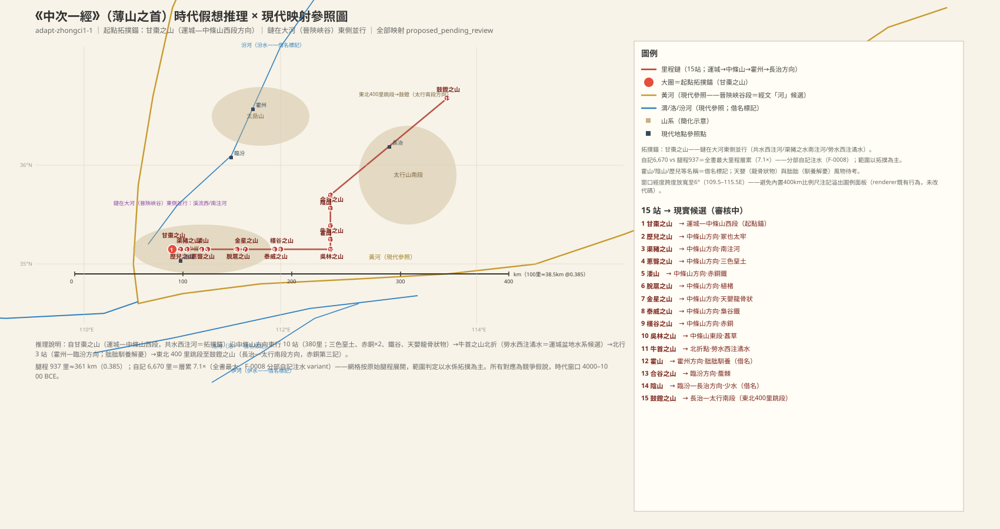

### 甘枣之山：全卷第一站，中条山西段、运城以东

> **原文**：《中山經》薄山之首，曰甘棗之山。共水出焉，而西流注于河。其上多杻木，其下有草焉，葵本而杏葉，黃華而莢實，名曰籜，可以已瞢。有獸焉，其狀如𤠢鼠而文題，其名曰㔮，食之已癭。

**白话解读**：中山经的第一条就从这里开始。这座山发源的共水向西流进黄河——水往西入大河，说明山在大河东侧，这是全卷第一个定位支点（`WAT:SHJ-05-1-001#1`、`WAT:SHJ-05-1-001#2`）。据此我们把它放在运城以东的中条山西段（解州—芮城一带，雪花山方向），判断较可靠（`MTN:SHJ-05-1-001#1`）。山上多杻木（檍树类），山下有一种葵根杏叶、开黄花结豆荚的草叫「籜」，说能治眼病（`PLA:SHJ-05-1-001#4`）；还有一种像猴鼠、额头带花纹的兽叫「㔮」，说吃了治大脖子病（甲状腺肿）（`CRE:SHJ-05-1-001#2`）。动植物的具体所指待考，但「西流注河」这个拓扑关系很可靠。

### 历儿之山：本经唯一的太牢级圣山

> **原文**：又東二十里，曰歷兒之山，其上多橿，多櫔木，是木也，方莖而員葉，黃華而毛，其實如揀，服之不忘。

**白话解读**：往东二十里到历儿之山，对应中条山五老峰（永济段）方向，较可靠（`MTN:SHJ-05-1-002#1`）。这座山本身着墨不多——多橿树，还有一种方茎圆叶、开黄花、果实像揀的櫔木，说吃了它「不忘」（益智类药效）。它真正的分量在总结段：全经十五座山里只有历儿一座是「冢」级，用太牢（牛羊豕全牲）祭祀——是本经唯一的顶级圣山。历儿名字虽近「历山」，但我们按借名处理，不作证据。

**未决项**（照录 draft-v1）：
- 衝突：歷兒之山——歷兒名近歷山（借名標記，不作證）

### 渠猪之山：南流注河的第二个支点

> **原文**：又東十五里，曰渠豬之山，其上多竹，渠豬之水出焉，而南流注于河。其中是多豪魚，狀如鮪，而赤喙赤尾赤羽，可以已白癬。

**白话解读**：东十五里，山在黄河河曲以北——因为渠猪之水向南流进黄河，这是第二个拓扑支点（`WAT:SHJ-05-1-003#1`）。对应中条山南麓芮城段，较可靠（`MTN:SHJ-05-1-003#1`）。山上多竹，与中条山南麓的竹类记录相符。水里有「豪鱼」，像鲔（鲟鳇类大鱼）而红嘴红尾红羽，说能治白癣（皮肤病）（`CRE:SHJ-05-1-003#1`）——鱼的确指待考。

### 葱聋之山：四色垩土的大谷

> **原文**：又東三十五里，曰蔥聾之山，其中多大谷，是多白堊，黑、青、黃堊。

**白话解读**：东三十五里，对应中条山闻喜—夏县段，较可靠（`MTN:SHJ-05-1-004#1`）。这条只记了一件事：山里有个大谷，出产白、黑、青、黄四种垩土——这是颜料土/涂料土的矿物群记录，与黄土—红土层多色土出露的地貌吻合（`MIN:SHJ-05-1-004#1-4`、`LND:SHJ-05-1-004#1`）。注意它和中次五的葱聋之山同名不同地，按裁决作同名异地标记。

**未决项**（照录 draft-v1）：
- 衝突：蔥聾之山——蔥聾之山與中五同名異地

### 涹山：赤铜加铁，对着中条山古铜矿带

> **原文**：又東十五里，曰涹山，其上多赤銅，其陰多鐵。

**白话解读**：东十五里，山上多赤铜、山北坡多铁（`MIN:SHJ-05-1-005#1`、`MIN:SHJ-05-1-005#2`）。这一条的分量很重：中条山垣曲—闻喜一带是真实的古铜矿带（垣曲铜矿峪被认为是二里头—二里岗时期的铜料来源候选），我们把涹山对应到垣曲铜矿峪山岭，较可靠（`MTN:SHJ-05-1-005#1`）。「铁」在这个时代窗口里只能理解为陨铁或铁矿石类物产，不作后世冶铁解。

### 脱扈之山：一种「解忧不梦魇」的草药

> **原文**：又東七十里，曰脫扈之山。有草焉，其狀如葵葉而赤華，莢實，實如棕椶莢，名曰植楮，可以已癙，食之不眯。

**白话解读**：东七十里，对应中条山闻喜东段，较可靠（`MTN:SHJ-05-1-006#1`）。全条只记一种草药「植楮」：叶子像葵、开红花、结豆荚，荚像棕榈荚；说它能「已癙」（治忧郁/内疾）、吃了不做噩梦（`PLA:SHJ-05-1-006#2`）。具体是哪种植物待考。

**未决项**（照录 draft-v1）：
- 未知：脫扈之山——植楮確指

### 金星之山：像「龙骨」的药用物

> **原文**：又東二十里，曰金星之山，多天嬰，其狀如龍骨，可以已痤。

**白话解读**：东二十里，对应中条山翼城—沁水段，较可靠（`MTN:SHJ-05-1-007#1`）。山上多「天婴」，形状像「龙骨」，说能治痤疮（`CRE:SHJ-05-1-007#1`）。「龙骨」是后世对哺乳动物骨骼化石药材的通称，晋南黄土层确实多新生代哺乳动物化石出露——这条可能是全书最早的「龙骨」状物药用记录之一，但我们保持未知标记，不强解。

**未决项**（照录 draft-v1）：
- 未知：金星之山——天嬰確指（化石藥用候選，保持未知標記）

### 泰威之山：产铁的枭谷

> **原文**：又東七十里，曰泰威之山，其中有穀，曰梟谷，其中多鐵。

**白话解读**：东七十里，对应中条山东段翼城山岭，较可靠（`MTN:SHJ-05-1-008#1`）。山中有个「枭谷」，谷里多铁——晋南古铁矿点方向的记录；同样，「铁」在时代窗口内作矿石/陨铁类理解（`MIN:SHJ-05-1-008#1`、`LND:SHJ-05-1-008#1`）。

**未决项**（照录 draft-v1）：
- 未知：泰威之山——「鐵」的時代確指（隕鐵/礦石，不作冶鐵解）

### 橿谷之山：铜带链第二站

> **原文**：又東十五里，曰橿谷之山，其中多赤銅。

**白话解读**：东十五里，对应中条山垣曲东段，较可靠（`MTN:SHJ-05-1-009#1`）。内容只有「多赤铜」一句——这是本经第二次记赤铜（涹山—橿谷—鼓镫连成一条铜矿带链，`MIN:SHJ-05-1-009#1`），与中条山铜矿带的走向一致。

### 吴林之山：香草之山

> **原文**：又東百二十里，曰吳林之山，其中多葌草。

**白话解读**：东一百二十里——这是东行段最长的一腿，对应中条山东段沁水—阳城山岭，较可靠（`MTN:SHJ-05-1-010#1`）。山中多「葌草」，即兰类香草（`PLA:SHJ-05-1-010#1`）。

### 牛首之山：链向由东转北的折点

> **原文**：又北三十里，曰牛首之山。有草焉，名曰鬼草，其葉如葵而赤莖，其秀如禾，服之不憂。勞水出焉，而西流注于潏水。是多飛魚，其狀如鮒魚，食之已痔衕。

**白话解读**：东行了十站之后，链向在这里折向北走三十里（`MTN:SHJ-05-1-011#1`），对应太岳山南段（古县—洪洞山岭）方向，较可靠。劳水发源此山、向西流进潏水——西向受水，是第三个拓扑支点（`WAT:SHJ-05-1-011#1`）。潏水我们猜是运城盆地水系（涑水河方向），但保持待考；它与关中潏水同名不同水，按借名处理（`WAT:SHJ-05-1-011#2`）。物产：鬼草，葵叶红茎、抽穗像禾苗，说吃了「不忧」（`PLA:SHJ-05-1-011#1`）；水里有飞鱼，像鲫鱼，说吃了治痔瘘（`CRE:SHJ-05-1-011#1`）。

**未决项**（照录 draft-v1）：
- 未知：牛首之山——潏水確指（運城盆地水系候選，保持未知標記）
- 衝突：潏水——潏水同名（關中潏水——借名標記）
- 未知：潏水——潏水確指（涑水河方向候選，保持未知標記）

### 霍山：养宠物解忧的朏朏

> **原文**：又北四十里，曰霍山，其木多穀。有獸焉，其狀如貍，而白尾有鬛，名曰朏朏，養之可以已憂。

**白话解读**：北四十里到霍山，对应太岳山霍山（老爷顶）方向，较可靠（`MTN:SHJ-05-1-012#1`）。与现实霍山同名——按借名处理，位置由里程链给出而不是名字。山上多构树；有一种兽像狸猫、白尾巴带鬃毛，叫「朏朏」，说**养**它可以解忧（`CRE:SHJ-05-1-012#2`）——这是书内罕见的动物驯养/宠物记录，原型待考。

**未决项**（照录 draft-v1）：
- 衝突：霍山——霍山同名（借名標記）
- 未知：霍山——朏朏原型（貍形白尾有鬛——小型獸類候選）

### 合谷之山：多刺丛的山

> **原文**：又北五十二里，曰合谷之山，是多薝棘。

**白话解读**：北五十二里，临汾方向，对应太岳山北段灵石山岭，方向性猜测（`MTN:SHJ-05-1-013#1`）。内容只有「多薝棘」（棘丛）一句（`PLA:SHJ-05-1-013#1`）。

### 阴山：少水的源头、治聋的雕棠

> **原文**：又北三十五里，曰陰山，多礪石、文石。少水出焉，其中多彫棠，其葉如榆葉而方，其實如赤菽，食之已聾。

**白话解读**：北三十五里，临汾—长治方向，对应太岳山北段—沁源山岭，较可靠（`MTN:SHJ-05-1-014#1`）。山名与现实的阴山山脉同名，按借名处理不作证。山上多磨刀石和带纹理的石头；少水从这里发源（原文只说出山、没说流向，我们就保持无方向连接，`WAT:SHJ-05-1-014#1`）。水里多长「雕棠」：叶子像榆叶但方形、果实像红豆，说吃了治耳聋（`PLA:SHJ-05-1-014#1`）。

**未决项**（照录 draft-v1）：
- 衝突：陰山——陰山同名（借名標記）
- 未知：陰山——少水流向（原文無記錄）
- 未知：少水——少水流向（原文無記錄）

### 鼓镫之山：东北四百里大跳段的终点

> **原文**：又東北四百里，曰鼓鐙之山，多赤銅。有草焉，名曰榮草，其葉如柳，其本如雞卵，食之已風。

**白话解读**：这一腿往东北跳出四百里——占全链腿程的 43%，是跨区大跳段，也是里程注水疑点最集中的地方。落地方向是自阴山往东北进入上党盆地—太行山南段，对应太行山南段（长治—壶关山岭），较可靠（`MTN:SHJ-05-1-015#1`）。山上多赤铜，是晋南—上党铜矿链的东端（第三次记赤铜）；还有一种「荣草」，柳叶、块根像鸡蛋，说吃了治风病（`PLA:SHJ-05-1-015#1`）。

### 中一总结段：全书最大的里程注水

> **原文**：凡薄山之首，白甘棗之山至于鼓鐙之山，凡十五山，六千六百七十里。歷兒、冢也，其祠禮：毛，太牢之具；縣嬰以吉玉。其餘十三者，毛用一羊，縣嬰用藻珪，瘞而不糈。藻珪者，藻玉也，方其下而銳其上，而中穿之加金。

**白话解读**：总结说从甘枣之山到鼓镫之山共十五山、六千六百七十里。站数 15 与正文一致，但自记 6,670 里对逐段加总的 937 里放大了 7.1 倍——这是全书最大的里程注水，说明这个总数来自另一层信息源，不能当实测距离用。礼制分两级：历儿之山是冢级，用太牢（牛羊豕全牲）加吉玉祭祀；其余十三山各用一只羊、挂一块藻珪、埋掉而不用祭米。最后还专门解释了藻珪的形制：就是藻玉，下方上尖、中间穿孔、加装金属饰件——一段难得的玉器形制记录（`MIN:SHJ-05-1-016#2`、`OBJ:SHJ-05-1-016#2`）。「白甘棗」的「白」应是「自」的讹字，待文字校勘。

## 中山经·次二（zhongci2）——伊河支流扇形水系

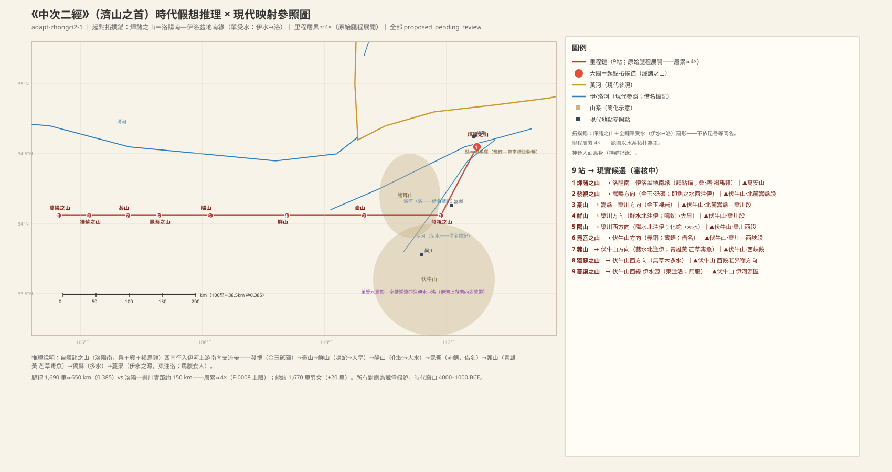

### 煇诸之山：洛阳南缘的起点，桑树与褐马鸡

> **原文**：《中次二經》濟山之首，曰煇諸之山，其上多桑，其獸多閭麋，其鳥多鶡。

**白话解读**：中次二的起点在洛阳以南、伊洛盆地南缘（万安山—龙门方向），较可靠（`MTN:SHJ-05-2-001#1`）。山上多桑树——这是全经唯一的农耕型植被记录，正合伊洛盆地低山丘陵的生业环境（`PLA:SHJ-05-2-001#1`）。兽类多闾麋（麂，小鹿），鸟类多「鶡」——鶡就是褐马鸡，像雉而大、性好斗。**注意（C3）：褐马鸡现代分布为吕梁山—陕北—冀西北，若允许历史分布宽容放行洛阳，则同样宽容放行晋南——该物种对「洛阳南 vs 晋南」无鉴别力，已降为区域相容性注记、移出锚定证据链**（待 G-6 对称性重审 T-RT17）（`CRE:SHJ-05-2-001#2`）。

**配图**：

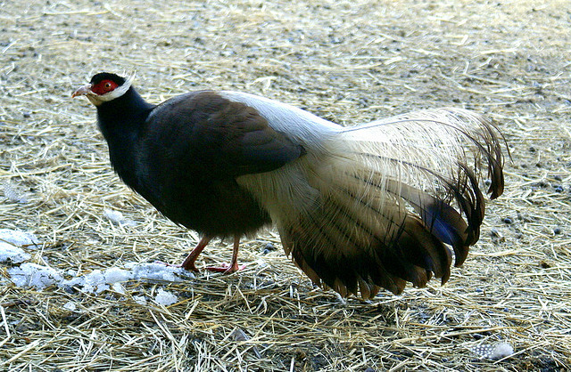（图：Wikimedia Commons）

### 发视之山：伊水在全卷第一次出现

> **原文**：又西南二百里，曰發視之山，其上多金玉，其下多砥礪。即魚之水出焉，而西流注于伊水。

**白话解读**：西南二百里（里程有注水，实距应短得多），对应伏牛山北麓嵩县段，较可靠（`MTN:SHJ-05-2-002#1`）。山上多金玉、山下多磨刀石——嵩县正是豫西金矿集中区，物产记录与矿带方向相符。关键在水系：即鱼之水西流注入伊水，这是「伊水」在中山经第一次出现，它是整条链的水系锚（`WAT:SHJ-05-2-002#2`）；名字与今天伊河相同，按借名处理，但拓扑关系不依名字成立。

**未决项**（照录 draft-v1）：
- 衝突：伊水——伊水同名（借名標記）

### 豪山：金玉矿山，寸草不生

> **原文**：又西三百里，曰豪山，其上多金玉而無草木。

**白话解读**：西三百里，对应伏牛山北麓嵩县—栾川段，较可靠（`MTN:SHJ-05-2-003#1`）。山上多金玉而不长草木——矿山裸岩的否定式记录，与豫西有色金属矿带方向可比（`MIN:SHJ-05-2-003#1`、`MIN:SHJ-05-2-003#2`）。

### 鲜山：四翼鸣蛇与大旱预兆

> **原文**：又西三百里，曰鮮山，多金玉，無草木。鮮水出焉，而北流注于伊水。其中多鳴蛇，其狀如蛇而四翼，其音如磬，見則其邑大旱。

**白话解读**：西三百里，对应伏牛山栾川段（老君山方向），较可靠（`MTN:SHJ-05-2-004#1`）。鲜水向北流进伊水——南面的支流往北入伊，说明链在伊水南侧的支流带上，拓扑自证（`WAT:SHJ-05-2-004#1`）。水里多「鸣蛇」：蛇形而长四只翅膀、叫声像磬，说一出现当地就大旱（`CRE:SHJ-05-2-004#1`）——这是旱灾预兆的信仰记录，与下一条阳山化蛇的「大水」配成旱/涝一对，反映伊河流域的旱涝记忆。鸣蛇原型待考。

**未决项**（照录 draft-v1）：
- 未知：鮮山——鳴蛇原型確指

### 阳山：人面豺身的化蛇与大水预兆

> **原文**：又西三百里，曰陽山，多石，無草木。陽水出焉，而北流注于伊水。其中多化蛇，其狀如人面而豺身，鳥翼而蛇行，其音如叱呼，見則其邑大水。

**白话解读**：西三百里，对应伏牛山栾川西段，较可靠（`MTN:SHJ-05-2-005#1`）。山上多石、无草木；阳水北流注伊，同样是南侧支流拓扑（`WAT:SHJ-05-2-005#1`）。水里多「化蛇」：人面、豺身、鸟翼、蛇行，叫声像人叱喝，出现则当地发大水（`CRE:SHJ-05-2-005#1`）——洪水预兆信仰，与鲜山鸣蛇的「大旱」正好成对。原型待考。

**未决项**（照录 draft-v1）：
- 未知：陽山——化蛇原型確指

### 昆吾之山：赤铜与号角声的怪兽

> **原文**：又西二百里，曰昆吾之山，其上多赤銅。有獸焉，其狀如彘而有角，其音如號，名曰蠪蛭，食之不眯。

**白话解读**：西二百里，对应伏牛山栾川—西峡段，方向性猜测（`MTN:SHJ-05-2-006#1`）。昆吾是夏商古国名，此处同名不作证（借名标记）。山上多赤铜，与豫西铜矿带方向相容（`MIN:SHJ-05-2-006#1`）。有兽叫「蠪蛭」：像野猪而长角、叫声像号筒，说吃了不做梦魇——造像有夸张成分，原型待考（`CRE:SHJ-05-2-006#2`）。

**未决项**（照录 draft-v1）：
- 衝突：昆吾之山——昆吾同名（借名標記）
- 未知：昆吾之山——蠪蛭原型確指

### 葌山：能毒鱼的芒草

> **原文**：又西百二十里，曰葌山，葌水出焉，而北流注于伊水，其上多金玉，其下多青雄黃。有木焉，其狀如棠而赤葉，名曰芒草，可以毒魚。

**白话解读**：西一百二十里（腿程开始缩短，进入伏牛山密集段），对应伏牛山西峡段，较可靠（`MTN:SHJ-05-2-007#1`）。葌水北流注伊，是扇形水系里第三条北注溪。矿产是上金玉、下青雄黄（雄黄为砷硫化物矿，`MIN:SHJ-05-2-007#3`）。最有趣的是「芒草」：树形像棠梨而红叶，**可以毒鱼**——这是用毒植物麻鱼捕捞的生业技术记录，具体是莽草类还是鱼藤类待考（`PLA:SHJ-05-2-007#2`）。

**未决项**（照录 draft-v1）：
- 未知：葌山——芒草確指（毒魚植物二選：莽草類/魚藤類）

### 独苏之山：无草木而多水

> **原文**：又西一百五十里，曰獨蘇之山，無草木而多水。

**白话解读**：西一百五十里，对应伏牛山西段老界岭方向，方向性猜测（`MTN:SHJ-05-2-008#1`）。「无草木而多水」——高山裸岩之上水源丰富，可能是泉群、溪群或沼泽；原文没给名字和流向，我们只作存在性水文记录，「多水」的确指待考（`WAT:SHJ-05-2-008#1`）。

**未决项**（照录 draft-v1）：
- 未知：水（獨蘇之山）——「多水」確指（泉群/溪群/沼澤待考）

### 蔓渠之山：伊水的源头，水系拓扑在这里闭合

> **原文**：又西一百二十里，曰蔓渠之山，其上多金玉，其下多竹箭。伊水出焉，而東流注于洛。有獸焉，其名曰馬腹，其狀如人面虎身，其音如嬰兒，是食人。

**白话解读**：西一百二十里到全链最西的终点，对应伏牛山西缘、伊河源区（栾川陶湾山岭方向），较可靠（`MTN:SHJ-05-2-009#1`）。这一句「伊水出焉，而东流注于洛」是全经的要害：伊水从此山发源、向东汇入洛河——现代伊河正是源出栾川伏牛山北麓、在偃师入洛河，方向完全相容。至此整条水系闭合：源头（蔓渠）→四条支流北注→主流东入洛（`WAT:SHJ-05-2-002#2`、`WAT:SHJ-05-2-009#1`）。伊、洛是通用大水名，按借名处理，但这个拓扑结构不依名字成立，很可靠。另有兽「马腹」：人面虎身、叫声像婴儿、吃人——食人兽的造像化记录，原型（虎方向）待考（`CRE:SHJ-05-2-009#1`）。

**未决项**（照录 draft-v1）：
- 衝突：蔓渠之山——伊/洛同名（借名標記）
- 未知：蔓渠之山——馬腹原型確指（虎/人虎混合造像）
- 衝突：洛——洛同名（借名標記）

### 中二总结段：人面鸟身的神群

> **原文**：凡濟山之首，自煇諸之山至于蔓渠之山，凡九山，一千六百七十里。其神皆人面而鳥身。祠用毛，用一吉玉，投而不糈。

**白话解读**：总结：九山、一千六百七十里。站数与正文一致无缺站；自记 1,670 里对腿程 1,690 只差 20 里，基本自洽。这一经的山神统一是「人面鸟身」造型，与中次五的「人面兽身」系统不同——中山经内部的神群按子经分系（`PER:SHJ-05-2-010#1`）。祭仪统一为中等规格：用毛牲、投一块吉玉于地、不用祭米（`MIN:SHJ-05-2-010#1`）。

## 中山经·次三（zhongci3）——黄河南岸邙山一线

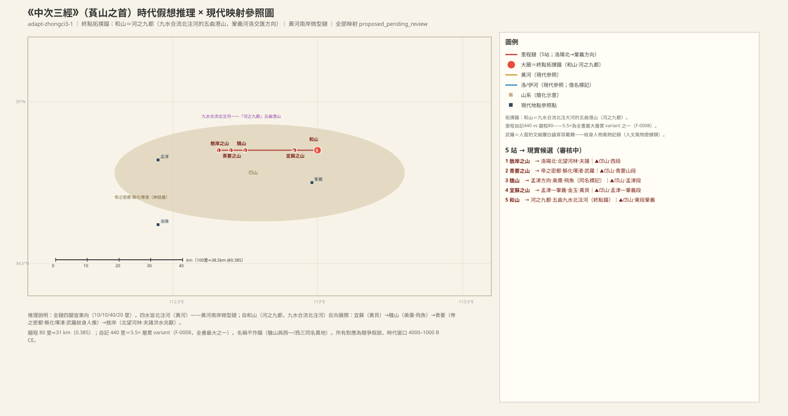

### 敖岸之山：邙山西段，北望大河之林

> **原文**：《中次三經》萯山之首，曰敖岸之山，其陽多㻬琈之玉，其陰多赭、黃金。神熏池居之。是常出美玉。北望河林，其狀如莤如舉。有獸焉，其狀如白鹿而四角，名曰夫諸，見則其邑大水。

**白话解读**：中次三「萯山系」的首站，位置在黄河南岸、洛阳以北，对应邙山西段（洛阳北—孟津西），较可靠（`MTN:SHJ-05-3-001#1`）。山的阳坡产㻬琈玉、阴坡产赭石和黄金；神熏池住在这里，山中常出美玉。「北望河林，其状如莤如举」——往北望见大河边的林带，这是静态的视野关系，说明山临黄河南岸，与全链北流注河的水系一致（`LND:SHJ-05-3-001#1`）。有兽「夫诸」，像白鹿而长四角，出现则当地发大水——全书「见则大水」格式的洪水兆兽（`CRE:SHJ-05-3-001#2`）。

**未决项**（照录 draft-v1）：
- 未知：敖岸之山——「其狀如莤如舉」的莤/舉確指（草狀比擬待考）

### 青要之山：帝之密都，河洛神话核心区

> **原文**：又東十里，曰青要之山，實惟帝之密都。是多駕鳥。南望墠渚，禹父之所化，是多僕累、蒲盧。䰠武羅司之，其狀人面而豹文，小要而白齒，而穿耳以鐻，其鳴如鳴玉。是山也，宜女子。畛水出焉，而北流注于河。其中有鳥焉，名曰鴢，其狀如鳧，青身而朱目赤尾，食之宜子。有草焉，其狀如葌，而方莖黃華赤實，其本如藁本，名曰荀草，服之美人色。

**白话解读**：东十里，对应邙山青要山段（新安），较可靠（`MTN:SHJ-05-3-002#1`）。「实惟帝之密都」——这里是「帝的秘密都邑」，是本经神话位格最高的地方之一，标示河洛神话核心区（`POL:SHJ-05-3-002#1`）。往南望见墠渚，传说是禹的父亲鲀（鲧）化身的地方；渚上多仆累、蒲卢等小生物（`WAT:SHJ-05-3-002#1`）。管这里的神叫䰠武罗：人面、身上有豹纹、细腰、白牙齿、耳朵上穿戴着耳环，声音像玉磬相击——这是一段难得的人物风物记录（纹身、细腰、耳饰）（`PER:SHJ-05-3-002#2`、`OBJ:SHJ-05-3-002#1`）。「是山也宜女子」，此山利于女性，具体指什么风俗待考。畛水发源北流注入黄河；水中有鸟「鴢」，像野鸭、青身红眼红尾，吃了「宜子」（助孕）；还有荀草，方茎黄花红果、根像藁本，吃了「美人色」（美容）（`CRE:SHJ-05-3-002#5`、`PLA:SHJ-05-3-002#2`）。

**未决项**（照录 draft-v1）：
- 未知：青要之山——「宜女子」的確切功能（祭祀/風俗指向待考）
- 未知：青要之山——僕累、蒲盧確指（小生物類）
- 未知：墠渚——墠渚確指（黃河洲渚/洛河洲渚待裁）
- 未知：墠渚——僕累、蒲盧確指

### 騩山：美枣与「不畏雷」的飞鱼

> **原文**：又東十里曰騩山，其上有美棗，其陰有㻬琈之玉。正回之水出焉，而北流注于河。其中多飛魚，其狀如豚而赤文，服之不畏雷，可以禦兵。

**白话解读**：东十里，对应邙山孟津段（黄河南岸），较可靠（`MTN:SHJ-05-3-003#1`）。与西山经的騩山同名，按借名处理。山上产美枣——黄河南岸正是传统枣树带，风物相符（`PLA:SHJ-05-3-003#1`）；阴坡产㻬琈玉，与敖岸之山阳坡同种，链内矿产有连续性。正回之水北流注入黄河；水里多飞鱼，像小猪而带红纹，说吃了不怕雷、可以抵御兵祸（`CRE:SHJ-05-3-003#1`）——是黄河鱼类的记录还是水族造像的夸张，待考。

**未决项**（照录 draft-v1）：
- 衝突：騩山——騩山與西一（SHJ-02-1）/西三（SHJ-02-3）同名異地——借名/同名標記，不作證
- 未知：騩山——飛魚原型（黃河魚類或水族誇張待考）

### 宜苏之山：黄贝水产地

> **原文**：又東四十里，曰宜蘇之山，其上多金玉，其下多蔓居之木。滽滽之水出焉，而北流注于河，是多黃貝。

**白话解读**：东四十里（本经最长一腿，跨过孟津—巩义间距），对应邙山孟津—巩义段，较可靠（`MTN:SHJ-05-3-004#1`）。山上多金玉、山下多「蔓居之木」（蔓生/丛生木，确指待考）。滽滽之水（叠字水名，像水声）北流注河，水中多「黄贝」——黄色贝类水产，是淡水贝还是货贝类待考（`MIN:SHJ-05-3-004#3`）。

**未决项**（照录 draft-v1）：
- 未知：宜蘇之山——蔓居之木確指（蔓生/叢生木待考）
- 未知：宜蘇之山——黃貝確指（淡水貝/貨貝類待考）

### 和山：河之九都，九水合流北注大河

> **原文**：又東二十里，曰和山，其上無草木而多瑤碧，實惟河之九都。是山也五曲，九水出焉，合而北流注于河，其中多蒼玉。吉神泰逢司之，其狀如人而虎尾，是好居于萯山之陽，出入有光。泰逢神動天地氣也。

**白话解读**：东二十里到终点，对应邙山东段巩义、河洛交汇的洛口山岭方向，较可靠（`MTN:SHJ-05-3-005#1`）。「实惟河之九都」——这里是大河的「九都」，即多水汇流的港湾地貌；山形五曲，九条水从山里出来、合流后向北注入黄河——多水汇流加共享水体的双重拓扑，是本经的锚点级证据（`WAT:SHJ-05-3-005#1`、`POL:SHJ-05-3-005#1`）。水里多苍玉。司掌此山的是吉神泰逢：人形虎尾，喜欢住在萯山系的南坡，出入时身上发光，评语说他能「动天地之气」（`PER:SHJ-05-3-005#1`）。

**未决项**（照录 draft-v1）：
- 未知：和山——九水的具體水係構成（九為成數或實指待裁）
- 未知：和山——萯山之陽與萯山系的範圍關係
- 未知：九水——九水具體構成（成數 vs 實指）

### 中三总结段：440 里对 80 里的双重注水

> **原文**：凡萯山之首，自敖岸之山至于和山，凡五山，四百四十里。其祠︰泰逢、熏池、武羅皆一牡羊副，嬰用吉玉。其二神用一雄雞瘞之，糈用稌。

**白话解读**：总结：五山、四百四十里。站数与正文一致；但自记 440 里对逐段加总的 80 里放大 5.5 倍——腿程本身已经普遍超过实际距离，自记又超腿程 5.5 倍，属双重注水，所以本经的范围判断完全让位于水系拓扑。祭仪分两级：泰逢、熏池、武罗三位主祭神各用一只剖开的公羊、挂吉玉；其余二山之神用一只公鸡埋祭，祭米用「稌」——稻米，这是河洛低地稻作存在的水土指标（`PLA:SHJ-05-3-006#1`）。

## 中山经·次四（zhongci4）——熊耳山—洛河上游

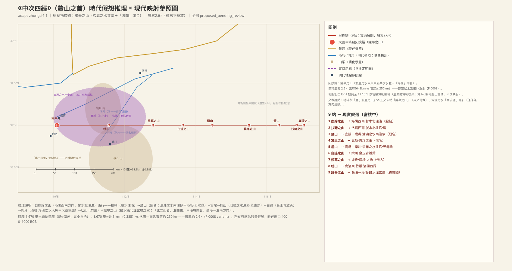

### 鹿蹄之山：厘山系的首站（但冠名山不在首位）

> **原文**：《中次四經》釐山之首，曰鹿蹄之山，其上多玉，其下多金。甘水出焉，而北流注于洛，其中多泠石。

**白话解读**：中次四「厘山系」之首，在豫西洛阳西南方向，对应熊耳山东段（宜阳—洛宁），较可靠（`MTN:SHJ-05-4-001#1`）。注意冠名方式：系名叫「厘山」，但首站是鹿蹄之山，厘山本身排在第三站——冠名与首站分离，和中次五「薄山之首/苟床」同型。山上多玉、山下多金；甘水北流注洛，水中多「泠石」（确指待考）。「洛」是这四站共同的主受水体（`WAT:SHJ-05-4-001#2`）。

**未决项**（照录 draft-v1）：
- 未知：鹿蹄之山——泠石確指
- 未知：甘水——泠石確指
- 衝突：洛——洛同名/通用字層（借名標記）

### 扶猪之山：人目兽「䴦」

> **原文**：西五十里，曰扶豬之山，其上多礝石。有獸焉，其狀如貉而人目，其名曰䴦。虢水出焉，而北流注于洛，其中多瓀石。

**白话解读**：西五十里（全链最短一腿），对应熊耳山洛宁段，较可靠（`MTN:SHJ-05-4-002#1`）。山上多礝石（坚美石类）。有兽「䴦」，像貉而长着人眼——造像夸张，原型待考（`CRE:SHJ-05-4-002#2`）。虢水北流注洛，是第二条北注洛的溪；水中多瓀石（美石类）。「虢」是封国式命名，借名层不作证。

**未决项**（照录 draft-v1）：
- 未知：扶豬之山——礝石/瓀石確指
- 未知：扶豬之山——䴦原型
- 未知：虢水——瓀石確指

### 厘山：冠名山，全链唯一南向受水

> **原文**：又西一百二十里，曰釐山，其陽多玉，其陰多蒐。有獸焉，其狀如牛。蒼身，其音如嬰兒，是食人，其名曰犀渠。滽滽之水出焉，而南流注于伊水。有獸焉，名曰𤢺，其狀如獳犬而有鱗，其毛如彘鬣。

**白话解读**：西一百二十里到厘山——就是「厘山之首」的厘山本站，冠名山位居链中而不是链首。对应熊耳山洛宁—卢氏段，较可靠（`MTN:SHJ-05-4-003#1`）。阳坡多玉、阴坡多蒐（茜草类）。有兽「犀渠」，像牛、苍色身子、叫声像婴儿、吃人——「音如婴儿」是书内食人兽的常规模记（`CRE:SHJ-05-4-003#2`）。水系是关键：滽滽之水**南流**注于伊水——全链其他水都北注洛，只有这一条南向入伊，说明链条在厘山一线骑跨洛河/伊河的分水岭，这个格局不依名称成立，较可靠（`WAT:SHJ-05-4-003#1`）。又有兽「𤢺」，像恶犬而有鳞、毛像野猪鬃，原型待考。

**未决项**（照录 draft-v1）：
- 未知：釐山——犀渠/𤢺原型
- 未知：釐山——蒐確指
- 衝突：伊水——伊同名層（借名標記）

### 箕尾之山：与南山经同名的山

> **原文**：又西二百里，曰箕尾之山，多穀，多涂石，其上多㻬琈之玉。

**白话解读**：西二百里，嵩县方向，对应外方山嵩县段，较可靠（`MTN:SHJ-05-4-004#1`）。与南次一经的箕尾之山同名异地，按借名处理不作证。山上多构树、多「涂石」（确指待考），山顶多㻬琈玉。

**未决项**（照录 draft-v1）：
- 衝突：箕尾之山——箕尾與南次一經同名（借名標記）
- 未知：箕尾之山——涂石確指

### 柄山：第二种毒鱼植物

> **原文**：又西二百五十里，曰柄山，其上多玉，其下多銅。滔雕之水出焉，而北流注于洛。其中多羬羊。有木焉，其狀如樗，其葉如桐而莢實，其名曰茇，可以毒魚。

**白话解读**：西二百五十里，嵩县—栾川方向，对应外方山南段，较可靠（`MTN:SHJ-05-4-005#1`）。上多玉、下多铜（豫西铜矿带方向）。滔雕之水北流注洛，是第三条北注溪；溪中多羬羊（大角羊类，栖于溪谷）。有一种树叫「茇」，像臭椿、叶像梧桐、结豆荚，**可以毒鱼**——与中二葌山芒草并列的第二条毒鱼植物记录，是渔猎技术的直接证据（`PLA:SHJ-05-4-005#3`）。

### 白边之山：对着栾川多金属矿集区

> **原文**：又西二百里，曰白邊之山，其上多金玉，其下多青雄黃。

**白话解读**：西二百里，栾川方向，对应伏牛山北麓栾川段（钼钨矿带），较可靠（`MTN:SHJ-05-4-006#1`）。山上金玉、山下青雄黄——栾川正是现实中的多金属矿集区，矿带方向相容（不单独作证据）。

### 熊耳之山：「人鱼」就是娃娃鱼

> **原文**：又西二百里，曰熊耳之山，其上多漆，其下多椶。浮濠之水出焉，而西流注于洛，其中多水玉，多人魚。有草焉，其狀如蘓而赤華，名曰葶薴，可以毒魚。

**白话解读**：西二百里，卢氏方向，对应熊耳山主脊卢氏段（全宝山方向），较可靠（`MTN:SHJ-05-4-007#1`）。与现代熊耳山同名，按借名处理——位置是里程链加水系推出来的，名字只是巧合或后世沿用。山上多漆树、山下多棕榈，是漆园、棕编利用的生业作物双记。浮濠之水注洛（原文说「西流」，与常识的东向相反，这个流向疑点记下待审），水中多水玉（水晶类）、多**人鱼**——人鱼就是大鲵（娃娃鱼），这是书内通例，洛河流域历史上确有大鲵分布，判定较可靠（`CRE:SHJ-05-4-007#1`）。还有草「葶苎」，像紫苏开红花，可以毒鱼——本经毒鱼植物第二记。

**配图**：

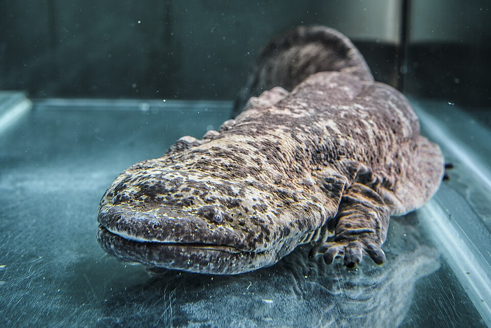（图：Wikimedia Commons）

**未决项**（照录 draft-v1）：
- 衝突：熊耳之山——熊耳同名（借名標記）
- 衝突：熊耳之山——浮濠之水西流注洛（流向疑點）
- 衝突：浮濠之水——「西流注于洛」流向疑點

### 牡山：「洛閒」的西界之一

> **原文**：又西三百里，曰牡山，其上多文石，其下多竹箭竹䉋，其獸多㸲牛、羬羊，鳥多赤鷩。

**白话解读**：西三百里（全链第二长腿，跨豫陕界），商洛东方向，对应蟒岭（商洛东北山岭），较可靠（`MTN:SHJ-05-4-008#1`）。山上多纹石，山下多竹箭、竹䉋两类竹丛；兽多㸲牛（牦牛类候选）、羬羊（与柄山跨站同种），鸟多赤鷩（红腹锦鸡类候选）。这座山没有水体记录，但它与下站讙举之山合称「洛閒」——洛河流域的西界站之一。

**未决项**（照录 draft-v1）：
- 未知：牡山——竹䉋確指

### 讙举之山：终点，「此二山者，洛閒也」

> **原文**：又西三百五十里，曰讙舉之山。雒水出焉，而東北流注于玄扈之水，其中多馬腸之物。此二山者，洛閒也。

**白话解读**：西三百五十里（全链最长腿）到终点，商洛—洛南方向，对应秦岭草链岭（洛河源区），较可靠（`MTN:SHJ-05-4-009#1`）。雒水发源此山、东北流注玄扈之水，水中有「马肠之物」（确指待考）。「此二山者，洛閒也」——牡山与讙举之山之间就是「洛閒」（洛水之域）的西界，这是区域级的水系闭合表述。玄扈之水是**跨链共享水体锚点**：中次五的终点阳虚之山「临于玄扈之水」，两条子经的终点被同一水体互相锁定——**F-0020 已裁決（2026-10-27）、T-RT05 遮蔽重判修訂（2026-10-28）：玄扈之水＝洛宁玄扈水（洛河上游段/支流）——雒水注玄扈在本读法下为同水系内汇注，两链夹河洛东西对列；原「黄河三门峡—孟津段」降对立候选存册**（`WAT:SHJ-05-4-009#2`）。注意总结段把终点站写作「玄扈之山」，与正文「讙举之山」是异文，待裁。

**未决项**（照录 draft-v1）：
- 衝突：讙舉之山——總結段作「玄扈之山」vs 正文「讙舉之山」（異文待裁）
- 未知：讙舉之山——馬腸之物確指
- 衝突：雒水——雒/洛通用字層
- 衝突：雒水——雒水與鏈內「洛」同體與否待裁
- 未知：雒水——馬腸之物確指
- 衝突：玄扈之水——玄扈之山/讙舉之山異文
- 未知：玄扈之水——確指（與中五聯合校準）

### 中四总结段：里程完全自洽的轻祭链

> **原文**：凡釐山之首，自鹿蹄之山至于玄扈之山，凡九山，千六百七十里。其神狀皆人面獸身。其祠之，毛用一白雞，祈而不糈，以采衣之。

**白话解读**：总结：九山、一千六百七十里——站数与正文九站一致，自记 1,670 里与腿程合计 1,670 里**完全一致**，是里程自洽的好样本（对比中五「凡十六山 vs 15 站」的缺站）。终点写作「玄扈之山」，与正文的「讙举之山」是异文（也可能玄扈之山就是讙举的别称，因为玄扈之水正出此山），待文字校勘。九山神格统一为「人面兽身」；祭仪很轻：一只白鸡、祷告而不用祭米、给神主穿彩绘衣饰——对比中五的太牢血祭，这是一条轻祭链（`CRE:SHJ-05-4-010#1`、`OBJ:SHJ-05-4-010#2`）。

**地理候选**（照录 draft-v1）：玄扈之山 → 玄扈水所出山（豫西商洛走廊方向）（medium）

**未决项**（照录 draft-v1）：
- 未知：玄扈之山——玄扈之山確指待考

## 中山经·次五（zhongci5）——秦岭东段主脊到黄河南岸（F-0020 裁决后框架）

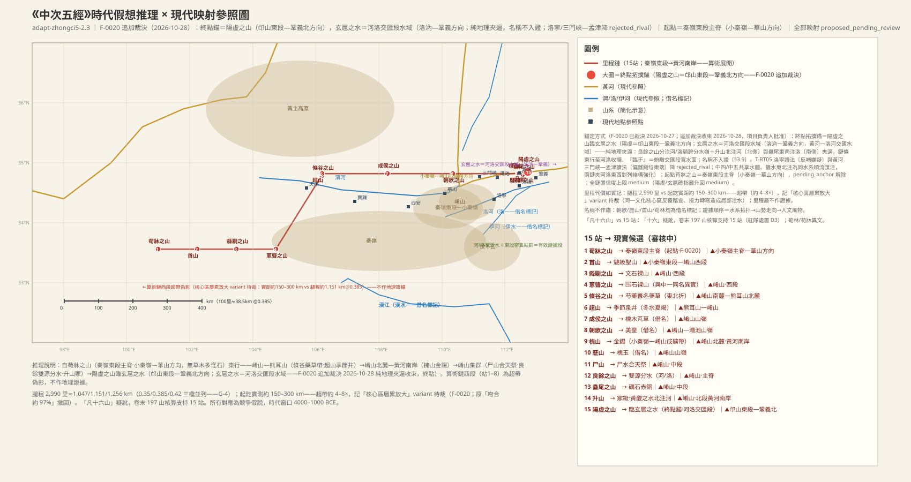

### 苟床之山：从秦岭东段主脊出发

> **原文**：《中次五經》薄山之首，曰苟牀之山，無草木，多怪石。

**白话解读**：中次五也叫「薄山系」（与中一同名系，待裁），从全链最西端的苟床之山起步——**2026-10-27 裁決（F-0020）：起点确指为秦岭东段主脊（小秦岭—华山方向），pending_anchor 解除**（`MTN:SHJ-05-5-001#1`）。裁决推理：本经祭祀规格（升山冢、尸山合天、首山䰠）属核心区等级，河洛是夏人核心区（成书层）；中四、中五共享玄扈之水（已确指＝洛宁玄扈水·洛河上游——F-0020 经 T-RT05 遮蔽重判修订，2026-10-28），两链夹河洛东西对列，结构自洽。原「东昆仑—黄河源区」起点带系腿程自终点反推（循环锚定，A1），已废点存册。「无草木、多怪石」——高海拔裸岩风化地貌的记录，与小秦岭花岗岩主脊带（老鸦岔垴 2,414 米为豫西最高峰方向）相符（`PLA:SHJ-05-5-001#1`、`MIN:SHJ-05-5-001#1`）。里程代价如实记：苟床—阳虚实距约 150–300 公里，而腿程 2,990 里（约 1,047–1,256 公里）——超带约 4–8 倍，记「核心区层累放大」variant 待裁（同一文化核心区反复踏查、接力转写造成局部注水），里程不作证据。

**未决项**（照录 draft-v1）：
- 未知：苟牀之山——「核心區層累放大」variant 待裁（腿程超帶約 4–8×，F-0020）

### 首山：小秦岭东段的最高神格圣山

> **原文**：東三百里，曰首山，其陰多榖柞，其草多𦬸芫，其陽多㻬琈之玉，木多槐。其陰有谷，曰机谷，多䲦鳥，其狀如梟而三目，有耳，其音如錄，食之已墊。

**白话解读**：东三百里到首山，小秦岭东段—崤山西段方向，较可靠（`MTN:SHJ-05-5-002#1`）。总结段说「首山，䰠也」——䰠级是本经最高神格之一（与冢级升山并列）；「首」即起点圣山之意，是秦岭东段主脊方向的第一圣山。物产按阴阳坡分列：阴坡构树柞树、草类𦬸芫，阳坡㻬琈玉、槐木。阴坡有个「机谷」，多「䲦鸟」：像猫头鹰而三只眼、有耳朵，叫声像「录」，说吃了治「垫」（湿疾）——三目是造像夸张（`CRE:SHJ-05-5-002#1`）。

**未决项**（照录 draft-v1）：
- 衝突：首山——首山為多處同名（借名標記）

### 县劚之山：崤山西段的纹石山

> **原文**：又東三百里，曰縣劚之山，無草木，多文石。

**白话解读**：东三百里，崤山西段方向，方向性猜测（`MTN:SHJ-05-5-003#1`）。无草木、多文石（带纹理的美石）——裸岩地貌的延续。

### 葱聋之山（中五）：与中一同名的第二座

> **原文**：又東三百里，曰蔥聾之山，無草木，多𢈦石。

**白话解读**：东三百里，崤山方向，方向性猜测（`MTN:SHJ-05-5-004#1`）。与中次一的葱聋之山同名异地，按借名/通名标记（F-0022 同名异实诸例的边界同型）。无草木、多「𢈦石」（矿物，确指待考）。

**未决项**（照录 draft-v1）：
- 衝突：蔥聾之山——蔥聾之山與中一同名異地
- 未知：蔥聾之山——𢈦石確指

### 条谷之山：折向东北，进入药材带

> **原文**：東北五百里，曰條谷之山，其木多槐桐，其草多芍藥、虋冬。

**白话解读**：东北五百里（层累承载段，里程不作证据），崤山南麓—熊耳山北麓方向，较可靠（`MTN:SHJ-05-5-005#1`）。木多槐桐，草多芍药、虋冬（门冬/麦冬类）——两种药草并记，豫西山地药草带，风物相符（`PLA:SHJ-05-5-005#3`、`PLA:SHJ-05-5-005#4`）。

### 超山：冬有水而夏竭的季节泉

> **原文**：又北十里，曰超山，其陰多蒼玉，其陽有井，冬有水而夏竭。

**白话解读**：北十里（极短腿，紧邻条谷的山前站），熊耳山—崤山方向，较可靠（`MTN:SHJ-05-5-006#1`）。阴坡多苍玉；阳坡有一口井，**冬天有水、夏天枯竭**——季节性泉井的精确水文记录，豫西山地泉眼的季节机制（`WAT:SHJ-05-5-006#1`）。

### 成侯之山：香椿与茂草

> **原文**：又東五百里，曰成侯之山，其上多櫄木，其草多芃。

**白话解读**：东五百里（层累承载段），崤山方向，较可靠（`MTN:SHJ-05-5-007#1`）。「成侯」是封号式命名，借名标记。山上多櫄木（香椿类），草多「芃」（草茂）（`PLA:SHJ-05-5-007#1`）。

### 朝歌之山（中五）：白垩土谷

> **原文**：又東五百里，曰朝歌之山，谷多美堊。

**白话解读**：东五百里（层累承载段），崤山—渑池方向，较可靠（`MTN:SHJ-05-5-008#1`）。与淇县朝歌同名，是借名或同名两地，不作证（与中十一的朝歌之山也是同名异地）。山谷中多「美垩」——白垩土，豫西黄土—白垩层物产（`MIN:SHJ-05-5-008#1`）。

**未决项**（照录 draft-v1）：
- 衝突：朝歌之山——朝歌同名（借名標記）

### 槐山：金锡谷，对着小秦岭—崤山成矿带

> **原文**：又東五百里，曰槐山，谷多金錫。

**白话解读**：东五百里（层累承载段），崤山北麓—黄河南岸方向，较可靠（`MTN:SHJ-05-5-009#1`）。山谷中多金、多锡——小秦岭—崤山成矿带（豫陕金矿带西起小秦岭、东延崤山）是真实矿带，方向相符（`MIN:SHJ-05-5-009#1`、`MIN:SHJ-05-5-009#2`）。

### 历山（中五）：槐木与阳坡玉

> **原文**：又東十里，曰歷山，其木多槐，其陽多玉。

**白话解读**：东十里，进入东段密集站群，崤山方向，较可靠（`MTN:SHJ-05-5-010#1`）。多处历山同名，借名不作证。木多槐、阳坡多玉。

**未决项**（照录 draft-v1）：
- 衝突：歷山——歷山同名（借名標記）

### 尸山：「合天」级的最高祭仪地

> **原文**：又東十里，曰尸山，多蒼玉，其獸多麖。尸水出焉，南流注于洛水，其中多美玉。

**白话解读**：东十里，豫西崤山方向，对应崤山中段，较可靠（`MTN:SHJ-05-5-011#1`）。「尸」是尸主/神主之意——总结段说「尸水，合天也」，尸山—尸水是本经最高祭仪地（比冢、䰠更高一级；核心区等级祭仪与河洛核心区定位互洽——F-0020）。山上多苍玉，兽多麖（麂类小鹿）；尸水南流注洛水，水中多美玉（`WAT:SHJ-05-5-011#1`）。

**未决项**（照录 draft-v1）：
- 衝突：洛水／洛——洛同名（借名標記）

### 良余之山：一座山分开黄河与洛河

> **原文**：又東十里，曰良餘之山，其上多穀柞，無石。餘水出于其陰，而北流注于河；乳水出于其陽，而東南流注于洛。

**白话解读**：东十里，对应崤山主脊——黄河/洛河分水岭，较可靠（`MTN:SHJ-05-5-012#1`）。这条的证据价值很高：余水出北坡北流注黄河，乳水出南坡东南流注洛河——一座山的两面分别入黄河和洛河，正是崤山分水岭的拓扑自证，不靠任何地名（`WAT:SHJ-05-5-012#1`、`WAT:SHJ-05-5-012#3`）。山上多构树柞树、无石（土质山）。

### 蛊尾之山：砺石与赤铜

> **原文**：又東南十里，曰蠱尾之山，多礪石、赤銅。龍餘之水出焉，而東南流注于洛。

**白话解读**：东南十里，对应崤山中段，较可靠（`MTN:SHJ-05-5-013#1`）。多磨刀石和赤铜；龙余之水东南流注洛河（`WAT:SHJ-05-5-013#1`）。

### 升山：冢级圣山

> **原文**：又東北二十里，曰升山，其木其多榖柞棘，其草多藇蕙，多寇脫。黃酸之水出焉，而北流注于河，其中多璇玉。

**白话解读**：东北二十里，豫西崤山—黄河南岸（陕州段），较可靠（`MTN:SHJ-05-5-014#1`）。总结段「升山，冢也」——冢级圣山，用太牢。植被丰富：构、柞、棘，药草藇蕙（薯蓣/山药类）、寇脱（通草类）。黄酸之水北流注黄河，水中多璇玉（美玉）（`WAT:SHJ-05-5-014#1`）。

### 阳虚之山：终点，临于玄扈之水

> **原文**：又東二十里，曰陽虛之山，多金，臨于玄扈之水。

**白话解读**：东二十里到终点——**2026-10-27 裁決（F-0020）、2026-10-28 遮蔽重判修訂（T-RT05）：阳虛之山＝洛宁阳虛山方向（约 34.7°N, 111.4°E 一带），玄扈之水＝洛宁玄扈水（洛河上游段/支流）**（`MTN:SHJ-05-5-015#1`）。山上多金；「临于玄扈之水」——滨水的静态关系；传世地名中洛宁县即有玄扈水/阳虛山（仓颉造字传说地），「临于」指向洛河上游较黄河三门峡更自然。玄扈之水就是中四终点雒水所注的那条水：中四自洛阳西南西行至商洛—洛南、中五自秦岭东段东行至河洛之间，两链夹河洛东西对列，由它互相锁定，是全卷最重要的跨链水体锚（已确指，`WAT:SHJ-05-5-015#1`）——洛宁读法下雒水注玄扈为同水系内汇注，较黄河读法更顺。注意反哺风险：洛宁玄扈水可能系后世据《山海经》命名（借名方向待裁）——但即便反哺成立，「阳虛在河洛之间」的结构定位已由良余之山分注河/洛独立成立。原「黄河三门峡—孟津段」读法降对立候选存册。

**未决项**（照录 draft-v1）：
- （結案）玄扈之水確指——F-0020 已裁決（2026-10-27）、T-RT05 遮蔽重判修訂（2026-10-28）：洛寧玄扈水（洛河上游段/支流）；原黃河三門峽—孟津段降對立存冊
- （待裁）洛寧玄扈水是否為後世據經命名（反哺）——借名方向待裁

### 中五总结段：三级祭仪与「十六」疑讹

> **原文**：凡薄山之首，自苟林之山至于陽虛之山，凡十六山，二千九百八十二里。升山，冢也，其祠禮：太牢，嬰用吉玉。首山，䰠也，其祠用稌、黑犧、太牢之具、糱釀；干儛，置鼓；嬰用一璧。尸水，合天也，肥牲祠之，用一黑犬于上，用一雌雞于下，刉一牝羊，獻血。嬰用吉玉，采之，饗之。

**白话解读**：总结：从苟林之山（「苟林」与正文「苟床」是异文）到阳虚之山，「凡十六山」——但正文只有 15 站；**「十六」疑訛：卷末「大凡百九十七山」核算支持 15 站（各子經站數之和 15+9+5+9+15+14+19+23+16+9+48+15＝197 ✓；按 16 計則 198 ✗），不再假設傳抄遺佚缺站（D3）**。里程 2,982 里对腿程 2,990 里只差 0.3%，账目自洽；但腿程对起讫实距（约 150–300 公里）超带约 4–8 倍——「核心区层累放大」variant 待裁（F-0020），里程层不作证据。祭仪分三级，是中山经里规格最高的一条链：升山为冢，用太牢加吉玉；首山为䰠，用稻米、黑色牺牲、太牢全套、酒酿，还要跳盾舞、架鼓，挂一块玉璧；尸水为「合天」，用肥牲祭祀，上面用一只黑狗、下面用一只母鸡、再杀一只母羊献血——血祭记录。圣山集中在两头：首山在秦岭东段主脊方向（西端出发点），升山、尸山在豫西崤山—黄河南岸东段——三级祭仪集中于一条河洛核心区链，与 F-0020 裁决的核心区定位互洽。

## 中山经·次六（zhongci6）——洛阳西分水岭到潼关

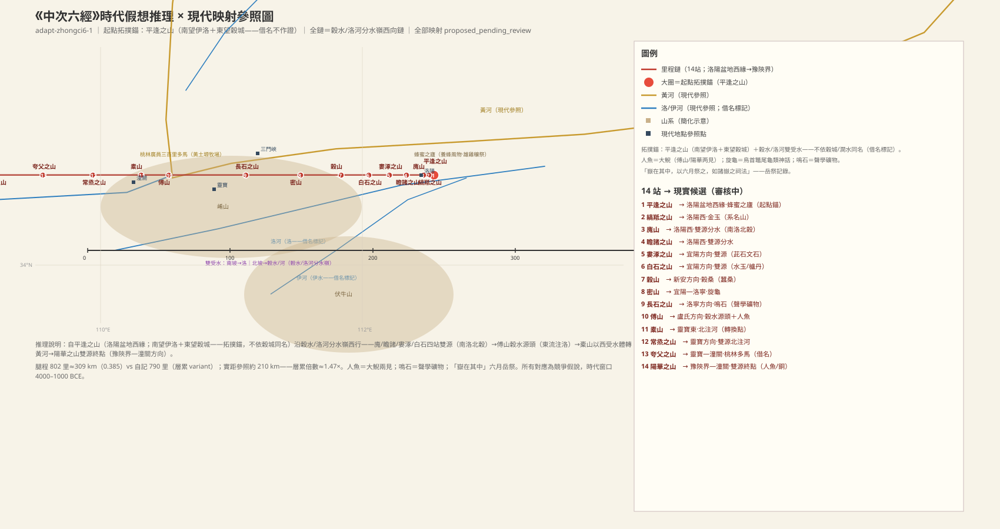

### 平逢之山：蜜蜂之神的圣所

> **原文**：《中次六經》縞羝山之首，曰平逢之山，南望伊洛，東望穀城之山，無草木，無水，多沙石。有神焉，其狀如人而二首，名曰驕蟲，是為螫蟲，實惟蜂蜜之廬，其祠之：用一雄雞，穰而勿殺。

**白话解读**：中次六「缟羝山系」之首，在洛阳盆地西缘，对应周山—邙山西段，较可靠（`MTN:SHJ-05-6-001#1`）。站在山上往南望见伊洛交汇的平原、往东望见谷城之山——两个静态视野关系是拓扑锚的组件（`WAT:SHJ-05-6-001#1`、`MTN:SHJ-05-6-001#2`）。山上无草木、无水、多沙石——盆地西缘的黄土砂石裸丘。有神「骄虫」，人形而两个头，是「螫虫」（蜂类）之神，这里就是「蜂蜜之庐」——**全书唯一的蜂神与蜂蜜记录，是养蜂风物的直接证据**（`CRE:SHJ-05-6-001#1`、`LND:SHJ-05-6-001#1`）。祭它用一只公鸡，但「穰而勿杀」——只作禳祭仪式而不杀牲，是特例。

**未决项**（照录 draft-v1）：
- 衝突：平逢之山——穀城之山與後世穀城同名（借名標記，不作證）
- 未知：平逢之山——驕蟲二首造像的確切禮制內涵
- 衝突：伊洛——伊洛同名（借名標記）
- 未知：穀城之山——穀城之山確指待考

### 缟羝之山：系名由它冠名

> **原文**：西十里，曰縞羝之山，無草木，多金玉。

**白话解读**：西十里，洛阳西近郊，对应邙山洛阳西段，较可靠（`MTN:SHJ-05-6-002#1`）。本经的系名「缟羝山」就由这一站冠名——系名山紧邻起点。无草木、多金玉。

**未决项**（照录 draft-v1）：
- 未知：縞羝之山——縞羝名義（系名來源）

### 廆山：本经第一个双源分水岭站

> **原文**：又西十里，曰廆山，其陰多㻬琈之玉。其陰有谷，名曰雚谷，其木多柳楮。其中有鳥焉，狀如山雞而長尾，赤如丹火而青喙，名曰鴒䳩，其鳴自呼，服之不眯。交觴之水出于其陽，而南流注于洛；俞隨之水出于其陰，而北流注于穀水。

**白话解读**：西十里，洛阳以西、谷水/洛河分水岭的东段，对应邙山西段—新安东山岭，较可靠（`MTN:SHJ-05-6-003#1`）。阴坡多㻬琈玉；阴坡有雚谷，多柳树和楮树。谷中有鸟「鸰䳩」，像山鸡而长尾、红得像丹火、青色的喙，叫声像在叫自己的名字——红腹锦鸡类（`CRE:SHJ-05-6-003#2`）。水系是重点：交觞之水出阳坡南流注洛河，俞随之水出阴坡北流注谷水——一山两面分注两水，是谷水/洛河分水岭拓扑的第一个自证站（`WAT:SHJ-05-6-003#1`、`WAT:SHJ-05-6-003#3`）。

**未决项**（照录 draft-v1）：
- 衝突：穀水——穀水同名（借名標記）
- 未知：穀水——穀水古河道與今澗河的對應細節
- 衝突：洛——洛同名（借名標記）

### 瞻诸之山：双源分水第二站

> **原文**：又西三十里，曰瞻諸之山，其陽多金，㴬水出焉，而東南流注于洛；少水出于其陰，而東流注于穀水。

**白话解读**：西三十里，对应邙山新安段，较可靠（`MTN:SHJ-05-6-004#1`）。阳坡多金。㴬水出山东南流注洛河，少水出阴坡东流注谷水——双源分水第二个样本，分水岭拓扑继续成立。

### 娄涿之山：双源分水第三站

> **原文**：又西三十里，曰婁涿之山，無草木，多金玉。瞻水出于其陽，而東流注于洛；陂水出于其陰，而北流注于穀水，其中多茈石、文石。

**白话解读**：西三十里，宜阳方向分水岭，对应崤山东北段（宜阳北山岭），较可靠（`MTN:SHJ-05-6-005#1`）。无草木、多金玉。瞻水出阳坡东流注洛，陂水出阴坡北流注谷水、水中多茈石（紫色石，待考）和文石——双源分水第三个样本。

**未决项**（照录 draft-v1）：
- 未知：婁涿之山——茈石確指

### 白石之山：水晶与丹砂

> **原文**：又西四十里，曰白石之山。惠水出于其陽，而南流注于洛，其中多水玉。澗水出于其陰，西北流注于穀水，其中多麋石、櫨丹。

**白话解读**：西四十里，宜阳方向分水岭，较可靠（`MTN:SHJ-05-6-006#1`）。白石即白色岩石山。惠水出阳坡南流注洛，水中多**水玉**——水晶（`MIN:SHJ-05-6-006#1`）；涧水出阴坡西北流注谷水，水中多麋石（待考）和**栌丹**——丹砂类红色颜料矿（`MIN:SHJ-05-6-006#3`）。双源分水第四个样本。「涧水」与后世洛阳涧水同名，借名不作证。

**未决项**（照录 draft-v1）：
- 衝突：白石之山——澗水與後世澗水同名（借名標記）
- 未知：白石之山——麋石確指
- 衝突：澗水——澗水同名（借名標記）

### 榖山：上构下桑的蚕桑风物

> **原文**：又西五十里，曰榖山，其上多榖，其下多桑。爽水出焉，而西北流注于榖水，其中多碧綠。

**白话解读**：西五十里，新安县方向，对应邙山新安西段（谷水流域），较可靠（`MTN:SHJ-05-6-007#1`）。山上多构树、山下多桑树——上构下桑的垂直植被分层，是蚕桑风物记录（`PLA:SHJ-05-6-007#2`）。爽水西北流注谷水，水中多「碧绿」（绿色美石）。本站只有北坡水入谷水，属谷水流域北岸站。

### 密山：旋龟再现身

> **原文**：又西七十二里，曰密山，其陽多玉，其陰多鐵。豪水出焉，而南流注于洛，其中多旋龜，其狀鳥首而鼈尾，其音如判木。無草木。

**白话解读**：西七十二里（不是整数，是里程记录精细化的样本），宜阳—洛宁方向，对应崤山洛宁东段，较可靠（`MTN:SHJ-05-6-008#1`）。阳坡多玉、阴坡多铁。豪水南流注洛，水中多**旋龟**：鸟头鳖尾、叫声像劈木头——这个形象也见于《南山经》杻阳之山，是跨经共享的神话题材（`CRE:SHJ-05-6-008#1`）。山无草木。

### 长石之山：会发声的「鸣石」

> **原文**：又西百里，曰長石之山，無草木，多玉。其西有谷焉，名曰共谷，多竹。共水出焉，西南流注于洛，其中多鳴石。

**白话解读**：西一百里，洛宁方向，对应崤山洛宁段，较可靠（`MTN:SHJ-05-6-009#1`）。无草木、多玉。西侧有共谷，多竹（豫西竹林记录）。共水西南流注洛，水中多**鸣石**——撞击或风蚀会发声的岩石，是书内罕见的声学物产记录，与密山旋龟「音如判木」同属声学观察群（`MIN:SHJ-05-6-009#2`）。发声机理待考。

**未决项**（照录 draft-v1）：
- 未知：長石之山——鳴石確指（聲學機理）

### 傅山：谷水的源头、人鱼第一见

> **原文**：又西一百四十里，曰傅山，無草木，多瑤碧。厭染之水出于其陽，而南流注于洛，其中多人魚。其西有林焉，名曰墦冢。穀水出焉，而東流注于洛，其中多㻒玉。

**白话解读**：西一百四十里（全经最长腿），卢氏方向、洛河上游，对应崤山卢氏段，较可靠（`MTN:SHJ-05-6-010#1`）。无草木、多瑶碧。厌染之水出阳坡南流注洛，水中多**人鱼——大鲵在本书上游河段的第一次记录**（`CRE:SHJ-05-6-010#1`）。西侧有片林子叫「墦冢」（性质待裁）。最关键的是：**谷水发源此山、东流注洛**——谷水的源头在链西端、向东穿流全链北坡汇入洛河，证明谷水是洛河支流，「南洛北谷」的格局在此收束，拓扑自证（`WAT:SHJ-05-6-003#4`）。水中多㻒玉（似玉美石）。

**未决项**（照录 draft-v1）：
- 未知：傅山——墦冢林性質（林地/冢域）

### 橐山：受水体从谷水切换成黄河

> **原文**：又西五十里，曰橐山，其木多樗，多𣖾木，其陽多金玉，其陰多鐵，多蕭。橐水出焉，而北流注于河。其中多脩辟之魚，狀如黽而白喙，其音如鴟，食之已白癬。

**白话解读**：西五十里，灵宝东方向、黄河南岸，对应崤山西北段，较可靠（`MTN:SHJ-05-6-011#1`）。林木多樗（臭椿）、𣖾木（待考），阳坡金玉、阴坡铁，多萧（艾蒿）。水系出现转换：橐水不再入谷水，而是**北流直接注入黄河**——从这里起，北向受水体由谷水换成黄河，说明链已走出洛阳盆地进入三门峡段（`WAT:SHJ-05-6-011#1`）。水中有「脩辟之鱼」，像蛙而白嘴、叫声像鹞鹰，说吃了治白癣（`CRE:SHJ-05-6-011#1`）。

**未决项**（照录 draft-v1）：
- 未知：橐山——𣖾木確指

### 常烝之山：两条溪同注黄河

> **原文**：又西九十里，曰常烝之山，無草木，多堊。潐水出焉，而東北流注于河，其中多蒼玉。菑水出焉，而北流注于河。

**白话解读**：西九十里，灵宝方向黄河南岸，对应崤山灵宝段，较可靠（`MTN:SHJ-05-6-012#1`）。无草木、多垩土（黄土区白垩层）。潐水东北流注河（水中多苍玉）、菑水北流注河——两溪同注黄河的北向双源站，黄河南岸支流格局（`WAT:SHJ-05-6-012#1`、`WAT:SHJ-05-6-012#2`）。

### 夸父之山：方圆三百里的桃林牧场

> **原文**：又西九十里，曰夸父之山，其木多椶枏、多竹箭，其獸多㸲牛、羬羊，其鳥多鷩，其陽多玉，其陰多鐵。其北有林焉，名曰桃林，是廣員三百里，其中多馬。湖水出焉，而北流注于河，其中多㻒玉。

**白话解读**：西九十里，灵宝—潼关方向黄河南岸，对应崤山西段（桃林塞方向），较可靠（`MTN:SHJ-05-6-013#1`）。「夸父」是神话名，借名不作地理证据。山上棕榈、楠木、竹箭；兽多㸲牛（牦牛类）、羬羊，鸟多鷩（锦鸡类）；阳坡玉、阴坡铁。山北有片「桃林」，**方圆三百里、其中多马**——黄土塬牧场的风物记录（与后世桃林塞同名，借名层，但风物有效）（`LND:SHJ-05-6-013#1`、`CRE:SHJ-05-6-013#4`）。湖水北流注黄河，水中多㻒玉。

**未决项**（照录 draft-v1）：
- 衝突：夸父之山——桃林與後世桃林塞同名（借名標記）
- 衝突：夸父之山——夸父為神話名（借名標記）

### 阳华之山：终点仍骑分水岭，人鱼第二见

> **原文**：又西九十里，曰陽華之山，其陽多金玉，其陰多青雄黃，其草多藷藇，多苦辛，其狀如橚，其實如瓜，其味酸甘，食之已瘧。楊水出焉，而西南流注于洛，其中多人魚。門水出焉，而東北流注于河，其中多玄䃤。𦁎姑之水出于其陰，而東流注于門水，其上多銅。門水出于河，七百九十里入雒水。

**白话解读**：西九十里到终点，豫陕界—潼关方向、黄河大拐弯南岸，对应小秦岭豫灵—潼关段，较可靠（`MTN:SHJ-05-6-014#1`）。阳坡金玉、阴坡青雄黄（砷硫化物颜料/药用矿）；草药多藷藇（薯蓣类）和「苦辛」——样子像橚树、果实像瓜、味道酸甜，说吃了治疟疾（`PLA:SHJ-05-6-014#2`）。水系仍是分水岭格局：杨水西南流注洛（水中多**人鱼**——大鲵第二次出现，与傅山呼应，连成洛河上游大鲵分布带，`CRE:SHJ-05-6-014#1`），门水东北流注黄河（水中多玄䃤，黑色砥石类）；𦁎姑之水出阴坡东流注门水、沿岸多铜——三級水系加铜矿记录。末句「门水出于河，七百九十里入雒水」疑点很大：门水明明是入河的溪，「出于河」流向倒逆，且「七百九十里」与总结里程重复，疑似总结语窜入的衍文，待文字校勘；雒水节点的存废待裁，不作锚。

**未决项**（照录 draft-v1）：
- 衝突：陽華之山——門水句疑衍文 variant
- 未知：陽華之山——玄䃤確指
- 未知：陽華之山——苦辛確指（治瘧藥草）
- 衝突：門水——門水出于河句疑衍文
- 衝突：雒水——疑衍文 variant
- 未知：雒水——雒水是否為本經真實水體

### 中六总结段：岳祭与「天下安宁」

> **原文**：凡縞羝山之首，自平逢之山至于陽華之山，凡十四山，七百九十里。嶽在其中，以六月祭之，如諸嶽之祠法，則天下安寧。

**白话解读**：总结：十四山、七百九十里。站数全对得上；自记 790 里对腿程 802 里只差 1.5%，相当自洽。「岳在其中」——本经辖域内有一座「岳」（具体是哪一站没指明，待裁），六月祭它，比照诸岳的通用祠法，「则天下安宁」——这是岳祭礼制加政治性祈愿的明确记录，与中五的冢/䰠/合天三级祭是不同的礼制类型（`MTN:SHJ-05-6-015#1`）。

## 中山经·次七（zhongci7）——嵩山枢纽到郑州、新郑

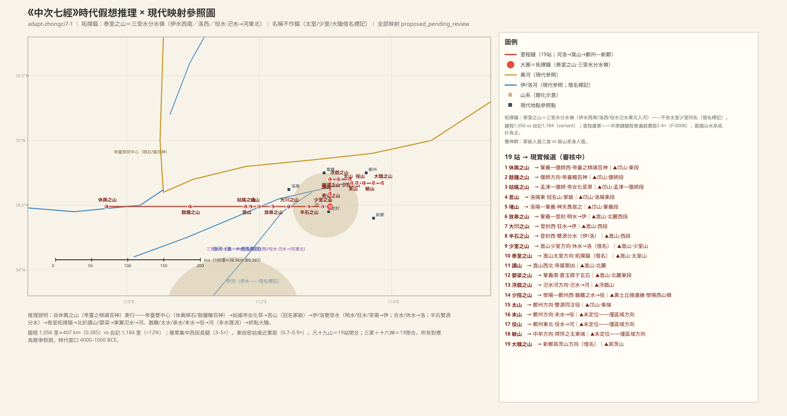

### 休舆之山：帝台的五色棋石

> **原文**：《中次七經》苦山之首，曰休輿之山。其上有石焉，名曰帝臺之棋，五色而文，其狀如鶉卵，帝臺之石，所以禱百神者也，服之不蠱。有草焉，其狀如蓍，赤葉而本叢生，名曰夙條，可以為簳。

**白话解读**：中次七「苦山系」之首（冠名山是第四站苦山，系名与首站不同名），巩义—偃师西方向，对应邙山东段，较可靠（`MTN:SHJ-05-7-001#1`）。山上有一种石头叫「帝台之棋」：五色带纹、形状像鹌鹑蛋，是帝台用来祷告百神的祭石/法器，佩戴它可以「不蛊」（防蛊毒）——彩色砾石或玉髓类，材质待考（`OBJ:SHJ-05-7-001#1`）。还有草「夙条」，像蓍草、红叶丛生，可以做「簳」（箭杆/筹策材）。

**未决项**（照录 draft-v1）：
- 未知：休輿之山——帝臺之棋五色石確指（彩色礫石/玉髓類待考）

### 鼓钟之山：帝台宴请百神之处

> **原文**：東三百里，曰鼓鍾之山，帝臺之所以觴百神也。有草焉，方莖而黃華，員葉而三成，其名曰焉酸，可以為毒。其上多礪，其下多砥。

**白话解读**：东三百里（里程有注水），偃师方向，对应邙山偃师段，较可靠（`MTN:SHJ-05-7-002#1`）。「鼓钟」是乐器名山（宴飨礼乐语义）。这里是「帝台之所以觞百神」——帝台宴请群神的地方，帝台是本经的神权中心（`PER:SHJ-05-7-002#1`）。有草「焉酸」，方茎黄花圆叶，**可以为毒**——毒饵/毒药的用途记录（`PLA:SHJ-05-7-002#1`）。山上多粗磨石（砺）、山下多细磨石（砥），是磨石的垂直分带。

**未决项**（照录 draft-v1）：
- 未知：鼓鍾之山——焉酸確指

### 姑媱之山：帝女化草

> **原文**：又東二百里，曰姑媱之山。帝女死焉，其名曰女尸，化為䔄草，其葉胥成，其華黃，其實如菟丘，服之媚于人。

**白话解读**：东二百里（里程有注水），孟津—偃师方向，对应邙山孟津—偃师段，较可靠（`MTN:SHJ-05-7-003#1`）。「姑媱」是女性语义的山名，与帝女神话互文。帝的女儿死在这里，名叫女尸，化成了「䔄草」：叶子相叠而生、开黄花、果实像菟丝子，吃了「媚于人」（情魅药效）（`PER:SHJ-05-7-003#1`、`PLA:SHJ-05-7-003#1`）。注意后面太室山也有同名䔄草（但形态不同），是同名回声，待考。

**未决项**（照录 draft-v1）：
- 未知：姑媱之山——䔄草確指

### 苦山：冠名山，会骂人的赤色兽

> **原文**：又東二十里，曰苦山。有獸焉，名曰山膏，其狀如逐，赤若丹火，善詈。其上有木焉，名曰黃棘，黃華而員葉，其實如蘭。服之不字。有草焉，員葉而無莖，赤華而不實，名曰無條，服之不癭。

**白话解读**：东二十里到苦山——本经的冠名山，且是冢级圣山。洛阳东方向，对应邙山洛阳东段，较可靠（`MTN:SHJ-05-7-004#1`）。有兽「山膏」，像猪、浑身赤红如火，「善詈」——叫声刺耳如骂人，是行为夸张化的造像（`CRE:SHJ-05-7-004#1`）。两种药用植物：黄棘，黄花圆叶、果实像兰，吃了「不字」——**不生育，是节育药效的记录**（`PLA:SHJ-05-7-004#1`）；无条，圆叶无茎、开红花不结果，吃了治大脖子病。

**未决项**（照录 draft-v1）：
- 未知：苦山——黃棘/無條確指

### 堵山：神居之处多怪风雨

> **原文**：又東二十七里，曰堵山，神天愚居之，是多怪風雨。其上有木焉，名曰天楄，方莖而葵狀，服之不㖶。

**白话解读**：东二十七里，洛阳—巩义方向，对应邙山巩义段，较可靠（`MTN:SHJ-05-7-005#1`）。神天愚住在这里，山中多「怪风雨」——神居与气候异常耦合，可能是山口风道微气候的记录（`CLIM:SHJ-05-7-005#1`）。注意这座堵山与中次十、中次十一的堵山同名异地，待裁。有树「天楄」，方茎像葵，吃了「不㖶」（治咽喉哑）。

**未决项**（照录 draft-v1）：
- 衝突：堵山——堵山同名見中次十經（SHJ-05-10-010）與中次十一經（SHJ-05-11-049）——同名異地待裁
- 未知：堵山——天楄確指

### 放皋之山：明水入伊，进入伊洛水系区

> **原文**：又東五十二里，曰放皋之山。明水出焉。南流注于伊水，其中多蒼玉。有木焉，其葉如槐，黃華而不實，其名曰蒙木，服之不惑。有獸焉，其狀如蜂，枝尾而反舌，善呼，其名曰文文。

**白话解读**：东五十二里，巩义—登封方向，对应嵩山北麓西段，较可靠（`MTN:SHJ-05-7-006#1`）。从这里进入伊、洛水系记录区：明水南流注入伊水，水中多苍玉——伊水系在本经的第一条支流（`WAT:SHJ-05-7-006#1`）。有树「蒙木」，叶像槐、开黄花不结果，吃了「不惑」（醒神益智）；有兽「文文」，像蜂、尾巴分岔、舌头反生、爱叫——复合造像夸张。

**未决项**（照录 draft-v1）：
- 未知：放皋之山——現實山名未定位
- 衝突：伊水——伊水與現代伊河同名——借名標記

### 大𩇵之山：狂水里的三足龟

> **原文**：又東五十七里，曰大𩇵之山，多㻬琈之玉，多麋玉。有草焉，其狀葉如榆，方莖而蒼傷，其名曰牛傷，其根蒼文，服者不厥，可以禦兵。其陽狂水出焉，西南流注于伊水，其中多三足龜，食者無大疾，可以已腫。

**白话解读**：东五十七里，登封西，对应嵩山西段，较可靠（`MTN:SHJ-05-7-007#1`）。多㻬琈玉和麋玉（两种玉——与敏山同玉种，构成一条玉种走廊）。有草「牛伤」，叶像榆、方茎带刺、根有苍色纹理，吃了不昏厥、可抵御兵祸。阳坡出狂水、西南流注伊水（伊水系第二支流），水中多**三足龟**，吃了不得大病、能消肿——三足是畸形或神话化记录（`CRE:SHJ-05-7-007#1`）。

**未决项**（照录 draft-v1）：
- 未知：大𩇵之山——麋玉確指

### 半石之山：伊水与洛河的分水岭

> **原文**：又東七十里，曰半石之山，其上有草焉，生而秀，其高丈餘，赤葉黃華，華而不實，其名曰嘉榮，服之者不霆。來需之水出于其陽，而西流注于伊水，其中多鯩魚，黑文，其狀如鮒，食者不睡。合水出于其陰，而北流注于洛，多鰧魚，狀如鱖，居逵，蒼文赤尾，食者不癰，可以為瘻。

**白话解读**：东七十里到半石之山，登封西，对应嵩山西段——**伊水/洛河分水岭**，较可靠（`MTN:SHJ-05-7-008#1`）。来需之水出阳坡西流注伊水，合水出阴坡北流注洛河——一山分注两水系，拓扑很清楚。物产：草「嘉荣」高丈余、红叶黄花不结果，吃了不怕雷（`PLA:SHJ-05-7-008#1`）；来需之水多鯩鱼，黑纹像鲫鱼，吃了不犯困；合水多鰧鱼，像鳜鱼、居于水中洲渚岔道、苍纹红尾，吃了不长痈、可治瘘疮（`CRE:SHJ-05-7-008#1`、`CRE:SHJ-05-7-008#3`）。

**未决项**（照录 draft-v1）：
- 未知：半石之山——嘉榮/鯩魚/鰧魚確指
- 衝突：洛——洛與現代洛河同名——借名標記

### 少室之山：与嵩山少室同名

> **原文**：又東五十里，曰少室之山，百草木成囷。其上有木焉，其名曰帝休，葉狀如楊，其枝五衢，黃華黑實，服者不怒。其上多玉，其下多鐵。休水出焉，而北流注于洛，其中多䱱魚，狀如𥂕蜼而長距，足白而對，食者無蠱疾，可以禦兵。

**白话解读**：东五十里到少室之山——与嵩山少室同名，按借名处理不作证据，但里程链把它放在嵩山少室方向，较可靠（`MTN:SHJ-05-7-009#1`）。冢级圣山。「百草木成囷」，草木繁茂如谷仓。有树「帝休」（帝系冠名植物），叶像杨、枝条五岔、黄花黑果，吃了不恼怒（情志药效）。上多玉、下多铁。休水北流注洛河（洛系第二支流），水中多䱱鱼，样子像猕猴而长距、脚掌白色两两相对，吃了不患蛊疾、可御兵祸（`CRE:SHJ-05-7-009#1`）。

**未决项**（照录 draft-v1）：
- 衝突：少室之山——少室與嵩山少室同名——借名標記
- 未知：少室之山——䱱魚/𥂕蜼確指

### 泰室之山：全经水系的中枢锚点

> **原文**：又東三十里，曰泰室之山。其上有木焉，葉狀如棃而赤理，其名曰栯木，服者不妒。有草焉，其狀如𦬸，白華黑實，澤如蘡薁，其名曰䔄草，服之不眯。上多美石。

**白话解读**：东三十里到泰室之山——**全经最重要的拓扑锚**：它是三大受水体系的分水岭中枢（伊水在西南、洛河在西、汜水/役水在东北入黄河）。与嵩山太室同名属借名，但里程链与水系拓扑独立地把它锁定在嵩山太室山（峻极峰）方向，较可靠（`MTN:SHJ-05-7-010#1`）。**注意（A5）：万安山（洛阳南，伊洛间脊——北坡入洛、南坡入伊）同样满足双受水结构，对立候选尚未测试；且全链无一水南注颍河（嵩山真实南侧最大受水），缺失未解。**冢级圣山，总结段说其神「人面三首」。物产：栯木，叶像梨而带红纹理，吃了不嫉妒（情志药效）；䔄草，像白术、白花黑果、光泽像野葡萄，吃了不做梦魇——与姑媱山帝女所化的䔄草同名而形态不同，是同名回声（`PLA:SHJ-05-7-010#5`）。山上多美石。

**配图**：

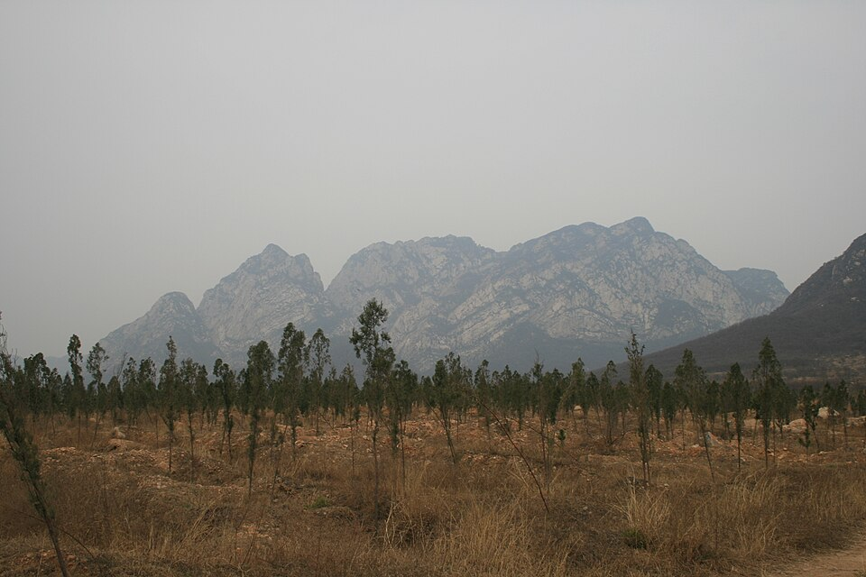（图：Wikimedia Commons）

**未决项**（照录 draft-v1）：
- 衝突：泰室之山——泰室/太室與嵩山太室峰同名——借名標記
- 未知：泰室之山——栯木確指

### 讲山：帝屋御凶

> **原文**：又北三十里，曰講山，其上多玉，多柘，多柏。有木焉，名曰帝屋，葉狀如椒，反傷赤實，可以禦凶。

**白话解读**：里程链自此折向北三十里，嵩山北麓方向（登封北），较可靠（`MTN:SHJ-05-7-011#1`）。山上多玉、多柘树（染料/良材）、多柏。有树「帝屋」（与少室帝休呼应的帝系冠名植物），叶像花椒、刺逆生、结红果，可以「御凶」——防凶祸的护身药效（`PLA:SHJ-05-7-011#3`）。

**未决项**（照录 draft-v1）：
- 未知：講山——帝屋確指

### 婴梁之山：苍玉依附玄石——矿床赋存记录

> **原文**：又北三十里，曰嬰梁之山，上多蒼玉，錞于玄石。

**白话解读**：北三十里，巩义南方向，对应嵩山北麓东段，较可靠（`MTN:SHJ-05-7-012#1`）。「上多苍玉，錞于玄石」——苍玉附着/赋存于玄石（深色基岩）之中，这是一条罕见的**矿床赋存关系**记录：古人已经注意到某种玉料总长在深色岩石里（`MIN:SHJ-05-7-012#1`、`MIN:SHJ-05-7-012#2`）。

### 浮戏之山：汜水入河，东翼水系起点

> **原文**：又東三十里，曰浮戲之山。有木焉，葉狀如樗而赤實，名曰亢木，食之不蠱，汜水出焉，而北流注于河。其東有谷，因名曰蛇谷，上多少辛。

**白话解读**：东三十里，里程链复折向东，对应荥阳西南的浮戏山方向，较可靠（`MTN:SHJ-05-7-013#1`）。有树「亢木」，叶像臭椿结红果，吃了不患蛊疾。汜水发源此山、北流注入黄河——与现代汜水河同名（借名），但北注河的拓扑一致（`WAT:SHJ-05-7-013#1`）。山东侧有谷叫蛇谷，多长「少辛」（细辛类药草）——微生境记录。

**未决项**（照录 draft-v1）：
- 衝突：浮戲之山——汜水與現代汜水河同名——借名標記
- 未知：浮戲之山——亢木確指
- 衝突：汜水——汜水與現代汜水河同名——借名標記

### 少陘之山：役水系第一条支流

> **原文**：又東四十里，曰少陘之山。有草焉，名曰𦱌草，葉狀如葵，而赤莖白華，實如蘡薁，食之不愚。器難之水出焉，而北流注于役水。

**白话解读**：东四十里，荥阳—郑州西方向，对应黄土丘陵边缘的荥阳西山岭，较可靠（`MTN:SHJ-05-7-014#1`）。有草「𦱌草」，叶像葵、红茎白花、果实像野葡萄，吃了「不愚」（益智药效）。器难之水北流注入**役水**——役水水系的第一条支流；役水是三受水拓扑的东翼主干，多条溪水汇入它，但它的现代确指还保持未知（`WAT:SHJ-05-7-014#2`）。

**未决项**（照录 draft-v1）：
- 未知：少陘之山——𦱌草確指
- 未知：少陘之山——現實山名未定位
- 未知：役水——役水現代確指

### 太山（中七）：双源同注役水

> **原文**：又東南十里，曰太山。有草焉，名曰棃，其葉狀如荻而赤華，可以已疽。太水出于其陽，而東南注于役水；承水出于其陰，而東北流注于役。

**白话解读**：东南十里（全经最短腿之一），郑州方向，对应邙山东端（郑州西北广武山），较可靠（`MTN:SHJ-05-7-015#1`）。有草「棃」，叶像荻、开红花，可治疽疮。太水出阳坡东南注役水、承水出阴坡东北注役水——一座山两条源都注进同一条役水，是汇流记录（`WAT:SHJ-05-7-015#1`、`WAT:SHJ-05-7-015#2`）。

**未决项**（照录 draft-v1）：
- 未知：太山——現實山名未定位

### 末山：赤金与末水

> **原文**：又東二十里，曰末山，上多赤金。末水出焉，北流注于役。

**白话解读**：东二十里，郑州方向（现实山名未定位），较可靠的方向性判断（`MTN:SHJ-05-7-016#1`）。山上多赤金（铜/赤色金属矿）；末水北流注役水——役水系第三条支流。

**未决项**（照录 draft-v1）：
- 未知：末山——現實山名未定位
- 未知：末山——現實山名未定位

### 役山：役水在这里入黄河

> **原文**：又東二十五里，曰役山，上多白金，多鐵。役水出焉，北流注于河。

**白话解读**：东二十五里到役山——山以水名，郑州东北方向（`MTN:SHJ-05-7-017#1`）。山上多白金（银/锡/白铜待考）、多铁。役水北流注入黄河——器难、太水、承水、末水四支汇入役水后在此入河，东翼水系拓扑到此闭合（`WAT:SHJ-05-7-017#1`）。

**未决项**（照录 draft-v1）：
- 未知：役山——白金確指（銀/錫/白銅待考）
- 未知：役山——現實山名未定位
- 未知：役山——現實山名未定位

### 敏山：玉种走廊的东端

> **原文**：又東三十五里，曰敏山。上有木焉，其狀如荊，白華而赤實，名曰葪柏，服之不寒。其陽多㻬琈之玉。

**白话解读**：东三十五里，中牟方向（平原区，现实山名未定位）（`MTN:SHJ-05-7-018#1`）。有树「葪柏」，像荆条、白花红果，吃了不怕冷（御寒药效）。阳坡多㻬琈玉——与大𩇵之山同一玉种，构成从登封西到中牟的一条「玉种走廊」，敏山是它的东端（`MIN:SHJ-05-7-018#1`）。

**未决项**（照录 draft-v1）：
- 未知：敏山——葪柏確指
- 未知：敏山——現實山名未定位
- 未知：敏山——現實山名未定位

### 大騩之山：全经终点，对着具茨山

> **原文**：又東三十里，曰大騩之山，其陰多鐵、美玉、青堊。有草焉，其狀如蓍而毛，青華而白實，其名曰𦵧，服之不夭，可以為腹病。

**白话解读**：东三十里到全经终点大騩之山，与新郑具茨山（大騩）同名属借名，定位靠里程链东端和役水入河拓扑的下游方向，较可靠（`MTN:SHJ-05-7-019#1`）。阴坡多铁、美玉、青垩（青色涂料土）三种矿。有草「𦵧」，像蓍草而带毛、青花白果，吃了不夭折、可治腹病（`PLA:SHJ-05-7-019#2`）——「状如蓍」与起点休舆之山的夙条首尾呼应。

**未决项**（照录 draft-v1）：
- 衝突：大騩之山——大騩與新鄭具茨山同名——借名標記
- 未知：大騩之山——𦵧確指

### 中七总结段：人面三首的三冢

> **原文**：凡苦山之首，自休輿之山至于大騩之山，凡十有九山，千一百八十四里。其十六神者，皆豕身而人面。其祠：毛牷用一羊羞，嬰用一藻玉瘞。苦山、少室、太室皆冢也，其祠之：太牢之具，嬰以吉玉。其神狀皆人面而三首。其餘屬皆豕身人面也。

**白话解读**：总结：十九山、一千一百八十四里。站数与正文 19 站完全一致；自记 1,184 里比腿程 1,056 里高 12%。神群分两级闭合：十六座余山的神都是「猪身人面」，祭用一只羊、埋一块藻玉；苦山、少室、太室三座是冢级，神是「人面三首」造型，用太牢全套加吉玉——两级神格配两级祭仪，16+3=19 恰好闭合（`PER:SHJ-05-7-020#1`、`PER:SHJ-05-7-020#2`）。太室即泰室，正对应嵩山太室方向，这条链的锚定因此很扎实。

## 中山经·次八（zhongci8）——荆山、桐柏山到大别山

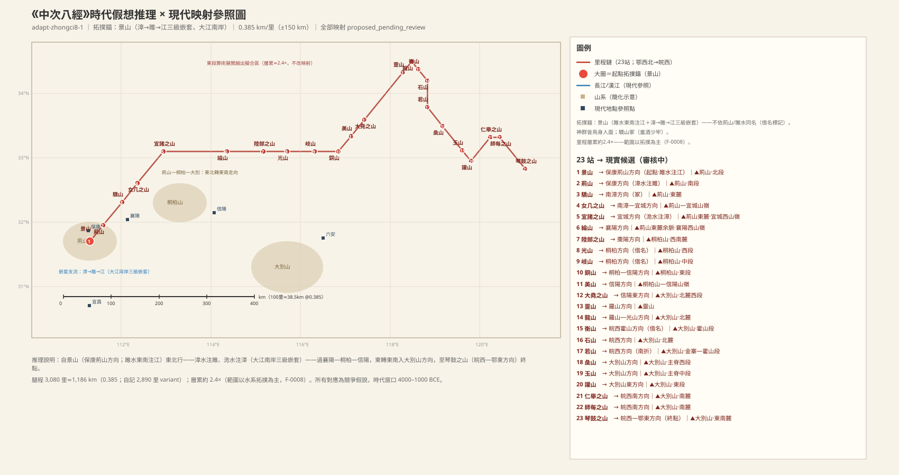

### 景山：荆山系起点，雎水东南入江

> **原文**：《中次八經》荊山之首，曰景山，其上多金玉，其木多杼、檀。雎水出焉，東南流注于江，其中多丹粟，多文魚。

**白话解读**：中次八「荆山系」之首，在鄂西保康—荆山方向，对应荆山北段（保康），较可靠（`MTN:SHJ-05-8-001#1`）。「荆山」之名按借名处理，不作锚。山上多金玉，木多杼（栎类）、檀。雎水发源此山、**东南流注于江**——东南向入长江的北岸支流，这是起点锚的拓扑核心；「江」即长江（中游段）（`WAT:SHJ-05-8-001#2`）。水中多丹粟（朱砂粒）和「文鱼」（有纹彩的鱼，确指待考）。

**未决项**（照录 draft-v1）：
- 未知：景山——文魚確指
- 衝突：雎水——雎水同名（借名標記）

### 荆山：牦牛出现在鄂西之谜

> **原文**：東北百里，曰荊山，其陰多鐵，其陽多赤金，其中多犛牛，多豹虎，其木多松柏，其草多竹，多橘櫾。漳水出焉，而東南流注于雎，其中多黃金，多鮫魚，其獸多閭麋。

**白话解读**：东北一百里到荆山本站，保康—南漳方向，对应荆山南段，较可靠（`MTN:SHJ-05-8-002#1`）。阴坡铁、阳坡赤金；兽群里有**牦牛**——高原种出现在鄂西，这条记录的生态含义待裁（也许是长途贸易或更广的历史分布）；还有豹、虎、闾麋。木多松柏、草多竹、多**橘柚**——亚热带果木，与鄂西物产相符（`PLA:SHJ-05-8-002#4`、`PLA:SHJ-05-8-002#5`）。漳水发源东南流注雎水（漳→雎的二级嵌套），水中多黄金（砂金）、多鲛鱼（鲛=鲨/鲟类泛化，内陆水体记录）。

**未决项**（照录 draft-v1）：
- 衝突：荊山——荊山同名（借名標記）
- 衝突：荊山——犛牛（高原種）出現於鄂西——物種記錄待裁
- 未知：荊山——犛牛記錄的時代生態含義
- 衝突：漳水——漳水同名（借名標記）
- 未知：漳水——漳淵（008）與本水的空間關係——鏈條東延後神話地理延用待裁

### 骄山：冢级圣山，神游雎漳之渊

> **原文**：又東北百五十里，曰驕山，其上多玉，其下多青雘，其木多松柏，多桃枝鉤端。神𧕛圍處之，其狀如人面。羊角虎爪，恒遊于雎漳之淵，出入有光。

**白话解读**：东北一百五十里，南漳方向，对应荆山东麓，较可靠；冢级圣山（羞酒少牢级）（`MTN:SHJ-05-8-003#1`）。上多玉、下多青雘（青色颜料矿），木多松柏、桃枝竹和钩端竹。神「𧕛围」住在这里：人面、羊角、虎爪的复合造像，常游于「雎漳之渊」——雎水、漳水汇流的深潭，双水共名一渊是汇流的静态拓扑自证；「出入有光」是神光赋义（`PER:SHJ-05-8-003#1`、`WAT:SHJ-05-8-003#1`）。

### 女几之山（中八）：雉群与毒鸟

> **原文**：又東北百二十里，曰女几之山，其上多玉，其下多黃金，其獸多豹虎，多閭麋麖麂，其鳥多白鷮，多翟，多鴆。

**白话解读**：东北一百二十里，南漳—宜城方向，对应荆山—宜城山岭，方向性猜测（`MTN:SHJ-05-8-004#1`）。与中次九的女几之山同名异地，待裁。上多玉、下多黄金；兽多豹虎、闾麋、麖、麂（鹿群三记）；鸟多白鹞（白雉）、翟（长尾雉）、鸩（毒鸟）——雉群加毒鸟的记录。

**未决项**（照录 draft-v1）：
- 衝突：女几之山——女几之山與中九同名異地

### 宜诸之山：全书唯一的三级水系嵌套

> **原文**：又東北二百里，曰宜諸之山，其上多金玉，其下多青雘。洈水出焉，而南流注于漳，其中多白玉。

**白话解读**：东北二百里，宜城方向，对应荆山东麓宜城西山岭，较可靠（`MTN:SHJ-05-8-005#1`）。上多金玉、下多青雘。洈水南流注入漳水——至此形成**洈→漳→雎→江的三级嵌套水系**，这是全书唯一的三级嵌套，是本经范围判定的决定性拓扑证据（`WAT:SHJ-05-8-005#1`）。水中多白玉（籽玉记录）。

### 纶山：林果群与鹿羚群

> **原文**：又東北三百五十里，曰綸山，其木多梓枏，多桃枝，多柤粟橘櫾，其獸多閭麈麢㚟。

**白话解读**：东北三百五十里——这一腿按原始腿程展开会越出拟合区域，是里程注水的长腿；拓扑与人文物产把它拟合到襄阳方向，对应荆山东麓余脉襄阳西山岭，方向性猜测（`MTN:SHJ-05-8-006#1`）。木多梓、楠、桃枝竹，果木多柤（楂）、栗、橘、柚——林果群七记；兽多闾麈、麢（羚羊类）、㚟（确指待考）。

**未决项**（照录 draft-v1）：
- 未知：綸山——㚟確指

### 陆䣀之山：进入桐柏山

> **原文**：又東二百里，曰陸䣀之山，其上多㻬琈之玉，其下多堊，其木多杻橿。

**白话解读**：东二百里，枣阳方向，对应桐柏山西南麓，方向性猜测（`MTN:SHJ-05-8-007#1`）。上多㻬琈玉、下多垩土，木多杻、橿（用材树）。

### 光山：龙首神计蒙，出入必有暴风雨

> **原文**：又東百三十里，曰光山，其上多碧，其下多木。神計蒙處之，其狀人身而龍首，恒遊于漳淵，出入必有飄風暴雨。

**白话解读**：东一百三十里，桐柏方向，对应桐柏山西段，方向性猜测（`MTN:SHJ-05-8-008#1`）。与豫南光山县同名，借名不作证。上多碧石、下多木。神「计蒙」住在这里：人身龙头，常游于「漳渊」，出入必定带来狂风暴雨——雷雨山神的气候赋义（`PER:SHJ-05-8-008#1`）。问题：光山已到桐柏方向，远离西段漳水系统，这里的「漳渊」应是神话地理的延用或同名异渊，待裁。

**未决项**（照录 draft-v1）：
- 衝突：光山——光山同名（借名標記）
- 衝突：光山——漳淵與西段漳水的關係待裁
- 未知：光山——漳淵確指
- 衝突：漳淵——漳淵與西段漳水的空間矛盾
- 未知：漳淵——漳淵確指

### 岐山（中八）：三足神涉𧕛

> **原文**：又東百五十里，曰岐山，其陽多赤金，其陰多白瑉，其上多金玉，其下多青雘，其林多樗。神涉𧕛處之，其狀人身而方面三足。

**白话解读**：东一百五十里，对应桐柏山中段，方向性猜测（`MTN:SHJ-05-8-009#1`）。与陕西岐山等同名，借名不作证。矿产五记：阳坡赤金、阴坡白珉（白色美石）、上金玉、下青雘；林多樗（臭椿，劣材记录）。神「涉𧕛」：人身、方脸、**三只脚**——三足造像，与中七三足龟等「三足记录群」可比（`PER:SHJ-05-8-009#1`）。

**未决项**（照录 draft-v1）：
- 衝突：岐山——岐山同名（借名標記）

### 铜山：金银铁三金属并记

> **原文**：又東百三十里，曰銅山，其上多金銀鐵，其木多榖柞柤栗橘櫾，其獸多犳。

**白话解读**：东一百三十里，桐柏—信阳方向，对应桐柏山东段（信阳西），较可靠（`MTN:SHJ-05-8-010#1`）。「铜山」是物产式命名（通名标记）。山上**金、银、铁三种金属并记**——桐柏山多金属矿带是真实矿带，方向可比（`MIN:SHJ-05-8-010#1-3`）。木多构、柞、楂栗、橘柚；兽多犳（豹属/犬属，确指待考）。

### 美山：兕（犀）的记录

> **原文**：又東北一百里，曰美山，其獸多兕牛，多閭麈，多豕鹿，其上多金，其下多青雘。

**白话解读**：东北一百里，链条折回东北向，信阳方向，对应桐柏山—信阳山岭，方向性猜测（`MTN:SHJ-05-8-011#1`）。兽群里有**兕**——兕就是犀类（古书通例），这是南方暖湿兽群的记录，与后文琴鼓之山的「白犀」呼应；历史上犀牛分布曾北抵长江流域甚至更广，这条读法较可靠（`CRE:SHJ-05-8-011#1`）。另有闾麈、豕鹿；上多金、下多青雘。

**配图**：

（图：Wikimedia Commons）

### 大尧之山：桑竹并记的豫南物产

> **原文**：又東北百里，曰大堯之山，其木多松柏，多梓桑，多机，其草多竹，其獸多豹虎麢㚟。

**白话解读**：东北一百里，信阳东方向，对应大别山北麓西段，方向性猜测（`MTN:SHJ-05-8-012#1`）。「尧」是圣王借名层，不作证。木多松、柏、梓、桑、机，草多竹——桑竹并记是豫南农林物产的标志；兽多豹、虎、麢、㚟。

**未决项**（照录 draft-v1）：
- 衝突：大堯之山——堯名（借名標記）

### 灵山：桃李梅杏果树群

> **原文**：又東北三百里，曰靈山，其上多金玉，其下多青雘，其木多桃李梅杏。

**白话解读**：东北三百里（长腿有注水），罗山方向，对应灵山（罗山）—大别山北麓，方向性猜测（`MTN:SHJ-05-8-013#1`）。上多金玉、下多青雘；木多**桃、李、梅、杏**——书内少见的果树集中记录（`PLA:SHJ-05-8-013#1-4`）。

### 龙山：寄生木记录开始

> **原文**：又東北七十里，曰龍山，上多寓木，其上多碧，其下多赤錫，其草多桃枝鉤端。

**白话解读**：东北七十里——东北段到此为止（第 1–14 站），下一站折向东南。罗山—光山方向，对应大别山北麓光山段，方向性猜测（`MTN:SHJ-05-8-014#1`）。「上多寓木」——寓木即寄生木，从这里起连续四站都记寓木，是一条植被带标志（`PLA:SHJ-05-8-014#1`）。上多碧石、下多赤锡（赤色锡/铅锡矿），草多桃枝、钩端。

### 衡山（中八）：东南折点，双色垩土

> **原文**：又東南五十里，曰衡山，上多寓木榖柞，多黃堊白堊。

**白话解读**：东南五十里——链向在这里折向东南。皖西霍山方向，对应大别山霍山段，方向性猜测（`MTN:SHJ-05-8-015#1`）。「衡山」与古衡山（霍山）方向同名，只标借名不作证。多寓木、构、柞；多**黄垩、白垩**——双色垩土并记（颜料/陶土矿）（`MIN:SHJ-05-8-015#1`、`MIN:SHJ-05-8-015#2`）。

**未决项**（照录 draft-v1）：
- 衝突：衡山——衡山同名（借名標記）

### 石山：寄生木第三见

> **原文**：又東南七十里，曰石山，其上多金，其下多青雘，多寓木。

**白话解读**：东南七十里，皖西方向，对应大别山北麓金寨段，方向性猜测（`MTN:SHJ-05-8-016#1`）。「石山」是通名。上多金、下多青雘，多寓木（寄生木第三见）。

### 若山：全链唯一的南向折腿

> **原文**：又南百二十里，曰若山，其上多㻬琈玉，多赭，多邽石，多寓木，多柘。

**白话解读**：**向南**一百二十里——全链唯一的南向折腿，是山势走向的真实记录。皖西方向，对应大别山金寨—霍山段，方向性猜测（`MTN:SHJ-05-8-017#1`）。上多㻬琈玉、赭（赤铁矿颜料）、邽石（待考）；多寓木（第四见）、多**柘**——柘树（染料/弓材树）从这里到第 23 站屡见，是皖西—大别物产带的标志（`PLA:SHJ-05-8-017#2`）。

**未决项**（照录 draft-v1）：
- 未知：若山——邽石確指

### 彘山：美石与柘

> **原文**：又東南一百二十里，曰彘山，多美石，多柘。

**白话解读**：东南一百二十里，大别山方向，对应大别山主脊西段，方向性猜测（`MTN:SHJ-05-8-018#1`）。「彘」是猪名山（通名）。多美石、多柘。

### 玉山（中八）：金玉碧铁

> **原文**：又東南一百五十里，曰玉山，其上多金玉，其下多碧、鐵，其木多柏。

**白话解读**：东南一百五十里，对应大别山主脊中段，方向性猜测（`MTN:SHJ-05-8-019#1`）。多处玉山同名，借名不作证。上多金玉、下多碧石和铁，木多柏。

**未决项**（照录 draft-v1）：
- 衝突：玉山——玉山同名（借名標記）

### 讙山：伏流（岩溶水文）记录

> **原文**：又東南七十里，曰讙山，其木多檀，多封石，多白錫。郁水出于其上，潛于其下，其中多砥礪。

**白话解读**：东南七十里，大别山东方向，对应大别山东段，方向性猜测（`MTN:SHJ-05-8-020#1`）。木多檀，多封石（待考）、白锡。郁水「出于其上，潜于其下」——水从山上发源、潜入山下，是**伏流/岩溶水文记录**；原文没说它最后汇入哪里，归宿不明（`WAT:SHJ-05-8-020#1`）。水中多磨刀石。

**未决项**（照录 draft-v1）：
- 未知：讙山——郁水歸宿（潛流後無受水記錄）
- 未知：郁水——郁水歸宿

### 仁举之山：大别山南麓

> **原文**：又東北百五十里，曰仁舉之山，其木多榖柞，其陽多赤金，其陰多赭。

**白话解读**：东北一百五十里（东段中的回折腿），皖西南方向，对应大别山南麓岳西段，方向性猜测（`MTN:SHJ-05-8-021#1`）。木多构、柞；阳坡赤金、阴坡赭。

### 师每之山：磨石与颜料矿

> **原文**：又東五十里，曰師每之山，其陽多砥礪，其陰多青雘，其木多柏，多檀，多柘，其草多竹。

**白话解读**：东五十里，皖西南方向，对应大别山南麓太湖—宿松段，方向性猜测（`MTN:SHJ-05-8-022#1`）。阳坡多磨刀石、阴坡多青雘；木多柏、檀、柘，草多竹。

### 琴鼓之山：终点，白犀再见

> **原文**：又東南二百里，曰琴鼓之山，其木多榖柞椒柘，其上多白瑉，其下多洗石，其獸多豕鹿，多白犀，其鳥多鴆。

**白话解读**：东南二百里到终点，皖西—鄂东方向，对应大别山东南麓（英山—罗田方向），方向性猜测（`MTN:SHJ-05-8-023#1`）。「琴鼓」是乐器名（通名）。木多构、柞、椒、柘；上多白珉、下多洗石（盥洗用石，待考）。兽多豕鹿、多**白犀**——白色犀牛，与美山的「兕」呼应，是犀类在本经的第二次记录；这条记录的时代生态含义待考（`CRE:SHJ-05-8-023#2`）。鸟多鸩（毒鸟再见）。

**未决项**（照录 draft-v1）：
- 未知：琴鼓之山——白犀記錄的時代生態含義

### 中八总结段：鸟身人面的二十三神

> **原文**：凡荊山之首，自景山至琴鼓之山，凡二十三山，二千八百九十里。其神狀皆鳥身而人面。其祠：用一雄雞祈瘞，用一藻圭，糈用稌。驕山，冢也，其祠：用羞酒少牢祈瘞，嬰毛一璧。

**白话解读**：总结：二十三山、二千八百九十里。站数与正文 23 站自洽无缺；自记 2,890 里对腿程 3,080 里差 6.6%，属异文范围。二十三位山神统一为「鸟身人面」——与中二「人面鸟身」方向相反，东西分异待裁（`PER:SHJ-05-8-024#1`）。常祠用一只公鸡祈祭埋掉、一块藻圭、祭米用稌（稻米——稻作区物产相符）。骄山是冢级，升级用进献的酒、少牢（羊豕二牲）、挂毛饰玉璧。

## 中山经·次九（zhongci9）——岷山到三峡

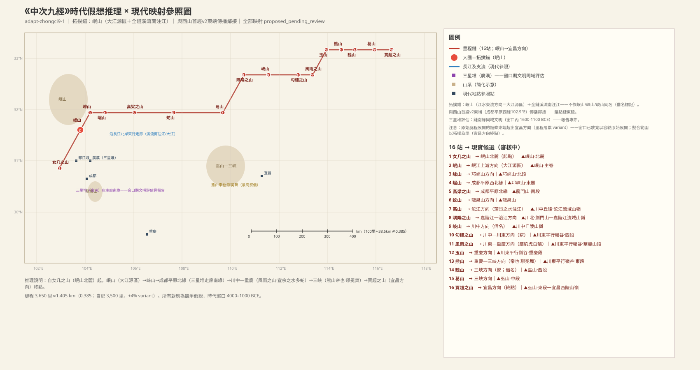

### 女几之山（中九）：岷山系起点

> **原文**：《中次九經》岷山之首，曰女几之山，其上多石涅，其木多杻橿，其草多菊𦬸。洛水出焉，東注于江，其中多雄黃，其獸多虎豹。

**白话解读**：中次九「岷山系」之首，岷山北麓方向（松潘南），较可靠（`MTN:SHJ-05-9-001#1`）。与河南宜阳女几山同名，借名不作证。上多石涅（矾石类黑色矿石——川西矿物带可比），木多杻橿，草多菊、𦬸（菊科植物群）。洛水发源此山、东流注江——注意此「洛水」与河洛之洛同名异水，借名不作证；「江」即长江，是全链的受水体（`WAT:SHJ-05-9-001#2`）。水中多雄黄（砷硫化物，川西雄黄矿带方向），兽多虎豹。

**未决项**（照录 draft-v1）：
- 衝突：女几之山——女几與河南宜陽女几山同名（借名標記，不作證）
- 衝突：女几之山——洛水同名（借名標記）
- 衝突：洛水（女几）——洛水同名（借名標記）
- 衝突：江——江為通用大水語義（借名層注意）

### 岷山：「江水出焉」——大江源区，犀象成群

> **原文**：又東北三百里，曰岷山。江水出焉，東北流注于海，其中多良龜，多鼉，其上多金玉，其下多白瑉，其木多梅棠，其獸多犀象，多夔牛，其鳥多翰鷩。

**白话解读**：东北三百里到岷山——**全经锚点（A3：降为「大江源区某山」方向性表述）**：江水从这里发源、**东北**向奔赴大海——「東北流注于海」是方向硬约束，与岷江源区南流、长江上游东南折东的实流向偏差 >90°；此前适配曾误引作「东流注于海」，抹去方向冲突，已更正。按此约束须先列满足东北向入海的候选水系再谈山名（对立候选：邛崃山系／大渡河上游）；不靠「岷山」这个名字（借名）；对应岷山主脊、岷江源区方向，中等（`MTN:SHJ-05-9-002#1`）。水中多良龟、多**鼍**——鼍就是扬子鳄，大江大型水生动物，判定很可靠（`CRE:SHJ-05-9-002#2`）。上多金玉、下多白珉，木多梅、棠。兽群是重点：**犀、象、夔牛**——西南暖湿大型动物群；但注意（C2）：岷江上游 2500–3000 m 高寒源区有犀象生态张力，且窗口期物种分布属非定位性证据（全新世大暖期犀象北界达黄河流域，分布带宽数千里，只能用于否决不能用于钉点）——不作锚定支持，待 G-6 对称性重审（T-RT17）（`CRE:SHJ-05-9-002#3-5`）。鸟多翰鷩（锦鸡类）。

**配图**：

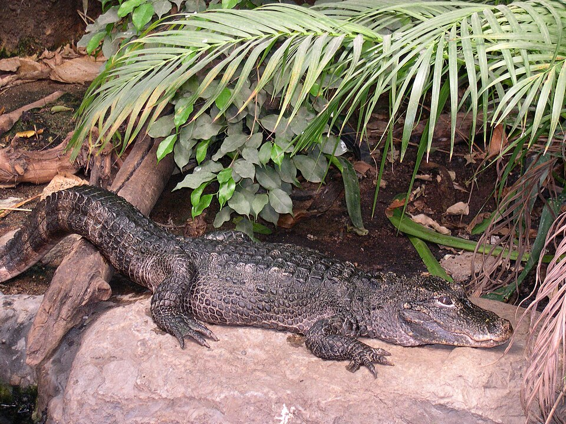（图：Wikimedia Commons）

（图：Wikimedia Commons）

**未决项**（照录 draft-v1）：
- 衝突：岷山——岷山同名（借名標記）

### 崍山：江水第二出

> **原文**：又東北一百四十里，曰崍山，江水出焉，東流注于江。其陽多黃金，其陰多麋麈，其木多檀柘，其草多䪥韭，多葯、空奪。

**白话解读**：东北一百四十里，邛崃山方向，对应邛崃山北段，较可靠（`MTN:SHJ-05-9-003#1`）。「崍」与邛崃同名，借名不作证。这里又记「江水出焉」——源区诸水并记的第二处；东注于江（全链受水体）。阳坡多黄金，阴坡多麋麈（大型鹿类）；木多檀、柘；草多䪥韭（薤韭菜类）、葯（白芷类香草）、空夺（药草，待考）——香草药草群。

**未决项**（照录 draft-v1）：
- 衝突：崍山——崍山＝邛崍同名（借名標記）

### 崌山：江水第三次发源，受水升格为「大江」

> **原文**：又東一百五十里，曰崌山。江水出焉，東流注于大江，其中多怪蛇，多䲀魚，其木多楢杻，多梅梓，其獸多夔牛麢㚟犀兕。有鳥焉，狀如鴞而赤身白首，其名曰竊脂，可以禦火。

**白话解读**：东一百五十里，成都平原西北缘方向，对应邛崃山东麓（汶川—都江堰），较可靠（`MTN:SHJ-05-9-004#1`）。第三次「江水出焉」，但受水体从「江」升格为「**大江**」——进入平原方向的称谓递变，是细腻的水文标记（`WAT:SHJ-05-9-004#1`）。水中多怪蛇、䲀鱼；木多楢、杻、梅、梓；兽多夔牛、麢、㚟、犀、兕——暖湿大型兽群延续。有鸟「窃脂」，像猫头鹰而红身白头，可以「御火」（防火赋义）（`CRE:SHJ-05-9-004#9`）。

### 高梁之山：四川盆地北缘竹带

> **原文**：又東三百里，曰高梁之山，其上多堊，其下多砥礪，其木多桃枝鉤端。有草焉，狀如葵而赤華、莢實、白柎，可以走馬。

**白话解读**：东三百里，成都平原北缘方向，对应龙门山南段（什邡—彭州），较可靠（`MTN:SHJ-05-9-005#1`）。上多垩土、下多磨刀石；木多桃枝竹、钩端竹——竹类双记，与四川盆地北缘竹带相符（`PLA:SHJ-05-9-005#1`）。有一种草，像葵而开红花、结豆荚、白色花萼，「可以走马」——饲用/药用赋义（喂马或促马奔跑）（`CRE:SHJ-05-9-005#1`）。

### 蛇山：白尾长耳的𤜣狼，兵灾兆兽

> **原文**：又東四百里，曰蛇山，其上多黃金，其下多堊，其木多栒，多橡章，其草多嘉榮、少辛。有獸焉，其狀如狐，而白尾長耳，名𤜣狼，見則國內有兵。

**白话解读**：东四百里，成都平原东北—龙泉山方向，对应龙泉山（成都东），较可靠（`MTN:SHJ-05-9-006#1`）。上多黄金、下多垩土；木多栒、橡章（橡栎/樟类）；草多嘉荣、少辛（细辛类药草）。有兽「𤜣狼」，像狐狸而白尾长耳，出现则国内有兵事——兵灾兆兽，本经兵兆记录之一（`CRE:SHJ-05-9-006#2`）。原型待考。

**未决项**（照录 draft-v1）：
- 未知：蛇山——𤜣狼原型確指

### 鬲山：犀象熊罴猿猴的川中林

> **原文**：又東五百里，曰鬲山，其陽多金，其陰多白珉。蒲𪈘之水出焉，而東流注于江，其中多白玉，其獸多犀象熊羆，多猨蜼。

**白话解读**：东五百里（全链最长腿之一），沱江方向，对应川中丘陵沱江流域山岭（资阳—内江），较可靠（`MTN:SHJ-05-9-007#1`）。阳坡金、阴坡白珉。蒲𪈘之水东流注江，水中多白玉；兽群多**犀、象、熊、罴、猨蜼**（猿猴类）——川中林区的暖湿林栖动物群，与岷山犀象记录连成一片（`CRE:SHJ-05-9-007#1-5`）。

### 隅阳之山：蚕桑与朱砂

> **原文**：又東北三百里，曰隅陽之山，其上多金玉，其下多青雘，其木多梓桑，其草多茈。徐之水出焉，東流注于江，其中多丹粟。

**白话解读**：东北三百里，嘉陵江—涪江方向，对应川北剑门山—嘉陵江流域山岭，较可靠（`MTN:SHJ-05-9-008#1`）。上多金玉、下多青雘（石青类颜料矿）；木多**梓、桑**——蚕桑生业标记，川北正是传统蚕桑区（`PLA:SHJ-05-9-008#2`）；草多茈（紫草，染料草）。徐之水东流注江，水中多**丹粟**——朱砂粒，川东黔北汞矿带方向可比（`MIN:SHJ-05-9-008#4`）。

### 岐山（中九）：本经铁的首见

> **原文**：又東二百五十里，曰岐山，其上多白金，其下多鐵。其木多梅梓，多杻楢。減水出焉，東南流注于江。

**白话解读**：东二百五十里，川中方向，对应川中丘陵山岭（盐亭—南部方向），较可靠（`MTN:SHJ-05-9-009#1`）。与关中岐山同名，借名不作证。上多白金（银/锡类白色金属）、下多**铁——本经铁的首见**；在时代窗口内理解为陨铁/块炼铁认知层，层位待考（不能因现代冶铁分类而单独否决）（`MIN:SHJ-05-9-009#2`）。木多梅、梓、杻、楢；减水东南流注江。

**未决项**（照录 draft-v1）：
- 衝突：岐山——岐山同名（借名標記）
- 未知：岐山——鐵的時代層位（隕鐵/早期冶鐵認知）

### 勾檷之山：冢级四圣山之一

> **原文**：又東三百里，曰勾檷之山，其上多玉，其下多黃金，其木多櫟柘，其草多芍藥。

**白话解读**：东三百里，川中—川东方向，对应川东平行岭谷西段（渠江流域），较可靠；冢级四圣山之一（`MTN:SHJ-05-9-010#1`）。上多玉、下多黄金；木多栎、柘；草多**芍药**——与中五条谷之山的芍药跨经并记，构成一条药草带（`PLA:SHJ-05-9-010#3`）。

**未决项**（照录 draft-v1）：
- 未知：勾檷之山——文山確指（總結段冢級四山之一，正文無對應站——或為高梁/蛇山之別稱，待 textual-critic）

### 风雨之山：冢级，白鹇之乡

> **原文**：又東一百五十里，曰風雨之山，其上多白金，其下多石涅；其木多棷椫，多楊。宣余之水出焉，東流注于江，其中多蛇。其獸多閭麋，多麈豹虎，其鳥多白鷮。

**白话解读**：东一百五十里，川东—重庆方向，对应川东平行岭谷华蓥山段，较可靠；冢级（`MTN:SHJ-05-9-011#1`）。上多白金、下多石涅（与女几之山首尾呼应）；木多棷、椫、杨。宣余之水东流注江，水中多蛇；兽多闾麋、麈（大型鹿类）、豹、虎；鸟多**白鹞——即白鹇**，南方林鸟，与川东—重庆方向相符（`CRE:SHJ-05-9-011#6`）。

### 玉山（中九）：铜与樟楠大木

> **原文**：又東北二百里，曰玉山，其陽多銅，其陰多赤金，其木多豫章楢杻，其獸多豕鹿麢㚟，其鳥多鴆。

**白话解读**：东北二百里，重庆方向，对应川东平行岭谷重庆段（中梁山—缙云山），较可靠（`MTN:SHJ-05-9-012#1`）。多处玉山同名，借名。阳坡多铜、阴坡多赤金；木多**豫章**——樟楠类大木，川东林产相符，加楢、杻；兽多豕鹿、麢、㚟；鸟多鸩（毒鸟赋义）。

**未决项**（照录 draft-v1）：
- 衝突：玉山——玉山為多處同名（借名標記）

### 熊山：「帝也」——全经最高祭仪与冬眠物候

> **原文**：又東一百五十里，曰熊山。有穴焉，熊之穴，恒出神人。夏啟而冬閉；是穴也，冬啟乃必有兵。其上多白玉，其下多白金，其林多樗柳，其草多寇脫。

**白话解读**：东一百五十里，重庆—三峡方向，对应川东平行岭谷东段（涪陵—万州），较可靠（`MTN:SHJ-05-9-013#1`）。总结段说「熊山，帝也」——帝级，全经最高祭仪。山上有个「熊之穴」，常有神人出入；洞穴**夏天开启、冬天封闭**——这是对熊冬眠物候的精确观察（与中五超山「冬水夏竭」同属书内季节记录群）；如果冬天反常开启，就预兆兵灾（`LND:SHJ-05-9-013#1`）。上多白玉、下多白金；林多樗柳，草多寇脱（通草，与中五升山并记）。

### 騩山（中九）：冢级，进入巫山

> **原文**：又東一百四十里，曰騩山，其陽多美玉赤金，其陰多鐵，其木多桃枝荊𦬊。

**白话解读**：东一百四十里，三峡方向，对应巫山西段（奉节—巫山），较可靠；冢级四圣山之一（`MTN:SHJ-05-9-014#1`）。与多经的騩山同名，借名不作证。阳坡多美玉赤金、阴坡多铁（本经铁的二见）；木多桃枝竹、荆𦬊（荆条灌丛）。

**未决项**（照录 draft-v1）：
- 衝突：騩山——騩山多經同名（借名標記）

### 葛山：三峡柑橘带的最早记录

> **原文**：又東二百里，曰葛山，其上多赤金，其下多瑊石，其木多柤栗橘櫾楢杻，其獸多麢㚟，其草多嘉榮。

**白话解读**：东二百里，三峡方向，对应巫山中段（巴东），较可靠（`MTN:SHJ-05-9-015#1`）。上多赤金、下多瑊石（瑊玞类美石）；木多柤栗（楂栗）、**橘柚**——这是长江三峡柑橘带最早的文献记录群之一，至今三峡两岸仍是柑橘主产区，风物级证据很可靠（`PLA:SHJ-05-9-015#2`、`PLA:SHJ-05-9-015#3`），加楢、杻；兽多麢㚟，草多嘉荣。

**配图**：

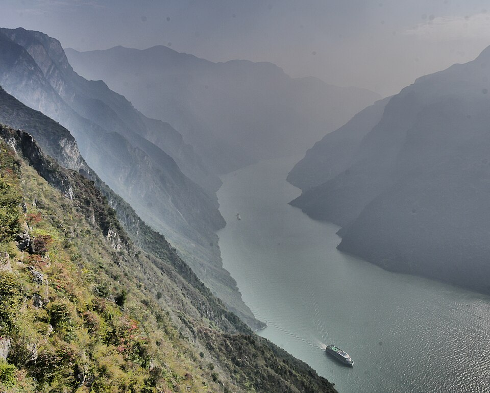（图：Wikimedia Commons）

### 贾超之山：终点，柑橘带东延到宜昌

> **原文**：又東一百七十里，曰賈超之山，其陽多黃堊，其陰多美赭，其木多柤栗橘櫾，其中多龍脩。

**白话解读**：东一百七十里到全经终点，宜昌方向，对应巫山东段—宜昌西陵山岭，较可靠（`MTN:SHJ-05-9-016#1`）。阳坡黄垩、阴坡美赭（赭土颜料）；木多柤栗、橘柚——柑橘带向东延伸到三峡东口—宜昌，方向相符；多「龙脩」（龙须草/席草类沼泽草，与江汉平原西缘湿地风物可比，确指待考）（`CRE:SHJ-05-9-016#1`）。

**未决项**（照录 draft-v1）：
- 未知：賈超之山——龍脩確指（龍鬚草/席草類）

### 中九总结段：马身龙首神群，熊山为「帝」

> **原文**：凡岷山之首，自女几山至于賈超之山，凡十六山，三千五百里。其神狀皆馬身而龍首。其祠：毛用一雄雞瘞。糈用稌。文山、勾檷、風雨、騩之山，是皆冢也，其祠之：羞酒，少牢具，嬰毛一吉玉。熊山，帝也，其祠：羞酒，太牢具，嬰用一璧。干儛，用兵以禳；祈，璆冕舞。

**白话解读**：总结：十六山、三千五百里。站数与正文 16 站一致；自记 3,500 里对腿程 3,650 里差 4.3%，基本自洽。神群统一为「马身龙首」。常祠用一只公鸡埋祭、祭米用稌。文山、勾檷、风雨、騩四山为冢级（羞酒、少牢、吉玉）——但「文山」在正文 16 站里找不到对应站，也许是高梁山或蛇山的别称，待文字校勘。熊山为**帝级**，全经最高祭仪：太牢全套、玉璧，跳盾舞用兵以禳灾，祈祭时跳「璆冕舞」（最高规格的冕舞）——武舞禳兵的描写与本经两处兵灾兆应（𤜣狼、熊穴冬启）呼应（`MTN:SHJ-05-9-017#1`、`OBJ:SHJ-05-9-017#8`）。

**未决项**（照录 draft-v1）：
- 未知：文山——文山確指待考

## 中山经·次十（zhongci10）——甘南短链

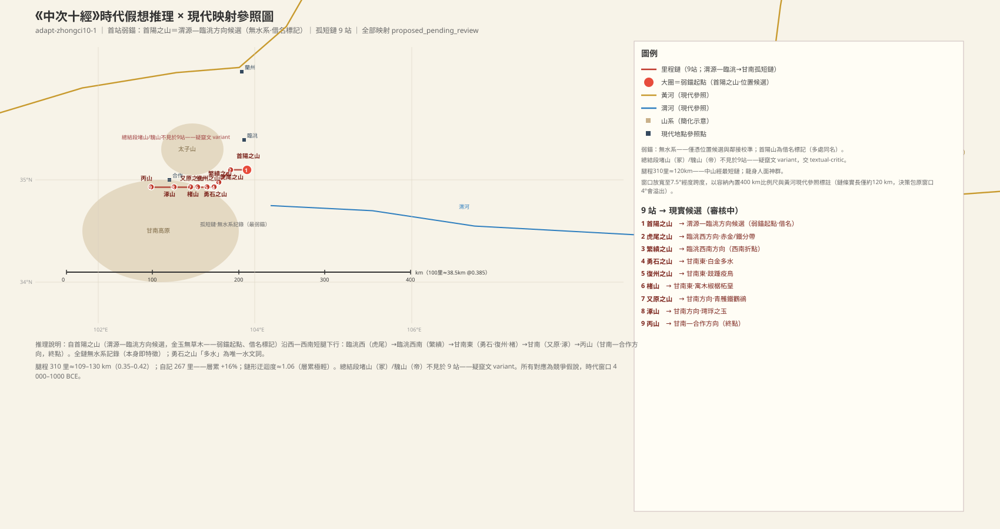

### 首阳之山：弱锚起点

> **原文**：《中次十經》之首，曰首陽之山，其上多金玉，無草木。

**白话解读**：中次十的起点（全链最东端），位置候选在渭源—临洮方向（西秦岭渭源段、鸟鼠山方向），只是方向性猜测——这条链没有水系可以校准，是「弱锚」（`MTN:SHJ-05-10-001#1`）。首阳山多处同名（渭源首阳山是后世伯夷叔齐传说的附着地），借名不作证。山上多金玉、无草木——矿区裸岩地表的记录，本经矿产密集的第一站。

**未决项**（照录 draft-v1）：
- 衝突：首陽之山——首陽山同名多處（借名標記）
- 衝突：首陽之山——總結段作「自首山至于丙山」——首山/首陽之山異文
- 未知：首陽之山——確指山體（弱錨，無水系校準）

### 虎尾之山：阴阳坡金属分带

> **原文**：又西五十里，曰虎尾之山，其木多椒椐，多封石；其陽多赤金，其陰多鐵。

**白话解读**：西五十里，临洮西方向，对应太子山北段，方向性猜测（`MTN:SHJ-05-10-002#1`）。「虎尾」是形貌式命名（山脊尾端象形）。木多椒（花椒类）、椐——椒椐组合与后面楮山重复，说明链内是同一植被带。多封石（一说大石，待考）；阳坡赤金（铜/红色金属候选）、阴坡铁——阴阳坡金属分带记录。

**未决项**（照录 draft-v1）：
- 未知：虎尾之山——封石確指
- 未知：虎尾之山——赤金確指（銅/紅金）

### 繁缋之山：链向转西南

> **原文**：又西南五十里，曰繁繢之山，其木多楢杻，其草多枝勾。

**白话解读**：西南五十里——链向由西转西南（之后复西，整体南倾）。临洮西南方向，对应太子山中段，方向性猜测（`MTN:SHJ-05-10-003#1`）。木多楢（楸类）、杻（檍木类），属温暖型林木；草多「枝勾」（确指待考）。

**未决项**（照录 draft-v1）：
- 未知：繁繢之山——枝勾確指

### 勇石之山：全链唯一的水文词

> **原文**：又西南二十里，曰勇石之山，無草木，多白金，多水。

**白话解读**：西南二十里，甘南东方向，对应太子山南段，方向性猜测（`MTN:SHJ-05-10-004#1`）。无草木、多白金（银/锡类候选）。「多水」是全链唯一的水文词——但没给名字、没说出注方向，只表示水源丰富（泉群/溪群/沼泽待考）；「全链几乎没有水系记录」本身就是中次十的特征（`WAT:SHJ-05-10-004#1`）。

**未决项**（照录 draft-v1）：
- 未知：勇石之山——白金確指（銀/錫）
- 未知：勇石之山——「多水」所指（泉群/溪群/沼）
- 未知：水（勇石之山）——「多水」所指（泉群/溪群/沼）

### 复州之山：一足疫鸟「跂踵」

> **原文**：又西二十里，曰復州之山，其木多檀，其陽多黃金。有鳥焉，其狀如鴞，而一足彘尾，其名曰跂踵，見則其國大疫。

**白话解读**：西二十里，甘南东方向，方向性猜测（`MTN:SHJ-05-10-005#1`）。与中次十一的复州之山同名异地待裁。木多檀（与丙山重复，植被带内证），阳坡多黄金。有鸟「跂踵」：像猫头鹰、只有一只脚、长着猪尾巴，**一出现那个国家就暴发大疫**——疫病征兆的「疫鸟」母题，是书内疫病民俗记录群之一（`CRE:SHJ-05-10-005#3`）。

**未决项**（照录 draft-v1）：
- 衝突：復州之山——復州之山與中十一同名異地

### 楮山：寄生木与椒椐

> **原文**：又西三十里，曰楮山，多寓木，多椒椐，多柘，多堊。

**白话解读**：西三十里，甘南东方向，对应甘南高原东缘山岭（合作东），方向性猜测（`MTN:SHJ-05-10-006#1`）。「楮」是以树名山。多寓木（寄生/附生木，待考）、椒椐（与虎尾之山重复）、柘（养蚕/染料木）、垩土。

**未决项**（照录 draft-v1）：
- 未知：楮山——寓木確指

### 又原之山：八哥与青雘

> **原文**：又西二十里，曰又原之山，其陽多青雘，其陰多鐵，其鳥多鸜鵒。

**白话解读**：西二十里，甘南方向，对应甘南高原合作北山岭，方向性猜测（`MTN:SHJ-05-10-007#1`）。阳坡多青雘（青色颜料矿，石青/蓝铜矿类候选），阴坡多铁（与虎尾之山同格式）；鸟多鸜鹆——鸲鹆/八哥类，是暖性鸟，指示这里海拔不算太高（`CRE:SHJ-05-10-007#1`）。

### 涿山：跨链玉名

> **原文**：又西五十里，曰涿山，其木多榖柞杻，其陽多㻬琈之玉。

**白话解读**：西五十里，甘南方向，对应甘南高原合作段，方向性猜测（`MTN:SHJ-05-10-008#1`）。「涿」为借名标记。木多构、柞、杻（杻与繁缋之山重复——链内第三次物产重复）；阳坡多㻬琈玉——与中五首山「其阳多㻬琈之玉」是同名玉，跨链联合校准时要注意（`MIN:SHJ-05-10-008#1`）。

**未决项**（照录 draft-v1）：
- 衝突：涿山——涿山同名（借名標記）

### 丙山：终点，天干序数式命名？

> **原文**：又西七十里，曰丙山，其木多梓檀，多弞杻。

**白话解读**：西七十里（全链最长腿）到终点，甘南—合作方向，对应甘南高原合作西段，方向性猜测（`MTN:SHJ-05-10-009#1`）。「丙」可能是天干序数式命名（与书内其他天干名并列待裁）。木多梓、檀（檀与复州之山重复）、弞杻（待考）。

**未决项**（照录 draft-v1）：
- 未知：丙山——弞杻確指
- 未知：丙山——丙山命名性質（天干序數式？）

### 中十总结段：龙身人面，堵山騩山疑为窜文

> **原文**：凡首陽山之首，自首山至于丙山，凡九山，二百六十七里。其神狀皆龍身而人面。其祠之：毛用一雄雞瘞，糈用五種之糈。堵山，冢也，其祠之：少牢具，羞酒祠，嬰毛一璧瘞。騩山，帝也，其祠︰羞酒，太牢其；合巫祝二人儛，嬰一璧。

**白话解读**：总结：「自首山至于丙山」——「首山」与正文「首阳之山」是异文；九山、二百六十七里，站数与正文 9 站相合，自记 267 里对腿程 310 里差 16%。神群统一为「龙身人面」（中山经神格分区的又一系）。常祠统一：一只公鸡埋祭、祭米用五谷（五种之糈），九站之内没有冢/帝分级。但接下来说「堵山，冢也」「騩山，帝也」——这两座山都不在本经九站名单里（堵山首见于中七、騩山首见于中九），疑似他经总结窜入的文字，待校勘。騩山的帝级祭仪描写最高规格：太牢、玉璧，还有「合巫祝二人儛」——巫祝双人合舞（`MTN:SHJ-05-7-005#1`、`MTN:SHJ-05-9-014#1`）。

## 中山经·次十一（zhongci11）——伏牛山南麓到大别山东端（48 站）

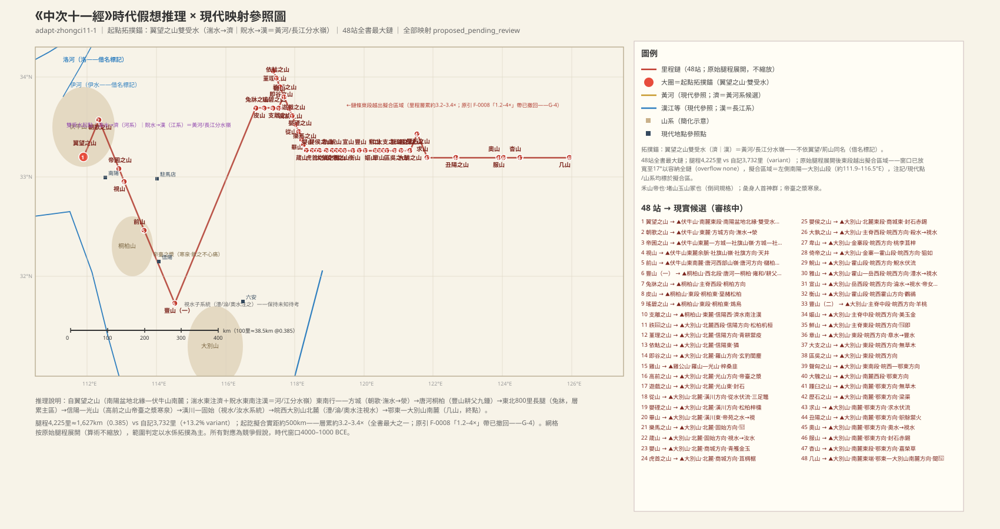

### 翼望之山：一山分注黄河、长江两系

> **原文**：《中次十一經》荊山之首，曰翼望之山。湍水出焉，東流注于濟；貺水出焉，東南流注于漢，其中多蛟。其上多松柏，其下多漆梓，其陽多赤金，其陰多珉。

**白话解读**：中次十一也叫「荆山系」（与中八同名系统，待裁），起点翼望之山在南阳盆地北缘—伏牛山南麓方向——**F-0016 已裁決（2026-10-27）：济≠济水（四渎），翼望锚升回 medium**（`MTN:SHJ-05-11-001#1`）。与西次三经终点的翼望之山同名，借名不作证。这座山是关键锚：湍水东流注「济」、贶水东南流注「汉」——一山双源分注两系。裁决推理：若「济」＝四渎济水（黄河以北），则翼望须在豫北，但豫北无南流注汉之水——两方位约束夹逼下，拆分是唯一自洽解：**「济」＝伏牛山东麓东流的淮北上源（沙河—汝水方向）**，湍水＝湍河（文字「东流」略偏记 variant），于是双受水＝**淮/汉分水岭**，与伏牛山南麓定位自洽（`WAT:SHJ-05-11-001#1`、`WAT:SHJ-05-11-001#3`）。历史演变：四渎济水因黄河改道被夺而消亡（历代夺济、1855 年夺大清河）——「济」的后世专名化恰是河道消亡史的一部分。水中多蛟（水栖大爬虫泛化——鳄/巨蜥类）。上多松柏、下多漆梓，阳坡赤金、阴坡珉。

**未决项**（照录 draft-v1）：
- 衝突：翼望之山——翼望之山與西次三經終點同名（借名標記）
- （結案）翼望之山/濟——F-0016 已裁決（2026-10-27）：濟≠濟水，濟＝伏牛山東麓東流的淮北上源（沙河—汝水方向），錨升回 medium
- 未知：湍水——「東流」略偏記 variant（F-0016：湍水＝湍河，與今湍河南入白河—漢水走向略偏）
- （結案）濟——濟/濟水一站兩見，指向相反（東注 vs 南注漢）——F-0016 已裁決：同名異水，顯式拆分

### 朝歌之山（中十一）：人鱼再见，莽草毒鱼

> **原文**：又東北一百五十里，曰朝歌之山。潕水出焉，東南流注于滎，其中多人魚。其上多梓枏，其獸多麢麋。有草焉，名曰莽草，可以毒魚。

**白话解读**：东北一百五十里，方城方向，对应伏牛山东麓方城段，较可靠（`MTN:SHJ-05-11-002#1`）。与中五朝歌之山同名（两处都不是淇县朝歌）。潕水东南流注「荥」（荥泽候选——湖泽，待考），水中多**人鱼**——大鲵再次出现在中原东缘（`CRE:SHJ-05-11-002#1`）。上多梓楠；兽多麢麋（羚羊加麋鹿）；有草「莽草」，**可以毒鱼**——毒鱼民俗的又一条记录。

**未决项**（照录 draft-v1）：
- 衝突：朝歌之山——朝歌與中五同名（借名標記）
- 未知：朝歌之山——滎＝滎澤候選待裁
- 未知：滎——滎澤確指與時代湖相

### 帝囷之山：帝之粮仓与山顶伏流

> **原文**：又東南二百里，曰帝囷之山，其陽多㻬琈之玉，其陰多鐵。帝囷之水出于其上，潛于其下，多鳴蛇。

**白话解读**：东南二百里，方城—社旗方向，对应伏牛山东麓—社旗山岭，较可靠（`MTN:SHJ-05-11-003#1`）。「帝囷」意为帝的粮仓（囷=圆仓）。阳坡㻬琈玉、阴坡铁。帝囷之水「出于其上，潜于其下」——发源于山顶、潜入地下的伏流记录（与西次四申水同格式）；水中多鸣蛇（鸣叫的蛇，这里只记其多）（`WAT:SHJ-05-11-003#1`）。

**未决项**（照录 draft-v1）：
- 未知：帝囷之山——鳴蛇確指

### 视山：夏有水冬竭的「天井」

> **原文**：又東南五十里，曰視山，其上多韭。有井焉，名曰天井，夏有水，冬竭。其上多桑，多美堊金玉。

**白话解读**：东南五十里，社旗方向，对应伏牛山东麓余脉社旗山岭，较可靠（`MTN:SHJ-05-11-004#1`）。山上多韭（山韭）。有一口「天井」，**夏天有水、冬天枯竭**——与中五超山的「冬有水而夏竭」正好相反季：两处季节水文记录方向相反，可能反映不同水文机制，保持未知（`WAT:SHJ-05-11-004#1`）。上多桑，多美垩、金、玉。

**未决项**（照录 draft-v1）：
- 未知：視山——視山與視水的名稱關係待考

### 前山：櫧柏与金赭

> **原文**：又東南二百里，曰前山，其木多櫧，多柏，其陽多金，其陰多赭。

**白话解读**：东南二百里，唐河方向，对应伏牛山东南麓唐河西部山岭，方向性猜测（`MTN:SHJ-05-11-005#1`）。木多櫧树、柏；阳坡金、阴坡赭（赭石）。

### 丰山（一）：耕父、清泠之渊与会报霜的九钟

> **原文**：又東南三百里，曰豐山。有獸焉，其狀如猨，赤目，赤喙、黃身，名曰雍和，見則國有大恐。神耕父處之，常遊清泠之淵，出入有光，見則其國為敗。有九鍾焉，是知霜鳴。其上多金，其下多榖柞杻橿。

**白话解读**：东南三百里，唐河—桐柏方向，对应桐柏山西北段，较可靠（`MTN:SHJ-05-11-006#1`）。内容很满：兽「雍和」，像猿、红眼红嘴黄身，出现则国有大恐慌；神「耕父」（农耕神格命名）住在这里，常游于清泠之渊（寒潭）、出入发光，出现则其国衰败——灾异神格（`PER:SHJ-05-11-006#1`）。最有名的是「有九钟焉，是知霜鸣」——九口钟能预知霜降而自鸣，可能是风铃/悬钟声学现象的神化，或霜期物候记录（`OBJ:SHJ-05-11-006#1`）。上多金，下多构、柞、杻、橿。注意本经还有另一座丰山（第 33 站），同名两见。

**未决项**（照录 draft-v1）：
- 衝突：豐山——豐山一站兩見（站6/站33同名）
- 衝突：豐山——與站33豐山同名（一站兩見）
- 未知：豐山——九鍾的性質（自然共鳴/禮器裝置）待考

### 兔床之山：本经最大的里程注水腿

> **原文**：又東北八百里，曰兔牀之山，其陽多鐵，其木多藷芧，其草多雞穀，其本如雞卵，其味酸甘，食者利于人。

**白话解读**：**东北八百里**——本经最大单腿，远超前后各站 50–300 里的尺度，是里程注水的主区。拟合到桐柏方向，对应桐柏山主脊西段，方向性猜测（`MTN:SHJ-05-11-007#1`）。阳坡多铁；木多藷、芧；草多「鸡谷」，根像鸡蛋、味酸甜，吃了对人有利（`PLA:SHJ-05-11-007#3`）。

**未决项**（照录 draft-v1）：
- 衝突：兔牀之山——東北800里長腿與前後站距（50–300里）不匹配——層累 variant

### 皮山：垩赭与松柏

> **原文**：又東六十里，曰皮山，多堊，多赭，其木多松柏。

**白话解读**：东六十里，桐柏东方向，对应桐柏山东段，方向性猜测（`MTN:SHJ-05-11-008#1`）。多垩土、赭石；木多松柏。

### 瑶碧之山：吃毒虫的鸩

> **原文**：又東六十里，曰瑤碧之山，其木多梓枏，其陰多青雘，其陽多白金。有鳥焉，其狀如雉，恒食蜚，名曰鴆。

**白话解读**：东六十里，桐柏东方向，对应桐柏山东段，较可靠（`MTN:SHJ-05-11-009#1`）。「瑶碧」以美玉碧石命名。木多梓楠；阴坡青雘、阳坡白金（银）。有鸟「鸩」，像雉、常年吃「蜚」（蜚蠊，蟑螂类毒虫）——**吃毒虫的鸟被后世神话化为「鸩毒」之源**，这是鸩的动物原型记录（`CRE:SHJ-05-11-009#3`）。

**未决项**（照录 draft-v1）：
- 未知：瑤碧之山——白金確指（銀/白色金屬）

### 支离之山：「济水」南流注汉——借名的铁证

> **原文**：又東四十里，曰支離之山。濟水出焉，南流注于漢。有鳥焉，其名曰嬰勺，其狀如鵲，赤目、赤喙、白身，其尾若勺，其鳴自呼。多㸲牛，多羬羊。

**白话解读**：东四十里，信阳西方向，对应桐柏山东麓，较可靠（`MTN:SHJ-05-11-010#1`）。这条是方法论上的铁证：「济水出焉，**南流注于汉**」——四渎济水（黄河系）不可能南入汉水（济水入河入海），所以这里的「济水」只能是桐柏山—信阳方向的同名溪流，与四渎济水无涉——**F-0016 已裁決（2026-10-27）：济≠济水，显式拆分，结案**（`WAT:SHJ-05-11-010#1`）。有鸟「婴勺」，像鹊、红眼红嘴白身、尾巴像勺子、叫声像自呼其名（`CRE:SHJ-05-11-010#1`）。多㸲牛、羬羊。

**未决项**（照录 draft-v1）：
- （結案）支離之山/濟水——濟水與站1『濟』的同名關係：F-0016 已裁決，同名異水，顯式拆分

### 祑𥮐之山：松柏机桓

> **原文**：又東北五十里，曰祑𥮐之山，其上多松柏机桓。

**白话解读**：东北五十里，信阳方向，对应大别山北麓西段，方向性猜测（`MTN:SHJ-05-11-011#1`）。山上多松、柏、机木、桓树。「祑𥮐」字义待考。

**未决项**（照录 draft-v1）：
- 未知：祑𥮐之山——祑𥮐字義待考

### 堇理之山：能御疫的青耕鸟

> **原文**：又西北一百里，曰堇理之山，其上多松柏，多美梓；其陰多丹雘，多金；其獸多豹虎。有鳥焉，其狀如鵲，青身白喙，白目白尾，名曰青耕，可以禦疫，其鳴自叫。

**白话解读**：西北一百里（回折腿），信阳方向，对应大别山北麓信阳西北段，较可靠（`MTN:SHJ-05-11-012#1`）。上多松柏、美梓；阴坡多丹雘（红色颜料矿）、金；兽多豹虎。有鸟「青耕」，像鹊、青身白嘴白眼白尾，**可以御疫**——防疫护佑鸟，瘟疫民俗由动物承担，叫声像自呼其名（`CRE:SHJ-05-11-012#4`）。

### 依轱之山：虎爪有甲的獜

> **原文**：又東南三十里，曰依軲之山，其上多杻橿，多苴。有獸焉，其狀如犬，虎爪有甲，其名曰獜，善駚𤘝，食者不風。

**白话解读**：东南三十里，信阳东方向，对应大别山北麓，方向性猜测（`MTN:SHJ-05-11-013#1`）。上多杻、橿、苴（苴麻类）。有兽「獜」，像犬、长虎爪、身上有甲，善于「駚𤘝」（奔突，确义待考），吃了它的肉不患风疾（`CRE:SHJ-05-11-013#3`）。

**未决项**（照录 draft-v1）：
- 未知：依軲之山——駚𤘝確義

### 即谷之山：玄豹（黑豹）记录

> **原文**：又東南三十五里，曰即谷之山，多美玉，多玄豹，多閭麈，多麢㚟。其陽多珉，其陰多青雘。

**白话解读**：东南三十五里，罗山方向，对应大别山北麓罗山段，较可靠（`MTN:SHJ-05-11-014#1`）。多美玉；兽多**玄豹**——黑色豹（黑化豹记录）、闾麈（大鹿类）、麢㚟（羚羊类）（`CRE:SHJ-05-11-014#1`）。阳坡珉、阴坡青雘。

### 鸡山：梓桑韭

> **原文**：又東南四十里，曰雞山，其上多美梓，多桑，其草多韭。

**白话解读**：东南四十里，罗山—光山方向，对应鸡公山（信阳—罗山段）方向，方向性猜测（`MTN:SHJ-05-11-015#1`）。上多美梓、桑；草多韭。

### 高前之山：「帝台之浆」寒泉

> **原文**：又東南五十里，曰高前之山，其上有水焉，甚寒而清，帝臺之漿也，飲之者不心痛。其上有金，其下有赭。

**白话解读**：东南五十里，光山方向，对应大别山北麓光山段，较可靠（`MTN:SHJ-05-11-016#1`）。山顶有一汪水，极寒而清，叫「帝台之浆」——帝台（神话中心）的饮品、圣水，喝了不心痛（药效赋义）；一处山顶寒泉记录（`WAT:SHJ-05-11-016#1`）。上多金、下多赭。这里的帝台与中七的帝台是同一神格还是借名，待裁。

**未决项**（照录 draft-v1）：
- 未知：高前之山——帝臺與中七帝臺的關係（同一神格/同名借名）待裁
- 未知：高前之水（帝臺之漿）——帝臺與中七帝臺關係待裁

### 游戏之山：杻橿构与封石

> **原文**：又東南三十里，曰遊戲之山，多杻橿榖，多玉，多封石。

**白话解读**：东南三十里，光山东方向，对应大别山北麓光山东段，方向性猜测（`MTN:SHJ-05-11-017#1`）。多杻、橿、构；多玉、封石（矿物，待考）。

**未决项**（照录 draft-v1）：
- 未知：遊戲之山——封石確指

### 从山：伏流里的三足鳖

> **原文**：又東南三十五里，曰從山，其上多松柏，其下多竹。從水出于其上，潛于其下，其中多三足鼈，枝尾，食之無蠱疾。

**白话解读**：东南三十五里，潢川方向，对应大别山北麓潢川段，较可靠（`MTN:SHJ-05-11-018#1`）。上多松柏、下多竹。从水「出于其上，潜于其下」——又一条伏流（与帝囷之水同格式）。水中多**三足鳖**，尾部分岔，吃了不患蛊疾——「三足」属畸形或神话化记录（书内有三足鳖/三足龟/三足蟾一组）（`CRE:SHJ-05-11-018#1`）。

### 婴䃌之山：松柏梓椿

> **原文**：又東南三十里，曰嬰䃌之山，其上多松柏，其下多梓櫄。

**白话解读**：东南三十里，潢川方向，对应大别山北麓，方向性猜测（`MTN:SHJ-05-11-019#1`）。上多松柏、下多梓、櫄（香椿类）。

### 毕山：帝苑之水入「视」

> **原文**：又東南三十里，曰畢山。帝苑之水出焉，東北流注于視，其中多水玉，多蛟。其上多㻬琈之玉。

**白话解读**：东南三十里，潢川东方向，对应大别山北麓，较可靠（`MTN:SHJ-05-11-020#1`）。帝苑之水（「帝苑」=帝的苑囿，帝系地名）东北流注于「视」——视水是本经后段一个子水系的主干，多条溪注入它；其现代确指保持未知（淮河中游支流系统候选）（`WAT:SHJ-05-11-020#2`）。水中多水玉（水晶）、多蛟。山上多㻬琈玉。

**未决项**（照录 draft-v1）：
- 未知：視水／視——視水確指（保持未知）
- 未知：視水／視——視山/視水名稱關係

### 乐马之山：赤红小兽与瘟疫兆象

> **原文**：又東南二十里，曰樂馬之山。有獸焉，其狀如彙，赤如丹火，其名曰𤟑，見則其國大疫。

**白话解读**：东南二十里，固始方向，对应大别山北麓固始段，方向性猜测（`MTN:SHJ-05-11-021#1`）。有兽「𤟑」，像刺猬、赤红如火，出现则其国大疫——瘟疫兆象兽，与青耕的「御疫」恰成凶/吉两面（`CRE:SHJ-05-11-021#2`）。

### 葴山：视水发源，人鱼、蛟、颉

> **原文**：又東南二十五里，曰葴山，視水出焉，東南流注于汝水，其中多人魚，多蛟，多頡。

**白话解读**：东南二十五里，固始方向，对应大别山北麓固始段，较可靠（`MTN:SHJ-05-11-022#1`）。**视水在这里发源**，东南流注汝水（汝河系统候选，借名标记）——视水子水系的主干由此确立（`WAT:SHJ-05-11-022#1`）。水中多人鱼（大鲵）、蛟、颉（水鸟或鱼，待考）——水域生物群。

**未决项**（照录 draft-v1）：
- 未知：葴山——頡確指
- 未知：汝水——與現代汝河關係待裁

### 婴山：青雘与金玉

> **原文**：又東四十里，曰嬰山，其下多青雘，其上多金玉。

**白话解读**：东四十里，商城方向，对应大别山北麓商城段，方向性猜测（`MTN:SHJ-05-11-023#1`）。下多青雘、上多金玉。

### 虎首之山：山形如虎首

> **原文**：又東三十里，曰虎首之山，多苴椆椐。

**白话解读**：东三十里，商城方向，对应大别山北麓，方向性猜测（`MTN:SHJ-05-11-024#1`）。「虎首」是山形似虎首的外观命名。多苴、椆、椐（林木群）。

### 婴侯之山：封石与赤锡

> **原文**：又東二十里，曰嬰侯之山，其上多封石，其下多赤錫。

**白话解读**：东二十里，商城东方向，对应大别山北麓东段，方向性猜测（`MTN:SHJ-05-11-025#1`）。上多封石、下多赤锡（红铜/锡矿物）。

### 大孰之山：杀水入视水

> **原文**：又東五十里，曰大孰之山。殺水出焉，東北流注于視水，其中多白堊。

**白话解读**：东五十里，皖西方向，对应大别山主脊西段（金寨西），较可靠（`MTN:SHJ-05-11-026#1`）。杀水东北流注视水——视水子系统再确认（`WAT:SHJ-05-11-026#1`）。水中多白垩。

### 卑山：桃李苴梓

> **原文**：又東四十里，曰卑山，其上多桃李苴梓，多纍。

**白话解读**：东四十里，皖西方向，对应大别山金寨段，较可靠（`MTN:SHJ-05-11-027#1`）。上多桃、李、苴梓，多「纍」（藤类，确指待考）——果木群。

**未决项**（照录 draft-v1）：
- 未知：卑山——纍確指

### 倚帝之山：白耳白喙的狙如，兵灾兆兽

> **原文**：又東三十里，曰倚帝之山，其上多玉，其下多金。有獸焉，狀如鼣鼠，白耳白喙，名曰狙如，見則其國有大兵。

**白话解读**：东三十里，皖西方向，对应大别山金寨—霍山段，方向性猜测（`MTN:SHJ-05-11-028#1`）。「倚帝」是帝系地名。上多玉、下多金。有兽「狙如」，像鼣鼠（大鼠类）、白耳白嘴，出现则其国有大兵——兵灾兆象（`CRE:SHJ-05-11-028#2`）。

### 鲵山：以娃娃鱼命名的山

> **原文**：又東三十里，曰鯢山，鯢水出于其上，潛于其下，其中多美堊。其上多金，其下多青雘。

**白话解读**：东三十里，皖西方向，对应大别山霍山段，较可靠（`MTN:SHJ-05-11-029#1`）。**山以「鲵」命名——鲵就是大鲵（娃娃鱼），是大鲵栖息带的命名级记录**，与人鱼诸条互证，较可靠（`WAT:SHJ-05-11-029#1`）。鲵水出山顶、潜于山下（伏流格式），水中多美垩；上多金、下多青雘。

### 雅山：澧水东注视水，多大鱼

> **原文**：又東三十里，曰雅山。澧水出焉，東流注于視水，其中多大魚。其上多美桑，其下多苴，多赤金。

**白话解读**：东三十里，皖西方向，对应大别山霍山—岳西段，较可靠（`MTN:SHJ-05-11-030#1`）。澧水东流注视水（与湖南澧水同名，借名），水中多大鱼（`WAT:SHJ-05-11-030#1`）。上多美桑、下多苴、多赤金。

**未决项**（照录 draft-v1）：
- 衝突：雅山——澧水同名多處（借名標記）
- 衝突：澧水——澧水同名多處（借名標記）

### 宣山：帝女之桑——五十围巨桑

> **原文**：又東五十五里，曰宣山。淪水出焉，東南流注于視水，其中多蛟。其上有桑焉，大五十尺，其枝四衢，其葉大尺餘，赤理黃華青柎，名曰帝女之桑。

**白话解读**：东五十五里，皖西方向，对应大别山岳西段，较可靠（`MTN:SHJ-05-11-031#1`）。沦水东南流注视水，水中多蛟。山上有一棵巨桑：**粗五十尺、枝条四向分叉、叶子一尺多大、红色纹理黄花青萼**，名叫「帝女之桑」——巨型桑树的神圣化记录，与蚕桑生业、桑林神话相关（`PLA:SHJ-05-11-031#2`）。这位帝女与中七姑媱山化草的帝女是何关系，待裁。

**未决项**（照录 draft-v1）：
- 未知：宣山——帝女與中七帝女（䔄草）的關係待裁

### 衡山（中十一）：桑与鸜鹆

> **原文**：又東四十五里，曰衡山，其上多青雘，多桑，其鳥多鸜鵒。

**白话解读**：东四十五里，皖西霍山方向，对应大别山霍山段（古衡山方向），方向性猜测（`MTN:SHJ-05-11-032#1`）。与南岳衡山/古衡山同名，借名不作证。上多青雘、多桑；鸟多鸜鹆（八哥类，南方鸟类风物）。

**未决项**（照录 draft-v1）：
- 衝突：衡山——衡山同名（借名標記）

### 丰山（二）：方茎的羊桃

> **原文**：又東四十里，曰豐山，其上多封石，其木多桑，多羊桃，狀如桃而方莖，可以為皮張。

**白话解读**：东四十里，皖西方向，对应大别山主脊中段，方向性猜测（`MTN:SHJ-05-11-033#1`）。与第 6 站的丰山同名异地。上多封石；木多桑；多「羊桃」——猕猴桃类，样子像桃而茎方形，「可以为皮张」（制革/皮绷用途？确义待考，保持未知）（`PLA:SHJ-05-11-033#2`）。

**未决项**（照录 draft-v1）：
- 衝突：豐山——豐山一站兩見（同名標記）
- 未知：豐山——羊桃/皮張確義

### 妪山：美玉金与鸡谷草

> **原文**：又東七十里，曰嫗山，其上多美玉，其下多金，其草多雞穀。

**白话解读**：东七十里，皖西方向，对应大别山主脊中段（潜山北方向），方向性猜测（`MTN:SHJ-05-11-034#1`）。上多美玉、下多金；草多鸡谷（与兔床之山的鸡谷跨站同种）。

### 鲜山（中十一）：𤝻即——火灾兆兽

> **原文**：又東三十里，曰鮮山，其木多楢杻苴，其草多虋冬，其陽多金，其陰多鐵。有獸焉，其狀如膜犬，赤喙、赤目、白尾，見則其邑有火，名曰𤝻即。

**白话解读**：东三十里，皖西方向，对应大别山主脊东段，较可靠（`MTN:SHJ-05-11-035#1`）。木多楢、杻、苴；草多处冬（药草，与中五条谷之山呼应）；阳坡金、阴坡铁。有兽「𤝻即」，像膜犬、红嘴红眼白尾，出现则其邑有火灾——火灾兆象兽，与毕方「见则有讹火」同类（`CRE:SHJ-05-11-035#2`）。

**未决项**（照录 draft-v1）：
- 未知：鮮山——膜犬確指

### 章山：皋水入丰水

> **原文**：又東三十里，曰章山，其陽多金，其陰多美石。臯水出焉，東流注于豐水，其中多脃石。

**白话解读**：东三十里，皖西方向，对应大别山东段，较可靠（`MTN:SHJ-05-11-036#1`）。阳坡金、阴坡美石。皋水东流注丰水（丰水确指待考，与丰山同名水系），水中多脃石（脆而易碎的石）（`WAT:SHJ-05-11-036#1`）。本条目的文本对齐为 fuzzy（疑有简省）。

**未决项**（照录 draft-v1）：
- 衝突：章山——本條目對齊為 fuzzy
- 未知：章山——脃石確指
- 未知：豐水——豐水確指（保持未知）

### 大支之山：「多木」与「无草木」的矛盾

> **原文**：又東二十五里，曰大支之山，其陽多金，其木多榖柞，無草木。

**白话解读**：东二十五里，皖西方向，对应大别山东段，方向性猜测（`MTN:SHJ-05-11-037#1`）。阳坡多金。「其木多构柞，无草木」两句并置自相矛盾——合理解读是「无草而有木」（没有草本但有乔木），属异文问题，待校勘（`PLA:SHJ-05-11-037#1`）。

**未决项**（照录 draft-v1）：
- 衝突：大支之山——「其木多榖柞」與「無草木」矛盾（異文 variant）

### 区吴之山（中十一）：与南山经同名

> **原文**：又東五十里，曰區吳之山，其木多苴。

**白话解读**：东五十里，皖西方向，对应大别山东段（潜山方向），方向性猜测（`MTN:SHJ-05-11-038#1`）。与南次二经的区吴之山同名，借名不作证。木多苴。

**未决项**（照录 draft-v1）：
- 衝突：區吳之山——區吳與南次二經同名（借名標記）

### 声匈之山：构、玉、封石

> **原文**：又東五十里，曰聲匈之山，其木多榖，多玉，上多封石。

**白话解读**：东五十里，皖西—鄂东方向，对应大别山东南段过渡带，方向性猜测（`MTN:SHJ-05-11-039#1`）。木多构；多玉、上多封石。

### 大騩之山（中十一）：与中七终点同名

> **原文**：又東五十里，曰大騩之山，其陽多赤金，其陰多砥石。

**白话解读**：东五十里，鄂东方向，对应大别山南麓西段（麻城方向），方向性猜测（`MTN:SHJ-05-11-040#1`）。与中七终点大騩之山同名（两处不同域），借名不作证。阳坡赤金、阴坡磨刀石。

**未决项**（照录 draft-v1）：
- 衝突：大騩之山——大騩與中七同名（借名標記）

### 踵臼之山：无草木

> **原文**：又東十里，曰踵臼之山，無草木。

**白话解读**：东十里，鄂东方向，对应大别山南麓麻城段，方向性猜测（`MTN:SHJ-05-11-041#1`）。无草木（否定记录）。

### 历石之山：白首虎爪的梁渠

> **原文**：又東北七十里，曰歷石之山，其木多荊𦬊，其陽多黃金，其陰多砥石。有獸焉，其狀如貍而白首虎爪，名曰梁渠，見則其國有大兵。

**白话解读**：东北七十里，鄂东方向，对应大别山南麓麻城—罗田段，较可靠（`MTN:SHJ-05-11-042#1`）。木多荆𦬊（荆棘类）；阳坡黄金、阴坡磨刀石。有兽「梁渠」，像狸而白头虎爪，出现则其国有大兵——兵灾兆象兽（`CRE:SHJ-05-11-042#3`）。

### 求山：本经第四条伏流

> **原文**：又東南一百里，曰求山。求水出于其上，潛于其下，中有美赭。其木多苴，多䉋。其陽多金，其陰多鐵。

**白话解读**：东南一百里，鄂东方向，对应大别山南麓罗田段，较可靠（`MTN:SHJ-05-11-043#1`）。求水出于山上、潜于山下——本经第四条伏流记录（帝囷、从山、鲵山之后），岩溶水文特征；水中产美赭（颜料矿）。木多苴、䉋（竹类，待考）；阳坡金、阴坡铁（`WAT:SHJ-05-11-043#1`）。

**未决项**（照录 draft-v1）：
- 未知：求山——䉋確指

### 丑阳之山：赤足鸟䳅鵌御火

> **原文**：又東二百里，曰丑陽之山，其上多椆椐。有鳥焉，其狀如烏而赤足，名曰䳅鵌，可以禦火。

**白话解读**：东二百里，鄂东方向，对应大别山南麓罗田—英山段，方向性猜测（`MTN:SHJ-05-11-044#1`）。上多椆、椐。有鸟「䳅鵌」，像乌鸦而红脚，可以「御火」——佩之避火的民俗功能记录（`CRE:SHJ-05-11-044#2`）。

### 奥山：视水第五条支流

> **原文**：又東三百里，曰奧山，其上多柏杻橿，其陽多瀁琈之玉。奧水出焉，東流注于視水。

**白话解读**：东三百里，鄂东方向，对应大别山南麓英山段，较可靠（`MTN:SHJ-05-11-045#1`）。上多柏、杻、橿；阳坡多「瀁琈之玉」——「瀁琈」与他经「㻬琈」是异字，待校勘。奥水东流注视水——视水系统的第五条支流、最东一支（`WAT:SHJ-05-11-045#1`）。

**未决项**（照录 draft-v1）：
- 衝突：奧山——本條目對齊為 fuzzy；瀁琈 vs 㻬琈異字

### 服山：封石赤锡组合重现

> **原文**：又東三十五里，曰服山，其木多苴，其上多封石，其下多赤錫。

**白话解读**：东三十五里，鄂东方向，对应大别山南麓英山—蕲春段，方向性猜测（`MTN:SHJ-05-11-046#1`）。木多苴；上多封石、下多赤锡——与婴侯之山的封石/赤锡组合重现，是矿带标记。

### 杳山：嘉荣草与金玉

> **原文**：又東百十里，曰杳山，其上多嘉榮草，多金玉。

**白话解读**：东一百一十里，鄂东方向，对应大别山南麓东段（蕲春—黄梅），方向性猜测（`MTN:SHJ-05-11-047#1`）。上多嘉荣草（香草/良草，中山经多见）、多金玉。

### 几山：终点，闻𧲂一现天下大风

> **原文**：又東三百五十里，曰几山，其木多楢檀杻，其草多香。有獸焉，其狀如彘，黃身、白頭、白尾，名曰聞𧲂，見則天下大風。

**白话解读**：东三百五十里（长腿，有注水）到全经终点，鄂东—大别山南麓东端（黄梅方向），方向性猜测（`MTN:SHJ-05-11-048#1`）。木多楢、檀、杻；草多香（香草泛称）。有兽「闻𧲂」，像猪、黄身白头白尾，出现则**天下大风**——风灾兆象；其猪形与本经神群「彘身人首」的猪母题呼应（`CRE:SHJ-05-11-048#2`）。

**未决项**（照录 draft-v1）：
- 衝突：几山——東350里長腿——層累 variant

### 中十一总结段：彘身人首，禾山玉山不见正文

> **原文**：凡荊山之首，自翼望之山至于几山，凡四十八山，三千七百三十二里。其神狀皆彘身人首。其祠：毛用一雄雞祈，瘞用一珪，糈用五種之精。禾山，帝也，其祠：太牢之具，羞瘞倒毛；用一璧，牛無常。堵山、玉山，冢也，皆倒祠，羞毛少牢，嬰毛吉玉。

**白话解读**：总结：四十八山、三千七百三十二里。站数与正文 48 站核对相符；自记 3,732 里对腿程 4,225 里差 493 里，属异文/注水变体。神群通形「彘身人首」（猪身人头），与终点几山闻𧲂的猪形呼应。常祠：一只公鸡祈祭、埋一块玉圭、祭米用五谷精米。特殊列名：「禾山，帝也」用太牢、玉璧、「羞瘞倒毛」（毛牲倒埋）、牛牲无定数；「堵山、玉山，冢也」皆倒祠、少牢、吉玉——但禾山、玉山都不见正文 48 站名单，堵山则与中七堵山同名（同一山还是借名，待裁），都记作待审（`MTN:SHJ-05-11-049#1`、`MTN:SHJ-05-11-049#2`）。

**未决项**（照录 draft-v1）：
- 衝突：禾山——總結段列名與正文站名不吻合——待裁
- 未知：禾山——禾山確指待裁
- 衝突：玉山——總結段列名與正文站名不吻合——待裁
- 未知：玉山——玉山確指待裁

## 中山经·次十二（zhongci12）——洞庭湖区到幕阜山

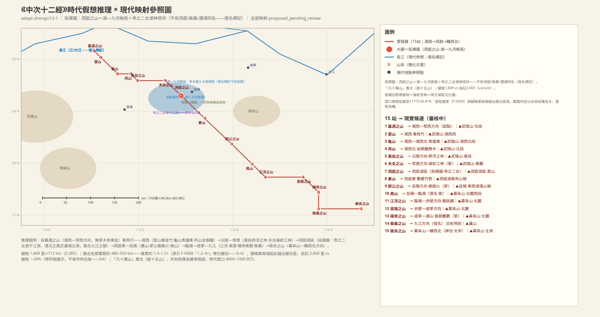

### 篇遇之山：洞庭山系起点

> **原文**：《中次十二經》洞庭山之首，曰篇遇之山，無草木，多黃金。

**白话解读**：中次十二「洞庭山系」之首（系名以第七站洞庭之山冠名——湖区是本系的中心），在湘西—鄂西方向，对应武陵山北段，方向性猜测（`MTN:SHJ-05-12-001#1`）。无草木、多黄金。

### 云山：「伤人必死」的毒竹

> **原文**：又東南五十里，曰雲山，無草木。有桂竹，甚毒，傷人必死。其上多黃金，其下多㻬琈之玉。

**白话解读**：东南五十里，湘西方向，对应武陵山湘西段，较可靠（`MTN:SHJ-05-12-002#1`）。无草木，但有一种「桂竹」：**毒性很强，伤人必死**——毒性植物的精确警告记录，具体竹种与毒性机制待考（文化断层，保持未知）（`PLA:SHJ-05-12-002#3`）。上多黄金、下多㻬琈玉。

**未决项**（照录 draft-v1）：
- 未知：雲山——桂竹確指（何種竹/毒性機制）

### 龟山：对着湘西雄黄矿带

> **原文**：又東南一百三十里，曰龜山，其木多榖柞椆椐，其上多黃金，其下多青雄黃，多扶竹。

**白话解读**：东南一百三十里，湘西—湘西北方向，对应武陵山湘西北段，较可靠（`MTN:SHJ-05-12-003#1`）。龟山多处同名，借名不作证。木多构、柞、椆、椐；上多黄金、下多**青雄黄**——砷硫化物矿，湘西—湘西北雄黄矿带（如石门雄黄矿）方向可比，较可靠（`MIN:SHJ-05-12-003#2`）。多扶竹。

**未决项**（照录 draft-v1）：
- 衝突：龜山——龜山同名多處（借名標記）

### 丙山（中十二）：金铜铁与筀竹

> **原文**：又東七十里，曰丙山，多筀竹，多黃金銅鐵，無木。

**白话解读**：东七十里，湘西北方向，对应武陵山北段（桑植—永顺），方向性猜测（`MTN:SHJ-05-12-004#1`）。多筀竹；**黄金、铜、铁三种金属并记**；「无木」——有竹而无木（否定/肯定并置的植被记录）（`MIN:SHJ-05-12-004#1-3`）。

### 风伯之山：莽浮之林

> **原文**：又東南五十里，曰風伯之山，其上多金玉，其下多痠石、文石，多鐵，其木多柳杻檀楮。其東有林焉，名曰莽浮之林，多美木鳥獸。

**白话解读**：东南五十里，湘西北—沅陵方向，对应武陵山东段（沅陵），较可靠（`MTN:SHJ-05-12-005#1`）。「风伯」是风神通用名，借名不作证。上多金玉；下多痠石（待考）、文石、铁；木多柳、杻、檀、楮。山东侧有片林子叫「莽浮之林」，多美木鸟兽——湖区林莽的生态记录（`LND:SHJ-05-12-005#1`）。

**未决项**（照录 draft-v1）：
- 衝突：風伯之山——風伯＝風神通用名（借名標記）
- 未知：風伯之山——痠石確指

### 夫夫之山：手操双蛇的江神

> **原文**：又東一百五十里，曰夫夫之山，其上多黃金，其下多青雄黃，其木多桑楮，其草多竹、雞鼓。神于兒居之，其狀人身而身操兩蛇，常遊于江淵，出入有光。

**白话解读**：东一百五十里，沅陵—常德方向，对应武陵山东麓（常德西），较可靠；冢级（`MTN:SHJ-05-12-006#1`）。上多黄金、下多青雄黄（湘西砷矿带的延续）；木多桑、楮（桑是湖区桑蚕生业的暗示），草多竹、鸡鼓（待考）。神「于儿」住在这里：**人身、双手各操一蛇**，常游于「江渊」（大江湖泽的深潭），出入发光——南方操蛇神像传统的典型（`PER:SHJ-05-12-006#1`）。它与下一站帝之二女同游「江渊」，两站由同一水域连接，支持夫夫之山位于洞庭湖区外缘。

**未决项**（照录 draft-v1）：
- 未知：夫夫之山——雞鼓確指（草名）

### 洞庭之山：帝之二女，「是在九江之间」

> **原文**：又東南一百二十里，曰洞庭之山。其上多黃金，其下多銀鐵，其木多柤棃橘櫾，其草多葌、蘼蕪、芍藥、芎藭。帝之二女居之，是常遊于江淵。澧沅之風，交瀟湘之淵，是在九江之閒，出入必以飄風暴雨。是多怪神，狀如人而載蛇，左右手操蛇。多怪鳥。

**白话解读**：东南一百二十里到本经拓扑锚站洞庭之山，对应洞庭湖区方向——**F-0021 已裁決（2026-10-27）：洞庭＝湖南洞庭湖，鄱阳否决存册，锚回复 medium_high（待 T-RT05 遮蔽确认）**。裁决理由是**专名簇共时证据**：澧、沅、潇、湘四个水名同句共现，全部指向湖南，且「帝之二女」（湘君湘夫人）神话簇同域；这批水名与成书层（战国楚地）是共时证据而非后世借名（楚辞传统《九歌》湘君/湘夫人同时证明）——免费名物密度压倒鄱阳读法（需借名豁免四个水名）。这是继具区（F-0015）之后第二个「专名簇共时证据」范式案例（`MTN:SHJ-05-12-007#1`）。「洞庭」借名，但内容自证湖区：上多黄金、下多银铁；木多柤、梨、橘柚——本经是中山经唯一记柑橘的子经（**C1：橘櫾属窗口期非定位性证据——中八荆山 32°N、中九三峡带 31°N 同记橘櫾，只能用于否决不能用于钉点，撤销其锚支持角色，待 T-RT17**）；草多葌、蘼芜、芍药、芎䓖（伞形科芳草群）。**帝之二女住在这里，常游于江渊**——湖区水域女神信仰（后世湘妃娥皇女英传统属借名层，不作证）。「澧沅之风，交潇湘之渊，是在九江之间」——两组水名加「九江」共指多条水汇入大湖泽的格局；「出入必以飘风暴雨」是大湖面风暴的气候记录（`WAT:SHJ-05-12-007#3`、`CLIM:SHJ-05-12-007#1`）。还多「怪神」：人形、头上载蛇、左右手各操一蛇——操蛇神像的加强版；多怪鸟。总结段定它为「神」级（太牢加圭璧十五），与东端荣余之山并列为本经两座最高圣山。

**配图**：

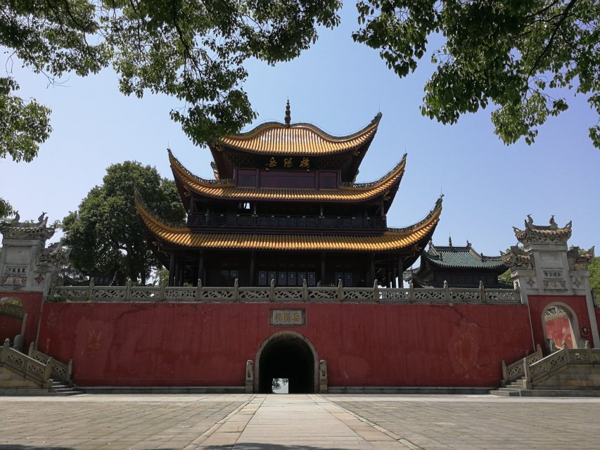（图：Wikimedia Commons）

**未决项**（照录 draft-v1）：
- 衝突：洞庭之山——洞庭同名（借名標記——後世洞庭湖名層不作證）
- 衝突：澧沅——澧沅同名（借名標記）
- 衝突：瀟湘之淵——瀟湘同名（借名標記）
- 衝突：瀟湘之淵——後世湘妃傳統＝借名層（不作證）
- 衝突：九江——九江同名（借名標記）
- 未知：九江——『九江』具體水數（九為泛指——保持未知）

### 暴山：湖区的麋鹿

> **原文**：又東南一百八十里，曰暴山。其木多椶枏荊𦬊竹箭䉋箘，其是多黃金玉，其下多文石鐵，其獸多麋鹿𪊨就。

**白话解读**：东南一百八十里，洞庭东方向，对应洞庭湖东岸山岭（岳阳西南），较可靠（`MTN:SHJ-05-12-008#1`）。木多棕榈、楠、荆𦬊、竹箭、䉋、箘——亚热带林木竹类群；上多黄金玉、下多文石铁。兽多**麋鹿**——湖区沼泽兽群，洞庭湖区的标志性动物（`CRE:SHJ-05-12-008#1`、`CRE:SHJ-05-12-008#2`）；还有𪊨就（传为雕类鸟，确指待考）。

**未决项**（照录 draft-v1）：
- 未知：暴山——𪊨就確指（傳為鵰類鳥）

### 即公之山：白身赤首的御火龟「蛫」

> **原文**：又東南二百里，曰即公之山，其上多黃金，其下多㻬琈之玉，其木多柳杻檀桑。有獸焉，其狀如龜，而白身赤首，名曰蛫，是可以禦火。

**白话解读**：东南二百里，岳阳方向，对应岳阳东南湖滨山岭，较可靠；冢级（`MTN:SHJ-05-12-009#1`）。上多黄金、下多㻬琈玉；木多柳、杻、檀、桑（桑树再见，生业暗示延续）。有兽「蛫」，像龟而白身红头，**可以御火**——佩戴或畜养以防火的巫术赋义（`CRE:SHJ-05-12-009#2`）。

### 尧山：冢级，黄垩与黄金

> **原文**：又東南一百五十九里，有堯山，其陰多黃堊，其陽多黃金，其木多荊𦬊柳檀，其草多藷藇𦬸。

**白话解读**：东南一百五十九里（「有尧山」的「有」字与通例「曰」不同，用字异文待校），岳阳—临湘方向，对应幕阜山北麓西段（临湘），较可靠；冢级（`MTN:SHJ-05-12-010#1`）。「尧」是帝尧借名，不作证。阴坡黄垩（黄色垩土，颜料/陶土）、阳坡黄金；木多荆𦬊、柳、檀；草多藷藇（薯蓣/山药类，药食草）、𦬸。

**未决项**（照录 draft-v1）：
- 衝突：堯山——堯山同名（帝堯借名標記）

### 江浮之山：银与磨刀石

> **原文**：又東南一百里，曰江浮之山，其上多銀砥礪，無草木，其獸多豕鹿。

**白话解读**：东南一百里，临湘—赤壁方向，对应幕阜山北麓赤壁段，方向性猜测（`MTN:SHJ-05-12-011#1`）。上多银和磨刀石；无草木；兽多野猪和鹿。

### 真陵之山：荣草

> **原文**：又東二百里，曰真陵之山，其上多黃金，其下多玉，其木多榖柞柳杻，其草多榮草。

**白话解读**：东二百里，赤壁—咸宁方向，对应幕阜山北麓咸宁段，方向性猜测（`MTN:SHJ-05-12-012#1`）。上多黄金、下多玉；木多构、柞、柳、杻；草多荣草（确指待考）。

**未决项**（照录 draft-v1）：
- 未知：真陵之山——榮草確指

### 阳帝之山：美铜，对着大冶铜绿山矿带

> **原文**：又東南一百二十里，曰陽帝之山，多美銅，其木多橿杻檿楮，其獸多麢麝。

**白话解读**：东南一百二十里，咸宁—通山方向，对应幕阜山北麓通山段，较可靠；冢级（`MTN:SHJ-05-12-013#1`）。「多美铜」——优质铜；**鄂东南大冶—阳新铜矿带（铜绿山）是现实中最著名的先秦铜矿，方向可比，风物级证据**（`MIN:SHJ-05-12-013#1`）。木多橿、杻、檿（山桑——生业暗示延续）、楮；兽多麢（羚羊）、麝（山地兽群，鄂东南山地可比）。

### 柴桑之山：白蛇与飞蛇

> **原文**：又南九十里，曰柴桑之山，其上多銀，其下多碧，多泠石、赭，其木多柳𦬊楮桑，其獸多麋鹿，多白蛇飛蛇。

**白话解读**：向南九十里（全链唯一南向腿），九江方向，对应庐山方向，较可靠（`MTN:SHJ-05-12-014#1`）。「柴桑」与汉晋柴桑县同名，是后世地名层，借名不作证。上多银，下多碧（绿石）、泠石（待考）、赭；木多柳、𦬊、楮、桑（桑再见）。兽多麋鹿（湖区兽群延续）；多**白蛇、飞蛇**——湖区蛇群记录，属蛇信仰风物层（飞蛇是滑翔蛇类还是造像夸张，保持未知）（`CRE:SHJ-05-12-014#3`、`CRE:SHJ-05-12-014#4`）。

**未决项**（照录 draft-v1）：
- 衝突：柴桑之山——柴桑同名（借名標記）
- 未知：柴桑之山——泠石確指

### 荣余之山：神级，东端收束

> **原文**：又東二百三十里，曰榮余之山，其上多銅；其下多銀，其木多柳𦬊，其蟲多怪蛇怪蟲。

**白话解读**：东二百三十里到链条终点，幕阜山—赣西北方向，对应幕阜山主脊（赣西北修水段），较可靠（`MTN:SHJ-05-12-015#1`）。里程注水使推算位置越出幕阜山拟合区东南，记异文。总结段「洞庭、荣余山神也」——神级，与洞庭并列为本经两座最高圣山，分居链两端（湖区锚与东端收束）。上多铜、下多银（赣西北铜银矿方向可比）；木多柳、𦬊；「其虫多怪蛇怪虫」——虫部记录，蛇信仰序列的收束。

### 中十二总结段：鸟身龙首，「凡十万山」是讹字

> **原文**：凡洞庭山之首，自篇遇之山至于榮余之山，凡十萬山，二千八百里。其神狀皆鳥身而龍首。其祠：毛用一雄雞、一牝豚刏，糈用稌。凡夫夫之山、即公之山、堯山、陽帝之山皆冢也，其祠：皆肆瘞，祈用酒，毛用少牢，嬰毛一吉玉。洞庭、榮余山神也，其祠：皆肆瘞，祈酒太牢祠，嬰用圭璧十五，五采惠之。

**白话解读**：总结：从篇遇之山到荣余之山，「凡十万山」——这明显是「十五山」的讹字（本经正文恰好 15 站），待文字校勘。自记 2,800 里对腿程 1,849 里——**带符号统一：腿程较自记 −34%（即自记较腿程 +51%），为全书最大落差之一，不写作吻合度（D4）**，注水方向与全书一致。神群统一「鸟身龙首」（南方系，与南山经鸟身龙首传统呼应）。常祠：一只公鸡加一只母猪（刏=刺杀取血），祭米用稌——**稻米祭，是南方稻作生业的直接证据**（`PLA:SHJ-05-12-016#1`）。夫夫、即公、尧山、阳帝四山为冢级：陈列后埋牲（肆瘞）、祈酒、少牢、吉玉；洞庭、荣余两山为神级：太牢外加**圭璧十五件、以五彩装饰**——全中山经最重的玉币组合之一。

### 中山经全书总结：197 山，21,371 里

> **原文**：右中經之山，大凡百九十七山，二萬一千三百七十一里。

**白话解读**：中山经十二子经的汇总：共 197 山、21,371 里。这是跨子经的汇总数字，与各子经自记、腿程的核对属于框架级任务，记待审（`DOC:SHJ-05-12-017#1`）。

### 五藏山经全书总结：天下名山五千三百七十

> **原文**：大凡天下名山五千三百七十，居地，大凡六萬四千五十六里。

**白话解读**：五藏山经全书的总数字：天下名山 5,370 座、居地 64,056 里（「居地」即所居之地）。框架级数字，待跨经汇总核对（`MTN:SHJ-05-12-018#1`）。

## 中山经·总结（zhongci13）——禹曰

### 禹曰：天地、铜铁与封禅的文献层总结

> **原文**：禹曰：天下名山，經五千三百七十山，六萬四千五十六里，居地也。言其《五臧》，蓋其餘小山甚眾，不足記云。天地之東西二萬八千里，南北二萬六千里，出水之山者八千里，受水者八千里，出銅之山四百六十七，出鐵之山三千六百九十。此天地之所分壤樹穀也，戈矛之所發也，刀鎩之所起也，能者有餘，拙者不足。封于太山，禪于梁父，七十二家，得失之數，皆在此內，是謂國用。

**白话解读**：托名大禹的全书跋：天下名山 5,370、64,056 里，《五臧》所记只是大略，其余小山太多不足记。天地东西二万八千里、南北二万六千里；产水（水源）之山八千里、受水之地八千里；**出铜之山 467 座、出铁之山 3,690 座**——矿产统计是文献层的国家资源观（「此天地之所分壤树谷也……是谓国用」：土地、粮食、兵器都从这里来，能者有余、拙者不足）。「封于太山，禅于梁父，七十二家」是封禅传统的话头——太山（泰山）、梁父在此按借名警示处理，窗口期的确指待考（`MTN:SHJ-05-13-001#4`、`MTN:SHJ-05-13-001#5`）。

**未决项**（照录 draft-v1）：
- 未知：太山——太山窗口期確指待考
- 未知：梁父——梁父確指待考
- 五臧山經總結段：封禪/禹曰/出銅出鐵統計為文獻層記錄（見 readings-supplement）

### 字数总结：《五臧山经》一万五千五百三字

> **原文**：右《五臧山經》五篇，大凡一萬五千五百三字。

**白话解读**：《五臧山经》五篇总计 15,503 字——全书的字数总结，文献层记录。

---

本卷条目 213（draft-v2 白话解读全覆盖）；未决项逐条照录 draft-v1（凡 v1 有「未決項」小节者均完整保留，含总结段跨条目条目）。配图 8 张，均为 Wikimedia Commons 真实照片，文件页已逐一验证可达。
