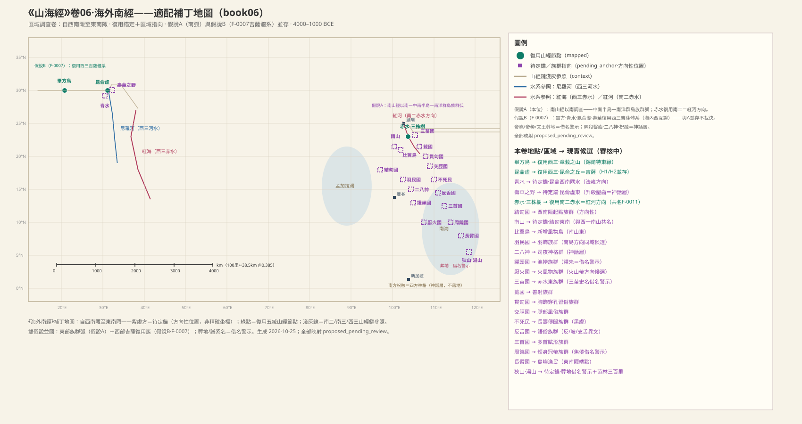
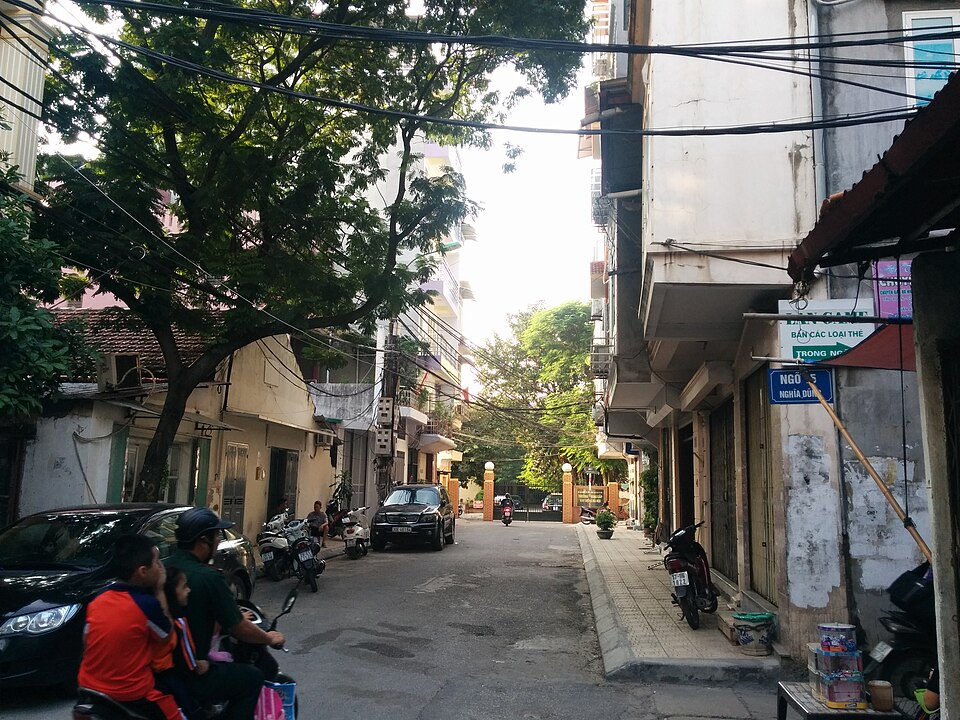
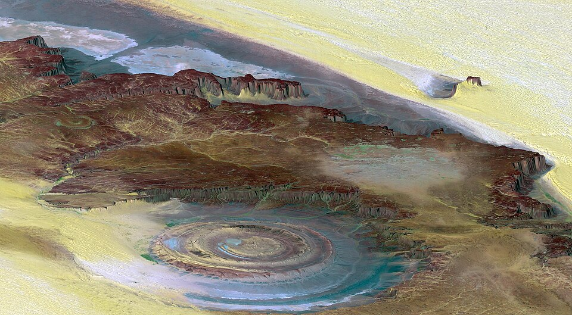

# 《海外南經》白话通顺稿（卷六·draft-v2）

## 本卷导览

《海外南经》不是一条记里程的旅行路线，而是一次"区域调查"：它宣布自己记录"海外"从西南角到东南角这一弧带上的族群和风物，然后像扫掠一样自西向东逐个点名。这一卷记了二十多个对象，绝大多数是"国"——其实是以体貌、服饰、习俗命名的族群（结匈、羽民、贯匈、交脛、反舌……），间杂少数地物（南山、赤水、三株树、狄山）和神话层记录（二八神、羿射凿齿、祝融）。

关于这一卷在现实世界的落点，目前并存两套假说，本卷不裁决：

- **假说 A（本位读法）**：全卷是南山经以南的南方族群弧——从中南半岛方向一直推到南洋群岛，东端"长臂国捕鱼海中"正落在海域上，与"东南陬"收尾自洽。
- **假说 B（F-0007 两河体系延伸）**：卷中段（毕方鸟、青水、昆仑虚、寿华之野）复用西山经第三册的西亚—北非体系。

本卷最重要的一个落点已经裁决（ADJ-002）：**昆仑虚＝撒哈拉之眼（理查特构造，毛里塔尼亚）**，不再并入吉萨金字塔。赤水则按 ADJ-005 裁决处理："赤水"是"红色外观之水"的类名，红河、红海等各自成立，不算冲突。另有一组"借名警示"：尧、喾、文王葬地、三苗、驩兜、焦侥、祝融这类后世谱系名，一律不用来反推定位。

序列本身自洽（自西南向东逐点推进、终于海中渔民），但因是区域调查，没有里程数字可供吻合度核验；主要未决集中在：双假说的取舍、各族群风物的原型、以及"虫为蛇、蛇号为鱼"这条语言风俗线索的对应。

---

### 总序：这套书的世界观开场白

> **【經文原文】**
> 地之所載，六合之閒，四海之內，照之以日月，經之以星辰，紀之以四時，要之以太歲，神靈所生，其物異形，或夭或壽，唯聖人能通其道。

**白话解读**：这是《海外经》各卷共用的序言，意思是：大地承载的一切、天地四方之内、四海之中，由日月照明、星辰定序、四时纪年、太岁总摄；神灵所生的万物形态各异，有的短命有的长寿，只有圣人能通晓其中道理。它不记任何具体山水，是给全卷"异形族群"记录定调的开场白——"其物异形，或夭或寿"正好预告了后面一长串奇形异俗的族群名单。值得注意的是"太岁"是战国以后流行的纪时术语，说明序文这层比正文记录层晚出。REG:SHJ-06-1-001#1、#2

---

### 调查框架：从西南角记到东南角

> **【經文原文】**
> 海外自西南陬至東南陬者。

**白话解读**：这一句划定本卷的记录范围：海外世界从西南角到东南角这一弧带。也就是说，后面的一串国名不是一条有里程的路线，而是按"从西往东扫一遍"的顺序排列的区域名单。本卷实际的排列（结匈国在西南起头，一路向东，到长臂国在海里捕鱼收尾）和这个框架对得上，说明框架本身是自洽的。它对应的现实方向，我们判断是南山经以南——中南半岛—南洋群岛这一条南方弧带（较可靠的方向性判断，假说 A）；另一套假说 B 认为中段会接入西亚—北非体系，两说并存。REG:SHJ-06-1-002#1

**未决项**
- 衝突：海外南經調查框架（西南陬—東南陬）——假說A（本位）：南山經以南的南方—南洋弧 vs 假說B（F-0007）：中段復用西三吉薩體系——雙假說並存，本層不裁決
- 未知：海外南經調查框架（西南陬—東南陬）——「陬」的確切範圍界定

---

### 结匈国：名单的第一个族群

> **【經文原文】**
> 結匈國在其西南，其為人結匈。

**白话解读**：这是点名序列的起点国，位置在西南角方向。"匈"就是"胸"，"结匈"说的是这个族群的胸部特征——可能是胸肌前凸的体态，也可能是胸前打结佩饰的装束，两种读法都讲得通，目前不取舍。这类以体貌、服饰命名的方式是本卷族群的通例（后面还有贯匈、交脛、反舌等）。现实方向上只能指向西南角外侧、大致缅泰方向的某个族群，属于方向性猜测。POL:SHJ-06-1-003#1

**未决项**
- 未知：結匈國——結匈確義（體態 vs 服飾）
- 未知：結匈國——具體族屬

---

### 南山与比翼鸟：一个"管蛇叫鱼"的地方

> **【經文原文】**
> 南山在其東南。自此山來，蟲為蛇，蛇號為魚。一曰南山在結匈東南。比翼鳥在其東，其為鳥青、赤，兩鳥比翼。一曰在南山東。

**白话解读**：结匈国东南有一座南山。注意：这座南山和西山经第一册里的"南山"只是同名，不是同一座山——两处方位完全对不上，按同名不同山处理。最有意思的是"自此山来，虫为蛇，蛇号为鱼"：从这座山往外走，当地人管蛇叫"鱼"。这是一条语言风俗线索——记录者注意到山南一带的族群命名习惯和中原不同，与南方百越、南岛方向的命名习俗在气质上相容，但具体对应哪种语言还完全待考。比翼鸟在南山以东，一青一红两只鸟并翅而飞，是把"成双成对出现的水鸟"风物化的记录，原型鸟种待考。MTN:SHJ-06-1-004#1；CRE:SHJ-06-1-004#2

**未决项**
- 衝突：南山（海外南）——與西一「南山」（MTN:SHJ-02-1-012#1，橫斷山北段 31.6°N 99.0°E）同名異實——方位（西南陬外 vs 西一川西）不相容，記共名不復用
- 未知：南山（海外南）——蟲蛇魚名俗的語言學對應
- 未知：比翼鳥——原型鳥種

---

### 羽民国：披羽衣的长头人

> **【經文原文】**
> 羽民國在其東南，其為人長頭，身生羽。一曰在比翼鳥東南，其為人長頰。

**白话解读**：比翼鸟东南是羽民国，那里的人"长头、身上生羽"。"身生羽"几乎可以肯定不是说人长羽毛，而是记录者看到的羽饰习俗——羽衣、羽冠，在南方和南洋族群中都很常见；另一种本子写作"长颊"，只是体貌描述的异文。方向还是沿中南半岛往南岛一带推进，属方向性猜测。另外《大荒南经》里也有"羽民"，两处是同族的分散记录还是重复传闻，目前并存。POL:SHJ-06-1-005#1

**未决项**
- 衝突：羽民國——與大荒南經羽民同名——同族分散記錄 vs 重複傳聞，兩讀並存
- 未知：羽民國——「身生羽」＝羽衣習俗或文身之讀

---

### 二八神：十六个连臂守夜的小神

> **【經文原文】**
> 有神人二八，連臂，為帝司夜于此野。在羽民東。其為小人頰赤肩，盡十六人。

**白话解读**：羽民国以东的原野上，有一组"二八神"——十六个神人手挽着手连成一排，替天帝守夜。文本怕人算错，自己补了一句"尽十六人"。他们红脸颊、赤肩膀。"为帝司夜"是神话层的记录，"帝"是天神，不指后世的某个帝王；"其为小"三个字可能有脱文或残存的地名，存疑。这一条没有现实地理落点，读作当地夜祭仪式或群像图画的神格化即可。PER:SHJ-06-1-006#1

**未决项**
- 未知：二八神（神人二八）——「其為小」是否殘存地名
- 未知：二八神（神人二八）——司夜儀式的原型

---

### 毕方鸟与青水：本卷第一个跨卷互证点

> **【經文原文】**
> 畢方鳥在其東，青水西，其為鳥一腳。一曰在二八神東。

**白话解读**：二八神以东、青水的西边，有毕方鸟，只有一只脚。这只鸟在《西山经》第三册已经登场过——章莪之山的毕方"状如鹤、一足、赤纹青质白喙"，和这里"一脚"的特征完全吻合，所以我们判断两处是同一只神鸟的重复记录（跨卷互证；**置信已降 medium→low，2026-10-27**：复用置信度不得超过被复用节点——西三章莪节点本身待审，且本卷卷级框架（南洋弧 vs 吉萨体系）未裁决，框架未决时点位不得高于 pending 级）。青水在山经里没有对应条目，但《海内西经》说"弱水、青水出西南隅……过毕方鸟东"，三卷合起来指向同一个格局：青水是昆仑体系西南角的一条水（西山经框架下指向埃及法雍方向，方向性猜测）。这套"复用读法"如果成立，本卷中段就接上了西山经的西亚—北非体系（假说 B）；如果坚持全卷是南方弧（假说 A），毕方和青水就得读成南方本地的同名火鸟和水。两说并存，本层不裁。CRE:SHJ-02-3-015#4；WAT:SHJ-06-1-007#1

**未决项**
- 衝突：畢方鳥（海外南）——假說B（本位南弧）下畢方＝南方本地火鳥同名——與復用假說並存
- 衝突：青水（海外南）——假說B（本位南弧）：青水＝南方本地水——兩讀並存
- 未知：青水（海外南）——青水具體水道

---

### 讙头国：长翅膀鸟嘴的捕鱼人

> **【經文原文】**
> 讙頭國在其南，其為人人面有翼，鳥喙，方捕魚。一曰在畢方東。或曰讙朱國。

**白话解读**：毕方鸟以南（一说以东）是讙头国，人长着脸和翅膀、鸟一样的嘴，记录者看到他们的时候正在捕鱼。"方捕鱼"三个字很生动——这是一张行为快照，说明记录来自对滨水渔捞族群的目击或图画。"人面有翼、鸟喙"是对渔具、装扮的风物化夸张，不是真的鸟人。这国又名"讙朱国"，名字和后世谱系里的驩兜、丹朱同音，但那是借名——不能拿"尧放驩兜于崇山"这类后世放逐故事来给它定位。POL:SHJ-06-1-008#1

**未决项**
- 未知：讙頭國（讙朱國）——讙頭/讙朱與驩兜·丹朱譜系的關係（借名警示）

---

### 厌火国：口中喷火的人

> **【經文原文】**
> 厭火國在其南，獸身黑色。生火出其口中。一曰在讙朱東。

**白话解读**：讙头国以南是厌火国，黑色的兽身之人，能生火从口中喷出。两种读法都摆在桌面上：一是南洋火山带方向——把目睹火山喷发的印象安到当地居民头上；二是食火、火舞一类习俗的实录。按假说 A 的南弧走向，火山带方向（印尼群岛是世界火山最密集的地带之一）在地理气质上是顺的，但目前只是方向性猜测。POL:SHJ-06-1-009#1

**未决项**
- 未知：厭火國——生火出口的原型（火山 vs 習俗）

---

### 三株树与赤水：红水河边叶子像珠子的树

> **【經文原文】**
> 三株樹在厭火北，生赤水上，其為樹如柏，葉皆為珠。一曰其為樹若彗。

**白话解读**：厌火国以北、赤水岸边长着三株树（也可能是树名"三株"），树形像柏树，叶子全是珠子——另一种本子说"树形像彗星"。"叶皆为珠"大概是把珠状的果实或附生物风物化了，具体所指待考。关键是赤水：这是本卷一处重要复用。按 ADJ-005 裁决，"赤水"是"外观发红之水"的类名，各地实例各自成立、不算冲突——西山经第三册的赤水指红海方向、第二册指印度河、第一册指雅鲁藏布江林芝段，而本卷的赤水我们复用南山经第二册的判断：红河水系方向（较可靠）。红河流域水土富含红色铁铝氧化物、汛期水色浑红，"赤水"名副其实；这也和本卷"南山经以南"的调查范围自洽。若按假说 B，此处的赤水则是红海，与毕方、青水、昆仑虚的复用链互证，两说并存。PLA:SHJ-06-1-010#1；WAT:SHJ-01-2-001#2

**配图**

（图：Wikimedia Commons）

**未决项**
- 未知：三株樹——葉皆為珠的具體所指
- 衝突：赤水（海外南）——赤水共名多實（F-0011）：南二＝紅河方向 vs 西三＝紅海 vs 西二＝印度河 vs 西一＝雅魯藏布林芝段；假說B（F-0007）下本卷赤水＝西三紅海（與畢方·青水·昆侖虛復用鏈互證）——雙假說並存，本層不裁決
- 衝突：赤水（海外南）——ADJ-005（水名/地貌名為性狀類名，多實例合法非衝突）——本條按類名多實例處理，留檔不裁

---

### 三苗国：赤水东岸成群结伴的人

> **【經文原文】**
> 三苗國在赤水東，其為人相隨。一曰三毛國。

**白话解读**：赤水东岸有三苗国，又名三毛国，那里的人"相随"——成群结队地走，具体是什么风俗（迁徙？队列出行？）还说不清。这里要特别警告："三苗"是尧舜禹叙事里的后世史名（"窜三苗于三危"之类是后人的层累添加），不能拿后世征伐故事反推它在中原的哪个方向。按假说 A，赤水东岸即红河以东、滇黔桂方向的某个族群（方向性猜测）；按假说 B，则是红海以东、阿拉伯半岛希贾兹方向——随赤水的双假说联动。POL:SHJ-06-1-011#1

**未决项**
- 衝突：赤水（海外南）——赤水共名多實（F-0011）：南二＝紅河方向 vs 西三＝紅海 vs 西二＝印度河 vs 西一＝雅魯藏布林芝段；假說B（F-0007）下本卷赤水＝西三紅海（與畢方·青水·昆侖虛復用鏈互證）——雙假說並存，本層不裁決
- 衝突：赤水（海外南）——ADJ-005（水名/地貌名為性狀類名，多實例合法非衝突）——本條按類名多實例處理，留檔不裁
- 衝突：三苗國（三毛國）——假說A（紅河東）vs 假說B（紅海東·希賈茲方向）——隨赤水雙假說連動
- 未知：三苗國（三毛國）——「其為人相隨」的風物確義
- 未知：三苗國（三毛國）——三苗/三毛異文優先級

---

### 臷国：射蛇的黄色族群

> **【經文原文】**
> 臷國在其東，其為人黃，能操弓射蛇。一曰臷國在三毛東。

**白话解读**：三苗（三毛）国以东是臷国，人"黄"——可以是肤色、衣色或旗色，三种读法并存；他们擅长拉弓射蛇。"射蛇"是很接地气的南方风物：多蛇的环境里猎蛇是日常本领，与本卷南方弧的区域气质吻合。现实落点只能说是三苗以东的某个善射族群，方向性猜测。POL:SHJ-06-1-012#1

**未决项**
- 未知：臷國——「黃」指膚色/衣色/旗色

---

### 贯匈国：胸前穿孔的习俗

> **【經文原文】**
> 貫匈國在其東，其為人匈有竅。一曰在臷國東。

**白话解读**：臷国以东是贯匈国，那里的人胸口有孔洞。这当然不是说人身上真开了个洞，而是胸部穿孔佩饰习俗的极化记录——把胸饰穿凿夸大成"胸被贯穿"。这类人体改造风俗在世界多地的族群中都存在；后世志怪把"贯胸"渲染成怪物，那是后来的分层，不要混为一谈。落点：贯匈在臷国以东，方向性猜测。POL:SHJ-06-1-013#1

**未决项**
- 未知：貫匈國（穿匈）——匈有竅的習俗原型

---

### 交脛国：盘着腿的人

> **【經文原文】**
> 交脛國在其東，其為人交脛。一曰在穿匈東。

**白话解读**：贯匈国以东是交脛国，"交脛"就是两条腿交叉——最自然的读法是盘腿而坐的习俗（椅子传入之前，中原席地正坐，看到盘腿坐姿会觉得是显著的族群特征），也可能是小腿上的装饰。两读并存，落点为贯匈以东，方向性猜测。POL:SHJ-06-1-014#1

**未决项**
- 未知：交脛國——交脛確義

---

### 不死民：黑皮肤的长寿传闻

> **【經文原文】**
> 不死民在其東，其為人黑色，壽，不死。一曰在穿匈國東。

**白话解读**：交脛（穿匈）国以东是"不死民"，黑色皮肤、长寿、不死。"不死"显然是传闻在传播中被放大的结果——源头大概是"这个族群特别长寿"；而"黑色"是对南方深肤色族群的观察记录，这条线索和东南亚—南洋方向的深肤族群在气质上相容。《大荒南经》也有"不死国"，是同族传闻还是重复记录，并存待考。POL:SHJ-06-1-015#1

**未决项**
- 衝突：不死民——與大荒南經不死國同名——同族傳聞 vs 重複記錄，兩讀並存
- 未知：不死民——不死傳聞的來源層

---

### 反舌国：舌头有讲究的族群

> **【經文原文】**
> 反舌國在其東，其為人反舌。一日支舌國在不死民東。

**白话解读**：不死民以东是反舌国，异文又作岐舌、支舌——三个字形并存，说明传抄很不稳定。"反舌"最可能的所指是语言特征：这个族群的语音里有中原人听来"倒转舌头"的音（卷舌、弹舌之类），也可能是舌饰、舌技等风俗。这是本卷继"蛇号为鱼"之后又一条语言风俗线索。落点为不死民以东，方向性猜测。POL:SHJ-06-1-016#1

**未决项**
- 未知：反舌國（岐舌/支舌）——反舌/岐舌/支舌異文優先級
- 未知：反舌國（岐舌/支舌）——舌俗原型

---

### 昆仑虚：撒哈拉之眼

> **【經文原文】**
> 昆侖虛在其東，虛四方。一曰在反舌東，為虛四方。

**白话解读**：反舌国以东有昆仑虚，"虚四方"——一座四四方方的大土墟。这是本卷最重要的一个落点，且已有正式裁决（ADJ-002，2026-10-26）：**昆仑虚＝理查特构造，即"撒哈拉之眼"**（毛里塔尼亚阿德拉尔高原，约 21.1°N 11.4°W；较可靠）。理由一句话说清：《海内西经》说流沙"西行又南行昆仑之虚，西南入海"——沙带横贯北非、经此再西南直达大西洋，只有西撒哈拉中部的理查特构造坐得进这个位置，吉萨坐不进（地中海在其北，"西南入海"无着落）；而且"虚"就是"墟"，理查特是直径约 40 公里的同心环状侵蚀穹窿，环脊加环间洼地，远望如一座废弃的环城，形象上正是"虚"。旧说把昆仑虚并入吉萨金字塔（昆仑之丘）已被否决——两者分书并列为不同实体。遗留的张力也如实记录："四方/九门"的台地语汇和圆形环带并不严丝合缝，这是待考的缝隙。至于本卷的名单怎么会从南方弧跳到西撒哈拉，假说 B 下的中间路径还缺环节，属假设级。MTN:SHJ-02-3-005#1（撤销复用，改待锚定）

**配图**

（图：Wikimedia Commons）

（图：Wikimedia Commons）

**未决项**
- 衝突：昆侖虛（海外南）——ADJ-002（2026-10-26 裁決）：昆侖虛＝理查特構造（撒哈拉之眼）為主候選，吉薩合併說否決；「虛四方」與圓形環帶的張力項保留
- 未知：昆侖虛（海外南）——本卷序列如何從南弧銜接至吉薩（假說B下的路徑缺失環節——假設級）

---

### 羿与凿齿之战：昆仑虚以东的神话战事

> **【經文原文】**
> 羿與鑿齒戰于壽華之野，羿射殺之。在昆侖虛東。羿持弓矢，鑿齒持盾。一曰持戈。

**白话解读**：昆仑虚以东的寿华之野，羿和凿齿打了一仗，羿用弓箭射杀了对方；装备细节是"羿持弓矢，凿齿持盾（一说持戈）"。羿是跨多卷出现的射手神格，属神话层；凿齿这个"持盾的人形敌手"，有一种读法认为源自拔牙、凿齿习俗族群的妖魔化（假设级）。"寿华之野"没有独立地标证据，只能依附昆仑虚定位：若按旧假说（昆仑虚＝吉萨）就是吉萨以东、开罗东缘到三角洲方向；昆仑虚改判撒哈拉之眼后，其东侧对应撒哈拉中部原野。值得留意的是"持弓矢/持盾"这种白描很像在描述一幅画——本卷多条都带这种图像口吻，支持"古图配文"的成书假说（假设级）。PER:SHJ-06-1-018#1；CRE:SHJ-06-1-018#2；LND:SHJ-06-1-018#3

**未决项**
- 衝突：壽華之野——隨昆侖虛 H1/H2 連動
- 未知：壽華之野——壽華之野的獨立地標證據
- 未知：羿（射鑿齒）——羿敘事與後世后羿譜系的層累關係
- 未知：鑿齒——鑿齒＝習俗族群 vs 純神話怪物的優先級

---

### 三首国：一个身子三个头

> **【經文原文】**
> 三首國在其東，其為人一身三首。一曰在鑿齒東。

**白话解读**：寿华之野（凿齿）以东是三首国，人一个身子三个头。这自然不是写实，最合理的读法是把图腾、面具习俗极化的结果——比如仪式中一人叠戴多重面具，传到画里就成了"一身三首"。具体原型待考，落点方向性猜测。POL:SHJ-06-1-019#1

**未决项**
- 未知：三首國——三首賦形原型

---

### 周饶国：戴冠系带的矮小人

> **【經文原文】**
> 周饒國在其東，其為人短小，冠帶。一曰焦僥國在三首東。

**白话解读**：三首国以东是周饶国，又名焦侥国，那里的人身材短小，但戴冠系带——有自己的服饰制度。这个组合很有意思：个子矮却衣冠齐整，说明记录的是真实见闻而非纯怪物想象。它和南洋群岛的矮黑人（尼格利陀人）传闻在方向上相容，但也仅此而已——同域候选级，不能划等号。"焦侥"之名被后世文献反复沿用并越传越神（《国语》"焦侥氏长三尺"之类），属借名警示，不拿后世说法反推。POL:SHJ-06-1-020#1

**未决项**
- 未知：周饒國（焦僥國）——周饒/焦僥名稱層累

---

### 长臂国：在海里捕鱼的东南角终点

> **【經文原文】**
> 長臂國在其東，捕魚水中，兩手各操一魚。一曰在焦僥東，捕魚海中。

**白话解读**：周饶（焦侥）国以东是本卷点名的最后一站：长臂国。异文明说"捕鱼海中"——这是岛屿、海域环境的直接证据，正好落在"东南陬"的收尾位置上，说明本卷的扫掠自西南一路推进到了海上，序列自洽。"长臂"是渔民善捕的赋形：两手各抓一条鱼，臂长如猿。有一种附带猜测认为这与南洋长臂猿共域的传闻有关，但只是待考的原型猜想，不作定论。POL:SHJ-06-1-021#1

**配图**

（图：Wikimedia Commons）

**未决项**
- 未知：長臂國——長臂賦形原型（長臂猿共域？）

---

### 狄山：帝王葬地传说附着的大山

> **【經文原文】**
> 狄山，帝堯葬于陽，帝嚳葬于陰。爰有熊、羆、文虎、蜼、豹、離朱、視肉。吁咽、文王皆葬其所。一曰湯山。一曰爰有熊、羆、文虎、蜼、豹、離朱、𩿨久、視肉、虖交。有范林方三百里。

**白话解读**：长臂国以东方向有一座狄山（一说叫汤山），山南葬着帝尧，山北葬着帝喾，吁咽、文王也葬在这里；山上有熊、罴、斑纹虎、蜼（一种长尾猿）、豹，还有离朱、视肉等神异之物；山属有一片方圆三百里的"范林"。先给核心警示：尧、喾、文王的葬地是后世帝王谱系一层层附着的产物——后世尧陵、喾陵在成阳、濮阳、临汾等地互相竞争，全是晚出之说——所以绝不能拿"尧葬于此"来反推狄山在中原哪里；山本身只按序列放在东南角末端方向（待锚定）。风物群中：熊、罴、虎、豹是大兽群实录，蜼是长尾猿类；"离朱"与前面讙头国的异名"讙朱"同音但所指不同（记共名，不混同）；"视肉"是跨多卷反复出现的再生肉神异；𩿨久、虖交名物待考。"范林"是依附狄山的三百里大林野，"范"字何解待考。MTN:SHJ-06-1-022#1；CRE:SHJ-06-1-022#2–#8、#11、#12；PER:SHJ-06-1-022#9、#10；LND:SHJ-06-1-022#13

**未决项**
- 衝突：狄山（一曰湯山）——一曰湯山——狄山/湯山異文並存
- 未知：狄山（一曰湯山）——吁咽其人
- 未知：狄山（一曰湯山）——葬地敘事的層累年代
- 未知：范林——范林確義（范＝範式/地名？）
- 衝突：狄山風物群（離朱·視肉·虖交·𩿨久等）——離朱與讙朱（008）共名——異實標記
- 未知：狄山風物群（離朱·視肉·虖交·𩿨久等）——視肉/𩿨久/虖交的具體所指

---

### 南方祝融：四方神收尾

> **【經文原文】**
> 南方祝融，獸身人面，乘兩龍。

**白话解读**：全卷以南方之神祝融收尾：兽的身、人的脸，乘两条龙。这是"四方神"宇宙论结构里的南方神，和《海外经》其他三卷末尾的方神格式完全一样——它呼应卷首"自西南陬至东南陬"的框架，是结构性的收官，不落到任何现实地点。"乘两龙"是这类神格的标准配置。照例警示：后世把祝融说成火神、楚人始祖，都是层累；本层只记录"四方神里的南方神"这一结构。PER:SHJ-06-1-023#1

**未决项**
- 未知：祝融（南方）——祝融神格與後世譜系的層累關係

---

本卷条目 23，白话解读全覆盖；未决项 47 条照录 draft-v1，无删改。
