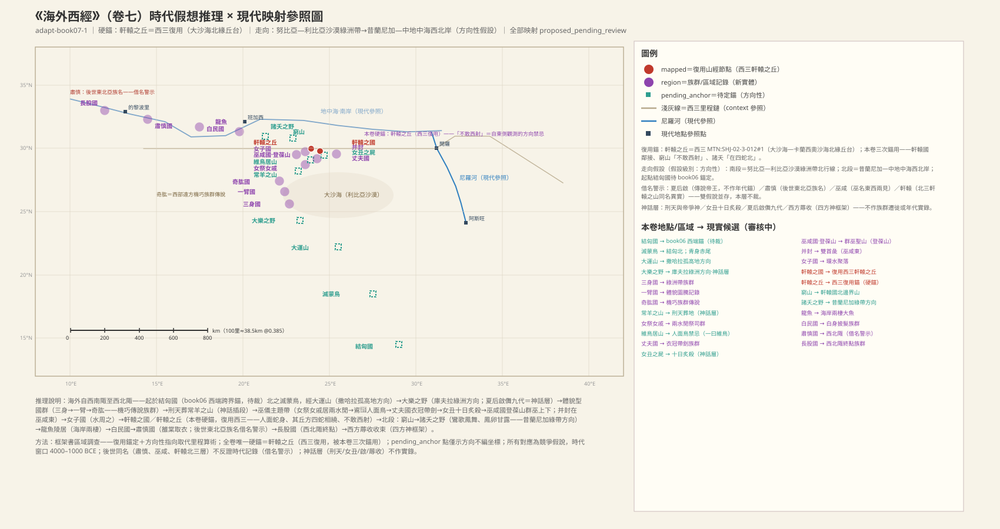
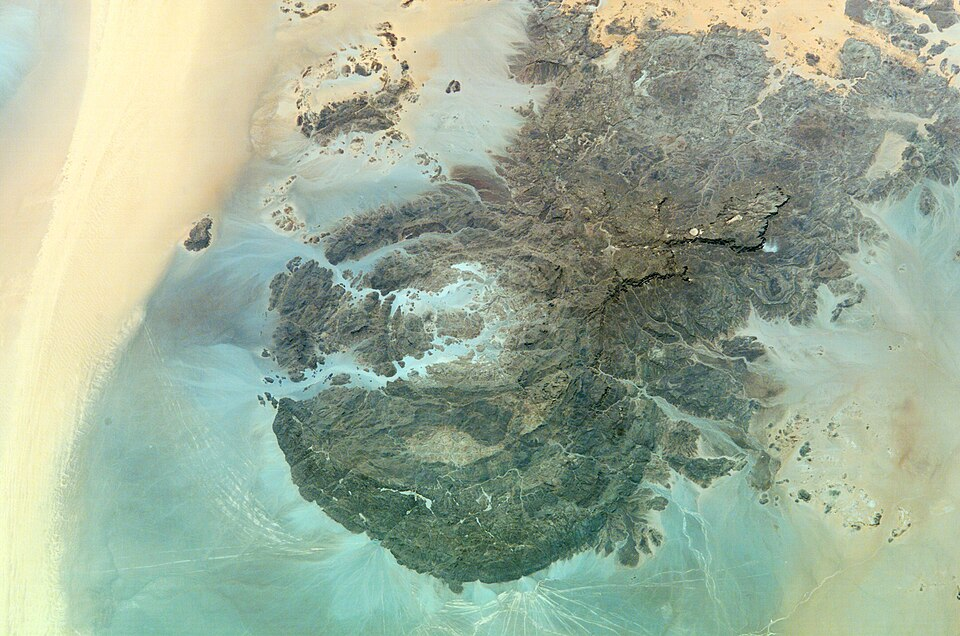
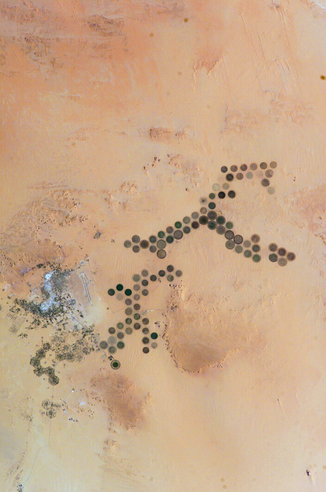
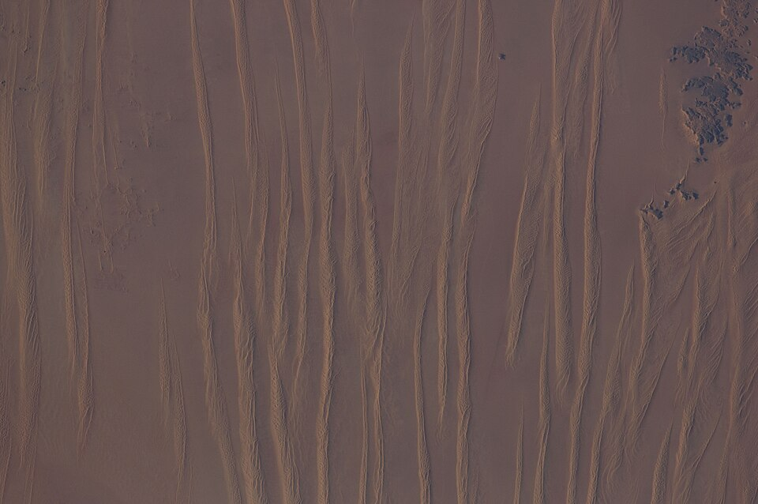
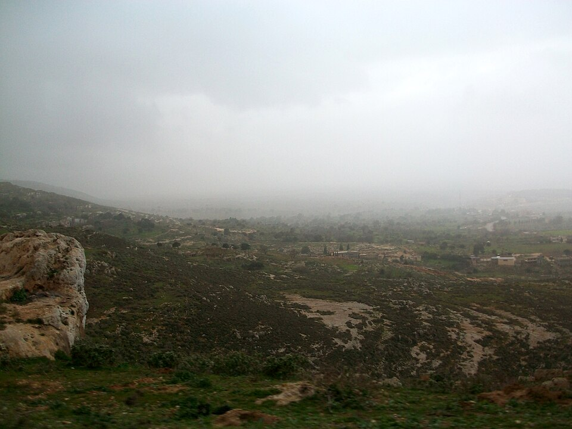
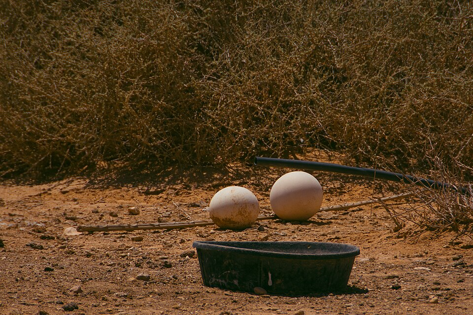

# 《海外西經》白話讀本（卷七）

## 本卷導覽

《海外西經》是「海外」四卷里的西邊一段——「自西南陬至西北陬」，起點正好接《海外南經》最西端的結匈國，一路向北，最後以西方之神蓐收收尾。全卷 23 條記錄串成一條北行的方位鏈（只說「在某之北」，不報里程），中間夾著幾段神話（夏后啓、刑天、女丑、蓐收）。

**全卷最硬的一處定位是軒轅之丘**：我們判斷它和《西山經》里說的軒轅之丘是同一個地方——利比亞大沙海北緣的丘台一帶。它在本卷被反覆用了三次（軒轅國、窮山「不敢西射」的方向禁忌、諸夭之野「在四蛇北」），比只提一次的地名可靠得多。以此為軸，南半段（結匈國到女子國）大致是努比亞—利比亞沙漠綠洲帶的北行線，北半段（窮山到長股國）大致指向昔蘭尼加—中地中海西北岸。整體是一條方向性的弧線，多數站位的具體地點只是猜測。

本卷沒有里程數字可覈算，但方位鏈內部自洽，和軒轅之丘的相對方位（整條觀察線都在丘的東側）也吻合。還沒解決的主要是：海外四卷的整體框架怎麼落到現實地圖上，要等四卷合起來研究；一批和其他卷重名的國名（三身、丈夫、女子、白民等）是不是同一家，還沒定論。另有四條「借名警示」：夏后啓是傳說帝王，不能拿來定年代；肅慎是後世的東北亞族名，不能反證本卷寫的是東北；「巫咸」之名東西兩邊都出現，誰傳給誰不好說；「軒轅」在《北山經》里也有一座同名的山，不是同一處。

---

### 1. 開場：海外，從西南角說到西北角

> **【原文】**
> 海外自西南陬至西北陬者。

**白話翻譯**：海外這一片，從西南角講到西北角。

**白話解讀**：這是全卷的開場白。「海外」就是海（古人對大水大洋的泛稱）以外的地方。海外四經——南經走西南到東南、本捲走西南到西北、北經走西北到東北、東經走東北到東南——正好圍成一圈；本卷的起點結匈國就是上一卷的西端終點，兩卷在西南角縫上了。按我們的整體判斷，這一弧大致落在北非東北部（努比亞—利比亞沙漠—中地中海西北岸方向），但四角框架怎麼整體落到現實地圖上，還沒定論，目前只是方向性猜測。

---

### 2. 滅蒙鳥：結匈國北邊的青身紅尾鳥

> **【原文】**
> 滅蒙鳥在結匈國北，為鳥青，赤尾。

**白話翻譯**：滅蒙鳥在結匈國的北邊，這種鳥身子青色、尾巴紅色。

**白話解讀**：結匈國本是《海外南經》西端的第一國，本卷只借它當起跑線；如果整卷落在北非，它的位置大致指向上尼羅河—努比亞方向（要等上一卷的定位定下來再對照）。滅蒙鳥只記了毛色——青身紅尾，像候鳥或圖騰標記一類的風物記錄；「滅蒙」是什麼意思、具體是哪種鳥，都還不知道。

---

### 3. 大運山：沙漠里突兀而起的高山

> **【原文】**
> 大運山高三百仞，在滅蒙鳥北。

**白話翻譯**：大運山高三百仞，在滅蒙鳥的北邊。

**白話解讀**：「仞」是古人常用的身高單位，三百仞約合七百來米，多半是夸它高，不是實測。茫茫沙漠里忽然拔起一座高山——這個畫面跟撒哈拉東部的孤立高地很像：吉爾夫凱比爾高原、烏韋納特山一帶正是這種地形（方向性猜測）。這座山沒有水系、植被等旁證，「大運」之名是什麼意思也還沒有定論。

**配圖**

（圖：Wikimedia Commons）

---

### 4. 大樂之野：夏后啓的樂舞傳說

> **【原文】**
> 大樂之野，夏后啟于此儛九代；乘兩龍，雲蓋三層。左手操翳，右手操環，佩玉璜。在大運山北。一曰大遺之野。

**白話翻譯**：大樂之野（一說大遺之野），夏后啓曾在這裏跳《九代》之舞：駕兩條龍，頭頂三層雲蓋，左手拿羽扇、右手拿玉環，身佩玉璜。位置在大運山以北。

**白話解讀**：「野」就是開闊平地——沙漠里最像樣的開闊可居平地是綠洲，庫夫拉綠洲群方向是候選（方向性猜測）。要特別說明：啓是傳說層的人物，我們只把他當神話故事的署名，**絕不能反過來推出「夏朝都城在西邊」這類因果倒置的結論**。乘龍、云蓋、翳環玉璜全是帝王儀仗的神化描寫，屬神話內容，不當實錄。

**配圖**

（圖：Wikimedia Commons）

---

### 5. 三身國：一個腦袋三個身子

> **【原文】**
> 三身國在夏后啟北，一首而三身。

**白話翻譯**：三身國在大樂之野（原文借「夏后啓」代指）以北，那裏的人一個腦袋、三個身子。

**白話解讀**：這顯然是誇張的國名，比較合理的讀法是圖騰紋章——族徽畫成一個頭像下接三個身形；也可能是服飾描寫，讀法待定。位置沿利比亞沙漠綠洲帶繼續向北（方向性猜測）。從這裏進入本卷中段的「體貌型國群」（三身→一臂→奇肱）。注意《大荒南經》里也有個三身國（帝俊之妻娥皇所生），同名是不是同一家，還沒定論。

---

### 6. 一臂國：人和馬都只畫半邊

> **【原文】**
> 一臂國在其北，一臂、一目、一鼻孔。有黃馬虎文，一目而一手。

**白話翻譯**：一臂國在三身國以北，那裏的人只有一條胳膊、一隻眼、一個鼻孔。國里還有一種虎紋黃馬，也是一隻眼、一條前腿。

**白話解讀**：人和馬用同一套「只畫半邊」的描寫法——這強烈暗示「一臂一目」不是畸形實錄，而是側面像的紋章、面具或紋身圖案被當成了真人真馬。虎紋馬倒有現實底子：北非—撒哈拉的巖畫里常見斑紋馬匹，時代對得上。人馬同款描寫是不是同一圖騰系統，還沒有定論。

---

### 7. 奇肱國：一臂三目，騎花馬

> **【原文】**
> 奇肱之國在其北，其人一臂三目，有陰有陽，乘文馬。有鳥焉，兩頭，赤黃色，在其旁。

**白話翻譯**：奇肱國在一臂國以北，那裏的人一條胳膊、三隻眼，「有陰有陽」，騎著花斑馬。旁邊還有一種兩個頭、赤黃色的鳥。

**白話解讀**：「肱」就是胳膊。「有陰有陽」可能是雌雄並記，也可能是陰陽紋飾，讀法待定。一臂、雙頭這類對稱套路在本卷反覆出現（後文並封雙頭豬是同款），我們傾向於統一讀作紋章圖案的語言。後世的《博物志》把奇肱氏寫成會造「飛車」的能工巧匠——那是文學演化，不能倒推回本卷；在本書的年代裏，合理的讀法是「西方遠方善技藝族群的傳聞記錄」。

---

### 8. 刑天：斷首猶舞的神話名段

> **【原文】**
> 刑天與帝爭神，帝斷其首，葬之常羊之山，乃以乳為目，以臍為口，操干戚以舞。

**白話翻譯**：刑天和「帝」爭神位，帝砍了他的頭，把他葬在常羊之山；他於是以乳頭當眼睛、以肚臍當嘴，揮著盾（干）和斧（戚）繼續戰鬥。

**白話解讀**：這是一段神話插曲（原文沒有「在其北」這類鏈條詞，位置靠前後文夾出來），是「戰死不屈」套路的千古名段。「帝」指誰（黃帝？天帝？）屬神話內容，不下定論。常羊之山大致指向利比亞沙漠中部山地方向（方向性猜測）；注意《大荒西經》有座「常陽之山」是日月落山之處，名字音近，是否同一座山還沒有結論。「葬」是神話敘事，不當陵墓實錄。

---

### 9. 女祭、女戚：兩水之間的女祭司

> **【原文】**
> 女祭、女戚在其北，居兩水閒，戚操魚觛，祭操俎。

**白話翻譯**：女祭、女戚住在常羊之山以北的「兩水之間」；女戚捧著魚形祭器（魚觛），女祭捧著祭案（俎）。

**白話解讀**：禮器組合直接坐實了她們的祭司身份。這是本卷難得的水文線索：沙漠里被兩條水道或兩眼泉水夾著的地，正是綠洲聖地的樣子。但「兩水」連個專名都沒給，只能存疑。她們和後文的巫咸國同屬本卷的「巫儀主題帶」。

---

### 10. 䳐鳥、𪆻鳥：「所經國亡」的凶兆鳥

> **【原文】**
> 䳐鳥、𪆻鳥，其色青黃，所經國亡。在女祭北。䳐鳥人面，居山上。一曰維鳥，青鳥、黃鳥所集。

**白話翻譯**：䳐鳥和𪆻鳥，羽毛青黃二色，飛到哪兒哪兒亡「國」。位置在女祭以北。䳐鳥長著人臉，住在山上。一說這裏叫維鳥，是青鳥、黃鳥聚集之地。

**白話解讀**：「所經國亡」是典型的凶兆鳥寫法（和山經里「出現就大旱」一個套路）。䳐鳥「人面」，應是貓頭鷹一類猛禽的面部盤羽被神化了。另一種說法這裏叫「維鳥」、是群鳥聚集之地——凶兆鳥與群聚鳥兩種說法並存，不下定論。山沒有名字，還沒有定論。

---

### 11. 丈夫國：衣冠帶劍的「文明」族群

> **【原文】**
> 丈夫國在維鳥北，其為人衣冠帶劍。

**白話翻譯**：丈夫國在維鳥以北，那裏的人穿衣、戴冠、佩劍。

**白話解讀**：在一堆體貌誇張的國名里，這條很特別：它記的不是長相而是制度，說明記錄者把這支族群當成有服制、有武備的「文明社會」來寫——可能是成年男性武士群體的遠方傳聞，也可能是成人禮服制的記錄，還沒有定論。《大荒西經》里也有丈夫之國，同名是否同實，尚無定論。

---

### 12. 女丑之尸：被十日曬死的女巫

> **【原文】**
> 女丑之屍，生而十日炙殺之。在丈夫北。以右手鄣其面。十日居上，女丑居山之上。

**白話翻譯**：女丑之尸——她活著的時候被十個太陽活活曬死。位置在丈夫國以北。她用右手擋著臉。十個太陽在天上，女丑在山上。

**白話解讀**：「十日居上」是大旱記憶被寫成了故事；「以右手鄣其面」是擋太陽的姿勢，很像巖畫或雕像式的姿態記錄。後世「暴巫求雨」（把女巫拖到烈日下曝曬祈雨）的禮俗，神話源頭就在這裏。十日的套路與《大荒東經》湯谷十日屬於同一個神話系統。山沒有名字，還沒有定論。

---

### 13. 巫咸國與登葆山：群巫上下的天梯之山

> **【原文】**
> 巫咸國在女丑北，右手操青蛇，左手操赤蛇。在登葆山，群巫所從上下也。

**白話翻譯**：巫咸國在女丑以北，國人右手握青蛇、左手握赤蛇。他們住在登葆山——那是群巫上天下地的地方。

**白話解讀**：右手青蛇、左手赤蛇，是標準的操蛇巫儀形象（和山經里諸神耳掛蛇、腳踩蛇一套語法）。「群巫所從上下」——巫師們從這座山上天下地，是把山當天梯使。「巫咸」後來被尊為巫文化始祖，但在本卷我們讀作一支西方巫師族群的實錄；巫的名字東西兩邊都出現（《中山經》騩山—巫山方向也有巫文化同名），誰傳給誰不下定論。登葆山大致指向利比亞沙漠—昔蘭尼加南緣方向（方向性猜測）；《大荒西經》的靈山「十巫從此升降」是同款套路，是否同一座山還沒有定論。「登葆」二字何解（登＝升，葆＝寶或保？）也沒有定論。

---

### 14. 並封：前後都有頭的黑豬

> **【原文】**
> 并封在巫咸東，其狀如彘，前後皆有首，黑。

**白話翻譯**：並封在巫咸以東，樣子像豬，前後都有頭，黑色。

**白話解讀**：又是雙首對稱套路（與一臂國的人馬、奇肱的雙頭鳥同屬本卷的對稱圖騰語言）——讀作圖騰紋章顯然比讀作畸形實錄合理。注意方位詞是「東」：這是全卷唯一不沿北鏈的橫向記錄，說明這條鏈不是一根單純的直線，而是以巫咸為支點伸出了一條東向旁支。「並封」這個名字本身（並＝雙，封＝大豬？）也還沒有定論。

---

### 15. 女子國：環水而居

> **【原文】**
> 女子國在巫咸北，兩女子居，水周之。一曰居一門中。

**白話翻譯**：女子國在巫咸以北，兩個女子居住，水環繞四周。一說住在一道門裏。

**白話解讀**：「水周之」放在沙漠語境下，就是綠洲環水或島嶼聚落的樣子；「居一門中」則像是隻有單一入口的封閉聚落（峽口式）。兩種讀法都存。它與丈夫國一女一男，恰好構成性別對稱的國名對。《大荒西經》里也有女子之國，同名還沒有定論；後世「女兒國」的文學化不能反證本條記錄。

---

### 16. 軒轅之國：本卷最硬的定位點

> **【原文】**
> 軒轅之國在之際，其不壽者八百歲。在女子國北。人面蛇身，尾交首上。

**白話翻譯**：軒轅國在女子國以北，那裏的人極長壽——活不到八百歲的都算短命；人面蛇身，尾巴盤到頭頂上。

**白話解讀**：這是本卷最重要的定位點：我們判斷軒轅國就是《西山經》「軒轅之丘」體系的配套人群，位置在利比亞大沙海—卡蘭西奧沙海北緣的丘台一帶，較有把握。理由很硬：同名「軒轅」；下一條說「不敢西射，畏軒轅之丘」，證明觀察者站在這座丘的東側往西看；而且《西山經》那邊也引用了本條互證。人面蛇身是蛇崇拜族群的圖騰化寫法（和伏羲女娲的蛇身套路同款）——人居蛇身、丘纏四蛇（見下條），互為表裏。注意《北山經》里也有一座「軒轅之山」（太行山陵川段方向），那是同名異地，屬後世華夏軒轅傳統在東方的附著；兩種說法並存，但本卷的方位鏈明確指向西邊這一處。「八百歲」是長壽傳說，不當人口學實錄；更不能拿「黃帝軒轅氏」的後世家譜反推這裏是華夏西遷的證據。

---

### 17. 窮山與軒轅之丘：「不敢西射」的沙海禁地

> **【原文】**
> 窮山在其北，不敢西射，畏軒轅之丘。在軒轅國北。其丘方，四蛇相繞。

**白話翻譯**：窮山在軒轅國以北，那裏的人不敢往西邊射箭，因為敬畏軒轅之丘。這座丘是方形的，四條蛇盤繞著它。

**白話解讀**：這條禁令的價值極高：方向禁忌以軒轅之丘為西向參照，證明整條觀察線位於丘的東側——站在大沙海北緣往東看，再往西就是茫茫沙海禁地，方位完全吻合，較有把握。「方丘＋四蛇環繞＋射禁忌」，就是一幅完整的沙海聖域畫像（四蛇是蛇環衛丘的意象，與軒轅國人面蛇身互為表裏）。窮山本身指向大沙海北緣—昔蘭尼加南麓方向（方向性猜測），「窮」大概是「走到盡頭」之意；射箭禁忌具體忌諱什麼，還沒有定論。

**配圖**

（圖：Wikimedia Commons）

---

### 18. 諸夭之野：鳳蛋隨便吃的樂土

> **【原文】**
> 諸夭之野，鸞鳥自歌，鳳鳥自舞；鳳皇卵，民食之；甘露，民飲之，所欲自從也。百獸相與群居。在四蛇北。其人兩手操卵食之，兩鳥居前導之。

**白話翻譯**：在「四蛇」（軒轅丘的蛇環聖域）以北有一片諸夭之野：鸞鳥自唱、鳳鳥自舞，鳳凰蛋人們隨便吃，甘露隨便喝，想要什麼就有什麼。百獸成群聚居。那裏的人兩隻手各捧一個蛋吃，前面還有兩隻鳥引路。

**白話解讀**：剝掉「所欲自從」的理想化包裝，底下是實打實的生計記錄：北非綠洲草原帶上鸵鳥成群，採食鸵鳥蛋是當地舊石器到新石器時代的常見營生，時代完全對得上；「甘露」就是甜味樹汁或蜜露。方向上我們指向昔蘭尼加綠帶——北非最著名的溼潤綠帶，與「百獸群居」的富饒描述相容（方向性猜測）。「在四蛇北」也再次確認：本卷的方位詞直接掛在軒轅之丘這個定位點上。那兩隻「在前面引路的鳥」，是驯化還是伴行，還沒有定論。

**配圖**

（圖：Wikimedia Commons）

（圖：Wikimedia Commons）

---

### 19. 龍魚：鏈條逼近海岸的信號

> **【原文】**
> 龍魚陵居在其北，狀如狸。一曰鰕。即有神聖乘此以行九野。一曰鼈魚在夭野北，其為魚也如鯉。

**白話翻譯**：龍魚在諸夭之野以北，住在陸岸上，樣子像狸。一說像鰕；有神聖騎著它周遊九野。一說叫鱉魚，在夭野以北，這種魚像鲤魚。

**白話解讀**：住在岸上的大魚（「陵居」＝水陸兩棲），形狀有三种說法——像狸、像鰕、像鲤魚。三套說法並存，說明記錄者面對的是一種陌生的海濱大動物：海豹、海龜、大鱉三种讀法都有可能，還沒有定論。重點在於：大型水生動物的出現，說明鏈條已經逼近海岸——支持北段向中地中海南岸、潟湖方向展開的判讀。「神聖乘此以行九野」是神化包裝（神靈交通工具套路，與乘龍同款），不作實錄。

**配圖**

（圖：Wikimedia Commons）

---

### 20. 白民之國與乘黃：背上有角的「狐狸」

> **【原文】**
> 白民之國在龍魚北，白身披髮。有乘黃，其狀如狐，其背上有角，乘之壽二千歲。

**白話翻譯**：白民國在龍魚以北，那裏人身白、披頭散髮。國里有神獸乘黃，樣子像狐狸、背上長角，騎上它能活兩千歲。

**白話解讀**：「白身」可以是膚色淺，也可以是穿白衣，兩讀並存——「披髮」則是髮式的直寫，在本卷誇張的國名里屬於外觀實錄型。「乘黃」是「騎了能長壽」的神話包裝（與軒轅國「八百歲」同一套長壽想像）。「背上有角的狐狸」的現實底子，候選是耳廓狐這類沙漠狐，或某種有角有蹄動物的神化，還沒有定論。《大荒東經》里也有白民之國（帝俊後裔），同名是否同實，尚無定論。

**配圖**

（圖：Wikimedia Commons）

---

### 21. 肅慎之國與雒棠：本卷最大的借名警示

> **【原文】**
> 肅慎之國在白民北，有樹名曰雒棠，聖人代立，于此取衣。

**白話翻譯**：肅慎國在白民國以北，那裏有棵樹叫雒棠（一說雄常），歷代聖人都在這裏取衣料。

**白話解讀**：能「取衣」的樹，應是樹皮纖維做衣的衣料樹——樹皮布是紡織術之前正經的衣料技術，時代對得上。另一個版本作「先入伐帝，於此取之」，是征伐取料版的說法。**重要警示**：後世的肅慎是東北亞（滿洲）族名——周代肅慎氏進貢楛矢石砮很有名；但本卷的方位明確在西方框架的西北角，拿後世族名反推本卷寫的是東北，會跟整條方位鏈矛盾。兩種可能（當時的西方族群實錄，或族名後來東移／被借用）並存，不下定論。《大荒北經》的肅慎氏之國與本條同名互見。「聖人代立於此取衣」是儀禮還是征伐記錄，雒棠是哪種樹，都還沒有定論。

---

### 22. 長股之國：西北角的終點

> **【原文】**
> 長股之國在雒棠北，被髮。一曰長腳。

**白話翻譯**：長股國（一說長腳國）在雒棠樹以北，那裏人披髮。

**白話解讀**：這是本卷族群鏈的最後一站，也就是「西北陬」的終點，再往北就交棒給《海外北經》了。「長股／長腳」是腿長的誇張：可能是身材直寫，也可能是高蹺、綁腿之類習俗被誤讀成了天生長腿，還沒有定論。體貌型國名序列（三身→一臂→奇肱→長股）到此收尾；後世《穆天子傳》《博物志》的長股傳說屬文學演化，不反證本條。

---

### 23. 西方蓐收：四方神框架收束全卷

> **【原文】**
> 西方蓐收，左耳有蛇，乘兩龍。

**白話翻譯**：西方的神蓐收，左耳掛著蛇，駕兩條龍。

**白話解讀**：全卷以西方之神蓐收收尾。耳掛蛇、駕兩龍都是山經神靈的標配語言——這說明這類按方位點名的書和山經出自同一記錄傳統。蓐收與海外南的祝融（南）、海外北的禺彊（北）、海外東的句芒（東）合成四方神框架；後來《國語》《禮記·月令》把他配成西方金神，那是體系化的後世加工。本卷只記他是西方方位神：無地點、不上地圖。「蓐收」之名何解（收＝秋收藏？）、四方神這套框架的來源，都還沒有定論。

## 卷末小結

《海外西經》的軸心是軒轅之丘（大沙海北緣）：「不敢西射」的方向禁忌、三處重複引用與四方神框架互相印證；多數國名的具體落點仍只是方向性猜測。
