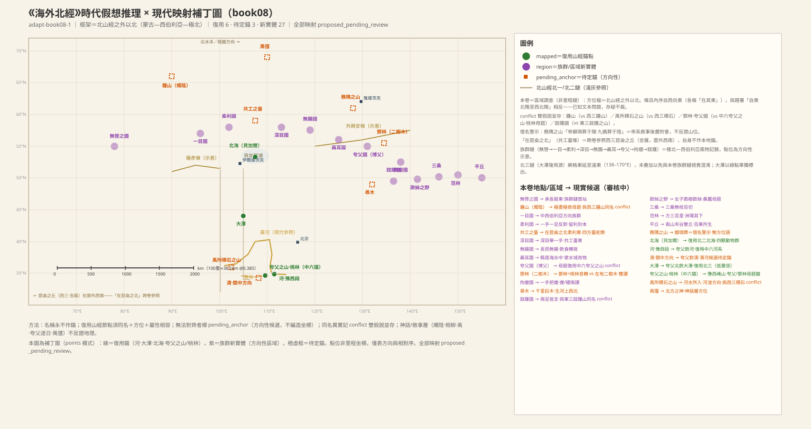
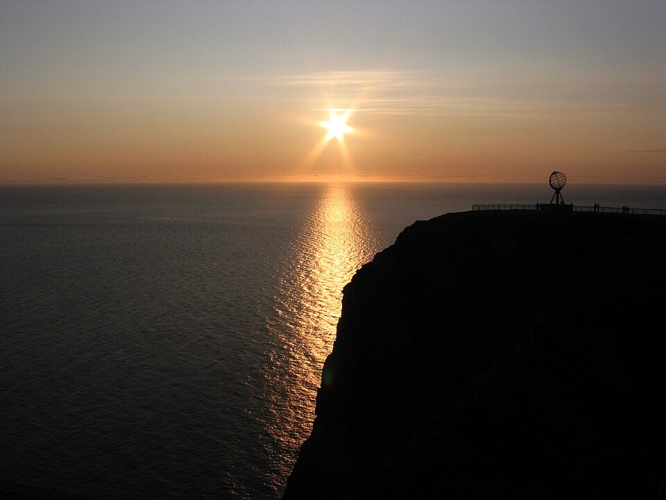
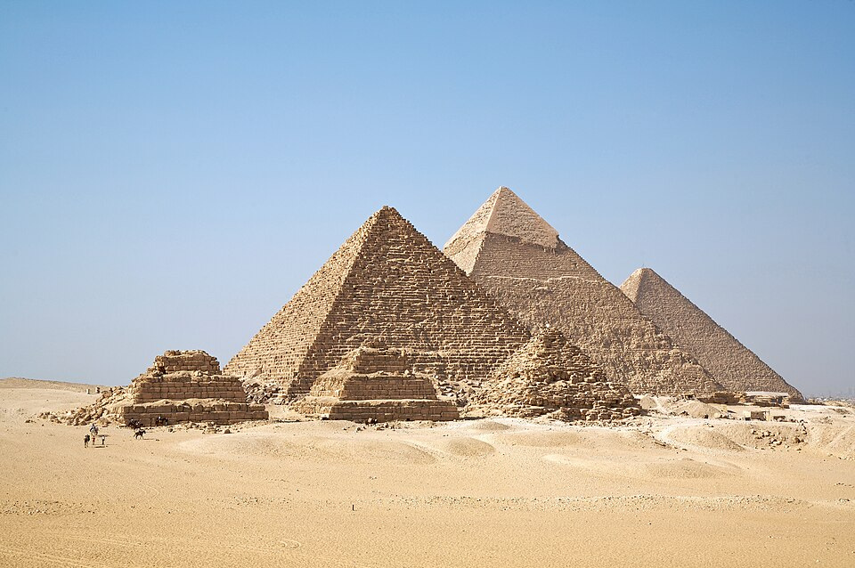
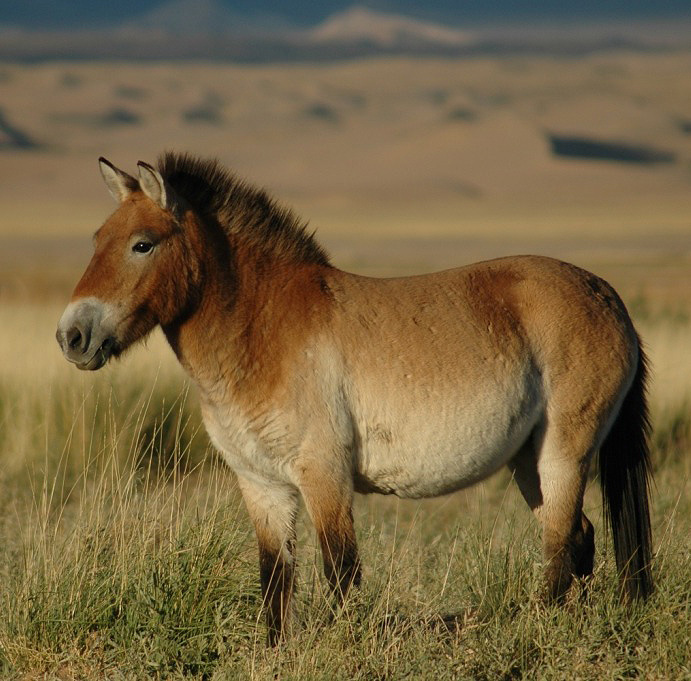

# 《海外北經》白話讀本（卷八）

## 本卷導覽

《海外北經》是「海外」四卷區域調查的北方卷，接在《北山經》（青海—蒙古—貝加爾一線）之外、之北，記的是蒙古高原—西伯利亞—極北—遠東一線上的族群、神祇與地標。體例上它是一份「方位名單」：只按「在某之東」逐站點名，沒有里程數字。

本卷最可靠的幾處定位：

- **北海＝貝加爾湖**：北山經已經一路記到「敦題之山，是錞于北海」（到達貝加爾湖南岸方向），本卷「北海內有獸」的湖域動物群記錄與貝加爾湖區生態相容。古人稱大湖為「海」是常事，不必糾結。
- **河、渭＝黃河、渭河**：夸父「飲于河、渭」，是關中—豫西一帶人人熟知的一對大河。
- **崑崙之丘＝吉薩高地的金字塔—陵寢群**：「在崑崙之北」直接引用了山經里崑崙的位置作參照。注意區分：《海內經》里的「崑崙虛」按我們目前的判斷是撒哈拉之眼，和這裏的「崑崙之丘」是兩處，不要混。
- **燭陰＝極晝極夜加極光的複合神格**：睜眼為晝、閉眼為夜，正是極圈的光照經驗；詳見燭陰一節。

本卷沒有里程可覈算，空間上的自洽靠與北山經、中山經的對接（河渭、北海、崑崙）來保證。**主要懸案**：①卷首題署說「自東北陬至西北陬」，卷內各條卻一律「在其東」逐條向東排，方向正好擰著，只能存疑；②本卷鐘山與《西山經》的同名鐘山不是一處；③「禹所積石之山」一段，我們判斷是戰國時期才編進去的晚出文字（「禹導河」是戰國人纔有的敘事框架），不作定位；④務隅之山「帝顓顼葬」是後世借名，不能反證山的位置。

---

## 海外北經 · 全卷

### 1. 本卷的框架句：海外北調查幅

> **【原文】**
> 海外自東北陬至西北陬者。

**白話翻譯**：海外世界，從東北角到西北角的這一片。

**白話解讀**：這句相當於給整卷劃定調查範圍，是海外四經固定的開場句式。按我們的判斷，它承接北山經已經走完的青海—蒙古—貝加爾一線，再往外、往北推，指向蒙古高原—西伯利亞直到極北方向。框架本身大致可信，但有個明顯矛盾：題署說從東北往西北，卷內各條卻一律「在其東」逐條向東排——方向正好擰著，只能存疑還沒有定論。

---

### 2. 無啓之國：本卷族群鏈的第一站

> **【原文】**
> 無啓之國在長股東，為人無啓。

**白話翻譯**：無啓國在長股國的東邊，那裏的人「無啓」。

**白話解讀**：這是本卷族群鏈的第一站，位置只說「在長股國的東邊」——長股國的正文在上一卷《海外西經》，這裏只借它當起點路標。「無啓」有兩個讀法：讀「無啓」，是沒有後代、死而不絕的部族（《淮南子》里有對應的「無繼民」）；讀另一個版本「無𦜹」，則是說小腿或足踝有畸形特徵。兩種讀法都通，我們傾向把它當作中西伯利亞方向的族群傳聞記錄，具體是哪種特徵、在哪個點，都只能算方向性猜測。

---

### 3. 鐘山之神燭陰：極晝極夜與極光寫成的神

> **【原文】**
> 鍾山之神名曰燭陰，視為晝，瞑為夜，吹為冬，呼為夏，不飲，不食，不息，息為風，身長千里。在無啓之東。其為物，人面，蛇身，赤色，居鍾山下。

**白話翻譯**：鐘山的神叫燭陰：睜眼就是白天，閉眼就是黑夜，吹氣是冬天，呼氣是夏天；不吃不喝不呼吸，一呼吸就化成風，身子有一千里長。它在無啓國的東邊，人面蛇身，通體紅色，住在鐘山下。

**白話解讀**：按我們目前的主要判斷，這不是憑空想像的神，而是**極圈生活經驗的神格化**：「視為晝、瞑為夜」是極晝極夜——太陽幾個月不落、幾個月不升；「吹為冬、呼為夏」是極地季風與寒暑交替；「人面蛇身、赤色、身長千里」是橫貫天際的紅色極光弧。鐘山因此落在北緯六十到七十度的北方山系方向（上揚斯克—切爾斯基山系一帶是主要候選）。它和《西山經》里那座同名的鐘山（南黎凡特海岸方向，北緯三十一度，不可能有極晝極夜）只是同名，不是一處。《大荒北經》章尾山的燭龍（「是燭九陰」）是同一套路的又一處記錄，燭陰、燭龍音義都近，應是同一個神；章尾山我們判斷指向泰梅爾半島—北地群島方向（那裏極夜最長，最貼「燭九陰」），科拉半島是另一個候選。這一讀法與北山經「西望幽都」「雞號寒風」構成同一組極北認知，較有把握。

**配圖**

（圖：Wikimedia Commons）

（圖：Wikimedia Commons）

---

### 4. 一目國：臉中央一隻眼睛的人

> **【原文】**
> 一目國在其東，一目中其面而居。

**白話翻譯**：一目國在鐘山（燭陰）的東邊，國人的特徵是臉的正中央只有一隻眼睛。

**白話解讀**：這多半不是真的獨眼人，而是面具、紋面或額飾一類的裝扮被遠方傳聞轉寫成了「一目」——類似的文化誤讀在世界各民族的異域傳聞里很常見；當然也不排除純傳聞構造。方位上我們繼續把它放在中西伯利亞方向，屬方向性猜測。另一個版本補了一筆「有手足」，是別的本子加的性狀。

---

### 5. 柔利國：一手一足、膝蓋反曲的人

> **【原文】**
> 柔利國在一目東，為人一手一足，反厀，曲足居上。一云留利之國，人足反折。

**白話翻譯**：柔利國在一目國東邊，那裏的人只有一隻手一隻腳，膝蓋反著長，腳彎曲朝上。一說叫留利之國，「人足反折」。

**白話解讀**：這可能是對肢體畸形者的觀察，也可能是柔術表演者一類特殊技藝人群被誇飾成了全族特徵——年代久遠，已無法確證，只能存疑。地理方向仍是中西伯利亞一線，方向性猜測。柔利、留利兩個名字的關係也還沒有定論。

---

### 6. 相柳與共工之台：本卷唯一的神話工程記錄

> **【原文】**
> 共工之臣曰相柳氏，九首，以食于九山。相柳之所抵，厥為澤谿。禹殺相柳，其血腥，不可以樹五穀種。禹厥之，三仞三沮，乃以為眾帝之臺。在昆侖之北，柔利之東。相柳者，九首人面，蛇身而青。不敢北射，畏共工之臺。臺在其東，臺四方，隅有一蛇，虎色，首衝南方。

**白話翻譯**：共工的臣子叫相柳氏，長著九個頭，分別在九座山上取食；它所到之處都變成沼澤溪谷。禹殺了相柳，它的血腥臭，种不了五穀；禹掘土掩埋，填了三次塌了三次，最後築成「衆帝之台」。位置在崑崙之北、柔利國以東。相柳的樣子是九個頭、人面、蛇身、青色。人們不敢向北射箭，因為畏懼共工之台；台在其東，四方形，台角有一條虎色斑紋的蛇，頭朝南方。

**白話解讀**：這是本卷分量最重的一條。相柳「所抵厥為澤溪」是洪水與沼澤化災害被寫成了故事；「三仞三沮」（填三次塌三次）這種反覆塌方的工程細節，很像真實夯土筑台的經驗記錄。台的位置用了一個跨卷座標：「在崑崙之北」，即直接引用山經的崑崙之丘＝吉薩高地金字塔—陵寢群作方位參照（較有把握；按我們的判斷，這裏是崑崙之丘，不是海內經里那座撒哈拉之眼的崑崙虛）。相柳的形象與《海內經》的「相繇」（九首蛇身）疑似同一套路的異名。後半還有一條禁忌：人們不敢向北射箭，因為畏懼共工之台——四方臺加隅角蛇飾，是本卷唯一一處人工構築物的形制細錄。禹和共工都是敘事層人物，這層故事與真實歷史之間的界線，還說不清。

**配圖**

（圖：Wikimedia Commons）

---

### 7. 深目國：眼窩深邃、舉著一隻手的人

> **【原文】**
> 深目國在其東，為人深目，舉一手，一曰在共工臺東。

**白話翻譯**：深目國在共工臺東邊，那裏的人眼窩深陷，舉著一隻手。一說在共工臺東。

**白話解讀**：「深目」就是眼窩深陷，這是對北方族群面貌的直接觀察，詞義上沒有神話色彩，各國史書也常這麼寫；「舉一手」可能是舉手禮或單臂習俗的轉寫。另一個版本作「舉一手一目」，是把兩個性狀合併了。地理上我們放在東西伯利亞方向，方向性猜測。

---

### 8. 無腸之國：身材高而「無腸」的人

> **【原文】**
> 無腸之國在深目東，其為人長而無腸。

**白話翻譯**：無腸國在深目國東邊，那裏的人個子高，「無腸」。

**白話解讀**：「長而無腸」——高個子，外加「無腸」這個誇張的生理描述。一種解釋是「吃下去不消化、直進直出」的直覺誇飾；另一種是對肉食漁獵族群高蛋白飲食的觀察轉寫。屬於文化轉寫類比的猜測，具體何指還沒有定論，方向為東西伯利亞一線。

---

### 9. 聂耳之國：住在水中、雙手托著大耳朵的人

> **【原文】**
> 聶耳之國在無腸國東，使兩文虎，為人兩手聶其耳。縣居海水中，及水所出入奇物。兩虎在其東。

**白話翻譯**：聂耳國在無腸國東邊，國人役使兩隻花斑虎，耳朵大到要用兩隻手托著。他們懸居在海水之中，掌控著這片水域進出的一切珍奇物產。那兩隻虎在他們東邊。

**白話解讀**：耳朵大到要用手托，很像耳飾拉長耳垂風俗的觀察轉寫。最關鍵的是生計記錄：「懸居海水中」即住在水中島嶼上，並且掌控這片水域進出的珍奇物產——像是湖島上的漁獵兼中轉貿易族群。這片「海水」最自然的候選是貝加爾湖（湖中有奧爾洪島等島嶼，島居記錄相容），但也不排除北冰洋岸；兩說並存，還沒有定論。所役使的兩隻「文虎」是紋身虎還是虎圖騰使者，也還說不清。

---

### 10. 夸父逐日：河、渭、大澤與鄧林

> **【原文】**
> 夸父與日逐走，入日。渴，欲得飲，飲於河、渭，河、渭不足，北飲大澤。未至，道渴而死。棄其杖，化為鄧林。

**白話翻譯**：夸父和太陽賽跑，一直追進太陽里；渴了想喝水，先喝乾了黃河、渭河，還不夠，又向北去喝大澤，沒走到就渴死在路上；丟下的手杖化成一片樹林，叫鄧林。

**白話解讀**：人物本身屬神話，但故事裏的水系都可以落地：「河」是黃河豫西段——《中山經》里的夸父之山（崤山·靈寶—潼關方向）正北臨黃河，空間起點相容；「渭」是關中渭河，夸父之山正處渭河入黃河之口方向。注意《西山經》里也各有一條同名的「渭」，那是各卷框架內的地方命名，按「水名是通稱」的原則互不構成衝突。「北飲大澤」指蒙古高原方向的大湖澤（呼倫湖、貝加爾、戈壁湖群方向都兼容），把握不大。「鄧林」早年曾和《中山經》夸父之山北的桃林連在一起（豫西黃土塬林帶），但連起來的理由是清代注家「鄧、桃音近通轉」的說法——單憑讀音相近如今不足以作數，這個連接已經撤回，只保留「同屬夸父逐日故事」這一點關聯。且下一條在本卷極北鏈上也記了一處「鄧林」，只有兩棵樹，和豫西桃林的規模差得很遠——「當地的一處小林子」這個讀法相對佔優，但仍不下定論。夸父逐日這個故事的原型（旱災記憶？立杆測影？），我們不下定論。

---

### 11. 夸父國：操蛇的巨人之國

> **【原文】**
> 夸父國在聶耳東，其為人大，右手操青蛇，左手操黃蛇。鄧林在其東，二樹木。一曰博父。

**白話翻譯**：夸父國在聂耳國東邊，國人身材巨大，右手握青蛇、左手握黃蛇；國的東邊有鄧林，只有兩棵樹。一說叫博父國。

**白話解讀**：這裏的「夸父」是同一個名字的再現：同名的族名、巨人操蛇的形象都和逐日故事裏的神格一致，《中山經》的夸父之山（崤山·靈寶—潼關方向）是這個套路在山經里唯一的落點。但本卷的鏈位在東西伯利亞方向，和豫西在空間上是分開的——到底是夸父族群或神話從豫西核心傳到了極北（族源遷徙說），還是極北這個夸父國只是借了個神話族名、與豫西並無地理同一性（同名異地說），兩說並存。本地這處「鄧林」只有兩株樹，規模上支持「當地林子」一側，但仍不下定論。

---

### 12. 禹所積石之山：黃河穿入的山

> **【原文】**
> 禹所積石之山在其東，河水所入。

**白話翻譯**：禹所積石之山在夸父國東邊，是黃河水穿入的山。

**白話解讀**：「禹所」是禹敘事的冠名。我們判斷**這一條是戰國時代才編進去的晚出文字，不作定位**——「禹導河」的敘事框架是戰國層的投影（和《海內西經》「入禹所導積石山」同一句里的「入渤海」是同一層）；最直觀的傳統候選河湟積石峽（青海循化至甘肅永靖一帶，黃河上游穿峽進入河湟谷地，《禹貢》「導河積石」同構）留檔備查但不採用。原先的兩處麻煩據此了結：一是與《西山經》「積石之山」的同名——三處分開結案，西山經的積石山＝阿斯旺第一瀑布的花崗岩峽門方向（原始地理層），本條＝晚出文字，後世甘肅河州積石山＝借名；二是鏈位問題——本鏈一路向東已到極北，河湟卻在西南方向，空間接不上，正說明這一整段禹敘事是後來插入的文字，名單的順序在這裏斷了一截。

---

### 13. 拘癭之國：手托頸瘤的人

> **【原文】**
> 拘癭之國在其東，一手把癭。一曰利癭之國。

**白話翻譯**：拘癭國在積石山東邊，國人用手托著脖子上的瘤。一說叫利癭之國。

**白話解讀**：如果上一段的名單斷裂成立，本條實際承接夸父國一線向東，方向為遠東—東西伯利亞。「一手把癭」是用手托著頸瘤——「癭」就是頸部甲狀腺腫，是山區缺碘導致的風土病，這條很可能是對病區人群的觀察記錄。另一個版本作「纓」（頸飾），讀「把纓」就是手持頸飾，也通。異文取捨還沒有定論。

---

### 14. 尋木：長在黃河上游西北的千里巨木

> **【原文】**
> 尋木長千里，在拘癭南，生河上西北。

**白話翻譯**：尋木長達一千里，在拘癭國南邊，生長在黃河上游的西北方向。

**白話解讀**：「長千里」是神話誇飾，這株巨木屬神話植物地標。值得注意的是它給了兩個方位：「在拘癭南」加「生河上西北」——這是本卷少見的交叉方位記錄；兩個方位若同時取信，指向黃河上游西北、河套以西方向。兩個方位能不能兼容，還沒有定論。

---

### 15. 跂踵國：踮著腳走路的人

> **【原文】**
> 跂踵國在拘癭南，其為人兩足皆支。一曰反踵。

**白話翻譯**：跂踵國在拘癭國南邊（一說在東邊），那裏的人兩隻腳都踮著。一說叫反踵。

**白話解讀**：「兩足皆支」是踮著腳、腳跟不著地的樣子。別的版本作「其為人大，兩足亦大」「大踵」——巨人加大腳的讀法，這樣就接入了全書反覆出現的「北方巨人」主題群。另外，《東山經》里有一座「跂踵之山」與它同名：一個是山名在東方框架，一個是族名在北方框架，我們按同名異地處理；「用足部特徵命名在兩個框架各自獨立產生」的說法也並存，不下定論。

---

### 16. 歐絲之野：跪在樹前吐絲的女子

> **【原文】**
> 歐絲之野在反踵東，一女子跪據樹歐絲。

**白話翻譯**：歐絲之野在跂踵（反踵）東邊，一個女子跪在樹前吐絲。

**白話解讀**：「歐」即「嘔」：一個女子跪在樹前吐絲、引絲。這是桑蠶育蠶抽絲場景的圖像化記錄——要麼反映桑蠶業知識向北、向東的傳播，要麼是對某種類似纖維採集行為的觀察轉寫。它和下面兩條（三桑、范林）構成一個「桑林—絲業」群組，值得連在一起看。地理方向為遠東，方向性猜測；絲的套路為什麼出現在極北鏈上，傳播路徑還沒有定論。

---

### 17. 三桑：三株百仞高的無枝巨桑

> **【原文】**
> 三桑無枝，在歐絲東，其木長百仞，無枝。

**白話翻譯**：三桑在歐絲之野東邊，是三株不長枝條的大桑樹，高達百仞。

**白話解讀**：「百仞」有神話誇飾成分，但樹種明確是桑——和上一條的吐絲女子合看，指向的是真實的桑蠶生計知識，只是尺度和「三株」的構型被地標化了。這是桑林群組的第二站，方向遠東，方向性猜測。

---

### 18. 范林：洲渚環繞的三百里大林

> **【原文】**
> 范林方三百里，在三桑東，洲環其下。

**白話翻譯**：范林方圓三百里，在三桑東邊，林下被洲渚環繞。

**白話解讀**：這是一片河洲溼地林帶的景觀記錄——大森林泡在水系洲島之間，與黑龍江流域的洲島林景觀在方向上相容。桑林群組的第三站。「范林」一名何義、「方三百里」的尺度能不能照單全收，都還沒有定論。

---

### 19. 務隅之山：帝顓顼的葬地（借名警示）

> **【原文】**
> 務隅之山，帝顓頊葬于陽。九嬪葬于陰。一曰爰有熊、羆、文虎、離朱、𩿨久、視肉。

**白話翻譯**：務隅之山，帝顓顼葬在山的陽面，九位妃嬪葬在陰面；一說山中有熊、羆、文虎、離朱、𩿨久、視肉。

**白話解讀**：這裏要特別提醒：**「帝顓顼葬于陽」是後世帝王傳說附會到山上的借名**——葬地命名晚於山體記錄，不能拿葬地反過來證明山的位置。山本身是地理實體，但本條沒有方位詞（本卷少見），山體還沒有定論，暫放東北方向。《大荒北經》的「附禺之山」也記帝顓顼與九嬪之葬，務隅、附禺是同一個名字的異文，兩卷記的是同一條借名記錄。物產名單里，熊、羆（棕熊類）、文虎（斑紋虎）是北方山林的真實動物群；離朱（赤色鳥或神鳥）、𩿨久（或為貓頭鷹類）、視肉（神話肉芝）則介於真實與神話之間，混著記。

---

### 20. 平丘：兩山夾谷中的雙丘

> **【原文】**
> 平丘在三桑東，爰有遺玉、青鳥、視肉、楊柳、甘柤、甘華，百果所生。有兩山夾上谷，二大丘居中，名曰平丘。

**白話翻譯**：平丘在三桑東邊。這裏有遺玉、青鳥、視肉、楊柳、甘柤（甘美的一類果木）、甘華，號稱「百果所生」。有兩座山夾著一條上谷，谷中央立著兩座大丘，名叫平丘。

**白話解讀**：出產豐饒是谷地果木繁茂的寫法。最值錢的是地形細錄：「有兩山夾上谷，二大丘居中」——兩座山夾著一條谷，谷中央立著兩座大丘。這是本卷少見的、可以拿到真實地形上去覈對的結構性描述，方向遠東，具體谷地還沒有定論。

---

### 21. 北海內的四种獸：騊駼、駮、蛩蛩、羅羅

> **【原文】**
> 北海內有獸，其狀如馬，名曰騊駼。有獸焉，其名曰駮，狀如白馬，鋸牙，食虎豹。有素獸焉，狀如馬，名曰蛩蛩。有青獸焉，狀如虎，名曰羅羅。

**白話翻譯**：北海之內有一種獸，樣子像馬，名叫騊駼。又有一種獸叫駮，像白馬，長鋸齒狀的牙，能吃虎豹。有一種素色（淺色）的獸，像馬，叫蛩蛩。有一種青色的獸，像虎，叫羅羅。

**白話解讀**：本條是本卷定位最硬的一處。**北海＝貝加爾湖**——北山經第二鏈已經記到「敦題之山，是錞于北海」，把框架直送到貝加爾，湖域動物群的記錄也與貝加爾湖區生態相容（古人稱大湖為「海」，東山經另有一處同名「北海」是別的框架里的實例，互不構成衝突）。湖區四种獸：**騊駼**，樣子像馬——後世文獻里騊駼就是北方的名馬，詞義一脈相承，蒙古—西伯利亞馬系方向，較有把握；**駮**，像白馬、鋸齒牙、能吃虎豹——猛獸屬性疊在馬形上的複合記錄，是否存有史前猛獸的記憶，存疑；**蛩蛩**，淺色馬形獸——蒙古野驢、普氏野馬方向，方向性猜測；**羅羅**，青色的虎形獸——北方虎亞种方向，方向性猜測。

**配圖**

（圖：Wikimedia Commons）

（圖：Wikimedia Commons）

---

### 22. 北方禺彊：四方神體系的收官

> **【原文】**
> 北方禺彊，人面鳥身，珥兩青蛇。踐兩青蛇。

**白話翻譯**：北方之神禺彊，人面鳥身，耳朵上掛著兩條青蛇，腳下踩著兩條青蛇。

**白話解讀**：這是「四方神」體系的收尾：海外南經的祝融（南）、海外西經的蓐收（西）、海外東經的句芒（東），加上本卷的禺彊（北），是編者把四方各配一位方位神的格式化安排。「珥蛇、踐蛇」的操蛇構型，與本卷夸父國「右手操青蛇，左手操黃蛇」以及其他卷的奢比尸珥蛇等共享同一套神話用語。禺彊在大荒諸卷又寫作禺京，兼具海神、風神雙重神格，它的譜系（禺彊、禺京、玄冥的關係）還沒有定論。本條屬神話內容，無地理落點。

## 卷末小結

《海外北經》最硬的一處是「北海內有獸」接回貝加爾湖；燭陰的極晝極夜意象與夸父逐日是北方神話層的代表——定位與神話在本卷已分層處理，各不相擾。
