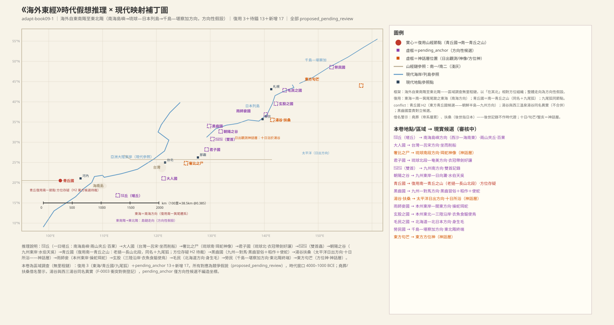
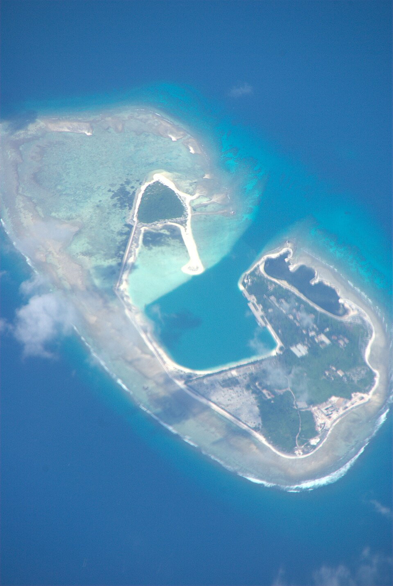
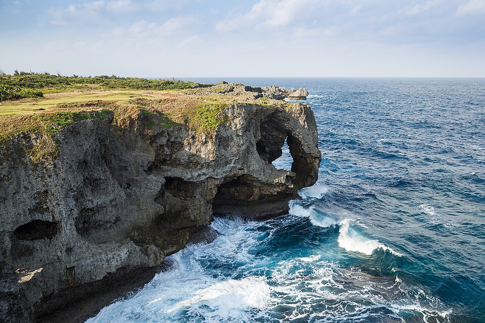
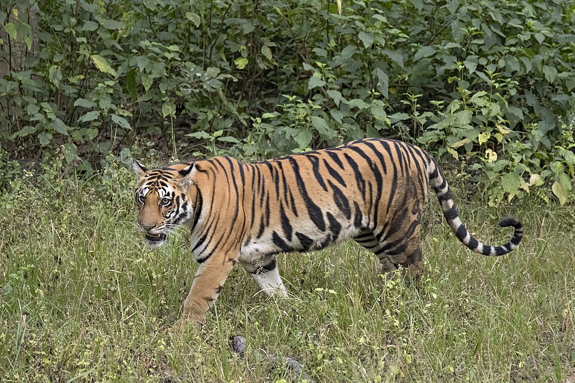
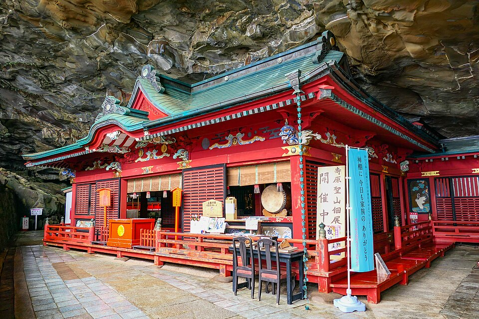
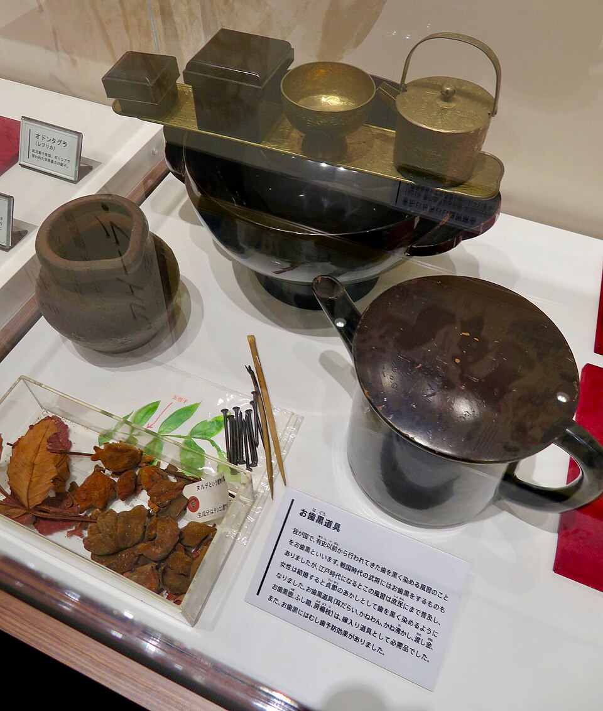
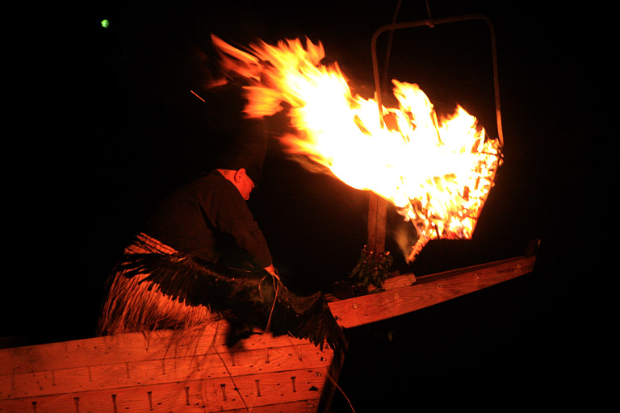
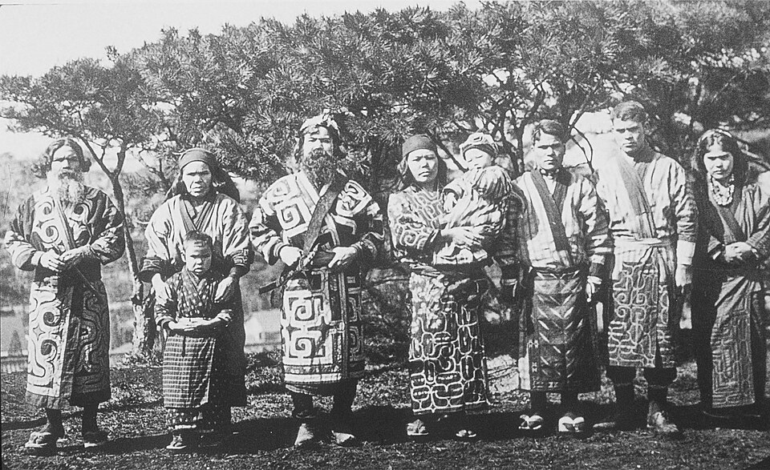

# 《海外東經》白話讀本（卷九）

## 本卷導覽

《海外東經》是「海外」四卷的最後一卷，寫的是中原人認知中「海外」東方區域的一串地名與族群，從東南角一路向北排到東北角。全卷不用里程數字，全靠「在其北」三個字一站接一站，共 16 條記錄加一條漢代校書題記。

我們對本卷的整體判斷是：**這是一條沿西太平洋島鏈由南向北的走廊**——從南海北部島嶼（西沙—海南以東方向）起步，經臺灣—呂宋、琉球諸島、九州、本州東岸、北海道，一直排到千島—堪察加方向收尾。鏈上各站的相對次序（由南向北）與島鏈的實際地理走向吻合得很好，這是本卷最強的一條整體證據；但每一站的具體對應都只是方向性猜測，沒有一處能釘死的硬定位。需要提醒：青丘國一站的方位與島鏈走向不合（詳見該條），是全卷最大的懸案；湯谷「十日」、豎亥步極、句芒等屬於神話內容，只作信仰與觀測史材料，不參與實地定位。另外，本書裏「湯谷」出現兩處、「東海」出現多處，都不算衝突——這類水名是通稱，各是各地同類水體的同名實例。

---

### 1. 全捲開場：海外東方，從東南角到東北角

> **【原文】**
> 海外自東南陬至東北陬者。

**白話翻譯**：海外的東方部分，從東南角說起，一直說到東北角。

**白話解讀**：這是全卷的總起，本身不含任何具體地名和里程，只負責劃定講述範圍——這種「自某陬至某陬」的框式和《海外南經》的「自西南陬至東南陬」正好在東南角銜接，說明四卷海外經是一套統一規劃的框架。我們判斷它覆蓋的是東海到西太平洋的島鏈地帶，南端接南海北緣，北端到千島—堪察加方向，但這個框架本身只是方向性假設，兩個「陬」的絕對位置無法鎖定。

---

### 2. 𨲠丘：百果叢生的大海島丘（本卷第一站）

> **【原文】**
> 𨲠丘，爰有遺玉、青馬、視肉、楊桃、甘柤。甘華，百果所生。在東海，兩山夾丘，上有樹木。一曰嗟丘，一曰百果所在，在堯葬東。

**白話翻譯**：𨲠丘——這裏有散落的玉料、青色的馬、視肉、楊桃、甘柤、甘華，是百果叢生的地方。它在東海之中，兩座山夾著中間的丘地，上面有樹木。一說叫嗟丘，一說是百果所在之地，在堯葬地以東。

**白話解讀**：這是本卷的第一站：一座海中的島丘。「視肉」——割了還能長回來的肉——是海外、大荒各卷反覆出現的神話風物，屬於傳說套路，不必找實物。「在東海」的東海，我們判斷和《南山經》箕尾之山「其尾踆于東海」說的是同一片水，即南海方向（箕尾之山我們定在長山山脈北中段東麓的入海處——乂安—河靜海岸，長山餘脈貼海伸入南海之處）；這類海名在全書多處所指不同，各卷實例各自成立。「在堯葬東」是拿帝堯葬地當方位參照——帝堯故事屬於後世帝王傳說，只能當路標用，不能當年代證據（借名警示）。綜合看，這座「百果」島丘指向南海北部島嶼方向（西沙—海南以東一帶），是方向性猜測。青馬怎麼進入島嶼環境、楊桃一作楊柳哪個對，都還沒有答案。

**配圖**

（圖：Wikimedia Commons）

---

### 3. 大人國：坐著削船的高個子

> **【原文】**
> 大人國在其北，為人大，坐而削船。一曰在镸𨲠丘北。

**白話翻譯**：大人國在𨲠丘以北，那裏的人個子高大，坐著削木頭造船。

**白話解讀**：「大人」到底是真實的體質記錄還是部族稱號，我們不知道；但「坐而削船」是實打實的海洋生活方式記錄——會造船、靠船吃飯的島嶼族群。按島鏈向北推的方向，我們把它指向臺灣—呂宋一帶（方向性猜測）。

**配圖**

（圖：Wikimedia Commons）

---

### 4. 奢比之尸：耳朵上掛青蛇的神像

> **【原文】**
> 奢比之尸在其北，獸身、人面、大耳，珥兩青蛇。一曰肝榆之尸，在大人北。

**白話翻譯**：奢比之尸在大人國以北，獸的身子、人的臉、大耳朵，兩隻耳朵上各掛一條青蛇。一說叫肝榆之尸。

**白話解讀**：這裏的「尸」不是屍體，而是祭祀時立的神像（尸祝）。「耳朵掛蛇」（珥蛇）是《山海經》里反覆出現的神像標配，本卷後面的雨師妾、西山經諸神都有同款，屬於信仰符號，不是寫實。《大荒東經》里也有一個「奢比尸」，應是同一神格的兩次記錄。方位上指向琉球南段方向（神話內容，方位還沒有定論）。

---

### 5. 君子國：佩劍講禮、老虎隨侍的人們

> **【原文】**
> 君子國在其北，衣冠帶劍，食獸，使二文虎在旁，其人好讓不爭。有薰華草，朝生夕死。一曰在肝榆之尸北。

**白話翻譯**：君子國在奢比之尸以北，那裏的人穿衣戴帽、腰佩長劍，吃肉，身邊使喚著兩隻帶斑紋的老虎；他們生性喜歡謙讓、不愛爭鬥。當地還有一種薰華草，早晨開花晚上就謝。

**白話解讀**：「好讓不爭」就是後世「君子國」傳說的源頭。「使二文虎」是真驯虎還是儀仗象徵，我們不下結論（老虎作為物種本身沒有問題，參見配圖）。薰華草「朝生夕死」是典型的「一日花」物候觀察。方位上指向琉球北段—奄美方向；後世文獻多把君子國放在東方（朝鮮—倭方向），那些記錄只能佐證方位感覺，不能當年代證據（方向性猜測）。

**配圖**

（圖：Wikimedia Commons）

（圖：Wikimedia Commons）

---

### 6. 𧈫𧈫：每個都長兩個頭的虫蛇

> **【原文】**
> 𧈫𧈫在其北，各有兩首。一曰在君子國北。

**白話翻譯**：𧈫𧈫在君子國以北——每個個體都長兩個頭。

**白話解讀**：字面看是一種虫或蛇，「各有兩首」。雙頭、雙首是《山海經》反覆出現的神異套路（本卷後面還有「一鳥兩頭」），屬於神異觀察記錄，不作生物對應。這一條用生物記錄來佔一個鏈位，說明這類按方位串連的書裏地標、族群、神異三類混編。方位約當九州以南方向（方向性猜測）。

---

### 7. 朝陽之谷與水伯天吳：迎著日出的谷地

> **【原文】**
> 朝陽之谷，神曰天吳，是為水伯。在𧈫𧈫北兩水間。其為獸也，八首人面，八足八尾，背青黃。

**白話翻譯**：朝陽之谷，谷里的神叫天吳，是「水伯」（一方水域的主宰）。位置在𧈫𧈫以北、兩條水道之間。他的形象是八顆人頭、八條腿、八條尾巴，背脊青黃相間。

**白話解讀**：「朝陽」顧名思義，是朝東迎著日出的谷地。《大荒東經》里的天吳是「虎身十尾」，形象不同但應是同一水神。這條最有價值的是地形描寫：「兩水間」的東向谷地，與九州東岸日向灘一帶迎日出、夾于河川之間的海岸地形相容，是本卷里少數有地形依據的定位（較有把握）；天吳本身屬神話。

**配圖**

（圖：Wikimedia Commons）

---

### 8. 青丘國：五穀絲帛與九尾狐（本卷最大懸案）

> **【原文】**
> 青丘國在其北，其人食五穀，衣絲帛。其狐四足九尾。一曰在朝陽北。

**白話翻譯**：青丘國在朝陽之谷以北，那裏的人種五穀、穿絲帛。那裏的狐狸四條腿、九條尾巴。一說在朝陽北。

**白話解讀**：這裏是成熟的農耕蠶桑社會，標誌物是九尾狐——全《山海經》九尾狐只在兩處出現：這裏和《南山經》的青丘之山。我們的主要讀法是把它對齊到《南山經》的青丘之山：同名「青丘」＋九尾狐這個全書獨有的標誌＋農耕蠶桑文化，三重對齊；青丘之山我們定在長山山脈北段東麓的近海帶（越南清化—乂安方向）。但必須坦白問題：本卷是從東南向東北排的島鏈，這一站卡在朝陽之谷（九州）以北、黑齒國以南，鏈位緯度與清化—乂安對不上；而且《逸周書》等後世文獻里的青丘多指東方。所以對立的第二種讀法是：這是另一個獨立的東方青丘國（朝鮮半島—九州方向，同名異地）。兩種讀法並存，不下定論。下一條豎亥「左手指青丘北」說明青丘在當時人心目中是個標誌性的遠方地名——這一點兩種讀法都支持。九尾狐是實物觀察（狐的變異）還是圖騰符號，也還不知道。

---

### 9. 豎亥步極：拿算籌丈量世界的測量員

> **【原文】**
> 帝命豎亥步，自東極至于西極，五億十選九千八百步。豎亥右手把筭，左手指青丘北。一曰禹令豎亥。一曰五億十萬九千八百步。

**白話翻譯**：帝（一說大禹）命令豎亥用腳步丈量大地，從東極走到西極，得數是「五億十選九千八百步」（另一版本作「五億十萬九千八百步」）。豎亥右手拿著算籌，左手指向青丘以北。

**白話解讀**：這是一則測量神話：「右手把筭」活畫出上古測量員邊走邊算的形象，而那個天文數字般的步數是一層層疊加出來的，不能當真實里程用。「東極／西極」也只是概念上的世界盡頭，不落地、不上圖。此條真正的價值在於「左手指青丘北」——給上一條青丘的地標性提供了第二個文本支點。

---

### 10. 黑齒國：染黑牙齒、吃稻弄蛇的人們

> **【原文】**
> 黑齒國在其北，為人黑，食稻啖蛇，一赤一青，在其旁。一曰：在豎亥北，為人黑首，食稻使蛇，其一蛇赤。

**白話翻譯**：黑齒國在其北，那裏的人是「黑」的，吃稻米、吃蛇，一紅一青兩條蛇在身邊。一說在豎亥以北，那裏人黑頭，吃稻米、使喚蛇，其中一條蛇是紅色的。

**白話解讀**：三件事互相印證：一是「為人黑」（另一版本作「黑首」），即染黑牙齒的習俗；二是吃稻米，屬東亞—東南亞稻作帶；三是與蛇打交道。三項合起來是一個習俗鮮明的沿海族群畫像，我們按鏈位指向九州—對馬方向（方向性猜測）。要補充說明：《華陽國志》等後世文獻記雲貴—中南半島也有黑齒、漆齒部族——後世記錄不能反推本書成書年代的狀況，只作另一種可能存檔。染齒習俗本身在東亞—東南亞廣泛留存到近代（日本的「お歯黒」即其一，見配圖），但後世民俗只說明習俗的流變，不作定位證據。

**配圖**

（圖：Wikimedia Commons）

---

### 11. 湯谷、扶桑與十日：太陽洗澡的地方

> **【原文】**
> 下有湯谷。湯谷上有扶桑，十日所浴，在黑齒北。居水中，有大木，九日居下枝，一日居上枝。

**白話翻譯**：黑齒國以北，下方有個湯谷——「湯」就是熱水——谷泡在水裏（海際），谷上長著一棵大神木「扶桑」，是十個太陽洗澡棲息的地方：九個太陽待在低枝，一個待在高枝。

**白話解讀**：這是古人觀測海上日出的神話化記錄：太陽從海面升起的過程，被想像成十個太陽輪流爬上大樹，「一上九下」就是日出過程的樹枝投影。方位取日本列島以東的太平洋日出方向（神話方位，還沒有定論）。三點提醒：其一，後世拿「扶桑」指日本，那是借名，不能反過來證明本文含義；其二，《西山經》天山下也有一個「湯谷」（利比亞錫爾特南緣溫泉谷方向），與本條同名異地——「熱水之谷」東西各有一處完全正常，不算衝突；其三，「十日」與天干紀日有沒有關係，我們不清楚，不編造傳播鏈。

---

### 12. 雨師妾國：雙手操蛇、雙耳掛蛇的巫者

> **【原文】**
> 雨師妾國在其北，其為人黑，兩手各操一蛇，左耳有青蛇，右耳有赤蛇。一曰在十日北，為人黑身人面，各操一龜。

**白話翻譯**：雨師妾國在其北（一說在十日所居之北），那裏的人膚色黑，兩隻手各握一條蛇，左耳掛青蛇、右耳掛赤蛇。一說手裏各握一隻龜。

**白話解讀**：「操蛇＋珥蛇」雙件套與前面的奢比之尸同出一系，是島鏈巫俗的集中記錄；「雨師妾」的字面意思是「雨師的從屬」，可能指依附於雨師、專司求雨儀式的巫者集團。方位指向本州東岸—關東方向（方向性猜測）。「操蛇」還是「操龜」，兩個版本並存。

---

### 13. 玄股之國：穿魚皮、吃牡蛎、使喚漁鳥的沿海人

> **【原文】**
> 玄股之國在其北，其為人股黑，衣魚食䳼，使兩鳥夾之。一曰在雨師妾國北。

**白話翻譯**：玄股之國在雨師妾國以北，那裏的人兩腿墨黑，穿魚皮、吃牡蛎貝類，左右各使喚一隻鳥。

**白話解讀**：四條風俗拼出一幅完整的寒地海洋漁撈圖景：「股黑」——兩條腿墨黑，是染體或紋身；「衣魚」——拿魚皮做衣服；「食䳼」——吃牡蛎貝類；「使兩鳥夾之」——很可能是鸬鹚捕魚。魚皮衣＋貝類食俗＋漁鳥三項，與本州東北—三陸沿岸的寒流漁場環境高度相容，是本卷里風俗證據鏈最完整的一條（較有把握）。另一個版本沒有「股黑」二字，兩讀並存。

**配圖**

（圖：Wikimedia Commons）

---

### 14. 毛民之國：渾身長毛的人們

> **【原文】**
> 毛民之國在其北，為人身生毛。一曰在玄股北。

**白話翻譯**：毛民之國在玄股國以北，那裏的人身上生滿毛髮。

**白話解讀**：這是體質觀察記錄；「毛」是真多毛體質還是毛皮穿戴的觀感，我們保持未知。方位上指向北海道—北日本方向，是後世「毛人／蝦夷」記錄的源頭候選——阿伊努人的多毛體徵正是這個方向（較有把握）；那個年代該地屬繩文文化圈，文化上的聯繫已不可考，不編傳播鏈。

**配圖**

（圖：Wikimedia Commons）

---

### 15. 勞民國：島鏈盡頭、面目盡黑的採集者

> **【原文】**
> 勞民國在其北，其為人黑，食果草實。有一鳥兩頭。或曰教民。一曰在毛民北，為人面目手足盡黑。

**白話翻譯**：勞民國在毛民國以北，那裏的人膚色黑（一說「面目手足盡黑」），靠吃野果草籽過活。當地還有一種長兩個頭的鳥。一說叫教民。

**白話解讀**：這是本卷的最後一站。靠野果草籽過活是採集生計；「一鳥兩頭」與前面𧈫𧈫的「各有兩首」同屬雙首神異套路。鏈位最北，正好給「東北陬」收尾——方位指向千島—堪察加方向的高緯度地帶，與採集生計的生態位相容（方向性猜測）。勞民、教民兩個名字的關係未定。

**配圖**

（圖：Wikimedia Commons）

---

### 16. 東方句芒：本卷的收尾方位神

> **【原文】**
> 東方句芒，鳥身人面，乘兩龍。

**白話翻譯**：東方之神句芒，鳥的身子、人的臉，駕著兩條龍。

**白話解讀**：全卷以東方之神句芒收尾。這是神話層的方位神記錄——海外四卷每卷卷尾各立一位方位神（南方祝融、西方蓐收、北方禺強、東方句芒），構成整齊的四方位神體系，這種結構本身就是這幾卷經過系統編纂的證據。後世句芒變成木神、春神，那是後來的神格演化，不能反推本文。

---

### 17. 卷末校勘題記：公元前 6 年的官方校書記錄

> **【原文】**
> 建平元年四月丙戌，待詔太常屬臣望校治，侍中光祿勳臣龔、侍中奉車都尉光祿大夫臣秀領主省。

**白話翻譯**：建平元年四月丙戌日，由待詔太常屬臣劉望校勘整理，侍中光祿勳臣劉龔、侍中奉車都尉光祿大夫臣劉秀主持審定。

**白話解讀**：這不是地理內容，而是文本的「出生證明」：漢哀帝建平元年（公元前 6 年），由劉望校勘、劉龔與劉秀（即劉歆）主持審定的校書題記。它直接證明本卷經歷過西漢末年的官方校訂，是文本流傳史的硬證據；與正文地理內容的年代（大約三四千年前到兩千多年前）分屬兩層，不混入地理判斷。

## 卷末小結

《海外東經》是一條沿西太平洋島鏈由南向北的走廊：各站次序與島鏈走向吻合是最強的整體證據，但沒有一處能釘死；卷末的校書題記（公元前 6 年）則是文本年代的硬錨。
