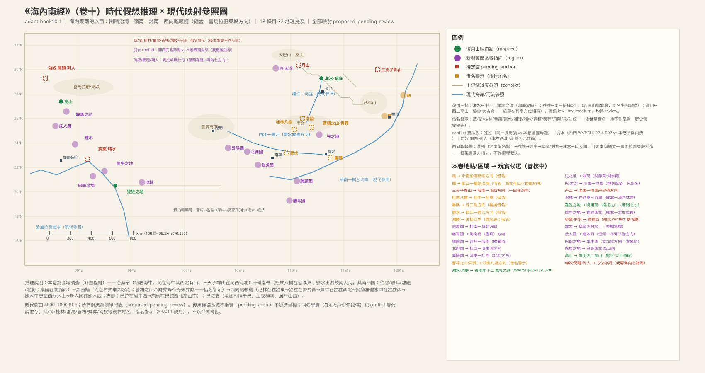
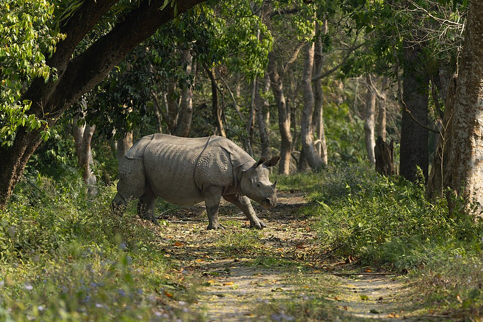
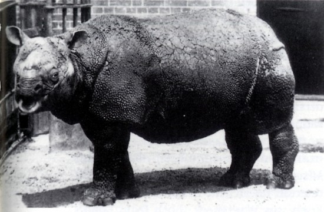
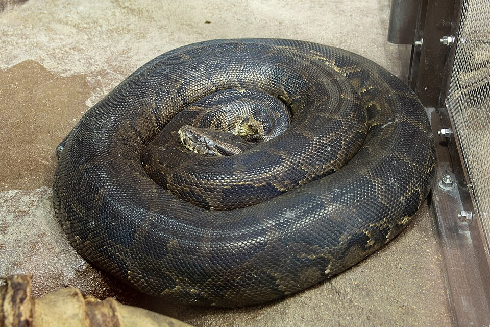

# 《海內南經》白話讀本（卷十）

## 本卷導覽

《海內南經》是一卷「區域調查」式的書，不排里程、不數山頭，只用「某某在某某之東／之西」把一大片地方串起來。它的覆蓋範圍是「海內」的東南角以西——從今天的浙閩沿海出發，經嶺南（广西、珠三角）、湘南（湖南南部），再沿著一條向西的鏈條一直推到緬甸、孟加拉，最後收在喜馬拉雅東段南麓。

本卷的定位方式不是里程，而是「掛回舊書」：三個關鍵地名接回《五藏山經》已經定過位的地點——狌狌接《南山經》首卷的招搖之山（緬印邊境若開山脈北段）、湘水接《中山經》的瀟湘之淵（洞庭—湘水體系）、高山接《西山經》的高山（喜馬拉雅錫金段，大吉嶺—干城章嘉一帶）。這條西向鏈上，狌狌、犀牛、窫窳、建木、氐人五環環環相扣，全部落在緬北—孟加拉—恒河下游這一條帶上，內部沒有互相打架。

兩條重要提醒：其一，卷中「甌、閩、桂林、番禺、郁水、蒼梧、舜葬、匈奴」這些名字都是後世坐實的大名，我們一律作「借名警示」——只取它指的方向，絕不拿後來的郡縣位置反推原文；其二，「弱水」是通稱（凡是弱得載不動船的水都可叫弱水），本卷的弱水與《西山經》的弱水各自成立，不算同名衝突。主要還沒解決的是：狌狌到底是長臂猿還是猩猩套路（兩種說法並存）、卷末「匈奴、開題、列人並在西北」一句是不是錯簡（竹簡編次錯亂）、「桂林八樹在番隅東」與後世方位相悖的方向矛盾。

---

### 1. 開場白：這一卷管「海內東南角以西」

> **【原文】**
> 海內東南陬以西者。

**白話翻譯**：本卷記錄海內東南角以西的見聞。

**白話解讀**：這是體例性的卷首句，沒有具體地名，只是給整卷定調：後面十八條從閩浙沿海一路寫到嶺南、湘南，再拐向西南，方向上和這句話完全對得上。

---

### 2. 甌和閩：住在「海中」的東南沿海族群

> **【原文】**
> 甌居海中。閩在海中，其西北有山。一曰閩中山在海中。

**白話翻譯**：甌人住在海中。閩人也在海中，閩地西北有山。一說閩中有一座山立在海裏。

**白話解讀**：這條說東南沿海有兩群濱海而居的人。「在海中」是古人對沿海島嶼、半島棲居環境的樸素說法。我們的讀法：甌大致對應浙南—閩北沿海島嶼方向，閩大致對應閩江—福建沿海方向；閩西北那座無名山，方向和武夷山脈相容，和《南山經》第二鏈的武夷山地是同一片，但原文沒給山名，我們不硬指。要特別小心：「甌」「閩」都是後來漢代東甌國、閩越國坐實的名字，屬借名警示——我們只取「海中族群＋西北有山」這個結構，不用後世位置反推。另一個版本說「閩中山在海中」（山變成了島），兩種讀法並存，不下結論。方向性猜測。

---

### 3. 三天子鄣山：閩地西邊、海北邊的一座山

> **【原文】**
> 三天子鄣山在閩西海北。一曰在海中。

**白話翻譯**：三天子鄣山在閩地以西、海的北邊。一說在海中。

**白話解讀**：這座山用「閩之西、海之北」兩個參照定位——從福建沿海往西北內陸走，落在贛東北—皖南—浙西這一帶的方向上，黃山—天目山方向是候選。晉代郭璞說「在新安歙縣東」，那是後世的詮釋，只作方向參考不作證據。另一個版本說山「在海中」，就成了舟山一類的近海島嶼；兩種讀法緯度相近（約北緯二十九到三十一度）、經度分歧，並存不下結論。「三天子」這名字帶祭祀色彩，可能是後來加上去的，名義還沒有定論。方向性猜測。

---

### 4. 桂林八樹和番隅：嶺南的一對地標

> **【原文】**
> 桂林八樹在番隅東。

**白話翻譯**：桂林八樹在番隅的東邊。

**白話解讀**：「桂林八樹」——一片桂樹林，或者八株特別醒目的大樹，是個地標；「番隅」就是番禺。方向上，桂中—桂東的桂樹林帶和珠三角河口都說得通。但這裏有一處明顯的矛盾：原文說桂林八樹在番隅**東**邊，而今天的桂林在广州**西北**邊——我們以原文方位為準記錄方向，矛盾如實保留，絕不用後世位置改經文。「桂林」「番禺」都是秦漢郡縣坐實的大名，雙重借名警示；相比之下「八樹」這種巨木地標是實地見聞的寫法，可信度比專名高。「八樹」是幾棵巨木還是一片林帶，番隅是聚落還是地區名，都還沒有定論。

---

### 5. 郁水南岸的四個國：伯慮、離耳、雕題、北朐

> **【原文】**
> 伯慮國、離耳國、雕題國、北朐國皆在鬱水南。鬱水出湘陵南海。一曰相慮。

**白話翻譯**：伯慮國（一說相慮）、離耳國、雕題國、北朐國，都在郁水以南。郁水發源於湘陵，向南流入南海。

**白話解讀**：四個族群共享同一條水系參照。郁水是一條「出湘陵、南流入南海」的大河，和西江—鬱江—珠江水系的格局、流向都對得上，方向對齊較有把握；源頭「湘陵」指湘桂交界一帶的山陵，越城嶺—海洋山方向。四國里最有味道的是兩條風俗記錄：離耳國的人耳垂戴著長飾——往海南島方向看，漢代那裏真設過「儋耳郡」，但這是借名警示，反過來不作證據，只是習俗加方位自相容；雕題國的人額頭臉面有紋飾，即紋面之俗，《禮記·王制》說南方「雕題交趾」，黎族紋面、南島民族紋身都是同一風俗帶。伯慮在桂南—越北方向，北朐在桂西—滇東南方向（由下一條「枭陽在北朐之西」反推）。整體：水系對齊較有把握，四國落點是方向性猜測。四國的具體族屬，都還不能確定。

---

### 6. 枭陽國：人面長脣、腳跟朝後的遠方族群

> **【原文】**
> 梟陽國在北朐之西，其為人人面長脣，黑身有毛，反踵，見人笑亦笑；左手操管。

**白話翻譯**：枭陽國在北朐（桂西—滇東南方向）的西邊。那裏的人：人臉、長嘴脣、黑身多毛、腳跟反著長，看見人笑他也跟著笑，左手拿著一根管子。

**白話解讀**：這是把猩猩—狒狒一類的靈長形象疊加到遠方族群身上的混合記錄——「反踵」「見人笑亦笑」都是後世「野人」傳說里反覆出現的套路，我們記為傳說套路，族屬不下結論；「左手操管」倒是個實在的人文細節（管狀器物？樂器？），保持未知。方向性猜測。

---

### 7. 兕：舜葬地以東、湘水以南的獨角巨獸

> **【原文】**
> 兕在舜葬東，湘水南，其狀如牛，蒼黑，一角。

**白話翻譯**：兕在帝舜葬地的東邊、湘水的南邊，樣子像牛，蒼黑色，只長一隻角。

**白話解讀**：這條用雙參照定位——帝舜葬地的東邊、湘水的南邊，夾出湘南一條狹帶。湘水接《中山經》洞庭之山條的「瀟湘之淵」：同名「湘」、同屬洞庭—湘水體系（後世「湘江」專名化是借名警示）。「舜葬」由下條坐實為蒼梧之山，後世九嶷山舜陵同屬借名警示，這裏只取湘南方向。重頭戲是「兕」本身：樣子像牛、蒼黑色、一隻角——這就是印度犀的寫生。華南在幾千年前本來就有犀牛分佈，古生物上完全成立。犀牛記錄的出現，支持這一帶是實地調查記錄而不是純神話。物種較有把握，地點是方向性的。兕具體是印度犀還是蘇門犀，還不能確定。

**配圖**

（圖：Wikimedia Commons）

---

### 8. 蒼梧之山：舜葬山南、丹朱葬山北

> **【原文】**
> 蒼梧之山，帝舜葬于陽，帝丹朱葬于陰。

**白話翻譯**：蒼梧之山，帝舜葬在山的陽面，帝丹朱葬在山的陰面。

**白話解讀**：蒼梧之山就是上條「舜葬」的落點——湘南的一座大山，後世坐實為九嶷山（借名警示，我們只取湘南山嶽這個區域）。舜葬山南、堯的兒子丹朱葬山北，是「山陽／山陰雙葬」的格式。我們的規矩是：堯舜禹這類帝王葬地一律不作因果證據，只留下「依山的南坡北坡分葬」這個先秦葬制的風俗結構本身。《大荒南經》還有「蒼梧之野，舜與叔均葬」，跨卷同名，待將來交叉覈對。方向性猜測。

---

### 9. 氾林：方圓三百里的大森林

> **【原文】**
> 氾林方三百里，在狌狌東。

**白話翻譯**：一片方圓三百里的大森林，在狌狌棲地的東邊。

**白話解讀**：「方三百里」是這類書裏極少見的面積表述，說明記錄者見到的是真正連片的大尺度森林。如果狌狌之地接《南山經》招搖之山（若開山脈北段）成立，那它東面三百里級的森林正好落在緬北—滇西的野人山—高黎貢原始林帶——這條林帶到近代都還是密林，屬性完全相容。方向性猜測（依賴狌狌的定位成立）。「方三百里」是實測還是誇飾，還沒有定論。

---

### 10. 狌狌：通人性的「人面豕身」之獸

> **【原文】**
> 狌狌知人名，其為獸如豕而人面，在舜葬西。

**白話翻譯**：狌狌能叫出人的名字，這種獸像豬卻長著人臉，在舜葬地以西。

**白話解讀**：這是本卷西向鏈條的第一環。它接《南山經》首卷招搖之山的狌狌——理由有三：同名（招搖之山「有獸焉……其名曰狌狌」）；方位相容（湘南之西指向緬印邊境若開山脈方向，這種方位名單隻做遠方指向、不談里程）；屬性部分相容（都是大型靈長的擬人化記錄）。但形態有出入：《南山經》說它「像猿猴、白耳朵、能伏地爬也能直立走」，本卷說它「像豬、人面、叫得出人的名字」。於是兩種假說並存：一說同名同實，都是長臂猿一類；二說同名異實，本卷這個是猩猩／野人套路（《海內經》有「青獸人面名曰猩猩」的同類記錄，《禮記》也有「猩猩能言不離禽獸」）。不下結論。

**配圖**

（圖：Wikimedia Commons）

---

### 11. 犀牛：狌狌西北的黑色巨獸

> **【原文】**
> 狌狌西北有犀牛，其狀如牛而黑。

**白話翻譯**：狌狌（若開山脈北段方向）的西北有犀牛，像牛、黑色。

**白話解讀**：寫實描述。落點在緬北—孟加拉東—阿薩姆一帶，那正是印度犀、爪哇犀的歷史分佈區，古生物上完全成立。它和第 7 條的「兕」構成一東一西雙犀記錄：兕在湘南、犀牛在緬孟，合起來正好覆蓋華南—南亞連成一線的犀牛歷史分佈帶。至於為什麼一個叫「兕」一個叫「犀牛」，可能是不同種、也可能只是不同地域的叫法，保持未知。較有把握。

**配圖**

（圖：Wikimedia Commons）

---

### 12. 巴地與孟涂：血衣神判的古老風俗

> **【原文】**
> 夏后啟之臣曰孟涂，是司神于巴，人請訟于孟涂之所，其衣有血者乃執之，是請生。居山上，在丹山西。

**白話翻譯**：夏后啓有個臣子叫孟涂，在巴地主管神判：打官司的人到他的處所請神裁決，衣服上有血跡的就被抓起來——「是請生」，求的是一條生路。他住在山上，在丹山以西。

**白話解讀**：這是本卷人文價值最高的一條，是神明裁判（血衣神判）的早期實錄，司法—宗教合一的風俗。巴地在川東—鄂西、三峽—大巴山方向（後世巴國巴郡是借名警示）。孟涂「居山上，在丹山西」：丹山是巴域內的參照山，渝東—鄂西一帶正好是丹砂（辰砂）產帶，山名與礦帶的關聯只是一種推測；山經里同帶「丹」字的丹熏之山、丹穴之山方位都對不上，不接。另一個版本多了一句「丹山在丹陽南，丹陽居屬也」——丹陽後世多地坐實，借名警示。「夏后啓」的世系屬後世家譜層，同樣借名警示。巴域方向較有把握，丹砂關聯是方向性猜測。孟涂其人是否實有，還沒有定論。

---

### 13. 窫窳與弱水：龍首食人的水中猛獸

> **【原文】**
> 窫窳龍首，居弱水中，在狌狌之西，其狀如貙，龍首，食人。

**白話翻譯**：窫窳長著龍的頭，住在弱水之中，在狌狌以西；它樣子像貙（虎屬猛獸），龍首，吃人。

**白話解讀**：這是水域猛獸的神話化寫法，鳄魚或大型猛獸是候選讀法；《海內西經》另有一個「蛇身人面」的窫窳，同名不同形，兩處的關係還沒有定論。關於「弱水」要多說一句：弱水是通稱——凡是「弱得載不動船」的內流水、沼澤水都可以叫弱水，所以《西山經》的弱水（撒哈拉體系的內流河）和本卷的弱水各自成立，不算同名衝突。本卷這條弱水落在緬西—孟加拉方向的內流／沼澤型水域，規模可觀——它同時是窫窳的棲境和下一條建木的定位參照。方向性猜測。

---

### 14. 建木：弱水之濱的通天神樹

> **【原文】**
> 有木，其狀如牛，引之有皮，若纓、黃蛇。其葉如羅，其實如欒，其木如蓲，其名曰建木。在窫窳西弱水上。

**白話翻譯**：有一棵樹，樣子像牛，剝扯它能扯出皮條，像帽纓、像黃蛇；葉子像羅，果實像欒樹的果，木質像蓲。它叫建木，在窫窳以西的弱水之濱。

**白話解讀**：原文用了一連串類比：樹皮纖維或藤蔓狀特徵（「引之有皮，若纓、黃蛇」，具體讀法還沒有定論）；葉子、果實、木質三重植物類比是實地觀察的寫法，建木背後可能真有一棵熱帶巨樹原型（榕屬巨木？保持未知）。建木是著名的「天梯」套路神樹，《海內經》說它「在都广之野」、太皞曾從它上下——本卷自帶的位置關係（窫窳西、弱水上，落孟加拉東方向）優先；「都广之野」本身有成都平原和兩河—埃及法雍兩種讀法，地域差異待《海內經》一卷交叉，這裏不下結論。方向性猜測。

---

### 15. 氐人國：人面魚身的水域族群

> **【原文】**
> 氐人國在建木西，其為人人面而魚身，無足。

**白話翻譯**：氐人國在建木以西，那裏的人人面魚身，沒有腳。

**白話解讀**：建木（孟加拉東方向）再往西，是氐人國——西向鏈條的終端，落在恒河—布拉馬普特拉河下遊方向。「人面魚身、沒有腳」是典型的人魚套路：對大河口水域漁獵族群的誇飾記錄——終點落在恒河三角洲一帶，和「魚身」的水域意象恰好自洽。整條鏈從蒼梧（湘南）出發，經狌狌、窫窳、建木到氐人，向西南—西推進約兩千五百公里。提醒一點：後世的「氐族」在西北隴蜀一帶，和本卷方位相反，是同名異地的風險，不以今果為因。方向性猜測（依賴上游各環成立）。

---

### 16. 巴蛇：吞象三年才吐骨頭的巨蟒

> **【原文】**
> 巴蛇食象，三歲而出其骨，君子服之，無心腹之疾。其為蛇青黃赤黑。一曰黑蛇青首，在犀牛西。

**白話翻譯**：巴蛇能吞象，三年才把骨頭排出來；君子喫了它，不生心腹之病。這種蛇青黃赤黑四色。一說黑蛇青頭，在犀牛以西。

**白話解讀**：「吞象」是誇飾的頂點，但底子是真的——緬甸蟒、網紋蟒吞食大型獵物是實地觀察的基础，南亞—東南亞分佈也對；「三歲出骨」是把蟒蛇漫長的消化週期誇成了年份。「君子服之，無心腹之疾」是藥用記錄。體色一說青黃赤黑四色，一說黑蛇青頭，兩讀並存。象的出場也側面印證這裏是南亞—東南亞的象分佈帶。物種方向較有把握。巴蛇是哪種蟒、它和「巴」地有沒有命名關係，還沒有定論。

**配圖**

（圖：Wikimedia Commons）

---

### 17. 旄馬與高山：喜馬拉雅東段南麓的高原馬

> **【原文】**
> 旄馬，其狀如馬，四節有毛。在巴蛇西北，高山南。

**白話翻譯**：旄馬，樣子像馬，四肢關節長著毛。在巴蛇西北、高山以南。

**白話解讀**：「四節有毛」——馬匹四肢關節長毛是高原適應的寫實細節，高原馬或野驢一類是候選，這也反過來支持記錄出自高海拔地帶。這裏的「高山」接《西山經》第二鏈的高山＝喜馬拉雅錫金段、大吉嶺—干城章嘉山麓：一來「高山」是通用語義、沒有專名修飾；二來孟加拉西北正對喜馬拉雅東段，方位嚴絲合縫；三來《西山經》高山「多銀、雄黃」的礦帶記錄和喜馬拉雅東段礦化帶相容。這一接回讓西向鏈的北端收束在喜馬拉雅東段，和《西山經》形成跨卷接點。旄馬具體是哪種馬科動物是方向性猜測；高山這處接回把握不大，留待複覈。

**配圖**

（圖：Wikimedia Commons）

---

### 18. 匈奴、開題、列人：卷末的存疑句

> **【原文】**
> 匈奴、開題之國、列人之國並在西北。

**白話翻譯**：匈奴、開題之國、列人之國，都在西北。

**白話解讀**：卷末這句本身就站不穩——古本異文「或無此句」（有的本子沒有這句），清代吳承志更直接說它應該挪到《海內北經》去。「匈奴」是戰國秦漢才坐實的名字，出現在本卷屬於異常，借名警示；開題、列人則完全無考。於是兩種假說並存：一說留在本卷原位，接著旄馬、高山再往西北，落青藏高原東緣—喜馬拉雅方向；二說是錯簡（竹簡編次錯亂），本屬海內北，指蒙古高原—草原方向。兩種讀法都有文本依據，不下結論；地圖上只標方向性邊緣點，不給內陸座標。整條存疑。

## 卷末小結

《海內南經》靠「掛回舊書」定位：狌狌、犀牛、窫窳、建木、氐人五環落在緬北—恆河下游一條帶上，內部不打架；卷末匈奴一句自帶異文，兩種讀法並存。
