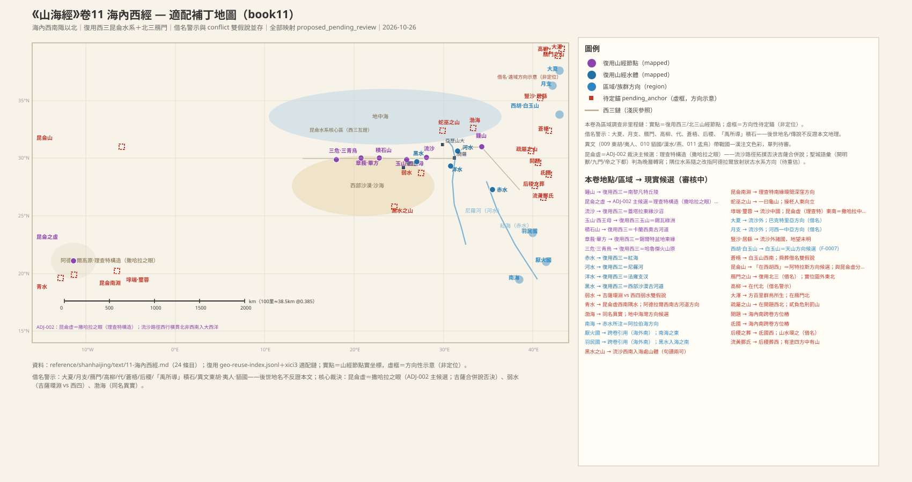
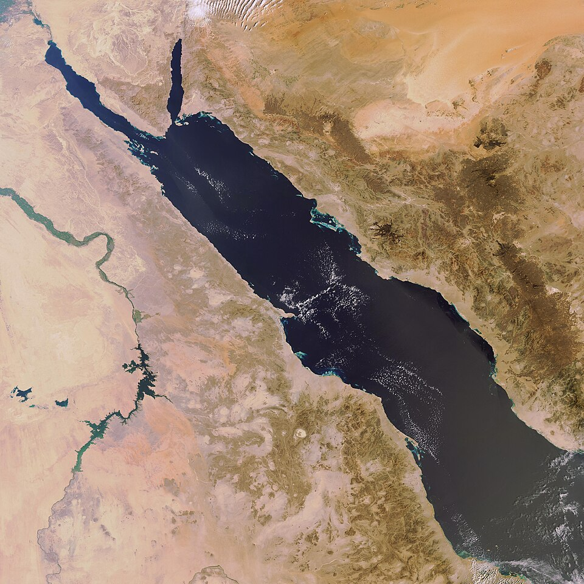
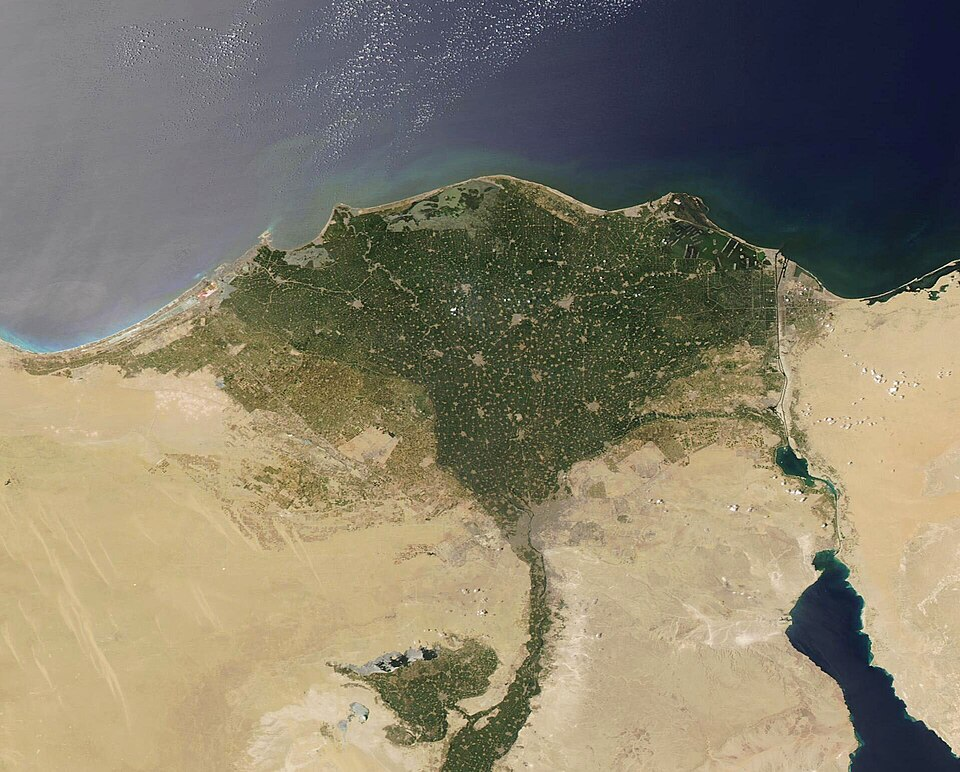
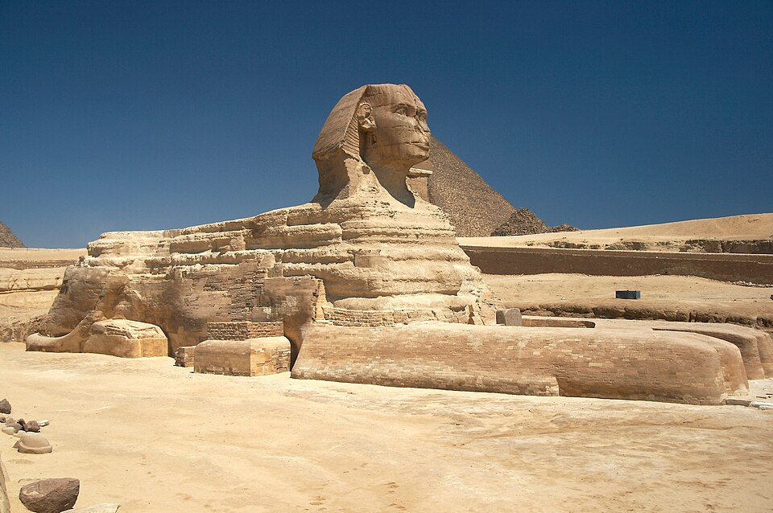
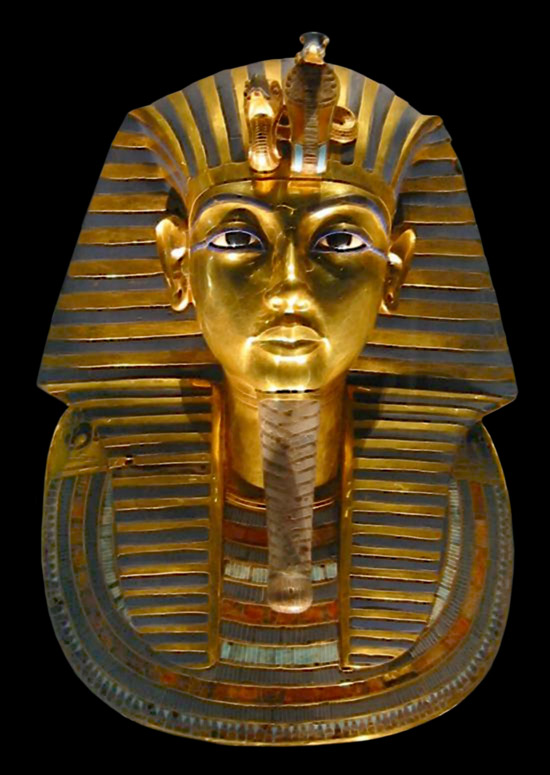
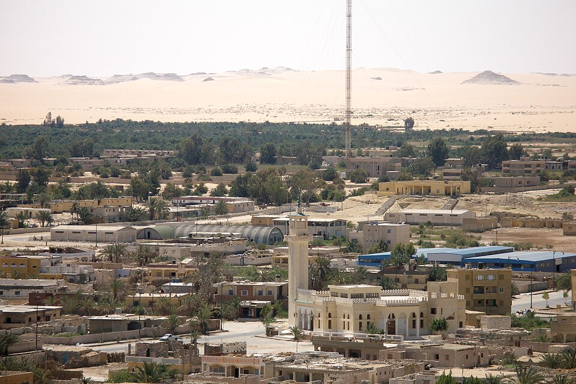

# 《海內西經》白话通顺版（卷十一 · draft-v2）

## 本卷导览

《海內西經》是「海內」四经的第一卷，名义上从「海内西南角以北」展开，实际内容分成三大块：

- **北方定位簇（003–005）**：大泽、雁门山、高柳、代——一条自北向南的方位链，全部地名都是战国—汉代的郡县名（雁门郡、高柳县、代地），我们判断这一簇层位最晚，很可能是后世编者插入的北方定位注，可信度低，仅作存录。
- **西部昆仑核心簇（008、012–024）**：本卷的重心。核心地标是「海内昆仑之虚」，按 ADJ-002 裁决（2026-10-26），主候选定为**撒哈拉之眼（理查特构造，毛里塔尼亚阿德拉尔高原，约 21.1°N, 11.4°W）**，原「昆仑虚＝吉萨金字塔群」的合并说已被否决——决定性证据是 008 条流沙路径「西行又南行昆仑之虚，西南入海」对吉萨在几何上不成立、对西撒哈拉完全成立。环绕昆仑虚的四隅水系（赤水、河水、洋水黑水、弱水青水）仍沿用西次三经的旧锚（红海、尼罗河、法雍支汊、西部沙漠古河道），但裁决之后这些「隅位」读法都需要在阿德拉尔新框架下重估，各条均已标注。开明兽（狮身人面像）、凤皇鸾鸟戴蛇（埃及王权蛇标）、六巫操不死之药（木乃伊防腐）等具体造像/仪式读法，按裁决口径改判为**晚层转写**——即后世作者把吉萨昆仑之丘的圣城语汇套写到了西方同名圣域上。
- **流沙诸国簇（009–011）**：流沙中二国（埻端、璽㬇）、流沙外四国（大夏、竖沙、居繇、月支）、白玉山、苍梧、昆仑山。按 ADJ-004 裁决，两河流域在山经中的空档是体例性缺席（平原无山链可记）；但其「框架书承担两河—中亚」说已于 2026-10-27 降为假说——本簇的方位依据「昆侖虛東南／皆在西北」在两种昆仑假说下皆不成立（理查特→巴克特里亚为东北偏东约 8,000 km 非东南），判为**晚层编纂方位（战国—汉层按当时已知世界重排），不作定位**；逐国地望全部待考。

**里程吻合度**：本卷是区域调查体（「海內西南陬以北者」），不含里程链，不做里程算术；定位全靠复用锚点与相对方位。

**主要未决**：开题、氐国两个跨卷方位桩自身待锚（依赖卷十裁决）；弱水近指/远指双假说；苍梧借名/同名异实双假说；「昆仑山在西胡西」与昆仑虚的合并/竞争问题；北方借名簇整簇的层位判定。全卷未决项 128 条照录于各条目末。

---

### 1. 开篇框架句：从海内西南角往北数

> **【經文原文】**
> 海內西南陬以北者。

**白话解读**：这是一句体例宣告，不是地理记录。「海内」是「四海之内」的框架词，与「海外」对举，不是具体地名；「陬」是角落。整句意思是：本卷记述海内从西南角开始往北的这一片。它和海外四经「自某陬至某陬」的开篇格式完全同构，本身没有可定位的实体。（节点：`REG:SHJ-11-1-001#1`、`REG:SHJ-11-1-001#2`；框架句，不涉及置信度）

#### 未决项
（本条 v1 无未决项）

### 2. 贰负之臣危杀窫窳：一场弑神与刑罚的神话

> **【經文原文】**
> 貳負之臣曰危，危與貳負殺窫窳。帝乃梏之疏屬之山，桎其右足，反縛兩手與髮，繫之山上木。在開題西北。

**白话解读**：这条讲的是一则完整的惩罚型神话：天神贰负和他的臣子「危」合谋杀了神兽窫窳，「帝」（至高神的泛称，不指某位真实帝王）于是把危押到疏属之山行刑——颈上带梏、右脚上镣、双手反绑连同头发一起拴在山上的树上。刑罚细节（梏、桎、反缚、系木）非常具体，说明记录者熟悉束缚刑的实际仪节，属于民俗层的真实素材。地理上唯一的抓手是「在开题西北」——开题是海內南經（卷十）里与匈奴、列人并列的西北国名，但匈奴是战国汉代才出现的族群名，整组方位桩带后期色彩，而开题本身还没定位，所以疏属之山只能待锚。「疏属」是什么意思也不知道。窫窳「蛇身人面」的形象见第 20 条，那里六巫夹着它的尸体施救，与本条构成「被杀→受尸→施救」的完整事件链。（节点：貳負/危/帝/窫窳/疏屬之山/開題均为 `PER|CRE|MTN|POL:NEW`；地望待考，神话层记录）

#### 未决项
- 未知：疏屬之山——開題地望（海內南經）
- 未知：疏屬之山——「疏屬」語義
- 衝突：開題——海內南經開題與匈奴、列人並列西北——匈奴為戰國漢代族群名，整組方位樁帶後期層位色彩，待 book10 裁決
- 未知：開題——開題地望
- 未知：貳負——貳負神格源流
- 未知：危——受刑場景的民俗來源
- 未知：窫窳——窫窳形象的動物基底（蛇身人面＝？）

### 3. 大泽方百里：雁门以北的候鸟繁殖换羽地

> **【經文原文】**
> 大澤方百里，群鳥所生及所解。在鴈門北。

**白话解读**：这条记了一片方圆百里的大湖沼，是候鸟「所生及所解」的地方——「生」是繁殖，「解」是换羽（脱毛）。能承担候鸟繁殖加换羽功能的，只能是大型浅水湖沼，这是一条精度很高的生态观察，暗示记录者对候鸟生活史有长期定点观察。方位是「在雁门北」，雁门沿用北次三经的节点（今山西代县—朔州方向，但有借名警示，见下条）；方向性候选是河套—阴山以北的古大湖群——公元前 4000–1000 年正当全新世大暖期后段，北方湖面远大于今天。注意它和北山经里的泑泽、泰泽（蒙古—贝加尔框架的大泽）是否同属一个系统，还没审。（节点：`WAT:NEW`、`CRE:NEW` 群鳥、`MTN:SHJ-03-3-045#1`；方向性猜测）

#### 未决项
- 未知：大澤（方百里）——是否與北一泑澤（WAT:SHJ-03-1-010#2）/北一·北三泰澤（WAT:SHJ-03-1-019#2 等）同構——北山經諸大澤在蒙古—貝加爾框架，本澤在「鴈門北」，層位關係待審

### 4. 雁门山：以候鸟通道命名的山隘

> **【經文原文】**
> 鴈門山，鴈出其閒。在高柳北。

**白话解读**：雁门山，雁群从山间穿行而过——「门」就是隘口（古代通用词义），这是用候鸟迁徙通道给山隘命名的物候地标。它和北次三经记的雁门之山同名、属性相容，我们沿用同一节点：今山西代县—朔州方向。但必须说明：「雁门」本身是战国—汉代的郡名，这条连同下一条的高柳、代，整组都是后世政区地名，借名警示适用全簇——可能是后世编者插入的北方定位注，不是本文时代的记录。地名演化的方向是「山名→郡名」，不能倒过来用汉代的雁门郡反证经文。（节点：`MTN:SHJ-03-3-045#1`、`CRE:NEW` 鴈、`LND:NEW` 高柳；复用较可靠，但整簇层位偏晚、借名警示）

#### 未决项
- 衝突：鴈門之山——鴈門＝戰國—漢郡縣名（借名警示）；北三適配已標記，本卷沿用
- 未知：鴈門之山——高柳、代的本文時代對應地望
- 衝突：高柳——高柳＝漢代縣名（借名警示）
- 未知：高柳——本文時代的高柳對應
- 未知：高柳——ADJ-002（2026-10-26 裁決）：昆侖虛＝理查特構造（撒哈拉之眼）為主候選，吉薩合併說否決——本記錄方位框架隨之西移，方向性重估待覆核

### 5. 高柳在代北：方位链的终点

> **【經文原文】**
> 高柳在代北。

**白话解读**：高柳这个地方在「代」的北边。这是 003–005 方位链的终点（大泽→雁门→高柳→代，自北向南逐级定位），本身没有任何属性记录。高柳即后世的高柳县（今山西阳高一带），代即战国代地/汉代代郡——全是战国—汉政区名，借名警示同上条：这条链最可能是晚期插入的定位注。（节点：`LND:NEW` 高柳、`LND:NEW` 代；待考，借名警示）

#### 未决项
- 衝突：代——代＝戰國—漢政區名（借名警示）
- 未知：代——本文時代的代對應

### 6. 后稷之葬：山水环绕的农神葬地

> **【經文原文】**
> 后稷之葬，山水環之。在氐國西。

**白话解读**：这里记了周人始祖、农神后稷的葬地，地形特征是「山水环之」——山与水环绕的一块墓葬台地。方位是「在氐国西」，氐国即海內南經（卷十）的氐人国，自身还没定位（后世「氐」是陇蜀一带的族群名，借名警示），所以葬地也只能待锚。两种读法并存：一是它和西次三经「后稷所潜」的大泽（尼罗河三角洲西缘玛丽尤特湖方向）属于同一个后稷母题簇，「葬」与「潜」是异文；二是按本卷方位链它就是一处独立葬地。注意借名警示：后稷信仰是周人层位，不能用周代祖神反证地理。另外按 ADJ-002 裁决，昆仑虚西移之后，本条所在方位框架也要随之重估。（节点：`PER:NEW` 后稷、`TMB:NEW`、`POL:NEW` 氐國；待考）

#### 未决项
- 衝突：后稷之葬——H1：與西三「后稷所潛」大澤（WAT:SHJ-02-3-007#3，尼羅河三角洲西緣瑪麗尤特湖方向）屬同一后稷母題簇——葬/潛異文；H2：依本卷方位鏈（氐國西）為獨立葬地，地望待錨。兩假說並存
- 未知：后稷之葬——氐國地望（海內南經）
- 未知：后稷之葬——后稷母題的層位
- 未知：后稷之葬——ADJ-002（2026-10-26 裁決）：昆侖虛＝理查特構造（撒哈拉之眼）為主候選，吉薩合併說否決——本記錄方位框架隨之西移，方向性重估待覆核
- 衝突：氐國——氐＝後世族群政區名（借名警示）
- 未知：氐國——氐國地望
- 未知：氐國——ADJ-002（2026-10-26 裁決）：昆侖虛＝理查特構造（撒哈拉之眼）為主候選，吉薩合併說否決——本記錄方位框架隨之西移，方向性重估待覆核

### 7. 流黄酆氏之国：有十字大道、中央有山的规划城邑

> **【經文原文】**
> 流黃酆氏之國，中方三百里。有塗四方，中有山。在后稷葬西。

**白话解读**：流黄酆氏之国，国土见方三百里（约合 115 公里见方，是夸饰还是实指待定）；「有涂四方」——「涂」就是道路，四出的十字道路格局，像是规划性城邑或沟洫系统的观察记录；「中有山」，国境正中有座山，大约是圣山或地标。方位上它在后稷葬以西，是「氐国→后稷葬→流黄酆氏」一路向西链条的第三环——可惜全链没有一个锚点是定的，整链待锚。「流黄」这个名字全书出现三处（南次二经柜山西临的「流黄」、本卷的流黄酆氏、卷十八的「流黄辛氏之国」），三者是同名异地还是母题扩散，待审；「酆氏」与周都「酆」的关系也可疑（借名疑虑）。（节点：`POL:NEW`、`FEA:NEW` 有塗四方、`MTN:NEW` 中有山；待考）

#### 未决项
- 衝突：流黃酆氏之國——「流黃」同名三處：南二柜山西臨「流黃」地標（LND:SHJ-01-2-001#1）、本卷流黃酆氏、卷18「流黃辛氏之國」——三者關係待審（同名異實或母題擴散）
- 衝突：流黃酆氏之國——「酆氏」與周都「酆」之名關係（借名疑慮）
- 未知：流黃酆氏之國——酆氏語義
- 未知：流黃酆氏之國——地望方向（僅知在后稷葬西）

### 8. 流沙出钟山：横贯北非的沙带之路（昆仑虚定位的决定性证据）

> **【經文原文】**
> 流沙出鍾山，西行又南行昆侖之虛，西南入海黑水之山。

**白话解读**：流沙（沙漠带）从钟山发端，向西延伸，再向南绕过昆仑之虚，最后向西南进入海边的黑水之山。这是全书最重要的路径句之一：按 ADJ-002 裁决，它单独否决了「昆仑虚＝吉萨」——吉萨北临地中海、东临红海，「西南入海」无从所指；而对西撒哈拉完全成立：沙带自埃及—利比亚—阿尔及利亚连绵西行，理查特构造（撒哈拉之眼）正居沙海中央，再西南直达大西洋。具体节点沿用西次三经：钟山＝南黎凡特海岸丘陵（加沙走廊方向），流沙＝盖塔拉洼地东缘沙沼带并向西横贯北非，黑水之山在流沙入海处（毛里塔尼亚海岸暗色火山岩岬方向，假设级别低）；所入之「海」是红海、古湖还是地中海/大西洋，保持未知。另外，「流沙」是地貌类名，全书多处出现（北一、东三同名），按 ADJ-005 裁诀，类名多实例合法、不算冲突；本卷这处与西三对齐。「钟山」与北三钟山（烛阴神话）、大荒北章尾山（烛龙）同名异实，跨卷问题由卷八/卷十七处理。（节点：`LND:SHJ-02-3-010#1` 流沙、`MTN:SHJ-02-3-004#2` 鍾山、`MTN:NEW` 黑水之山；流沙/鍾山复用较可靠，黑水之山待考）

#### 未决项
- 未知：流沙——流沙作地貌泛稱的多處所指（北一 LND:SHJ-03-1-013#1、東三 LND:SHJ-04-3-007#1 同名）——本卷此處與西三流沙對齊，其餘各卷流沙另案
- 未知：流沙——ADJ-005（水名/地貌名為性狀類名，多實例合法非衝突）
- 衝突：鍾山——與北三「鍾山」（燭陰/鼓神話，SHJ-03-3 末段）及大荒北「章尾山燭龍」同名異實——競爭/合併雙假說由 book08/book17 處理，本卷僅記跨卷同名
- 未知：鍾山——流沙全帶 vs 分段類名（F-0011 分段待裁）
- 未知：黑水之山——句讀
- 未知：黑水之山——「海」之確指（紅海？古湖？地中海？）
- 未知：黑水之山——ADJ-002（2026-10-26 裁決）：昆侖虛＝理查特構造（撒哈拉之眼）為主候選，吉薩合併說否決——本記錄方位框架隨之西移，方向性重估待覆核
- 衝突：黑水——ADJ-002（2026-10-26 裁決）：昆侖虛＝理查特構造（撒哈拉之眼）為主候選，吉薩合併說否決——本記錄方位框架隨之西移，方向性重估待覆核——原吉薩復用撤銷
- 未知：黑水——黑水所入「海」之確指
- 未知：黑水——隅位水系在阿德拉爾框架下的具體河道待重估

### 9. 海内昆仑之虚：帝的下都（本卷核心条）

> **【經文原文】**
> 海內昆侖之虛，在西北，帝之下都。昆侖之虛，方八百里，高萬仞。上有木禾，長五尋，大五圍。面有九井，以玉為檻。面有九門，門有開明獸守之，百神之所在。在八隅之巖，赤水之際，非仁羿莫能上岡之巖。

**白话解读**：这是全书的「昆仑」母题里最华丽的一段：海内的昆仑之虚在西北方，是「帝之下都」——天帝在人间的都城。它方八百里、高万仞（约合 308 公里见方，这是神话夸饰，不能当量测用；有效信息是「方形大台地＋高耸」的静态印象）；上面长着木禾，五寻高、五围粗（约 11.5 米高的巨型谷物，是神都的丰饶神粮）；每面有九口井，井栏用玉（白色石料）做成；每面有九座门，门前有开明兽把守，是「百神之所在」；它坐落在八隅之岩上、赤水岸边，不是仁羿谁也上不去那高冈。

按 ADJ-002 裁决（2026-10-26），**昆仑虚主候选＝理查特构造（撒哈拉之眼）**：那是毛里塔尼亚阿德拉尔高原上一个直径约 40 公里的侵蚀同心环状穹窿——环状山脊＋环间洼地＋中央盆地，外观像一座废弃的环城，与「虚」（墟，废址高台）的字义高度吻合；「方八百里」读作区域尺度（阿德拉尔高原区域约 300 公里见方）与传抄的四方台语汇；环带被放射状干谷切割成多段残丘，「八隅之岩」「九门」可对应残丘分段与缺口（假设级别中）。原「合并说」（昆仑虚＝吉萨金字塔群）已被否决：流沙路径拓扑否决＋「虚/丘」用字不同＋第 11 条昆仑虚与昆仑山并列分书。所以本条里的圣城语汇（帝之下都、九门、开明兽、木禾）按裁决口径改判为**晚层转写**——海内经晚于山经，作者把吉萨昆仑之丘的意象套写到了西方这座同名圣域上。「赤水之際」的赤水若按西三＝红海则与理查特不合，改按多实例类名读为撒哈拉红色氧化古河道方向（待考）；「非仁羿莫能上」的「仁羿」读法存疑（仁義之羿还是人名异写），保持未知。（节点：`COM/MTN:SHJ-02-3-005#1` 昆侖之虛、`PLA:NEW` 木禾、`FEA:NEW` 九井/九門、`LND:NEW` 八隅之巖、`WAT:SHJ-02-3-008#3` 赤水、`PER:NEW` 仁羿；主候选较可靠（medium），细节读法多为方向性猜测）

**配图**

（图：Wikimedia Commons）

#### 未决项
- 衝突：昆侖之虛——H1（合併＝吉薩）：ADJ-002 否決（流沙路徑拓撲＋虛/丘用字＋11-011 昆侖虛與昆侖山並列分書）
- 衝突：昆侖之虛——H3（塔西里/提貝斯提等高台）：對立候選（缺環狀墟形）
- 未知：昆侖之虛——「赤水之際」（赤水多實類名——西撒哈拉紅色氧化古河道方向？）
- 未知：昆侖之虛——「非仁羿莫能上岡之巖」之仁羿讀法
- 未知：昆侖之虛——木禾誇飾係數
- 未知：昆侖之虛——九井以玉為檻的對應物（環間窪地泉水？假設級別低）
- 衝突：赤水——ADJ-002（2026-10-26 裁決）：昆侖虛＝理查特構造（撒哈拉之眼）為主候選，吉薩合併說否決——本記錄方位框架隨之西移，方向性重估待覆核——原吉薩復用撤銷
- 未知：赤水——「厭火東」的確指
- 未知：赤水——隅位水系在阿德拉爾框架下的具體河道待重估
- 衝突：開明獸——ADJ-002（2026-10-26 裁決）：昆侖虛＝理查特構造（撒哈拉之眼）為主候選，吉薩合併說否決——本記錄方位框架隨之西移，方向性重估待覆核
- 未知：開明獸——「開明」名義（門戶守護神格？）
- 未知：木禾——木禾的植物基底（高粱/蘆粟類高稈穀物？）

### 10. 赤水出东南隅：红海作为昆仑的东南界水

> **【經文原文】**
> 赤水出東南隅，以行其東北。西南流注南海厭火東。

**白话解读**：赤水从昆仑虚的东南隅流出，先向东北行，再折向西南注入南海，入海处在厌火国以东。按西三旧框架，赤水＝红海：出昆仑（旧读吉萨）东南隅正合红海方向，「以行其东北」对应红海水道向北延至苏伊士湾/亚喀巴湾方向，南下出曼德海峡入阿拉伯海（即本条「南海」，对应西三赤水所注的「泛天之水」）——水道拓扑自洽。但 ADJ-002 之后昆仑虚西移，这套隅位读法需要在阿德拉尔框架下重估（赤水作多实例类名，此处或指红色氧化古河道），本条的复用按旧框架保留并标注待重估。厌火国（食火/吐火族群的海外南经国名）只是入海口东侧的方位桩，本体待卷六处理。「南海」是通用海域词，与南三经的中国南海同名异域，各卷按各自框架处理。（节点：`WAT:SHJ-02-3-008#3` 赤水、`WAT:NEW` 南海、`POL:NEW` 厭火國；旧框架复用较可靠，新框架下待重估）

**配图**

（图：Wikimedia Commons）

#### 未决项
- 衝突：南海——與南三「海」（WAT:SHJ-01-3-009#2，中國南海方向）同名異域——「南海」為通用海域詞，各卷依框架處理
- 未知：厭火國——厭火國地望（book06 待錨）

### 11. 河水出东北隅：尼罗河与「禹所导积石山」

> **【經文原文】**
> 河水出東北隅，以行其北，西南又入渤海，又出海外，即西而北，入禹所導積石山。

**白话解读**：河水从昆仑虚东北隅流出北行，西南又汇入「渤海」，又流出海外，再折向西、向北，进入「禹所导」的积石山。按西三旧框架：河水＝尼罗河，出东北隅＝三角洲方向；「渤海」是同名异实的麻烦词——一读是地中海海湾泛称（尼罗河入海口），一读是后世华北渤海观念的回植，两说并存；「又出海外，即西而北」像是河口汊流绕潟湖、沙嘴的水文观察（假设级别低）。积石山复用西三节点＝卡兰西奥—萨里尔古河道区（今利比亚东南部），西三记「河水冒以西流」，与本条构成同一个「河水在西部沙漠古河道中复涌西流」的信仰水文，两卷互证；**但此复用已降 medium→low（2026-10-27 红队处置）**：补上此前漏列的对立候选——河湟积石峡（青海循化—甘肃永靖，《禹贡》「导河积石」的传统读法，海外北 08-012、大荒北 17-009 两卷均取河湟），三卷三址未裁，待 F-0017 积石逐项裁决。这些湿期古河道在窗口期前段还有间歇水流，后来断流消亡。「禹所导」是大禹治水传说的西部延伸（《禹贡》也有「导河积石」），属借名警示：禹迹叙事层位晚于地理记录层，不反证山体地望，也与后世甘肃河州积石山同名异实。（节点：`WAT:SHJ-02-3-003#2` 河水、`WAT:NEW` 渤海、`MTN:SHJ-02-3-013#1` 積石山、`PER:NEW` 禹；河水复用较可靠，積石复用降 low 待裁，渤海两说并存）

**配图**

（图：Wikimedia Commons）

#### 未决项
- 衝突：河水——ADJ-002（2026-10-26 裁決）：昆侖虛＝理查特構造（撒哈拉之眼）為主候選，吉薩合併說否決——本記錄方位框架隨之西移，方向性重估待覆核——原吉薩復用撤銷
- 未知：河水——「又入渤海又出海外即西而北」段的水文解讀（河口灣—潟湖繞流？）
- 未知：河水——隅位水系在阿德拉爾框架下的具體河道待重估
- 衝突：渤海——與南三渤海（WAT:SHJ-01-3-003#2，中國南方丹水/汎水受水）同名異實：H1 本文渤海＝北方大海灣泛稱（地中海）；H2 後世渤海（華北）觀念回植。兩假說並存
- 未知：渤海——渤海的本文時代所指
- 衝突：積石山——「禹所導」＝禹治水傳說層（借名警示）；與後世河州積石山（甘肅）同名異實；河湟對立候選（08-012／17-009）已補記，三卷三址待 F-0017 逐項裁決，本復用降 low（2026-10-27）

### 12. 洋水、黑水出西北隅：法雍支汊与西部沙漠古河道

> **【經文原文】**
> 洋水、黑水出西北隅，以東，東行，又東北，南入海，羽民南。

**白话解读**：洋水和黑水从昆仑虚西北隅流出，向东、再东北行，最后南流入海，入海处在羽民国以南。按西三旧框架：洋水＝巴赫尔·优素福—法雍支汊（尼罗河分入法雍盆地的水道，法雍湖在窗口期还是大湖），黑水＝西部沙漠西向古河道系统（湿期河、后来消亡）——两条水一「changed」一「gone」，文本并记正好反映窗口期的水文实况。本卷记的流向（东行东北）与西三（西南流注丑涂之水）有出入，按规矩降为无方向连接——法雍支汊在不同水文期本可多向漫流。二水所入之「海」是湿期古湖还是海口想象，保持未知。羽民国（海外南经）只是入海口南侧的方位桩，本体待卷六。ADJ-002 之后本隅位水系同样待在阿德拉尔框架下重估。（节点：`WAT:SHJ-02-3-008#5` 洋水、`WAT:SHJ-02-3-008#7` 黑水、`POL:NEW` 羽民國；复用较可靠，流向存异）

#### 未决项
- 衝突：洋水——ADJ-002（2026-10-26 裁決）：昆侖虛＝理查特構造（撒哈拉之眼）為主候選，吉薩合併說否決——本記錄方位框架隨之西移，方向性重估待覆核——原吉薩復用撤銷
- 未知：洋水——本卷洋水與黑水並列出西北隅「東行又東北」段的水文解讀
- 未知：洋水——隅位水系在阿德拉爾框架下的具體河道待重估
- 未知：羽民國——羽民國地望（book06 待錨）

### 13. 弱水、青水出西南隅：以毕方鸟为西部地标的水文定位

> **【經文原文】**
> 弱水、青水出西南隅，以東，又北，又西南，過畢方鳥東。

**白话解读**：弱水、青水从昆仑虚西南隅流出，先向东、再北、再西南，从毕方鸟（的栖息地）以东经过。「弱水」是古代通用词，指浮不起船、水流微弱的河。这条有两种读法并存：近指——大荒西经「弱水之渊环之」，即旧吉萨框架下的港池运河系统（环状弱水）；远指——西次四经的弱水（阿尔及利亚西部绍拉河西侧的内流支流，一条会消失的河）。关键定位词是「过毕方鸟东」：毕方鸟复用西三章莪之山节点（今利比亚锡尔特盆地东缘裸岩带，东经 20.8°；当地油苗自燃的预兆鸟传说），两卷同名神鸟加西部地标一致，这是本卷与西三同源的重要证据——而若毕方鸟真在利比亚中部，弱水的西向流路至少要延伸到那里，这支持远指读法（或一条超长古河道系统）。青水与弱水同源同隅并行，卷十八若木「黑水青水之间」可互证其名存于西部水文框架。ADJ-002 后全部待在新框架重估。（节点：`WAT:NEW` 弱水/青水、`CRE`（錨 `MTN:SHJ-02-3-015#1`）畢方鳥；畢方复用较可靠，弱水双假说待裁）

#### 未决项
- 衝突：弱水——ADJ-002（2026-10-26 裁決）：昆侖虛＝理查特構造（撒哈拉之眼）為主候選，吉薩合併說否決——本記錄方位框架隨之西移，方向性重估待覆核——原吉薩復用撤銷
- 未知：弱水——「以東又北又西南」流路的水文解讀
- 未知：弱水——隅位水系在阿德拉爾框架下的具體河道待重估
- 衝突：青水——ADJ-002（2026-10-26 裁決）：昆侖虛＝理查特構造（撒哈拉之眼）為主候選，吉薩合併說否決——本記錄方位框架隨之西移，方向性重估待覆核——原吉薩復用撤銷
- 未知：青水——青水與黑水的相對位置（卷18「黑水青水之間」）
- 未知：青水——隅位水系在阿德拉爾框架下的具體河道待重估
- 未知：畢方鳥——畢方形象的動物基底（一足鶴形鳥？）
- 未知：畢方鳥——ADJ-002（2026-10-26 裁決）：昆侖虛＝理查特構造（撒哈拉之眼）為主候選，吉薩合併說否決——本記錄方位框架隨之西移，方向性重估待覆核

### 14. 昆仑南渊与开明兽：狮身人面像的文本证据

> **【經文原文】**
> 昆侖南淵深三百仞。開明獸身大類虎而九首，皆人面，東嚮立昆侖上。

**白话解读**：昆仑南侧有一处深三百仞的渊（夸饰的深水记录）。开明兽身体大得像虎，却长着九个头，个个都是人脸，面朝东方立在昆仑之上。这段是「开明兽＝狮身人面像」读法的核心文本证据：「身大类虎」说明记录者狮虎不分（中国本土无狮），「九首皆人面」是人面造像的复数化描写（西三的陆吾作「九尾」，是首/尾移位的异文），「东向立」恰合狮身人面像位于吉萨高地东缘、面朝东方（尼罗河/日出方向）的实景。不过按 ADJ-002 裁决，昆仑虚本体已西移为撒哈拉之眼，这套造像读法随之改判为晚层转写——它对应的仍是吉萨昆仑之丘体系的圣城语汇，被海内经的作者套写过来。「九首」与三头人（第 18 条）、六首树鸟（第 19 条）同属「多首＝多向监视/全知」的造像母题群。狮身人面像建于约公元前 2500 年（窗口前段），新王国时期已是朝拜对象（图特摩斯四世记梦碑），转写的素材在时代上没有障碍。（节点：`WAT:NEW` 昆侖南淵、`CRE`（錨 `MTN:SHJ-02-3-005#1`）開明獸、`CRE:NEW` 虎；造像对应较可靠，但作为转写层处理）

**配图**

（图：Wikimedia Commons）

#### 未决项
- 未知：昆侖南淵——與大荒西「弱水之淵環之」的關係
- 未知：昆侖南淵——ADJ-002（2026-10-26 裁決）：昆侖虛＝理查特構造（撒哈拉之眼）為主候選，吉薩合併說否決——本記錄方位框架隨之西移，方向性重估待覆核

### 15. 开明西的凤皇鸾鸟：埃及王权蛇标的观察记录

> **【經文原文】**
> 開明西有鳳皇、鸞鳥，皆戴蛇踐蛇，膺有赤蛇。

**白话解读**：开明兽的西边陈设着凤皇和鸾鸟，它们头上顶着蛇（戴蛇）、脚下踩着蛇（践蛇）、胸前挂着红蛇（膺有赤蛇）。头顶、足下、胸前三重蛇饰的配置顺序，与埃及法老造像的蛇标系统（头饰上的乌拉埃乌斯圣蛇、胸前蛇标、踩敌/踩蛇基座）观察顺序一致——这是该读法的互证之一。同样按 ADJ-002 口径，它属于套写到昆仑虚上的吉萨圣城语汇（转写层）。凤皇、鸾鸟的鸟类原型保持未知（鹭鸶、鸵鸟、朱鹭诸说并存）；王权蛇标在整个窗口期（早王朝—新王国）稳定存在，时代相容。（节点：`CRE:NEW` 鳳皇/鸞鳥/蛇×3；造像对应方向性猜测，转写层）

**配图**

（图：Wikimedia Commons）

#### 未决项
- 未知：鳳皇·鸞鳥（戴蛇踐蛇）——鳳皇/鸞鳥的鳥類基底（鷺鷥/鴕鳥/朱鷺？）

### 16. 开明北的神域陈设群：宝树、神鸟与甘泉

> **【經文原文】**
> 開明北有視肉、珠樹、文玉樹、玗琪樹、不死樹。鳳皇、鸞鳥皆戴瞂。又有離朱、木禾、柏樹、甘水、聖木曼兌，一曰挺木牙交。

**白话解读**：开明兽北边陈列着一批神物：视肉（割了还会再长出来的肉，大约是祭肉「用之不竭」信仰的神化）、珠树、文玉树、玗琪树（结珍珠、纹玉、美石的树，「玗琪」是哪种石头不知道）、不死树（永生信仰的载体，与下条六巫的「不死之药」呼应）。凤皇、鸾鸟在这里还「戴瞂」——持盾形饰（瞂＝盾），是武备元素的造像附加。此外还有离朱（神鸟，朱＝赤色；可能与《孟子》里明目者「离娄」的母题有关，层位待审）、木禾（见第 9 条的巨型神粮）、柏树（陵寝常见的常绿圣树）、甘水（甘美的泉水，与中四经的甘水只是同名通用词，不对齐）、圣木曼兑（又叫「挺木牙交」，语义完全不明，文化断层保持未知）。整组读作圣地宝物陈列（庙宝/殉葬品）的树形神化，假设级别低；全部依附「开明北」这个位置，没有独立地望。（节点：`CRE:NEW` 視肉/離朱、`PLA:NEW` 珠樹/文玉樹/玗琪樹/不死樹/木禾/柏樹/聖木曼兌、`WAT:NEW` 甘水；信仰层记录，待考）

#### 未决项
- 未知：視肉——視肉的物質基底
- 未知：珠樹·文玉樹·玗琪樹·不死樹——玗琪的石質確指
- 未知：離朱——離朱與後世離婁母題的層位關係
- 衝突：甘水——與中四甘水同名通用詞（不對齊，非衝突裁決項）
- 未知：聖木曼兌——曼兌/挺木牙交語義

### 17. 开明东六巫夹窫窳之尸：防腐祭司团的神话化

> **【經文原文】**
> 開明東有巫彭、巫抵、巫陽、巫履、巫凡、巫相，夾窫窳之尸，皆操不死之藥以距之。窫窳者，蛇身人面，貳負臣所殺也。

**白话解读**：开明兽东边站着六位巫——巫彭、巫抵、巫阳、巫履、巫凡、巫相，他们夹着窫窳的尸体分列两侧，手里都拿着「不死之药」来「距之」（守护、抗拒腐朽）。这条读作木乃伊防腐祭司团的神话异化：「夹尸」是遗体两侧的站位，「不死之药」是防腐香料、树脂、泡碱的信仰转写，整个场景是系统性遗体处理仪式的记录。埃及木乃伊防腐（开口仪式、泡碱处理）在窗口期全程存在，素材时代相容——按 ADJ-002 口径同样属于转写层。末句「窫窳者，蛇身人面，贰负臣所杀也」是作者自注，回指第 2 条的弑神事件，证明 002 与本条是同一作者层，「被杀→受尸→施救」事件链完整。六巫名单与大荒西经的「十巫」（巫咸为首）是什么关系，待审。（节点：`PER:NEW` 六巫、`FEA:NEW` 不死之藥、`CRE:NEW` 窫窳；仪式对应假设中，转写层）

#### 未决项
- 未知：六巫（巫彭·巫抵·巫陽·巫履·巫凡·巫相）——六巫與大荒西十巫（巫咸等）的名單關係

### 18. 服常树与三头人：守宝树的多首守卫

> **【經文原文】**
> 服常樹，其上有三頭人，伺琅玕樹。

**白话解读**：服常树上有个三头人，守着琅玕树。「服常」是什么意思不知道（保持未知）；三头人是「多首＝全向警戒」的造像母题，与开明兽九首、六首树鸟同构；琅玕是珠玉类美石（青珊瑚说、玉石说并存，确指未知），「伺」是守视——三头人守伺宝树，是圣地宝物守护格局的神化。宝树加守卫的组合，读作圣地宝物管理制度的神话转写（假设级别低）。位置没有方位词，只能从上下文判断在昆仑神域的语境内。（节点：`PLA:NEW` 服常樹/琅玕樹、`CRE:NEW` 三頭人；信仰层记录，待考）

#### 未决项
- 未知：服常樹——服常語義
- 未知：三頭人——三頭人造像原型
- 未知：琅玕樹——琅玕的物質確指

### 19. 开明南的动物与池树群

> **【經文原文】**
> 開明南有樹鳥，六首；蛟、蝮、蛇、蜼、豹、鳥秩樹，于表池樹木，誦鳥、鶽、視肉。

**白话解读**：开明兽南边有六头的树鸟（又一个多首造像母题）；有蛟（大型水栖爬行动物，鳄类的通用古称）、蝮（毒蛇）、蛇、蜼（长尾猿——《尔雅》说「蜼卬鼻而長尾」）、豹（大猫）；有「鸟秩树」（语义未明，也许是鸟群序列栖息的树）；「于表池树木」——在池边种树，是圣地水池园圃的记录（若按旧吉萨框架，可对应神庙圣池传统，假设级别低）；还有诵鸟（鸣唱的鸟）、鶽（隼类猛禽）和视肉（见第 16 条，开明北、开明南两处都出现，说明是同一份陈设清单的分面记录）。蛟、蝮、蛇、蜼、豹这组动物全是尼罗河流域窗口期实有的动物（鳄今天在埃及下游已绝迹）——它们究竟是生态实录还是造像陈设，层位判别保持开放。（节点：`CRE:NEW` 樹鳥/蛟/蝮/蛇/蜼/豹/誦鳥/鶽、`PLA:NEW` 鳥秩樹、`WAT:NEW` 于表池；动物群较可靠，层位待定）

#### 未决项
- 未知：樹鳥（六首）——「樹鳥」讀法（棲樹之鳥？樹上鳥造像？）
- 未知：開明南動物群（蛟·蝮·蛇·蜼·豹）——作為生態記錄還是造像陳設的層位判別
- 未知：鳥秩樹——鳥秩語義
- 未知：于表池——于表語義

### 20. 蛇巫之山（一曰龟山）：山顶持柸东向的仪式人物

> **【經文原文】**
> 蛇巫之山，上有人操柸而東向立。一曰龜山。

**白话解读**：蛇巫之山，山顶上有个人手持「柸」面朝东方而立；这座山又叫龟山。「柸」是杯还是棒，字形异读并存；这个「操柸而东向立」的人是祭祀者还是山顶造像，不确定——但定向东立的仪式姿态和开明兽「东向立」同向，也许属于同一套朝日仪式体系（假设级别低）。「蛇巫」与第 17 条六巫传统的关系未知；别名「龟山」指龟形的外观还是龟灵信仰，也未知。地理上没有任何方位词，只因它夹在昆仑诸条（017–024）之间，方向性候选为昆仑区域的邻近山体。（节点：`MTN:NEW` 蛇巫之山/龜山、`PER:NEW` 操柸人；待考）

#### 未决项
- 衝突：蛇巫之山（一曰龜山）——蛇巫之山 vs 一曰龜山——異名並存
- 未知：蛇巫之山（一曰龜山）——操柸人之身份（祭者/造像）
- 未知：蛇巫之山（一曰龜山）——「蛇巫」與六巫傳統的關係

### 21. 西王母与三青鸟：锡瓦绿洲的神谕所

> **【經文原文】**
> 西王母梯几而戴勝，其南有三青鳥，為西王母取食。在昆侖虛北。

**白话解读**：西王母凭几而坐（「梯几」，神谕者/巫者的坐姿）、头戴「胜」（冠饰）——这与西三玉山记的「蓬发戴胜」、大荒西经记的「戴胜虎齿豹尾穴处」一脉相承。她的南边有三青鸟，专门为她取食，是随侍神鸟的固定组合。按西三框架的复用锚点：西王母＝锡瓦绿洲的阿蒙神谕所（埃及西部沙漠中的著名绿洲，亚历山大大帝曾亲往求神谕），三青鸟复用西三三危之山节点（利比亚哈鲁杰火山原北缘）。方位有一个待审的差异：本卷说西王母「在昆仑虚北」，而西三玉山在昆仑之西约 1320 里——是北/西异文，还是另一处西王母据点，记为未知不作否决；昆仑虚西移之后，与玉山的相对方位也需要全链复核。（节点：`PER`（錨 `MTN:SHJ-02-3-011#1`）西王母、`CRE`（錨 `MTN:SHJ-02-3-018#1`）三青鳥；复用较可靠，方位差待审）

**配图**

（图：Wikimedia Commons）

#### 未决项
- 未知：西王母——方位差：本卷「在昆侖虛北」vs 西三玉山在昆侖西 1,320 里——北/西異文或另一西王母據點，待審
- 未知：西王母——昆侖虛西移後與玉山（西三）的相對方位需全鏈復核
- 未知：三青鳥——三青鳥的鳥類基底（青色猛禽/鴉類？）

### 22. 埻端、璽㬇：流沙中的两个绿洲国（附东胡异文）

> **【經文原文】**
> 國在流沙中者埻端、璽蓉，在昆侖虛東南。一曰海內之郡，不為郡縣，在流沙中。

**白话解读**：坐落在流沙之中的国家有埻端、璽㬇两个——大约是沙海穿越路线上的绿洲/台地聚落，但两个名字的语义都不明（「璽」字带后世印玺的语感，层位存疑）。「在昆仑虚东南」原为流沙中聚落与昆仑之间少数几条直接相对方位之一；**2026-10-27 红队处置：该方位在两种昆仑假说下皆不成立**（理查特构造→巴克特里亚为东北偏东约 8,000 km 非东南；即便被否决的吉萨框架下中亚亦在东北），判为**晚层编纂方位（战国—汉层按当时已知世界重排），不作定位**——原「昆仑虚西移后方向需重估」的表述撤回，不再重估。后面「一曰海内之郡，不为郡县，在流沙中」用了「郡县」这种秦汉政区词汇，是汉代注文混入的典型样本。本条还附有整段异文「东胡在大泽东，夷人在东胡东」——东胡是战国—汉的蒙古高原东部族群名，夷人是东方族群泛称，异文接的是北方簇（大泽，或即第 3 条的大泽）框架，与正文（西部流沙框架）层位不同；一条之内正文、一曰注、异文三层叠压，是文本层位分析的标准样本。按 ADJ-004 裁决，这组待锚记录由框架书承担，逐项留待后续裁决（承担说本身已降假说，见上）。（节点：`POL:NEW` 埻端/璽蓉/東胡/夷人、`FEA:NEW` 海內之郡；待考）

#### 未决项
- 未知：埻端——埻端語義
- 未知：埻端——異文層（東胡在大澤東）與正文之真偽
- 未知：埻端——ADJ-002（2026-10-26 裁決）：昆侖虛＝理查特構造（撒哈拉之眼）為主候選，吉薩合併說否決——本記錄方位框架隨之西移，方向性重估待覆核
- 未知：埻端——ADJ-004（2026-10-26）：F-0007 採納——兩河空檔為山經體例性缺席，本群由框架書待錨承擔，逐項留待後續裁決
- 衝突：璽蓉——「海內之郡」注語＝漢代語境混入（層位警示）
- 未知：璽蓉——璽蓉語義
- 未知：璽蓉——ADJ-002（2026-10-26 裁決）：昆侖虛＝理查特構造（撒哈拉之眼）為主候選，吉薩合併說否決——本記錄方位框架隨之西移，方向性重估待覆核
- 未知：璽蓉——ADJ-004（2026-10-26）：F-0007 採納——兩河空檔為山經體例性缺席，本群由框架書待錨承擔，逐項留待後續裁決
- 衝突：東胡（異文）——異文（東胡/夷人）vs 正文（埻端/璽蓉）——兩套記錄的層位關係待審
- 未知：東胡（異文）——異文來源

### 23. 大夏、竖沙、居繇、月支：流沙之外的西方远国

> **【經文原文】**
> 國在流沙外者，大夏、豎沙、居繇、月支之國。

**白话解读**：流沙之外的远方国家，有大夏、竖沙、居繇、月支。「流沙外」就是沙带之外的西方/西北方远域；原按 F-0007/ADJ-004 框架指向两河—中亚方向——**2026-10-27 更正：该指向的方位依据（「昆侖虛東南」方位群）已判晚层编纂方位、不作定位，F-0007 承担说降为假说**。其中大夏后世即希腊—巴克特里亚（阿富汗北部），月支后世即河西—伊犁的游牧族群月氏——但都有借名警示：不能用汉代的大夏、月氏反证本文；窗口期内的候选（BMAC 方向、中亚草原—绿洲方向族群）保留为假说级，不再承担框架定位。如果本文层位早，这将是这些族名已知最早的记录，价值很高；如果是借名回植，则价值降为注文——两种读法并存，不裁决。竖沙（名字或含沙地语义）、居繇仅存国名。本条也带整段异文「貊国在汉水东北，地近于燕，灭之」——貊、燕、汉水全是华北—东北的战国语境，「灭之」是战国兼并史的叙事口气，整段是后世注文混入的高置信候选；异文里的汉水与西四经的汉水（摩洛哥苏斯河水系）同名异水，不对齐。（节点：`POL:NEW` 大夏/豎沙/居繇/月支/貊國/燕、`WAT:NEW` 漢水（異文）；方向性猜测，借名警示）

#### 未决项
- 衝突：大夏——大夏＝漢代西域國名（借名警示）；本文層位與後世同名之關係待審
- 未知：大夏——與《呂氏春秋》《穆天子傳》西方「大夏」記錄的層位關係
- 未知：大夏——ADJ-004（2026-10-26）：F-0007 採納——兩河空檔為山經體例性缺席，本群由框架書待錨承擔，逐項留待後續裁決
- 未知：豎沙——地望
- 未知：豎沙——語義
- 未知：豎沙——ADJ-004（2026-10-26）：F-0007 採納——兩河空檔為山經體例性缺席，本群由框架書待錨承擔，逐項留待後續裁決
- 未知：居繇——地望
- 未知：居繇——語義
- 未知：居繇——ADJ-004（2026-10-26）：F-0007 採納——兩河空檔為山經體例性缺席，本群由框架書待錨承擔，逐項留待後續裁決
- 衝突：月支——月支＝秦漢月氏（借名警示）
- 未知：月支——本文層位月支與後世月氏之關係
- 未知：月支——ADJ-004（2026-10-26）：F-0007 採納——兩河空檔為山經體例性缺席，本群由框架書待錨承擔，逐項留待後續裁決
- 衝突：貊國（異文）——異文（貊國）vs 正文（大夏豎沙居繇月支）——層位關係待審
- 未知：貊國（異文）——異文來源與混入時代
- 衝突：漢水（異文）——與西四漢水同名異水（異文層，不對齊）

### 24. 西胡白玉山、苍梧、昆仑山：本卷方位网最密的一条

> **【經文原文】**
> 西胡白玉山在大夏東，蒼梧在白玉山西南，皆在流沙西，昆侖虛東南。昆侖山在西胡西，皆在西北。

**白话解读**：西胡地区的白玉山在大夏以东，苍梧在白玉山西南，它们都在流沙以西、昆仑虚东南；另有一座单称的「昆仑山」在西胡以西，（这一片）都在西北。**更正（2026-10-27 红队处置）**：本条「昆仑虚东南／皆在西北」方位群在两种昆仑假说下皆不成立（理查特→巴克特里亚为东北偏东约 8,000 km 非东南；吉萨框架下中亚亦在东北）——判为**晚层编纂方位（战国—汉层按当时已知世界重排），不作定位**；原「四角互相定位、与 008–010 流沙框架自洽」的方位自洽性撤回。白玉山是产白玉的山——「玉出昆仑」观念的早期层位候选，天山方向降为假说级（失去方位依据，仅余玉料风物相容）；「西胡」的「胡」是后世族群泛称，借名警示。苍梧与后世湖南九嶷「舜葬苍梧」完全异域——一读是借名误植（舜葬传说层的地名回植），一读是西部自有「苍梧」地名（同名异实），两说并存。关于「昆仑山在西胡西」：按 ADJ-002 口径，昆仑虚已与吉萨分立（主候选撒哈拉之眼），昆仑山与昆仑虚分离，阿特拉斯山方向的读法维持候选，本层不裁决。本条异文「孟鸟在貊国东北，其鸟文赤、黄、青，东乡」——一只三色文彩、面朝东方的凤类神鸟，依附貊国异文层，层位警示同上。（节点：`REG:NEW` 西胡、`MTN:NEW` 白玉山/昆侖山、`LND:NEW` 蒼梧、`CRE:NEW` 孟鳥（異文）；白玉山假说级，其余待考）

**配图**

（图：Wikimedia Commons）

#### 未决项
- 衝突：西胡——「胡」為後世族群泛稱語彙（借名警示）
- 未知：西胡——西胡的本文時代所指範圍
- 未知：西胡——ADJ-002（2026-10-26 裁決）：昆侖虛＝理查特構造（撒哈拉之眼）為主候選，吉薩合併說否決——本記錄方位框架隨之西移，方向性重估待覆核
- 未知：白玉山——白玉山與「昆侖」玉山母題的關係（玉出昆侖觀念的早期層位？）
- 未知：白玉山——ADJ-002（2026-10-26 裁決）：昆侖虛＝理查特構造（撒哈拉之眼）為主候選，吉薩合併說否決——本記錄方位框架隨之西移，方向性重估待覆核
- 未知：白玉山——ADJ-004（2026-10-26）：F-0007 採納——兩河空檔為山經體例性缺席，本群由框架書待錨承擔，逐項留待後續裁決
- 衝突：蒼梧——H1：借名誤植——後世蒼梧（湖南九嶷，舜葬傳說）地名回植西部；H2：西部自有「蒼梧」地名傳統（同名異實）。兩假說並存
- 未知：蒼梧——語義（蒼梧＝蒼色梧桐林？）
- 未知：蒼梧——ADJ-002（2026-10-26 裁決）：昆侖虛＝理查特構造（撒哈拉之眼）為主候選，吉薩合併說否決——本記錄方位框架隨之西移，方向性重估待覆核
- 衝突：昆侖山——H1（合併說）：昆侖山＝昆侖虛＝西三昆侖之丘同一母題（吉薩），此句為異名重出；H2（競爭說）：此「昆侖山」為獨立記錄＝後世青藏高原昆侖觀念的早期層位，與海內昆侖虛分立。兩假說並存，本層不裁決
- 未知：昆侖山——「皆在西北」的總結語層位
- 未知：昆侖山——ADJ-002（2026-10-26 裁決）：昆侖虛＝理查特構造（撒哈拉之眼）為主候選，吉薩合併說否決——本記錄方位框架隨之西移，方向性重估待覆核
- 未知：孟鳥（異文）——孟鳥語義與母題歸屬

---

本卷條目 24（draft-v1 節號 001–024 全覆蓋，v2 按敘事順序重排為 1–24）；未決項 128 條全部照錄。配图 7 幅（撒哈拉之眼、红海、尼罗河三角洲、狮身人面像、图坦卡蒙面具、锡瓦绿洲、天山），均为 Wikimedia Commons 实拍/卫星影像。
