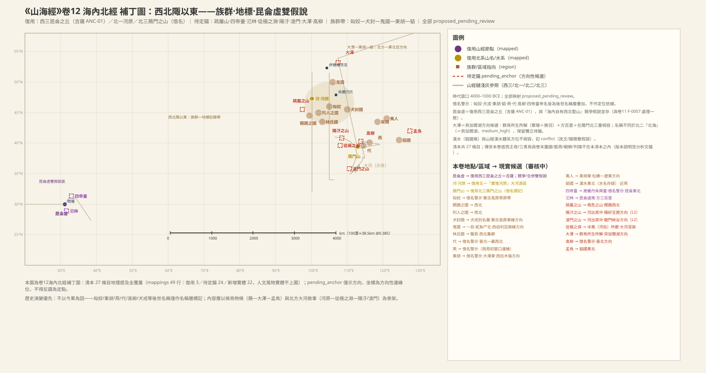
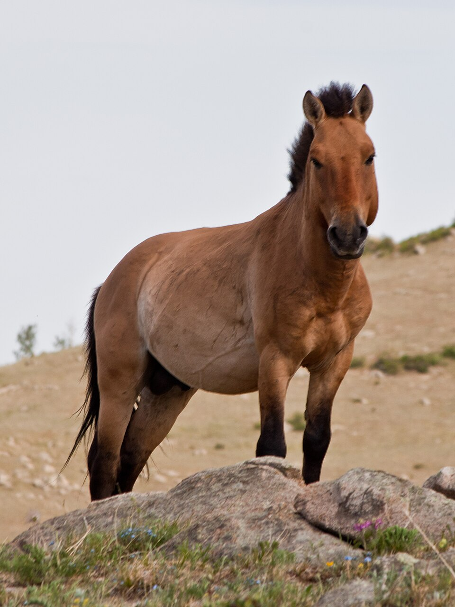

# 《海內北經》白话通顺稿（卷十二，draft-v2）

## 本卷导览

**范围**：本卷是「海内经」四篇中的北篇，叙述视野从西北角开始一路向东——先是蒙古高原到西伯利亚南缘的族群与神怪集群（匈奴、犬封、鬼国一线），中段折回昆仑虚圣域（四帝台、氾林）和北方大河叙事（阳污、凌门、从极之渊），最后落在晋北—东北亚一条清晰的链上：雁门山→高柳→代→大泽→东胡→夷人→貊国→孟鸟。

**主锚点**：
- **大泽＝贝加尔湖**（较可靠）：「方百里、群鸟所生及所解、在雁门北」——晋北以北唯一同级的巨大水体就是贝加尔湖，而且和山经北二链终点「錞于北海」指向同一水域，多重证据互相咬合。
- **雁门山—高柳—代**（较可靠，但名称是后世借名）：晋北自北向南的地理序列与真实的句注山—大同盆地—蔚县盆地格局吻合。
- **河＝北一『实惟河原』大河源区**（杭爱山北麓、色楞格—鄂尔浑河源方向，较可靠）：本卷的河与雁门—大泽北方集群同框架，不取尼罗河读法。
- **昆仑虚＝撒哈拉之眼（理查特构造）**：按 2026-10-26 裁决（ADJ-002），昆仑虚主候选为毛里塔尼亚的理查特构造，吉萨合并说已被否决；「在昆仑东北」的四帝台恰好指向阿尔及利亚—埃及方向的吉萨金字塔群。

**里程吻合度**：本卷属框架书（区域调查），通篇无里程记录，定位全部依靠方位链与族群序列；其北方集群与山经北一—北三链的方位格局相互兼容。

**主要未决**：貊国「在汉水东北」的汉水与山经汉水体系方位不相容（讹文或错简）；窫窳、穷奇的同名异形问题；匈奴、东胡、犬戎、燕、代、高柳等均为后世名称层叠在更早的族群基底上（借名警示）——**2026-10-28 对齐 book11/book13 标准：东胡/貊国/燕/汉水/孟鸟/匈奴簇改判编辑层借名（book11 同簇判异文注文层、book13 判编辑层），各条方向性落点（蒙古高原草原带、西拉木伦—辽西、辽东—半岛西北、北京—辽西等）一律撤销，仅保留文本相对方位；底本差异说明：该簇在 book11 为异文、本卷为正文，正文身份不改变名称层年代**；昆仑虚定位变动后，凡「在昆仑虚某方」的条目（四帝台、蟜、氾林）方位参照需随之复核。

---

### 开场白：海内西北角以东【SHJ-12-1-001】

> **【經文原文】**
> 海內西北陬以東者。

**白话解读**：这是全卷的体例开场：「海内经」从西北角说起，以下各条都按从西向东的次序排列。它不是一处真实地点，而是编者搭的方位框架——框架本身可能晚于内容，但不妨碍里面的山水族群记录保留更早的地理记忆。置信度：框架构件，不作实地对应。

**未决项**
- 未知：海內西北陬（框架）——「海內」框架的成文層年代

---

### 匈奴等三国与贰负、危杀窫窳的故事【SHJ-12-1-002】

> **【經文原文】**
> 匈奴、開題之國、列人之國並在西北。貳負之臣曰危，危與貳負殺窫窳，帝乃梏之疏屬之山，桎其右足，反縛兩手，繫之山上木。在開題西北。

**白话解读**：这条分两层。前半是地理：匈奴、开题、列人三个国族都在西北方向。**按 book11/book13 的统一标准（2026-10-28 对齐）**：「匈奴」是战国到汉代才通行的名称，判编辑层借名，原"蒙古高原草原带"的方向性落点撤销，只保留文本内部方位（"并在西北"），不作窗口期地理依据。（底本差异说明：同一族群簇在 book11《海内西经》是异文注文层、在本卷是正文——正文身份不改变名称层的年代，只是说明晚层材料已编入海内北经正文。）后半是神话：贰负和他的臣子危合谋杀死了神窫窳，天帝惩罚危，把他锁在疏属之山上——右脚戴镣、双手反绑、拴在树上。这是一则典型的「监禁型神话」，山的位置只说在开题西北，大致指向河套—阴山方向，待考。另外窫窳在这里是被杀的神（人面蛇身），北山经少咸之山也有一只窫窳（如牛、赤身人面马足、食人），两者同名不同形，是同一母题分化还是碰巧同名，尚无定论。置信度：族群仅存文本方位（低），神话层不定位。

**未决项**
- 衝突：匈奴——匈奴名稱層戰國—漢——借名/編輯層警示，不作窗口期地理依據（對齊 book11 異文層、book13 編輯層標準，2026-10-28）
- 未知：匈奴——4000–1000 BCE 對應族群實體（假設L2：草原青銅文化帶先民政體）
- 未知：開題之國——名義讀法
- 未知：開題之國——與海內西經開題重文關係
- 未知：列人之國——名義讀法
- 未知：疏屬之山——與海內西經重文的層次關係
- 未知：貳負——神格來源
- 衝突：窫窳——{'type': '同名異實', 'with': '北一少咸之山窫窳（SHJ-03-1-018，獸形：如牛赤身人面馬足，食人）', 'hypotheses': ['H1 同一母題在神/獸兩層的分化', 'H2 同名異實，偶合']}

---

### 持戈的大行伯与犬封国【SHJ-12-1-003】

> **【經文原文】**
> 有人曰大行伯，把戈。其東有犬封國。貳負之尸在大行伯東。

**白话解读**：一个叫大行伯的人手持戈站在那里，他的东边是犬封国；贰负的「尸」（神像或木主）也在大行伯的东边。这条的价值在于方位关系：它和上一条「疏属山在开题西北」拼在一起，给西北集群搭出了一个不依赖绝对坐标的相对位置网。把戈的人像，是西北武士—守卫形象的记录；「大行」怎么读还没定。置信度：犬封国方位较可靠（方向性），其余待考。

**未决项**
- 未知：大行伯——「大行」讀法
- 未知：犬封國（犬戎國）——犬封與犬戎是否同一底層族群
- 未知：犬封國（犬戎國）——吉量馬原型
- 未知：貳負之尸（貳負神）——「尸」作神像/木主讀法（假設L2）

---

### 犬封国（犬戎）与神马吉量【SHJ-12-1-004】

> **【經文原文】**
> 犬封國曰犬戎國，狀如犬。有一女子，方跪進柸食。有文馬，縞身朱鬛，目若黃金，名曰吉量，乘之壽千歲。

**白话解读**：犬封国又叫犬戎国，国人的形象像犬（更可能是犬图腾的妆饰）。有一幅生活场景：一个女子跪着进献食物。这里还产一种花纹马，白身红鬃、眼睛像金子，名叫吉量，说骑上它能活千岁。这条是民族志式的风物记录而不是纯神话：犬图腾、进食礼俗、名马三件套都指向蒙古高原东缘—大兴安岭西麓一带的草原族群。蒙古高原正是家马早期利用的核心区，「吉量」在后世文献里变成吉良、吉光等西域良马的名字，母题一脉相传。「犬戎」这个名字属于西周晚期（前 771 年犬戎杀周幽王那层），本卷记的是更早的风物底层。置信度：方位较可靠（方向性），神话夸饰（寿千岁）不计。

（图：Wikimedia Commons）

**未决项**
- 未知：犬封國（犬戎國）——犬封與犬戎是否同一底層族群
- 未知：犬封國（犬戎國）——吉量馬原型

---

### 鬼国与食人的蜪犬【SHJ-12-1-005】

> **【經文原文】**
> 鬼國在貳負之尸北，為物人面而一目。一曰貳負神在其東，為物人面蛇身。蜪犬如犬，青，食人從首始。

**白话解读**：鬼国在贰负神像的北边，国人长着人脸但只有一只眼睛（另一种说法：贰负神在它东边，人面蛇身）。附近还有蜪犬，像狗、青色、吃人从头开始吃。「一目」最合理的读法是面具或面部妆饰，不必当真；鬼国可能与商代的鬼方记忆有关——甲骨文和《易经》都记过商王武丁伐鬼方（约前 1200 年，在我们的时代窗口内），若这层记忆投到北方，鬼国大致指向西伯利亚南缘—贝加尔湖以西方向。但这只是跨文献的旁证，存而不论。一目母题在海外北经的一目国也出现过，属同一套「异相族群」记录传统。置信度：方向性猜测，待考。

**未决项**
- 未知：貳負之尸（貳負神）——「尸」作神像/木主讀法（假設L2）
- 未知：鬼國——鬼國—鬼方關係僅為假設L2
- 未知：鬼國——一目母題與海外北經一目國的關係

---

### 有翼食人的穷奇【SHJ-12-1-006】

> **【經文原文】**
> 窮奇狀如虎，有翼，食人從首始，所食被髮，在蜪犬北。一曰從足。

**白话解读**：穷奇样子像虎、长着翅膀，吃人从头吃起（一说从脚吃起），被吃的人披散着头发——「披发」可能指被吃者的族群发式。穷奇这个名字在全书别处也出现过：西次四经邽山（高阿特拉斯东段方向）的穷奇是「像牛、浑身刺猬毛、叫声像狗」，和这里的虎形有翼完全两样。两种解释并存：要么穷奇是一个到处流动的「食人兽」名号，各地共享名字但形象各异；要么纯属同名巧合。我们按「名字流动、形象不稳」的母题扩散来处理。置信度：神话层，不定位。

**未决项**
- 衝突：窮奇——{'type': '同名異實', 'with': '西四邽山窮奇（SHJ-02-4-017，MTN:SHJ-02-4-017#1 高阿特拉斯東段；獸形：如牛蝟毛，音如獆狗，食人）', 'hypotheses': ['H1 窮奇為流動食人獸母題，多地共享名號（母題擴散）', 'H2 同名異實，形態各異（牛形 vs 虎形有翼）不可合併']}
- 未知：窮奇——被髮人牲讀法

---

### 昆仑虚东北的四座帝台【SHJ-12-1-007】

> **【經文原文】**
> 帝堯臺、帝嚳臺、帝丹朱臺、帝舜臺，各二臺，臺四方，在昆侖東北。

**白话解读**：帝尧、帝喾、帝丹朱、帝舜各有两座台，台是四方的，在昆仑的东北。先说「昆仑」：按 2026-10-26 的裁决（ADJ-002），海内经体系的「昆仑虚」主候选是撒哈拉之眼——毛里塔尼亚的理查特构造，一个直径约 40 公里的同心环状地貌，远望如废弃的环城废墟，与「虚」（墟）字形象高度吻合；此前「昆仑虚＝吉萨金字塔群」的合并说已被否决（否决关键是流沙路径：沙带横贯北非、西南入大西洋，与吉萨的地中海在北、红海在东完全对不上）。再看方位：从理查特构造向东北，正是阿尔及利亚—埃及方向——吉萨那片「方台」形的金字塔群恰好落在这个方位上，「各二台、台四方」的形制描写是全条最硬的内容。尧、喾、丹朱、舜这些帝名是后世圣王谱系的叠加层，不带定位信息。（旧适配层曾复用吉萨节点 `MTN:SHJ-02-3-005#1`，裁决后昆仑虚与昆仑之丘分离，此节点归属山经体系。）置信度：昆仑虚＝撒哈拉之眼较可靠（裁决口径），四帝台位置随昆仑虚定位浮动，待复核。

（图：Wikimedia Commons）

（图：Wikimedia Commons）

**未决项**
- 未知：帝堯臺——臺址隨昆侖虛定位浮動
- 未知：帝堯臺——ADJ-002（2026-10-26 裁決）：昆侖虛＝理查特構造（撒哈拉之眼）為主候選，吉薩合併說否決（方位參照隨之復核）
- 衝突：帝堯臺——×大荒北經（SHJ-17-1-017）群帝之臺「在崑崙之北」：同為「群帝四方臺＋昆侖相對方位」母題，方位一作東北（本卷）一作北（book17），兩卷互記 conflict（2026-10-27 紅隊發現 8）；兩種昆侖假說下各自重述見數據層注記
- 未知：帝嚳臺——ADJ-002（2026-10-26 裁決）：昆侖虛＝理查特構造（撒哈拉之眼）為主候選，吉薩合併說否決（方位參照隨之復核）
- 未知：帝丹朱臺——ADJ-002（2026-10-26 裁決）：昆侖虛＝理查特構造（撒哈拉之眼）為主候選，吉薩合併說否決（方位參照隨之復核）
- 未知：帝舜臺——ADJ-002（2026-10-26 裁決）：昆侖虛＝理查特構造（撒哈拉之眼）為主候選，吉薩合併說否決（方位參照隨之復核）
- 衝突：昆侖（昆侖虛）——{'type': '同名異實（體系間）', 'with': '海內經體系昆侖虛 vs 山經西三昆侖之丘', 'hypotheses': ['H1 合併：海內昆侖虛＝山經昆侖之丘（吉薩 ANC-01），海內西/北經為同一聖域的複寫（帝之下都、四帝臺、氾林、從極之淵皆為聖域子要素）', 'H2 競爭：昆侖虛為海內經體系自有之西北聖山（西北高原方向），與西三昆侖之丘同名異實，層積自不同傳統'], 'note': '與卷11 F-0007 處理一致：雙假說並存，本層不裁決'}
- 未知：昆侖（昆侖虛）——海內經體系與山經體系的成文先後
- 未知：昆侖（昆侖虛）——ADJ-002（2026-10-26 裁決）：昆侖虛＝理查特構造（撒哈拉之眼）為主候選，吉薩合併說否決（方位參照隨之復核）

---

### 大蜂与朱蛾【SHJ-12-1-008】

> **【經文原文】**
> 大蠭其狀如螽。朱蛾其狀如蛾。

**白话解读**：有一种大蜂，样子像螽斯；有一种红色的蛾（一说赤色蚁类），样子像蛾。这是接在四帝台之后的物产短条，属于昆仑虚圣域描写序列的一部分（台→物产→人物→林→渊），说明编者把昆仑虚当作一个有台、有物、有神居的完整圣域来写。「朱蛾」到底读蛾还是读蚁，未定。置信度：风物记录，不定位。

**未决项**
- 未知：朱蛾——蛾/蟻讀法

---

### 身有虎纹的蟜人【SHJ-12-1-009】

> **【經文原文】**
> 蟜，其為人虎文，脛有𦜹。在窮奇東。一曰，狀如人。昆侖虛北所有。

**白话解读**：蟜是人（族群），身上有虎形纹饰，小腿上有某种特征或绑饰（一说就是普通人形）；它在穷奇的东边，也是昆仑虚以北所有的风物。这条的关键词是双锚：「在穷奇东」把它挂在西北异兽集群上，「昆仑虚北所有」又把它挂进昆仑圣域——编者用一句话把两个框架缝在了一起。按裁决口径昆仑虚在撒哈拉之眼，那么「昆仑虚北」是极西方向的参照；而穷奇—蜪犬集群留在蒙古—西伯利亚方向。本卷地图因此分两层呈现，不强行合并。虎纹与脛饰读作纹身/服饰，是族群风物记录。（旧适配曾复用 `MTN:SHJ-02-3-005#1`，裁决后分离。）置信度：风物记录，方位随昆仑虚裁决复核。

**未决项**
- 衝突：昆侖（昆侖虛）——{'type': '同名異實（體系間）', 'with': '海內經體系昆侖虛 vs 山經西三昆侖之丘', 'hypotheses': ['H1 合併：海內昆侖虛＝山經昆侖之丘（吉薩 ANC-01），海內西/北經為同一聖域的複寫（帝之下都、四帝臺、氾林、從極之淵皆為聖域子要素）', 'H2 競爭：昆侖虛為海內經體系自有之西北聖山（西北高原方向），與西三昆侖之丘同名異實，層積自不同傳統'], 'note': '與卷11 F-0007 處理一致：雙假說並存，本層不裁決'}
- 未知：昆侖（昆侖虛）——海內經體系與山經體系的成文先後
- 未知：昆侖（昆侖虛）——ADJ-002（2026-10-26 裁決）：昆侖虛＝理查特構造（撒哈拉之眼）為主候選，吉薩合併說否決（方位參照隨之復核）
- 未知：蟜——ADJ-002（2026-10-26 裁決）：昆侖虛＝理查特構造（撒哈拉之眼）為主候選，吉薩合併說否決（方位參照隨之復核）

---

### 人面兽身的闒非【SHJ-12-1-010】

> **【經文原文】**
> 闒非，人面而獸身，青色。

**白话解读**：闒非是人脸兽身、青色的东西。它和后面的环狗、𥘯、戎属于同一批「异相人/兽」风物群，保留了色彩记录（青色）。读作图腾形象或妆饰记录即可，不定位。置信度：待考。

---

### 折颈被发的据比之尸【SHJ-12-1-011】

> **【經文原文】**
> 據比之尸，其為人折頸被髮，無一手。

**白话解读**：据比之尸，脖子折断、披头散发、缺一只手。这是本卷「尸」系列的第二具（另有贰负之尸、王子夜之尸）：受刑或战死者的形象被固定成地标式的记录。「尸」系列在本卷承担方位骨架——贰负之尸给鬼国、大行伯定位——其残损形象与处刑/战败者记忆相容，但具体所指已不可考。置信度：神话层，不定位。

---

### 兽首人身的环狗【SHJ-12-1-012】

> **【經文原文】**
> 環狗，其為人獸首人身。一曰蝟狀如狗，黃色。

**白话解读**：环狗是兽头人身的人（一说像刺猬那样的狗，黄色）。「其为人」这个句式说明编者把它归进族群而不是野兽——兽首人身最自然的读法是戴兽首面具或头饰的族群，和犬封国「状如犬」同属犬系形象集群，方向指向蒙古—西伯利亚。置信度：风物记录，待考。

---

### 黑首纵目的𥘯【SHJ-12-1-013】

> **【經文原文】**
> 𥘯，其為物人身黑首從目。

**白话解读**：𥘯这个东西，人身、黑头、眼睛是纵着长的。「黑首」可读作染面或黑色面具，「从目」（纵目）可读作面部妆饰——海外经里深目国等异相记录同属这套传统。注意这里用「其为物」而不是「其为人」，或许反映编者在归类为人还是兽之间的犹豫。𥘯字本身的字义还没定。置信度：待考。

**未决项**
- 未知：𥘯——字義

---

### 头生三角的戎人【SHJ-12-1-014】

> **【經文原文】**
> 戎，其為人人首三角。

**白话解读**：戎这里指一种人，头上长着（或戴着）三角。要提醒：此处的「戎」是具体形貌记录（三角头饰或发式），不是周代「西戎」那个族类大帽子——不能拿后世的泛称反读回这条。「其为人」句式与蟜、环狗一致，同属西北集群的族群风物群。置信度：待考。

---

### 林氏国的五彩神兽驺吾【SHJ-12-1-015】

> **【經文原文】**
> 林氏國有珍獸，大若虎，五采畢具，尾長于身，名曰騶吾，乘之日行千里。

**白话解读**：林氏国有一种珍兽，大得像虎，五种颜色齐备，尾巴比身子还长，名叫驺吾，骑上它一天能走千里。结构上和犬封国＋吉量马一模一样：一个国以一种名兽闻名。「大若虎、尾长于身」的原型就是大型猫科动物（虎/豹类），「五采毕具」是神化夸饰；《诗经·召南》里的仁兽「驺虞」是同一母题，互证可到西周窗口边缘。「日行千里」与吉量的「寿千岁」共用一套夸饰句式，是本卷风物记录的程式化写法。林氏国本身大致在蒙古高原—西北方向的林居族群，线索很少，待锚。置信度：原型较可靠，国名待考。

（图：Wikimedia Commons）

---

### 昆仑虚以南的氾林【SHJ-12-1-016】

> **【經文原文】**
> 昆侖虛南所，有氾林方三百里。

**白话解读**：昆仑虚以南有一片氾林，方圆三百里。氾林在海内西经的昆仑虚叙事里也出现过，是圣域的子要素之一（互证）。它的位置随昆仑虚的定位浮动：按现行裁决昆仑虚＝撒哈拉之眼，则氾林指向阿德拉尔高原以南的林带——撒哈拉在全新世湿润期确实曾有广阔绿带，「方三百里」的面积型记录放在这个背景下并不突兀。旧读法（吉萨南—尼罗河谷绿带）随吉萨合并说一并失效。「三百里」这类尺度数值全书层级待考，不作算术换算锚定。（旧适配复用 `MTN:SHJ-02-3-005#1`，裁决后分离。）置信度：方向性猜测，随裁决复核。

**未决项**
- 衝突：昆侖（昆侖虛）——{'type': '同名異實（體系間）', 'with': '海內經體系昆侖虛 vs 山經西三昆侖之丘', 'hypotheses': ['H1 合併：海內昆侖虛＝山經昆侖之丘（吉薩 ANC-01），海內西/北經為同一聖域的複寫（帝之下都、四帝臺、氾林、從極之淵皆為聖域子要素）', 'H2 競爭：昆侖虛為海內經體系自有之西北聖山（西北高原方向），與西三昆侖之丘同名異實，層積自不同傳統'], 'note': '與卷11 F-0007 處理一致：雙假說並存，本層不裁決'}
- 未知：昆侖（昆侖虛）——海內經體系與山經體系的成文先後
- 未知：昆侖（昆侖虛）——ADJ-002（2026-10-26 裁決）：昆侖虛＝理查特構造（撒哈拉之眼）為主候選，吉薩合併說否決（方位參照隨之復核）
- 未知：氾林——與海內西經氾林重文關係
- 未知：氾林——ADJ-002（2026-10-26 裁決）：昆侖虛＝理查特構造（撒哈拉之眼）為主候選，吉薩合併說否決（方位參照隨之復核）

---

### 河神冰夷居住的从极之渊【SHJ-12-1-017】

> **【經文原文】**
> 從極之淵深三百仞，維冰夷恒都焉。冰夷人面，乘兩龍。一曰忠極之淵。

**白话解读**：从极之渊（一说忠极之渊）深三百仞，是冰夷常住的地方；冰夷人面，驾着两条龙。冰夷就是后世冯夷/河伯的原型——黄河河神。这个信仰基底在时代窗口之内：商代甲骨文里有大量祭「河」的记录（约前 1300–1046 年）。深渊本身大致指向北方大河的深潭（河套—晋陕峡谷方向），与下一条「河出其中」的两山同属北方大河叙事集群：河从山出（源）→ 深潭有神居（渊）→ 北方大泽（群鸟），构成一条完整的叙事链。「三百仞」的深度数值层级待考。置信度：信仰原型较可靠，渊的具体位置待考。

**未决项**
- 未知：從極之淵（忠極之淵）——三百仞數值層級

---

### 大河发源于阳污、凌门二山【SHJ-12-1-018】

> **【經文原文】**
> 陽汙之山，河出其中；淩門之山，河出其中。

**白话解读**：阳污山，大河从那里流出；凌门山，大河也从那里流出。这里的「河」我们取北方大河体系——复用北山经第一链「实惟河原」的大河源区（敦薨之山，杭爱山北麓、色楞格—鄂尔浑河的源头方向，`WAT:SHJ-03-1-017#2`，较可靠）。理由是方位：本卷的河与雁门—高柳—代—大泽这个北方集群在同一个框架里，而西次三经的「河水」＝尼罗河在地理上根本放不到一起；按裁决口径（水名作类名，多河并存），本卷取北系读法。阳污山可能与《穆天子传》的阳纡之山互证，指向河套—阴山南麓方向（较可靠的方向性读法）；凌门山让人想到晋陕峡谷—龙门那样的「河出峡谷」景观，但龙门之名后出，不作定位依据。两座山都是「河出其中」的河源/出峡叙事节点。置信度：河较可靠，两山方向性猜测。

**未决项**
- 未知：陽汙之山——陽汙—陽紆互證僅為假設L2
- 未知：淩門之山——淩門—龍門互證僅為假設L2
- 衝突：河（陽汙·淩門所出）——{'type': '多「河」體系', 'with': '西三河水＝尼羅河（WAT:SHJ-02-3-003#2）', 'hypotheses': ['H1 本卷河屬北方大河體系（北一河原）——鴈門/代/大澤集群方位支持', 'H2 河為昆侖四水之河（尼羅河）的框架複寫——僅在昆侖虛合併假說下成立；本卷北方集群錨定強，H1 優先']}

---

### 被肢解的王子夜之尸【SHJ-12-1-019】

> **【經文原文】**
> 王子夜之尸，兩手、兩股、胷、首、齒，皆斷異處。

**白话解读**：王子夜的尸体，两只手、两条腿、胸、头、牙齿都断开散在不同地方。这是本卷「尸」系列中描写最具体的一具。有一个跨文献的旁证：殷人先公王亥在有易被杀、尸体遭肢解的传说（见《易经》《楚辞·天问》的「仆牛」叙事层），若王子夜就是王亥的异写，这条的内容层可上溯到夏商之际——但这只是假设，存而不论。置信度：神话层，不定位。

**未决项**
- 未知：王子夜之尸——王子夜—王亥互證僅為假設L2

---

### 雁门以北、方圆百里的大泽【SHJ-12-1-020】

> **【經文原文】**
> 大澤方百里，羣鳥所生及所解，在鴈門北。

**白话解读**：有一片方圆百里的大泽，是群鸟繁殖和换羽的地方，在雁门山以北。这是本卷最硬的定位之一：「所生及所解」记的是候鸟繁殖加换羽的物候——这是大型北方湖泊的标志性生态；「方百里」是超大型水体的尺度；「在雁门北」把方向钉死在晋北以北。三个条件叠加，候选几乎唯一：贝加尔湖—色楞格河口湖沼方向（较可靠）。山经也给它托底：北二链终点的敦题之山「錞于北海」＝贝加尔湖南岸—伊尔库茨克方向，与本条三重相容。之所以不直接复用「北海」节点，是因为名称不同（大泽 vs 北海），保留独立待锚更严谨。

（图：Wikimedia Commons）

**未决项**
- 未知：大澤（方百里，群鳥所生及所解）——不直接復用北二北海節點：名稱不同（大澤 vs 北海），保留獨立待錨

---

### 大雁出入的雁门山【SHJ-12-1-021】

> **【經文原文】**
> 鴈門山，鴈出其閒。在高柳北。

**白话解读**：雁门山，大雁从山间穿行而过；它在高柳的北边。这条复用北山经第三链的雁门之山（`MTN:SHJ-03-3-045#1`，代县—朔州方向，较可靠），名字虽带后世借名标记（雁门关、雁门县都是后来叠加的），但「雁出其间」的物候内容可以早于名称层。雁（候鸟）＋雁门（迁徙通道）＋大泽（繁殖换羽地）串成了一条完整的候鸟年度循环知识链——这是本卷最具民族志硬度的内容：晋北的句注山一线至今仍是候鸟迁徙通道，古人显然清楚大雁春天从这里飞向北方的大泽。

（图：Wikimedia Commons）

---

### 高柳在代地以北【SHJ-12-1-022】

> **【經文原文】**
> 高柳在代北。

**白话解读**：高柳在代地的北边。雁门—高柳—代构成晋北自北向南的地理序列，与真实地形（句注山—大同盆地—蔚县盆地）的排布相容：高柳大致在晋北阳高—大同盆地北缘方向，代大致在晋北—冀西北的蔚县—代县盆地一带。但要泼冷水：「高柳」是汉代代郡的县名，「代」的国/郡名也不早于春秋战国——两个名称层都晚出，所以这个序列只能算方向性读法，置信度压在较可靠以下。置信度：较可靠（方向性）。

---

### 河泽之滨的宵明、烛光二女神【SHJ-12-1-023】

> **【經文原文】**
> 舜妻登比氏生宵明、燭光，處河大澤，二女之靈能照此所方百里。一曰登北氏。

**白话解读**：舜的妻子登比氏（一说登北氏）生了宵明、烛光两个女儿，住在河与大泽之间；两位女神的灵光能照亮方圆百里。「处河大泽」把上面的大河（018）和大泽（020）缝成同一处水域景观——贝加尔湖畔；「照方百里」又恰好呼应大泽「方百里」的尺度。一个合理的读法是：大湖夜间的波光、霞光或湖上光象被神格化成两位光性女神，名字本身（宵明＝夜明、烛光）就写着「光」。「舜妻」的舜名属后世圣王谱系叠加，不带定位信息。置信度：水域较可靠，神话层不定位。

**未决项**
- 衝突：河（陽汙·淩門所出）——{'type': '多「河」體系', 'with': '西三河水＝尼羅河（WAT:SHJ-02-3-003#2）', 'hypotheses': ['H1 本卷河屬北方大河體系（北一河原）——鴈門/代/大澤集群方位支持', 'H2 河為昆侖四水之河（尼羅河）的框架複寫——僅在昆侖虛合併假說下成立；本卷北方集群錨定強，H1 優先']}
- 未知：大澤（方百里，群鳥所生及所解）——不直接復用北二北海節點：名稱不同（大澤 vs 北海），保留獨立待錨

---

### 大泽以东的东胡【SHJ-12-1-024】

> **【經文原文】**
> 東胡在大澤東。

**白话解读**：东胡在大泽的东边。**按 book11/book13 的统一标准（2026-10-28 对齐）**：「东胡」作为匈奴东邻的政治名号属战国层（《史记·匈奴列传》），判编辑层借名——原"西拉木伦河—辽西方向"的落点（连同"大泽若＝贝加尔湖则其东为辽西"的推法）撤销，不作窗口期地理依据；只保留文本方位"在大泽东"。族群基底假设（辽西夏家店上层文化圈前身）存册备考，不作定位。底本差异说明：同一句在 book11《海内西经》为异文（判"不作地理依据"），本卷为正文——正文身份不改变名称层年代。置信度：低（仅存文本方位），名称借名警示。

**未决项**
- 衝突：東胡——東胡名稱層戰國——借名/編輯層警示，不作窗口期地理依據（對齊 book11 異文層標準，2026-10-28）

---

### 东胡以东的夷人【SHJ-12-1-025】

> **【經文原文】**
> 夷人在東胡東。

**白话解读**：夷人在东胡的东边。东胡→夷人→貊国构成一条文本上的族群序列；但东胡落点已按 book11/book13 标准撤销（2026-10-28），夷人依附东胡，原"松嫩平原—辽东方向"推定随之失效——本条只存文本序列方位（"在东胡东"）。这里的「夷」是具体族群记录，不是华夏中心视角下的「东夷」大范畴——「夷」作为泛称是后世叠加层，本条的具体所指已不可考。置信度：低（依附撤落点后的东胡），待考。

**未决项**
- 未知：夷人——夷在此處的具體所指

---

### 临近燕国的貊国【SHJ-12-1-026】

> **【經文原文】**
> 貊國在漢水東北。地近于燕，滅之。

**白话解读**：貊国在汉水东北，地方靠近燕，后来被燕灭掉。这条内部张力最强：「汉水」在山经里属于长江水系（西一长江上游方向、中十一长江系汉水），与东北方向的貊、燕方位上根本拼不到一起——必有一层是后世叠加。**按 book11/book13 的统一标准（2026-10-28 对齐）**：这一整条（貊国在汉水东北、地近于燕、灭之）在 book11 判为后世注文混入候选、不作窗口期地理依据——因此原"辽东—朝鲜半岛西北"和"北京—辽西"两个方向性落点一并撤销，只保留文本相对方位；「汉水」维持存疑（要么是讹文别水，要么是错简窜入），原"辽东—半岛水系"候选同步撤销。「滅之」两个字尤其重要：它是叙述者所在时代的史事回注，直接证明本卷的成文晚于内容层。「燕」的国名层在西周初（克盉、克罍证明约前 1045 年封燕），「貊」名见于《诗经·韩奕》层，都在时代窗口边缘，均需借名警示——燕封考古证据仅作流变注记，不作定位。置信度：低（仅存文本方位），汉水存疑。

**未决项**
- 衝突：貊國——貊/燕/漢水名簇層位晚出——整條為後世注文混入候選，不作窗口期地理依據（對齊 book11 異文層標準，2026-10-28）
- 衝突：燕——燕＝戰國秦漢名簇一員（貊/漢水同條）——編輯層借名警示，不作窗口期地理依據（對齊 book13 標準，2026-10-28）
- 未知：貊國——『滅之』所指的成文層
- 衝突：漢水（貊國在漢水東北）——{'type': '水名存疑', 'with': '山經漢水體系（WAT:SHJ-02-1-013#3 長江上游方向；WAT:SHJ-05-11-001#4 長江系漢水）', 'hypotheses': ['H1 此『漢水』為訛文或別水（東北水系，後世以漢江等名層回讀）', 'H2 文本錯簡：『在漢水東北』為他處竄入']}
- 未知：漢水（貊國在漢水東北）——水名原文

---

### 貊国东北的三色孟鸟【SHJ-12-1-027】

> **【經文原文】**
> 孟鳥在貊國東北，其鳥文赤、黃、青，東鄉。

**白话解读**：孟鸟在貊国的东北，这种鸟羽毛有赤、黄、青三色花纹，栖息时头朝东。全卷以一只鸟收尾并非偶然：它与大泽的群鸟（020）、雁门的雁（021）呼应——本卷的「北方知识」始终以候鸟—大泽—迁徙通道为骨架，族群序列（匈奴→犬封→东胡→夷→貊→孟鸟）就沿这条骨架展开。孟鸟是具体鸟类的风物或图腾记录；地点依附貊国——貊国落点已按 book11/book13 标准撤销（2026-10-28），本条无独立地理方位，仅存风物记录。置信度：风物记录，待考。

---

本卷条目 27；未决项 50 条（照录自 draft-v1，未删减）。
