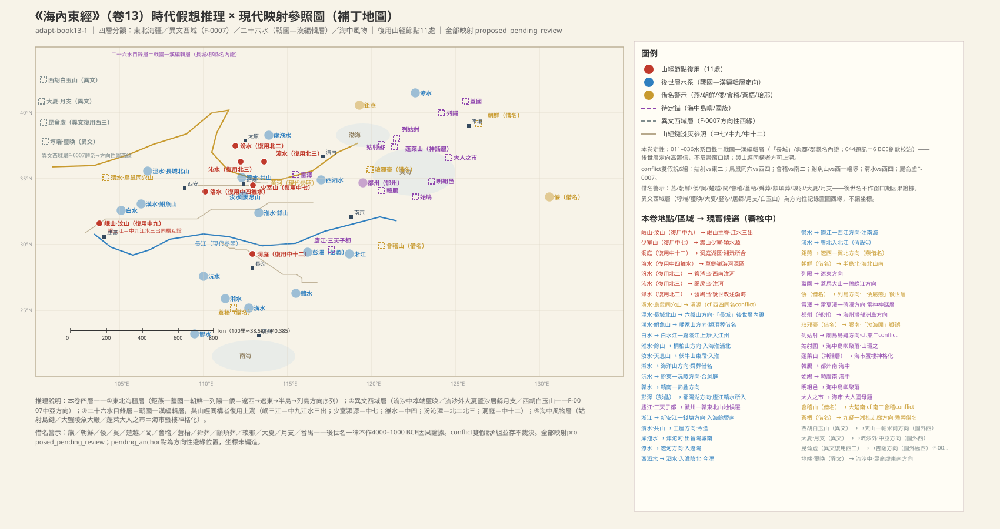
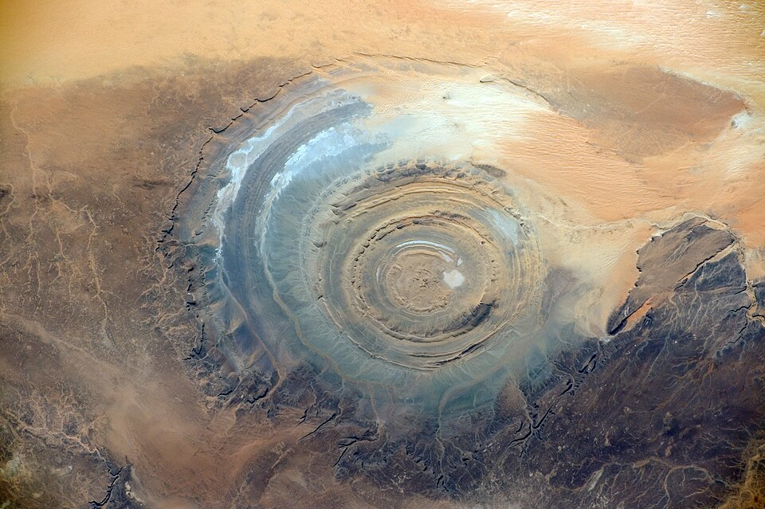
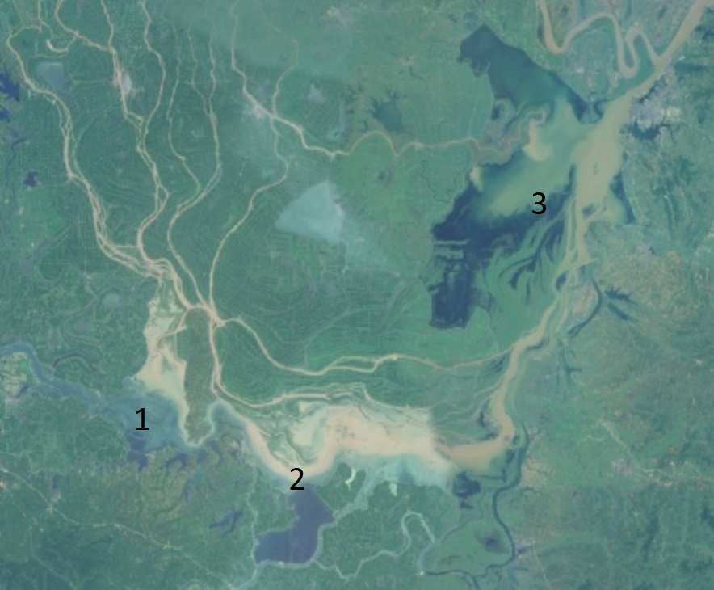
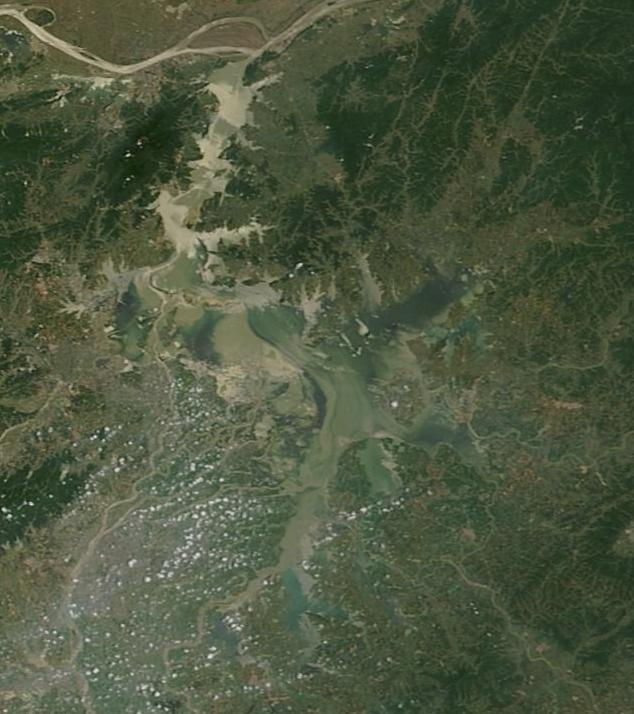

# 《海內東經》白话通顺版（卷十三 · draft-v2）

## 本卷导览

《海內東經》是一部「框架书」：它不做逐山逐水的里程式踏查，而是以「海内东北角以南」为框架，做区域性的点名登记。全卷 44 条，内容实际分四层——

1. **东北海疆国族层**（002–010）：钜燕、盖国、倭、朝鲜、列阳，构成「辽西→辽东→朝鲜半岛→日本列岛」的方位链条，外加庙岛群岛方向的列姑射岛链。这一层地名多是周秦汉名回溯（燕、朝鲜、倭、会稽、楚越都属「借名警示」），方向可信、落点待考。
2. **西流沙异文层**（003–004 条所附异文）：埻端、璽㬇、大夏、豎沙、居繇、月支六国与白玉山、苍梧，属于另一个空间系统——中亚—西域方向，是编者无法归入东北框架而以异文形式附录的材料。按 2026-10-26 裁决（ADJ-002），本层方位基准「昆侖虛」的主候选为**撒哈拉之眼（理查特构造）**，吉萨合并说已否决；ADJ-004 采纳 F-0007，两河空档属山经体例性缺席，本群逐项留待后续裁决。
3. **水系目录层**（011–036）：二十六条大河的「源—流—注」三段式目录，与今日中国水系拓扑高度吻合；但「长城」「象郡」「江州」及大批汉县名证明它是**战国—汉编辑层**，卷末 044 条建平元年（公元前 6 年）刘歆校治题记是铁证。其中与山经同构的部分（岷山江水三出、少室颍源、雒水、汾沁漳、洞庭）才可上溯为先秦认知。
4. **海中风物层**（037–043）：黄海岛屿聚落、海洋巨型生物三连（大蟹—陵鱼—大鯾）、海市蜃楼神话层（蓬莱、大人之市）。

**主锚点**：岷山—长江源三出（与中山经九次独立互证，很强）、嵩山少室山（颍水源，一山两水系与实测分水岭完全相符）、洞庭湖、彭蠡（鄱阳湖方向）、郁洲岛（今连云港云台山）。**吻合度**：本卷无里程数字（框架书体例），以水系拓扑与方位序列的吻合度代替，后世层大河拓扑几乎逐条命中。**主要未决**：东北国族的实体落点与借名分际、流沙六国对音全无考、三天子都确指、多处同名异实双假说（会稽、嶓冢、鸟鼠同穴、姑射）并存待裁。

---

## 海內東經·全卷（book13）

### 1. 全卷总纲：从东北角往南记

> **【經文原文】**
> 海內東北陬以南者。

**白话解读**：这是一句编排说明，意思是「本卷登记的是海内的东北角、以及由东北角往南的一片地方」。没有实体内容，但它透露了编者的整理原则——按方位分区。值得注意的是，本卷实际混入了大批「西北—流沙」方向的异文材料（见第 3、4 条），说明编者把归不进东北框架的抄本残片附录在了这里，这本身就是文本编纂过程的证据。

---

### 2. 钜燕：东北角的大燕之地

> **【經文原文】**
> 鉅燕在東北陬。

**白话解读**：「钜」就是「大」，钜燕即大燕之地，在海内框架的最东北角。我们判断它指河北北部到辽西走廊这一片——方向上与「东北陬」相容（《海內北經》也有钜燕，两卷互见）。但要提醒：「燕」是战国七雄的国名，是后人回溯着贴上去的标签，不能反推为先秦早期当地族群的自称。方向性猜测，落点待考。

#### 未决项
- 衝突：鉅燕——燕＝戰國七雄名回溯借名，不作因果證據
- 未知：鉅燕——窗口期內該域族群自名缺失

---

### 3. 东北亚国族序列＋流沙六国异文

> **【經文原文】**
> 蓋國在鉅燕南，倭北。倭屬燕。　　朝鮮在列陽東，海北山南。列陽屬燕。

**白话解读**：这条要拆成两层读，正文和所附异文是两个完全不同的空间系统。

**正文层**是一条东北亚国族链：盖国在钜燕之南、倭之北——我们判断在盖马大山—鸭绿江流域方向（朝鲜半岛北部，待考）；「倭」指日本列岛方向（传统对音落在北九州），但「倭属燕」是汉代册封叙事的口吻，属后世层（方向性猜测）；朝鲜在列阳以东，「海北山南」——渤海黄海之北、山脉之南，与半岛北部（平壤—大同江方向）地形相容，但「朝鲜」是周秦名回溯，借名警示（方向性猜测）；列阳属燕，大致在辽东（辽阳—襄平方向，待考）。这一层自辽西到列岛的方位序列在地理上是自洽的，只是每个具体落点都还不能定死。

**异文层**（另一批抄本附录的文字）：「国在流沙中者埻端、璽㬇，在昆侖虛東南」「国在流沙外者，大夏、豎沙、居繇、月支之国」。这是中亚—西域方向的材料：埻端、璽㬇是流沙中的绿洲国，对音实体全无考（待考）；大夏我们判断对应巴克特里亚—阿姆河流域方向，其时代窗口与 BMAC 文明（约前 2250–1700）相容（方向性猜测，时代对得上）；豎沙、居繇在中亚河中地（索格底亚那）方向（待考）；月支即月氏前身，河西走廊—伊犁河—阿姆河方向（方向性猜测）。「流沙」复用西山经的流沙体系，即盖塔拉洼地东缘沙沼带（较可靠；`LND:SHJ-02-3-010#1`）。方位基准「昆侖虛」按 2026-10-26 裁决（ADJ-002）：主候选是**撒哈拉之眼（理查特构造）**，吉萨金字塔合并说已否决（`MTN:SHJ-02-3-005#1`）——因此「昆侖虛東南」应复核为红海—阿拉伯半岛方向。「一曰海内之郡，不为郡县」一句是汉代编者的按语混入了正文。

（图：Wikimedia Commons）

#### 未决项
- 未知：蓋國——蓋國實體性質（國/邑/山名）
- 衝突：倭——倭名定著於漢代——借名警示；「倭屬燕」為後世層敘事
- 未知：倭——彌生前期（窗口末段）列島與大陸交通程度
- 衝突：朝鮮——朝鮮＝周秦名（箕子朝鮮敘事）——借名警示，不作窗口期因果證據
- 未知：朝鮮——窗口期該域實體名
- 未知：列陽——列陽確指
- 衝突：埻端——異文「一曰海內之郡，不為郡縣」＝漢代編者按語混入
- 未知：埻端——埻端對音/實體全無考
- 未知：埻端——ADJ-002（2026-10-26 裁決）：昆侖虛＝理查特構造（撒哈拉之眼）為主候選，吉薩合併說否決（方位參照隨之復核）
- 未知：埻端——ADJ-004（2026-10-26）：F-0007 採納——兩河空檔為山經體例性缺席，本群由框架書待錨承擔，逐項留待後續裁決
- 未知：璽㬇——璽㬇對音/實體全無考
- 未知：璽㬇——ADJ-002（2026-10-26 裁決）：昆侖虛＝理查特構造（撒哈拉之眼）為主候選，吉薩合併說否決（方位參照隨之復核）
- 未知：璽㬇——ADJ-004（2026-10-26）：F-0007 採納——兩河空檔為山經體例性缺席，本群由框架書待錨承擔，逐項留待後續裁決
- 衝突：大夏——大夏＝希臘-巴克特里亞時期漢譯名定著——借名警示；另有晉西南「大夏」地名同名異實
- 未知：大夏——文本層與 BMAC 的直接通道
- 未知：大夏——ADJ-004（2026-10-26）：F-0007 採納——兩河空檔為山經體例性缺席，本群由框架書待錨承擔，逐項留待後續裁決
- 未知：豎沙——豎沙對音無考
- 未知：豎沙——ADJ-004（2026-10-26）：F-0007 採納——兩河空檔為山經體例性缺席，本群由框架書待錨承擔，逐項留待後續裁決
- 未知：居繇——居繇對音無考
- 未知：居繇——ADJ-004（2026-10-26）：F-0007 採納——兩河空檔為山經體例性缺席，本群由框架書待錨承擔，逐項留待後續裁決
- 衝突：月支——月氏名定著於戰國漢——借名警示
- 未知：月支——窗口期月氏前身族群認定
- 未知：月支——ADJ-004（2026-10-26）：F-0007 採納——兩河空檔為山經體例性缺席，本群由框架書待錨承擔，逐項留待後續裁決
- 衝突：流沙——北一（SHJ-03-1-013）/東三（SHJ-04-3-007）亦有流沙——類名分段（F-0011），跨卷分段待裁
- 衝突：流沙——ADJ-005（水名/地貌名為性狀類名，多實例合法非衝突）——本條按類名多實例處理，留檔不裁
- 未知：流沙——本卷異文層是否直接承西三體系
- 未知：流沙——ADJ-002（2026-10-26 裁決）：昆侖虛＝理查特構造（撒哈拉之眼）為主候選，吉薩合併說否決（方位參照隨之復核）
- 衝突：昆侖虛——海內西經「昆侖之虛…帝之下都」（book11 核心）與西三昆侖之丘：競爭/合併雙假說並存（F-0007），本層不裁決
- 未知：昆侖虛——昆侖虛與昆侖之丘的同體/分體
- 未知：昆侖虛——ADJ-002（2026-10-26 裁決）：昆侖虛＝理查特構造（撒哈拉之眼）為主候選，吉薩合併說否決（方位參照隨之復核）

---

### 4. 列姑射岛链＋白玉山异文

> **【經文原文】**
> 列姑射在海河州中。

**白话解读**：正文一句：列姑射「在海河州中」，即在黄河古口之外的海中岛洲——我们判断是庙岛群岛—渤海海峡岛链方向（方向性猜测）。它与《東山經》的姑射三山（北美内陆映射）同名，属同名异实，两种假说并存不裁。

所附异文又是一段西域材料：「西胡白玉山在大夏东，苍梧在白玉山西南，皆在流沙西，昆侖虛東南。昆侖山在西胡西，皆在西北。」白玉山我们判断是天山—帕米尔的玉料山地，和田玉矿脉方向（假说级，但先秦和田玉东传有实物佐证）；苍梧的正文系统在九疑山—湘桂走廊方向（舜葬叙事属借名警示），而异文却把它摆到白玉山西南——两层抄本混排，矛盾并存、不作裁决；「昆侖山」复用西三昆仑体系（`MTN:SHJ-02-3-005#1`），按 ADJ-002 裁决以撒哈拉之眼为主候选后，「昆侖虛東南」「皆在西北」等方位参照需随之复核。异文的空间逻辑（大夏东→白玉山→流沙西）在 F-0007 框架内自洽，指向一条自西而东展开的异域认知序列。

#### 未决项
- 衝突：列姑射——東二姑射之山/北姑射/南姑射（MTN:SHJ-04-2-010/011/012，北美內陸映射）同名——同名異實，雙假說並存不裁決
- 未知：列姑射——島鏈確指（廟島 vs 朝鮮半島西岸島鏈）
- 衝突：西胡白玉山——「蒼梧在白玉山西南」與蒼梧湘桂方向矛盾——異文層混排，兩層並存
- 未知：西胡白玉山——白玉山確指（和田 vs 天山北麓）
- 未知：西胡白玉山——ADJ-002（2026-10-26 裁決）：昆侖虛＝理查特構造（撒哈拉之眼）為主候選，吉薩合併說否決（方位參照隨之復核）
- 未知：西胡白玉山——ADJ-004（2026-10-26）：F-0007 採納——兩河空檔為山經體例性缺席，本群由框架書待錨承擔，逐項留待後續裁決
- 衝突：蒼梧——舜葬蒼梧＝帝系借名警示，不作因果證據；異文「在白玉山西南（流沙西）」與湘桂方向矛盾——異文混排雙層並存
- 未知：蒼梧——蒼梧名原始所指
- 衝突：昆侖山——同昆侖虛——競爭/合併雙假說（F-0007）並存
- 未知：昆侖山——「昆侖山」與「昆侖虛」異文層關係
- 未知：昆侖山——ADJ-002（2026-10-26 裁決）：昆侖虛＝理查特構造（撒哈拉之眼）為主候選，吉薩合併說否決（方位參照隨之復核）

---

### 5. 雷泽雷神：打雷的神

> **【經文原文】**
> 雷澤中有雷神，龍身而人頭，鼓其腹。在吳西。

**白话解读**：雷泽里住着一位雷神，龙身人头，敲打自己的肚子（发出雷声）。雷泽我们判断是雷夏泽—菏泽一带的古湖沼（古济水流域，今已湮灭；方向性偏可信）。「鼓其腹」是把隆隆雷声拟人化的写法；龙身人头的造型与《東山經》诸神「人身龙首」同属一个东亚水神造型系统，跨卷互证。「在吴西」是以江南（吴地）为参照点说的——但「吴」是春秋国名，属借名警示。后世「华胥踩雷泽脚印生伏羲」的叙事是更晚的附加层，不作地理证据。

#### 未决项
- 衝突：雷澤——吳＝春秋國名借名警示（時代錯位方位詞）
- 未知：雷澤——雷澤原始水域範圍
- 衝突：雷神——華胥—伏羲敘事＝後世層借名
- 衝突：吳（方位詞）——吳＝春秋國名借名警示

---

### 6. 都州：今天的连云港云台山，当年真是海中岛

> **【經文原文】**
> 都州在海中。一曰郁州。

**白话解读**：都州是一座海中之岛，另一种写法叫「郁州」。我们判断它就是郁洲岛——今江苏连云港云台山一带，海州湾方向（较可靠）。这个判断有硬支撑：郁洲岛在清代以前确实是海中之岛，后因泥沙淤积才与大陆相连——「在海中」三字与历史地貌完全吻合，而「一曰郁州」的异文正好记录了名字的传承链。这是本卷少有的「古今地貌演化直接对上」的例子。

（图：Wikimedia Commons）

---

### 7. 琅邪台：海滨高台

> **【經文原文】**
> 琅邪臺在渤海閒，琅邪之東。其北有山。一曰在海閒。

**白话解读**：琅邪台在海滨，琅邪地以东，它北面有山。我们判断是胶南琅琊台（黄海之滨的台地，北依大珠山）——「琅邪之东，其北有山」与实地地形相容（方向性偏可信）。但「在渤海閒」与胶南滨黄海相矛盾，好在抄本自己存了异文「一曰在海閒」——这是古人自己打的存疑标记，应取后者。「琅邪」一名属于越王勾践徙都、秦始皇登临那套后世叙事层，借名警示；这座「台」究竟是人工观测台还是天然台地，也未定。

#### 未决项
- 衝突：琅邪臺——琅邪＝越都/秦郡名——借名警示；「在渤海閒」與膠南（黃海）矛盾——異文「一曰在海閒」存疑
- 未知：琅邪臺——臺為人造觀測台還是自然台地
- 衝突：琅邪——越都琅邪＝後世敘事借名
- 衝突：渤海——琅邪臺渤海/黃海矛盾——異文存疑

---

### 8. 韩鴈：都州以南的海中岛

> **【經文原文】**
> 韓鴈在海中，都州南。

**白话解读**：韩鴈是海中的一座岛，在都州（郁洲岛）以南。方向上是苏北—鲁南外海，但该海域岛屿稀少，也可能是已淹没的岸外沙洲，或指向半岛方向——具体落点待考。「韩」字与「三韩」之音有无关系，也只是最弱一级的猜想。

#### 未决项
- 未知：韓鴈——韓鴈確指

---

### 9. 始鳩：轅厲以南的海中岛

> **【經文原文】**
> 始鳩在海中，轅厲南。

**白话解读**：始鳩在海中，位于轅厲之南。始鳩大致在黄海南部—东海北部岛屿方向，轅厲在它北边（或指朝鲜半岛西南岸群岛方向，最弱一级猜想）。两个名字都无考（待考）。但都州（6）—韩鴈（8）—始鳩（9）连成一条海中岛屿序列，与列姑射（4）、姑射国（37）同属「环黄海岛链认知层」——序列本身是结构证据，说明编者手里有一整套黄海岛屿的知识，只是具体名字对不上了。

#### 未决项
- 未知：始鳩——始鳩、轅厲皆無考
- 未知：轅厲——轅厲確指

---

### 10. 会稽山：大禹叙事的核心舞台

> **【經文原文】**
> 會稽山在大楚南。

**白话解读**：会稽山在大楚（异文作「大越」）以南。我们判断是后世层定位的绍兴会稽山方向（方向性偏可信）。但要叠三重警示：一，「大楚／大越」是战国国名，借名；二，禹会诸侯、禹葬会稽的叙事是帝系借名层，不作因果证据；三，《南山經》另有一座「会稽之山」（南岭中段候选，`MTN:SHJ-01-2-009#1`），与本卷同名异实，两种假说并存不裁。

#### 未决项
- 衝突：會稽山——南二會稽之山（MTN:SHJ-01-2-009#1，南嶺中段候選）同名——同名異實雙假說並存；禹會/禹葬敘事＝借名警示；大楚/大越＝戰國國名借名
- 未知：會稽山——本卷會稽與南二會稽的同體/分體
- 衝突：大楚——楚/越＝戰國國名借名警示

---

### 11. 岷三江：长江源的三源认知（本卷最重要的复用）

> **【經文原文】**
> 岷三江：首江出汶山，北江曼山，南江出高山。高山在都，西入海，在長州南。

**白话解读**：这是「长江（江水）有三个源头」的古老认知：首江出汶山，北江出曼山，南江出高山。汶山就是岷山（复用《中山經》九的岷山节点，`MTN:SHJ-05-9-002#1`），即岷山主脊、岷江源区（很可靠）。关键在于：《中山經》九里岷山、崍山、崌山三座山各记了一条「江水出焉」，与本卷「首江／北江／南江」三出同构——这是先秦长江源多源认知的两次独立记录互相印证（`WAT:SHJ-05-9-002#1`），是全书最强的跨卷互证之一。曼山、高山大致是岷山北翼（松潘高原方向）、南翼（邛崃山方向），具体待考。「高山在都，西入海，在長州南」一句文理不通——江水从不向西入海——是传抄错简，不影响源区锚定；长州无考。顺带一提，岷江—成都平原南缘正是三星堆文明同域背景。

（图：Wikimedia Commons）

#### 未决项
- 衝突：江水（岷三江）——「高山在都，西入海，在長州南」——江水不西入海，傳抄錯簡警示（或屬他水誤植）
- 未知：江水（岷三江）——北江曼山/南江高山確指
- 未知：曼山——曼山無考
- 衝突：高山——「高山在都，西入海」文本淆亂——錯簡警示
- 未知：高山——高山確指；「都」確指（成都？江州？）
- 未知：長州——長州確指

---

### 12. 淅江：钱塘江—新安江水系

> **【經文原文】**
> 淅江出三天子，都在東，在閩西北，入海，餘暨南。

**白话解读**：淅江（即渐江，今新安江—钱塘江水系）发源于三天子都，在闽地西北，向东入海，入海口在余暨以南。这条的后世层定向比较可靠（较可靠）：三天子都大致是徽州—黄山—赣东北一带山地（新安江与鄱阳湖的分水岭，方向性偏可信，黄山、率山、鄣公山三说并存）；余暨即今萧山方向，正在钱塘江口南岸——「源出徽州山地、入海于萧山南」的拓扑与实际水系相容。「闽」「余暨」都是后世地名，借名警示。《海內南經》的「三天子鄰」与本条互见，可跨卷互证。

#### 未决项
- 衝突：淅江——閩/餘暨＝後世地名借名警示
- 未知：淅江——漸江原層名
- 未知：三天子都——三天子都確指（黃山 vs 率山 vs 鄣公山）
- 衝突：閩（方位詞）——閩＝後世名借名警示
- 衝突：餘暨——餘暨＝漢縣名借名警示

---

### 13. 庐江：与淅江同出一山、向西入大江

> **【經文原文】**
> 廬江出三天子，都入江，彭澤西，一曰天子鄣。

**白话解读**：庐江同样发源于三天子都（异文作「天子鄣」），向西入大江，入江口在彭泽以西。这描述的是皖南—赣北入江的水系（青弋江或乐安江方向，假说级，待考）。彭泽即彭蠡泽—鄱阳湖方向（较可靠，但古彭蠡泽范围与今鄱阳湖有演化差异，后来才从江北缩到江南）。与上一条合看：同一座三天子都，向东的水成了钱塘江系，向西北的水入彭蠡进长江——与皖赣山地的真实分水岭格局相容。

#### 未决项
- 未知：三天子都——三天子都確指（黃山 vs 率山 vs 鄣公山）
- 衝突：廬江——一曰天子鄣——異文並存
- 未知：廬江——廬江確指
- 衝突：彭澤——彭澤＝漢縣名借名警示
- 未知：彭澤——古彭蠡澤北岸—江南演變細節

---

### 14. 淮水：淮河

> **【經文原文】**
> 淮水出餘山，餘山在朝陽東，義鄉西，入海，淮浦北。

**白话解读**：淮河发源于余山——我们判断即桐柏山方向（较可靠），东流入海，入海口在淮浦以北。桐柏山源→东流入海的拓扑与今日淮河完全吻合（很可靠，但这是后世层地理）。朝阳、义乡、淮浦都是汉代县名，说明这条是汉代人整理的版本，借名警示。颍水（19）、汝水（20）入淮的记载与本条互证，本卷水系目录内部自洽。

#### 未决项
- 衝突：淮水——朝陽/義鄉/淮浦＝漢縣名借名警示——本段為後世層地理

---

### 15. 湘水：绕九疑山入洞庭

> **【經文原文】**
> 湘水出舜葬東南陬，西環之，入洞庭下，一曰東南西澤。

**白话解读**：湘水发源于「舜葬」之地的东南角，向西绕过它，下入洞庭湖。「舜葬」指九疑山方向的帝系葬地叙事——这是借名警示，不作地理锚；但抛开叙事看水系：湘江源出海洋山、绕九疑山西北入洞庭，拓扑与实际相容（后世层水系很可靠）。洞庭复用《中山經》十二的洞庭之山—湖区节点（很可靠；`MTN:SHJ-05-12-007#1`），中十二「潇湘之渊」「帝之二女居之」是同域记录，互证。

（图：Wikimedia Commons）

#### 未决项
- 衝突：湘水——「舜葬」＝帝系葬地借名警示（九疑山敘事層，不作因果證據）

---

### 16. 汉水：嶓冢山源与颛顼葬地叙事

> **【經文原文】**
> 漢水出鮒魚之山，帝顓頊葬于陽，九嬪葬于陰，四蛇衛之。

**白话解读**：汉水发源于鲋鱼之山——我们判断是嶓冢山方向（陕西宁强，汉水源区；较可靠），与《禹贡》「嶓冢导漾」传统同源（后世层很可靠）。后半句是帝系葬地叙事：颛顼葬在山南（阳）、九位妃嫔葬在山北（阴）、四条蛇守卫——阴阳配置属礼制层，「神兽守陵」的构型与西三开明兽守昆仑同类。注意《大荒北經》附禺之山也记「帝颛顼与九嫔葬焉」——同一母题两地记录，说明葬地叙事会流动，两处都不作锚。另外《西山經》一也有一座嶓冢山（其链内假说为长江上游水系），同名异实，双假说并存。

#### 未决项
- 衝突：漢水——「帝顓頊葬于陽，九嬪葬于陰，四蛇衛之」＝帝系葬地借名警示——顓頊葬層與大荒北經附禺之山互見，葬地敘事層不作錨
- 衝突：鮒魚之山——西一嶓塚之山（WAT:SHJ-02-1-013 漢水出焉，長江上游水系假說）同名——同名異實雙假說並存

---

### 17. 濛水：汉水上游支流

> **【經文原文】**
> 濛水出漢陽，西入江，聶陽西。

**白话解读**：濛水出汉阳，向西入江（此处的「江」指汉水段，江汉称谓混用），在聂阳以西。我们判断它是汉中盆地入江（汉）的支流，漾水／沔水方向（假说级，待考）。汉阳、聂阳均无确考。《西山經》四也有一条濛水（摩洛哥高阿特拉斯溪），那是类名异地同用，按 F-0011 分段原则不算冲突。

#### 未决项
- 衝突：濛水——西四濛水（WAT:SHJ-02-4-017，摩洛哥高阿特拉斯溪）同名——類名異水不衝突
- 未知：濛水——漢陽/聶陽確指

---

### 18. 温水：崆峒山下的泾河支流

> **【經文原文】**
> 溫水出崆峒山，在臨汾，南入灑，華陽北。

**白话解读**：温水发源于崆峒山，向南注入灑水，在华阳以北。崆峒山我们判断是平凉崆峒山—六盘山方向（方向性偏可信）；温水大致是泾河支流（汭水方向，假说级）。「黄帝上崆峒问道广成子」的叙事属借名警示。「在临汾」一句与平凉方位矛盾——临汾在晋南，离崆峒数百里，是传抄错简；灑水确指待考。下一条泾水与本条同域互证。

#### 未决项
- 衝突：溫水——「在臨汾」與崆峒（平涼）方位矛盾——傳抄層混排警示
- 未知：溫水——灑水確指；臨汾錯簡
- 衝突：崆峒山——崆峒＝黃帝問道敘事地——借名警示

---

### 19. 颍水：嵩山少室的南麓之水

> **【經文原文】**
> 潁水出少室，少室山在雍氏，南入淮，西鄢北。一曰緱氏。

**白话解读**：颍水（今颍河）发源于少室山，向南入淮河。少室山复用《中山經》七节点，即嵩山少室（很可靠；`MTN:SHJ-05-7-009#1`）。这条是复用证据里的硬例子：《中山經》七记少室之山「休水出焉，北流注于洛」——北麓的水入洛河（黄河系），本卷记南麓出颍水入淮（淮河系），一座山、两个水系，与嵩山实际的分水岭格局完全相符。雍氏、西鄢、緱氏都是汉县名，借名警示。

（图：Wikimedia Commons）

#### 未决项
- 衝突：潁水——雍氏/緱氏/西鄢＝漢縣名借名警示

---

### 20. 汝水：伏牛山东麓入淮

> **【經文原文】**
> 汝水出天息山，在梁勉鄉，西南入淮，極西北。一曰淮在期思北。

**白话解读**：汝水（今汝河）发源于天息山——伏牛山东段—外方山方向（较可靠），西南入淮河，异文对入淮点有另一说（期思北）。后世层拓扑很可靠，但注意汝河在元代被截流改道，今日面貌已非古貌。梁勉乡、期思皆汉县名，借名。《中山經》十一的「汝水」记录与此互证。

#### 未决项
- 衝突：汝水——梁勉鄉/期思＝漢縣名借名警示；元代汝水截流改道——present_state changed

---

### 21. 泾水：「长城」二字是本卷年代的化石

> **【經文原文】**
> 涇水出長城北山，山在郁致，長垣北，北入謂戲北。

**白话解读**：泾水（今泾河）发源于「长城北山」——六盘山方向，北流入渭（「谓戏」是「渭」的讹字）。泾河六盤山源—高陵入渭的拓扑与实际相容（后世层很可靠）。这条最大的价值在「长城」二字：以战国秦长城为地标，直接证明本卷水系目录层不可能早于战国——这是文本内部的时代化石，与卷末建平元年（前 6 年）题记首尾呼应。郁致、长垣皆汉县名，借名。

#### 未决项
- 衝突：涇水——「長城」＝戰國秦長城——建築名證本卷水系層不早於戰國（時代分層標記）；郁致/長垣＝漢縣名借名
- 衝突：渭水——西四渭水（WAT:SHJ-02-4-018#1，高阿特拉斯東坡水系假說）同名——同名異水，跨卷分段（F-0011）不衝突

---

### 22. 渭水：鸟鼠同穴山

> **【經文原文】**
> 渭水出烏鼠同穴山，東注河，入華陰北。

**白话解读**：渭水（今渭河）发源于鸟鼠同穴山——今甘肃渭源鸟鼠山（很可靠），东注黄河，入河点在华阴以北。渭源—潼关入河的拓扑与实际完全相容，《禹贡》「导渭自鸟鼠同穴」同源。「鸟鼠同穴」这个名字可能来自高原鼠兔与雪雀共栖的生态观察（假说级），这类生态在青藏高原—黄土高原西缘与高原山地都能见到，所以属性本身不能用来裁决地点。警示：《西山經》四也有鸟鼠同穴之山（其链内映射为高阿特拉斯主脊集水岭，`MTN:SHJ-02-4-018#1`），同名异实，双假说并存，本层不裁。

#### 未决项
- 衝突：渭水——西四渭水（WAT:SHJ-02-4-018#1，高阿特拉斯東坡水系假說）同名——同名異水，跨卷分段（F-0011）不衝突
- 衝突：鳥鼠同穴山——西四鳥鼠同穴之山（MTN:SHJ-02-4-018#1，高阿特拉斯主脊集水嶺映射）同名——同名異實雙假說並存，本層不裁決

---

### 23. 白水：嘉陵江上游

> **【經文原文】**
> 白水出蜀，而東南注江。入江州城下。

**白话解读**：白水发源于蜀地，东南流注入长江，入江口在江州城下——即今白水江—嘉陵江上游，到重庆（江州）入长江，拓扑完全相容（后世层很可靠）。「蜀」「江州」皆后世名，借名警示。《中山經》九岷山链东段（成都平原方向）与本条同域互证。

#### 未决项
- 衝突：白水——蜀/江州＝後世名借名警示

---

### 24. 沅水：象郡之名是编辑层的错位

> **【經文原文】**
> 沅水山出象郡，鐔城西。入東注江，入下雋西，合洞庭中。

**白话解读**：沅水（今沅江）发源后东流，最终汇入洞庭湖——黔东源—常德入洞庭的拓扑与实际相容（较可靠）。但「出象郡」是明显的时代错位：秦象郡实际在岭南，与沅水源区（黔东）对不上，是汉代编者拿秦汉政区硬套先秦水名的痕迹（这本身就是编辑层证据）。洞庭复用中十二节点（`MTN:SHJ-05-12-007#1`）。鐔城待考，下雋为汉县名借名。

#### 未决项
- 衝突：沅水——象郡＝秦郡名且實在嶺南，與沅水源區（黔東）錯位——後世層傳抄混排警示；下雋＝漢縣名借名
- 未知：沅水——鐔城確指

---

### 25. 赣水：赣江入鄱阳湖

> **【經文原文】**
> 贑水出聶都東山，東北注江，入彭澤。

**白话解读**：赣水（今赣江）发源于聶都东山（赣南山地方向），东北流，经彭泽（彭蠡泽—鄱阳湖方向，较可靠）入长江。赣江→鄱阳湖→长江的拓扑完全相容（后世层很可靠），与第 13 条庐江构成「赣—皖入湖水系对」。聶都为后世地名借名。

（图：Wikimedia Commons）

#### 未决项
- 衝突：彭澤——彭澤＝漢縣名借名警示
- 未知：彭澤——古彭蠡澤北岸—江南演變細節
- 衝突：贑水——聶都＝後世地名借名

---

### 26. 西泗水：已消失的泗水

> **【經文原文】**
> 西泗水出吳東北而南、西南，過湖陵西而東南，注東海，入淮陰北。

**白话解读**：西泗水即古泗水，发源于吴地东北（鲁南方向——「吴」为春秋国名借名），过湖陵以西，东南流，在淮阴以北入海（实应为入淮，「注东海」是约举）。泗水下游拓扑与实际相容（较可靠）；这条河后来在黄河夺泗改道中湮灭，今已不存。湖陵、淮阴皆汉县名借名。

#### 未决项
- 衝突：吳（方位詞）——吳＝春秋國名借名警示
- 衝突：西泗水——湖陵/淮陰＝漢縣名借名；「注東海」與入淮矛盾——傳抄層

---

### 27. 郁水：岭南入南海的西江水系

> **【經文原文】**
> 鬱水出象郡而西南，注南海，入須陵東南。

**白话解读**：郁水即郁江—西江水系，西南流注入南海（较可靠）；南海的指向很可靠。有趣的是：这里的「象郡」用在岭南是对的，而第 24 条沅水也说自己「出象郡」——两处自相矛盾，恰好证明「象郡」是汉代编者随手套用的泛用地名，这是编辑层的文本内证。须陵无考，待考。

#### 未决项
- 衝突：鬱水——象郡錯位——後世層傳抄混排
- 未知：鬱水——須陵確指

---

### 28. 肆水：北江方向，源山是错简

> **【經文原文】**
> 肆水出臨晉，西南而東南注海，入番隅西。

**白话解读**：肆水东南注海，入海口在番禺（广州方向）以西——我们判断是浈水—北江方向（假说级，待考），珠江口方位相容。但「出临晋」必是错简：临晋在陕西，与注海入番禺差了半个中国，传抄混排警示。下一条潢水（粤北）注肆水，与本条构成内部自洽的粤北—珠江口水系对，错简的只是源山。「番隅」即番禺，后世名借名。

#### 未决项
- 衝突：肆水——「出臨晉」為錯簡（臨晉在陝西，與注海入番禺矛盾）——傳抄層混排警示；番隅＝番禺，後世名借名
- 未知：肆水——肆水確指；敦浦確指

---

### 29. 潢水：粤北入北江的水

> **【經文原文】**
> 潢水出桂陽西北山，東南注肆水，入敦浦西。

**白话解读**：潢水发源于桂阳西北山地（郴州西北方向——「桂阳」是汉郡名借名），东南流注入肆水。我们判断它是连江／湟水一类粤北入北江的水系（假说级，待考）。桂阳西北山地→东南入北江，与粤北山地—北江水系拓扑相容；敦浦无考。《南山經》三岭南链（犀兕象热带动物群）是同域背景。

#### 未决项
- 衝突：肆水——「出臨晉」為錯簡（臨晉在陝西，與注海入番禺矛盾）——傳抄層混排警示；番隅＝番禺，後世名借名
- 未知：肆水——肆水確指；敦浦確指
- 衝突：潢水——桂陽＝漢郡名借名

---

### 30. 洛水：复用中山经的洛河

> **【經文原文】**
> 洛水出洛西山，東北注河，入成臯之西。

**白话解读**：洛水（今洛河）发源于洛西山，东北注入黄河，入河点在成皋（荥阳方向）以西。这条复用《中山經》四的雒水节点（`WAT:SHJ-05-4-009#1`）：草链岭洛河源区—巩义入河，方向一致，很可靠。「洛西山」与中四讙举之山同域；中二、中四、中五多卷都有洛河记录，是中原水系的跨卷共识层。成皋为汉县名借名。

#### 未决项
- 衝突：洛水——成臯＝漢縣名借名

---

### 31. 汾水：复用北山经的汾河

> **【經文原文】**
> 汾水出上窳北，而西南注河，入皮氏南。

**白话解读**：汾水（今山西汾河）发源于上窳以北，西南流注入黄河，入河点在皮氏（河津方向）以南。复用《北山經》二汾水节点（`WAT:SHJ-03-2-001#2`）：北二记「管涔之山…汾水出焉，而西流注于河」，与本条同名、同向、同拓扑，很可靠。「上窳」或许是管涔山的异名，待考。皮氏为汉县名借名。

#### 未决项
- 衝突：汾水——皮氏＝漢縣名借名
- 未知：汾水——上窳確指（管涔山異名？）

---

### 32. 沁水：源山写错了，水没错

> **【經文原文】**
> 沁水出井陘山東，東南注河，入懷東南。

**白话解读**：沁水（今山西沁河）东南流注入黄河，入河点在怀（沁阳方向）东南——拓扑与实际相容。但「出井陉山东」是错简：沁河实出沁源方向，井陉在太行山东侧，对不上（传抄层混排警示）。水系本身复用《北山經》三沁水节点（`WAT:SHJ-03-3-019#1`，谒戾之山南注河），较可靠；按「水系拓扑优先于山名」的裁定顺序，源山异文不动摇水系复用。怀为汉县名借名。

#### 未决项
- 衝突：沁水——本卷「出井陘山東」與沁水實源（沁源方向）矛盾——傳抄層混排警示；懷＝漢縣名借名
- 未知：沁水——井陘錯簡

---

### 33. 济水：已湮灭的古四渎之一

> **【經文原文】**
> 濟水出共山南東丘，絕鉅鹿澤，注渤海，入齊琅槐東北。

**白话解读**：济水发源于共山南东丘（王屋山方向，假说级），穿越巨鹿泽方向的大湖沼，东北注渤海。这是古济水——济渎「出王屋、绝河、东北入海」的传统与本条大意相容（较可靠）；这条河后来因黄河改道、泺口夺济而湮灭，今已不存。「巨鹿泽」「齐琅槐」皆后世名借名。《中山經》十一另有一条「济」，候选未定，跨卷留待裁决。

#### 未决项
- 衝突：濟水——中十一「濟」（WAT:SHJ-05-11-001#2）候選未定——跨卷待裁；鉅鹿澤/琅槐＝後世名借名
- 未知：濟水——共山確指（王屋方向——假設級別C）

---

### 34. 潦水：辽河方向

> **【經文原文】**
> 潦水出衛臯東，東南注渤海，入遼陽。

**白话解读**：潦水发源于卫皋以东，东南流注入渤海，至辽阳。我们判断是辽河方向——辽西源—东南入渤海（辽东湾），拓扑相容（较可靠）。这条与本卷开头的东北国族层（钜燕、列阳）在空间上闭合：辽西—辽东的山水认知是同一套。卫皋无考；辽阳为汉县名借名。

#### 未决项
- 衝突：潦水——遼陽＝漢縣名借名
- 未知：潦水——衛臯確指

---

### 35. 虖沱水：滹沱河

> **【經文原文】**
> 虖沲水出晉陽城南，而西至陽曲北，而東注渤海，入越章武北。

**白话解读**：虖沱水即今滹沱河：出太原盆地（晋阳城南、阳曲北一带），东穿太行入河北平原，最终注渤海（章武方向）。拓扑与实际相容（后世层很可靠）。晋阳、阳曲、章武皆汉县名借名。《北山經》三太行山链是同域背景。

#### 未决项
- 衝突：虖沲水——晉陽/陽曲/章武＝漢縣名借名

---

### 36. 漳水：一条河身上的黄河改道史

> **【經文原文】**
> 漳水出山陽東，東注渤海，入章武南。

**白话解读**：漳水（今漳河）东流注渤海，至章武以南。复用《北山經》三漳水节点（`WAT:SHJ-03-3-022#2`），较可靠。这条最有意思的地方是受水的变化：《北山經》记漳水「东流注于河」（先秦时入黄河），本卷记「东注渤海」——黄河改道北徙之后，漳河才独流入海。同一水系、两个时代的记录，演化方向完全正确（河→渤海是黄河改道的结果而非原因），这是全书「时代分层」的示范案例。山阳、章武皆汉县名借名；「出山阳东」与发鸠山（长子方向）小有出入，属传抄层。

#### 未决项
- 衝突：漳水——山陽/章武＝漢縣名借名；「出山陽東」與發鳩山（長子方向）微異——傳抄層

---

### 37. 姑射国：列姑射岛链上的岛屿聚落

> **【經文原文】**
> 姑射國在海中，屬列姑射，西南，山環之。

**白话解读**：姑射国是海中的一个岛屿聚落，隶属列姑射（第 4 条的岛链），在其西南，有山环绕。我们判断是庙岛群岛—胶东外海的岛屿聚落方向（方向性猜测）：「山环之」是岛屿地形记录，庙岛群岛正是丘陵岛，相容。「属列姑射」表明岛链与聚落的空间隶属关系，与都州—韩鴈—始鳩序列同属黄海岛屿人居层。与《東山經》姑射三山（北美内陆映射）同名异实，双假说并存。

#### 未决项
- 衝突：列姑射——東二姑射之山/北姑射/南姑射（MTN:SHJ-04-2-010/011/012，北美內陸映射）同名——同名異實，雙假說並存不裁決
- 未知：列姑射——島鏈確指（廟島 vs 朝鮮半島西岸島鏈）
- 衝突：姑射國——東二姑射三山（北美內陸映射）同名——同名異實雙假說並存
- 未知：姑射國——姑射國實體性質

---

### 38. 大蟹：海中巨蟹

> **【經文原文】**
> 大蟹在海中。

**白话解读**：海中有一只（种）大蟹。我们判断这是渤海—黄海大型蟹类的夸饰性风物记录（最弱一级猜想，待考）。它与《東山經》三加勒比岛链的蠵龟（巨型海龟）记录同属「海洋巨型生物夸饰」这一记录类型，跨卷互证。具体物种对应保持未知。

#### 未决项
- 未知：大蟹——物種對應

---

### 39. 陵鱼：人面手足的鱼

> **【經文原文】**
> 陵魚人面，手足，魚身，在海中。

**白话解读**：陵鱼长着人的脸、有手有脚、鱼的身体，在海中。两个候选并存：一是大鲵（娃娃鱼）的神格化——大鲵有四肢、叫声似婴儿啼哭，与「人面手足」相容，但它是淡水种，与「在海中」矛盾；二是鲸或海牛类大型海兽的目击泛化。两种读法都只能说方向性猜测。《海外西經》「龙鱼陵居」是同一母题，跨卷互见。

（图：Wikimedia Commons）

#### 未决项
- 衝突：陵魚——大鯢為淡水種與「在海中」矛盾——兩候選並存
- 未知：陵魚——物種對應

---

### 40. 大鯾：海中大鱼

> **【經文原文】**
> 大鯾居海中。

**白话解读**：大鯾是栖居海中的大鱼。「鯾」指鲂类大鱼，「居海中」指向大型海鱼或鲸——黄海历史上有鲸类（长须鲸等）记录（最弱一级猜想，待考）。大蟹（38）—陵鱼（39）—大鯾（40）构成「海洋巨型生物三连」记录，结构上互证：编者手里有一批黄渤海的海洋巨物传闻。

#### 未决项
- 未知：大鯾——物種對應

---

### 41. 明组邑：海岛上的人居聚落

> **【經文原文】**
> 明組邑居海中。

**白话解读**：明组邑是海中岛屿上的一个定居点（「邑」就是人居聚落）。方向上是黄海岛屿（待考）。值得注意的是一个「邑」字：编者把它当作真实的人居实体而非神怪，与姑射国同属黄海岛屿人居层。确指保持未知。

#### 未决项
- 未知：明組邑——明組邑確指

---

### 42. 蓬莱山：海市蜃楼神格化

> **【經文原文】**
> 蓬萊山在海中。

**白话解读**：蓬莱山在海中。我们判断这是海市蜃楼自然现象的神格化——海雾中浮现的岛影（假说级偏可信，属神话层，不作地理锚）。后来战国齐地的方仙传统把它定型为「蓬莱、方丈、瀛洲」三神山叙事，那是后世层；「蓬莱」成为胶东地名也是这层叙事的落地，借名警示。与下一条「大人之市」合看：山＝岛影、市＝城郭幻影，是渤海—胶东海市蜃楼观察的一对双记录。

#### 未决项
- 衝突：蓬萊山——蓬萊仙山＝戰國齊地方仙傳統——後世層借名警示

---

### 43. 大人之市：「海市」一词的源头

> **【經文原文】**
> 大人之市在海中。

**白话解读**：海中有一座「大人之市」。这是海市蜃楼（城郭市集的幻影）与「大人国」母题的叠合记录——汉语「海市」一词正是从这类记录定型的（假说级偏可信）。大人国母题还见于《海外東經》与《大荒東經》，说明该母题在东部沿海叙事圈里流动，可作分布证据，但不作单点地理锚。

#### 未决项
- 未知：大人之市——大人國實體層與神話層分際

---

### 44. 校治题记：全书的「出厂标签」

> **【經文原文】**
> 建平元年四月丙戌，待詔太常屬臣望校治，侍中光祿勳臣龔、侍中奉車都尉光祿大夫臣秀領主省。

**白话解读**：这不是地理内容，而是《山海经》的「出厂标签」：建平元年四月丙戌日——即公元前 6 年（汉哀帝朝），由待诏太常属臣丁望校订整理，侍中光禄勋王龚、侍中奉车都尉光禄大夫刘秀（即刘歆，改名秀）主持审阅。这是刘歆校定本的原始题记，证明本卷（及全书）文本定型不晚于公元前 6 年。它与第 21 条的「长城」、第 24/27 条的「象郡」、第 3 条的「海内之郡」按语连成一条内证链：本卷水系目录层是战国—汉的编辑层，是汉代人地理知识的回溯性编纂——其中只有与山经同构的部分（岷三江、少室、雒水、汾沁漳、洞庭）才能上溯为先秦认知证据。

---

本卷条目 44（全卷覆盖）；未决项 125 条照录自 draft-v1（逐行 diff 一致）；配图 7 张（Wikimedia Commons 真实图片，URL 均经验证可达）。
