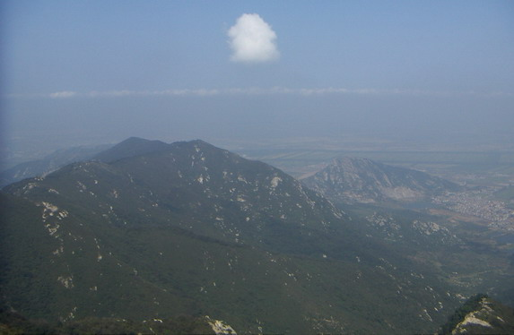

# 《海內東經》白話讀本（卷十三）

## 本卷導覽

《海內東經》不像前五卷《山經》那樣「往東三百里又一座山」地一步步走，而是一份按區域點名登記的「地名總目錄」：以「海內的東北角往南」為框架，把地名一批批掛上去。全卷四十四條，內容其實混了四層，讀的時候要分清——

1. **東北海疆的方國名單**：鉅燕、蓋國、倭、朝鮮、列陽，從遼西、遼東一路排到朝鮮半島和日本列島，外加廟島群島方向的一串海島。要特別提醒：燕、朝鮮、倭這些名字，都是戰國到漢代的人才用的稱呼，是後來編書的人用當時的地名往上貼的標籤。方向大體可信，但每個名字的最早所指是哪一族人，還在研究。
2. **夾在正文里的西域材料**：第 3、4 條後面附著另一批抄本殘片，記的是埻端、璽㬇、大夏、豎沙、居繇、月支等流沙內外的國家和白玉山、蒼梧——這是中亞—西域方向的東西，跟東北框架對不上，是編者歸不進正文、只好附在這裏的材料。其中「崑崙虛東南」這類方位詞，是把當時（戰國到漢）人已知的世界重新排過的結果，不能拿來定位；我們在前卷的判斷是：「崑崙虛」最可能是撒哈拉沙漠里的理查特構造（俗稱「撒哈拉之眼」），另一說（吉薩金字塔）已被排除。這一點還在研究，只當方向參考。
3. **二十六條大河的目錄**：第 11 到 36 條逐條記河流的「發源—流向—入海（入河）處」，和今天中國的水系對得出奇地好。但裏面出現了「長城」「象郡」「江州」和成堆的漢代縣名——說明**這一層是戰國到漢代的編者補寫的，按當時人熟悉的中國地理寫的**；卷末那條建平元年（公元前 6 年）的校書題記就是鐵證。所以這部分的可靠，是「漢代人記的水系和今天對得上」的可靠，不等於書裏最古老那一層的證據。只有和《山經》能對上的部分（岷山長江三源、少室山與颍水、洛水、汾沁漳諸水、洞庭）纔可能上溯到更早的認知。
4. **海裏的風物**：黃海上的島嶼聚落，海洋巨物三連（大蟹、陵魚、大鯾），以及海市蜃樓變成的神話（蓬萊、大人之市）。

全卷最結實的幾個點：岷山—長江三源（和《中山經》九次互相印證）、嵩山少室山（一座山分出兩個水系，和實測分水嶺完全相符）、洞庭湖、彭蠡（鄱陽湖方向）、郁洲島（今連雲港雲臺山——清代以前真是海裏的島）。本卷沒有里程數字，能驗證的是水系走向和先後次序，這些幾乎條條命中。

---

## 海內東經·全卷

### 1. 全卷總綱：從東北角往南記

> **【原文】**
> 海內東北陬以南者。

**白話解讀**：這是一句編排說明：本卷登記的是海內的東北角、以及由東北角往南的一片地方（「陬」就是角落）。沒有實際內容，但透露了編者的整理原則——按方位分區。值得注意的是，本卷實際混進了一大批西域方向的材料（見第 3、4 條），說明編者把歸不進東北框架的抄本殘片附在了這裏——這本身就是這部書被反覆編訂過的證據。

---

### 2. 鉅燕：東北角的大燕之地

> **【原文】**
> 鉅燕在東北陬。

**白話解讀**：「鉅」就是「大」，鉅燕即大燕之地，在海內框架的最東北角。我們判斷它指河北北部到遼西走廊這一片，方向上和「東北角」相合（《海內北經》也記了鉅燕，兩卷互相印證）。但要知道：「燕」是戰國七雄的國名，是後人回溯著貼上去的標籤，不能反推更早的時代當地族群管自己叫「燕」。方向可作參考，具體落點還在研究。

---

### 3. 東北亞方國鏈＋附帶的西域殘片

> **【原文】**
> 蓋國在鉅燕南，倭北。倭屬燕。　　朝鮮在列陽東，海北山南。列陽屬燕。

**白話解讀**：這一條要拆成兩層讀——正文和附在後面的另一種抄本文字，說的是兩個完全不同的方向。

**正文**是一條東北亞方國鏈：蓋國在鉅燕以南、倭以北——大概在蓋馬大山—鴨綠江流域方向（朝鮮半島北部），還在考證；「倭」指日本列島方向（傳統上認為對應北九州一帶），但「倭屬燕」是漢代冊封故事的口吻，屬於後加的；朝鮮在列陽以東，「海北山南」——渤海黃海之北、山脈之南，和半島北部（平壤—大同江方向）的地形相合，但「朝鮮」是周秦時代的名字，同樣是後來貼的標籤；列陽大致在遼東（遼陽—襄平方向）。這一層從遼西到列島的排列次序在地理上是順的，只是每個具體落點都還沒法定死。

**附帶殘片**是另一批抄本上的話：「國在流沙中者埻端、璽㬇，在崑崙虛東南」「國在流沙外者，大夏、豎沙、居繇、月支之國」。這是中亞—西域方向的材料：埻端、璽㬇是流沙中的綠洲國，名字和今天的地名完全對不上號；大夏大概對應巴克特里亞—阿姆河流域方向（那裏公元前兩三千年間確有發達的青銅文明，時代對得上）；豎沙、居繇在中亞河中地方向；月支就是後來月氏人的前身，河西走廊—伊犁河—阿姆河方向。這些全是方向性猜測。其中「崑崙虛東南」這個方位有問題：按我們的主候選，崑崙虛是撒哈拉之眼，中亞在它的東北方八千里之外，怎麼也不在其東南——所以這批方位詞**是戰國到漢代的編者按當時已知的世界重新排過的，不能拿來實地定位**。還有一句「一曰海內之郡，不為郡縣」，是漢代編者的批註混進了正文。

（圖：Wikimedia Commons）

---

### 4. 列姑射島鏈＋白玉山殘片

> **【原文】**
> 列姑射在海河州中。

**白話解讀**：正文一句：列姑射「在海河州中」，即在黃河古口之外的海中島洲——我們判斷是廟島群島—渤海海峽島鏈方向，屬方向性猜測。它和《東山經》的姑射三山同名，但那一處另有歸屬，同名而不同地，兩種讀法都留著。

附帶的殘片又是一段西域材料：「西胡白玉山在大夏東，蒼梧在白玉山西南，皆在流沙西，崑崙虛東南。崑崙山在西胡西，皆在西北。」白玉山大概是天山—帕米爾一帶產玉的山地，和田玉礦脈方向（先秦時和田玉東傳有實物證據，但這條殘片的方位詞同樣是後來重排過的，不能當定位依據）；蒼梧在正文系統里指九疑山—湘桂走廊方向（舜葬蒼梧的故事是後人附會的），殘片卻把它擺到白玉山西南——兩批抄本混排，矛盾擺在那兒，我們不強解。

---

### 5. 雷澤雷神：打雷的神

> **【原文】**
> 雷澤中有雷神，龍身而人頭，鼓其腹。在吳西。

**白話解讀**：雷澤里住著一位雷神，龍的身子、人的頭，敲打自己的肚子——隆隆雷聲就是這麼來的。雷澤大概是雷夏澤—菏澤一帶的古湖沼（古濟水流域，今天已經消失了），方向比較可信。「鼓其腹」是把雷聲擬人化的寫法；龍身人頭的造型和《東山經》諸神「人身龍首」屬於同一套水神造像傳統。不過「在吳西」的「吳」是春秋國名，屬於後世貼上去的方位詞。後世「華胥踩雷澤腳印生伏羲」的故事，是更晚的附加層，不能當地理證據。

---

### 6. 都州：今天的連雲港雲臺山，當年真是海中島

> **【原文】**
> 都州在海中。一曰郁州。

**白話解讀**：都州是海中的一座島，另一種寫法叫「郁州」。我們判斷它就是郁洲島——今江蘇連雲港雲臺山一帶。這個判斷有硬支撐：**郁洲島在清代以前確實孤懸海中，後來泥沙淤積才和大陸連起來**——「在海中」三個字和歷史地貌完全吻合，而「一曰郁州」正好記下了名字的傳承。這是本卷少有的「古今地貌變遷直接對上」的例子。

（圖：Wikimedia Commons）

---

### 7. 琅邪台：海濱高臺

> **【原文】**
> 琅邪臺在渤海閒，琅邪之東。其北有山。一曰在海閒。

**白話解讀**：琅邪台在海濱，琅邪地以東，北面有山。大概是膠南琅琊台（黃海之濱的臺地，北依大珠山）——「琅邪之東，其北有山」和實地地形相合。但「在渤海間」和膠南濱黃海矛盾，好在抄本自己留了另一種寫法「一曰在海間」——這是古人自己打的存疑標記，應當取後者。「琅邪」一名來自越王勾踐遷都、秦始皇登臨那套後世故事，是後來貼的名字；這座「台」到底是人工觀測臺還是天然臺地，還沒定論。

---

### 8. 韓鴈：都州以南的海中島

> **【原文】**
> 韓鴈在海中，都州南。

**白話解讀**：韓鴈是海中的一座島，在都州（郁洲島）以南。方向上是蘇北—魯南外海，但那片海域島嶼稀少，也可能是早已淹沒的岸外沙洲，或指向朝鮮半島方向——具體落點還在研究。「韓」字和「三韓」有沒有關係，也只是最弱的一種猜想。

---

### 9. 始鳩：轅厲以南的海中島

> **【原文】**
> 始鳩在海中，轅厲南。

**白話解讀**：始鳩在海中，位於轅厲以南。大致是黃海南部—東海北部的島嶼方向，轅厲在它北邊。兩個名字都查不到下落。但都州（第 6 條）—韓鴈（第 8 條）—始鳩（本條）連成了一條海中島嶼序列，和列姑射（第 4 條）、姑射國（第 37 條）同屬一套「環黃海島鏈」的知識——序列本身就是證據：編者手裏有一整套黃海島嶼的記錄，只是具體名字對不上了。

---

### 10. 會稽山：大禹故事的核心舞臺

> **【原文】**
> 會稽山在大楚南。

**白話解讀**：會稽山在大楚（另一種寫法作「大越」）以南。大概是後世定位的紹興會稽山方向。但要疊三層提醒：一，「大楚／大越」是戰國國名，是後來貼的名字；二，禹會諸侯、禹葬會稽的故事是後人一層層附會上去的，不能當證據；三，《南山經》里另有一座「會稽之山」，和這裏同名不同地，兩種讀法並存。

---

### 11. 岷三江：長江有三個源頭（本卷最重要的一條）

> **【原文】**
> 岷三江：首江出汶山，北江曼山，南江出高山。高山在都，西入海，在長州南。

**白話解讀**：這是「長江（江水）有三個源頭」的古老認知：首江出汶山，北江出曼山，南江出高山。汶山就是岷山，即岷山主脊、岷江源區——這個對應很有把握。關鍵在於：《中山經》第九次山系裏，岷山、崍山、崌山三座山各記了一條「江水出焉」，和本卷「首江／北江／南江」三出正好同構——**這是先秦長江多源認知的兩次獨立記錄互相印證**，是全書最有力的跨卷證據之一。曼山、高山大致是岷山北翼（松潘高原方向）、南翼（邛崃山方向），具體還沒有定論。「高山在都，西入海，在長州南」一句文理不通——江水從不向西入海——是傳抄時錯位的句子，不影響源頭的認定；長州無考。順帶一提：岷江—成都平原南緣，正是三星堆文明的同一片天地。

（圖：Wikimedia Commons）

---

### 12. 淅江：錢塘江—新安江水系

> **【原文】**
> 淅江出三天子，都在東，在閩西北，入海，餘暨南。

**白話解讀**：淅江（即漸江，今新安江—錢塘江水系）發源於三天子都，在閩地西北，向東入海，入海口在余暨以南。這條的後世地理對應較有把握：三天子都大致是徽州—黃山—贛東北一帶山地（新安江和鄱陽湖的分水嶺；黃山、率山、鄣公山三种說法並存），余暨即今蕭山方向，正在錢塘江口南岸——「源出徽州山地、入海于蕭山南」和實際水系相合。「閩」「余暨」都是後世地名，是編者按當時地理寫的。《海內南經》的「三天子鄰」和本條互相印證。

---

### 13. 廬江：與淅江同出一山、向西入大江

> **【原文】**
> 廬江出三天子，都入江，彭澤西，一曰天子鄣。

**白話解讀**：廬江同樣發源於三天子都（另一種寫法作「天子鄣」），向西入大江，入江口在彭澤以西。這說的是皖南—贛北入江的水系（青弋江或樂安江方向，還拿不準）。彭澤即彭蠡澤—鄱陽湖方向（較有把握，但古彭蠡澤的範圍和今鄱陽湖不同，湖是後來才從江北縮到江南的）。和上一條合看很有意思：**同一座三天子都，向東的水成了錢塘江系，向西北的水入彭蠡進長江**——和皖贛山地真實的分水嶺格局完全相符。

---

### 14. 淮水：淮河

> **【原文】**
> 淮水出餘山，餘山在朝陽東，義鄉西，入海，淮浦北。

**白話解讀**：淮河發源於余山——大概就是桐柏山方向，東流入海，入海口在淮浦以北。桐柏山發源、東流入海，和今天的淮河完全吻合（但請記住：這是後世編者記的水系）。朝陽、義鄉、淮浦都是漢代縣名——說明這一條是漢代人整理的版本。颍水（第 19 條）、汝水（第 20 條）入淮的記載和本條互相印證，本卷的水系目錄內部是自洽的。

---

### 15. 湘水：繞九疑山入洞庭

> **【原文】**
> 湘水出舜葬東南陬，西環之，入洞庭下，一曰東南西澤。

**白話解讀**：湘水發源於「舜葬」之地的東南角，向西繞過它，下入洞庭湖。「舜葬」指九疑山方向的帝舜葬地故事——那是後人附會的，不能當定位點；但拋開故事看水系：湘江源出海洋山、繞九疑山西北入洞庭，和實際水系相合。洞庭在《中山經》第十二次山系裏就是「洞庭之山」的湖區，那一卷還記了「瀟湘之淵」「帝之二女居之」，是同一片水域的兩次記錄，可以互證。

（圖：Wikimedia Commons）

---

### 16. 漢水：嶓冢山源與顓顼葬地故事

> **【原文】**
> 漢水出鮒魚之山，帝顓頊葬于陽，九嬪葬于陰，四蛇衛之。

**白話解讀**：漢水發源於鮒魚之山——大概是嶓冢山方向（陝西寧強，漢水源區），和《禹貢》「嶓冢導漾」的傳統同源。後半句是帝王葬地故事：顓顼葬在山南（陽坡）、九位妃嬪葬在山北（陰坡）、四條蛇守衛——山南水北的配置是禮制講究，「神獸守陵」的寫法和《西山經》開明獸守崑崙是同一類。注意《大荒北經》附禺之山也記「帝顓顼與九嬪葬焉」——**同一個故事安在兩個地方，說明葬地傳說會流動，兩處都不能當定位證據**。另外《西山經》第一列也有一座嶓冢山，同名不同地，兩種讀法並存。

---

### 17. 濛水：漢水上游支流

> **【原文】**
> 濛水出漢陽，西入江，聶陽西。

**白話解讀**：濛水出漢陽，向西入江（這裏的「江」指漢水這一段，江、漢的稱呼混著用），在聂陽以西。大概是漢中盆地入漢水的支流，漾水／沔水方向，還拿不準。漢陽、聂陽都無確考。《西山經》第四列也有一條濛水，那是同名異地，各是各的水。

---

### 18. 溫水：崆峒山下的泾河支流

> **【原文】**
> 溫水出崆峒山，在臨汾，南入灑，華陽北。

**白話解讀**：溫水發源於崆峒山，向南注入灑水，在華陽以北。崆峒山大概是平涼崆峒山—六盤山方向；溫水大約是泾河的支流（汭水方向）。「黃帝上崆峒問道广成子」的故事是後人附會的。「在臨汾」一句和平涼的方位矛盾——臨汾在晉南，離崆峒數百里，是傳抄時混進來的錯句；灑水指哪條河還在研究。下一條泾水和本條同域互證。

---

### 19. 颍水：嵩山少室的南麓之水

> **【原文】**
> 潁水出少室，少室山在雍氏，南入淮，西鄢北。一曰緱氏。

**白話解讀**：颍水（今颍河）發源於少室山，向南入淮河。少室山就是嵩山少室——這是複用《中山經》第七次山系的節點，很有把握。這條好在哪：《中山經》記少室之山「休水出焉，北流注于洛」——**北麓的水入洛河（黃河水系），本卷記南麓出颍水入淮（淮河水系）；一座山、兩個水系，和嵩山實際的分水嶺完全相符**。雍氏、西鄢、緱氏都是漢縣名，屬後世編者的寫法。

（圖：Wikimedia Commons）

---

### 20. 汝水：伏牛山東麓入淮

> **【原文】**
> 汝水出天息山，在梁勉鄉，西南入淮，極西北。一曰淮在期思北。

**白話解讀**：汝水（今汝河）發源於天息山——伏牛山東段—外方山方向，西南入淮河；另一種抄本對入淮點有另一說（期思北）。後世記的水系走向可靠，但要注意：**汝河在元代被截流改道，今天的樣子已經不是古汝河了**——河流改道是讀這部書時要常記的古今變遷。梁勉鄉、期思都是漢縣名。《中山經》第十一次山系裏的「汝水」記錄與此互證。

---

### 21. 泾水：「長城」二字是本卷年代的化石

> **【原文】**
> 涇水出長城北山，山在郁致，長垣北，北入謂戲北。

**白話解讀**：泾水（今泾河）發源於「長城北山」——六盤山方向，北流入渭（「謂戲」是「渭」的讹字）。泾河六盤山發源、高陵入渭，和實際相符。這條最大的價值在「長城」兩個字：**拿戰國秦長城當地標，直接證明本卷水系目錄是戰國到漢代的編者補寫的**——這是文本內部的時代化石，和卷末建平元年（公元前 6 年）的題記首尾呼應。郁致、長垣都是漢縣名。

---

### 22. 渭水：鳥鼠同穴山

> **【原文】**
> 渭水出烏鼠同穴山，東注河，入華陰北。

**白話解讀**：渭水（今渭河）發源於鳥鼠同穴山——今甘肅渭源鳥鼠山，東注黃河，入河點在華陰以北。渭源—潼關入河，和實際完全相合，《禹貢》「導渭自鳥鼠同穴」同源。「鳥鼠同穴」這個名字可能來自高原鼠兔與雪雀共棲的生態觀察（還屬猜測）——這種生態在青藏高原—黃土高原西緣的山地都見得到，所以光靠名字定不了地點。提醒：《西山經》第四列也有鳥鼠同穴之山，同名不同地，兩種讀法並存。

---

### 23. 白水：嘉陵江上游

> **【原文】**
> 白水出蜀，而東南注江。入江州城下。

**白話解讀**：白水發源於蜀地，東南流注入長江，入江口在江州城下——即今白水江—嘉陵江上游，到重慶（江州）入長江，和實際完全相符。「蜀」「江州」都是後世地名，是編者按當時地理寫的。《中山經》第九次山系的岷山鏈東段（成都平原方向）與本條同域互證。

---

### 24. 沅水：「象郡」是編輯露出的馬腳

> **【原文】**
> 沅水山出象郡，鐔城西。入東注江，入下雋西，合洞庭中。

**白話解讀**：沅水（今沅江）發源后東流，最終匯入洞庭湖——黔東發源、常德入洞庭，和實際相合。但「出象郡」是明顯的時代錯位：秦代的象郡實際在嶺南，和沅水源區（黔東）對不上——**這是漢代編者拿秦漢政區硬套先秦水名留下的痕跡，本身就是「這一層是後來編的呢」的證據**。鐔城還沒有定論，下雋是漢縣名。

---

### 25. 贛水：贛江入鄱陽湖

> **【原文】**
> 贑水出聶都東山，東北注江，入彭澤。

**白話解讀**：贛水（今贛江）發源於聶都東山（贛南山地方向），東北流，經彭澤（彭蠡澤—鄱陽湖方向）入長江。贛江→鄱陽湖→長江，和實際完全相合，和第 13 條廬江構成「贛—皖入湖水系對」。聶都是後世地名。

（圖：Wikimedia Commons）

---

### 26. 西泗水：已經消失的古泗水

> **【原文】**
> 西泗水出吳東北而南、西南，過湖陵西而東南，注東海，入淮陰北。

**白話解讀**：西泗水即古泗水，發源於吳地東北（魯南方向——「吳」是春秋國名，屬後世貼名），過湖陵以西，東南流，在淮陰以北入海（實際應是入淮，「注東海」是約略說法）。泗水下遊走向和實際相符；**這條河後來在黃河奪泗的改道中湮滅，今已不存**——又一處河流改道的古今變遷。湖陵、淮陰都是漢縣名。

---

### 27. 郁水：嶺南入南海的西江水系

> **【原文】**
> 鬱水出象郡而西南，注南海，入須陵東南。

**白話解讀**：郁水即鬱江—西江水系，西南流注入南海，指嚮明確。有趣的是：這裏的「象郡」用在嶺南是對的，而第 24 條沅水也說自己「出象郡」——兩處自相矛盾，恰好證明「象郡」是漢代編者隨手套用的泛用地名，這是編輯留下的文本內證。須陵無考。

---

### 28. 肆水：北江方向，源頭是抄錯的

> **【原文】**
> 肆水出臨晉，西南而東南注海，入番隅西。

**白話解讀**：肆水東南注海，入海口在番禺（广州方向）以西——大概是浈水—北江方向，和珠江口方位相合。但「出臨晉」必是抄錯的：臨晉在陝西，和注海入番禺差了半個中國。下一條潢水（粵北）注肆水，與本條構成一對自洽的粵北—珠江口水系，錯的只是源山。「番隅」即番禺，後世地名。

---

### 29. 潢水：粵北入北江的水

> **【原文】**
> 潢水出桂陽西北山，東南注肆水，入敦浦西。

**白話解讀**：潢水發源於桂陽西北山地（郴州西北方向——「桂陽」是漢郡名），東南流注入肆水。大概是連江／湟水一類粵北入北江的水系。桂陽西北山地→東南入北江，和粵北山地—北江水系相符；敦浦無考。《南山經》第三列的嶺南鏈（犀兕象熱帶動物群）是同域背景。

---

### 30. 洛水：複用《中山經》的洛河

> **【原文】**
> 洛水出洛西山，東北注河，入成臯之西。

**白話解讀**：洛水（今洛河）發源於洛西山，東北注入黃河，入河點在成皋（荥陽方向）以西。這條複用《中山經》第四列的雒水：草鏈嶺洛河源區—巩義入河，方向一致，很有把握。中二、中四、中五多卷都有洛河記錄，是中原水系的跨卷共識。成皋是漢縣名。

---

### 31. 汾水：複用《北山經》的汾河

> **【原文】**
> 汾水出上窳北，而西南注河，入皮氏南。

**白話解讀**：汾水（今山西汾河）發源於上窳以北，西南流注入黃河，入河點在皮氏（河津方向）以南。《北山經》第二列記「管涔之山……汾水出焉，而西流注于河」，與本條同名、同向、同走法，很有把握。「上窳」或許是管涔山的異名，還沒有定論。皮氏是漢縣名。

---

### 32. 沁水：源頭寫錯了，水沒錯

> **【原文】**
> 沁水出井陘山東，東南注河，入懷東南。

**白話解讀**：沁水（今山西沁河）東南流注入黃河，入河點在懷（沁陽方向）東南——走向和實際相符。但「出井陉山東」是錯的：沁河實出沁源方向，井陉在太行山東側，對不上，是傳抄時混排的。水系本身在《北山經》第三列有記錄（謁戾之山南注河），可以互證；按「水系走向比山名更要緊」的原則，源山寫錯不動搖這條水的認定。懷是漢縣名。

---

### 33. 濟水：已湮滅的古四渎之一

> **【原文】**
> 濟水出共山南東丘，絕鉅鹿澤，注渤海，入齊琅槐東北。

**白話解讀**：濟水發源於共山南東丘（王屋山方向），穿越鉅鹿澤方向的大湖沼，東北注渤海。這是古濟水——濟渎「出王屋、絕河、東北入海」的傳統與本條大意相合；**這條河後來因黃河改道、泺口奪濟而湮滅，今已不存**。又一條消失的古河。「鉅鹿澤」「齊琅槐」都是後世地名。《中山經》第十一列另有一條「濟」，是否同一條還沒定。

---

### 34. 潦水：遼河方向

> **【原文】**
> 潦水出衛臯東，東南注渤海，入遼陽。

**白話解讀**：潦水發源於衛皋以東，東南流注入渤海，至遼陽。大概是遼河方向——遼西發源、東南入渤海（遼東灣），走向相符。這條和本捲開頭的東北方國名單（鉅燕、列陽）在空間上合攏：遼西—遼東的山水認知是同一套。衛皋無考；遼陽是漢縣名。

---

### 35. 虖沱水：滹沱河

> **【原文】**
> 虖沲水出晉陽城南，而西至陽曲北，而東注渤海，入越章武北。

**白話解讀**：虖沱水即今滹沱河：出太原盆地（晉陽城南、陽曲北一帶），東穿太行入河北平原，最終注渤海（章武方向），和實際相符。晉陽、陽曲、章武都是漢縣名。《北山經》第三列的太行山鏈是同域背景。

---

### 36. 漳水：一條河身上的黃河改道史

> **【原文】**
> 漳水出山陽東，東注渤海，入章武南。

**白話解讀**：漳水（今漳河）東流注渤海，至章武以南。《北山經》第三列也記了漳水，可互證。這條最有意思的地方是受水的變化：**《北山經》記漳水「東流注于河」（先秦時入黃河），本卷記「東注渤海」——黃河改道北徙之後，漳河才獨流入海**。同一水系、兩個時代的記錄，演化方向完全正確——這是全書裏「不同時代的文字疊在一起」的最佳示範。山陽、章武都是漢縣名；「出山陽東」和發鳩山（長子方向）小有出入，屬傳抄層的毛病。

---

### 37. 姑射國：列姑射島鏈上的島嶼聚落

> **【原文】**
> 姑射國在海中，屬列姑射，西南，山環之。

**白話解讀**：姑射國是海中的一個島嶼聚落，隸屬列姑射（第 4 條的島鏈），在其西南，有山環繞。大概是廟島群島—膠東外海的島嶼聚落方向：「山環之」是島嶼地形的記錄，廟島群島正是丘陵島，相合。「屬列姑射」記的是島鏈和聚落的隸屬關係，和都州—韓鴈—始鳩序列同屬黃海島嶼人居的記錄。與《東山經》姑射三山同名不同地，兩種讀法並存。

---

### 38. 大蟹：海中巨蟹

> **【原文】**
> 大蟹在海中。

**白話解讀**：海中有一隻（一種）大蟹。大概是渤海—黃海大型蟹類的誇飾性風物記錄，具體是什麼蟹還在研究。它和《東山經》第三列的蠵龜（巨型海龜）記錄同屬「海洋巨物」這一類記錄傳統——古人對海裏的大東西充滿想像。

---

### 39. 陵魚：人面手足的魚

> **【原文】**
> 陵魚人面，手足，魚身，在海中。

**白話解讀**：陵魚長著人的臉、有手有腳、魚的身體，在海中。兩個候選並存：一是大鲵（娃娃魚）的神格化——大鲵有四肢、叫聲似嬰兒啼哭，和「人面手足」相合，但它是淡水种，和「在海中」矛盾；二是鯨或海牛類大型海獸的目擊泛化。兩種讀法都只能算方向性猜測。《海外西經》「龍魚陵居」是同一個母題。

（圖：Wikimedia Commons）

---

### 40. 大鯾：海中大魚

> **【原文】**
> 大鯾居海中。

**白話解讀**：大鯾是棲居海中的大魚。「鯾」指鲂類大魚，「居海中」指向大型海魚或鯨——黃海歷史上有鯨類（長鬚鯨等）記錄。大蟹（38）—陵魚（39）—大鯾（40）構成「海洋巨物三連」，說明編者手裏有一批黃渤海的海洋巨物傳聞，只是具體物種對不上了。

---

### 41. 明組邑：海島上的人居聚落

> **【原文】**
> 明組邑居海中。

**白話解讀**：明組邑是海中島嶼上的一個定居點（「邑」就是人住的聚落）。方向上是黃海島嶼。值得注意一個「邑」字：編者把它當作真實的人居聚落而非神怪，和姑射國同屬黃海島嶼人居層。具體指哪裏還不知道。

---

### 42. 蓬萊山：海市蜃樓變成的神山

> **【原文】**
> 蓬萊山在海中。

**白話解讀**：蓬萊山在海中。我們判斷這是**海市蜃樓自然現象的神格化**——海霧中浮現的島影。後來戰國齊地的方仙傳統把它定型為「蓬萊、方丈、瀛洲」三神山，那是後來的事；「蓬萊」成為膠東地名也是這套故事落地的結果。和下一條「大人之市」合看：山是島影、市是城郭幻影，正是渤海—膠東海市蜃樓觀察的一對雙記錄。

---

### 43. 大人之市：「海市」一詞的源頭

> **【原文】**
> 大人之市在海中。

**白話解讀**：海中有一座「大人之市」。這是海市蜃樓（城郭市集的幻影）和「大人國」故事的疊合記錄——**漢語「海市」一詞正是從這類記錄定型的**。大人國的故事還見於《海外東經》與《大荒東經》，說明這個母題在東部沿海的敘事圈裏流傳；它能證明故事流傳的分佈，但不能當定位證據。

---

### 44. 校書題記：全書的「出廠標籤」

> **【原文】**
> 建平元年四月丙戌，待詔太常屬臣望校治，侍中光祿勳臣龔、侍中奉車都尉光祿大夫臣秀領主省。

**白話解讀**：這不是地理內容，而是《山海經》的「出廠標籤」：建平元年四月丙戌日——即**公元前 6 年**（漢哀帝朝），由待詔太常屬臣丁望校訂整理，侍中光祿勳王龔、侍中奉車都尉光祿大夫劉秀（即劉歆，改名秀）主持審閱。這是劉歆校定本的原始題記，證明本卷（及全書）文本定型不晚於公元前 6 年。它和第 21 條的「長城」、第 24/27 條的「象郡」、第 3 條的「海內之郡」批語連成一條內證鏈：**本卷水系目錄是戰國到漢代的編者按當時地理補寫的**；其中只有和《山經》能對上的部分（岷三江、少室、洛水、汾沁漳、洞庭）纔可能上溯為更早的認知。

## 卷末小結

《海內東經》是一份戰國到漢代編者補寫的水系目錄：與《山經》對得上的部分纔可能更早；漳水從「注于河」改記「注渤海」一條，是全書「不同時代的文字疊在一起」的最佳示範。
