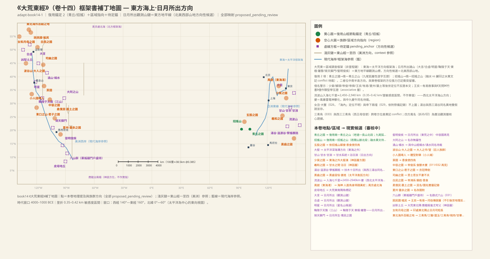

# 《大荒東經》白話通順版（卷十四 · draft-v2）

> 基於 draft-v1（book-14-dahuangdong.md）重寫：每條原文照錄，配一段白話解讀；未決項逐條照錄 v1，一條不丟。凡涉及已生效裁決處按裁決口徑表述（ADJ-002 昆侖虛＝撒哈拉之眼、ADJ-003 燭龍＝極晝極夜極光、ADJ-004 兩河空檔由框架書承擔、ADJ-005 山名唯一／水名類名）。本卷 36 條目。

## 本卷導覽

- **範圍**：本卷是「大荒」四卷之首，屬框架書（區域調查），不走山經「又東幾百里」的里程站鏈，而是以「東海（太平洋方向）之外／大荒之中／東南隅—東北隅」為空間框架，收錄東方海上方向的山水、方國與神話人物。
- **主錨點**：全卷沒有實測錨點，只有兩處跨卷復用——招搖山復用《南山經》首山（若開山脈北段方向，較低—中等置信）、青丘之國復用南一青丘之山（長山北段東麓近海·清化—乂安方向 ≈19.3°N 105.4°E——南一雙修後新站位，2026-10-28 同步；中等置信）；其餘全部待錨。
- **里程吻合度**：框架書不做里程算術。全卷唯一里程是流波山「入海七千里」，按每里 0.35–0.42 公里的敏感區間約合 2450–2940 公里，自東亞海岸起算落在西北太平洋海山帶—中途島方向之間——只作方向性參考，不作單值。
- **核心內容**：六組「日月所出」觀測山（大言、合虛、明星、鞠陵于天／東極／離瞀三山簇、猗天蘇門、壑明俊疾）構成東方地平線上的日出觀測山標鏈；帝俊系譜方國群（中容、司幽、白民、黑齒）、王亥—有易—河伯傳說、應龍殺蚩尤夸父神話、羲和浴日（十日）曆法神話是本卷人文主體。
- **主要未決**：日月所出山鏈的具體觀測基點；青丘、招搖兩處「南卷實體收入東卷」的方位張力；甘水、楊水、湯谷等同名問題（按 ADJ-005 水名類名口徑已除衝突化）。未決項共 91 條，照錄於各條之下。
- **配圖說明**：本卷絕大多數實體為方向性猜測或神話層，按「只為高置信／已確認對象配圖」的規則從嚴配圖。又因本運行環境無法訪問 Wikimedia Commons（連接超時），按「不可達就換圖」規則改用 iNaturalist 開放數據的 CC 授權真實照片，所有圖片 URL 嵌入前均經 `curl -sI` 驗證返回 HTTP 200。

---

## 大荒東經·全卷（book14）

### 東海之外的大壑與少昊之國（甘山·甘水·甘淵）【SHJ-14-1-001】

> **【經文原文】**
> 東海之外大壑，少昊之國。少昊孺帝顓頊于此，棄其琴瑟。有甘山者，甘水出焉，生甘淵。

**白話解讀**：這段說：東海之外有一處極深的海上窪地，那裡是少昊之國；少昊曾在這裡撫養顓頊長大，（顓頊成人後）把童年用的琴瑟丟棄在此。還有一座甘山，甘水從這裡發源，匯成甘淵。我們的讀法：東海是本卷框架的東方大海，即太平洋方向（較可靠的方向性讀法）；「壑」就是深谷大水，「大壑」是太平洋深海溝一級的深水海淵，只記方向、不指認具體哪條海溝（方向性猜測）。少昊之國是神話層方國，「少昊孺帝顓頊」是帝系寄養神話的場所化，不作地理錨；後世把少昊定位到東夷曲阜之類，不反證本文。甘山→甘水→甘淵是一條「出—生」兩級自足的小水系，「甘」是美名（水味甘美）；它與《中四經》入洛方向的甘水（WAT:SHJ-05-4-001#1）同名，但按 ADJ-005「水名＝性狀類名」的裁決口徑，同名不是衝突——同類水體異地各自命名即可成立。全部待錨，方向性猜測。

**未決項**
- 未知：東海——東海框架海的具體空間尺度
- 未知：大壑——大壑是否實測深水或神話化海淵
- 未知：少昊之國——少昊氏是否有可錨定的族群基底
- 未知：甘山——甘山確指
- 衝突：甘水——與中四甘水（WAT:SHJ-05-4-001#1，鹿蹄之山北流溪入洛方向）同名——雙假說：A 通用嘉名各自命名（同名異地）；B 跨卷同一水名傳統。不裁決，待審
- 未知：甘水——甘水實體
- 未知：甘淵——甘淵與湯谷（027）是否同一日出地點的異名
- 未知：少昊——少昊與帝俊系譜的關係

### 皮母地丘（大荒東南隅的角標山）【SHJ-14-1-003】

> **【經文原文】**
> 大荒東南隅有山，名皮母地丘。

**白話解讀**：大荒的東南角有一座山，名叫皮母地丘。這是本卷框架的東南角標記——「地丘」就是丘隴土山；按大荒東觀測框架，它的方向性候選在東南遠端（中美地峽以南方向）。僅此一句、別無屬性，待考。

**未決項**
- 未知：皮母地丘——皮母地丘確指

### 大言山（日月所出之一）【SHJ-14-1-004】

> **【經文原文】**
> 東海之外，大荒之中，有山名曰大言，日月所出。

**白話解讀**：東海之外、大荒之中，有一座叫大言的山，是日月升起的地方。「日月所出」不是神話修辭那麼簡單——它是東方地平線上升點的觀測標記，有方位曆法功能；大言山是本卷觀測山鏈的第一員。方向性候選：北美西部山地方向。東海同 001 條。觀測基點待考。

**未決項**
- 未知：大言——日月所出山鏈的觀測基點

### 波谷山·大人之國·大人之市【SHJ-14-1-005】

> **【經文原文】**
> 有波谷山者，有大人之國。有大人之市，名曰大人之堂。有一大人踆其上，張其兩臂。

**白話解讀**：有一座波谷山，那裡有大人之國；大人國有集市，叫「大人之堂」；有一個大人蹲踞在堂上，張開雙臂。「波谷」像是濱海波浪谷地的描述性命名；「大人之國」是巨人族群的記錄，方向性候選在東北太平洋—北美西北海岸一帶。「大人之市／大人之堂」是市集兼公共建築的人文場景記錄；「踆」就是蹲踞，「張其兩臂」是對巨人體態的觀察速寫（另有異文作「兩耳」，量度／儀式姿態兩讀並存待裁）。整體方向性猜測。

**未決項**
- 未知：波谷山——波谷山確指
- 未知：大人之國——大人國與海外東大人國的同一性
- 未知：大人之國——異文兩臂/兩耳裁決
- 未知：大人之市（大人之堂）——堂/市的建築性質

### 小人國（靖人）【SHJ-14-1-006】

> **【經文原文】**
> 有小人國，名靖人。

**白話解讀**：有一個小人國，族名叫靖人。「靖」在這裡取「細小」之義，這是侏儒族群的記錄，與上條大人之國恰好對舉——一巨一侏，是觀察者對東方海上人群體態差異的並置記錄。方向性：東方海上；族群原型待考。

**未決項**
- 未知：小人國（靖人）——靖人族群的實際原型

### 犁𩵀之尸（人面獸身神）【SHJ-14-1-007】

> **【經文原文】**
> 有神，人面獸身，名曰犁𩵀之尸。

**白話解讀**：有一位神，人面獸身，名叫犁𩵀之尸。這是一尊人面獸身的複合神造像；「尸」是神主／祭儀造像的意思（古代「尸祭」「尸位」的尸），不是屍體。屬神話層，造像母題較可靠；「犁𩵀」名義待考。

**未決項**
- 未知：犁𩵀之尸——犁𩵀名義

### 潏山·楊水【SHJ-14-1-008】

> **【經文原文】**
> 有潏山，楊水出焉。

**白話解讀**：有一座潏山，楊水從這裡發源。「潏」就是水湧出，潏山是湧泉之山的候選；楊水只記了「出」這一級，沒有流向和受水，信息到此為止。同名問題按 ADJ-005 裁決口徑處理：楊水與《中六經》入洛方向的楊水（WAT:SHJ-05-6-014#1）同名，屬水名類名、異地各名，不再視為衝突；「潏」與《中一經》潏水（WAT:SHJ-05-1-011#2）同詞根，同屬以水性名水的通例。方向性猜測，待錨。

**未決項**
- 衝突：潏山——與中一潏水（WAT:SHJ-05-1-011#2，運城盆地水系候選）同詞根——雙假說：A 通用水義各自命名；B 水名移植。不裁決
- 未知：潏山——潏山確指
- 衝突：楊水——與中六楊水（WAT:SHJ-05-6-014#1，陽華之山西南坡溪入洛方向）同名——雙假說：A 同名異地（楊＝常見水名用字）；B 跨卷名移植。不裁決，待審
- 未知：楊水——楊水流向

### 葊國（黍食、使四鳥）【SHJ-14-1-009】

> **【經文原文】**
> 有蒍國，黍食，使四鳥：虎、豹、熊、羆。

**白話解讀**：有一個葊國，以黍為食，能驅使四種「鳥」：虎、豹、熊、羆。「黍食」說明這是種黍的農業族群；「使四鳥」而列出虎豹熊羆，可見「鳥」在這裡是禽獸的泛稱（也可能是馴獸或圖騰記錄，兩讀待考）。這種「黍食＋使四鳥」的句式是本卷方國記錄的標準格式。方向性：東方海上。「葊」的名義待考。

**未決項**
- 未知：葊國——葊名義
- 未知：葊國——使四鳥的確切含義（馴養/圖騰/泛稱）

### 合虛山（日月所出之二）【SHJ-14-1-010】

> **【經文原文】**
> 大荒之中，有山名曰合虛，日月所出。

**白話解讀**：大荒之中，有一座叫合虛的山，是日月升起的地方。這是觀測山鏈的第二員；「合虛」可解作「合於虛空」，是天地交接語義的候選。方向性候選同鏈：北美西部山地方向。本條 v1 無未決項記錄。

### 中容之國（帝俊系，食獸木實）【SHJ-14-1-011】

> **【經文原文】**
> 有中容之國。帝俊生中容，中容人食獸、木實，使四鳥：豹、虎、熊、羆。

**白話解讀**：有一個中容之國。帝俊生中容，中容人吃獸肉和樹木果實，能驅使豹、虎、熊、羆。這是帝俊系譜的方國；注意「食獸、木實」而**不吃黍**——與本卷一堆「黍食」諸國形成生業分層，狩獵採集與農業被分開記錄，這是很細的觀察。本國在 032 條再見，重出性質待裁。方向性：東方海上。

**未決項**
- 未知：中容之國——中容確指
- 未知：中容之國——011/032 重出是複寫還是兩支

### 東口之山·君子之國（衣冠帶劍）【SHJ-14-1-012】

> **【經文原文】**
> 有東口之山。有君子之國，其人衣冠帶劍。

**白話解讀**：有一座東口之山；有一個君子之國，那裡的人穿衣戴冠、腰佩長劍。「東口」是東方山口／海口的描述性命名候選；「衣冠＋帶劍」是禮制服飾加武裝佩飾，在觀察者筆下是文明程度的標記——這國人「像樣」。君子國亦見《海外東經》（book09 待聯動），兩處是否同一國待裁。方向性：東方海上。

**未決項**
- 未知：君子之國——君子國與海外東君子國的同一性

### 司幽之國（思士不妻、思女不夫）【SHJ-14-1-013】

> **【經文原文】**
> 有司幽之國。帝俊生晏龍，晏龍生司幽，司幽生思士，不妻；思女，不夫。食黍，食獸，是使四鳥。

**白話解讀**：有一個司幽之國。帝俊生晏龍，晏龍生司幽——這是帝俊系的三代系譜（神話層）。司幽又生出思士和思女：思士不娶妻，思女不嫁人。這是對婚俗／社會組織的直接觀察——一個存在不婚群體的族群，具體制度含義待考。他們「食黍、食獸」，是農獵混合生業；「使四鳥」仍是泛稱套語。方向性：東方海上。

**未決項**
- 未知：司幽之國——思士思女不妻不夫的制度含義

### 大阿之山（僅存名）【SHJ-14-1-014】

> **【經文原文】**
> 有大阿之山者。

**白話解讀**：有一座大阿之山。僅存山名、別無屬性；「阿」是山陵／山曲的意思，「大阿」即大陵候選。方向性猜測，待考。

**未決項**
- 未知：大阿之山——大阿之山確指

### 明星山（日月所出之三）【SHJ-14-1-015】

> **【經文原文】**
> 大荒中有山名曰明星，日月所出。

**白話解讀**：大荒之中有座叫明星的山，是日月升起的地方。觀測山鏈第三員；「明星」很可能是啟明星（金星）——以星名山，恰好旁證這條山鏈的觀測傳統。方向性候選同鏈：北美西部山地方向。本條 v1 無未決項記錄。

### 白民之國（帝俊—帝鴻系，銷姓）【SHJ-14-1-016】

> **【經文原文】**
> 有白民之國。帝俊生帝鴻，帝鴻生白民，白民銷姓，黍食，使四鳥：虎、豹、熊、羆。

**白話解讀**：有一個白民之國。帝俊生帝鴻，帝鴻生白民；白民以「銷」為姓，種黍為食，能驅使虎、豹、熊、羆。「白民」是膚色或服色的觀察記錄；「銷姓」是全書罕見的氏姓記錄之一（本卷另有姜姓、勾姓）。帝鴻這個名字在西三也出現——天山帝江即帝鴻（渾敦落日神，xici3 已判讀），同一神話人物跨卷出現，記為母題聯動，不裁決是否同一人。另外白民國還見於《海外西經》，東西兩見的方位差異待裁。方向性：東方海上偏北。

**未決項**
- 未知：白民之國——白民與海外西白民國的同一性（跨卷方位異）
- 未知：白民之國——銷姓讀法
- 未知：帝鴻——帝鴻與西三帝江/帝鴻的同一性

### 青丘之國·九尾狐（復用南一青丘之山）【SHJ-14-1-017】

> **【經文原文】**
> 有青丘之國，有狐，九尾。

**白話解讀**：有一個青丘之國，那裡有狐狸，九條尾巴。這是本卷少數能跨卷落實的條目：我們復用《南山經》首經的青丘之山（`MTN:SHJ-01-1-008#1`，中等置信）。**站位更新（2026-10-28）**：南一雙修後青丘＝長山北段東麓近海帶（清化—乂安方向，≈19.3°N 105.4°E），不再是舊標籤「老撾—長山北段」的深內陸位——此挪動同時消解赤鱬＝儒艮與內陸位的矛盾（RT-N4 結案），本復用同步改掛新站位。對齊理由有三：①「青丘」是全書稀有專名；②屬性完全一致——南一說「其狀如狐而九尾」，本條說「有狐，九尾」，九尾狐是青丘獨有的標記（與南一 `CRE:SHJ-01-1-008#3` 同一母題互證）；③國依山命名是全書通例。留下的張力是方位：南一鏈定位在中南半島方向，而本卷屬大荒東框架——兩種假說並存（A 大荒東是區域調查框架，兼收南方海外實體；B 根本就是兩處青丘），主復用、方位留審。九尾狐本身是神話化形象，其現實基底是狐屬動物。

（圖：iNaturalist 開放數據，CC BY-NC）

**未決項**
- 衝突：青丘之國——方位張力：南一鏈定位長山北段東麓近海（清化—乂安方向，中南半島方向），本卷屬大荒東框架——雙假說：A 大荒東框架為區域調查非嚴格方位（南方海外亦收入東卷）；B 同名異地（兩青丘）。主復用，方位裁決留待審查
- 未知：青丘之國——青丘國與海外東青丘國（book09 待適配）的關係

### 柔僕民·嬴土之國【SHJ-14-1-018】

> **【經文原文】**
> 有柔僕民，是維嬴土之國。

**白話解讀**：有一支柔僕民，他們就是嬴土之國。民名、國名雙層記錄；「嬴土」可解作盈沃之地（嬴＝盈餘）。借名警示：後世嬴姓（秦趙之嬴）與此無關，不反證本文。方向性：東方海上；嬴土確指待考。

**未決項**
- 未知：柔僕民——嬴土確指
- 未知：柔僕民——嬴土與後世嬴姓（秦趙）的關係不反證（借名警示）

### 黑齒之國（帝俊系，姜姓）【SHJ-14-1-019】

> **【經文原文】**
> 有黑齒之國。帝俊生黑齒，姜姓，黍食，使四鳥。

**白話解讀**：有一個黑齒之國。帝俊生黑齒，族人姜姓，種黍為食，能驅使四鳥。「黑齒」是染齒／鑿齒習俗的記錄——檳榔染齒、鐵漿染齒這類風俗在東亞到太平洋地帶廣泛存在，這個習俗讀法比較可靠；「姜姓」是氏姓記錄（本卷第二例）。黑齒國亦見《海外東經》（book09 待聯動）。方向性候選：太平洋島弧—東亞東緣一帶。

**未決項**
- 未知：黑齒之國——黑齒習俗確指（染齒/鑿齒）

### 夏州之國·蓋余之國（僅存名）【SHJ-14-1-020】

> **【經文原文】**
> 有夏州之國。有蓋余之國。

**白話解讀**：有夏州之國，還有蓋余之國。兩國都只存名字、沒有任何屬性描述，是方向性的名錄記錄。借名警示：後世的夏州（陝北統萬城）是同名地名，不反證本文。兩國名義皆待考。

**未決項**
- 未知：夏州之國——夏州名義
- 未知：蓋余之國——蓋余名義

### 天吳（八首人面虎身十尾）【SHJ-14-1-021】

> **【經文原文】**
> 有神人，八首人面，虎身十尾，名曰天吳。

**白話解讀**：有一位神人，八個腦袋都是人臉，虎的身體，十條尾巴，名叫天吳。這是多首多尾的複合水神造像——《海外東經》裡天吳正是「水伯」（book09 待聯動）；「十尾」可理解為水流分汊形態的隱喻（嚴謹假設級）。神話層，造像讀法較可靠；神職細節待考。

**未決項**
- 未知：天吳——天吳神職

### 鞠陵于天·東極·離瞀（日月所出之四）·折丹（東方風神）【SHJ-14-1-022】

> **【經文原文】**
> 大荒之中，有山名曰鞠陵于天、東極、離瞀，日月所出。名曰折丹──東方曰折，來風曰俊──處東極以出入風。

**白話解讀**：大荒之中，有山名叫鞠陵于天、東極、離瞀，是日月升起的地方。（又說）有位神名叫折丹——東方叫「折」，東方來的風叫「俊」——他守在東極掌管風的出入。三個山名並列，是三山簇還是一山三名，待裁；這是觀測山鏈的第四組，「東極」一名本身就是「東方極點」的直白標記。折丹是東方風神：「東方曰折、來風曰俊」是一套四方風名系統，與殷墟甲骨文的四方風名在類型上可比（嚴謹假設，不作直接等同）；「處東極以出入風」是把季風方向管理神格化。

**未決項**
- 未知：鞠陵于天——三名是一山三名還是三山並列
- 未知：離瞀——離瞀名義
- 未知：折丹——折丹與甲骨文東方風名的對應（類型學比較待證）

### 東海之渚·禺䝞·禺京（海神系譜）【SHJ-14-1-023】

> **【經文原文】**
> 東海之渚中，有神，人面鳥身，珥兩黃蛇，踐兩黃蛇，名曰禺䝞。黃帝生禺禺䝞，禺禺䝞生禺京，禺京處北海，禺䝞處東海，是為海神。

**白話解讀**：東海的洲島之中有一位神，人面鳥身，耳上掛著兩條黃蛇、腳下踩著兩條黃蛇，名叫禺䝞。黃帝生禺䝞，禺䝞生禺京；禺京住在北海，禺䝞住在東海，他們就是海神。「渚」是海中洲島（方向性：西太平洋島嶼帶）；「珥蛇踐蛇」是海神造像的標配（與 028 奢比尸珥青蛇同型）。系譜是黃帝→禺䝞→禺京：父居東海、子居北海，「是為海神」點明職能。北海是北方框架大海（北太平洋—北方海域方向性）。禺䝞／禺京與禺強的異文關係待考。神話層，讀法較可靠。

**未決項**
- 未知：禺䝞——禺䝞/禺京與禺強的異文關係
- 未知：北海——北海框架海的具體範圍

### 招搖山·融水·玄股之國（復用南一招搖之山）【SHJ-14-1-024】

> **【經文原文】**
> 有招搖山，融水出焉。有國曰玄股，黍食，使四鳥。

**白話解讀**：有一座招搖山，融水從這裡發源。附近有一國叫玄股，種黍為食，能驅使四鳥。招搖山復用《南山經》首山（`MTN:SHJ-01-1-001#2`，若開山脈北段方向，較低—中等置信）——「招搖」是北斗杓端的星名，屬稀有專名、以星名山；南一招搖之山是南山經之首、「臨于西海之上」，臨海屬性與本卷海上框架相容。留下的問題是水系異文：南一記「麗𪃨之水出焉而西流注于海」，本條記「融水出焉」——雙假說（A 同山多水源、異名異向；B 同名異山），不裁決，融水隨之浮沉。玄股即「黑腿」，是體態／服飾／紋身的觀察記錄；文本緊接招搖山，若鄰接成立則隨招搖錨定；玄股國亦見《海外東經》（book09 待聯動）。

**未決項**
- 衝突：招搖山——水系異文：南一「麗𪃨之水出焉，而西流注于海」vs 本條「融水出焉」——雙假說：A 同山異水名（大山多水源，麗𪃨西流/融水別向）；B 同名異山。不裁決，待審
- 衝突：招搖山——方位張力：南一鏈在西南方向（若開山脈），本卷屬大荒東框架——同 017 青丘的框架收錄問題
- 未知：招搖山——融水與麗𪃨之水的關係
- 衝突：融水——隨招搖山復用雙假說浮沉（見招搖山條）
- 未知：融水——融水流向受水
- 未知：玄股之國——玄股風俗確指

### 困民國·王亥·有易·河伯·搖民（傳說層敘事）【SHJ-14-1-025】

> **【經文原文】**
> 有困民國，勾姓，黍食。有人曰王亥，兩手操鳥，方食其頭。王亥托于有易、河伯僕牛。有易殺王亥，取僕牛。河伯念有易，有易潛出，為國于獸，方食之，名曰搖民。帝舜生戲，戲生搖民。

**白話解讀**：有一個困民國，族人勾姓，種黍為食——勾姓是本卷第三例氏姓記錄。接著是一段完整的傳說敘事：有個人叫王亥，兩手抓著鳥，正在吃鳥頭（持鳥啖食的場景速寫，是造像還是實觀待裁）。王亥寄身於有易之國和河伯那裡，為人放牧牛群（「僕牛」＝馴化牛群，這是著名的「王亥服牛」畜牧敘事）；有易人殺了王亥，奪走牛群。河伯顧念有易（放其一馬），有易遺民暗中逃出，依託獸群建立新國，名叫搖民。末尾「帝舜生戲，戲生搖民」是神話層的系譜疊加。這段故事與《楚辭·天問》《竹書紀年》的王亥—有易敘事跨文本互證（類型學比較；不引後世殷商地理反證本文落點）。河伯另有異文作「河」，則讀為實體大河——神／河雙讀並存。傳說層人物較可靠，地理落點待考。

**未決項**
- 未知：困民國——困民與搖民的關係（同國異名/前後相續）
- 未知：王亥——王亥敘事的地理落點（不引後世殷商地理反證）
- 未知：有易——有易地理
- 未知：河伯——河伯異文裁決
- 未知：搖民——搖民與困民國的同異

### 女丑·大蟹【SHJ-14-1-026】

> **【經文原文】**
> 海內有兩人，名曰女丑。女丑有大蟹。

**白話解讀**：海內有兩個人，都叫女丑；女丑養著一隻大蟹。「兩人同名」是女巫／祭儀人物的記錄（女丑之尸亦見《海外西經》，book07 待聯動）。「大蟹」是巨型蟹類風物的神話化持有——原型候選是堪察加擬石蟹（帝王蟹）一類的巨螯蟹，北太平洋冷水海域確有體型碩大的蟹類，屬「觀察替代容許」的方向性猜測。

（圖：iNaturalist 開放數據，CC BY-NC）

**未決項**
- 未知：女丑——兩人讀法
- 未知：女丑——女丑與海外西女丑之尸的關係

### 孽搖頵羝·扶木·溫源谷·湯谷（十日所出）【SHJ-14-1-027】

> **【經文原文】**
> 大荒之中，有山名曰孽搖頵羝，上有扶木，柱三百里，其葉如芥。有谷曰溫源谷。湯谷上有扶木。一日方至，一日方出，皆載于烏。

**白話解讀**：大荒之中有座山叫孽搖頵羝——四音節複合名，像是音譯型地名。山上有扶木：主幹高三百里（神話尺度），葉子細小如芥菜葉（這是拿日常芥葉做形態比較的基準）。有一處山谷叫溫源谷——溫熱水源之谷，是溫泉谷的實體地理層。湯谷上也有扶木；太陽一個剛到、一個剛出，都馱在烏鴉背上。「湯」就是熱水，湯谷即熱水谷，與溫源谷並置、互證溫泉語義——方向性候選是西太平洋火山島弧溫泉帶（較低—中等置信）。「一日方至，一日方出」是十日輪值，旬制週期的神話化候選；「皆載于烏」是金烏負日母題。扶木與《海外東經》扶桑聯動（book09）。同名問題按 ADJ-005 裁決口徑：西三也有湯谷（WAT:SHJ-02-3-020#2，錫爾特南緣溫泉谷），「湯谷」作為「熱水谷」的性狀類名，東西兩地各自命名即可成立，不再作衝突（v1 雙假說記錄照錄如下）。

**未決項**
- 未知：孽搖頵羝——孽搖頵羝名義（音譯候選）
- 未知：扶木——扶木與海外東扶桑的同一性
- 未知：溫源谷——溫源谷與湯谷是二谷還是一谷二名
- 衝突：湯谷——與西三湯谷（WAT:SHJ-02-3-020#2，錫爾特南緣溫泉谷）同名——西三已標同名異地待裁；雙假說：A『湯谷』為熱水谷通用詞義、東西兩地各自命名（本條溫源谷並置佐證溫泉語義）；B 同一神話日出地的跨卷投影。不裁決
- 未知：湯谷——湯谷確指

### 奢比尸（人面犬耳獸身珥蛇）【SHJ-14-1-028】

> **【經文原文】**
> 有神，人面、犬耳、獸身，珥兩青蛇，名曰奢比尸。

**白話解讀**：有一位神，人臉、狗耳朵、獸的身體，耳上掛著兩條青蛇，名叫奢比尸。「珥兩青蛇」與 023 禺䝞「珥兩黃蛇」是同型造像標記——珥蛇是這批東方海神的標配。奢比之尸亦見《海外東經》（book09 待聯動）。神話層，造像讀法較可靠；神職待考。

**未決項**
- 未知：奢比尸——奢比尸神職

### 五采之鳥·帝下兩壇【SHJ-14-1-029】

> **【經文原文】**
> 有五采之鳥，相鄉棄沙。惟帝俊下友。帝下兩壇，采鳥是司。

**白話解讀**：有一種五彩的鳥，在沙地上相向翔舞（「相鄉棄沙」的確切讀法待考）。牠們是帝俊下到下界時的友伴；帝俊下界處有兩座祭壇，由這些彩鳥司守。「壇」是築土祭台（沙丘或人工台均可，靜態形狀優先）；「采鳥是司」是祭儀職能鳥的記錄——神鳥守壇，是本卷帝俊神話群的一部分。五采之鳥在 031 再見。神話層，較可靠；兩壇位置形制待考。

**未決項**
- 未知：五采之鳥——「相鄉棄沙」讀法
- 未知：帝下兩壇——兩壇的位置與形制

### 猗天蘇門（日月所出之五）·壎民之國【SHJ-14-1-030】

> **【經文原文】**
> 大荒之中，有山名猗天蘇門，日月所生。有壎民之國。

**白話解讀**：大荒之中有座山叫猗天蘇門，是日月升起的地方（「所生」與「所出」異文無實質差）。這是觀測山鏈第五員，又是四音節複合山名，音譯型候選。山下有壎民之國——「壎」是陶塤樂器，以樂器名族的候選（讀法待考）。方向性：東方海上／北美西部山地方向。

**未決項**
- 未知：壎民之國——壎民名義

### 綦山·搖山·䰝山·門戶山·盛山·待山（六山名群）【SHJ-14-1-031】

> **【經文原文】**
> 有綦山。又有搖山。有䰝山，又有門戶山。又有盛山。又有待山。有五采之鳥。

**白話解讀**：有綦山，又有搖山，有䰝山，又有門戶山，又有盛山，又有待山；還有五采之鳥。這是六座山名連記的名錄，全部名存無屬性——注意這裡沒有「又東幾百里」的里程語，恰好自證本卷是區域調查體例而非里程鏈。六山中只有「門戶山」帶描述性語義（山口通道候選）。五采之鳥是 029 條再見——六山群與采鳥並記，或許有祭儀—山群關聯，待考。全部方向性猜測，待錨。

**未決項**
- 未知：綦山——六山名群的排列邏輯（山鏈/散列）
- 未知：䰝山——䰝字讀法

### 壑明俊疾（日月所出之六）·中容之國再見【SHJ-14-1-032】

> **【經文原文】**
> 東荒之中，有山名曰壑明俊疾，日月所出。有中容之國。

**白話解讀**：東荒之中，有座山叫壑明俊疾，是日月升起的地方；那裡有中容之國。這是觀測山鏈第六員（四音節複合名）；「東荒」是「大荒東部」的區域異稱，屬框架用語分化。中容之國在 011 已見，此處重出——是複寫、是兩支、還是「國依此山」的鄰接記錄，三讀待裁；本條至少提供了「東荒之中」這個方位增量。方向性候選同鏈：北美西部山地方向。

**未決項**
- 未知：中容之國——011/032 重出性質（複寫/兩支/山鄰接記錄）

### 東北海外百穀之地（三青馬·三騅·甘華·遺玉·三青鳥·視肉·甘柤）【SHJ-14-1-033】

> **【經文原文】**
> 東北海外，又有三青馬、三騅、甘華。爰有遺玉、三青鳥、三騅、視肉、甘華、甘柤，百穀所在。

**白話解讀**：東北海外，那裡有三青馬、三騅、甘華；還有遺玉、三青鳥、三騅、視肉、甘華、甘柤——是百穀叢生之地。這是一段「區域框架＋物產清單」：「百穀所在」是對農業／採集富庶之地的讚述，與大荒西「沃之野」、海內「都廣之野」同一母題。清單裡：三青馬是青色馬群、三騅是蒼白雜色馬（「三騅」兩見，重出還是衍文待裁）；甘華、甘柤是甘美植物對舉；遺玉是玉石礦物記錄；視肉是全書反覆出現的「割而復生」異物（神話層）。三青鳥與西三三青鳥（居三危之山、為西王母取食）同一意象，但方位一西一東——雙假說（青鳥類泛稱各自命名 vs 同一神話鳥跨卷散布），不裁決。整體方向性候選：北太平洋—白令方向。

**未決項**
- 未知：東北海外（百穀之地）——百穀之地的實體基底
- 未知：三青馬——「三」的數量/名物裁決
- 未知：三騅——三騅重出是否衍文
- 未知：甘華——甘華確指
- 未知：遺玉——遺玉讀法
- 衝突：三青鳥——跨卷方位差異：西三（非洲方向）三青鳥為西王母信使 vs 本條東北海外——雙假說：A 三青鳥＝青鳥類泛稱（通用詞義），各地獨立命名；B 同一神話鳥母題的跨卷散布。不裁決
- 未知：視肉——視肉原型
- 未知：甘柤——甘柤確指

### 女和月母之國·𪂧（北方風神止日月）【SHJ-14-1-034】

> **【經文原文】**
> 有女和月母之國。有人名曰𪂧，北方曰𪂧，來風曰𤟇，是處東北隅以止日月，使無相閒出沒，司其短長。

**白話解讀**：有一個女和月母之國——「女和」加「月母」的複合國名，像是月神祭司族群，與 002 的羲和（日母）恰好構成日月觀測神話的對稱。還有一個人名叫𪂧：北方叫「𪂧」，北方來的風叫「𤟇」；他守在東北角「止日月」，讓日月不相錯出沒，掌管晝夜的長短。這與 022 折丹（東方曰折、來風曰俊）是同一套四方風名系統；「止日月、司其短長」則是把晝夜長短（二分二至）的觀測神格化——實打實的曆法職能記錄。神話層，較可靠；字形讀法與異文待考。

**未決項**
- 未知：女和月母之國——女和/月母是一國二名還是複合名
- 未知：𪂧——𪂧/𤟇字形讀法
- 未知：𪂧——異文裁決

### 凶犁土丘·應龍殺蚩尤與夸父【SHJ-14-1-035】

> **【經文原文】**
> 大荒東北隅中，有山名曰凶犁土丘。應龍出南極，殺蚩尤與夸父，不得復上。故下數旱，旱而為應龍之狀，乃得大雨。

**白話解讀**：大荒東北角有座山叫凶犁土丘——東北隅角標記，與 003 皮母地丘（東南隅）遙遙對舉。神話說：應龍從南極出來，殺了蚩尤和夸父，卻因此不能再回到天上；所以地上屢屢乾旱，旱災時人們扎作應龍的模樣，就能求得大雨。應龍是致雨的有翼龍神，「不得復上」是「龍困於地所以乾旱」的神話機制；最後一句是龍形求雨儀式的直接記錄，民俗層的實錄價值很高。「南極」在這裡是神話方位詞（異文出／處待裁），不作地理實指。夸父與《中六經》夸父之山（MTN:SHJ-05-6-013#1）母題相關——山名承載逐日母題還是夸父族實居地，雙假說不裁；本條屬戰爭神話層。

**未決項**
- 未知：凶犁土丘——凶犁土丘確指
- 未知：應龍——應龍敘事與黃帝蚩尤戰爭神話的層位關係
- 衝突：夸父——與中六夸父之山（MTN:SHJ-05-6-013#1）母題相關——雙假說：A 山名承載夸父逐日母題（地方命名）；B 夸父族實居之地。本條為戰爭神話層，不裁決同一性
- 未知：夸父——夸父逐日與夸父戰死兩敘事的關係

### 流波山·夔（黃帝鼓）【SHJ-14-1-036】

> **【經文原文】**
> 東海中有流波山，入海七千里。其上有獸，狀如牛，蒼身而無角，一足，出入水則必風雨，其光如日月，其聲如雷，其名曰夔。黃帝得之，以其皮為鼓，橛以雷獸之骨，聲聞五百里，以威天下。

**白話解讀**：東海之中有座流波山，深入海中七千里——這是全卷唯一的里程記錄，按每里 0.35–0.42 公里的敏感區間約合 2450–2940 公里（不作單值），起算海岸未定，落在西北太平洋海山／火山島一帶的方向性候選（尺度敏感，方向性猜測）。山上有一種獸：樣子像牛，蒼色身子、沒有角、只有一條腿；它出入海水必定帶來風雨，身上的光像日月，吼聲像雷——名叫夔。這是海洋風暴／雷電的神獸化（生物發光或火山光是嚴謹假設級的自然現象候選）。夔與《中九經》岷山、崌山的夔牛同名——雙假說（夔是大獸泛稱、山海各自獨立 vs 同一神獸母題的山海分化），不裁決。後面是戰鼓神話：黃帝捕得夔，用它的皮蒙鼓，拿雷獸的骨頭做鼓槌，鼓聲傳五百里，以此威震天下——「聲聞五百里」是聲學威懾的敘事。雷獸與《海內東經》雷澤雷神的關係待考。

**未決項**
- 未知：流波山——七千里起算點（何處海岸）
- 未知：流波山——流波山確指（島弧/海山）
- 衝突：夔——與中九夔牛（岷山/崌山，西南暖濕動物群）同名——雙假說：A 夔＝大獸泛稱（通用詞義），山夔牛與海夔各自獨立；B 同一神獸母題的山海兩棲分化。不裁決
- 未知：夔——夔的原型動物/自然現象
- 未知：雷獸——雷獸與雷澤雷神（海內東，book13 待適配）的關係

### 羲和之國·浴日甘淵（十日神話）【SHJ-14-1-002】

> **【經文原文】**
> 東海之外，甘水之閒，有羲和之國。有女子名曰羲和，方浴日于甘淵。羲和者，帝俊之妻，是生十日。

**白話解讀**：東海之外、甘水之濱，有一個羲和之國。有個女子名叫羲和，正在甘淵中給太陽沐浴。羲和是帝俊的妻子，生了十個太陽。「甘水之閒」回指 001 條的甘水，001／002 靠這句話內部定位閉合，不依外證成立。羲和浴日是日出方位觀測／祭儀的神格化；帝俊是本卷始祖系譜的核心（生中容、晏龍、帝鴻、黑齒）；「是生十日」的十日輪值，是旬制曆法的神話化候選（嚴謹假設級，待證）。羲和國是否對應真實的觀測族群、帝俊系譜與黃帝系譜（023／025）如何分層，皆待考。神話層，較可靠。

**未決項**
- 未知：羲和之國——羲和國是否對應實際觀測族群
- 未知：羲和——十日與旬制曆法對應關係（假設待證）
- 未知：帝俊——帝俊系譜與黃帝系譜（023/025）的分層關係

---

本卷條目 36（白話解讀全覆蓋）；未決項 91 條（自 draft-v1 逐條照錄）；配圖 2 幅（青丘九尾狐現實基底赤狐、女丑大蟹原型候選帝王蟹——均為 iNaturalist 開放數據 CC BY-NC 真實照片，URL 嵌入前經 curl 驗證 HTTP 200；Wikimedia Commons 於本運行環境不可達，按規則換圖）。
