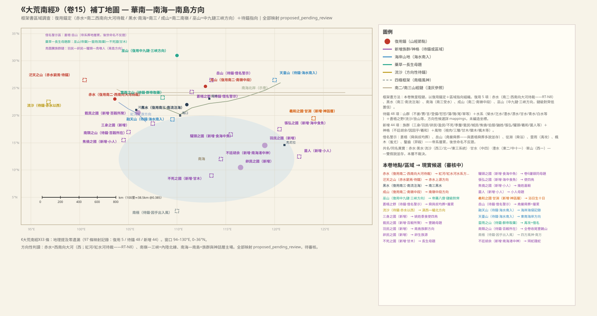
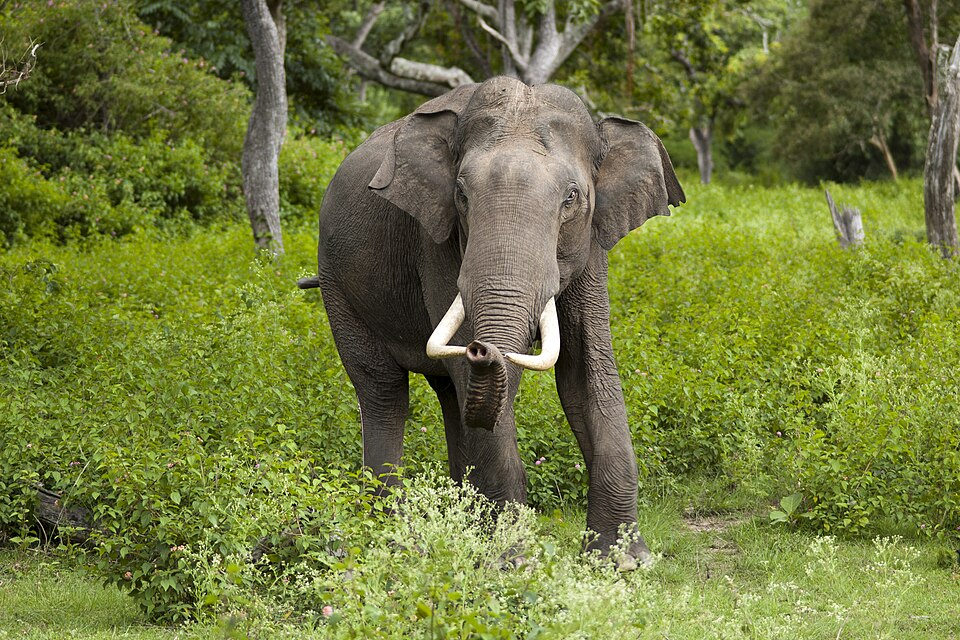
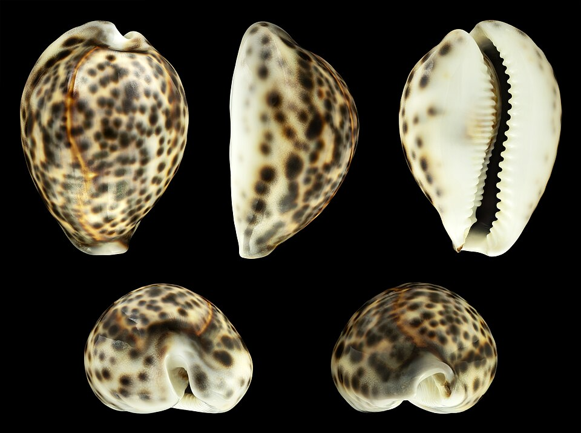
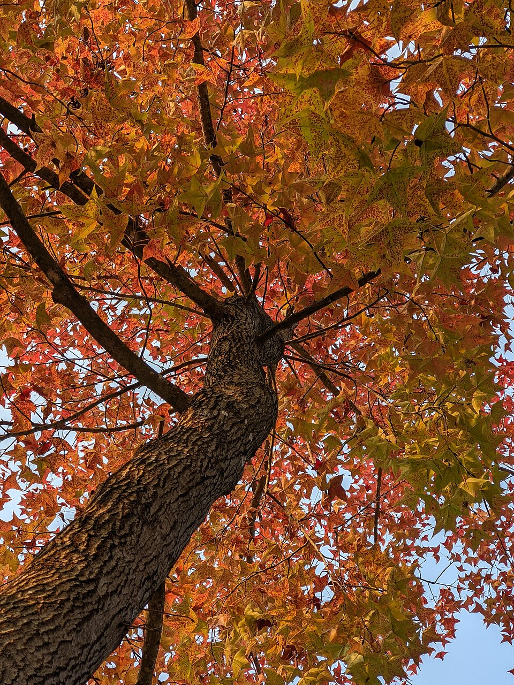
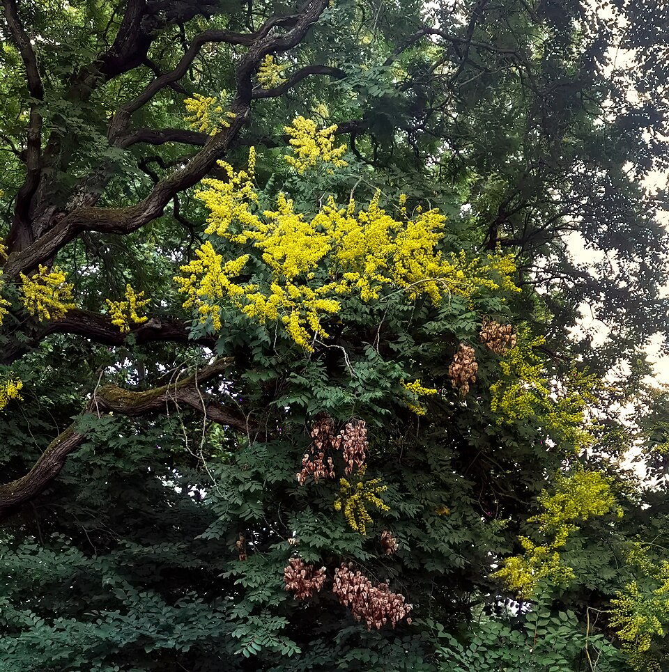

# 《大荒南经》白话通顺版（卷十五 · draft-v2）

## 本卷导览

**范围**：《大荒南经》是一卷"区域调查报告"，不是里程链。它覆盖华南内陆—南海北岸—南海岛屿方向，全卷借南山经的三大水体搭框架：赤水（复用南二＝红河水系方向，较可靠 `WAT:SHJ-01-2-001#2`）、黑水（复用南三黑水＝南流注海方向，较可靠 `WAT:SHJ-01-3-009#1`）、南海（复用南三黑水的受水海域，较可靠 `WAT:SHJ-01-3-009#2`）。

**主锚点**：本卷没有自己的强锚点，全部锚定靠复用——成山＝南岭中段骑田岭方向（南二复用，方向性 `MTN:SHJ-01-2-008#1`），巫山＝中九链整体对齐三峡—巫山山脉方向（链级、方向性 `MTN:SHJ-05-9-015#1`）。框架书不做里程算术，故无"里程吻合度"可验；自洽性体现在方位框架（赤水西有流沙、东有苍梧；黑水南有玄蛇；海水南入于融天、天台）的内部一致。

**裁決口径**：赤水、黑水、流沙、甘水、澧水等按 ADJ-005 裁决为"性状类名"——红色外观的水各地都可叫赤水，多处实例各自成立、不再是冲突；山名则按"同名唯一"原则逐项判别。帝系葬地行迹（舜葬苍梧、三帝葬岳山、禹攻云雨、蚩尤桎梏等）一律按借名警示处理：后世命名不反证。

**主要未决**：33 条目中绝大多数南方山地（仅 008 一条就列了 11 座山）无可锚点，全部待考；舜葬地文本内部两说并存（003 苍梧之野 vs 028 岳山，不裁决）；「南極果，北不成，去痓果」是全卷最晦涩的句子，保持未知；甘水、青水的跨卷同名关系留待裁决。本卷条目 33；未决项照录 draft-v1，共 104 条。

---

## 大荒南经·全卷（book15）

### 1 南海之外：赤水与流沙之间的双头兽（SHJ-15-1-001）

> **原文**
> 南海之外，赤水之西，流沙之東，有獸，左右有首，名曰䟣踢。有三青獸相並，名曰雙雙。

**白话解读**：开篇先用三个方位框定位置：南海之外、赤水以西、流沙以东。赤水按南二对齐为红河水系方向（较可靠，复用 `WAT:SHJ-01-2-001#2`）；南海即南三黑水南流注入的海（较可靠，复用 `WAT:SHJ-01-3-009#2`）。"流沙"按 ADJ-005 裁决是性状类名——凡流动沙质地带都可叫流沙，全书多处实例各自合法；本卷这处流沙指红河以西的沙带，方向性猜测是滇西—缅北干热河谷一带，待锚（`LND:book15`）。两种怪兽——左右各长一个头的"䟣踢"、三只并排的青兽"双双"——应是双头畸形观察或图腾形象的记录（中等可信的形象记录，确指待考，`CRE:book15`）。

**未决项**（照录 draft-v1）：
- 衝突：赤水——{'with': 'WAT:SHJ-02-3-008#3', 'note': '西三赤水＝紅海（F-0007 假說內高置信）——共名標記（F-0011），兩假說並存，本卷取南二就近對齊'}（按 ADJ-005：赤水為類名，兩處實例各自成立，非衝突）
- 未知：赤水——赤水窮焉的具體河段
- 衝突：流沙——{'with': 'LND:SHJ-03-1-013#1 / LND:SHJ-04-3-007#1 / LND:SHJ-02-3-010#1 / LND:SHJ-02-3-006#1', 'note': '山經流沙四見同名——同名異實共名標記，本卷流沙為南方實例'}（按 ADJ-005：流沙為類名，多實例合法）
- 未知：流沙——流沙確指
- 未知：䟣踢——䟣踢確指
- 未知：雙雙——雙雙確指

### 2 阿山与汜天山：赤水的尽头（SHJ-15-1-002）

> **原文**
> 有阿山者。南海之中，有汜天之山，赤水窮焉。

**白话解读**：阿山只是"南海方向有一座山"的孤记，无锚，待考（`MTN:book15`）。汜天之山是关键一句："赤水穷焉"——赤水（大河）到这座山就到了尽头，相当于"大河上源山地"的认知。若赤水＝红河方向成立，其上源是滇西北横断山—哀牢山方向（方向性猜测，待锚 `MTN:book15`）。这条与南二柜山"英水西南流注于赤水"互补：一个记赤水的源头所穷，一个记它的上游支流，同属红河方向的水系认知（中等假设）。

**未决项**（照录 draft-v1）：
- 未知：阿山——阿山確指
- 未知：汜天之山——汜天確指
- 未知：汜天之山——赤水窮焉的河道學含義

### 3 苍梧之野：舜与叔均的葬地和一份华南物产清单（SHJ-15-1-003）

> **原文**
> 赤水之東，有蒼梧之野，舜與叔均之所葬也。爰有文貝、離俞、𩿨久、鷹、賈、委維、熊、羆、象、虎、豹、狼、視肉。

**白话解读**：赤水以东有一片"苍梧之野"，传说是舜和叔均下葬的地方。【借名警示】舜葬苍梧是后世层层叠加的传说（汉代以后才系于九嶷山），不能拿它做定位锚；叔均又见于海内经"叔均始作耕"，跨卷人物关系备考（`PER:book15`）。真正有价值的是后面那份物产清单：文贝（有花纹的海贝，应是宝螺一类）、离俞、𩿨久、鹰、贾（几种鸟兽，确指待考）、委维（神蛇，028 条写作延维）、熊罴象虎豹狼——一套标准的华南动物群，和"赤水以东的南方原野"方位相容（清单中等偏上可靠，独立于舜葬成立）；苍梧之野本身的方向性候选是滇东—桂西—南岭以南一带（`LND:book15`）。视肉是奇幻物产，本卷出现四次，待考（`CRE:book15`）。

（图：Wikimedia Commons）

（图：Wikimedia Commons）

**未决项**（照录 draft-v1）：
- 未知：蒼梧之野——蒼梧本名與後世九嶷的關係
- 未知：蒼梧之野——叔均身份（與海內經叔均始作耕的關係）
- 衝突：帝系神話譜系群（帝俊/娥皇/舜/叔均/顓頊/少昊/倍伐/無淫/禹/羿/蚩尤/帝堯/帝嚳/群帝）——{'with': 'SHJ-15-1-003 vs 028', 'note': '舜葬蒼梧 vs 舜葬岳山——文本內多說並存，不裁決'}
- 未知：帝系神話譜系群（帝俊/娥皇/舜/叔均/顓頊/少昊/倍伐/無淫/禹/羿/蚩尤/帝堯/帝嚳/群帝）——帝俊與帝舜的譜系關係（學界多認為同源分化）
- 未知：視肉——視肉確指
- 未知：委維／延維——委維確指
- 未知：文貝·離俞·𩿨久·鷹·賈（風物群）——離俞、𩿨久、賈的確指

### 4 荣山荣水与黑水：吃麈的大蛇（SHJ-15-1-004）

> **原文**
> 有榮山，榮水出焉。黑水之南，有玄蛇，食麈。

**白话解读**：荣山发源荣水——这与第 6 条不庭之山"荣水穷焉"首尾呼应，是一条完整河流的两端记录（河流本身待锚，方向性 `MTN:book15`/`WAT:book15`）。黑水复用南三黑水（南流注海方向，较可靠 `WAT:SHJ-01-3-009#1`），"黑水之南"即南三终点以南、南海北岸方向。最有意思的是"玄蛇食麈"：能吞下麂鹿的大蛇，就是南方巨蟒的真实生态记录——华南蟒蛇吞麂有实证（较可靠的生态读法，`CRE:book15`）；第 5 条黄鸟"司此玄蛇"正与此钩连。

（图：Wikimedia Commons）

**未决项**（照录 draft-v1）：
- 衝突：黑水——{'with': 'WAT:SHJ-02-3-008#7', 'note': '西三黑水（昆侖四水之一＝西部沙漠古河道）同名異實——雙假說並存，本層不裁決'}（按 ADJ-005：黑水為類名，多實例合法）
- 未知：黑水——黑水確指河段
- 未知：榮山——榮山榮水確指
- 未知：榮水——榮水確指

### 5 巫山：黄鸟管着那条大蛇（SHJ-15-1-005）

> **原文**
> 有巫山者，西有黃鳥。帝藥，八齋。黃鳥于巫山，司此玄蛇。

**白话解读**：巫山复用中山经中九链的链级对齐——整条中九山链适配三峡—巫山山脉方向，巫山取其中段（方向性，链级而非点级，`MTN:SHJ-05-9-015#1`）；巫山之西有黄鸟。"帝药八斋"大意是帝的药草、八种斋戒用物（或八处药圃）——药草圣山记录，与第 10 条不死国"甘木"、第 23 条"群帝取药"组成本卷的"药草—长生"母题群，确义待考（`PLA:book15`）。"黄鸟于巫山，司此玄蛇"：黄鸟监管着第 4 条那条吃麈的大蛇——这是把鹰鹫捕蛇的生态观察神话化（中等假设，`CRE:book15`）。巫山名存续至今（重庆巫山），但适配依据是中九链整体而非名称本身。

**未决项**（照录 draft-v1）：
- 未知：巫山——巫山與中九鏈的點級對應
- 未知：巫山——帝藥八齋確義
- 未知：黃鳥（于巫山司玄蛇）——帝藥八齋確義

### 6 不庭之山、三身之国与四方之渊（SHJ-15-1-006）

> **原文**
> 大荒之中，有不庭之山，榮水窮焉。有人三身，帝俊妻娥皇，生此三身之國，姚姓，黍食，使四鳥。有淵四方，四隅皆達，北屬黑水，南屬大荒，北旁名曰少和之淵，南旁名曰從淵，舜之所浴也。

**白话解读**：不庭之山是荣水的尽头（待锚 `MTN:book15`）。"大荒"是本卷的框架区域名——边地之野，不是点（`LND:book15`）。三身之国：长着三个身子的人，传说是帝俊的妻子娥皇所生——注意娥皇在后世传说里是舜的妻子，这里却系于帝俊，恰好是"帝俊与帝舜同一来源、后来分化"的文本证据（中高假设，`PER:book15`）。这个国姚姓、吃黍、驯养四种鸟（与第 25 条张弘国同款风俗）。后面是一组方形深渊：一座四方之渊四角都通，北边接入黑水、南边属于大荒，北边的叫少和之渊，南边的叫从渊，"舜所浴"是帝舜行迹的层累传说（借名警示）。"北属黑水、南属大荒"说明渊群在黑水以南的南方内陆（不依舜浴成立）；各渊待锚（`WAT:book15`）。三身国同见海外西经（卷七），同母题跨卷互证。

**未决项**（照录 draft-v1）：
- 未知：不庭之山——不庭確指
- 未知：少和之淵——少和之淵確指
- 未知：從淵——從淵確指
- 未知：三身之國——三身的體質/風俗確義

### 7 成山、甘水与季禺、羽民、卵民三国（SHJ-15-1-007）

> **原文**
> 又有成山，甘水窮焉。有季禺之國，顓頊之子，食黍。有羽民之國，其民皆生毛羽。有卵民之國，其民皆生卵。

**白话解读**：成山复用南二成山＝南岭中段（骑田岭方向，方向性偏低置信，`MTN:SHJ-01-2-008#1`）；但水文细节对不上——南二说"䖠水出焉"，这里说"甘水穷焉"，所以"同一座山"还是"同名两座山"两种假说并存。甘水与中四甘水（豫西入洛溪）同名异物（待锚 `WAT:book15`）。接着是三个国家：季禺国——颛顼之子所建（谱系借名），吃黍；羽民国——百姓身上长毛羽，应是羽毛装饰风俗的夸张，与海外南经（卷六）羽民国同一母题，方向指向南岛族群（方向性候选）；卵民国——百姓"生卵"，是鸟图腾族群的卵生族源神话。羽民（羽饰）加卵民（卵生）并置，是一套完整的鸟图腾族群记录，也是本卷指向南岛—东南亚方向族群叙事的核心证据链（族群档案中等可信，`POL:book15`）。

**未决项**（照录 draft-v1）：
- 衝突：成山——{'with': 'self', 'note': '水文細節不盡同（南二成山「䖠水出焉南流注虖勺」 vs 本卷「甘水窮焉」）——同名合併 vs 同名異實雙假說並存'}
- 未知：成山——甘水與䖠水是否同水異名
- 衝突：甘水——{'with': 'WAT:SHJ-05-4-001#1', 'note': '中四甘水（豫西入洛溪流）同名異實——雙假說並存'}
- 未知：甘水——甘水確指
- 未知：甘水——007 與 030 甘水是否同水
- 未知：季禺之國——季禺確指
- 未知：羽民之國——羽民確指
- 未知：卵民之國——卵民確指

### 8 不姜之山到翠山：一份无里程的南方山系调查（SHJ-15-1-008）

> **原文**
> 大荒之中，有不姜之山，黑水窮焉。又有賈山，汔水出焉。又有言山。又有登備之山。有恝恝之山。又有蒲山，澧水出焉。又有隗山，其西有丹，其東有玉。又南有山，漂水出焉。有尾山。有翠山。

**白话解读**：这是全卷最大的山群清单：不姜、贾、言、登备、恝恝、蒲、隗、一座无名南山、尾、翠，共十座名山加四条水（汔水、澧水、漂水，以及穷于不姜的黑水），记录格式和山经一模一样（"X 山 Y 水出焉/穷焉"）但没有里程——可以理解为一份无里程版的南方山系调查。全部待锚（`MTN:book15`/`WAT:book15`）。唯一有信息量的细节是隗山"其西有丹，其东有玉"：丹砂在西、玉矿在东的矿产分布记录，与岭南—滇黔丹砂带方向弱相容（方向性猜测）。澧水与东二、中十一澧水同名，方位都不相容；翠山与西一翠山（藏东）同名——按 ADJ-005，水名是性状类名、多处实例合法，山名不相容则记共名，均不构成冲突。后世湖南澧水是借名方向，不反证。

**未决项**（照录 draft-v1）：
- 未知：不姜之山——不姜確指
- 未知：賈山——賈山確指
- 未知：汔水——汔水確指
- 未知：言山——言山確指
- 未知：登備之山——登備確指
- 未知：恝恝之山——恝恝確指
- 未知：蒲山——蒲山確指
- 衝突：澧水——{'with': 'WAT:SHJ-04-2-005#1 / WAT:SHJ-05-11-030#1', 'note': '東二／中十一澧水同名異實——雙假說並存'}
- 未知：澧水——澧水確指
- 未知：隗山——隗山確指
- 未知：漂水（又南有山）——漂水確指
- 未知：尾山——尾山確指
- 衝突：翠山——{'with': 'MTN:SHJ-02-1-018#1', 'note': '西一翠山（藏東）同名異實——共名標記'}
- 未知：翠山——翠山確指

### 9 盈民国与吃树叶的人（SHJ-15-1-009）

> **原文**
> 有盈民之國，於姓，黍食。又有人方食木葉。

**白话解读**：盈民国，姓于，吃黍——标准的"姓氏＋食性"族群档案格式（中等可信，`POL:book15`）。紧接着一句现场速写："又有人方食木叶"——"方食"是正在进行的观察：有人正在吃树叶，是热带采集食性的风俗记录（中等可信）。两条并置，等于记下同一南方区域里农耕与采集两种生计的共生。

**未决项**（照录 draft-v1）：
- 未知：盈民之國——盈民確指

### 10 不死之国：吃甘木的人（SHJ-15-1-010）

> **原文**
> 有不死之國，阿姓，甘木是食。

**白话解读**：不死国，姓阿，吃一种叫"甘木"的树。甘木是"不死"母题的物质载体——逻辑是"长寿依赖某种特定植物"，与海外诸经的不死民、不死树同一母题（跨卷互证）；它又与第 5 条帝药八斋、第 23 条群帝取药连成本卷的药草—长生母题群（族群与植物确指均待考，`POL:book15`/`PLA:book15`）。

**未决项**（照录 draft-v1）：
- 未知：不死之國——不死國與甘木的確指
- 未知：甘木——甘木確指

### 11 去痓之山：全卷最晦涩的一句话（SHJ-15-1-011）

> **原文**
> 大荒之中，有山名曰去痓。南極果，北不成，去痓果。

**白话解读**：去痓山无锚，待考（`MTN:book15`）。"南极果，北不成，去痓果"是全卷最难解的句子——可能是占验辞，也可能是传抄中产生的音韵衍文；其中"南极"与第 13 条风神所居的南极同名（待锚 `LND:book15`）。整句不做强解，保持未知。

**未决项**（照录 draft-v1）：
- 未知：去痓之山——「南極果北不成去痓果」確義

### 12 南海渚中的神：不廷胡余（SHJ-15-1-012）

> **原文**
> 南海渚中，有神，人面，珥兩青蛇，踐兩赤蛇，曰不廷胡余。

**白话解读**：南海的洲屿（渚）之中住着一位神：人的面孔，耳朵上挂着两条青蛇，脚下踩着两条赤蛇，名叫不廷胡余。耳挂蛇、脚踩蛇是山海经神格的"标准像"——与海外诸经奢比尸等神同构（较可靠的图像传统），其现实底层可能是巫觋通神时的装扮记录（中等假设，`PER:book15`）。名字与第 6 条不庭之山语音相近，关联备考（低假设）。南海复用南三受水海域（`WAT:SHJ-01-3-009#2`）。

**未决项**（照录 draft-v1）：
- 未知：不廷胡余——不廷胡余與不庭之山的語音關聯

### 13 因因乎：住在南极的南风之神（SHJ-15-1-013）

> **原文**
> 有神名曰因因乎，南方曰因乎，來風曰乎民，處南極以出入風。

**白话解读**：有一位神叫因因乎——南方这个方向叫"因乎"，从南方吹来的风叫"乎民"，他住在南极，掌管风的进出。"方向名＋风名"成套的格式，与甲骨文四方风、尧典四宅是同一传统，本条就是四方风神系统的南方环节（较可靠的文化层对应，`PER:book15`）。"南极"是极南方向的地标，属四极观测框架——与大荒东"日月所出"、大荒西"日月所入"同类（框架性，待考 `LND:book15`）。"出入风"是季风观测的祀风记录。

**未决项**（照录 draft-v1）：
- 未知：南極（因乎所處）——南極的具體所指（地/天）
- 未知：因因乎（因乎／乎民）——異文來／夸

### 14 襄山、重阴之山、季厘国、缗渊与俊坛（SHJ-15-1-014）

> **原文**
> 有襄山。又有重陰之山。有人食獸，曰季釐。帝俊生季釐，故曰季釐之國。有緡淵。少昊生倍伐，倍伐降處緡淵。有水四方，名曰俊壇。

**白话解读**：襄山、重阴之山都是孤记，待锚（`MTN:book15`）。季厘国：一个吃兽肉的族群，传说是帝俊所生（谱系借名，`POL:book15`）。缗渊：少昊生倍伐，倍伐"降处"（降居）于此——帝系降居记录（借名 `PER:book15`，渊待锚 `WAT:book15`）。俊坛：一座四方水域，挂着帝俊的名号——圣地祭坛水域，与第 6 条四方之渊构式相同，可能是同一圣地母题的两次记录（低—中假设）。本条帝系密度很高（帝俊、少昊、俊坛），是南方叙事挂进帝系谱系的典型段落。

**未决项**（照录 draft-v1）：
- 未知：襄山——襄山確指
- 未知：重陰之山——重陰確指
- 未知：緡淵——緡淵確指
- 未知：俊壇——俊壇確指
- 未知：俊壇——與四方之淵的關係
- 未知：季釐之國——季釐確指

### 15 臷民国：不织布有衣穿、不种田有饭吃的乐土（SHJ-15-1-015）

> **原文**
> 有臷民之國。帝舜生無淫，降臷處，是謂巫臷民。巫臷民盼姓，食穀，不績不經，服也；不稼不穡，食也。爰有歌舞之鳥，鸞鳥自歌，鳳鳥自舞。爰有百獸，相群爰處。百穀所聚。

**白话解读**：臷民国：帝舜生无淫，无淫降居臷地，这支部族称"巫臷民"（帝系降居借名，`PER:book15`）。他们姓盼、吃谷，"不绩不经而有衣服穿，不稼不穑而有饭吃"——不靠织耕、自然供给的丰饶乐土母题（`POL:book15`）。接着是三件套：鸾鸟自己唱歌、凤鸟自己跳舞，百兽成群共处，百谷汇聚于此——乌托邦式丰饶地景的完整版本，与海内经都广之野同一母题，并与第 33 条南类山"百谷所在"首尾呼应。丰饶记录本身反映的是对南方湿热地区自然供给能力的认知（中等假设）。

**未决项**（照录 draft-v1）：
- 未知：臷民之國（巫臷民）——臷/巫臷確指

### 16 融天山：海水灌进山里的地方（SHJ-15-1-016）

> **原文**
> 大荒之中，有山名曰融天，海水南入焉。

**白话解读**：融天山，"海水南入焉"——海水向南淹进山地之间，是海湾或溺谷海岸地貌的认知记录；方向指向华南的南海北岸海岸山地（方向性猜测，待锚 `MTN:book15`）。海水即南海（复用 `WAT:SHJ-01-3-009#2`）。本条与第 29 条天台山是同一格式的两处海岸记录，说明记录者熟悉南海北岸的海侵地貌（中等假设）。

**未决项**（照录 draft-v1）：
- 未知：融天之山——融天確指

### 17 凿齿：被羿杀死的拔牙之民（SHJ-15-1-017）

> **原文**
> 有人曰鑿齒，羿殺之。

**白话解读**：有个叫"凿齿"的人（或族群），被羿杀死了。"凿齿"即拔牙风俗——华南至东南亚新石器时代人骨中确有拔牙（齿列毁损）的考古实证，这是本卷风俗记录层的硬证据（较可靠）；与海外南经（卷六）凿齿国同一母题（`PER:book15`）。"羿杀凿齿"则是羿诛诸害叙事的一环，属神话叠加层（借名）——风俗层与神话层要剥开看。

**未决项**（照录 draft-v1）：
- 未知：鑿齒——鑿齒與卷6鑿齒國的關係

### 18 蜮山、蜮民国与射蛇的蜮人（SHJ-15-1-018）

> **原文**
> 有蜮山者，有蜮民之國，桑姓，食黍，射蜮是食。有人方扜弓射黃蛇，名曰蜮人。

**白话解读**：蜮山之下有蜮民国：姓桑、吃黍、以射杀水边的"蜮"为食——"蜮"就是后世"短狐含沙射人"（水弩）传说的风俗底层，这里记的是射食水域小虫的现实狩猎（山待锚 `MTN:book15`；族群档案中等可信 `POL:book15`）。紧接着又是现场速写：有人正张弓射黄蛇，名叫蜮人——南方水域狩猎的观察记录（中等可信 `PER:book15`）。山名—国名—人名三位一体，是"以风俗名地"的命名逻辑。

**未决项**（照录 draft-v1）：
- 未知：蜮山——蜮山確指
- 未知：蜮民之國——蜮的動物確指（短狐/水弩傳說）

### 19 宋山：蚩尤的枷锁变成的枫树（SHJ-15-1-019）

> **原文**
> 有宋山者，有赤蛇，名曰育蛇。有木生山上，名曰楓木。楓木，蚩尤所棄其桎梏，是爲楓木。

**白话解读**：宋山（待锚 `MTN:book15`）上有一种红色的蛇，叫育蛇（待考 `CRE:book15`）；山上生枫木。枫木就是枫香树——华南常见树种，风物层很可靠（`PLA:book15`）。"蚩尤所弃其桎梏，是为枫木"：蚩尤被擒后扔掉的枷锁化成了枫树——这是战败者刑具变植物的名源神话，属神话层借名（`PER:book15`）；枫香作为华南原生树种成立，并不依赖蚩尤传说。

（图：Wikimedia Commons）

**未决项**（照录 draft-v1）：
- 未知：宋山——宋山確指
- 未知：育蛇——育蛇確指

### 20 祖状之尸：方齿虎尾的神主（SHJ-15-1-020）

> **原文**
> 有人方齒虎尾，名曰祖狀之尸。

**白话解读**：有一个人，方形的牙齿、老虎的尾巴，名叫"祖状之尸"。"尸"指祭祀中扮演受祭神主的尸位传统——周代尸礼的先声（中等假设）；本条与海内经相顾之尸、大荒西女娲之肠同属一组"尸"记录（`PER:book15`）。方齿形象与第 17 条凿齿的关联备考。"祖状"确义待考。

**未决项**（照录 draft-v1）：
- 未知：祖狀之尸——祖狀確義

### 21 焦侥国：小人国（SHJ-15-1-021）

> **原文**
> 有小人，名曰焦僥之國，幾姓，嘉穀是食。

**白话解读**：有一群身材矮小的人，叫焦侥国，姓几，吃嘉谷。姓氏＋食性的档案格式完备，说明这是族群记录而非纯神话（中等可信 `POL:book15`）；方向性候选是南岛—东南亚的矮小人群（中等假设），并与卷十四靖人、本卷第 32 条菌人构成"小人"母题群。后世"焦侥氏三尺"之说属于层累夸张，不反证。

**未决项**（照录 draft-v1）：
- 未知：焦僥之國——焦僥確指

### 22 㱙涂山、青水与云雨山的栾树（SHJ-15-1-022）

> **原文**
> 大荒之中，有山名㱙塗之山，青水窮焉。有雲雨之山，有木名曰欒。

**白话解读**：㱙涂山是青水的尽头（山、水均待锚 `MTN:book15`/`WAT:book15`）。山经里没有青水这个节点，但海内经（卷十八）"若木……黑水青水之间"与之呼应——大荒与海内经可能共享同一套南方水系名册（中等假设）。云雨之山上生栾木（山待锚）——栾木就是栾树，华南常见，很可靠（`PLA:book15`），并接下一条"群帝取药"。

（图：Wikimedia Commons）

**未决项**（照录 draft-v1）：
- 未知：㱙塗之山——㱙塗確指
- 未知：青水——青水確指
- 未知：青水——與卷18青水是否同水
- 未知：雲雨之山——雲雨之山確指

### 23 禹攻云雨：群帝采药的圣山（SHJ-15-1-023）

> **原文**
> 禹攻雲雨，有赤石焉生欒，黃本，赤枝，青葉，群帝焉取藥。

**白话解读**："禹攻云雨"——禹攻打（治理）云雨之山，是禹迹层累，即攻山治水叙事向南方的延伸（借名 `PER:book15`）。山上有红色的岩石，赤石上生着栾树：黄色的根干、红色的枝条、青色的叶子——一段矿物与植物共生的物候观察（`MIN:book15`/`PLA:book15`）。"群帝焉取药"：各位帝都到这里采药——多族群共享的采药圣山认知；它与第 5 条"帝药八斋"、第 10 条"甘木不死"三点连成本卷的药草—长生母题三角。

**未决项**：draft-v1 本条无未决项记录。

### 24 伯服国、鼬姓国、六山与白水白渊（SHJ-15-1-024）

> **原文**
> 有國曰伯服，顓頊生伯服，食黍。有鼬姓之國。有苕山。又有宗山。又有姓山。又有壑山。又有陳州山。又有東州山。又有白水山，白水出焉，而生白淵，昆吾之師所浴也。

**白话解读**：伯服国——颛顼生伯服（谱系借名），吃黍；异文作"有国曰颛顼，生伯服"，异文本身就是层累的证据。鼬姓国：以鼬为图腾姓氏的族群（两族档案中等可信 `POL:book15`）。然后是苕、宗、姓、壑、陈州、东州六座山，全部待锚（`MTN:book15`；陈州、东州之名是后世地名借名方向，不反证）。最后是一组山—水—渊一体记录：白水山发源白水，白水汇成白渊，"昆吾之师"（昆吾的人众）在白渊洗浴——昆吾名号又见中二昆吾之山（伏牛山方向），但这里是人群行迹记录，不是山体复用（跨卷备考 `PER:book15`）。注意"X 之所浴也"句式本卷三见（舜浴从渊／昆吾之师浴白渊／羲和浴日甘渊），帝系、人群、女神三类主体并存，说明它是文体格式而非单一事实。

**未决项**（照录 draft-v1）：
- 未知：苕山——苕山確指
- 未知：宗山——宗山確指
- 未知：姓山——姓山確指
- 未知：壑山——壑山確指
- 未知：陳州山——陳州山確指
- 未知：東州山——東州山確指
- 未知：白水山——白水山確指
- 未知：白水——白水確指
- 衝突：白淵——{'with': 'MTN:SHJ-05-2-006#1', 'note': '中二昆吾之山（伏牛山方向）——昆吾名號的跨卷關聯，非同名異實，記以備考'}
- 未知：白淵——白淵確指
- 未知：白淵——昆吾之師與中二昆吾之山的關係
- 未知：伯服國——異文取捨
- 未知：鼬姓之國——鼬姓確指

### 25 张弘：海上捕鱼人和他的国（SHJ-15-1-025）

> **原文**
> 有人名曰張弘，在海上捕魚。海中有張弘之國，食魚，使四鳥。

**白话解读**：有个叫张弘的人在海上捕鱼；海中有个张弘国，以鱼为食、驯养四种鸟——南海岛屿渔捞族群的记录（中等可信 `PER:book15`/`POL:book15`；海＝南海，复用 `WAT:SHJ-01-3-009#2`）。"使四鸟"一种读法是鸬鹚捕鱼（低—中假设）；以人名国是本卷的命名方式之一。"使四鸟"与第 6 条三身国两见，说明驯鸟是本卷南方族群反复出现的风物。

**未决项**（照录 draft-v1）：
- 未知：張弘之國——張弘確指

### 26 鸟嘴翅膀的捕鱼人（SHJ-15-1-026）

> **原文**
> 有人焉，鳥喙，有翼，方捕魚于海。

**白话解读**：有个人，长着鸟嘴、有翅膀，正在海里捕鱼——这是第 27 条欢头（人面鸟喙有翼、食海中鱼）的"单人版"，鸟喙应是面具、装饰或夸张（中等假设 `PER:book15`）。26、27 两条相邻同构，等于同一风俗记了两次（单人→国族），支持"鸟形装饰渔捞族群"的风俗层读法。

**未决项**：draft-v1 本条无未决项记录。

### 27 欢头：鲧的后代、拄着翅膀走路的渔人（SHJ-15-1-027）

> **原文**
> 大荒之中，有人名曰驩頭。鯀妻士敬，士敬子曰炎融，生驩頭。驩頭人面鳥喙，有翼，食海中魚，杖翼而行。維宜芑苣，穋楊是食。有驩頭之國。

**白话解读**：欢头的谱系是：鲧娶士敬，士敬之子炎融生欢头——把鲧（禹的父亲）的谱系接到欢头身上，是帝系层累（借名 `PER:book15`）；后世"放欢兜于崇山"是对读方向，不反证。欢头人面、鸟嘴、有翅膀，吃海里的鱼，"杖翼而行"——拿翅膀当拐杖走路，是鸟形装饰渔捞族群的连贯图像（中等可信）。食物清单"维宜芑苣，穋杨是食"（两种植物确指待考）。欢头之国与海外南经（卷六）讙头国同一母题跨卷互证（讙/欢通假 `POL:book15`）。

**未决项**（照录 draft-v1）：
- 未知：驩頭之國——芑苣穋楊的植物確指
- 未知：驩頭（譜系）——士敬、炎融確指

### 28 岳山：尧、喾、舜三帝同葬的传说（SHJ-15-1-028）

> **原文**
> 帝堯、帝嚳、帝舜葬于岳山。爰有文貝、離俞、𩿨久、鷹、賈、延維、視肉、熊、羆、虎、豹；朱木，赤枝，青華，玄實。有申山者。

**白话解读**：帝尧、帝喾、帝舜都葬在岳山——三帝同葬一山，是帝系葬地"层累叠加"的教科书式案例；【借名警示】与第 3 条"舜葬苍梧"两说并存，文本内部双假说不裁决（`MTN:book15`/`PER:book15`）。后面的物产清单（文贝、离俞、𩿨久、鹰、贾、延维、视肉、熊罴虎豹）与第 3 条几乎一模一样——委维写作延维、少了象和狼——模板化复现说明两条出自同一文献传统（中高假设）；清单本身（华南动物群）比葬地归属更有地理价值。朱木：红枝、青花、黑果的树（`PLA:book15`）。申山与北方西山经申山系同名，方位不相容，不复用（共名标记，待锚）。

**未决项**（照录 draft-v1）：
- 衝突：岳山——{'with': 'SHJ-15-1-003 蒼梧之野', 'note': '舜葬地兩說（蒼梧之野 vs 岳山）——文本內雙假說並存，不裁決'}
- 未知：岳山——岳山確指
- 衝突：申山——{'with': '西山經申山系', 'note': '北方系統申山同名——共名標記，方位不相容不復用'}
- 未知：申山——申山確指
- 未知：朱木——朱木確指

### 29 天台山：又一处海水灌进山里的地方（SHJ-15-1-029）

> **原文**
> 大荒之中，有山名曰天臺，海水南入焉。

**白话解读**：天台山，"海水南入焉"——与第 16 条融天同一格式的海岸山地记录（待锚 `MTN:book15`；海水＝南海，复用 `WAT:SHJ-01-3-009#2`）。融天（南海北岸方向）与天台（东南海岸方向）两处"海水南入"，可能是自西南向东北的海岸扫描顺序（低—中假设）。后世浙江天台山是借名方向性候选，后世命名不反证。

**未决项**（照录 draft-v1）：
- 未知：天臺之山——天臺確指

### 30 羲和之国与甘渊：给太阳洗澡的女神（SHJ-15-1-030）

> **原文**
> 東南海之外，甘水之間，有羲和之國。有女子名曰羲和，方浴日於甘淵。羲和者，帝俊之妻，生十日。

**白话解读**：东南海之外、甘水之间有个羲和国（`POL:book15`；甘水与第 7 条同见，待锚 `WAT:book15`；海＝南海，复用 `WAT:SHJ-01-3-009#2`）。有个女子叫羲和，正在甘渊里给太阳洗澡；羲和是帝俊的妻子，生了十个太阳——"浴日"是日出观测的叙事化，"生十日"是"十天为旬"历法认知的神话化（中高假设 `PER:book15`）。甘渊同见大荒东（卷十四）——东方与东南方共享同一日出圣水叙事（较可靠的跨卷互证 `WAT:book15`）。本条整体属神话层，不作地理锚。

**未决项**（照录 draft-v1）：
- 未知：甘淵——甘淵與卷14甘淵的文本關係
- 未知：羲和之國——羲和國與卷14甘淵敘事的關係

### 31 盖犹之山：甘柤、甘华与三骓（SHJ-15-1-031）

> **原文**
> 有蓋猶之山者，其上有甘柤，枝幹皆赤，黃葉，白華，黑實。東又有甘華，枝幹皆赤，黃葉。有青馬，有赤馬，名曰三騅。有視肉。

**白话解读**：盖犹之山（待锚 `MTN:book15`）上生甘柤：枝干全红、黄叶、白花、黑果；东边又有甘华：枝干全红、黄叶——两段工整的植物形态记录（`PLA:book15`）。甘柤、甘华与甘水、甘渊、甘木组成"甘"字系列，是本卷"甘美丰饶"的命名群（中等假设）。青马加赤马合称"三骓"，第 33 条再次出现——两座山同属一个风物圈（中等置信 `CRE:book15`）。视肉本卷第四见。

**未决项**（照录 draft-v1）：
- 未知：蓋猶之山——蓋猶確指
- 未知：三騅（青馬赤馬）——三騅確義（三匹？駢馬？）
- 未知：甘柤·甘華——甘柤確指

### 32 菌人：又一个"小人"族群（SHJ-15-1-032）

> **原文**
> 有小人，名曰菌人。

**白话解读**：又有一群身材矮小的人，叫菌人——与第 21 条焦侥同属"小人"母题群；"菌"或许取"像菌蕈一样矮小"之意（低假设，`POL:book15`）。小人记录在卷末再次出现，说明大荒南—大荒东（卷十四靖人）对南方矮小族群有持续关注。

**未决项**（照录 draft-v1）：
- 未知：菌人——菌人確指

### 33 南类之山：以百谷丰饶收尾（SHJ-15-1-033）

> **原文**
> 有南類之山，爰有遺玉、青馬、三騅、視肉、甘華，百穀所在。

**白话解读**：南类之山（待锚 `MTN:book15`）上有遗玉（玉矿 `MIN:book15`）、青马、三骓、视肉、甘华，是"百谷所在"——全卷以一座丰饶山地收尾，与第 15 条臷民国"百谷所聚"首尾呼应。遗玉＋甘华＋三骓＋视肉四件套与第 31 条盖犹山重叠，是本卷丰饶山地的标配清单，也说明两山同属一个风物圈（中等置信）。"南类"之名也许只是"南方之属"意思的类名（低假设），保持未知。

**未决项**（照录 draft-v1）：
- 未知：南類之山——南類確指

---

## 附：本卷跨条目母题链（自 draft-v1/适配文档转写）

| 母题链 | 条目 | 层级判断 |
|---|---|---|
| 赤水—黑水—南海水系框架 | 001–004, 006, 008, 016, 029, 030 | 地理层（复用南二/南三） |
| 药草—长生母题 | 005 帝药八斋 / 010 甘木不死 / 023 群帝取药 | 风物层＋神话层 |
| 鸟图腾族群 | 007 羽民/卵民 / 026 鸟喙人 / 027 欢头 | 族群风俗层（南岛方向） |
| 小人母题 | 021 焦侥 / 032 菌人 | 族群记录层 |
| 浴叙事 | 006 舜浴从渊 / 024 昆吾之师浴白渊 / 030 羲和浴日甘渊 | 文体格式（神话层叠加） |
| 帝系葬地/降居 | 003 苍梧 / 006 从渊 / 014 缗渊 / 015 降臷 / 028 岳山 | 借名警示（多说并存） |
| 丰饶地景 | 015 百谷所聚 / 031 盖犹山 / 033 百谷所在 | 风物层（乌托邦母题） |
| 甘美命名群 | 甘水/甘渊/甘木/甘柤/甘华 | 命名倾向（中等假设） |
| 海岸海侵记录 | 016 融天 / 029 天台（海水南入） | 地理层（南海北岸） |

本卷条目 33；未决项照录 draft-v1，共 104 条（各条目下逐条保留；023、026 两条 draft-v1 原本即无未决项记录）。
