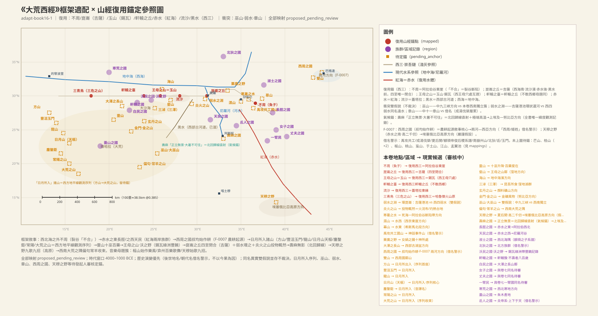
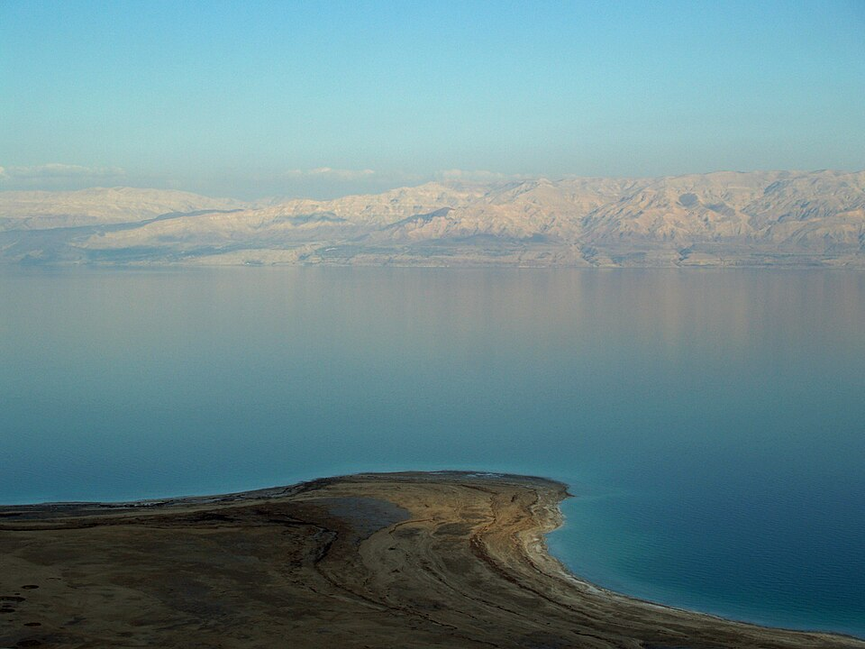
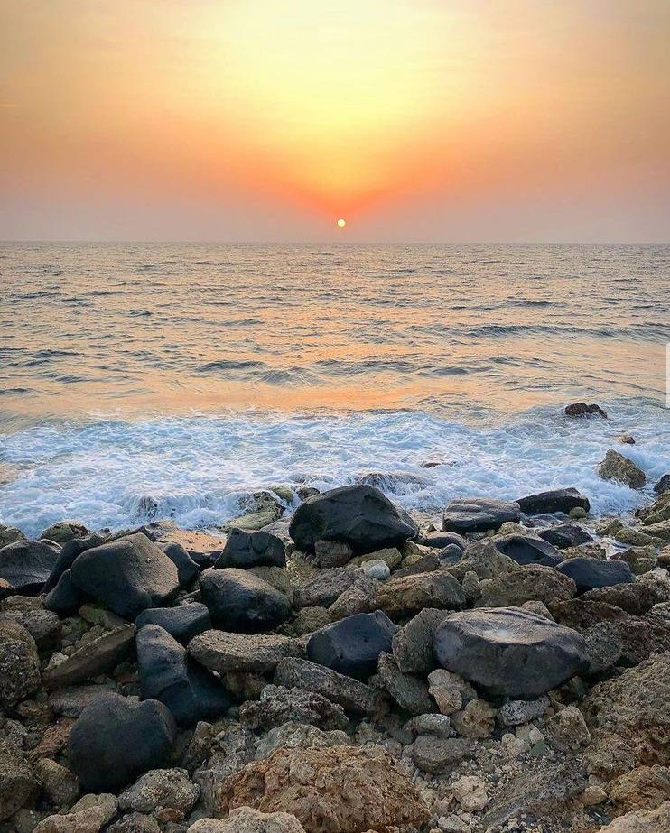
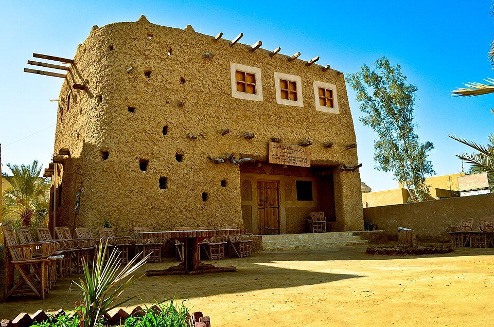
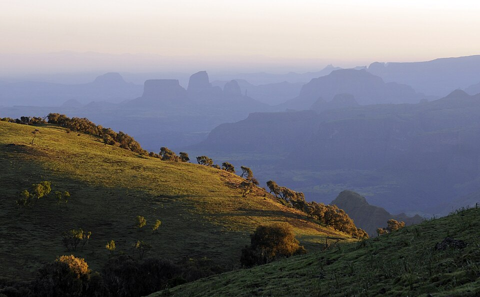

# 《大荒西經》白話讀本（卷十六）

## 本卷導覽

《大荒西經》是一篇「西方世界調查報告」，不帶里程鏈，而是按「西北海之外 → 西海之外 → 西南海之外」的框架掃過文明腹地以西的遠方——按我們的整體判斷，對應今天的埃及、利比亞、撒哈拉、阿拉伯半島，一直到埃塞俄比亞高原方向。全卷五十條。

本卷有七個地理支點，直接沿用《西次三經》已經做過的定位（那是全書考證最細的一卷）：不周山＝阿拉伯谷斷層帶、崑崙之丘＝吉薩高地、玉山（王母之山）＝錫瓦綠洲、軒轅之台＝大沙海北緣丘台、流沙＝蓋塔拉窪地沙沼帶、赤水＝紅海、黑水＝西部沙漠古河道、西海＝地中海。這些對應大都只能說「較有把握」或「方向性猜測」，下文逐條會交代分寸。

本卷最硬的兩處證據：一是第 37 條用「西海之南、流沙之濱、赤水之後、黑水之前」四個方位把崑崙之丘鎖在吉薩高地——四個條件同時滿足的地方只有一處，這是全書最強的定位之一；二是第 40 條壽麻國「正立無景（影）」——正午直立沒有影子的緯度觀測記錄（但這條只能約束一條很寬的熱帶緯度帶，定不了點，詳見該條）。此外本卷還有一串「日月所入」之山（方山、丰沮玉門、龍山、日月山、鏖鏊鉅、常陽之山、大荒之山），我們讀作站在西部高地觀測西方地平線上日月落點的一列標記山——和《大荒東經》的日出山鏈東西相對，正是大荒四方格局的西方一面。

要分清：按我們在前卷的考證，《海內西經》的「崑崙之虛」最可能是撒哈拉之眼（理查特構造），和本卷的「崑崙之丘」（吉薩）是兩處，不可混為一談。

---

## 大荒西經·全卷

### 1. 不周負子山：一座「合不攏」的山

> **【原文】**
> 西北海之外，大荒之隅，有山而不合，名曰不周，有兩黄獸守之。有水曰寒暑之水，水西有濕山，水東有幕山。有禹攻共工國山。

**白話解讀**：在西北海（地中海西段—大西洋這個方向）以外、大荒的角落裏，有一座「合不攏」的山叫不周，有兩隻黃色的獸守著山口；附近有一條叫「寒暑」的水，水西是溼山，水東是幕山；還有一座「禹攻共工國山」。核心判斷：這座不周山就是《西次三經》已經定位過的同一座——**阿拉伯谷（Wadi Arabah）南段東側的斷層山地**（亞喀巴灣以東）。理由很直白：「有山而不合」描述的就是裂谷斷陷——兩邊崖壁對峙、谷底斷開不環合，這是東非大裂谷北段的招牌地貌，山名和地貌完全對得上。寒暑之水讀作死海—阿拉伯谷斷陷帶里的水體（冬夏水溫、水位變化大，所以叫「寒暑」），方向性猜測；一水夾兩山的結構和阿拉伯谷兩側地形相合。「禹攻共工國山」是用神話事件命名的山——共工怒觸不周山的傳說和「不周」同段出現不是巧合，說明編書人心裏已經把事件和地名纏在一起了；但禹和共工屬於神話層，不能拿來做定位依據。兩隻黃獸是什麼（守山口的獅子像？岩柱？雕像？）已無從查考。

（圖：Wikimedia Commons）

---

### 2. 淑士之國

> **【原文】**
> 有國名曰淑士，顓頊之子。

**白話解讀**：有個國家叫淑士，是顓顼的後代。「淑士」就是「善士」的美稱，這是對西北海方向（黎凡特—阿拉伯西北一帶）一個族群的記錄；「顓顼之子」是後人給它安的神話家譜，不能當作定位依據。族群具體分佈還沒有定論。

---

### 3. 女娲之腸與栗广之野

> **【原文】**
> 有神十人，名曰女媧之腸，化為神，處栗廣之野，横道而處。

**白話解讀**：有十個神，名叫「女娲之腸」，是女娲的腸子變化成的，住在栗广之野，橫在大道旁邊。這是典型的「肢體化生」神話——和女娲摶土造人、精衛填海一樣，是用身體解釋世界的隱喻，沒有地理座標可言。栗广之野倒是個空間記錄：「栗樹广野、橫道而處」，讀作地中海東岸—西亞一帶長著栗樹、栎樹這類旱生樹的原野、緊挨交通道，方向性猜測。

---

### 4. 石夷與名叫「韋」的風

> **【原文】**
> 有人名曰石夷，來風曰韋，處西北隅以司日月之長短。

**白話解讀**：有個叫石夷的人，住在西北角，掌管日月的「長短」；那裏刮來的風叫「韋」。我們讀作一份天文觀測記錄的擬人化：「司日月之長短」就是觀測冬至夏至時太陽昇起落下的方位和晝夜長短——這是至點觀測官的職能被寫成了神；給西北來的風起專名「韋」，則是風向命名傳統的留痕（和後來說的「八風」體系可能有遠緣關係）。這套觀測傳統具體由什麼人、在什麼地方執行，還沒有定論。

---

### 5. 狂鳥

> **【原文】**
> 有五采之鳥，有冠，名曰狂鳥。

**白話解讀**：有一種五彩羽毛、頭上有冠的鳥，叫狂鳥。這是對戴胜一類羽冠鳥的外形記錄（五彩＋羽冠是最顯眼的特徵），具體物種還沒有定論。

---

### 6. 大澤長山與白民之國

> **【原文】**
> 有大澤之長山，有白民之國。

**白話解讀**：有一座「大澤旁邊的長條山」，附近有個白民之國。「大澤」是泛稱的大湖沼，長山貼著湖盆，方向性猜測指向利比亞古湖盆一帶（和《西次三經》陰山古湖群的方向相合）；白民可能是對膚色淺或穿白衣族群的觀察，和《海外西經》的白民國同名，是不是同一群，還沒有定論。

---

### 7. 長胫之國：紅海以東

> **【原文】**
> 西北海之外，赤水之東，有長脛之國。

**白話解讀**：西北海以外、赤水以東，有個長胫之國。這裏的赤水沿用《西次三經》的對應——**赤水＝紅海**（本卷第 37 條的四個方位把紅海的位置鎖死了）。「赤水」本是形容水色的通名，別卷另有同名的赤水，各是各的，不算矛盾。「赤水之東」就是紅海東岸的阿拉伯半島——長胫之國讀作阿拉伯西北、希賈茲方向一個以「腿長」為體貌特徵的族群，具體位置還沒有定論。

（圖：Wikimedia Commons）

---

### 8. 西周之國：叔均開始耕田（農耕起源的核心一條）

> **【原文】**
> 有西周之國，姬姓，食榖。有人方耕，名曰叔均。帝俊生后稷，稷降以百榖。稷之弟曰台璽，生叔均。叔均是代其父及稷播百榖，始作耕。有赤國妻氏。有雙山。

**白話解讀**：這是全書講農耕起源的核心一條。先說清楚：「西周之國、姬姓」里的「西周」和「姬姓」是戰國語境的詞——和我們判別燕、朝鮮、會稽、象郡用的是同一把尺子，不豁免。**原文只有「姬姓、食谷、始作耕」這類普世農耕起源敘事，沒有任何方位、水系、地貌標記，所以本條無法定位**。早先曾有「兩河流域—西亞方向」的讀法，但它唯一的依據本身又反過來靠本條證明，循環論證，已撤回。現在留著三种讀法：渭河—關中平原（后稷＝邰、姬姓周人起源的傳統讀法，最省事的落點）、成都平原／華夏本土方向、兩河—扎格羅斯方向（已無獨立證據，只存檔）。最有價值的是細節：「有人方耕，名曰叔均」——**有一個人正在犁地，這是現場目擊式的記錄，不是傳說腔**。家譜則把農業起源拆成兩層：后稷「降百穀」（帶來種子），他弟弟台玺的兒子叔均「代父及稷播百穀，始作耕」（發明耕作技術）——**種子來源和耕作技術分開記賬，是很成熟的技術史記憶**。末尾「赤國妻氏」是西周之國的婚配氏族記錄，「雙山」是隨國的雙峰地標，都還沒有定論。

---

### 9. 方山與柜格之松：日月從這裏出入

> **【原文】**
> 西海之外，大荒之中，有方山者，上有青樹，名曰柜格之松，日月所出入也。

**白話解讀**：西海（＝地中海）以外、大荒之中，有一座方台形狀的山，山頂有棵青樹叫「柜格之松」，是「日月所出入」的地方。我們讀作西方地平線觀測序列的第一座標記山：方山＝方台狀山體，方向性猜測指向利比亞沙漠西緣—費讚方向的臺地；山頂孤樹（松／柏類旱生樹）是立在觀測點上的醒目標記。注意這條是本卷唯一同時記「出」和「入」的山——可能它是整個觀測序列的總起點，或者是冬至夏至的日出日落都落在同一山標上的雙向觀測點。具體山體和樹種還沒有定論。

---

### 10. 天民之國：紅海以西

> **【原文】**
> 西北海之外，赤水之西，有天民之國，食榖，使四鳥。

**白話解讀**：赤水（＝紅海，見第 7 條）以西有個天民之國（另有版本寫作「先民」），種穀物吃，還「使四鳥」——役使四种鳥。赤水之西就是埃及—尼羅河谷方向；「食谷」是農耕，「使四鳥」是驯鳥生業（驯鷹？信鳥？內容還沒有定論）。這是本卷第二個以紅海為座標原點的族群記錄。

---

### 11. 北狄之國

> **【原文】**
> 有北狄之國。黄帝之孫曰始均，始均生北狄。

**白話解讀**：有個北狄之國；黃帝的孫子叫始均，始均生了北狄。先提醒：「北狄」是後世華夏給北方族群貼的分類標籤，這裏只是借用，不能反過來拿後世的「狄」去套位置。它就是對「北方族群」的一條記錄，方向性猜測指向地中海北岸—安納托利亞一帶；「黃帝之孫始均」是神話家譜。族群實體和方位還沒有定論。

---

### 12. 芒山、桂山、榣山：太子長琴在這裏發明瞭音樂

> **【原文】**
> 有芒山。有桂山。有榣山，其上有人，號曰太子長琴。顓頊生老童，老童生祝融，祝融生太子長琴，是處榣山，始作樂風。

**白話解讀**：有芒山，有桂山，還有榣山——榣山上有個號稱「太子長琴」的人；家譜是顓顼生老童、老童生祝融、祝融生太子長琴，他住在榣山，「始作樂風」——發明瞭音樂曲調。芒山只列了個名；桂山讓人聯想桂樹／肉桂這類香料樹，且第 24 條又出現一次桂山，是同一山重出還是同名兩山，還沒有定論。這條的價值在「始作樂風」：和第 8 條「始作耕」一樣，**是把一項文化成就（音樂）的起源寫成一個人物的發明，屬於技術史記憶**。

---

### 13. 皇鳥、鸞鳥、鳳鳥

> **【原文】**
> 有五采鳥三名：一曰皇鳥，一曰鸞鳥，一曰鳳鳥。

**白話解讀**：五彩鳥有三個名字：皇鳥、鸞鳥、鳳鳥。我們讀作同一個神鳥意象的三种叫法並列（皇＝大，鸞＝鈴聲，鳳＝風之鳥），和第 17 條「鸞鳥自歌，鳳鳥自舞」互相印證。這三個名字背後有沒有真實鳥類原型（鳳凰原型的候選很多），不下結論，還沒有定論。

---

### 14. 一種狀如兔子的「虫」

> **【原文】**
> 有蟲狀如菟，胷以後者裸不見，青如猨狀。

**白話解讀**：有一種「虫」（古代「虫」是動物的泛稱），樣子像兔子，胸部以後光禿禿看不見（後半身裸露？還是隱在土裏？），顏色發青、有點像猿。觀察描述不完整，是穴居哺乳類還是蜥蜴方向不好判，物種還沒有定論。

---

### 15. 丰沮玉門：日月落進去的門

> **【原文】**
> 大荒之中，有山名曰豐沮玉門，日月所入。

**白話解讀**：大荒之中有座山叫丰沮玉門，是「日月所入」之地。西方地平線觀測序列的第二座山；「玉門」指兩山夾峙的門戶地形（提醒：後世甘肅的玉門關是同名借用，不能拿來反證）。方向性猜測指向利比亞—撒哈拉西部的峽谷臺地。

---

### 16. 靈山與十巫

> **【原文】**
> 有靈山，巫咸、巫即、巫朌、巫彭、巫姑、巫真、巫禮、巫抵、巫謝、巫羅十巫，從此升降，百藥爰在。

**白話解讀**：有座靈山，巫咸、巫即、巫朌、巫彭、巫姑、巫真、巫禮、巫抵、巫謝、巫羅十位巫師從這裏「升降」，各種藥材都在這裏。我們讀作一個巫醫集團聖山的記錄：十巫是集團的人名錄（巫咸為首，這個名字在多卷里都出現），「從此升降」和上天下地的通神敘事配套，「百藥爰在」說明這山是藥材（藥用植物／礦物）的集散地。方向性猜測指向西部綠洲—藥草香料通道。《海外西經》巫咸國「群巫所從上下」和這條是同一巫團的兩卷互證。

---

### 17. 王母之山與沃之野：綠洲豐饒記

> **【原文】**
> 西有王母之山、壑山、海山。有沃民之國，沃民是處。沃之野，鳳鳥之卵是食，甘露是飲。凡其所欲，其味盡存。爰有甘華、甘柤、白栁、視肉、三騅、璇瑰、瑶碧、白木、琅玕、白丹、青丹，多銀鐵。鸞鳥自歌，鳳鳥自舞，爰有百獸，相群是處，是謂沃之野。

**白話解讀**：西邊有王母之山、壑山、海山；那裏有個沃民之國，住在「沃之野」——吃鳳鳥的蛋、喝甘露，想要什麼味道就有什麼味道；物產單子開出來有甘華、甘柤、白柳、視肉、三騅、璇瑰、瑤碧、白木、琅玕、白丹、青丹，還多產銀和鐵；鸞鳥自己唱歌、鳳鳥自己跳舞，百獸成群相處——這就叫沃之野。核心判斷：王母之山就是《西次三經》的玉山＝**錫瓦綠洲**（西王母所居之地）——名字是「西王母之山」的省寫，方位在西部綠洲帶，第 37 條西王母「穴處」還能互證。壑山讀作錫瓦—蓋塔拉窪地邊緣的谷地山（第 36 條又出現一次），海山讀作地中海海岸的丘陵，都是方向性猜測。沃之野整段是對錫瓦—西部綠洲帶的「豐饒綠洲」理想化記錄：鳳卵＝禽蛋食物，甘露＝樹蜜／甜味分泌物；物產單里甘華甘柤是甘甜果木，白柳白木是淺色木材，璇瑰瑤碧琅玕是玉石／玻璃質的貿易貨，白丹青丹是白色和青色的礦物顏料，銀鐵是金屬——**一份綠洲物產加礦物貿易的目錄**。視肉和三騅是什麼，還沒有定論。「鸞歌鳳舞、百獸相群」是祥瑞的修辭。

（圖：Wikimedia Commons）

---

### 18. 三青鳥：大鵹、少鵹、青鳥

> **【原文】**
> 有三青鳥，赤首黒目，一名曰大鵹，一名少鵹，一名曰青鳥。

**白話解讀**：有三隻青鳥，紅頭黑眼，分別叫大鵹、少鵹、青鳥。這是《西次三經》三危之山（哈魯杰火山原北緣）所居三青鳥的復見和細化——「三青鳥為西王母取食」是西王母意象群的固定配置，《海內北經》同見；本條把外貌（赤首黑目）和三隻的名字補齊了。真實鳥類原型還沒有定論。

---

### 19. 軒轅之台：射手不敢朝西

> **【原文】**
> 有軒轅之臺，射者不敢西鄉，畏軒轅之臺。

**白話解讀**：有座軒轅之台，射箭的人不敢朝西射，因為敬畏軒轅之台。這沿用《西次三經》的軒轅之丘——**大沙海—卡蘭西奧沙海北緣的丘台**：名字相同，《海外西經》「窮山……不敢西射，畏軒轅之丘」和本條是同一個禁忌母題，方位（錫瓦以西的沙海北緣）也和本卷框架相合；「台」和「丘」是丘台類地名的等價寫法。也有「臺和丘是兩處」的說法，並存。至於「不敢朝西」怕的到底是什麼（聖地禁忌？海市蜃樓？沙海危險帶？），還沒有定論。

---

### 20. 龍山：日月所入之三

> **【原文】**
> 大荒之中，有龍山，日月所入。

**白話解讀**：大荒之中有座龍山，是「日月所入」之地。觀測序列第三座；「龍」是山形蜿蜒的意思，方向性猜測指向撒哈拉西部臺地。

---

### 21. 三淖與昆吾

> **【原文】**
> 有三澤水，名曰三淖，昆吾之所食也。

**白話解讀**：有一片「三澤水」叫三淖，是昆吾的「所食」之地。三淖＝三片泥沼湖，方向性猜測指向西部沙漠窪地的湖群；昆吾是一個族群／祖先名，「所食」就是靠這三片湖取水、漁獵為生。注意別和《中次二經》的昆吾之山（伏牛山方向）搞混——那邊是山名、這邊是族名，這層關係還沒理清，不硬合；後世夏代的昆吾氏則是更晚的借用，不作反證。

---

### 22. 女丑之尸

> **【原文】**
> 有人衣青，以袂蔽面，名曰女丑之尸。

**白話解讀**：有個穿青衣、用袖子遮著臉的人，叫女丑之尸。「尸」在古代是神像或儀式扮演者，不是死屍。《海外西經》有「女丑之尸，生而十日炙殺之……以右手鄣其面」，蔽面的細節完全一致——我們讀作**曝曬求雨儀式里牺牲者／扮演者的記錄**（十個太陽炙殺女丑，正是大旱求雨的故事）。儀式具體內容還沒有定論。

---

### 23. 女子之國

> **【原文】**
> 有女子之國。

**白話解讀**：有個女子之國。只列了名字；和《海外西經》的女子國是不是同一處，還沒有定論。它和第 25 條的丈夫之國正好一男一女對稱，是古人按性別二分記錄傳聞族群的模式。

---

### 24. 桃山、䖟山、桂山、于土山

> **【原文】**
> 有桃山。有䖟山。有桂山。有于土山。

**白話解讀**：四座只列名的山：桃山（桃樹之山）、䖟山（䖟是虻虫之意）、桂山、于土山。桂山和第 12 條重出，同一山還是同名兩山還沒有定論；桃山和《西次三經》的桃水名字相近但沒有方位證據，不硬合。四座山的位置都還沒有定論。

---

### 25. 丈夫之國

> **【原文】**
> 有丈夫之國。

**白話解讀**：有個丈夫之國。只列名；和《海外西經》丈夫國同名、是否同一處還沒有定論；與第 23 條女子之國成對。

---

### 26. 弇州之山與鳴鳥

> **【原文】**
> 有弇州之山，五采之鳥仰天，名曰鳴鳥。爰有百樂歌儛之風。

**白話解讀**：有座弇州之山，山上有種仰著頭朝天的五彩鳥叫鳴鳥；這裏有「百樂歌舞之風」——音樂歌舞的風俗特別盛。這是本卷「音樂母題」的第二處（前有榣山太子長琴始作樂風，后還有天穆之野的九招）。弇州和第 28 條的神「弇茲」名字同根——山名和神名誰從誰來，還沒有定論。

---

### 27. 軒轅之國：短命的也活八百歲

> **【原文】**
> 有軒轅之國。江山之南棲為吉。不壽者乃八百歲。

**白話解讀**：有個軒轅之國；住在江山的南面才吉利；那裏壽命最短的也有八百歲。軒轅之國讀作軒轅之丘／台那一簇附近的族群（大沙海北緣—錫瓦以西方向），和《海外西經》軒轅之國文字基本相同，可互證；「江山之南棲為吉」是以一座叫「江山」的山做方位參照（也可能該讀成「江、山」兩樣東西，還沒有定論）。「不壽者乃八百歲」是極長壽記錄——神話誇飾還是某種特殊紀年法，還沒有定論。

---

### 28. 弇茲：西海島上的神

> **【原文】**
> 西海陼中，有神，人面鳥身，珥兩青蛇，踐兩赤蛇，名曰弇茲。

**白話解讀**：西海的洲渚（島嶼）中有個神，人面鳥身，耳朵上掛著兩條青蛇，腳下踩著兩條赤蛇，名叫弇茲。西海＝地中海，「陼」是水中洲渚／島嶼，所以這是地中海島嶼或海岸洲渚上的海神。人面鳥身＋耳掛蛇＋腳踩蛇是四海方位神的標準造型（禺䝞、奢比尸、不廷胡余都是這套裝束）；弇茲和第 26 條弇州之山名字同根。弇茲有沒有地名原型，還沒有定論。

---

### 29. 日月山：天的轉軸

> **【原文】**
> 大荒之中，有山名曰日月山，天樞也。吴姖天門，日月所入。有神，人面無臂，兩足反屬于頭上，名曰嘘。顓頊生老童，老童生重及黎，帝令重獻上天，令黎印下地。下地是生噎，處于西極，以行日月星辰之行次。

**白話解讀**：大荒之中有座日月山，是「天樞」——天的轉軸；又叫「吳姖天門」，是日月所入之地。這是觀測序列里被賦予最高天文地位的山（方向性猜測指向撒哈拉中部高地）。山上有個神叫噓，人面、沒有手臂、兩隻腳反長在頭上——肢體特異形象。接著是一段大神話：顓顼生老童，老童生重和黎，帝命重「獻上天」、命黎「印下地」——**這就是著名的「絕地天通」（把天和地斷開分管）的本卷版本**，《國語·楚語》有同一故事的另一版，可互證。黎在下地生了噎，住在西極，負責「行日月星辰之行次」——排定日月星辰的運行次序；這是西方天文觀測官的擬人化，和第 4 條石夷「司日月之長短」正好配套。

---

### 30. 天虞

> **【原文】**
> 有人反臂，名曰天虞。

**白話解讀**：有個手臂反曲的人，叫天虞。這是本卷「肢體特異」母題群的一員（還有第 42 條吳回無右臂、第 44 條一臂民、第 45 條三面一臂）。是真人體貌、神像造型還是儀式姿態，還沒有定論。

---

### 31. 常羲浴月：十二個月亮的母親

> **【原文】**
> 有女子方浴月。帝俊妻常羲，生月十二，此始浴之。

**白話解讀**：有個女子正在給月亮洗澡——她是帝俊的妻子常羲，生了十二個月亮，這裏在為它們舉行初浴。我們把「生月十二」讀作**一年十二月曆法知識的神話化**：月亮的「母親」生下十二個月亮，就是一年十二個月；「浴月」則是月相觀測儀式的記憶——和羲和生十日（旬制）東西相對，日月兩套曆法各有一位母親。原文沒寫浴月的地點，我們也不補——留一個誠實的空缺。

---

### 32. 玄丹之山與亡國鳥群

> **【原文】**
> 有玄丹之山。有五色之鳥，人面有髮。爰有青鴍、黄鷔、青鳥、黄鳥，其所集者其國亡。

**白話解讀**：有座玄丹之山；有種五色鳥，長著人臉、有頭髮；還有青鴍、黃鷔、青鳥、黃鳥——它們落到哪個國家，哪個國家就亡。玄丹是黑紅色的礦物，這山讀作赭石／辰砂類顏料礦山（和第 17 條的白丹、青丹礦物清單呼應）。「人面有發」的五色鳥像是貓頭鷹面部盤羽加耳羽簇的觀察泛化；那一群「落哪兒哪兒亡國」的鳥則是凶兆民俗的附會。

---

### 33. 孟翼之攻顓顼之池

> **【原文】**
> 有池，名孟翼之攻顓頊之池。

**白話解讀**：有個水池，名字叫「孟翼之攻顓顼之池」。「孟翼攻顓顼」這件事只見於這一處；它和第 1 條「禹攻共工國山」是同款命名模式——拿一場攻戰事件給地名貼標籤。事件屬於神話疊加層，不能拿來定位；水體位置還沒有定論。

---

### 34. 鏖鏊鉅：日月所入之四

> **【原文】**
> 大荒之中，有山，名曰鏖鏊鉅，日月所入者。

**白話解讀**：大荒之中有座山叫鏖鏊鉅，是日月所入之地。觀測序列第四座。有意思的是這個名字：「鏖鏊鉅」是疊韻的音譯名，不像漢語語義名——**它可能是外語山名的漢字記音**（還沒有定論），這提示整條觀測序列的山名來自多語言的信息源。方向性猜測指向撒哈拉西部臺地。

---

### 35. 屏蓬：左右各長一個頭

> **【原文】**
> 有獸，左右有首，名曰屏蓬。

**白話解讀**：有種獸，左右兩邊各長一個頭，叫屏蓬。這是「雙頭動物」母題；《海外西經》的「並封」是前後有頭，屏蓬／並封讀音相近，可能是同一物的異名。原型是什麼——是把兩端都像頭的動物看岔了，還是野豬類的泛化，還沒有定論。

---

### 36. 巫山、金門之山、黃姖之尸、比翼鳥、天犬

> **【原文】**
> 有巫山者。有壑山者。有金門之山，有人名曰黄姖之尸。有比翼之鳥，有白鳥，青翼，黄尾，玄喙。有赤犬，名曰天犬，其所下者有兵。

**白話解讀**：這段一口氣記了一串：有巫山，有壑山；有金門之山，山上有個叫黃姖之尸的人；有比翼鳥；還有一種白鳥，青翅膀、黃尾巴、黑嘴；有隻紅色的狗叫天犬，它落到哪裏哪裏就有兵災。巫山是全卷的難題，兩個讀法並存：一是沿用《中次九經》的巫山（三峽方向），名字相合但方位和本卷「西南海之外」的框架不合；二是本卷自有一座巫山（西南方向），和第 41 條「乃降於巫山」、第 50 條「大巫山」三條成簇、卷內方位自洽——不裁斷，留待更多證據。金門之山讀作金礦／黃色礦物的門戶山，方向性猜測指向**努比亞金礦帶**（古埃及黃金的主產區），和第 50 條「金之山」構成一組金礦風物命名。黃姖之尸是神像／儀式扮演記錄。比翼鳥是成雙水鳥的母題；白鳥的青翼黃尾玄喙是具體的羽色觀察。天犬是赤色犬，「其所下者有兵」是兵災凶兆——實體是犬、隕星還是星象，還沒有定論。

---

### 37. 崑崙之丘、弱水之淵、炎火之山、西王母（本卷核心條）

> **【原文】**
> 西海之南，流沙之濱，赤水之後，黒水之前，有大山，名曰崑崙之丘。有神，人面虎身，有文有尾，皆白，處之。其下有弱水之淵環之，其外有炎火之山，投物輒然。有人，戴勝，虎齒，有豹尾，穴處，名曰西王母。此山萬物盡有。

**白話解讀**：這是本卷的定盤星。原文給了四個方位座標：西海（地中海）之南、流沙（蓋塔拉窪地東緣沙沼帶）之濱、赤水（紅海）之後（以西為「后」）、黑水（西部沙漠西向古河道系統）之前——**同時滿足這四個條件的地方只有一處：吉薩高地（開羅西緣）**。這就是《西次三經》的崑崙之丘。再強調一次：它和《海內西經》的「崑崙之虛」（我們判斷為撒哈拉之眼）是兩處，別混。山上有個神「人面虎身、有文有尾、皆白」——**白色的人面獅身形象，方向直指大斯芬克斯**；它就是守在崑崙之丘的守護神像，和《海內西經》九首人面的開明獸是什麼關係，還在研究。山丘下有「弱水之淵環之」——一個環形水淵，兩個讀法並存：一是吉薩金字塔港池運河系統（環狀水淵，後期沼澤化）；二是《西次四經》另有一條弱水，屬同名遠水。「其外有炎火之山，投物輒然」——扔東西進去就著，讀作吉薩以西西部沙漠的灼熱裸岩臺地／高溫自燃現象（油氣苗或煤層自燃方向），也是後世「火浣布」傳說的遠源。西王母「戴胜、虎齒、有豹尾、穴處」：戴胜＝頭戴華冠，虎齒＝獠牙飾物，豹尾＝豹皮祭服，穴處＝住岩鑿的廟墓——和《西次三經》玉山（錫瓦綠洲）的西王母形象三卷一致；**錫瓦正是阿蒙神諭聖地**，西王母記錄和神諭祭司／女神傳統的對應有多深，還在研究。最後「此山萬物盡有」——什麼都有的總評，正是吉薩作為文明樞紐、貨物雲集的記錄。

（圖：Wikimedia Commons）

（圖：Wikimedia Commons）

---

### 38. 常陽之山：日月所入之五

> **【原文】**
> 大荒之中，有山名曰常陽之山，日月所入。

**白話解讀**：大荒之中有座常陽之山，是日月所入之地。觀測序列第五座；「常陽」就是「總能看到夕陽的山」，是觀測功能命名。方向指向撒哈拉西部，具體山體還沒有定論。

---

### 39. 寒荒之國與女祭、女薎

> **【原文】**
> 有寒荒之國。有二人女祭、女薎。

**白話解讀**：有個寒荒之國；有兩個人，女祭和女薎。寒荒＝寒冷荒遠之地，方向性猜測指向西北高緯度／高地的族群；女祭、女薎是兩名女性祭儀人物，和第 22 條女丑之尸同屬女巫傳統的記錄。

---

### 40. 壽麻之國：正午站直了沒有影子

> **【原文】**
> 有壽麻之國。南嶽娶州山女，名曰女虔。女虔生季格，季格生壽麻。壽麻正立無景，疾呼無響。爰有大暑，不可以往。

**白話解讀**：有個壽麻之國，家譜是南嶽娶了州山的女子女虔，女虔生季格，季格生壽麻。關鍵在描寫：壽麻「正立無景」——**正午人站直了沒有影子**；「疾呼無響」——大聲喊沒有回聲；還有「大暑，不可以往」——熱得不能去。這是一條真實的緯度觀測：太陽直射的地方，正午直立的人影纔會消失。但要坦白兩點：其一，「正午無影」不是一個點、而是一條約 47° 寬的熱帶緯度帶（迴歸線上一年一次、以南一年兩次），單靠它定不了位；其二，我們早先猜過阿斯旺—阿布辛貝方向，後來自己撤回了——阿斯旺在北緯 24 度，在今天的黃赤交角下**永遠不會出現正午無影**，候選本身不合格。同樣滿足條件的還有南阿拉伯（一年兩次無影，且在本卷西部框架內）、蘇丹、印度北部。所以本條只留結論：**熱帶方向，不定位**。「疾呼無響」是空曠乾燥環境的聲學觀察，「大暑不可以往」是熱帶夏季極端高溫的如實警告。「南嶽」是後世五嶽體系的詞，屬家譜敘事里的借名，不作定位依據。

（圖：Wikimedia Commons）

---

### 41. 夏耕之尸與章山

> **【原文】**
> 有人無首，操戈盾立，名曰夏耕之尸。故成湯伐夏桀于章山，克之，斬耕厥前。耕既立，無首，走厥咎，乃降于巫山。

**白話解讀**：有個沒有頭、手持戈盾站著的人，叫夏耕之尸。當年成湯在章山討伐夏桀，戰勝后在陣前斬了耕；耕沒了頭仍然站著，為了逃避罪責，降到了巫山。先說提醒：成湯、夏桀是後世王朝敘事的詞，這裏只證明「這個故事當時存在」，不能倒果為因拿來定位。夏耕之尸和刑天是同一母題（刑天「以乳為目、以臍為口，操干鏚以舞」）——**無首戰士尸是戰敗神靈的標準寫法**。章山有兩個讀法並存：一是沿用《中次十一經》的章山（大別山東段），名字相合但方位框架不合；二是借名／獨立章山，事件敘事層疊賦名、不可定位。無首之尸最後「降於巫山」，把巫山群和戰敗尸神話連了起來——巫山像是尸／巫傳統的收容地，和第 16 條靈山十巫的巫傳統互為鄰群。

---

### 42. 吳回：只有左臂

> **【原文】**
> 有人名曰吴回，竒左，是無右臂。

**白話解讀**：有個叫吳回的人，「奇左」——只有左臂，沒有右臂。肢體特異母題群的一員。吳回在後世楚國譜系裏是祝融的弟弟，那是後來的掛接，不作反證。這個「人」到底是人、神還是儀式形象，還沒有定論。

---

### 43. 蓋山之國與朱木

> **【原文】**
> 有蓋山之國。有樹，赤皮支幹，青葉，名曰朱木。

**白話解讀**：有個蓋山之國；有種樹，紅皮枝幹、青葉子，叫朱木。蓋山之國方位無記錄；朱木是紅皮樹種，觀察重點在「紅皮＋綠葉」的色彩對比，可能涉及染料／藥用方向，具體樹種還沒有定論。

---

### 44. 一臂民

> **【原文】**
> 有一臂民。

**白話解讀**：有個一臂民——只有一條手臂的族群。和《海外西經》一臂國（一臂一目一鼻孔、騎文馬）同名，是否同一族群還沒有定論；屬肢體特異母題群。

---

### 45. 大荒之山與三麪人

> **【原文】**
> 大荒之中，有山名曰大荒之山，日月所入。有人焉三面，是顓頊之子，三面一臂，三面之人不死，是謂大荒之野。

**白話解讀**：大荒之中有座大荒之山，是日月所入之地——觀測序列第六座，直接用「大荒」命名，等於是給整個序列所在區域做的框架總結。山那裏有個長著三張臉的人，是顓顼之子；三張臉一條手臂，三面之人不會死——這就叫「大荒之野」。三麪人讀作多面神像／面具族群的觀察泛化（三面＝多面雕刻或三面面具，「不死」＝神像恒存的附會），顓顼之子是神話家譜。「是謂大荒之野」是本卷空間框架的點題句。

---

### 46. 夏后開與天穆之野：高二千仞的高原

> **【原文】**
> 西南海之外，赤水之南，流沙之西，有人珥兩青蛇，乗兩龍，名曰夏后開。開上三嬪于天，得九辯與九歌以下。此天穆之野，髙二千仞，開焉得始歌九招。

**白話解讀**：西南海（紅海南端—印度洋方向）以外、赤水（紅海）之南、流沙（蓋塔拉沙沼帶）之西，有個人耳掛兩條青蛇、駕兩條龍，名叫夏后開。提醒：夏后開就是夏啓，這是後世王朝敘事的掛名；珥蛇乘龍是神王的標準造型（和第 28 條弇茲同款）。開三次上天獻嬪，把《九辯》和《九歌》帶下了凡間——這是「天樂下凡」的音樂起源神話（本卷音樂母題第三處）。最有信息量的是「此天穆之野，高二千仞」：一片兩千仞高的原野。全書極少給高度數字，這裏給了——讀作高原地形記錄；方位上「赤水之南」＝紅海南段以西，**正對著平均海拔兩千米以上的埃塞俄比亞高原，數量級相合**，是比較有依據的方向性假設。「二千仞」用什麼基準量的，還沒有定論。

（圖：Wikimedia Commons）

---

### 47. 氐人之國

> **【原文】**
> 有氐人之國。炎帝之孫名曰靈恝，靈恝生氐人，是能上下于天。

**白話解讀**：有個氐人之國（另有版本作「互人」）；炎帝的孫子叫靈恝，靈恝生氐人，他們能「上下於天」。提醒：「氐」是後世西北族稱，借來用而已；和《海內南經》氐人國同名、是否同一還沒有定論。「能上下於天」和第 16 條十巫「從此升降」同構——巫傳統的通天敘事。

---

### 48. 魚婦：顓顼死而復甦

> **【原文】**
> 有魚偏枯，名曰魚婦。顓頊死即復蘇。風道北来，天乃大水泉，蛇乃化為魚，是謂魚婦。顓頊死即復蘇。

**白話解讀**：有條半身枯槁的魚，叫魚婦；顓顼死後隨即復甦。北風颳來，天上涌起大水泉，蛇就變成了魚——這就叫魚婦；顓顼死後隨即復甦。我們把「北風起→大水涌泉→蛇化為魚」讀作**洪泛季節的生態觀察鏈**：洪水一來魚群出現、蛇蹤消失，古人把這條自然現象鏈神化成了「蛇變魚」；再配上「顓顼死即復甦」的死亡—再生循環附會。實體原型還沒有定論。

---

### 49. 𪇆鳥：六個頭的青鳥

> **【原文】**
> 有青鳥，身黄，赤足，六首，名曰𪇆鳥。

**白話解讀**：有種青鳥，黃身子、紅腳、六個頭，叫𪇆鳥。「六首」是多頭母題的誇飾，黃身赤足是具體羽色記錄。注意它和第 18 條西王母那一組的三青鳥不是一回事——這是一條獨立的鳥种記錄。物種原型還沒有定論。

---

### 50. 大巫山、金之山、偏句、常羊之山（本卷收束）

> **【原文】**
> 有大巫山。有金之山。西南，大荒之隅，有偏句、常羊之山。

**白話解讀**：有大巫山，有金之山；在西南方、大荒的角落，有偏句、常羊兩座山。大巫山的「大」是巫山群的主峰／總稱——本卷巫山三見（第 36、41、50 條）成簇，兩個讀法見第 36 條。金之山是金礦山，和第 36 條金門之山構成金礦風物命名群，方向性猜測指向努比亞金礦帶（古埃及語里「努比亞」的語源就和「金」有關，區域特徵相合）。偏句、常羊在西南大荒之隅，指向撒哈拉西南／薩赫勒方向；「常羊」和《淮南子》刑天葬首處的常羊之山同名，是借用還是互證還沒有定論——傳說層疊，不作定位依據。

---

## 卷末小結

本卷五十條，是大荒四方格局的西方一面：一串日落觀測山、一座被四個方位鎖死的崑崙之丘（吉薩）、一片豐饒的沃之野（錫瓦綠洲）、一個正午無影的熱帶國度、一片兩千仞高的天穆之野（埃塞俄比亞高原方向）。神話層里有農耕起源（后稷降百穀、叔均始作耕）、音樂起源（太子長琴、夏后開竊天樂）、絕地天通（重黎分管天地）、常羲生十二月——技術史和曆法史的記憶，都包裝在神話里流傳了下來。
