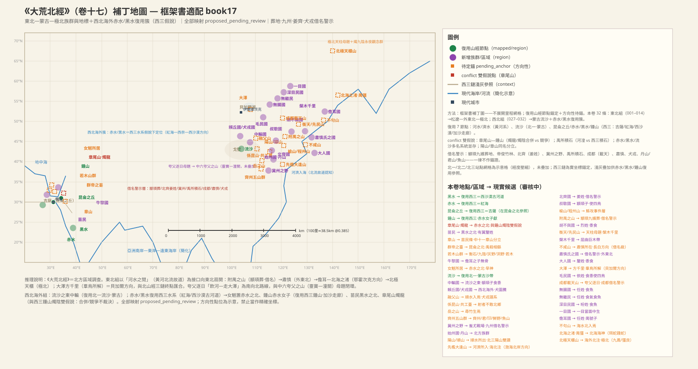
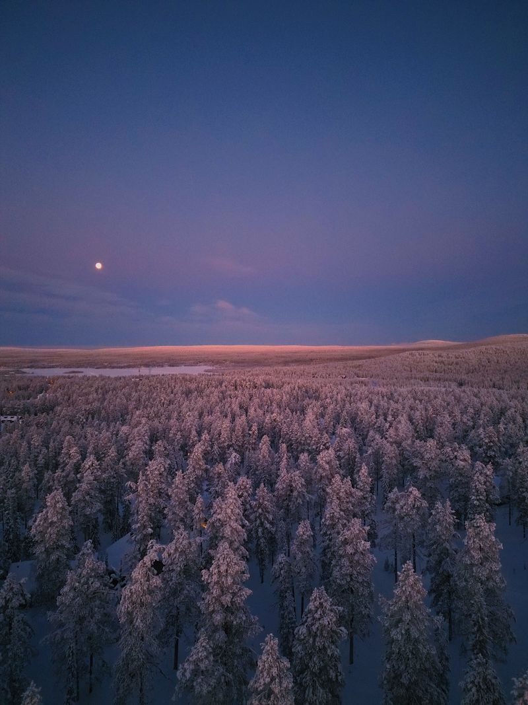
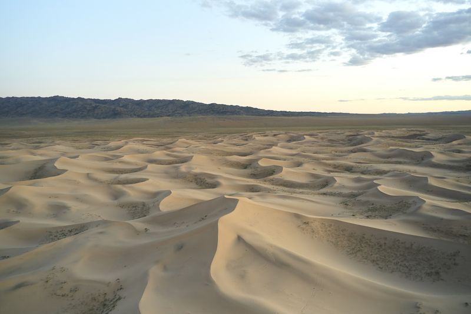
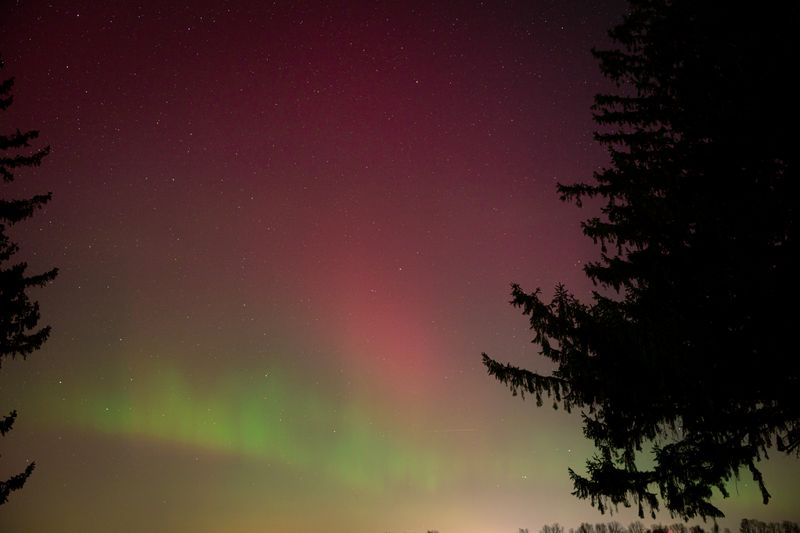

# 《大荒北經》白話讀本（卷十七）

## 本卷導覽

《大荒北經》是四篇《大荒經》里的「北方卷」，共三十二條。全卷按三組方位詞展開：開頭是「東北海之外、大荒之中」的東北組（黃河故道以東以北，直到極北），中段轉入「西北海外」的西北組（蒙古以西到西伯利亞方向），中間夾著一批北方族群名單。本卷不做里程算術，主要靠「沿用《山經》已定節點＋方位指向」來定位；它的價值在於把《北山經》三條山鏈的終點方向（貝加爾、楚科奇、極北光象）串成了一張區域網。

幾個主要支點：黃河主幹與北流故道（全卷的方位基準）；大澤＝貝加爾湖方向（《北山經》兩條鏈都指向貝加爾是北方最大水體）；流沙＝蒙古沙質草原；崑崙＝吉薩高地（只作方位參照：「群帝之台在崑崙之北」）；章尾山＝泰梅爾半島—北地群島方向（約北緯 76 度——詳見燭龍條）。

本卷最重頭的內容是神話史詩：**黃帝蚩尤大戰的完整版本**（應龍蓄水、風伯雨師、天女魃止雨）、夸父逐日、相繇（相柳）與禹湮洪水、燭龍照亮九陰。這些神話的現實原型——旱災與求雨儀式、鹽鹼沼澤、極晝極夜與極光——下文逐條交代。文中所有「葬地、州名、後世族名」（顓顼葬地、冀州、肅慎、犬戎、北齊等）一律是後世貼上去的標籤，只當提醒，不拿後世地名反推原文位置。

---

## 大荒北經·全卷

### 1. 附禺之山：東北方向的第一座山（顓顼葬地是後世貼上去的標籤）

> **【原文】**
> 東北海之外，大荒之中，河水之閒，附禺之山，帝顓頊與九嬪葬焉。爰有𩿨久、文貝、離俞、鸞鳥、鳳鳥、大物、小物。有青鳥、琅鳥、玄鳥、黄鳥、虎、豹、熊、羆、黄蛇、視肉、璿、瑰、瑶、碧，皆出于山。丘方圓三百里，丘南帝俊竹林在焉，大可為舟。竹南有赤澤水，名曰封淵。有三桑無枝。丘西有沈淵，顓頊所浴。

**白話解讀**：這是全卷的方位基準條：在「東北方向的海外、大荒之中、黃河幾條故道之間」有一片丘陵。這裏的「河」沿用《山經》的黃河主幹，「河水之間」指黃河北流故道諸流之間——這是全卷東北組的定位扇面。附禺之山本身只落在松遼平原北緣—小興安嶺這個方向上，屬方向性猜測；「帝顓顼與九嬪葬焉」是後世把帝王葬地層層附會上去的寫法（《海內東經》鮒魚之山也記了同一套顓顼葬地故事——**同一傳說安在兩個地方，正好說明葬地敘事會流動，兩處都不能當定位證據**）。後面那一長串物產——怪鳥、彩紋貝、鸞鳳、四色鳥群、虎豹熊羆、黃蛇、視肉、四種玉——是帝陵級的標配清單格式；其中「文貝」（彩紋海貝）出現在東北內陸，如果屬實就是遠距離交換網的證據，但目前只是猜測。南面「帝俊竹林，大可為舟」的巨竹在北緯 45° 以上不可能自然生長，記為神話層或南方竹意象的北植；竹南的紅色澤水「封淵」可能是鐵鏽水或藻色景觀；旁邊的「三桑無枝」是無枝巨桑的神樹地標；丘西「沈淵」說是顓顼洗澡的地方，同樣屬葬地故事層。

---

### 2. 胡不與之國：种黍的東北族群

> **【原文】**
> 有胡不與之國，烈姓，黍食。

**白話解讀**：這條只記了一個族群：姓烈，吃黍米——也就是种粟黍的農耕族群，位置在東北框架內，屬於農耕區的北緣（這與東北新石器時代黍作考古的方向相合，但族名對不上任何已知族群）。「胡不與」這個名字到底怎麼讀——是「何不與之」的縮略，還是音譯族名——目前無解。

---

### 3. 不咸山與肅慎氏之國：外東北方向

> **【原文】**
> 大荒之中，有山名曰不咸，有肅慎氏之國。有蜚蛭，四翼。有蟲，獸首蛇身，名曰琴蟲。

**白話解讀**：大荒之中有座不咸山，山下有個肅慎氏之國。後世文獻把不咸山等同於長白山，我們只能把它當成長白山方向的方向性猜測，不能拿這個後世等式反過來錨山。「肅慎」是周代以後纔出現的族名（《左傳》「肅慎、燕、亳」），用來記這個外東北（黑龍江流域—濱海方向）的族群同樣是后貼的名字，這部書成形的年代裏這支部族究竟是誰還不知道——大方向是古亞細亞或通古斯系統的先民，屬方向性猜測。兩種「虫」：「蜚蛭」是長著四隻翅膀的飛蟲，可能是複式觀察或造像詞彙；「琴虫」獸首蛇身，也是複合造像語彙——古漢語里「虫」是動物的泛稱（虎稱「大蟲」），不一定指蟲子。

---

### 4. 大人之國：北方的巨人記錄

> **【原文】**
> 有人名曰大人。有大人之國，釐姓，黍食。有大青蛇，黄頭，食麈。

**白話解讀**：北方也記了一個「大人之國」，姓釐，吃黍。「大人」這個母題在《海外東經》《大荒東經》都出現過，本卷是北方版本——同名母題多地分佈，不強行合併。釐姓和後面苗民的釐姓相同，是否同源還沒有定論。物產里有一條「黃頭、吃大鹿（麈）」的大青蛇：這是大型蛇的觀察記錄，體型可能有誇飾，方向性猜測是北方錦蛇或蝮蛇一類的放大記憶。

---

### 5. 榆山與鲧攻程州之山：兩座只有名字的東北山

> **【原文】**
> 有榆山。有鯀攻程州之山。

**白話解讀**：這條只有兩座山名。榆山，東北方向的山地，或許因榆樹林帶得名。「鲧攻程州之山」要拆開讀：程州之山是地理記錄，「鲧攻」是疊加在上面的神話事件層——鲧是洪水敘事里的人物（對照《海內經》鲧竊息壤），山體本身是真的，攻伐故事是後來貼上去的。

---

### 6. 衡天山、先民之山與槃木千里：天柱系列與原始森林記憶

> **【原文】**
> 大荒之中，有山名曰衡天。有先民之山。有槃木千里。

**白話解讀**：三座北方記錄。衡天山，「衡天」是「頂著天」的意思，屬天柱母題——本卷的衡天、北極天柜、成都載天構成一組極北「天柱」系列山名，方向性猜測為北方高寒山地。先民之山，以「先祖之民」命名的山，同樣只有方向。「槃木千里」最有意思：**盤曲的巨木綿延千里，我們判斷這是北方原始森林——泰加林帶——的遙遠記憶**：那種被風雪壓彎、盤根錯節的針葉林景觀，確實可以一望無際。

（圖：Pexels）

---

### 7. 叔歜國：顓顼後裔的驯鳥族群

> **【原文】**
> 有叔歜國，顓頊之子，黍食，使四鳥、虎、豹、熊、羆。有黒蟲如熊狀，名曰猎猎。

**白話解讀**：叔歜國，家譜上掛為「顓顼之子」，吃黍，能「使四鳥、虎豹熊羆」——「使四鳥」是驯禽或圖騰的記錄格式，虎豹熊羆是北方猛獸的標配清單。另有一種「黑色的虫，樣子像熊」，名叫獵獵：按「虫」是動物泛稱來推，這很可能就是黑熊的記錄。

---

### 8. 北齊之國：姜姓但不是山東那個齊

> **【原文】**
> 有北齊之國，姜姓，使虎、豹、熊、羆。

**白話解讀**：一個姜姓的「北齊之國」，會驯使虎豹熊羆。姜姓加齊名，讓人立刻想到周代山東的姜齊——但本條在北方方位框架里，指的是冀東—遼西方向的北方族群，跟山東齊國無關；「北」字很可能就是後人為了區別而加的。

---

### 9. 先檻大逢之山、河濟所入與禹所積石：渤海北岸的河口山

> **【原文】**
> 大荒之中，有山名曰先檻大逢之山，河濟所入，海北注焉。其西有山，名曰禹所積石。

**白話解讀**：這是本卷地形信息最密的一條。先檻大逢之山是「河、濟二水入海、海水向北彎注」的地方——河是黃河主幹（下遊走北流故道），濟是古濟水（黃河系分流的下游入海段）。兩河共入海、海岸向北彎的地形，指向渤海灣北岸的河口山地——遼西走廊、碣石—醫巫閭方向（方向性猜測）。「其西有禹所積石」：經我們考證，**「禹所積石」四個字是後來編訂時加的，不作定位**——「禹導河」那套敘事框架是戰國時代的投影；河湟積石峽的候選只存檔不取，「禹所」二字是禹跡故事的標籤。（《西次三經》另有一座積石之山，對應阿斯旺第一瀑布的花崗岩峽門方向，與這裏不相干。）

---

### 10. 陽山、順山順水、始州之國與丹山：一組北方點名

> **【原文】**
> 有陽山者。有順山者，順水出焉。有始州之國，有丹山。

**白話解讀**：一組簡略點名。陽山：《北山經》第三列有同名陽山（太行南段方向），但本卷這條沒有方位屬性可以驗證是不是同一座，合併／分立兩種讀法都留著。順山流出順水，順水往後流進融父山（見後文）——這是本卷內部一條自成閉環的小水系，實指何河還沒有定論。始州之國只有個名字。丹山：叫「丹」的山全書多處，只記北方方向。

---

### 11. 大澤方千里：群鳥換羽的巨大湖澤（貝加爾湖方向）

> **【原文】**
> 有大澤方千里，羣鳥所解。

**白話解讀**：一個方圓千里的大澤，是「群鳥所解」——成群候鳥換羽的地方。這是全書北方最大的水體記錄，我們判斷方向性猜測為**貝加爾湖**：《北山經》三條鏈路（泰澤、「錞于北海」）都指向貝加爾是北方最大水體，互相印證；後面夸父「將走大澤」走的也是同一個水體。「方千里」是尺度誇飾，但「超大湖＋候鳥換羽地」的組合在西伯利亞只有一個答案。「所解」讀作換羽地還是棲息地，還沒有定論。

（圖：Pexels）

---

### 12. 毛民之國：多體毛的北方族群與一段放逐神話

> **【原文】**
> 有毛民之國，依姓，食黍，使四鳥。禹生均國，均國生役采，役采生修鞈，修鞈殺綽人。帝念之，潛為之國，是此毛民。

**白話解讀**：毛民之國，姓依，吃黍，會「使四鳥」。「毛民」就是多體毛的族群——北方寒地居民的體質特徵被志怪化的記錄；《海外東經》也有毛民國，東方海上與北方兩處同名，兩種讀法保留。後半段是一串神話家譜：禹生均國、均國生役采、役采生修鞈，修鞈殺了綽人，帝念其情，暗中為他們立了國——這就是毛民的由來。這是「後裔獲罪被貶谪」的放逐敘事，屬神話層，不作地理證據。

---

### 13. 儋耳之國與北海之渚的禺強：長耳族群和北海海神

> **【原文】**
> 有儋耳之國，任姓，禺號子，食榖。北海之渚中，有神，人面鳥身，珥兩青蛇，踐兩赤蛇，名曰禺彊。

**白話解讀**：儋耳之國，姓任，家譜掛為「禺號之子」，吃穀物。「儋耳」是長耳朵母題（對照《海外北經》聂耳國）；任姓是本卷的一個姓群——無腸、無繼都姓任。北海之渚是北方海域里的島嶼或洲渚，方向候選鄂霍次克海—北冰洋一帶；但「北海」本身有兩種讀法——《山經》里的北海指貝加爾湖，這裏的「北海之渚」更像真海的島嶼，兩讀並存。渚中的神禺強，人面鳥身，耳朵上掛兩條青蛇、腳下踩兩條赤蛇——這是典型的薩滿式神像語彙（與奢比尸、強良同型），即北海的海神（神話層）。

---

### 14. 北極天柜之山、九鳳與強良：本卷最北的地標

> **【原文】**
> 大荒之中，有山名曰北極天櫃，海外北注焉。有神，九首人面鳥身，名曰九鳳。又有神衘蛇操蛇，其狀虎首人身，四蹏長肘，名曰彊良。

**白話解讀**：北極天柜（柜一作樻）之山，「北極天的樞柜」是天柱母題，「海外北注焉」——海水都向北傾注到這裏——把它推成本卷最北的地標：北冰洋岸、泰梅爾或科拉半島方向（猜測級別）。兩尊神：九鳳，九顆頭、人面鳥身，是極北的多首神造像（**後世九頭鳥／鬼車母題的源頭之一**）；強良，虎首人身、四蹄長肘、嘴裏銜蛇手裏操蛇，與禺強同屬「操蛇神像」語彙。兩神皆神話層，無地理對應。

---

### 15. 成都載天之山與夸父逐日：從黃河喝到大澤

> **【原文】**
> 大荒之中，有山名曰成都載天。有人珥兩黄蛇，把兩黄蛇，名曰夸父。后土生信，信生夸父。夸父不量力，欲追日景，逮之于禺谷。將飲河而不足也，將走大澤，未至，死于此。應龍已殺蚩尤，又殺夸父，乃去南方處之，故南方多雨。

**白話解讀**：成都載天之山是天柱系列的第三座；「成都」二字是後世蜀地名的借用——本卷在北方框架，跟成都平原無關。夸父耳掛兩條黃蛇、手持兩條黃蛇，家譜是后土生信、信生夸父，屬神話層人物；《中山經》的夸父之山（靈寶—潼關黃河南岸）是同一個逐日母題的地理附著點。他追太陽的影子一直追到禺谷——日入之處，和西方日落山（崦嵫）同型的神話地標。然後「將飲河而不足，將走大澤，未至，死於此」：**喝乾了黃河還不夠，要向北奔向大澤**（即貝加爾方向的那個大澤）——從黃河向北走大澤，路線方位是自洽的。末句接入另一段神話：應龍殺了蚩尤又殺夸父，然後移居南方，所以南方多雨——夸父的死因因此有「渴死」和「被應龍所殺」兩個版本，並存；「南方多雨」是對雨旱分佈的神話解釋。

---

### 16. 無腸之國：極北吃魚的人

> **【原文】**
> 又有無腸之國，是任姓。無繼子，食魚。

**白話解讀**：無腸之國，姓任，「無繼子」，吃魚。《海外北經》也記了無腸國，兩處同名、方位相容（都在北方），可視為同一母題兩書並記。「食魚」點明極北漁獵生業；「無繼子」是「沒有後嗣」還是別的讀法，還沒有定論。

---

### 17. 相繇、禹湮洪水與群帝之台：鹽鹼沼澤的神話解釋（在崑崙之北）

> **【原文】**
> 共工臣名曰相繇，九首蛇身，自環，食于九土。其所歍所尼，即為源澤，不辛乃苦，百獸莫能處。禹湮洪水，殺相繇，其血腥臭，不可生榖；其地多水，不可居也。禹湮之，三仞三沮，乃以為池，羣帝因是以為臺。在崑崙之北。

**白話解讀**：共工的臣子相繇（即相柳），九頭蛇身、身體盤繞，在「九土」（九州的泛稱，後世詞）到處觅食。他嘔吐、盤踞過的地方就化成澤藪，水不是辣就是苦，百獸無法生存——我們判斷這是**鹽鹼沼澤化的神話解釋**：洪水退去後低地鹽鹼化、「不可生谷」是真實的土壤問題，被包裝成了怪獸敘事。接著是禹的治水敘事：禹湮洪水、殺相繇，三筑三毀（三仞三沮）終於圍成水池，群帝順勢在上面筑了台——群帝之台這個建築群母題在《海外北經》《海內北經》也出現過。最關鍵的方位詞在末尾：「在崑崙之北」。這裏的崑崙沿用《西次三經》的崑崙之丘＝吉薩高地，本句是拿崑崙當方位參照——群帝之台在吉薩以北、尼羅河三角洲方向（猜測級別）。順帶說明：《海內北經》記帝堯台等四帝台「在崑崙**東北**」，與本卷「在崑崙**之北**」同母題而方位小有歧異，張力留著，還沒有定論。

（圖：Pexels）

---

### 18. 岳之山：北方也產長竹

> **【原文】**
> 有岳之山，尋竹生焉。

**白話解讀**：岳之山，山上長「尋竹」——八尺曰尋，尋竹就是長竹。北方出現竹子記錄，與前面的帝俊竹林互相印證，構成「北方竹記錄」母題：可能是**暖溼期竹分佈北界的殘留記憶**（幾千年前氣候比今天暖溼，竹子長得更靠北），也可能是南方意象北植。竹种還沒有定論。

---

### 19. 不句山：海水向北匯入的地方

> **【原文】**
> 大荒之中，有山名不句，海水北入焉。

**白話解讀**：不句山，「海水北入焉」——海水向北匯入此山之地，指向遠北的海岸山：遠東—鄂霍次克海沿岸方向（猜測級別）。有異文作「海水入焉」。

---

### 20. 系昆之山、共工之台與黃帝女魃：蚩尤之戰的完整版本

> **【原文】**
> 有係昆之山者，有共工之臺，射者不敢北鄉。有人衣青衣，名曰黄帝女魃。蚩尤作兵伐黄帝，黄帝乃令應龍攻之冀州之野。應龍畜水。蚩尤請風伯雨師，縱大風雨。黄帝乃下天女曰魃，雨止，遂殺蚩尤。魃不得復上，所居不雨。叔均言之帝，後置之赤水之北。叔均乃為田祖。魃時亡之，所欲逐之者，令曰：「神北行！」先除水道，决通溝瀆。

**白話解讀**：系昆之山上有共工之台，「射者不敢北鄉」——射箭的人不敢朝北開弓，這是把共工台當禁忌聖地的方位記錄（對照《大荒西經》軒轅之台「射者不敢西鄉」，同一禁忌母題）。隨後是**本卷最完整的蚩尤之戰敘事**：蚩尤起兵伐黃帝，黃帝令應龍在「冀州之野」迎戰（冀州是後世九州名的借用，不能拿後世行政地理反推戰場）。應龍蓄水，蚩尤請風伯雨師縱大風雨——**水與雨的對決是洪水與暴雨的神話對位**。黃帝降下天女「魃」，雨停了，於是殺了蚩尤；但魃再也回不了天上，她住的地方從此不下雨——**這是旱災的神話解釋**；女魃身穿青衣，與後文的「赤水女子獻」（同樣青衣）構成同型旱神對位。之後叔均（發明農耕的「田祖」，與《大荒西經》西周之國的叔均是同一人物）向帝進言，把魃安置到「赤水之北」。注意：「赤水」是「紅色外觀之水」的通名，本條取北方實例——西伯利亞紅色氧化河道或凍原湖泊方向（還沒有定論）。末尾「神北行！先除水道，決通溝渎」是一段**驅旱儀式的實錄**：要趕走魃，就先喊「請神往北走」，再清理水道溝渠——求雨巫儀的實踐文本，民俗價值很高。

---

### 21. 深目民之國：深目食魚的極北族群

> **【原文】**
> 有人方食魚，名曰深目民之國，昐姓，食魚。

**白話解讀**：深目民之國，姓昐，正在吃魚——「食魚」複述兩遍，是在強調漁獵生業。「深目」是體質特徵或面具母題（薩滿面具的猜測）；《海外北經》也有深目國，同名跨卷、方位相容（皆北）。

---

### 22. 鐘山與赤水女子獻：青衣女神住在北方鐘山

> **【原文】**
> 有鍾山者，有女子衣青衣，名曰赤水女子獻。

**白話解讀**：有座鐘山，山裏有個穿青衣的女子，名叫赤水女子獻。按我們的考證，這座鐘山取北緯六十到七十度的北方山系（與章尾山同簇方向），和《西次三經》那座在南黎凡特海岸的鐘山是兩處——那裏沒有極晝極夜也沒有極光，南北兩座鐘山同名不同地。「赤水女子」之名把這座山與赤水（紅色水體的通名）直接綁定；青衣加赤水，使她與女魃（衣青衣、被置於赤水之北）構成同型旱神母題對位。她是不是就是女魃，還沒有定論。

---

### 23. 融父山與犬戎家譜：順水終點與白犬始祖

> **【原文】**
> 大荒之中，有山名曰融父山，順水入焉。有人名曰犬戎。黄帝生苗龍，苗龍生融吾，融吾生弄明，弄明生白犬，白犬有牝牡，是為犬戎，肉食。有赤獸，馬狀，無首，名曰戎宣王尸。

**白話解讀**：融父山是順水的受水點——順山出順水，到這裏入山，本卷內部的小水系就此閉合；山在蒙古方向（還沒有定論）。然後是犬戎的始祖神話：黃帝生苗龍、苗龍生融吾、融吾生弄明、弄明生白犬，白犬有公有母，繁衍為犬戎——這是犬圖騰起源神話加犬种繁育記錄的組合；犬戎「肉食」，是草原生業。注意「犬戎」是西周滅鎬京那個族名，用在神話家譜里屬後世借用，不能以今果為因。最後一隻「赤獸，馬狀、無首，名曰戎宣王尸」：無首的馬形神像，「尸」是神像語彙（對照奢比尸、女丑之尸），無首屬刑天型造像。

---

### 24. 齊州之山等五山：五座還沒有定論的北方山

> **【原文】**
> 有山名曰齊州之山、君山、𩰿山、鮮野山、魚山。

**白話解讀**：五座山連排點名，全部只有方向（北方），全部還沒有定論。齊州是後世州名；君山、魚山是後世高頻山名，都屬同名借用；𩰿山用字生僻，反而少了後世貼名的污染，但字本身怎麼讀還沒有定論；鮮野山的「鮮野」讓人聯想到「鮮卑原野」，只作聯想，不作證據。

---

### 25. 一目國：臉中央一隻眼睛的人

> **【原文】**
> 有人一目，當面中生。一曰是威姓，少昊之子，食黍。

**白話解讀**：一目國：一隻眼睛長在臉正中央——獨眼母題，可能是薩滿面具或額飾被寫成了體質特徵。「一曰」引出異說：姓威、少昊之子、吃黍——這是異說並存的記錄格式，少昊之子屬家譜層疊。《海外北經》也有一目國，同名跨卷、方位相容（皆北）。

---

### 26. 無繼民：任姓、食氣食魚的極北族群

> **【原文】**
> 有無繼民，無繼民任姓，無骨子，食氣、魚。

**白話解讀**：無繼民，姓任，「無骨子」，食氣又食魚。與前面的無腸之國對照讀：同姓任、同食魚，一個「無繼子」一個「無骨子」——是同族雙名還是兩支分記，兩種讀法保留。「食氣」是辟穀、呼吸的母題；「無骨」是體質描述還是圖騰，還沒有定論。

---

### 27. 中䡢國：流沙以東的顓顼後裔

> **【原文】**
> 西北海外，流沙之東，有國曰中䡢，顓頊之子，食黍。

**白話解讀**：從這裏開始換框架：「西北海外」——西北組開篇。流沙以東有個中䡢國，家譜掛為顓顼之子，吃黍（農耕北緣）。流沙沿用《北山經》的節點：**蒙古沙質草原／沙丘地**，同名加方位相容——流沙之東正好落在蒙古東部到東北西緣。「流沙」是描述流動沙地貌的通名，別卷（埃及方向、加勒比方向）另有實例，各是各的。「䡢」字怎麼讀，還沒有定論。

（圖：Pexels）

---

### 28. 賴丘國與犬戎國：族名與保護神同名

> **【原文】**
> 有國名曰賴丘。有犬戎國。有神，人面獸身，名曰犬戎。

**白話解讀**：賴丘國只有名字，西北方向。犬戎國是前面犬戎的「國化」復見——同一族群的另一次記錄（西北方向）。特別的是後面這句：「有神，人面獸身，名曰犬戎」——**族名和保護神同名**，這是草原圖騰造像的記錄格式。

---

### 29. 苗民與章山：黑水之北的有翼人

> **【原文】**
> 西北海外，黒水之北，有人有翼，名曰苗民。顓頊生驩頭，驩頭生苗民，苗民釐姓，食肉。有山名曰章山。

**白話解讀**：西北海外、黑水之北，有一群長翅膀的人，叫苗民。黑水沿用《西次三經》的節點（西部沙漠西向古河道系統），「西北海外」的框架與那裏的水系相合；「黑水」也是通名，《南山經》的南方黑水是另一個實例，並存不矛盾。苗民「有翼」是羽人母題移位到西北（是羽飾還是造像，還沒有定論）；家譜「顓顼生驩頭、驩頭生苗民」與《海外南經》的讙頭國同源——是族群遷移敘事還是南北兩地分佈，兩種讀法保留。苗民姓釐（與大人之國同姓，這個跨條聯繫還沒有定論），「食肉」是游牧生業。末尾的章山：《中次十一經》有同名章山（皖西），方位不合（華東 vs 西北海外），按同名不同地處理。

---

### 30. 衡石、九陰、灰野、泂野四山與若木：西北極遠處的日落神樹

> **【原文】**
> 大荒之中，有衡石山、九陰山、灰野之山、泂野之山，上有赤樹，青葉赤華，名曰若木。

**白話解讀**：四座山連排：衡石、九陰、灰野、泂野，都是西北極遠方向的山（還沒有定論）。「九陰」與燭龍「是燭九陰」直接互文——**九陰就是燭龍所照的那片極陰之地**；「灰野」是灰燼原野的意象，火山或荒漠候選；「泂野」即遠野。山上有一棵「赤樹、青葉、赤花」的樹，名叫若木——日落處的神樹母題（《離騷》「折若木以拂日」）；《海內經》的若木在「黑水青水之間」，與這裏黑水的框架恰好自洽。若木的原型樹種還沒有定論。

---

### 31. 牛黎之國與無骨人：儋耳的分支

> **【原文】**
> 有牛黎之國。有人無骨，儋耳之子。

**白話解讀**：牛黎之國只有名字，西北方向。「有人無骨，儋耳之子」——沒骨頭的人是儋耳的後代：家譜把遠北的儋耳國與西北的無骨人連在一起，是無骨母題與無繼民（「無骨子」）的互文。

---

### 32. 章尾山與燭龍：極晝極夜與極光的神格化（本卷壓軸）

> **【原文】**
> 西北海外，赤水之北，有章尾山。有神，人面蛇身而赤，直目正乘，其暝乃晦，其視乃明，不食不寢不息，風雨是謁。是燭九陰，是謂燭龍。

**白話解讀**：全卷信息量最大的一條。「西北海外，赤水之北，有章尾山」：赤水按通名取北方實例（西伯利亞紅色氧化河道／凍原湖泊方向，還沒有定論）。山上有神：人面蛇身、通體赤紅，眼睛豎著長（直目正乘），他閉眼天就黑、睜眼天就亮（其暝乃晦、其視乃明），不吃不睡不呼吸，風雨都聽他調遣，他照亮九陰之地——這就叫燭龍。

經我們逐項考證，**燭龍是極晝極夜＋極光的複合人格化**，這個結論較有把握：「視為晝、瞑為夜」是極圈內太陽數月不落、數月不升的年度節律被寫成了神的睜眼閉眼；「人面蛇身而赤、身長千里」是橫亙天際的紅色極光弧（低緯度可見的極光多為紅色高層弧）；「直目正乘」是極光垂直矗立的光柱；「吹為冬、呼為夏」是極地季節風；「是燭九陰」是極光照亮漫漫極夜——與九陰山、《北山經》「西望幽都」同屬一個極北認知簇；「不食不寢不息」說明記錄者知道這是天象，不是生物。地理上，**章尾山最可能是泰梅爾半島—北地群島方向（約北緯 76 度）**：辨別特徵是極夜長度——泰梅爾在極圈深處、極夜最長，最貼「是燭九陰」；科拉半島極光頻繁但極夜短，是備選。這條記錄能存在，本身就提示：上古信息鏈的北端，觸到了北極圈。

（圖：Pexels）

（圖：Pexels）

---

## 卷末小結

本卷三十二條，是大荒四方格局的北方一面。它留給我們三件寶：一是**黃帝蚩尤大戰的最完整版本**——應龍蓄水、風伯雨師縱雨、天女魃止雨，水與雨的對決是洪水與暴雨的神話對位，而「所居不雨」和「神北行」則是旱災解釋與驅旱儀式的實錄；二是**夸父逐日的路線**——從黃河向北奔向大澤，把逐日神話釘在了一條方位自洽的路線上；三是**燭龍**——極晝極夜與極光的人格化，證明這部書的信息觸角伸到了北極圈。再加大澤（貝加爾）、泰加林的記憶、一批極北漁獵族群的名單，北方世界的輪廓就出來了。
