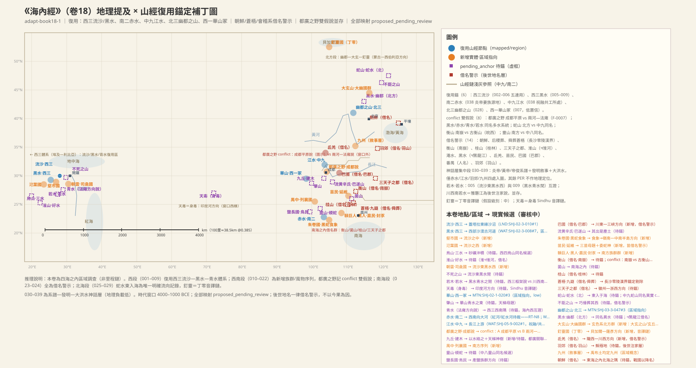
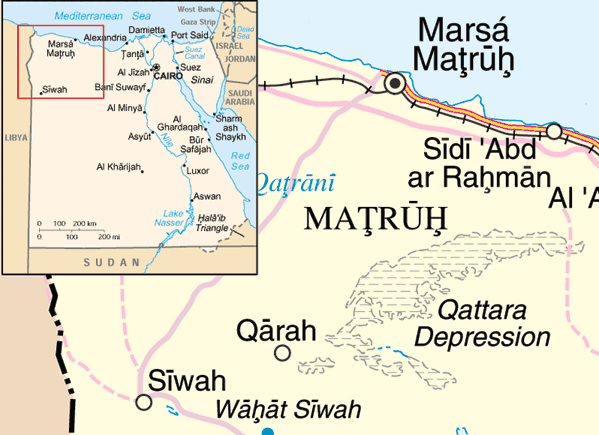
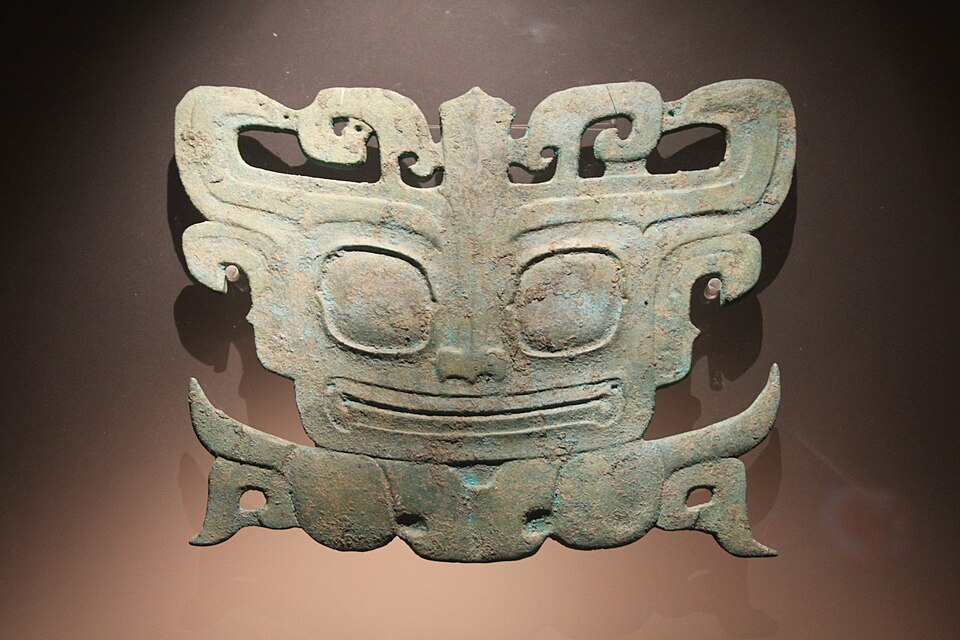

# 《山海经·海内经》白话解读（卷十八 · draft-v2）

## 本卷导览

《海内经》是全书唯一的单段式框架卷，共 39 个条目。它不走「又东三百里曰某山」的里程链，而是以「东海之内／西海之内／南海之内／北海之内」四个方位扇面做区域调查：前半（001–009）挂在西部流沙—黑水框架上，中段（010–024）是南方族群与风物序列，北段（025–029）是北方山水族群，末段（030–039）集中堆放帝系谱、发明叙事和大洪水神话。因为是框架书，**没有里程数字，也就谈不上里程吻合度**；它的价值在于把山经各卷的锚点重新引用、拼装成一幅「四海之内」的总图。

**主锚点**：本卷最硬的一组证据是 002–006 连续五次出现的「流沙」与「黑水」夹持格局——按我们的框架，流沙＝西三经盖塔拉洼地东缘沙沼带（较可靠），黑水＝西部沙漠西向古河道系统（复用西三，方向性猜测），两者夹出的地带正好落在尼罗河谷西缘—利比亚绿洲带，002–006 的方位递进（流沙中→流沙西→流沙之东黑水之西）与真实地理自洽。南方段的复用锚是赤水（南二红河方向）和江水（中九长江上游，038 条，较可靠）；北方段的复用锚是幽都之山（北三西望地标，028 条）。**都广之野（008）是本卷最大的悬念**：成都平原说与两河—法雍说并存，按 ADJ-004 裁决，两河方向内容由框架书以待锚形式承担，不在本层强行裁决。

**裁决口径**：本卷涉及两条已生效裁决——ADJ-004（两河空档为山经体例性缺席，都广之野双假说并存）与 ADJ-005（山名唯一／水名类名：本卷的流沙、黑水、赤水、若水都是描述外观性状的类名，多处同名各自落实，不再视为冲突）。ADJ-002（昆仑虚＝撒哈拉之眼）、ADJ-003（烛龙＝极昼极夜极光）的裁决对象不在本卷出现。

**主要未决**（全卷未决项照录于各条，共 66 条）：都广之野 A/B 双假说、若水归属（西三框架 vs 川西南）、青水双读、朝鮮/天毒的借名层位、蛇山与衡山的同名归属，以及一大批后世纪名（舜葬「长沙零陵界中」等汉代锚定层）的剔除核对。

**置信度口径**：很可靠 ＝ 高置信；较可靠 ＝ 中高置信；方向性猜测 ＝ 中至中低置信；待考 ＝ 低置信或未定。句末小字为知识图谱节点号。

---

## 海內經·全卷（book18）

### 【SHJ-18-1-001】朝鲜与天毒：东北隅的两个「借名」国

> **【經文原文】**
> 東海之内，北海之隅，有國名曰朝鮮；天毒，其人水居，偎人愛人。

**白话解读**：开篇先立框架：「东海之内、北海之隅」就是东北方向这个扇面。这里记了两个国。**朝鲜**大体在辽东—朝鲜半岛方向，但要打借名警示：「朝鲜」作为政权名是战国以后才通行的，比文本窗口晚，所以只能取它的方位记录、不能取它的名字当证据（待考）。**天毒**就是「身毒」，是 Sindhu（印度河）的音译链，指向印度河流域方向；「其人水居」——住在水乡——与印度河—恒河的河网平原相容（方向性猜测）。「偎人爱人」是说当地人性情亲善，一条族群性情记录。

**未决项**：
- 未知：朝鮮——借名警示：朝鮮名稱層位晚於文本窗口
- 未知：朝鮮——「偎人愛人」風俗記錄的族群歸屬
- 未知：天毒——音譯鏈時代層位待核
- 未知：天毒——與西二赤水（印度河）認知的關係

### 【SHJ-18-1-002】壑市：流沙洼地里的绿洲国

> **【經文原文】**
> 西海之内，流沙之中，有國名曰壑市。

**白话解读**：转到西海扇面。「流沙之中」的流沙是本卷的关键坐标——我们判断它就是西三经那套流沙体系，即**盖塔拉洼地东缘的沙沼带**（`LND:SHJ-02-3-010#1`，较可靠）：一片低于海平面、湿期为湖沼、旱季为盐沼的巨大洼地，四周被沙海包围，叫「流沙之中」很贴切。洼地里有个**壑市国**——「壑」就是洼地，我们把它读作盖塔拉绿洲聚落方向的记录（待考，这个国名在后世文献里没有对应）。

**配图**：

（图：Wikimedia Commons）

**未决项**：
- 未知：流沙——北一流沙（蒙古—貝加爾）、東三流沙為同名異實，本卷語境鎖定西三體系
- 未知：流沙——ADJ-005（水名/地貌名為性狀類名，多實例合法非衝突）
- 未知：壑市之國——國名無後世對應

### 【SHJ-18-1-003】氾叶：再往西一站

> **【經文原文】**
> 西海之内，流沙之西，有國名曰氾葉。

**白话解读**：上一条在流沙「之中」，这一条走到流沙「之西」——按盖塔拉洼地往西推，就是**锡瓦绿洲再往西的利比亚绿洲带方向**（待考）。这个「中→西」的方位递进很值钱：它说明作者对这条沙带东西向延展有真实认知，不是凭空写了个国名。文本有异文「氾／沮」，并存待核。

**未决项**：
- 未知：氾葉之國——異文 氾／沮

### 【SHJ-18-1-004】鸟山三水：撒哈拉湿期的砂矿记忆

> **【經文原文】**
> 流沙之西，有鳥山者，三水出焉。爰有黄金、璿瑰、丹貨、銀鐵，皆流于此中。又有淮山，好水出焉。

**白话解读**：流沙以西有座鸟山，三条水从山里发源；山里有黄金、璿瑰（美玉）、丹货（丹砂类红色矿物）、银铁，而且「皆流于此中」——这些矿产是**被水冲下来的**。这是很典型的砂矿冲积记录：山洪把含金含矿的碎屑从山体带进河床，人在河里淘取。它指向的是撒哈拉湿润期的山地放射状水系（那时的撒哈拉山地多雨多河，与今天完全不同），西四经的鸟山（撒哈拉阿特拉斯山前）是同名候选，但植被描述对不上，只能算方向性猜测（待考）。旁边的淮山、好水同样是流沙之西的方向性记录；注意这个「淮」不是淮河，别按后世地名套（待考）。

**未决项**：
- 未知：鳥山（三水所出）——三水之名無記
- 未知：鳥山（三水所出）——「黄金璿瑰丹貨銀鐵皆流于此中」＝砂礦沖積記錄的具體水系
- 未知：三水（鳥山所出）——水名全佚

### 【SHJ-18-1-005】朝云、司彘与黄帝家谱：流沙黑水夹出的地带

> **【經文原文】**
> 流沙之東，黑水之西，有朝雲之國、司彘之國。黄帝妻嫘祖，生昌意。昌意降處若水，生韓流。韓流擢首、謹耳、人面、豕喙、麟身、渠股、豚止，取淖子曰阿女，生帝顓頊。

**白话解读**：前半句是地理，后半句是家谱，混排在一起——这是本书的常见写法。地理部分：「流沙之东、黑水之西」把朝云、司彘两国夹在中间，这个夹持格局和西三经的流沙—黑水拓扑完全一致（黑水 `WAT:SHJ-02-3-008#7`，即西部沙漠的西向古河道，方向性猜测）；夹出来的地带就是**尼罗河谷西缘到绿洲带**这一线（待考）。家谱部分：黄帝娶嫘祖生昌意，昌意「降处若水」生韩流，韩流娶阿女生颛顼——这是把帝系叙事钉到地理上的「系谱—地理耦合点」，若水因此成了本卷少数能跨条互证的水（005 与 009 呼应）：一说在西三框架内，一说按后世注家是川西南的雅砻江方向，两说并存（待考）。韩流的长相——长头、小耳、人面、猪嘴、麒麟身、罗圈腿、猪蹄——是典型的动物复合造像，属神话层，不作动物学对应。按 ADJ-005，书里的「黑水」是描述深色水体的类名，好几处同名各指各的水，不算冲突。

**未决项**：
- 衝突：黑水——{'hypothesis': '復用西三黑水', 'note': '流沙—黑水並置格局相容'}
- 衝突：黑水——{'hypothesis': '南三黑水（雞山南流注于海，WAT:SHJ-01-3-009#1）', 'note': '同名異水系統，本卷 005/006 語境不支持，009「黑水青水之閒」或涉南方系統——兩假說並存'}
- 未知：黑水——書內「黑水」為多處共用水名（同名異水為常例，xici3 已自證）
- 未知：黑水——ADJ-005（水名/地貌名為性狀類名，多實例合法非衝突）
- 未知：司彘之國——司彘族名讀法
- 衝突：若水——{'hypothesis': '西三框架內若水', 'note': '與流沙黑水共置'}
- 衝突：若水——{'hypothesis': '川西南若水＝雅礱江方向（後世注家說）', 'note': '與 009「南海之內」相容，但與 005 方位框架衝突——兩假說並存'}
- 未知：若水——若水與若木的依存關係（水出樹下？）
- 未知：黃帝—顓頊系譜（嫘祖/昌意/韓流/阿女）——嫘祖／雷祖異名

### 【SHJ-18-1-006】不死之山：夹在沙与水之间的台地

> **【經文原文】**
> 流沙之東，黑水之閒，有山名不死之山。

**白话解读**：还是那套夹持坐标：流沙以东、黑水之间的山地，我们指向**埃及西缘的台地方向**（待考）。「不死」是个跨卷母题——海外南经有不死民、别处有不死树——这条山名大概率是从那套「不死」传说借来的标签，地理信息只在它的夹持位置里。

**未决项**：
- 未知：不死之山——不死母題（不死民/不死樹）的跨卷關係

### 【SHJ-18-1-007】肇山与柏子高：第一架「天梯」

> **【經文原文】**
> 華山青水之東，有山名曰肇山。有人名曰柏子高，柏子高上下於此，至于天。

**白话解读**：华山青水以东有座肇山，有个叫柏子高的人「上下于此，至于天」——顺着这座山上天下天。这是天梯母题，和后文 012 的建木、010 的灵山是同一组意象：祭司或萨满「登隐」通天的叙事。地理上，华山复用西一经的华山冢（`MTN:SHJ-02-1-020#3`，横断山—藏东方向，置信低）；「青水」有两个候选：西三昆仑西南隅的青水（法雍方向，有海内西经互证）或南方青水，同名异水，两说并存（待考）。

**未决项**：
- 未知：華山——與太華之山（西一）的名號關係
- 未知：華山——「華山青水之東」的青水系統歸屬
- 衝突：青水——{'hypothesis': '西三青水（法雍方向）', 'note': '四隅互證支持'}
- 衝突：青水——{'hypothesis': '南方青水（007 華山青水之東語境）', 'note': '與華山冢共置時指向橫斷山方向——同名異水可能，並存'}
- 未知：青水——索引無青水節點（山經正文未出），僅海內西互證
- 未知：肇山——天梯母題與建木/靈山的關係

### 【SHJ-18-1-008】都广之野：本卷最大的悬念——天府之国在哪

> **【經文原文】**
> 西南黑水之閒，有都廣之野，后稷葬焉。其城方三百里，蓋天地之中，素女所出也。爰有膏菽、膏稻、膏黍、膏稷，百榖自生，冬夏播琴。鸞鳥自歌，鳯鳥自儛，靈壽實華，草木所聚。爰有百獸，相羣爰處。此草也，冬夏不死。

**白话解读**：这是全卷最肥的一条。西南方向黑水之间有一片「都广之野」：肥美的豆、稻、黍、稷样样丰产，百谷自己生长，冬夏都能播种；鸾鸟自唱、凤鸟自舞，灵寿木开花结果，草木繁盛，百兽成群聚居，草冬夏不枯——一幅**无霜期极长的亚热带—热带平原农业天堂图**。问题是它在哪。我们保留两个假说：**A 说＝成都平原**（方向性猜测偏较可靠）：稻作百谷与成都平原的农业面貌吻合，紧邻中九经（岷山—长江上游）的地理认知圈，「西南」相对中原视角也顺；宝墩—三星堆考古（约 2500–1000 BCE）证明那里当时确有高度发达的稻作文明。**B 说＝两河—法雍方向**（方向性猜测）：挂在西三黑水体系上，西三次经还引过这条做「后稷所潜」大泽的异文互证。按 ADJ-004 裁决，两河—中亚方向的内容本来就由框架书以「待锚」形式承担，所以两说并存、不在本卷强行裁决。至于「后稷葬焉」，按借名警示处理：那是给农神安排的葬地叙事，不作定位证据。「其城方三百里，盖天地之中」这一句有异文（有的版本没有），城郭记录的层位待核。

**配图**：

（图：Wikimedia Commons）

**未决项**：
- 衝突：都廣之野——{'hypothesis': 'A 成都平原說', 'note': '稻作百穀＋中九鄰接＋「西南」方位（相對中原視角）'}
- 衝突：都廣之野——{'hypothesis': 'B 兩河—法雍方向說（F-0007/西三黑水體系）', 'note': 'xici3-adaptation 已引 18-1-008 為西三大澤「后稷所潛」異文互證；后稷葬地屬借名警示層，兩假說並存，不在本層裁決'}
- 未知：都廣之野——「其城方三百里蓋天地之中素女所出也」有無句異文（或無此句）——城郭記錄層位待核
- 未知：都廣之野——后稷葬地＝借名警示（農神葬地敘事）
- 未知：都廣之野——ADJ-004（2026-10-26）：F-0007 採納——兩河空檔為山經體例性缺席，本群由框架書待錨承擔，逐項留待後續裁決
- 未知：后稷/叔均（播百穀、始作牛耕）——牛耕發明的考古年代與文本層位關係

### 【SHJ-18-1-009】若木若水：一棵树名还是一条水名

> **【經文原文】**
> 南海之内，黑水青水之閒，有水名曰若木，若水出焉。

**白话解读**：「黑水青水之间，有水名曰若木，若水出焉。」注意原文写的是「有**水**名曰若木」——若木在这里是水名（或水边地标），和大荒西经那棵神树「若木」是否同名同物，两读并存（待考）。若木发源出若水，正好和 005 的「昌意降处若水」对上，是本卷内部少有的水系互证。「南海之内」这个方位词和西三框架有张力：一种读法是这里的「南海」指红海—阿拉伯海方向的认知（和西三赤水＝红海的读法相容），方向性猜测，保持双读。

**未决项**：
- 未知：若木——若木＝神樹（大荒西「若木」）與此處水名的關係
- 未知：若木——「南海之內」與西三框架的兼容問題

### 【SHJ-18-1-010】禺中、列襄与蝡蛇：南方序列开场

> **【經文原文】**
> 有禺中之國。有列襄之國。有靈山，有赤蛇在木上，名曰蝡蛇，木食。

**白话解读**：从这里开始进入南方族群与风物序列（010–022 一带没有方位词，是按文本顺序归入南方段的，所以方位置信本来就低）。禺中、列襄两个国名没有后世对应，只知道在南方—西南方向（待考）。灵山上有一条红色的蛇盘在树上，叫蝡蛇，「木食」——栖在树上、以木叶为食，是一条很朴素的树栖蛇观察记录（方向性猜测）。这座灵山与中八经的灵山（豫南大别山北麓）同名，是南方新山还是复用，两说并存（待考）。

**未决项**：
- 衝突：靈山（蝡蛇所棲）——{'hypothesis': '南方靈山（新）', 'note': '語境序列指向'}
- 衝突：靈山（蝡蛇所棲）——{'hypothesis': '中八靈山復用', 'note': '同名＋大別山北麓亦可泛稱南方——兩假說並存'}

### 【SHJ-18-1-011】盐长之国与鸟民：管盐的人和鸟头人

> **【經文原文】**
> 有鹽長之國。有人焉鳥首，名曰鳥民。

**白话解读**：盐长之国，顾名思义是**掌盐的族群**——如果记录属实，指向有盐资源的内陆盆地，川渝井盐在窗口期内已有开采，方向相容（方向性猜测）。鸟民（异文作「鸟氏」）是长着鸟头的人：按我们的读法，这类「鸟首人身」多半是**图腾或面具装扮的观察记录**，不是生理描述（待考）。鸟首母题在本书跨卷多见，是南方段的标准语汇。

### 【SHJ-18-1-012】九丘与建木：河网环绕的丘台和通天神树

> **【經文原文】**
> 有九丘，以水絡之，名曰陶唐之丘、叔得之丘、孟盈之丘、昆吾之丘、黑白之丘、赤望之丘、參衛之丘、武夫之丘、神民之丘。有木，青葉紫莖，玄華黄實，名曰建木，百仭無枝，上有九欘，下有九枸，其實如麻，其葉如芒。大皥爰過，黄帝所為。

**白话解读**：九个丘台被水网环绕（「以水络之」）——这是真实的地貌观察：河网分割出的一串丘台，成都平原的河网地貌或大河三角洲都相容（方向性猜测）。九个丘的名字（陶唐、昆吾等）多是后世的帝号、族名，属借名警示层，只能取「水络丘群」这个结构（待考）。**建木**是那棵著名的天梯神树：青叶紫茎、黑花黄实，主干百仞无枝，顶上九处分叉、根下九处盘曲，果实像麻籽、叶子像芒刺——「大皥爰过，黄帝所为」，说它是太皥经过、黄帝所立的天梯地标，与 008 都广之野的空间耦合是本卷西南段的核心结构（神话地标，方向性猜测）。它和 007 柏子高的肇山、010 的灵山构成同一组天梯意象。

**未决项**：
- 未知：九丘（陶唐/叔得/孟盈/昆吾/黑白/赤望/參衛/武夫/神民）——九丘名號多為族名/帝號，層位待核
- 未知：九丘（陶唐/叔得/孟盈/昆吾/黑白/赤望/參衛/武夫/神民）——與都廣之野的空間關係
- 未知：建木——神樹地標的實體性（木質遺跡 vs 神話純層）

### 【SHJ-18-1-013】窫窳与猩猩：神话兽与真实动物的分界线

> **【經文原文】**
> 有窫窳，龍首，是食人。有青獸，人面，名曰猩猩。

**白话解读**：窫窳是龙头的食人兽，在北山经、海内西经都出现过，但各处形象不一致（一会儿龙首、一会儿蛇身人面），属神话层的流变形象，不作动物对应（待考）。**猩猩**不一样：「青色兽、长着人脸」——这是本书少数能对上真实动物的记录，我们读作**南方大型灵长类**（红猩猩一类，较可靠）；它和南一经的「狌狌」互见，是同一信息源的南方风物。

**配图**：

（图：Wikimedia Commons）

### 【SHJ-18-1-014】巴国：方位与后世名字双保险的族群

> **【經文原文】**
> 西南有巴國。大皥生咸鳥，咸鳥生乘釐，乘釐生後照，後照是始為巴人。

**白话解读**：「西南有巴国」——方位词明确，我们指向**川东—三峡方向**（较可靠）：巴文化是这一带窗口期后段真实存在的考古学文化，三峡—川东一带的巴人遗址群与它相容。不过要留借名警示：「巴」作为行政名（巴郡）是后世沿用的。后面「大皥生咸鸟，咸鸟生乘厘，乘厘生后照，后照是始为巴人」是给巴人安排的始祖系谱，属神话层的族源叙事。

**配图**：

（图：Wikimedia Commons）

**未决项**：
- 未知：巴國——巴國實體的最早層位

### 【SHJ-18-1-015】流黄辛氏与巴遂山：扬尘的国度

> **【經文原文】**
> 有國名曰流黄辛氏，其域中方三百里，其出是塵。有巴遂山，澠水出焉。

**白话解读**：流黄辛氏之国，国土方圆三百里，「其出是尘土」——这地方多扬尘。我们读作黄土或盐碱尘暴的风物记录（方向性猜测）。巴遂山和它发源的渑水接着巴国序列往西南排（待考）；「渑」是后世水名用字（如渑池），按借名警示处理，只保留「西南方向」这层信息。

**未决项**：
- 未知：流黄辛氏之國——流黄辛氏族名讀法

### 【SHJ-18-1-016】朱卷与食象黑蛇：南方性的硬指标

> **【經文原文】**
> 又有朱卷之國。有黑蛇，青首，食象。

**白话解读**：朱卷之国又是个只有名字的南方族群（待考）。重点是后面：「有黑蛇，青首，食象」——黑色大蛇、青色脑袋、能吞象。这和海内南经的「巴蛇食象，三岁出骨」是同一母题。蛇吞象当然是夸张，但**象本身就是定位证据**：窗口期内亚洲象的分布北界大致在岭南—滇南一线，有象的地方就是南方深处，所以这条把方向钉向岭南—中南半岛（较可靠）。

**配图**：

（图：Wikimedia Commons）

### 【SHJ-18-1-017】赣巨人：会笑的长唇巨人

> **【經文原文】**
> 南方有贑巨人，人面長脣，黑身有毛，反踵，見人則笑，唇蔽其目，因可逃也。

**白话解读**：南方有种赣巨人：人脸、长嘴唇、黑身多毛、脚跟朝前（反踵），见到人就笑，笑得嘴唇翻上去遮住眼睛，人趁这个空当就能逃走。这套描述和海内南经的枭阳国几乎一字不差（人面长唇黑身反踵见人则笑），说明它有稳定的信息源。我们把它放在「大型灵长类／野人传闻」层：底层可能是对大型猿类的远距离观察，「见人则笑、唇蔽其目」是民间叙事的加工（方向性猜测）。

### 【SHJ-18-1-018】黑人：耍蛇人的定妆照

> **【經文原文】**
> 又有黑人，虎首鳥足，兩手持蛇，方啗之。

**白话解读**：又有一种「黑人」：虎头、鸟脚，两手各抓一条蛇，正在吃蛇。操蛇（珥蛇、践蛇、啖蛇）在本书里本是神人的标配动作，这里落在凡人族群身上，我们读作**仪式装扮的观察记录**——某个南方族群在仪式上戴虎头、持蛇啖蛇的样子被记了下来（待考）。

### 【SHJ-18-1-019】羸民与封豕：鸟脚人和大野猪

> **【經文原文】**
> 有羸民，鳥足，有封豕。

**白话解读**：羸民是长着鸟脚的族群（待考）。连着 011 鸟民、018 黑人，三条都是「鸟足／鸟首」体貌，像是同一信息源的一组描述。**封豕**就是大野猪，通用词，南方山林的寻常风物（较可靠）。

### 【SHJ-18-1-020】苗民与延维：双头蛇神是权力的符瑞

> **【經文原文】**
> 有人曰苖民。有神焉，人首蛇身，長如轅，左右有首，衣紫衣，冠旃冠，名曰延維，人主得而饗食之，伯天下。

**白话解读**：苗民——南方族群，对应史书里「三苗」那套叙事；但「苗」作为族名属后世层，按借名警示处理（待考）。苗民之地有个神：人头蛇身、身体有车辕那么长、左右各一个脑袋、穿紫衣戴旃冠，名叫**延维**——这就是《庄子》里的「委蛇」（「长如辕」如出一辙，较可靠的神名对应）。关键是功能：「人主得而飨食之，伯天下」——君主若能捕获并用它祭献（或宴飨之），就能称霸天下。这是一条权力符瑞记录：得到双头蛇神＝获得天命级别的合法性。族群＋守护神同记，是本书的标准结构。

### 【SHJ-18-1-021】鸾凤四文：战国修辞留下的时间戳

> **【經文原文】**
> 有鸞鳥自歌，鳯鳥自儛。鳯鳥首文曰德，翼文曰順，膺文曰仁，背文曰義，見則天下和。

**白话解读**：鸾鸟自唱、凤鸟自舞——和 008 都广之野的句子互相呼应。后半段说凤鸟头上花纹是「德」、翅膀是「顺」、胸口是「仁」、背上背「义」，现身则天下太平。这种给鸟身上贴伦理标签的写法是**典型的战国修辞**，比观察记录层晚——反过来，它正是本卷写定层位的内证之一：这段文字定型时，德顺仁义那套话语已经成熟了（祥瑞层）。

**未决项**：
- 未知：鸞鳥/鳳鳥（德順仁義文）——四文修辭的寫定時代

### 【SHJ-18-1-022】𡹤狗、翠鸟、孔鸟：南方风物三件套

> **【經文原文】**
> 又有青獸如莵，名曰𡹤狗。有翠鳥。有孔鳥。

**白话解读**：三样南方风物并排：𡹤狗是兔子形状的青色小兽，具体所指待考；翠鸟就是南方水边常见的翠鸟；**孔鸟我们读作孔雀**（较可靠）——南亚—东南亚的标志性大鸟。它和 001 的天毒（印度方向）、016 的食象一起，构成本卷南方风物的「南亚—东南亚边缘」：作者群的信息触角伸到了那个方向。

**配图**：

（图：Wikimedia Commons）

**未决项**：
- 未知：𡹤狗/翠鳥/孔鳥——𡹤狗具體所指

### 【SHJ-18-1-023】衡山、菌山、桂山、三天子之都：一份被后世重锚的山名录

> **【經文原文】**
> 南海之内有衡山，有菌山，有桂山。有山名三天子之都。

**白话解读**：「南海之内」序列的四座实山。麻烦在于这四个名字全都被后世地名「认领」过：衡山今天指湖南南岳，桂山让人想到桂林，三天子之都对应秦汉的「三天子鄣」（徽州—浙西一带）。但按我们的框架，山经里的衡山（中八/中十一）本是皖西霍山方向，和「南海之内」方位不合，所以**南岳衡山说与古衡山说并存**（待考）；五岳麓定名本身是晚出层。这四座山统一打借名警示，真正可靠的只有「南海之内」这个总方位。

**配图**：

（图：Wikimedia Commons）

**未决项**：
- 衝突：衡山（南海之內）——{'hypothesis': '南嶽衡山（湖南）', 'note': '南海之內方位相容，但屬後世五嶽定名層'}
- 衝突：衡山（南海之內）——{'hypothesis': '古衡山（皖西霍山，中八/中十一）', 'note': '山經節點方位不相容——兩假說並存'}
- 未知：三天子之都——「都」為山名還是都邑

### 【SHJ-18-1-024】苍梧与九嶷：最典型的「层位倒置」

> **【經文原文】**
> 南方蒼梧之丘，蒼梧之淵，其中有九嶷山，舜之所葬，在長沙零陵界中。

**白话解读**：南方的苍梧之丘、苍梧之渊，中间有九嶷山，是舜的葬地——「在长沙零陵界中」。问题就出在最后这半句：长沙、零陵是**汉代郡县名**，用汉代的行政区划去定位帝系神话里的葬地，是本卷最典型的层位倒置——这半句必是后世锚定层掺入的。所以我们的处理是：剔除它的定名权重，只保留「南方」框架（湘南—南岭方向，待考）。苍梧母题在海外南、大荒南也多次出现，各卷之间的层位关系待核。

**未决项**：
- 未知：蒼梧之丘/蒼梧之淵/九嶷山——蒼梧母題跨卷多見（海外南/大荒南），各卷層位關係

### 【SHJ-18-1-025】蛇山蛇水：北方段唯一的流向记录

> **【經文原文】**
> 北海之内，有蛇山者，蛇水出焉，東入于海。有五彩之鳥，飛蔽一鄉，名曰翳鳥。又有不鉅之山，巧倕葬其西。

**白话解读**：进入北海扇面。蛇山发源出蛇水，**向东流入大海**——别小看这四个字，它是本卷北方段唯一一条明确的流向记录，是北方水系锚定的唯一支点：一条东北方向东入海的河流（方向性猜测）。这座蛇山与中九经的蛇山（成都东北）同名但方位、水系都对不上，按同名异实处理，两说并存。翳鸟是五彩大鸟、「飞起来遮蔽一乡」，可能是候鸟群集的夸张观察，也可能纯神话（待考）。不钜之山旁边记「巧倕葬其西」——给工匠神安排的葬地，借名警示。

**未决项**：
- 衝突：蛇山（北海之內）——{'hypothesis': '北方蛇山（新）', 'note': '北海之內＋東入海格局'}
- 衝突：蛇山（北海之內）——{'hypothesis': '中九蛇山復用（MTN:SHJ-05-9-006#1）', 'note': '同名但方位/水系（東入海）不相容——同名異實雙假說並存'}
- 未知：不鉅之山——巧倕葬地層位

### 【SHJ-18-1-026】相顾之尸：一幅刑罚图像

> **【經文原文】**
> 北海之内，有反縛盗械，帶戈常倍之佐，名曰相顧之尸。

**白话解读**：北海之内有个「相顾之尸」：反绑双手、戴着刑械、持戈，是「常倍之佐」（「常倍」或读作「尝倍/叛」，即叛逆者的扈从）。这是一幅受刑者或叛逆者的图像记录，和刑天、相繇等「尸」母题同属神话层的受刑者叙事谱系，不作地理定位（待考）。

**未决项**：
- 未知：相顧之尸——「常倍」讀法

### 【SHJ-18-1-027】氐羌的族源挂接

> **【經文原文】**
> 伯夷父生西岳，西岳生先龍，先龍是始生氐羌，氐羌乞姓。

**白话解读**：伯夷父生西岳，西岳生先龙，先龙始生氐羌，氐羌是乞姓。这是给**氐羌**族群安排的族源系谱——神话层的挂接手法。氐羌作为史书中的族群活跃在陇西—川西高原方向，我们取这个方向性候选（借名警示：氐羌是后世史书的族名用字）。「乞姓」是本书少见的姓氏记录，它和后世氐羌姓氏怎么对应，保持未知。

**未决项**：
- 未知：氐羌（伯夷父—西岳—先龍系譜）——乞姓與後世氐羌姓氏的對應

### 【SHJ-18-1-028】幽都之山：全黑色系的北方

> **【經文原文】**
> 北海之内，有山，名曰幽都之山，黑水出焉。其上有玄鳥、玄蛇、玄豹、玄虎、玄孤蓬尾。有大玄之山。有玄丘之民。有大幽之國。有赤脛之民。

**白话解读**：幽都之山复用北三经的同名山（`MTN:SHJ-03-3-047#3`，山西—贝加尔方向的西望地标，较可靠）——山名唯一，跨卷引用同一座山。山上发黑水：按 ADJ-005，这是北方自己的「深色水」类名实例，和西三黑水、南三黑水各不相干，也别接成后世的黑龙江（借名警示）。最有意思的是那群动物：玄鸟、玄蛇、玄豹、玄虎、玄狐蓬尾——**一整套黑色系动物**；再配上大玄之山、玄丘之民、大幽之国，整段是「北方＝玄（黑）」的五行式归类——这种整齐的颜色政治学是写定层位的内证，但黑色动物群本身可以读作北方寒带—亚寒带的风物观察（深色毛皮的豹、虎、狐在寒带确有生态意义，方向性猜测）。赤胫之民是红小腿的族群，体貌记录（待考）。

**未决项**：
- 未知：幽都之山——黑水所出為北方同名異水（書內常例）
- 未知：黑水（幽都所出）——玄鳥玄蛇玄豹玄虎玄狐蓬尾＝全玄色系動物群記錄的性質（北方黑色風物叢）

### 【SHJ-18-1-029】钉灵：马背上被看走眼的草原民族

> **【經文原文】**
> 有釘靈之國，其民從䣛已下有毛，馬蹏善走。

**白话解读**：钉灵之国的人，膝盖以下长毛，长着马蹄，善于奔跑。我们判断钉灵就是后世史书里的**丁零**（音译链，较可靠），方向在贝加尔湖—萨彦岭一带的草原。「膝以下有毛、马蹄善走」是本书北方段最有解释力的一条体貌记录：远看一支骑马民族，人马合一、疾驰如飞，被观察者误读成「人长着马蹄」——这正是「人马合一」的经典误读（较可靠的读法方向）。

**配图**：

（图：Wikimedia Commons）

**未决项**：
- 未知：釘靈之國——音譯鏈層位

### 【SHJ-18-1-030】炎帝家的私情与编钟的发明

> **【經文原文】**
> 炎帝之孫伯陵，伯陵同吳權之妻阿女緣婦，緣婦孕三年，是生鼓、延、殳。殳始為侯，鼓、延是始為鍾，為樂風。

**白话解读**：从这里开始是连续的发明系谱段（030–036），全是神话层、不带地理信息。炎帝的孙子伯陵与吴权的妻子阿女缘妇私通，缘妇怀孕三年，生下鼓、延、殳三兄弟：殳发明了「侯」（箭靶），鼓和延发明了钟，创制了乐调。「孕三年」是神异诞生的标准修辞；「殳始为侯」的「侯」读作射侯（靶子）还是封侯，读法待核。

**未决项**：
- 未知：炎帝—伯陵—鼓/延/殳系譜（鐘與樂風發明）——「殳始為侯」讀法

### 【SHJ-18-1-031】鲧的帝系户口

> **【經文原文】**
> 黄帝生駱明，駱明生白馬，白馬是為鯀。

**白话解读**：黄帝生骆明，骆明生白马，白马就是鲧。短短一句把鲧挂进了黄帝的家谱——这是为 039 的大洪水叙事预设身份：鲧是黄帝之后，所以「帝」杀鲧、又用鲧之子禹，都是一家人内部的事。注意鲧在这里归黄帝系，而 039 里下令杀鲧的「帝」来历未明，这种双重归属正说明系谱是多来源拼合的工程（神话层）。

### 【SHJ-18-1-032】舟与车：帝俊家的交通发明

> **【經文原文】**
> 帝俊生禺號，禺號生淫梁，淫梁生番禺，是始為舟。番禺生奚仲，奚仲生吉光，吉光是始以木為車。

**白话解读**：帝俊一系的交通发明链：帝俊→禺号→淫梁→番禺，番禺发明船；番禺→奚仲→吉光，吉光发明木车。全是神话层的发明叙事。提醒一句：这里的**番禺是人名**，跟广州那个番禺无关（借名警示的反例——名字被后世借去当了地名）。禺号和大荒东经的东海神「禺䝞」同名近音，可算帝俊系海洋属性的旁证（方向性猜测）。

**未决项**：
- 未知：帝俊—禺號—淫梁—番禺—奚仲—吉光（舟車發明系譜）——帝俊系與帝嚳系的對應假說

### 【SHJ-18-1-033】般与弓矢：东方帝系的武器专利

> **【經文原文】**
> 少皥生般，般是始為弓矢。

**白话解读**：少皥生般，般发明弓箭。弓箭发明挂在少皥（东方帝系）名下，和下一条帝俊赐羿彤弓，构成弓箭叙事的两条线（神话层）。

### 【SHJ-18-1-034】羿的彤弓：他到底是谁的臣

> **【經文原文】**
> 帝俊賜羿彤弓素矰，以扶下國，羿是始去恤下地之百艱。

**白话解读**：帝俊把红色的弓、白色丝绳的箭赐给羿，让他下去扶助下国、平定人间的各种患难。值得留意的是：**这里的羿是帝俊派下来的**，而他书多把羿记作尧的臣子——羿的系属分歧是神话多源拼合的直接证据，我们不作裁决（神话层）。

### 【SHJ-18-1-035】晏龙与琴瑟

> **【經文原文】**
> 帝俊生晏龍，晏龍是為琴瑟。

**白话解读**：帝俊生晏龙，晏龙创制琴瑟。注意发明叙事的「分包」规律：030 炎帝系领走钟与乐风，035–036 帝俊系领走琴瑟与歌舞——乐器乐舞的发明按帝系分灶，是系谱工程的排版痕迹（神话层）。

### 【SHJ-18-1-036】帝俊八子与歌舞

> **【經文原文】**
> 帝俊有子八人，是始為歌舞。

**白话解读**：帝俊有八个儿子，始创歌舞。紧接上条，同属帝俊系的乐舞发明包（神话层）。八个儿子共领一项发明，这种「集体署名」也是系谱叙事压缩的痕迹。

### 【SHJ-18-1-037】百巧、牛耕与九州：技术史的大杂烩

> **【經文原文】**
> 帝俊生三身，三身生義均，義均是始為巧倕，是始作下民百巧。后稷是播百榖。稷之孫曰叔均，始作牛耕。大比赤隂，是始為國。禹、鯀是始布土，均定九州。

**白话解读**：一条里塞了四段发明叙事：帝俊→三身→义均（即巧倕），巧倕为百姓发明百般技艺（与 025「巧倕葬其西」互见）；后稷播种百谷，他的孙子叔均**始作牛耕**；大比赤阴「是始为国」（这句读法待核）；禹和鲧开始布土、均平划定九州。两点值得说：其一，牛耕的文本记录远早于铁犁牛耕的考古普及期（战国），这里应是耒耜、耦耕一类早期畜力牵引的叙事化表达，不能拿来断代；其二，**九州**作为区域概念在这里出现，是《禹贡》九州框架的前身认知（较可靠的概念层）——但本书始终不载具体州名。

**未决项**：
- 未知：九州——九州具體州名在本書不載

### 【SHJ-18-1-038】炎帝—祝融—共工—后土：南方帝系与水系的双重耦合

> **【經文原文】**
> 炎帝之妻，赤水之子聽訞生炎居，炎居生節竝，節竝生戲器，戲器生祝融，祝融降處於江水，生共工。共工生術器，術器首方顚，是復土穰，以處江水。共工生后土，后土生噎鳴，噎鳴生歳十有二。

**白话解读**：炎帝娶的妻子是「赤水之子」听訞——赤水我们复用南二经的赤水（`WAT:SHJ-01-2-001#2`，红河方向，方向性猜测；按 ADJ-005，西一/西二也有同名赤水，类名多水并存，不算冲突）。系谱一路往下：听訞→炎居→节竝→戏器→祝融，**祝融「降处于江水」**生共工；共工生术器，术器「首方颠」（方头顶），「是复土穰，以处江水」——恢复了土壤、在江水流域安居；共工又生后土，后土生噎鸣，噎鸣「生岁十有二」——生下十二年，是历法（岁星纪年）的神话化。地理负载在两条复用水上：**江水＝中九经的江水（长江上游，`WAT:SHJ-05-9-002#1`，较可靠）**，祝融居江水、术器治水处江水，这套南方帝系＋洪水治理叙事与长江流域的地理认知相容——赤水（族源）加江水（治所）双耦合，使本条成为本卷南方段复用置信度最高的条目。

**未决项**：
- 衝突：赤水（聽訞所出）——{'hypothesis': '南二赤水（紅河）', 'note': '南方系譜方位相容'}
- 衝突：赤水（聽訞所出）——{'hypothesis': '西一/西二赤水（雅魯藏布/印度河）', 'note': '炎帝系西源說——同名多水，兩假說並存'}
- 未知：赤水（聽訞所出）——書內赤水多處同名
- 未知：赤水（聽訞所出）——ADJ-005（水名/地貌名為性狀類名，多實例合法非衝突）
- 未知：炎帝—祝融—共工—后土系譜（噎鳴生歲十有二）——后土性別與句龍對應

### 【SHJ-18-1-039】洪水滔天：全卷的收束

> **【經文原文】**
> 洪水滔天。鯀竊帝之息壤以堙洪水，不待帝命。帝令祝融殺鯀于羽郊。鯀復生禹。帝乃命禹卒布土以定九州。

**白话解读**：全卷以完整的大洪水叙事收束：洪水漫天，鲧不等帝的命令就偷来「息壤」（会自己生长的神土）去堵洪水；帝派祝融把鲧杀死在羽郊；鲧的尸体（腹中）又生出禹；帝于是命禹完成布土、平定九州。息壤是神话风物，「鲧复生禹」的腹生叙事是神异诞生修辞；羽郊（羽山之郊）是鲧的殛地，后世把羽山定在东海郡—山东方向属注家层锚定，借名警示（待考）。这套洪水记忆与公元前 4000–2000 年间的气候事件（如 4.2 ka 事件）是否对应，只有方向性猜测的价值，不作锚定证据。

**未决项**：
- 未知：羽郊（羽山之郊）——鯀復（腹）生禹的敘事層位
- 未知：洪水（滔天）/息壤——與各地洪水記憶（4000–2000 BCE 氣候事件）的對應層位

---

本卷条目 39；未决项照录 v1（66 条，逐条核对无遗失）。配图 8 张，均为 Wikimedia Commons 真实图片，已在浏览器内逐一打开验证可达（本环境 curl 无法直连 wikimedia.org 域名，验证改用 Kimi Code 内置浏览器完成）。
