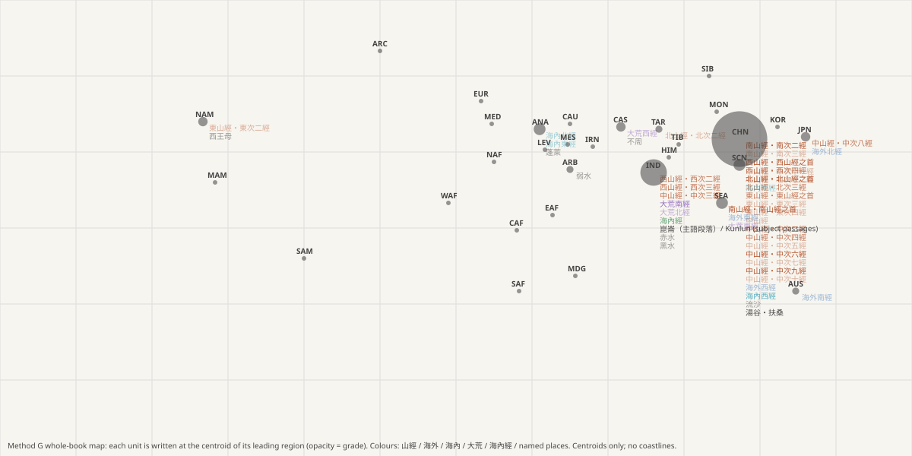

# 《山海經》全書全球對照・完整初稿 v1.0 / Shanhaijing Whole-Book Global Mapping — Full Draft v1.0

> 2026-10-19 ・ 方法 G（全球前提、只看描述、名稱遮蔽、距離只作參考），由項目發起人設定。所有數字可由 §9 的指令重現，與方法 A 的結論（[draft v0.2](draft-v0.1.md)）並列。
> Method G (global premise, descriptions only, names masked, distances only a reference), set by the initiator. Every number reproduces from the commands in §9. Shown alongside Method A's conclusions ([draft v0.2](draft-v0.1.md)).

---

## 0. 結論 / Bottom line

**繁中**：把 18 卷的每一篇（39 篇）都放到全球 31 個地區上，只用描述比對，結果是：

1. **得到 G-強或 G-中 的 18 篇，全部指向亞洲。** 其中華北華中 11 篇（含海內西經）、印度 5 篇（含大荒南經、海內經）、東南亞 1 篇、日本 1 篇。
2. **沒有任何一篇以 G-中以上指向歐洲、非洲或美洲。** 唯一領先在美洲的篇是東次二經，為 G-弱（只有 5 個泛化特徵）。
3. 全書的描述呈現一個**以東亞為中心、向外延伸的佈局**：南方伸向東南亞與大洋洲（南山經之首、海外南經、海外東經、大荒東經），西方伸向印度與喜馬拉雅（西次二經、西次三經、中次三經），西北伸向塔里木與中亞（北次二經、大荒西經）。
4. **這個佈局與書中自己的方位詞一致**：方法 G 完全不使用距離與方位，卻得出「南」篇偏南、「西」篇偏西、「北」篇偏西北的結果。這是兩條互相獨立的線索彼此吻合。
5. 崑崙在地區層級指向印度（G-中，主要因「如羊而四角」→ 四角羚）；在地點層級（H-0006）則是安那托利亞、吉薩並列，尼羅河複合為事後候選。兩個層級使用不同的特徵，結論不同，都保留。

**EN**: Every section of all 18 books (39 sections), matched by description against 31 world regions:

1. **All 18 sections graded G-strong or G-moderate point to Asia**: northern/central China 11, India 5, SE Asia 1, Japan 1.
2. **No section points to Europe, Africa or the Americas at G-moderate or above.** The only section led by the Americas (東次二經) is G-weak, on five generic features.
3. The descriptions form an **East-Asia-centred layout with outer arms**: south to SE Asia and Oceania, west to India and the Himalaya, north-west to the Tarim and Central Asia.
4. **The layout agrees with the book's own direction words**, although Method G uses no distances or bearings: "southern" sections lie south, "western" ones west, "northern" ones north-west. Two independent lines of evidence converge.
5. Kunlun leads in India at region level (G-moderate, mainly the four-horned "sheep"); at locus level (H-0006) Anatolia and Giza lead, with a post-hoc Nile composite. Different features, different answers; both are kept.

## 1. 推理路徑 / Reasoning path

```
G0 真實世界庫（先提交，後跑分）
   116 種真實動物（特徵＋古代分佈）· 31 個地區（覆蓋全部大陸）· 36 項地區性質（礦產、植物、地形、習俗）
G1 動物地圖     書中 126 個生物描述（名稱遮蔽）→ 42 個比對到真實動物（覆蓋率 ≥ 0.5）
G2 地理假設     每篇的礦產、植物、地形、習俗線索 ＋ 動物比對 → 對 31 個地區計分
                （罕見度加權；未知值取基準率期望；矛盾扣分；不提不算）
G3 書內證據     每篇列出支持與不利第一候選的特徵與條目編號；逐一移除特徵（jackknife）看領先是否穩定
G4 全書對照     39 篇＋9 個具名地點 → 全球對照圖、人群習俗表、方位自洽檢查（只作參考）
```

## 2. 全書對照總表 / The whole-book table

分數為各地區的加權總分；jackknife 為逐一移除特徵後仍維持同一領先者的比例。G-弱且前幾名分數相同者，表示**尚無法分辨**（同分時依代碼排序，第一名沒有意義）。完整證據見 [global-map.md](../data/derived/global-map.md)。
Scores are weighted totals; jackknife = share of drop-one runs keeping the leader. G-weak rows with tied scores are **unresolved** (ties are ordered alphabetically, so the "leader" means nothing).

| 單位 / Unit | 第一 / 1st | 第二 / 2nd | 第三 / 3rd | 等級 / Grade | jackknife | 支持第一的主要證據 / Main evidence for the leader |
|---|---|---|---|---|---|---|
| 南山經・南山經之首 | **東南亞** 2.3 | 華南 0.74 | 華北華中 0.57 | G-strong | 0.9 | 狌狌→orangutan ; 赤鱬→dugong ; rice  |
| 南山經・南次二經 | **華北華中** 2.57 | 日本 1.4 | 朝鮮滿洲 1.4 | G-strong | 1.0 | lacquer ; rice ; jade  |
| 南山經・南次三經 | **華北華中** 1.64 | 日本 1.46 | 朝鮮滿洲 1.46 | G-weak | 0.88 | lacquer ; rice ; jade  |
| 西山經・西山經之首 | **華北華中** 4.64 | 印度 2.72 | 華南 2.15 | G-strong | 1.0 | 䳋渠→golden_pheasant ; 有獸焉→rhino_one_horn ; lacquer  |
| 西山經・西次二經 | **印度** 2.1 | 華北華中 1.58 | 朝鮮滿洲 0.74 | G-moderate | 0.92 | 鸞鳥→indian_peafowl ; bamboo ; palm  |
| 西山經・西次三經 | **印度** 2.63 | 華北華中 1.7 | 中亞 1.2 | G-moderate | 0.94 | 土螻→four_horned_antelope ; sand_desert ; 䱻魚→monitor_lizard  |
| 西山經・西次四經 | **華北華中** 2.96 | 日本 2.42 | 華南 2.13 | G-moderate | 1.0 | lacquer ; rice ; realgar  |
| 北山經・北山經之首 | **華北華中** 3.99 | 東南亞 2.06 | 印度 1.71 | G-strong | 1.0 | lacquer ; 幽鴳→gibbon ; 足訾→gibbon  |
| 北山經・北次二經 | **塔里木** 2.34 | 中亞 2.25 | 蒙古 2.04 | G-weak | 0.75 | 獨𤞞→snow_leopard ; jade ; sand_desert  |
| 北山經・北次三經 | **華北華中** 4.4 | 日本 3.46 | 華南 2.81 | G-moderate | 1.0 | 人魚→giant_salamander ; lacquer ; 象蛇→common_pheasant  |
| 東山經・東山經之首 | **華北華中** 2.26 | 日本 1.26 | 朝鮮滿洲 1.26 | G-moderate | 0.88 | lacquer ; jade ; bamboo  |
| 東山經・東次二經 | **北美** 1.19 | 塔里木 1.12 | 華北華中 0.97 | G-weak | 0.6 | jade ; sand_desert ; barren  |
| 東山經・東次三經 | **華北華中** 1.36 | 中亞 1.18 | 北美 1.13 | G-weak | 0.67 | jade ; sand_desert ; peach_plum  |
| 東山經・東次四經 | **華北華中** 0.57 | 朝鮮滿洲 0.57 | 北非 0.51 | G-weak | 0.8 | jade ; jujube ; sea_coast  |
| 中山經 | **華北華中** 1.27 | 中美 1.14 | 朝鮮滿洲 1.13 | G-weak | 1.0 | jade ; bamboo ; palm  |
| 中山經・中次二經 | **華北華中** 1.45 | 北美 1.13 | 中美 0.85 | G-moderate | 0.83 | realgar ; jade ; bamboo  |
| 中山經・中次三經 | **印度** 1.99 | 喜馬拉雅南 1.25 | 華北華中 0.56 | G-moderate | 0.83 | 夫諸→four_horned_antelope ; rice ; jujube  |
| 中山經・中次四經 | **華北華中** 2.27 | 華南 1.87 | 日本 1.6 | G-moderate | 1.0 | lacquer ; realgar ; jade  |
| 中山經・中次五經 | **華北華中** 0.98 | 日本 0.98 | 朝鮮滿洲 0.98 | G-weak | 0.75 | rice ; jade ; tin  |
| 中山經・中次六經 | **華北華中** 2.57 | 伊朗 1.52 | 北美 1.41 | G-strong | 1.0 | 鴒䳩→common_pheasant ; realgar ; jade  |
| 中山經・中次七經 | **華北華中** 0.64 | 日本 0.64 | 朝鮮滿洲 0.64 | G-weak | 0.8 | jade ; cypress ; copper  |
| 中山經・中次八經 | **日本** 2.97 | 華南 2.59 | 東南亞 2.52 | G-moderate | 0.88 | citrus ; rice ; jade  |
| 中山經・中次九經 | **華北華中** 3.54 | 喜馬拉雅南 2.18 | 華南 2.13 | G-strong | 0.93 | 有獸焉→red_panda ; rice ; realgar  |
| 中山經・中次十經 | **華北華中** 0.63 | 日本 0.63 | 朝鮮滿洲 0.63 | G-weak | 0.83 | jade ; azurite_malachite ; copper  |
| 中山經・中次十一經 | **華南** 2.68 | 華北華中 2.63 | 東南亞 2.61 | G-weak | 0.8 | lacquer ; 嬰勺→hornbill ; bamboo  |
| 中山經・中次十二經 | **華南** 2.46 | 日本 2.19 | 華北華中 2.08 | G-weak | 0.83 | citrus ; rice ; realgar  |
| 海外南經 | **澳洲大洋洲** 1.49 | 東南亞 1.49 | 印度 0.98 | G-weak | 1.0 | pygmy_people ; feather_dress ; dark_skin  |
| 海外西經 | **華北華中** 0.49 | 日本 0.49 | 朝鮮滿洲 0.49 | G-weak | 0.5 | jade ; sea_coast  |
| 海外北經 | **日本** 0.73 | 朝鮮滿洲 0.73 | 北美 0.73 | G-weak | 0.25 | jade ; mulberry ; sea_coast  |
| 海外東經 | **東南亞** 1.68 | 日本 1.53 | 華南 1.29 | G-weak | 0.8 | black_teeth ; rice ; dark_skin  |
| 海內南經 | **華南** 1.24 | 東南亞 1.24 | 印度 1.23 | G-weak | 0.5 | 兕→rhino_one_horn ; ear_ornaments ; sea_coast  |
| 海內西經 | **華北華中** 1.16 | 中亞 0.76 | 塔里木 0.76 | G-moderate | 0.8 | jade ; sand_desert ; millet  |
| 海內北經 | **安那托利亞** 0.87 | 阿拉伯 0.87 | 中非 0.87 | G-weak | 1.0 | 吉量→hyena ; 窮奇狀如→lion ; sea_coast  |
| 海內東經 | **安那托利亞** 0.16 | 阿拉伯 0.16 | 北極 0.16 | G-weak | 1.0 | sea_coast ; hot_springs  |
| 大荒東經 | **東南亞** 1.66 | 日本 1.43 | 華南 1.03 | G-weak | 0.67 | black_teeth ; pygmy_people ; sea_coast  |
| 大荒南經 | **印度** 1.29 | 華北華中 0.71 | 中亞 0.67 | G-moderate | 0.83 | pygmy_people ; sand_desert ; millet  |
| 大荒西經 | **中亞** 1.15 | 東非 1.13 | 阿拉伯 0.98 | G-weak | 0.62 | sand_desert ; peach_plum ; millet  |
| 大荒北經 | **印度** 1.41 | 東非 1.34 | 華北華中 1.18 | G-weak | 0.75 | bamboo ; sand_desert ; millet  |
| 海內經 | **印度** 1.76 | 西非 1.25 | 東非 1.18 | G-moderate | 0.78 | rice ; dark_skin ; sand_desert  |
| 崑崙（主語段落）/ Kunlun (subject passages) | **印度** 1.29 | 北美 0.95 | 塔里木 0.5 | G-moderate | 0.86 | 土螻→four_horned_antelope ; sand_desert ; sea_coast  |
| 流沙 | **華北華中** 1.57 | 塔里木 1.54 | 伊朗 1.53 | G-weak | 0.3 | 竦斯→common_pheasant ; jade ; sand_desert  |
| 赤水 | **印度** 2.61 | 華北華中 2.48 | 華南 1.18 | G-weak | 0.92 | 土螻→four_horned_antelope ; 有獸焉→rhino_one_horn ; bamboo  |
| 黑水 | **印度** 1.9 | 華北華中 1.74 | 中亞 1.05 | G-weak | 0.9 | 土螻→four_horned_antelope ; rice ; sand_desert  |
| 弱水 | **阿拉伯** 0.7 | 東非 0.7 | 伊朗 0.7 | G-weak | 0.67 | sand_desert ; volcanic_fire ; sea_coast  |
| 西王母 | **北美** 0.96 | 伊朗 0.9 | 塔里木 0.74 | G-weak | 0.4 | jade ; sand_desert ; volcanic_fire  |
| 湯谷・扶桑 | **華北華中** 1.03 | 中亞 0.63 | 伊朗 0.63 | G-moderate | 0.75 | realgar ; jade ; mulberry  |
| 蓬萊 | **安那托利亞** 0.11 | 阿拉伯 0.11 | 北極 0.11 | G-weak | None | sea_coast  |
| 不周 | **中亞** 0.58 | 華北華中 0.58 | 朝鮮滿洲 0.58 | G-weak | 0.33 | peach_plum ; jujube ; sea_coast  |



## 3. 各層的全球解讀 / Global reading by layer

### 3.1 五藏山經 / Mountain Classics（26 篇）
| 結果 / Result | 篇 / Sections | 決定性描述 / Decisive descriptions |
|---|---|---|
| **華北華中（G-強）** / northern & central China | 南次二經、西山經之首、北山經之首、中次六經、中次九經 | 漆（`SHJ-02-1-010` 等，漆樹只在東亞與東南亞）；雄黃；玉；「狀如雞……五采」錦雞類；「如牛……一角」獨角犀；「其狀如䱱魚，四足，其音如嬰兒」大鯢（`SHJ-03-3-002`）|
| **東南亞（G-強）** / SE Asia | 南山經之首 | 「狀如禺而白耳，伏行人走」（`SHJ-01-1-001`）→ 猩猩類；「魚身而人面」（`SHJ-01-1-008`）→ 儒艮類；稻 |
| **印度與喜馬拉雅（G-中）** / India & Himalaya | 西次二經、西次三經、中次三經 | 「如羊而四角」「如鹿而四角」→ 四角羚（只分佈於印度、尼泊爾）；「狀如翟而五采」→ 孔雀 |
| **日本／華南（G-中）** / Japan, S China | 中次八經 | 柑橘、稻、竹、玉並見（柑橘的原生區在華南、日本、東南亞、印度）|
| **塔里木／中亞（G-弱）** / Tarim, Central Asia | 北次二經 | 「如虎而白身」→ 雪豹；玉；沙 |
| 尚無法分辨 / unresolved | 東次二至四經、中次五、七、十經等 | 特徵太少或前幾名同分 / too few features or ties |

### 3.2 海外四經 / Beyond the Seas
- 海外南經 → 澳洲大洋洲＝東南亞（同分，G-弱）：周饒國「其為人短小」（矮小人群）、羽民國「身生羽」（羽飾）、不死民「其為人黑色」。/ short people, feathered people, dark-skinned people.
- 海外東經 → 東南亞（G-弱）：黑齒國「為人黑，食稻啖蛇」（染齒習俗只見於東南亞、日本、華南）、毛民「身生毛」（日本）。/ tooth-blackening, rice, a hairy people.
- 海外西經、海外北經：線索太少，無法分辨。/ too few cues.

### 3.3 海內四經與海內經 / Within the Seas
- 海內南經 → 華南／東南亞／印度（同分）：「兕……狀如牛，蒼黑，一角」→ 獨角犀；離耳、雕題。/ one-horned rhino, ear-stretching, tattooing.
- 海內西經 → 華北華中（G-中）：玉、沙、黍。
- 海內北經、海內東經：線索極少。/ very few cues.
- 海內經 → 印度（G-中），其次西非、東非：稻、「黑人」、沙。/ rice, "black people", sand.

### 3.4 大荒四經 / Great Wilderness
- 大荒東經 → 東南亞／日本（G-弱）：黑齒、小人。
- 大荒南經 → 印度（G-中）：小人、沙、黍。
- 大荒西經、大荒北經 → 中亞、東非、印度之間未分勝負（G-弱）。

### 3.5 人群與習俗 / Peoples and customs — [peoples-map.md](../data/derived/peoples-map.md)
17 條海經、大荒經條目帶有可核對的習俗描述。可對應的地區集中在東南亞、日本、華南、大洋洲、印度與熱帶非洲：矮小人群（中非、東南亞、新幾內亞、安達曼）、染黑齒（東南亞、日本、華南）、穿耳或長耳（東南亞、華南、印度、東非、安第斯）、身生毛（日本阿伊努）、羽飾（美洲、大洋洲、東南亞）。
17 entries carry checkable customs; the matching regions cluster in SE Asia, Japan, south China, Oceania, India and tropical Africa.

## 4. 具名地點 / Named places

| 地點 / Place | 地區層級 / Region level | 其他證據 / Other evidence |
|---|---|---|
| 崑崙 | 印度 1.29（G-中），其次北美、塔里木 | 地點層級 H-0006：安那托利亞 0.59、吉薩 0.13；人工描述中只有吉薩符合「東嚮」；尼羅河複合 6.51（事後）。方法 A：H-0003 青海湖 L1 |
| 流沙 | 華北華中／塔里木／伊朗 幾乎同分（G-弱）| 指向內亞的沙漠帶 / the inner-Asian desert belt |
| 赤水、黑水 | 印度與華北華中接近（G-弱）| 主要來自同段的四角獸與犀 / driven by co-occurring fauna |
| 弱水、西王母、蓬萊、不周 | 線索太少 / too few cues | — |
| 湯谷・扶桑 | 華北華中（G-中）| 東方日出之處；與 H-0005 的地平線曆法一致 / consistent with H-0005 |

**關於崑崙在埃及 / On Kunlun in Egypt**：地區層級的特徵（礦產、植物、動物）不支持埃及；地點層級中，崑崙「人工」描述（東向的人面獸身守衛、門與井）只有吉薩完全符合。所以「崑崙＝埃及」若成立，最可能的形式是：**書中混合了一個來自尼羅河的聖所描述**。這需要 T-660 至 T-662 的檢驗。
Region-level features do not support Egypt; at locus level only Giza fully matches the built description. If "Kunlun = Egypt" holds, its most likely form is **a Nile sanctuary description blended into the text**, which T-660–T-662 must test.

## 5. 方位自洽（只作參考）/ Direction coherence (reference only)

| 山經 / Classic | 各篇的第一候選 / Section leaders |
|---|---|
| 南山經 | 華北華中 ×2、**東南亞** ×1 |
| 西山經 | 華北華中 ×2、**印度** ×2 |
| 北山經 | 華北華中 ×2、**塔里木** ×1 |
| 東山經 | 華北華中 ×3、北美 ×1（G-弱）|
| 中山經 | 華北華中 ×8、華南 ×2、印度 ×1、日本 ×1 |

偏離中心的篇，偏離方向與書中的方位詞一致：南向東南亞、西向印度、北向塔里木。東山經唯一的偏離（北美）是 G-弱，不可據。
Off-centre sections deviate in the direction their own names say: south to SE Asia, west to India, north to the Tarim. The East Classic's only outlier (North America) is G-weak and not reliable.

## 6. 與方法 A 的比較 / Compared with Method A

| 問題 / Question | 方法 A / Method A | 方法 G / Method G |
|---|---|---|
| 山經核心在哪 / Mountain core | 黃河中下游與漢水、岷江（H-0002，L2）| 華北華中（6 篇 G-強）|
| 西次三經、崑崙 / West route, Kunlun | 青海湖一帶（H-0003，L1）| 地區層級：印度（四角獸）；地點層級：安那托利亞／吉薩，尼羅河複合 |
| 海內諸經 / 海內 books | 秦漢知識範圍（H-0004，L2）| 華南、東南亞、印度、中亞；線索少 |
| 大荒經 / Wilderness | 曆法框架（H-0005，L1）| 東南亞、印度、中亞；多為 G-弱 |

兩種方法在**山經核心**上一致；在**西方延伸部分**分歧：方法 A 依內部的水系與里程把西次三經放在青藏高原東北緣，方法 G 依動物描述指向印度與喜馬拉雅。兩者地理上相鄰（喜馬拉雅–青藏），分歧可能來自「四角獸」這一項動物描述。
The methods agree on the **Mountain core** and diverge on the **western extension**: Method A, from internal rivers and distances, puts 西次三經 on the NE Tibetan Plateau; Method G, from the animals, points to India and the Himalaya. The two are adjacent, and the divergence may hinge on the single "four-horned" description.

## 7. 偏差與限制 / Biases and limits

1. **庫的組成**：動物庫與地區性質由分析者建立。分析者較熟悉東亞的自然史，雖已用基準率期望處理未知值，仍可能殘留偏差。/ The base was built by an analyst more familiar with East Asian natural history; base-rate imputation reduces but may not remove the bias.
2. **描述語言本身的偏向**：書中以「狀如牛、如雞、如禺」等東亞常見動物作比喻，「漆」「玉」等詞帶有東亞的物產概念。這是文本的性質，不完全是方法的偏差，但會讓東亞更容易吻合。/ The text's own comparisons (cow, fowl, macaque) and product words (lacquer, jade) are East Asian; a property of the text, but it favours East Asia.
3. **「玉」譯為 jade**：屬於詮釋。/ 玉 → jade is interpretive.
4. **線索稀少的篇**（海經、大荒經多數）只有 2–9 個特徵，結論以 G-弱為主。/ Sparse sections give mostly G-weak results.
5. **只計出現**：書中沒提到的東西不算證據，所以「書中沒有企鵝、袋鼠」不能用來排除南極或澳洲。/ Silence is never evidence.
6. **異文人工審查已取消**（依發起人決定），讀法依草稿政策。/ Human variant review was cancelled; the draft-reading policy applies.

## 8. 下一步 / Next steps
- T-660–T-662：崑崙的庫平衡、相鄰地名、動物投票檢驗。/ Kunlun tests.
- T-663：擴充動物庫與海經生物句式，提高海經、大荒經的線索數。/ Widen the animal base and Sea-book formats.
- T-664：由第二位分析者獨立填寫地區性質，比較兩份庫的結果，量化分析者偏差。/ An independent second annotation of region properties to quantify analyst bias.
- T-665：對「四角獸」做專項比對（四角羚、多角家羊、其他），因為西方延伸的結論依賴它。/ A focused test of the "four-horned" beast, on which the western extension depends.

## 9. 重現 / Reproduce

```bash
python3 -I tools/shj/creatures.py && python3 -I tools/shj/animal_map.py && python3 -I tools/shj/region_match.py
```
